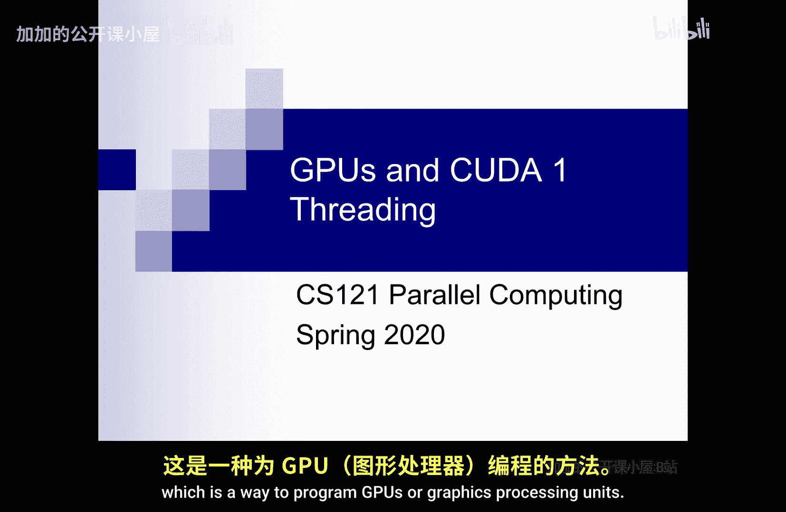
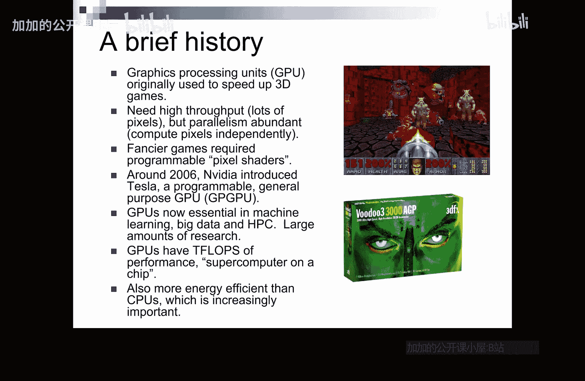
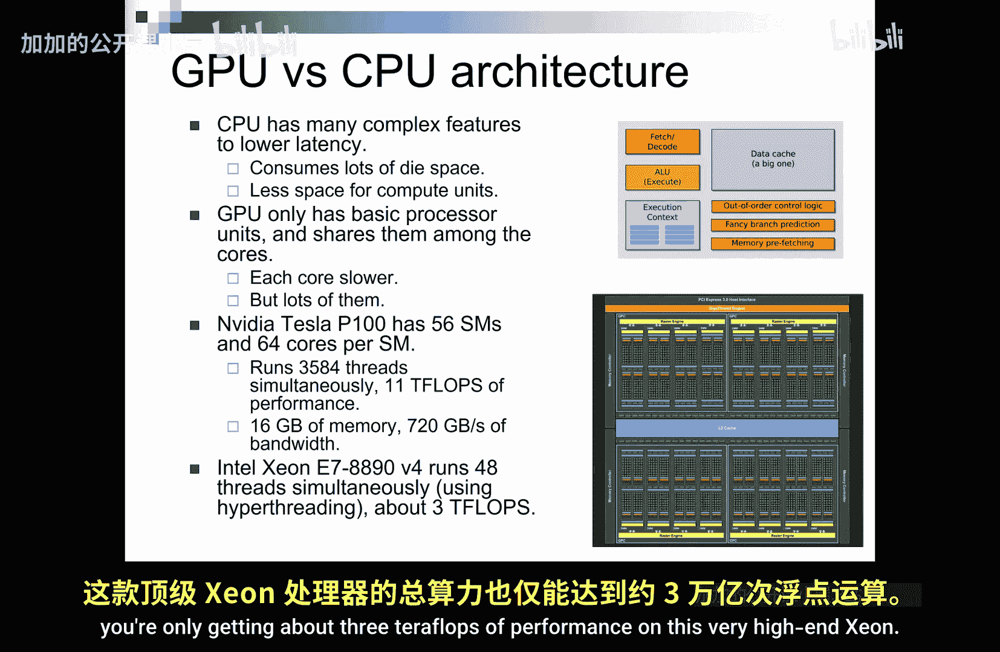
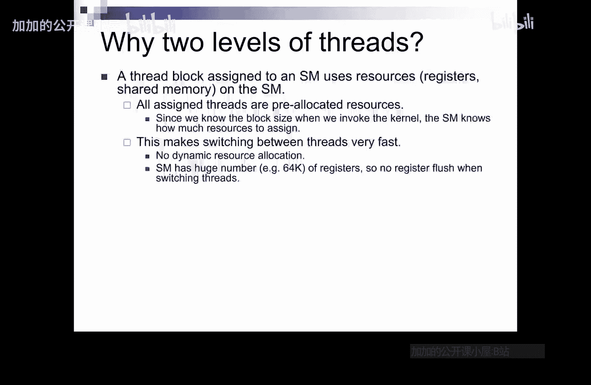
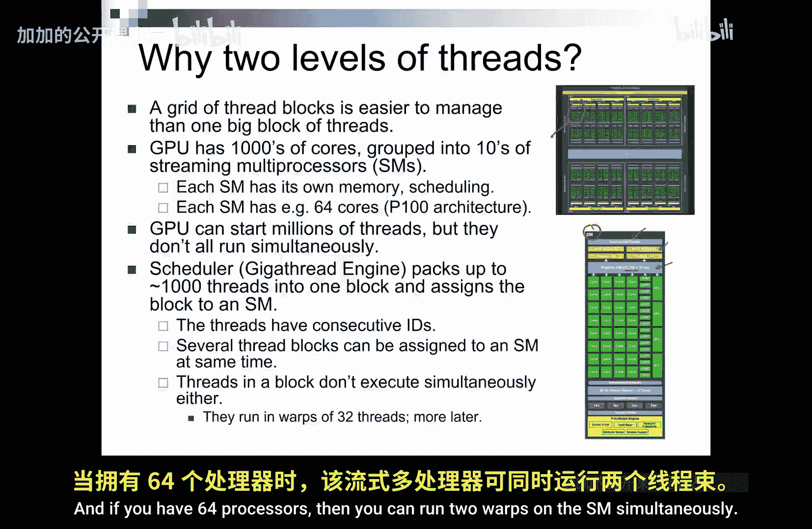
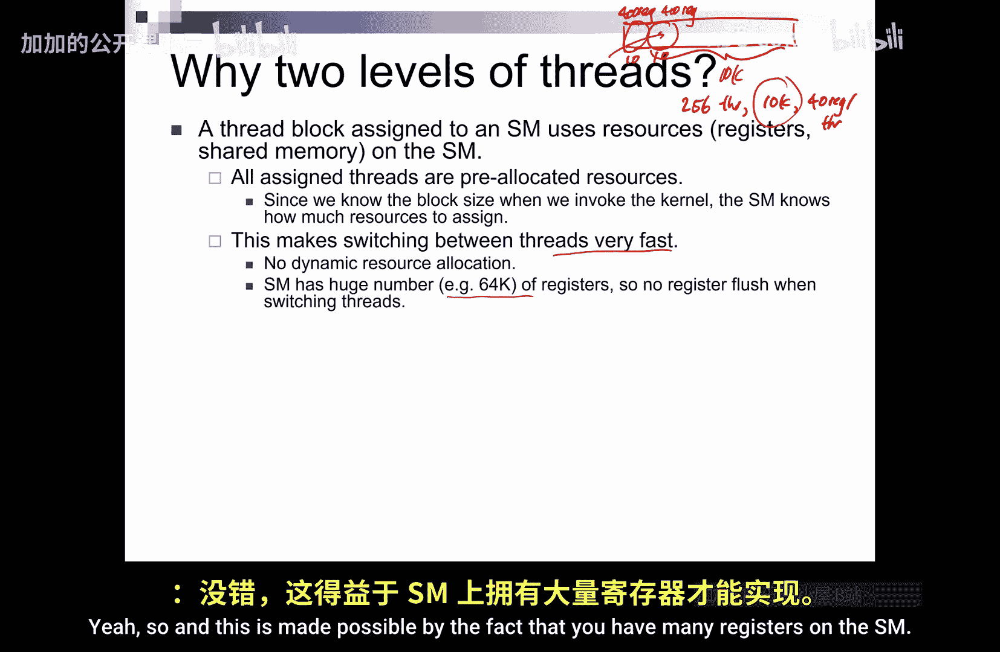
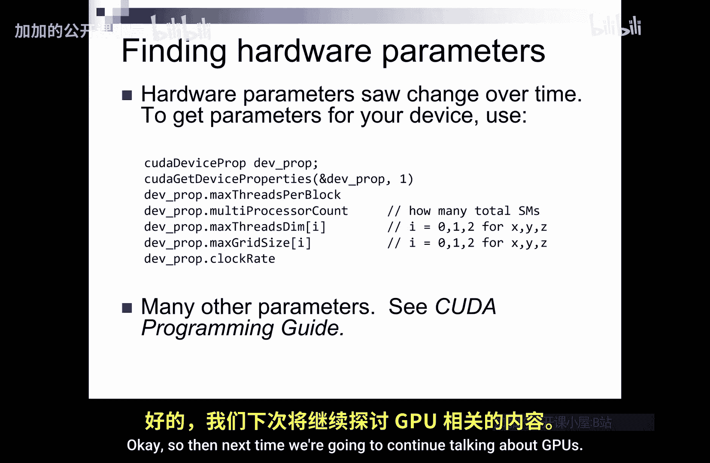

# 上海科技大学【中英⚡并行计算｜CS121 2020 Parallel computing】 p11 P11 CUDA 1 Threading -BV1VqypBaEaP_p11-

Welcome back。Today we're going to begin a series of lectures on the KUDa programming language。

 which is a way to program GPUs or graphics processing units。

So let me begin with a brief history about GPUs， so we have to go back about 25 years to the mid-1990s and so that was a time when the first generation of 3D games were appearing。

And back then computers were a lot slower so you couldn't actually run these games very well on a computer and so people decided that they needed to create some sort of dedicated hardware to run these games and so that was how these graphics processing units came about as like coprocessors for the CPU to run these games so you see on the right over here we have this voodoo3 card which was a very popular card back back in those days and that could let you play these games like so the game that you see above this is called doom right so this is like one of the first it's either the first or second doom and know incredibly doom is still around nowadays so they just released a new version of doom so it's been like 25 years almost。

But back then this doom was quite a revolution， and so the graphics was considered like really amazing back then。

Okay， so。So now you have these GPUs and the thing about the GPUs is that first of all they need to produce a lot of output。

 so they need to have very high throughput and the reason is that you know if you look at one of these screens for example for doom we have let's say 640 pixels by 480 pixels so of course nowadays that's a very low resolution but back then that was a lot of work that you had to do just to render this one frame and and you had to do that like 30 times a second okay so therefore every second you need to compute like millions of pixels。

But the nice thing about these workloads， these Graal workloads is that there's a lot of parallelism in the workload because you can basically compute each pixel independently right like yeah so you can assign like a single thread to compute a pixel and then you can assign a different thread to compute the next pixel right so if on a screen you have 100。

000 pixels then you can actually run 100，000 threads to produce that screen。

Okay so now eventually these games got to be better and better looking right so to improve the graphics quality。

 what you needed to do was actually make every pixel somehow look nicer right so to make it look nicer people ran these little programs for every pixel so these programs were called pixel shaders okay so they improve the quality of each pixel。

And so so therefore for the GPUs， in addition to having high throughput。

 there was also this requirement that you could individually program these threads so the threads are computing the pixels and these pixels need to run these little pixel shader programs。

Okay， so therefore you had this architecture being developed。

 this GPU architecture which was capable of a very large amount of parallelism， and furthermore。

 these parallel threads are programmable because you have to run the pixel shaders。

Okay so then people pretty soon they started realizing that you can use GPUs not just to play games。

 but you can use them for other types of parallel workloads okay so for example you if you need to do some sort of simulation like a fluid dynamic simulation or if you need to like render an MRI image or something right so all of these workloads have the property that they have a lot of parallelism and you you need some general purpose way of programming them so people and then the GPUs actually have a great deal of computational power so people started adopting the GPUs for these other types of workloads okay so that was the start of something called GPGU which was general purpose GPU so it's not just about playing games anymore it's about like general purpose computations。

And this GP GPU concept became so popular that eventually about around 2006 NviIDIA。

 which is one of the top makers of GPUs both back then and also today introduced a way for well they introduced a Tesla card which was a GPU that was that was fully programmable so before then when people were using these GPUs to do general purpose applications。

 you have to write these programs in a very strange way because the GPU itself was actually designed for games so if you want to if you want the GPU to solve some other problem。

 you have to somehow change your problem so that it looks like you're actually doing some sort of graphical computation so you could be computing something unrelated to graphics but in order to run your code on the GPU you have to somehow convert to something that looks like computer graphics so that was before 2006。

And after 2006， NviIDdia decided that so many people were using GPUs for general purpose computations that they might as well make it so that GPUs can be programmed in a much simpler way to do these general purpose computations。

Okay， and in fact， not only that they introduced this Tesla card。

 which was easy to use for other purposes， they also introduced the KUuda language so the Kuda language makes it much。

 much easier for you to write general purpose code on GPUs。Okay。

 so since since about 2006 GPUs have really taken off and now they're basically an essential part of of modern computing there are so many things that need GPUs because if we simply relied on CPUs we wouldn't have computational power for many tasks that are important nowadays。

 for example， machine learning if we had to run all of our machine learning workloads on CPUs then there's basically no way that we can scale to the size of these machine learning models that we have nowadays just because GPs are so much faster than CPUs so now so nowadays GPs are are included in many other types of computers so for example you could have。

A very large supercomputer， which not only has thousands of CPUs。

 it also has thousands and thousands of GPUs。And then because there's so much usage of GPUs and because they're so efficient from many problems。

 there's also a large amount of research on GPUs， even today it's an active research area。

Okay so GPUs basically have several teroflops of performance okay so nowadays you can buy a GPU card which has 10 to 20 teroflops of performance on a single single GPU so I think I mentioned this but if you look at the fastest supercomputer in the world in the year $2000 so that computer that supercomputer had about 10 teroflops of computational power so nowadays you can buy a GPU for like I don't know。

 $500 and that's got the same power as that supercomputer back then。Okay。

 another nice thing about GPUs is that they're more energy efficient than CPUUs okay so GPUs do take a lot of power。

 but because they can do so much computation， then the amount of power you're using per unit of computation is better for GPUs than for CPUUs and power usage is nowadays like more and more it's becoming an important consideration。

Okay， so what is the major difference between CPUs and GPUs So it's actually kind of a philosophical difference Okay so CPUs so if you want to do something fast let's say you have many things to do so one way that you can do all of these things fast is you can do each individual thing very quickly so that's basically the CPU philosophy is that if you want to solve a problem fast。

 a bunch of problems fast， you're going to solve each individual problem fast now the GPU philosophy is different it's saying that if you want to do many things quickly then what's going to happen is well the GPU might actually take a long time to do each thing however。

 it's going to do many， many things simultaneously it's going to have a high degree of parallelism。

And in fact。Yeah， so if we look at this diagram on the right over here so the CPU。

 if you have a bunch of these tasks， which are these little ovals here you know the CPU is pretty fast on each task but the CPU only has a few cores right so nowadays you might get us a very high end CPU might have let's say a dozen or two dozen cores but not more than that。

Okay， and so in each given amount of time， you know you can only solve a limited number of problems。

 even though you're solving each problem quickly。Now the GPU， if you look at each task。

 the GPU might actually be slower on each task， however， the GPU is going to have so many processors。

 okay it can have thousands of processors that overall in each unit of time。

 you can solve many more problems on the GPU than the CPUU。Okay， so this is basically。

 so these two philosophies are the laency are the latency versus throughput。

A philosophy of parallel computing。 Okay so CPUs try to minimize latency for each computation。

 tries to make every computation fast， whereas GPUs try to maximize throughput right。

 They only care how many things you do per unit of time。

They don't care how much time it takes to do each individual piece of work。Okay， yeah， yeah。

 so the CPUs are exemplified by the multi corere processors and they just have a few cores and the GPUs are these throughput oriented processors and they have many。

 many cores。Okay so what makes it so that you know the GPUs can have so much parallelism why is it that we can build GPUs with thousands of cores but for the CPUUs we only have a few dozen cores and the reason is that remember that the CPU wants to minimize latency for every single task and so it wants to compute very quickly and to do that it needs a very complicated complicated architecture so this architecture includes many things to make each each operation run as fast as possible so for example it could do things like so on the right here you know I have this diagram showing some features of a typical CPU so it might do things like memory prefeting or a lot of fancy branch prediction or some outof order operations so there's a lot happening in a CPU and it's got a big cache yeah and all of those fancy features on the CPU。

They make your code run faster， but they also take a lot of space physically on the chip。

 okay because chips are made from wires and wires can only get so small。

 so in order to build one of these CPUs right the CPU itself， the CPU core is actually quite large。

Now， the GPU， okay， so the GP doesn't try to make each task run fast。 Okay， so therefore。

 the GP doesn't really need all of these complicated features that the CPU has， right。

 It doesn't really do out of order computation or branch prediction or all of this other stuff。

 so and it doesn't have a big data cache。 Okay， the GP， all it wants to do is compute Okay。

 so basically each GP core is much simpler than a CPU core。 It just has you know。

 a few components of the core that you know， you need you can fetch the instructions， right。

 You can compute the instructions and then you need， you need registers。 Okay。

 so it does away with all of these other complicated CPU features。And so therefore。

 each GPU core can be made much smaller than a CPU core。Okay。

 and because you can make these GPU cores smaller， right。

 then you can fit more of them in the same area。Okay yeah。

 so in the same area that you can fit a few dozen CPU cores， you can fit thousands of GPU cores。Okay。

 so so for example， one of the newer GPUs are these Tesla P 100 GPs Okay or sorry the the Pascal architecture。

 Okay， yeah， so the P100s they have these。So now if you look at this diagram over here。

 each of these little green squares is actually a core okay so this is like a block diagram for a GPU and now these cores are sort of organized into these little units that you can kind of see right so these units are called SMMs or streaming multiprocessors now for the Pascal。

 the P100 each of these SMs actually has 64 cores in them。And the entire GP card has 56 of these Ss。

Okay， so if you multiply 56 by 64， you get that this entire GPU has 3，584 cores。Okay。

 and all of these cores can run simultaneously and by doing that。

 you actually get 11 ter flops of performance from this card。Now in addition to this。

 the GPU also has very high memory bandwidth okay so it has up to 720 gigabytes per second of memory bandwidth and that's much。

 much higher than what you can achieve with with a CPU however。

 the GPU does not have a lot of memory it only has let's say 16 gigabytes of memory so that's a lot less than what you can put on on a CPU so that's usually one of the the weaknesses of GPU is the limited memory because yeah。

Okay now in contrast， if you compare like one of these pretty high end GPUs to a high end CPU like this Intel Zion over here。

 so this has 24 cores， each of them can do hyperthreading so you can actually run 48 threads simultaneously。

 but altogether you're only getting about three teroflops of performance on this very high end Zion。

Okay so so then now that we see GPUs are much faster than CPUus， so the question is all right。

 so let's let's just forget about CPUus， let's just use GPUus for everything。

 but unfortunately we can do that so GPs are even though we say that they general purpose GPs are still optimized for a certain types of workloads and there are other types of workloads that CPUus perform better on so so now if you just look at the raw computational performance how manyteraflops a GP or CPU has then oftentimes you can see that GPus have let's say 10 times as many teriflops can do 10 times as many terlops as the CPU And so if you have the right type of problem。

 then you can solve it you know at least 10 times faster on the GP compared to the CPU and plus you can save some energy because they're more energy efficient。

And so because of this， there are many supercomputers that use many， many GPUs。

 Okay so this titan supercomputer over here， it has a lot of CPUs， but it also has like about 20。

000 GPU cards and these GPUs actually provide most of the computational power of this supercomputer。

Okay， but again these GPUs are limited in the types of tasks that they're optimized for so the GPUs work best for what are called data parallel tasks。

 which I'll show you。And the reason that they work well for these data parallel tasks is because of how the GPU architecture is designed okay so the GPU in order to achieve this high parallelism they're based on the SID architecture so remember that SID stands for single instruction multiple data okay so there's basically one instruction fetch and decocode unit right so that's going so that unit graphs an instruction and then it assigns the same instruction to many cores to let's say 32 cores okay now these 32 cores are going to do that instruction on different pieces of data however they're all doing the same instruction。

So now the problem becomes that what if you want the threats sorry the course to do different instructions okay so for example。

 if you have a code with lots of branching okay so one branch is going to add the other branch subtracts。

 but then that's not Cdy anymore because it's not a single instruction it's different instructions so in that case those workloads don't work so well on GPUs so GPUs work well for these data parallel tasks tasks where you just simply want to apply like say one operation the same operation on many pieces of data however if you had irregular workloads then it becomes problematic to run those on GPUs。

And also GPUs have much fewer ways to synchronize between the threads than CPUs。

 okay so if you have a code with lots of synchronization。

 then oftentimes it's not even possible to run that type of code on the GPU okay not only is it going to be slow。

 sometimes just it's impossible to run the code。Okay。

 so what are these data parallel tasks okay so basically the idea for data parallelism is that we're going to apply the same operation on multiple data items right so we're parallelzing across the data。

Okay， so now it turns out that there are many， many problems which are data parallel right So of course there are problems which are not data parallel。

 which are parallel， but not data parallel， Okay but there are also many。

 many important parallel problems， which are data parallel。 So for example。

 know suppose you want to add two vectors。 Okay so we have an a vector here and a B vector and all we want to do is for each component of these two vectors。

 we just want to add them so that's a perfectly data parallel task because we're just doing the same operation addition on many pieces of data So the first component of A and B we do the addition the second component of A and B。

 we also do an addition So now imagine that you had a bunch of processors。

 And if you assign one processor per。You know， per component， right。

 then all the processors would be doing the same instruction on multiple pieces of data。

Okay so that's a pretty simple example but if you think about it。

 many linear algebra operations actually are quite similar to just vector addition right so if you do something more complicated like a matrix vector multiplication so that's actually used in many。

 many tasks if you can do a matrix vector multiplication fast you can actually solve many problems fast the matrix vector multiplication is has a very similar computational pattern to vector addition because you just take your matrix and you go through a row and then you do the dot product with a column so the dot product is simply that for every component you do a multiplication and then in the end you have to add all those up so that's a very similar sort of data access pattern and computational pattern as vector addition and so many in fact most dense linear algebra operations。

Are data parallel。Okay computer graphics right so that was the original purpose of GPUs was computer graphics and those are often quite data parallel because again you have to like let's say you have to produce a picture of some sort okay so every pixel on this picture it's produced using basically the same process right whether you're doing something like you know a game or even something more complicated like ray tracing right you're still doing more or less the same process for every pixel so therefore that's also we're doing the same operations on multiple data items。

Okay there are many other tasks like you know some sort of data analysis right if you try to do like a frequency decomposition if you do convolutions right so yeah many types of simulations are data parallel and also a lot of machine learning tasks are data parallel like deep learning is one of the best examples because deep learning depends heavily on GPUs without GPUs we probably couldn't do largescale deep learning but deep learning basically turns out to be something like dense linear algebra and so GPUs are like an excellent architecture for that。

Okay， so now let's look at an example of how we do a computation on a GPU okay so we're going to go back to this vector addition example。

 so let's first start with a sequential program for vector addition so this is very simple so if your vector has n items right we're just going to iterate through all of the items all the indices and then add the item from a and the item from B and store that into C okay so it's a sequential process and it takes you n steps。

Now， if you do this on a GPU， what's going to happen is instead of so for the sequential computation。

 you had one thread which processed all of the elements right now on the GPU we're actually going to have each thread process only one element。

Okay， so for every element of the output， So if your n is here is like 1 thousand00， right。

 we're going to launch 1 thousand0 threads。 Each thread is just going to produce one one of these outputs C。

Okay so that's sort of illustrated over here so you don't need to worry too much about this notation right now。

 but basically what it's saying is that so here somehow we're computing the so the I thread over here okay it's going to process the I data item so then here we would have 256 threads。

B。And in fact， you can have a lot more than 256， so for GPU computation。

 you can very well have millions and millions。Many millions of threads。

Okay now we're going to talk later about so you have millions of threads but you don't have millions of processors right like we said the Pascal GPU has a few thousand processors and so we're not going to be running all of these millions of threads simultaneously that would also involve a lot of overhead to keep track of all of these threads so that's just not feasible however we do create millions of threads and then later on I'll tell you how how these threads are actually executed on just a few thousand cores but in principle we create millions of threads and somehow the GPU hardware so I'll tell you more later is designed so that we can actually make use of all of these threads and there's very little overhead to switching between the threads。

So this is another difference with CPUs okay with CPUUs， whenever you switch between a thread。

 that's actually a fairly expensive operation so you don't want to be switching between different threads all the time because you would be wasting basically all your time just doing the thread switching now on GPUs the hardware is designed so that there's almost no overhead whatsoever to switching between the threads and so that's why it's possible to have millions of threads。

Okay， so now we're going to be talking about a language called Kuda and KUa is basically the sort of de facto way that you program GPUs nowadays。

 at least nvio GPUs， which are the most popular GPUs so KUDa stands for compute unified device architecture and it basically allows you to use a GPU as a coprocessor for CPU right so it lets the GPU help the CPU do some sort of computation。

Okay， so。Yeah so the way this works is that so KUa is based on C and so to write a couda program。

 you basically write something which looks basically like a C program except for it's got these kuta extensions and then you're going to use the coa compiler。

 the NviDdia couta compiler and so that's going to produce code that can run both on your CPU and your GP because your CPU and GP have to work together in order to run the Kuta code so basically these coa programs that that use the GPU right they still start on the CPU and then the CPU eventually passes control to the GP but the CPU and the GPU have to work together。

Yeah， so this is a very popular way to program。These GPs， NVIdia GPUs。

 and NVIdia provides lots of nice tools for using KUDa right so they have a compiler。

 they have like debuggs， they have profilers to tell you like where the bottlenecks and your code are and so on。

Okay now besides Kuta there are other ways to program GPUs for example。

 there's an open standard called open CL right and there's also something called openCC open ACC So openCL is basically it's quite similar to Kutuda okay so if you know Kuta。

 then you can learn open C like in an afternoon So it's very similar to Kuta to Kuda both conceptually and syntactically and so on but the advantage of open C is that it's more portable than Kuda So for example。

 openCL also works on the AMD GPUs。And then in fact。

 you can take the same openCL source code and you can compile it even for different processor architectures。

 you can compile it for the GPUs， but you can also compile it for CPUs or FPGAs。

OkayNow the price that you pay for this portability is that it performs a bit slower than KUDa。

 not too much slower， so maybe like  20% slower for many tasks okay so it's not too bad and you gain a lot of portability but we're not going to talk about OpenCL because as I said。

 we're going to focus on Kuta， but once you know KutDa you can pick up openCL very easily。

Okay there's also this thing called open ACC and this is kind of similar to OpenM in the sense that you can write a GPU code using these directives okay so remember that in OpenM the way we achieve parallelism was using these like pragma O statements that create threads for us and then that divide up the parallel work for us so then OpenACCC is similar you use these directives and then that tells the compiler how you want the parallelism to go and then the compiler will take care of this process for you。

Okay， now open ACC is the performance is not at the same level as Kuta， right。

 So it's actually quite a bit slower than than Kutuda。 However， it's， it's easy。

 it's quite easy to use because as you saw with open MP， right。

 that's a very easy thing to use whereas Kuta is。You know。

 there's a lot to think about when you write a KUDa program， okay。

 so that's why we're spending a number of different lectures on KUa。Okay。

 so then now let's talk about the steps to writing a coudDa program okay so you basically to write a coa program you write a C program and then you add some KUa annotations and then you compile this with this MVCC right the video a couda compiler and then you can run this。

Okay， and the way you run this the way you run Kuda programs is that you're going to start the ka program on the CPU okay。

 so the CPU is called the host okay， and the host is going to do some like sort of initialization parts for you and it's going to run some serial code。

Okay， and then eventually you get to the parallel part and then you want to run that on the GPU and to do that。

The first thing is you need to allocate some memory on the GPU right and usually we call the GPU the device okay so the host is the CPU and the device is the GPU okay so we allocate some memory on the GPU and then we transfer some data you know the data that you want to compute with onto the GPU okay and then you have to tell the GPU how many threads you want so this depends on like the workload that you're running okay but you specify the number of threads and then you call the GPU the GPU code and the GPU code is called a kernel okay。

Yeah and then eventually this kernel finishes the GP computation and then it can return control back to the CPU and then the CPU can do some more computation but then it can invoke the GPU on another kernel okay so we go back and forth between the GPU and the CPU so that's kind of this process on the right over here where you the single line here is like a single CPU thread and then you start up a bunch of these GPU threads and when they finish you go back to the CPU and then go to the GPU and so on。

Okay， so so I'm going to talk a bit about the the syntax of these kuda functions。 Okay。

 so so we have different types of functions in Kuta。 So for example， if you have a。

So when you declare a function， you need to prefacex it with this label here okay so for example。

 the first label is double underscore okay so there are two underscores here and then device and then two more underscores so if you specify that if you label a function this way then what this means is that this function is executed on the device right so it's executed on the GPU and it's called from the GPU so that's sort of after you start the GPU program if you need to call the subroutine from the GPU then that you're going to label it with a device。

Okay， if you label your function with a global， right， then this is being executed on the GPU。

 but it's called from the CPU。 Okay， so for example， to start your GPU program， right。

 you need a global function on the GPU that the CPU can call。Okay。

 and then you can have these host functions， so double underscore host， double underscore。

 and this is like a CPU function that is also called from the CPU。

Okay so we have functions to allocate memory on the GPU。

 so for example there's this function called Kuta Malek so here you give a pointer to where you want the memory to get back the location for the memory that is allocated and then you specify the size for how much memory you need。

And we said that to start a co a program。 You need to transfer some data from the CPU to the GPU。

 Okay， so now suppose。Suppose x is some data on the CPU and let's let DX device X be a pointer to the device memory so Dx was somehow created by this kutamalic。

Now， to transfer data from the CPU to the GPU， right， then we can call this function K a mem copy。

 Okay， so then here you give the device address the。Host address。

 the size of what you're transferring， and since you're transferring from the CPU to the GPU。

 you have to write this thing over here。And then also eventually the GPU finishes right so maybe you want to get the output back from the GPU so then again you can use KuttaM copy。

 but you use it in the other direction okay so now you're copying to the CPU from the GPU right and you need to specify that it's in that direction。

Okay， so now for the couda functions when you call so the functions again are called kernels Okay so GPU functions are referred to as kernels。

 so when you run a kernel， so these things are always going to be parallel right you would never want to run just a single thread on a GPU and so you have to say how many threads you want in the kernel now you don't just give a single number for the number of threads Okay so if you want 1 thousand0 threads。

 let's say okay so your thousand0 threads actually have to be grouped hierarchically okay you first group these threads into things called blocks。

 thread blocks。And then you have to say how many blocks you want and how many threads per block you want。

Okay so for example， in this picture here right we're going to create M blocks。

 okay so n can be like a large number can be like  a00 or a million even okay and then within each block we're going to specify how many threads you want okay so here you have 256 threads。

So usually you're not going to have very， very many threads right so in fact there's a limit to how many threads you can put into a block which is usually something like maybe a few hundred or maybe 1 thousand00 but you can have many。

 many blocks。Okay so now that you specify how you want to call a function right。

 then in order to call that function from the CPU right what you say is suppose you want n threads total and then suppose you want to divide these threads between T blocks okay so then you have basically n divided by t thread blocks right and we take the ceiling of this number so now the way you call the kernel function is you use this notation okay kernel function and then you have to use three less than signs okay and then you have to give the number of blocks。

 the number of threads per block and then three greater than signs and then the arguments。Okay。

 and so this way we're guaranteed to have at least n threads right because the number of threads is like the number of blocks times the number of threads per block。

Okay， so now let's see how we can use this to in a simple example。

 so let's go back to this vector addition example Okay so yeah。

 so all we want to do is we initially have two vectors A and B sitting on the CPU okay and we want to add the mo we want to use the GPU to add the mo Okay so what we do is。

Okay， so we have these pointers for A B and C， so these pointers are going be pointing to GPU memory eventually okay so the first thing we're going to do is we need to allocate some memory on the GPU so initially the A and B vectors are sitting on the CPU so to get the GPU to add them we need to transfer the A and B vectors to the GPU so the first thing is to allocate memory on the GP okay so we're going to allocate this much memory right so this is we're going to call kutamalc and the sizere we're going allocate is let's suppose we have n numbers in the vectors so we're going to allocate this many bytes on the GPU。

Okay， and the next we're going to take the。The data from the CPU and then transferred over to the GPU at this pointer location right and then we do the same thing for B right you Ma B。

 you could a Ma B， and then you could a copy B to the GPU。

And then you mal some space on the GPU to store the output right in C and the next we're going to call a GPU function to actually do this addition okay so this is the GPU kernel that is the actual addition kernel。

Okay and now here notice that when you call it， we need to specify the number of thread blocks right and the number of threads per block Okay。

 so here we decided somehow that we want 256 threads per block so in fact。

 I'll talk to you later about how we decide how many threads you want per block。Okay， but right now。

 let's go for 256。 So in that case， since we have n items as in the vector right。

 and we plan to assign one thread per item。 Okay， each thread is just going to compute you know。

 the addition at one coordinate of the。Of the vector， and so therefore we need n threads in total。

 and so the number of thread blocks is going to be n divided by 256。Okay。

 and then you're going to give these some arguments which are these locations where the data is being stored。

Okay so we'll get to the kernel later but after you do this computation then eventually the answer is going to end up in this DC location so this is some memory on the GPU thats storing the sum of the vectors so we want to get that vector back so we're going to call this cotaM copy from the GP back to the CPU and then you free your code sorry you free the memory on the GP so this all of this is a CPU program sorry CPU function this is a CPU function and so when you call it we're going have our main function and we call this function and this is going to run on the CPU first of all so the CPU initializes all the data and then the CPU calls the GP kernel。

Okay now finally let's look at the GPU kernel so first of all this is a the GPU kernel is being called from the CPU。

 so therefore we have to label this kernel a global function。Okay and so this is our kernel。

 it's actually very simple so each thread okay is so this when you call this kernel。

 you're going to start many threads， okay in fact you're going to start at least n threads okay now each thread is going to have its own ID。

OkayAnd also the thread is going to belong to a particular thread block。

 so remember that you start a number of thread blocks here。

 let's say you start 100 thread blocks okay in that case。

 each thread is going to have a block ID from 0 to 99。Okay and then each block here has 256 threads。

 so therefore the thread also has an ID within its block， which is a number from 0 to 255。Okay。

 so yeah， so the thread has two ways of identifying itself first， which block is it in and second。

 which ID is it within that block？Okay， now we do this computation over here， so。

I think later I'm going to yeah， so I'll talk more about you know what this computation here is doing later okay but anyways somehow you use the ID of the thread right it block ID and its thread ID to compute some index into this array okay and then we just the thread is just responsible for the addition at that single index okay so it just takes A of I and adds it to B of I and then stores stores it in C of I。

Okay， now the thread is going to check that this index that I computed that this needs to be less than the size of the array okay because it's possible that a few of these indices can actually be larger than the size of the array。

 okay so as long as we are within the array bounds， we're going to do the addition。Okay。

 so now we started a lot of threads over here， each of those threads computed one index and did one addition and stored that result somewhere in C。

Okay so now it's going to turn out that the way we compute these indices， right。

 we're going to end up for every index from0 to n minus1 okay so for every component of that vector。

 we're guaranteed that there's at least one there's actually exactly one thread which is going to process that component。

Okay， so that means that for every component of A and B。

 we had a thread to add them and to store that result in C。

And so that's why the result in C after all of the threads。

 after all the threads that you start here， here you could start many。

 many threads after all of them finish right then we have the correct answer in C。Okay。

 so now this kernel is only going to return after all the threats that we started have finished the kernel。

And so at that point， we know that the correct answer is in C。

 and so that's why we can call this KaM copy here to get the answer back from the GPU。Okay。

 so now let's talk a bit more about this。About the fact that threads， you， if you want， let's say。

 10，000 threads， okay you don't just start 10，000 threads。

 you have to group the threads into blocks and you have to say how large each block is。Okay， so。

Yeah so so the way the threads are organized is that all of the threads are going to run the same code so if we go back to this kernel here。

 then you see that here every thread is going to run the same code however。

 they're going to work on different data items okay because every thread has a different either it's got a different thread ID or different block ID or actually the way to say this is that if you look at the combination of the block ID and the thread ID so if you look at let's say if you take any thread and you look at its block ID do X and the thread ID do X os。

Let's see ID。X right if you look at two different threads right then they're going to have different ones of these pairs okay so even if two threads have the same block ID because they're in the threat block in that case they would have different thread IDs。

And if they have the same thread ID， then they have to be in different blocks。Okay。

 so therefore the threads it's going to turn out that the threads are all going to work on different indices。

 but they all run the same code。So this is exactly this SID concept that we talked about right。

 they run the same instructions because every thread is first of all going to do this addition。

 this multiplication， these memory aes and so on， so they all run exactly the same code。

 but they do operations on different data items。Okay now I should say that in Kuta you know conceptually it's supposed to be a Sdi architecture right so we want the threads to do the same instruction all the time but in practice if you completely limit yourself to that type of program right then that's that's a big limitation there are many programs that you cannot write in that fashion so therefore in practice Kuta can run threads where they do different instructions but there's a like there's a big performance penalty to doing that so that's called threat divergence so I'm going to talk more about that in a later lecture so so conceptually you should think about the threads as running the same instruction but in practice you can。

They can run different instructions， but then you have to pay a performance penalty。Okay。

 so the threats all right， so getting back to this， the threads are organized into two levels。

 so now we start a bunch of thread blocks and if you take that collection of thread blocks so then that is called the grid so the GPU when you run a GPU kernel。

 you first create a grid of thread blocks。Okay， now each threat block has to have the same number of threats。

Okay， and it turns out that okay so then about this grid right so here we see a grid right so we see a grid of n blocks and thread blocks now it turns out now this here is a one dimensional grid right because the thread blocks right their ID is just it's just a number okay so it's a 1 d thing now you could actually have a 2D grid okay in that case we have a bunch of blocks and each block has two coordinates okay so maybe you're a block in the second row fourth column。

Okay， so right now we just have let's say we have the fourth block but if you have a 2D grid。

 then you can have a block in the second row fourth column of all the blocks and KutDa even supports 3D thread blogs so basically the reason you know KUDa supports this stuff is because oftentimes the types of programs that you run are some sort of simulation code and the simulations are usually taking place in either 1D2D or 3D。

Okay so you could have higher dimensional simulations and KutDa does not have like hardware support for arbitrary dimensions of grids and blockss。

 but it at least supports these common ones。Okay， so。All right。

 so I'm still not going to talk to you about why we have these both a grid of threat blocks and why we have both blocks and individual threads okay。

 so I'll get to that later， but just。いや。Okay， so now how do we so we start this grid of threads right so how do we map the individual threads onto the data that we care about Okay so this of course depends on the problem that you're solving okay for but I'll do an example with the with the vector addition problem Okay so here。

Yeah， so when you start the kernel right， every thread is going to get a unique block number， right。

 this block ID， and thread ID within that block。Okay， so this is what I said earlier， Okay。

 where was it Okay， so if you look at different threads。

 Okay so then these this pair here is going to be unique okay。

 you could have you know the same thread block， but then the ID is going to be different or if the ID is the same。

 then the block is going to be different。Okay， so therefore。

 you can uniquely identify a thread by these two parameters here。O。Now， also。

 the number of threads in a block。 Okay， this is given so by the way， these are constant sorry。

 these are sort of values which are defined by Kupa。 Okay， so， for example。

 you can't create your own variable called with this name。 Okay， so this is a special。

Special name for a cota variable。And so there's another named variable。

 which is this block dimension， okay？So block dimension is like how many threats you have per block。

Okay so when you call a coa function， you specify how many threats you want per block， this T here。

 so this block dimension is exactly this T here。Okay， now going back to our vector addition example。

 what we want to make sure is that every item in the vector in the two vectors is processed by some thread right because we want let's see so you want to make so if you want to add A and B if you want to make sure you don't miss any of the coordinates of A and B。

 you have to make sure that for every index from0 to n minus1。

 you must have at least one thread that's processing that index。Okay。

 so the way you ensure that is using this formula over here。

Okay so this formula you know this is specially designed for this vector edition example。

 if you have a different problem right then you might want to use a different formula okay but here at least let's take a look at what this formula is saying right so this formula is saying that for each thread we're going to take the sort of the name of that thread right and then we're going to do this computation okay。

And then now the claim is that what this computation achieves is well let's get some concrete numbers here just to make things easier okay so suppose here that we have threat blocks and let's say you have 100 threat blocks oop so here we're going to have 99 and then we have 256 threads per per block okay so then what's going to happen is this a block ID thing right this block ID dot X okay so then this is going to be a number between 0 to 99。

Okay， right， and then this block dimension here block。Dim dot x。Oops。I got a bit nicer Okay。Okay。

 this is how many threads are in each block， right， That's 256， right， you have 256， Okay。

 and then the thread ID。U dot x is going to be a number between 0 to 255 because it's the idea of a thread within its thread block。

O。Now。Now， the fact that you have。100 of these blocks okay so remember the number of blocks we have is equal to the number of items we have divided by the thread size sorry divided by the number of threads per block okay so basically here we had 200 or 25600。

So we had we write this， so we had n equals， so we had vectors with 25，600 elements in them。Okay。

 and then you divided this into 100 blocks。Of 256 threads each。Okay， right。

 so that ensures that we have the same number of threads as we have elements。

 so we can have one thread process each element。Okay。

 now we need to make sure that every thread processes a different element okay because we have the same number of threads as elements。

 so if we want to process all the elements， we better not have two threads process the same elements Okay now I claim that this formula right。

 this formula over here。Is going to produce a number between 0 to n minus1 to little n minus1。

 okay to 25，000， what is a 599？Okay and you can check that because a block ID here right block ID here is a number between 0 to 99 right times the block dimension right this here is 256 over here right the thread ID is going to be a number from0 to 255 so now you can check that as you consider all possible block IDs between 0 to 99 and all possible thread Is between 0 to 255 then when you plug these things into this formula here。

 you're going to get all possible numbers between 0 to 25599。

Okay so you can just check that right so basically what this formula says is that it's going to map each thread which is uniquely identified by these two numbers here。

 it's going to map each thread to a different vector element between 0 to 25599。O。Yeah。

 so for example， you know， if you take the 23rd thread right in block3， right。

 we are going to map that to element 791。Okay， so you can check that every element in the vector from 0 to n minus1。

 was assigned some thread。Okay for every number from0 to n minus1。

 we can find some settings for these two numbers between these ranges within this range。

 so that this formula equals the number。And also you can check that since these values are unique for every thread。

 then every thread is going to process a different element。Okay， so if you put these two together。

 you we see that every element in the vector is processed by some thread by one of these threads that we started up here。

 Okay， so we started 100 thread blocks with。256 threads each。

Now of course this is not the only possible mapping okay so we use this mapping because we wanted to have one thread process just one element now if you have one thread process let's say several elements okay so sometimes you might want to do that okay then you would use different mappings to achieve that。

OkayNow you usually will not have one thread process many elements， okay。

 so for example you definitely do not want to have one thread process all 25。

000 elements okay because then you don't have any parallelism。

 so usually you want each thread just to process a few elements。Okay。Now， yeah。

 I guess I'll just mention this now， which is that you see that each of these threads is。

Let's go back here。 Each of these threads is doing something very simple。

 right It's just adding two numbers right now you might wonder like isn't there some overhead to creating this thread and to like sort of allocating all the resources for this thread and so on and so you have to pay that overhead to work with this thread And then all you ask the thread to do is to do this like super simple computation So aren't you like wasting a lot of time sort of on allocating these threads Okay now the thing is that again。

 the GPU architecture is designed so that allocating the threads and like switching between the threads and scheduling the threads。

 all of these operations are very， very cheap so almost like no overhead whatsoever so it's almost free to create threads。

And so therefore， even though we're asking each thread just to do such a simple operation。

 because' we almost have no overhead for creating that thread。

 then we are actually not wasting much of our resources。Yeah， so in case you were wondering。

 and I'll talk more about this later， okay， why is it you know。

 what's so special about the GPU architecture that lets it work with threads in such a cheap way？

Okay so so now this here is a 1D thread mapping right have a so we have a one dimensional set of thread blocks right because all the thread blocks are just numbers okay so it's 1D and now within each thread block right the threads also are just identified by numbers so it's also a 1D organization of the threads within the thread block now in fact。

 KUa lets you work with higher dimensional grids and thread blocks。Okay so what that means is。

 for example， if we have a 2D grid， right， then each block would be identified by two numbers。Okay。

 right like this。Okay， and then each of these thread blocks in here right so in the previous example it was just a 1D thing。

 but you can also make the thread block a 2D thing okay so if it's a 2D thread block。

 then each thread within the thread block would be identified by two numbers right like thread 10。

 thread 20 and so on。Okay now in that and you can also make this 3D right so 2D would be useful for things like if you're processing matrices right then it's kind of natural to create a 2D grid or thread block to represent that or computer graphics because graphics is usually like we're working in 2D now for 3D you might be working with like know some sort of 3D data or maybe you're working with 2D but you have a time component like you have a video or something so then that would make sense to our 3D。

Okay so this is basically for convenience okay the fact that we can have these multidimensional know threat blocks and grids。

 it's sort of mostly there to make your programmer programming life easier strictly speaking if you wanted to process 2D data right you could actually use like a 1D representation it might be a bit less efficient but you can definitely work with it。

 but know just to make things as natural as possible KUDA provides this 2D and 3D abstraction。Okay。

 but nothing beyond that again。Okay。Yeah， so。Oh right。

 and the dimensions of the grid and thread blocks do not have to be equal， okay。

 meaning that for example， you could have a 2D grid， but within the 2D grid。

 all the thread blocks are one dimensional or some other combination。Okay。

 now if you have a multidisal threat block right or or a grid， right， well， first of all。

 we need to know how big those grids or the threat blocks are Okay， so remember that for a 1 D。

1D thread block right we have this built in parameter here B in dot sorry this should be an x here Okay sorry yeah so we have this built in parameter called a B in dot X okay now here this dot X is saying that this is the size of a block right the dimension of a block in the x direction。

Okay right so here B in dot x would be like4 right and then also if you are in a 2D situation。

 you also need to know how large your threat block is in the y direction， so that's just Bd do Y。

Okay， and if you have a 2D grid， right， you want to know how many threat blocks are in the x dimension。

 that's going to be again， a built in parameter here， griddm dot X。

 and then in the y direction griddm do y。Okay， and if you have a three dimensional thing。

 then you would have a grid dim dot Z and then block dim dot Z。Okay。So therefore right。

 and then within a threat block， right， if you're in a 2D situation。

 then the thread has to have an ID both in the X and the y direction。Okay。

 so a threat is going to have a block ID dot x， which has a number between 0 to block dim dot x minus1。

Okay， the thread would also have a block ID dot y， which is between 0 to this minus1。

 and if you have a third dimension， it's also got a block ID dot z。Okay， oh I sorry I'm sorry。

 a thread within a block， okay I'm sorry a thread within a block right， it's got a thread ID dot x。

 which is a value between 02 blocked in dot x minus1 okay， a thread ID dot y in this direction。Okay。

 now this block ID doX is a number between  zero to grid dimension dot x minus1。Okay。

 that tells you which block you're in in the x direction or in the Y direction。Okay， so。Allright。

 so now。Okay， map threats， Okay， so now all right， so now let's see like an example usage of this。

 Okay so for example， suppose we suppose we're processing a matrix Okay then it's natural to use a 2D threat block 2D grid and a 2 d thread block so then what we can do suppose this matrix is width by width。

 Okay， so here with this8。 So it's8 by8。 then you want to suppose you you just want to cover this matrix with thread blocks then we're going to make blocks of size。

 so each block is going have size tile width by tile width， Okay， so for example here right。

 we're gonna to have these two by two blocks。 so then tile width is going to be two and then here you could also tile this matrix with a bigger blocks with a4 by4。

Okay。 and now if you use these two by two blocks， right。

 then you're going to have to have four blocks in the x and the y directions。Okay嗯。

And then if you use the Tal width4 here， then you need two blocks in the x and Y directions。

And now if you want to call a kernel right so previously we saw that you can call the kernel with like the 1D block and 1D grid okay but what about like you know2 or 3D right so then what you do is you have you define this thing called a dim grid this data structure here and this specifies how many blocks you want in the X and y directions and also the z direction if you have it but here we're two dimensional so our z direction just has one has a length of one。

Okay， and then you also specify how big each block is right so our blocks are tile with by tile with okay and we don't have anything in the z direction that's a one here right and now if you want to call the GPU kernel right you're going to call it with this is going to tell you how many blocks you have right so here we have 2D blocks right and then this is telling you how big each block is。

Okay， so now let's see how we can map different so once you start these threads you need to map it onto the matrix right so how do we associate different threads with different matrix elements right okay so then we're going map each thread to an element of this matrix P here okay so the way we do this is if we're in this four by four threat blocks right and then we have two by two of these blocks then we're going take the block ID here which is a number between zero to one okay so the block ID in the y direction right。

So the block I D in the。Y direction， and then you multiply by the block dimension in the y direction。

 which is。Which is4 okay because they're four by fours right and then you add it to the thread ID。

 which is a number from 0 to3 Okay so that tells you which row you're in Okay so basically here this block ID is between0 to1 right and then here this number is is equal to4 here right and this thread ID do y is going to be a number from0 to3。

Okay so that tells you which row you're in and then for the column you're going take your so you're going to take which block you're in so your block ID dot x okay so you're either in block 0 or block1 in the x direction right so this is also between0 to1 you multiply by the size of the x direction which is4 here right and then you add your thread ID do x。

 which is like you know suppose you're in this block then your thread ID is maybe a number between it's going to be a number between0 to3 So like if you're here then your thread I do X is be it going to be2。

🤧Okay， so this is a number between zero to three here。Okay， so then yeah， so for example。

 you have thread2，3 where is this one thread23 in block 01 okay， so 01 is going to be this block2，3。

 I suppose is going to be this guy right so。Yeah， okay。

 so then this thing here is going to be assigned to row so we do this computation shown in blue right。

 and then it's going to be assigned to this matrix element， the one in the third row eighth column。

Sorry， this should be a column here， right？And then this oops and then this should be row here。

 sorry about that。Okay， now you can check just with so now notice that this is very similar to the 1D mapping thing。

 right？So it's basically the same formula except where you apply it both in the x and the y directions okay and so just as with the 1D mapping。

 we showed that every thread is mapped to a unique to a different vector element right then here you can show that every thread is going to be mapped different row and column in the matrix。

Okay， also， you can show that every matrix element has some thread being assigned to it。Okay。

 so now that we know how to map these 2D threat blocks and grids to a matrix。

 let's sort of use all this stuff to do an example of matrix multiplication so here we're going to use 2D threat blockss and grids。

Okay so imagine that you we have two matrices M and N， we want to multiply these right。

 so these matrices are going to be with by width okay so just this capital width here。Okay。Right。

 and。So by， yeah， so the way we're going to do this is that for every。

For every output value right so our output is going to be P right for every one of these values。

 we're going to assign a thread okay so this width by width is like if it's8 by8。

 we're going to have 64 threads。Okay， so each thread is responsible for computing just that particular value。

And so what it needs to do is it needs to just take a row from the M matrix and take a column from the M matrix and do the dot product。

Yeah， and we're going to do all of these computations in parallel。

 We have a with by width computations in parallel。🤧Okay， so yeah。

 I'll just say a simple thing about how the matrices are stored in memory。 so since。

Kuda is based on C， right and C uses a row major format。

Then Klua is also going to use a row major format and so what that means is if you have a matrix like this right then we're going to store the first row followed by the second row and so on and so therefore if you're given a row and a column right then in order to so we need to convert a row and a column into a 1 d index in this a array which represents this matrix and so the way to do that is if this matrix is width by width or actually let's just say the width is the size in the x direction then the index is just going to be which which row you're in times the size of the width right plus the column okay so for example you know here our width is going to be4 right so if we're talking about。

Something in the second row right this row over here right here row equals2 right and the column equals what1 right then this element here is actually going to be stored in index if you do this computation it's in index 9 right so like 12 or sorry01。

23，4，56，7，89。Okay so now lets compute let's do this example。

 so I'm just going to show the kernel function here for the matrix multiplication so we assume that M and N and N have already been preallocated now first we're going to compute for each thread we're going to figure out which item is it going to process like for example this thread which item of the output is it going to process and that's given by this formula over here which is just where is it it's this formula so again this formula has these these two features we basically this ensures that we correct we compute the correct output。

Okay， right。 And then once you figure out the。The row in the column right we need to check that you know we're not this is not out of bounds okay so we have a with by width matrix we need to make sure that the row in the column are both less than width right and then we're going to have this partial sum here this P value is basically we're just going to go you know we're going to go go through these items one by one right the row in the column right and then you multiply the corresponding M and N elements and then you keep adding this into this partial sum over here okay so so then now all we need to do is to figure out you know so we're going to traverse this row of M right and then this column of。

Of N， and we need to figure out for each item that we need to be processing。

 where is it stored in this M matrix and in this M matrix。and now the formula for doing that。

 as I was showing on the previous page， is that you take the row that you're talking about times the width of the matrix plus the column。

Okay， so for example， I here right this element here is in row。

 this is the row and this is the column right and those are computed up here right so you take this row times the width of this matrix okay so this here is width。

Yes。It's kind of hard to write with this。Anyways， with。

Okay right so you take the row types of width and then you know our index here is k right so then k is going to go from0 to width right so you add the K right so you use this formula right so the column is so here K is oops。

All right so k is going to go from 0 up to to with minus1 right just like over here all right so that's for the M and then for the n let's see okay so for the n since where so k here is going in this direction right so then we need to take k times width because now k here is giving us a row right K here is giving us a column right you know this column or that right and then here this is giving us a row it's giving us a row plus we're going to stay in this column right so therefore the location of these n entries in this in this n matrix are given by these indices。

All right， so then we yeah， we multiply those guys， we added to the P value。

 and then after the end of this for loop， right。We have the correct P value and now we need to store it into the correct location in the output matrix so now since we're in row row and then column call so then we're going to use that formula。

Okay， yeah， so all right so now let's talk about this thing so I've mentioned this several times okay so we have these two levels of threads right blocks and grids okay why do we have these two levels okay so basically imagine the alternative okay so on the GPU we're going to run millions of threads potentially okay or even billions of threads okay we could have up to billions of threads okay and I'll tell you why next lecture I'll talk about why we want so many threads on the GPU okay。

But anyways， we have many， many threads， okay， now if we do not have a two layer organization for these threads。

 okay， so then let's imagine a 1D organization。So then we somehow have to keep track of like millions of threads at the same time。

 okay， if it's a 1D organization。Okay， now if it's a 2D organization。

 then what we have are maybe we have several thousand thread logs。

 okay now each thread block might have a few hundred threads in it。Okay。

 so then what's going to happen is。All right， so let me first jump to we need to look at how the CPU sorry how the GPU architecture is set up okay so the GPU usually has a few thousand cores okay the high end GPUs have a few thousand and the really cheap GPUs have a few hundred but usually it's a few thousand cores okay and as I said。

 they're grouped into these units called the streaming multiprocessors。

Okay and each streaming multiprocesor。 So here we have a streaming multiproces Okay so this is kind of like a little multicore processor in itself。

 Okay so in fact， it's got all the features you want from a processor from a multicore processor。

 It's got like a cache here It's got some scheduling It's got some dispatch units and so on。

 it's got a bunch of registers。 Okay， notice that it has like 32000 registers over here so I'll talk more about that later。

 and then it has some number of cores。 Okay， usually a few dozen， So for example。

 something like 32 cores or 64 cores。Okay。All right， yeah， and then all together。

 so this is one SM and we might have a few dozen SMs altogether on the GPU。

 which makes for a few thousand cores。OkayNow since altogether， we have a few thousand cores。

 but we started several million threads right， then obviously we cannot run all the threads simultaneously。

Instead we can only run a few thousand， however many cores we have。

 that's how many threads we can run simultaneously。Okay， so what happens is that。

We have the scheduler， so one name for it is called the gigAthread engine。

 it packs like several hundred threads， maybe up to a thousand threads into a thread block and it assigns the thread block to an SM。

Okay， and the threads， as we saw， they have consecutive ID， okay， so you know。

 if our thread block is size 256， the ID is like  zero to 255。

And then the gigaths engine might assign a few blocks to an SMM okay。

 so maybe like depending on how big the blocks are。

 but it might assign let's say two thread blocks each size 5，12 to an SMM。

OkayAnd now so so therefore we've assigned you know120 if it's two threat blocks of size 5，12。

 we've assigned 1024 threads to an SM right， but the SM， let's say only has 64 cores， Okay。

 so you can't run all 1024 threads on the 64 cores， right。Okay， so then。

What's going to happen is that the 1024 threads that have been assigned to the threat block。

 they're further broken into these units of 32 threads called warps。Okay。

 so if you have 1024 threads and the warps are size 32， then we broken them into 32 different wars。

 okay？

And if you have 64 processors， then you can run two warps on the SM simultaneously。

O。Now when you assign a block to an SM， so if the block has let's say 256 threads。

 then we know exactly how many resources that SM uses okay so resource includes things like how many registers the threads use right because after you write your program right the compiler can figure out how many registers each thread needs to use okay so we know exactly how many registers each thread needs and since we know the number of threads per thread block。

 we know the total number of registers that the thread block needs。

Okay so there are other types of resources like shared memory， which I'll talk about later。

 but we can also know a priori at compile time how much of these other resources the threat needs so now since we know how much resources a threat block needs then the GPU hardware is going to preallocate all these resources for the threat block so if you need let's say 10000 registers the GPU hardware is going to preallocate the 10000 registers for the threat block and it's going to keep those 0 10000 registers for the threat block as long as that threat block is executing。

Okay， maybe eventually the threat block finishes。 and then after that。

 the GPU can reclaim those 10000 registers。 Okay， but as long as the threat block is executing it's。

Given this fixed amount of resources。Okay， now because it's given this fixed amount of resources。

 Okay， so you suppose you have a threat block of 256 threads， right？Okay， and then you need 10。

000 registers， okay， so that's basically about what about 40 registers per thread， right？Okay。

 so the GPU is going to pre allocatelocate these 10，000 registers for you。

 so basically 40 registers per thread。And now if you want to switch between two threads。Okay。

 well you've been pre allocatelocated this block of 10。

000 registers Okay so suppose you know these are the suppose you have a group of。

 let's say how do we make this computation easier， let's say you have a group of 10 threads Okay okay so then。

How do I write this Okay so yeah， so you have let's say 10 threads here and they're going to use 400 registers okay。

 and I'll suppose you have another group of 10 threads right os？Okay。

 so they're going to use another 400 registers， okay？

Right now all of these registers have them pre allocatelocated okay so they're sort of you know they're just fixed in place on on the GPU okay now suppose you need to switch between this group of 10 threads to that group of 10 threads then because these registers are just stored already on the GPU you don't need to do any like switching there's no cost to the switching because these 400 values are stored over here and if I want to switch the next 10 threads。

 I'll just read their register values right on a CPU okay compared to this to the situation on a CPU where to switch between a thread you would have to take all its register values write them out to memory okay because you need to store those register values so you store them in the memory now you go to a new thread you context switch to a new thread and then you need to read the new threads register values back from memory so that's a huge cost because you need to go out to memory that's like you。

Hundreds or thousands of psychos。So there's a big， big cost in CPUUs for switching between threads。

 whereas on the GPUs， because we've been pre allocatelocated all these resources， there's no cost。

 basically no cost at all to switching between one set of threads to another because all you need to do is basically switch a pointer that used to point to this block of registers you just you just change this pointer to point over here。

Okay， so it's very， very fast， okay， so switching between threads is very fast， okay？

Yeah so and this is made possible by the fact that you have many registers on the SM okay so this was why you see over here right we have a very large number of registers if you compare this to a CPU architecture right they have you know far fewer registers right here we have thousands of registers because the goal is to be able to run you know the goal to be able to run basically like let's say1000 threads okay per SM okay so then if you want each SM to sorry each thread to have a reasonable number of registers let's say 64 registers okay then you're going to need 64000 registers for that S。

Okay， so now each SM has a so there's this giga thread scheduler is going to take the blocks and then put them onto SMs。

 Okay， now there's a second type of scheduler， which is like each SM has its own scheduler。 Okay。

 so each SM， let's say it's been assigned assigned 1000 threads。 Okay。

 so its own scheduler is going to switch between blocks of these。

Blocks of these threads right because we said that you can't actually run all 1000 threads simultaneously on the SM because maybe it only has。

 let's say， 32 cores so you can only run 32 threads at a time。

 so you need to switch between groups of 32 threads okay so the SM has a scheduler to do that。嗯。Okay。

 now eventually， so here， you know we have a block of threads over here right and they've allocated these 10。

000 registers， okay， and they keep that those 10，000 registers until this block completely finishes。

Okay， when the block completely finishes， we're going to free all 10，000 registers。

And now we can bring in the next threat block right and maybe that guy next threat block needs let's say 20。

000 registers， okay， so we'll preallocate those 20，000 registers。And by doing the pre allocation。

 we can make sure that we can switch between the threads very fast。

We have a scheduler to switch between the threads of this second block and then eventually when the second block is finished。

 we're going to free up those 20，000 registers and bring in the third block。And so on。Okay。

 so the thing that's responsible for scheduling these new blocks is a gigath engine。Okay。

 so that's how the GPU。GPU manages its threads and so you see that by having this two layer organization of like millions of threads and then you break them into blocks of let's say a thousand0 threads each and then you schedule these1 thousand00 threads onto the Ss and then you have a second layer of scheduling which switches between。

 let's say blocks of 32 threads at a time this makes it very organized and easy and efficient to manage a very large number of threads。

 millions of threads。Okay， yeah， so that's the basic reason for having these two layers of threads。

Okay， so now。All right so Im right so just a few more topics here。

 So next I'm going to talk about synchronization on the GPU okay so this is actually kind of a weakness of GPUs。

 which is it's hard to do synchronization between threads In fact what's going to happen is so we have many threat blockss and in fact the threat blockss can execute in any order so so now suppose let's consider an example so if we have let's say we have a kernel with oops with eight threat blocks so if you run this on an SM sorry GPU with two SMs then one thing that can happen is that you run the first two threat blockss and then the next two and so on so in that case。

 for example， threat2 here threat block2 is running after zero。O。😊，Now， however。

 you could also run this exact same kernel， okay with eight threat blockss。

 you could run this on a bigger GPU which has more SMs。Okay， so for example。

 the P100 has 56 Ss right if you get it like I don't know like a P40 okay maybe it's only got 28 Ss or something so different GPUs have different numbers of SMs。

And now if you have like， let's say four Ss， then what's going to happen is the first four threat blocks are going to run simultaneously。

 because you can put one thread block per SM。At least okay， so in that case。

0 and  two are actually running concurrently。You see that on the smaller device， two runs after zero。

 but on the bigger device，0 and2 run concurrently。Okay， so therefore your code。

 because when you write your kernel right you don't know what kind of GPU it's going to run on eventually so you don't know whether2 is going to run after zero or concurrent with zero。

 so your code cannot depend on the order of the threat blocks。

 okay because potentially the threat blocks can execute in some arbitrary order。O。So therefore。

 your code cannot say that I'm going to wait for a thread block 0 to finish some computation to produce some sort of output and then because I need to use that output。

 okay there cannot be that dependency。Okay。So this is one example where it's hard to do synchronization on the GPU。

 okay， you cannot synchronize between blocks。🤧Now， what if you really have a statement where you need to make sure that you have two statements。

 Okay， where you need to make sure that。The first statementes after this finishes before the second statement starts。

Okay， so the way to do this。Would be to put the two statements in different kernels。Okay。

 so the kernels， right， the kernels are called by the CPU。

And the kernels are always going to execute in sequential order。

 so you're going to do the first kernel。So let's say you put statement1 in kernel1。

 statement two and kernel2 you're going to do the first kernel it's going to finish and then the CPU is going to call the second kernel so that way statement 2 definitely comes after statement1 and if statement1 for example produces a value that statement2 needs then you can correctly transfer the value from one to2。

🤧However it's rather expensive to launch a kernel okay so this is a really poor way to do synchronization so in fact there are many types of synchronizations that are either hard to do or impossible to do on a GPU。

So again， we said that GPUs are optimized for these data parallel tasks right so data parallel tasks usually don't have a lot of synchronization so that's another reason why they work well on GPUs is because they don't require too much synchronization。

Okay， so now we said that two different blocks cannot synchronize。

 however a single you can do synchronization within a single block okay so there's this a function called double underscore sync threads。

 which is basically like a barrier for all the threads within a block okay so I'll talk more about that later。

 but within at least within a block of let's say a few hundred threads you can do synchronization。

Okay now now we've been talking about these block sizes right so then and right now I've just sort of chosen arbitrary values for these sizes but then what is the right value to choose right if you're allowed to choose an arbitrary value why not just fix it at some value and this actually depends on so for example。

 if you're doing matrix multiplication are we going to use8 by8 blocks or 16 by 16 or what so now there's actually some considerations that we have in choosing so there is sort of a right way to choose a block size okay and it's based on these considerations so basically our goal for all these considerations what we're trying to do is to maximize the number of threads that we can put onto an Sm at each time point and this is called occupancy and I'll talk more about why you want to maximize occupancy in the next lecture but that's our basic goal。

And so how do you maximize occupancy， well you want to put as many threads as possible but subject to a few constraints okay so the first constraint are based is based on hardware constraints okay so for example。

 there's a limit on how many threads you can put onto an SM right the GPU hardware puts a limit on how many threads can be assigned to an SM at a single time point。

Okay， it also puts a limit on how many blocks can be assigned to an S and also might be there is a limit。

 some sort of limit on how many threads per block so now these limits are going differ based on different different GPUs and then I'll tell you how to how to find these numbers later。

 but there definitely are these numbers， and so here I'm getting giving sort of ballpark figures for these numbers so usually you're allowed to put maybe  one or 2000 threads onto an S and maybes something like you know six to8 blocks so you're not you're not allowed to put like 10000 threads onto an S there's no GPU that lets you do that and I think most GPUs let you put at least 1000 threads so there's 1500 is kind of like an average number here the blocks it's something like6 to8 it's not gonna be like 100 blocks and the threads per block。

 it's something like a few hundred。Okay so then now remember our goal is to run as many active threads as possible okay so now let's look at it so suppose you so we're trying to decide between these three block sizes right so suppose you go with8 by8 right then you have 64 threads per block now we can actually run 1500 threads on the S okay but if you only have 64 threads for block。

 you need to run 12 blocks to fully use up this SM but remember you're only allowed eight blocks okay so if you're using 8 by8 blocks。

 you cannot fully occupy this SM。OkayNow if you're using 16 by 16 blocks。

 you have 256 threads per block and now 1536 divided by 256 is6 blocks， so we can run six blocks。

 so this is fine so this would run fine that we can run 1，500 threads with 16 by 16 blocks。Okay。

 and now the 32 by 32 blocks， right now that is。Going to be 1。

024 threads per block and here we have a limit that we cannot run that many threads per block okay so we cannot use this block size。

 so basically that's saying that we should use the 16 by 16 blocks。Okay。Right。

 so next we need to take into account the complexity of each thread okay so remember that each SMM has thousands of registers okay but you know there's a limit。

 so maybe it's like let's say in our case it's going to be 16。

000 registers okay and suppose you have a bunch of threads that that use 20 registers per thread。

Okay now if you have 16 by 16 thread blocks right you have 256 threads per block and so they each use 20 registers that's like 5000 registers so out of your so since you have only 16。

000 registers available right then each block uses 5000 registers so you can run three blocks three blocks is 3 times 256 is 768 and 768 remember that you could run 1500 threads and you're only running 768 here so that's only half occupancy。

Now somehow now suppose you could run 512 threads per block right then each block would use 20 times 512 is 10。

000 registers okay so now you can only run one block okay because if you run two blocks。

 you would need 20，000 registers which you only have 16 okay so then now you can run only one block of 512 threads and 512 over 1536 that's only one third occupancy。

Okay right so in this case this also suggests that you would run 256 threads per block because you get higher occupancy so in fact know it's quite tedious to have to do these calculations yourself so in fact sorry NVIDA provides a tool that lets you do these computations that sort of automatically lets you figure out your occupancy for the program that you're running right so this tool is going to figure out how many registers are used by each thread it's going to look at how big your Ss are and then it'll figure out your occupancy and if you have very low occupancy then the suggestion is that you somehow modify your program so that you can sort of decreases number here if you decreases number then you can run more threads in the in the S。

Okay and the final consideration to choosing the right block size is that if you so even though GPUs are a Sd architecture sometimes and actually quite often in your code。

 the threads are going to do different amounts of work so if you have a very large threat block then it's quite likely that there's a substantial variation in the amount of work done by different threads so that's sort of shown over here where you have n threads and some of them like thread zero is doing a little bit of work and thread n minus2 is doing a lot of work okay so there's a lot of variation in fact the more thread you have the more likely that this variation is quite large so now the problem is that because of this variation and the way the GPU works so all of these threads belong to one thread block and we said that this thread block is going to occupy an S and then use up all the resources on that S until the threat block finishes。

Okay， so then。So then let's say the threat block finishes at this time point over here okay so we're occupying all of these resources and yet we're not doing much productive work with this threat block because know in all of this white region over here these threads are not working so in fact what we want to do is to minimize this white region this sort of idle region for the threads and the way you can try to reduce that is the smaller your threat blocks are the less variation there is between the different threads and the less variation the less waste there is。

Okay， yeah， so so therefore， sometimes you don't want to have really huge blocks because。

Because there will be a lot of wasted idle time。O， yeah。

Okay and there's a similar situation with a barrier synchronization okay so barrier synchronization so GPUs have have barrier synchronization。

 in fact the sync threads operation is basically a barrier operation so if this thread so if actually all the threads if they do a sync threads then what that would mean is that the first thread to hit the barrier okay it's going to be waiting for all of the other threads to reach the barrier and then it's only going to go on when all of the threads have reached that barrier now if you have a very large thread block that again you might have a large variation in the runtime of different threads so you could have a bunch of threads just waiting at this barrier for the other threads to reach it so that's also that's more wasted cycles。

Okay yeah， so you might want to reduce block size to reduce wasted cycles。Okay。

 so the final thing is that there are all these different hardware properties about the GPU like how many SMs you have。

 how many threads you can put onto an SM and so on right so now of course it depends on the GPU that you have and you can't memorize all of these numbers so therefore can there are functions for you to look up the numbers for your specific GPU and so can you can call these functions to get various properties about your GPU and there are additional functions and so if you look for the coUDA programming guide online then that provides you much more complete information about these detailed functions。

Okay， so then next time we're going to continue talking about GPUs， so see you guys next time。

