# 上海科技大学【中英⚡并行计算｜CS121 2020 Parallel computing】 p12 P12 CUDA 2 Memory and warps -BV1VqypBaEaP_p12-

Welcome back to the second lecture on GPUs。So today we're going to talk about the memory system of GPUs and also the concept of warbs。

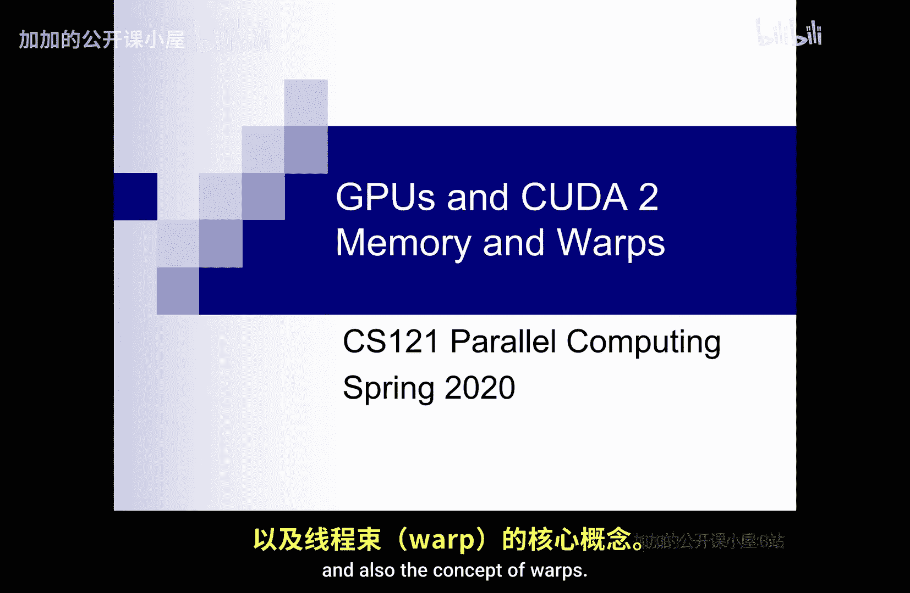

Okay， so we're going to start with memory because memory is actually one of the most important issues for getting good performance on computers。

So remember from a few lectures ago， we said that there's this big gap between the performance of processors and the performance of memory so we can actually compute a lot faster than we can read data out of memory and in fact。

 this gap has been growing over time because processors keep getting faster and they get faster a lot more quickly than the memory improves。

Okay， so today the main bottleneck for many programs is the memory， okay。

 we say that many programs are memory bound because the limit to their performance is actually on how quickly they can read data okay。

 if they could read data faster， then they would also perform faster。Okay。

 so therefore the way that we have of dealing with this is that remember we said computers have a memory hierarchy。

 okay so we have different types of memory right and the different types of memory have different sizes and also different speeds。

So if we can somehow make use of the right type of memory at the right time。

 then perhaps we can get better performance。

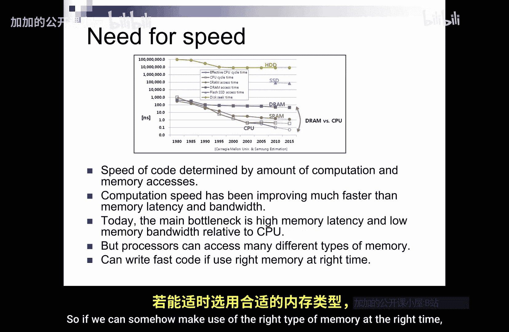

Okay， so first let's look at the memory hierarchy for GPUus。 Okay。

 so there are several layers of this hierarchy。So at the top layer so the biggest memory is called the global memory okay and then there's something called constant memory。

 but we're kind of going to ignore this because it's very small first of all。

 and it's also kind of a subset of the global memory okay so we're going to ignore this so next we have the shared memory right this is quite important and the L1 cache okay and then lastly we have these registers。

Okay， so now the the top of level of the hierarchy okay so the biggest chunk of memory is going to be the global memory okay so GPUs have something like between one to maybe 32 gigabytes of global memory okay so maybe we can actually change this one to like a three over here okay。

Now， because it's the biggest chunk of memory， it's also so the biggest chunk of memory is sitting farthest away from the actual processing chs okay and so they also have the highest latency to the cores okay so in fact if you want to access global memory on the GPU it's going take hundreds of computing cycles okay so like 400 to 800 cycles so that means that in one trip to read data from the global memory right you can actually like do 400 computations or 800 computations okay。

And the global memory is also limited in terms of its bandwidth so for example。

 you might only be getting you might only be able to read 150 gigabytes of data out of the global memory each second now higher endCUs maybe you can upgrade this number a little bit so maybe you can make this one into like maybe a seven over here but it's a few hundred gigabytes and this turns out to be actually not fast enough however。

 the nice thing about the global memory is that all the threads on the GPU can access the global memory so this is like a completely shared memory between all the threads on the GPU so remember that on the GPU。

 we broke the threads into thread blocks right now regardless of which threat block a thread is in it can access anything from the global memory so therefore we say the visibility is going to be the entire grid of threads。

Okay， so that's the biggest memory。 Now now we're gonna go to the next layer of the hierarchy and so this is this is the shared memory and this shared memory physically it's actually located on these Ss So remember these Ss are like the streaming multiprocessors and the streaming multiproces basically corresponds to a processor in a normal CPU right So so it's a processor and it has many cores and this processor has some memory called the shared memory Okay so the shared memory is kind of like it kind of corresponds to the cache on。

😊，On a normal processor。Okay and in addition to the shared memory。

 there's this thing the L1 cache okay however， the thing is that the shared memory and the L1 cache are physically implemented by the same hardware okay so you have this block of basically it's usually 64 kilobytes okay of memory and you can split that between the shared memory and L1 so in fact you can configure that at runtime how much of the 64 kilobytes you want to be shared memory versus the L1 cache okay so the L1 cache is just like a cache so it stores data that's been recently used and it evicts data when know when you're out of space。

Okay， on the other hand yeah and the e stuff is controlled by the hardware on the other hand。

 the shared memory is actually controlled by the programmer so the programmer can decide exactly what to put into the shared memory。

Okay， and now this shared memory in the cache they add up to 64 kiloBte。 Okay。

 so so this is actually tiny compared to the global memory right， which is like you know。

 tens of gigabytes Okay and then yeah， so you have and to share the。Let's see。

And the sharing is we can split the 64 kilobytes between the shared memory and the L1 cache and you can either give 48 kilobytes to the shared memory and 16 to the cache or vice versa。

Now even though the shared memory is or I'm just going to call the shared memory is so small。

 it's actually very useful and it can help you dramatically improve performance and the reason is that the shared memory is much。

 much faster than the global memory okay the shared memory might have a latency of let's say 20 cycles or a few tens of cycles so that's like you know 20 or 40 times faster than global memory。

😊，And also it's got a lot more bandwidth than global memory。

 so let me actually erase this one here because what I want to show is that the shared memory might have something like 10 times the bandwidth of global memory。

Okay now there is a limit here limitation here， which is that the shared memory because it's located on an SM and because threat blocks are allocated onto Ss。

 then the only threads which can see data from a piece of shared memory are the threads within a block。

Okay so the visibility is restricted to a block， so if you have another block of threads。

 so if I have one block of threads and they allocate something in their shared memory。

 then a different block of threads cannot read or write anything from the shared memory right they have no way of accessing this shared memory。

 it's like private to this block。and the same goes for the L1 cache because again。

 the L1 cache is physically implemented from the same hardware as the shared memory。Okay。

 and the final thing are the registers， okay， so the registers are also living in an SM。

And and we have actually a lot of registers okay so we can have maybe like 64。

000 registers per SM okay and the reason is that these 64。

000 registers need to be split between all the threads allocated to the SM so if you have 1 thousand0 threads on the SM then actually each thread can only get 64 registers and now these registers have a very。

 very low latency okay so basically you can access them every cycle yeah so they're the fastest type of memory and they also have the fastest bandwidth。

OkayHowever， the problem with the registers is that their visibility is restricted to a thread。

 so what happens is each thread can allocate memory which is stored in its registers another thread cannot read the registers but one thread cannot read the registers of a different thread。

Okay， so the registers are private to each thread。O。

Right so we'll look at so the first thing we'll look at is how to make use of the global memory right because most of your data is going to be stored in with global memory because it's a largest chunk of memory right。

 I mean even if you take all of the shared memory for all the Ss and you add it together right so you have 64 kilobytes of。

A sharedhar memory okay， let's say okay and then let's say you have 32 Ss okay so you multiply all that together and you get like like two megabytes of shared memory Okay。

 so it's a tiny bit of shared memory Okay so if you want to do any real computation。

 we're going to have to make use of the global memory。

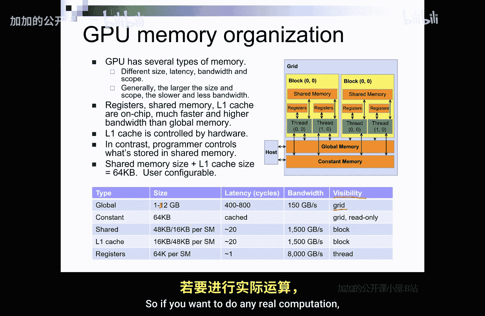

now this global memory right we said that it's got a very high latency okay 800 cycles okay so what are you going to do right so now if each thread just try to you if it performed a global memory operation and then waited for that operation to complete before it did the next operation then this thread would basically run at 1800th of its potential speed so that would be horrible so the way we get around this is that so GPUs use this technique called massive multithreading。

Okay， so what happens is that instead of just one thread waiting for the entire memory operation to complete。

 what's going to happen is we're gonna to run many。

 many threads on one SMM or on one core so what's going happen is so here if we look on the right over here we have several threads so the first thread let's say this is thread one over here right at the beginning it starts a memory operation and the memory operation takes a long time to finish let's say it finishes over here。

However， because T1 is going to need to wait such a long time。

 then we're not just going to let T1 occupy the processor。

 what we're going to do is we're going to switch the processor or the core rather to running a different thread。

 okay， let's say T2。Now let's say T2 also starts a memory operation right so actually I'm going to pair these up okay so yeah let's say T2 also starts a memory operation over here okay now this would also take a long time to finish。

 maybe it finishes at this time point okay so instead of waiting for T1 and T2's memory operation to finish。

We're now going to switch the core to running a third thread， okay。

 so let's say it also starts a memory operation， which starts and finishes at these two locations。

Okay and again so we keep switching so as long as you have a thread that has started a memory operation。

 but it's waiting and the memory operation has not completed yet。

 then we're going to keep switching to new threads okay so maybe here you start a fourth thread okay。

Now， at the end of this now eventually T1's memory operation is going finish right so for example。

 at this fifth time point over here right T1's memory operation has now finished okay so now we no longer need to switch to a different thread we can so now instead of switching to a fifth thread。

 we're going go back to T1 so then if you go back to T1。

 then maybe T1 now it has the result from its first memory operation and so now maybe it decides to do a second memory operation so the second memory operation it starts over here and again it's going to take many cycles to finish but now again instead of waiting for。

For T1s just waiting for T1 right we're going to switch to T2 okay now T2。

 you notice that at this time point its first memory operation has finished okay so now we can switch to T2 and T2 is going to do some computation based on the data that it got back and then maybe T2 is now going to decide to do yet another memory operation so now now we're going switch away from T2 to T3 T3 by this time point has finished its first memory operation so then now it can do its computation so basically the way this works is that we keep whenever a thread does a high latency memory operation we're not just going to wait for that thread to finish we're going to switch the core to processing a different thread。

So this is why it's called massive multi threading， okay。

 because we're going to have a large number of threads that we want to switch between。

Okay now we do need to now one thing is that we have to ensure we have lots of threads to switch between okay because imagine that we only had let's say two threads to switch between okay so sorry let me change to a different color here so let's go for blue so now imagine that we didn't have these two two threads down here so we just have T1 and T2 if you just have T1 and T2 then T1s memory operation starts here and ends here so then since t1's waiting we're going switch to T2 which it's going to start and over here but now t1 and T2 are both waiting and now at this third time point if we only have two threads then we have nobody else that we can switch to。

Okay， so then we just would have to wait for these two cycles where nothing's happening until T1 memory operation finishes。

So therefore， in order to implement this massive multi threading。

 we actually need to make sure that we have lots of threads that we can keep switching to。Okay。

 we need more threats。Okay， and also we need to make sure that when we switch from one thread to another。

 we can do it very quickly。Okay because here if the switching time from let's say T1 to T2 is very slow。

 right， then we don't get as much so we need two things。

 we need to make sure the threat switches are fast and we need to have many threads to switch to。

Okay， yeah， but but if we satisfy both conditions right。

 then you can see that what will be happening is that we'll actually be getting results back from the memory very quickly right so even though the overall latency of one memory operation is high but because we're pipeing many operations together right then effectively our actual memory throughput is high。

Okay， so now we said that we need to switch between these threads， right。

 So how do we switch between the threads while each S M has its own scheduler。 Okay。

 to do the thread switching。 And， and by the way， this is different from the。

From the thread scheduler that allocates blocks of threats to the SMs okay so that thing was called the the gigAth scheduler and here this is different so there's one gigath scheduler for the entire GPU whereas here every SM has its own scheduler。

Okay now what does it take to switch a thread right because we want to switch threads quickly how do we ensure that the threads can switch quickly So I talked about this last time。

 so let me just briefly repeat it okay so what happens is we saw that each SMM actually has a large number of registers Okay so let's sort of draw a bunch of registers over here okay so let's say that theres 64000 registers Okay now what we want to do is we want to and so these 64000 registers are let's say divide it between 1000 threads。

Okay， so then basically each thread has 64 registers。 Okay。

 now we're going to group these threads into these things called wars。 Okay。

 so I'll talk more about this later。 but basically a warp right is going to have something like 32 threads in it。

 Okay， so we're going to have several many wars。 Okay， In fact， you know， if you have 1000 threads。

 we're going to end up with like 32 wars。 Okay。A whoops warp。Singular。All right。

 so now the SM scheduler， okay is going to keep switching between wars。

Okay and and these wars have been preallocated the registers， so this is something we said last time。

 which is that when this block of threads block of 1000 threads was allocated to this SM all of the registers that this block needs were preallocated to to the block so all of these warbs have their own dedicated registers so therefore in order to switch between the registers of two different vers you don't need to do any reading or writing。

 all you need to say is that instead of looking at this block of registers I'm going to switch a pointer and say that well let's go look somewhere else okay let's go look over here at the next block of registers。

Okay， so switching between wars of threads just involves like sort of changing the value of a pointer to look at a different set of registers。

And once you have this new set of registers， then these registers over here。

 they define all of the state needed to run this war。And so now we can start executing the next warp。

And so this first of all incurs very little overhead because all you need to do is switch this one pointer from different chunks of registers and also this points to why GPUs have to have so many registers it's because we need to do this preallocation of the registers to the threads。

If we had fewer registers， then each time we switch between the threads。

 we might need to read or write the register values from memory from main memory， global memory。

And that would take just way too much time okay， so we can't afford to do that。

 so we have to just keep all of the register values in the big register file。

Okay now also how do we decide which threads or which wars to switch to okay well this is being so for example。

 eventually we set that T1's memory operation is going to finish at this time point so when it finishes at that time point right we don't want to switch to a new thread anymore。

 we want to switch back to T1 right so how do we know that we should be switching back to T1 okay so this is because this SMm scheduler has this thing called the scoreboard okay which keeps track of which threads are doing memory operations or doing other types of blocking operations and when this blocking operation has finished right like when the memory request has returned right then the SM scheduler can switch to back to the thread。

Okay， and again， this is only effective when we have many threads to switch between okay so again。

 if you don't have enough threads right， then this whole thing is not going to work because we're going to have to be waiting for a large chunk of time。

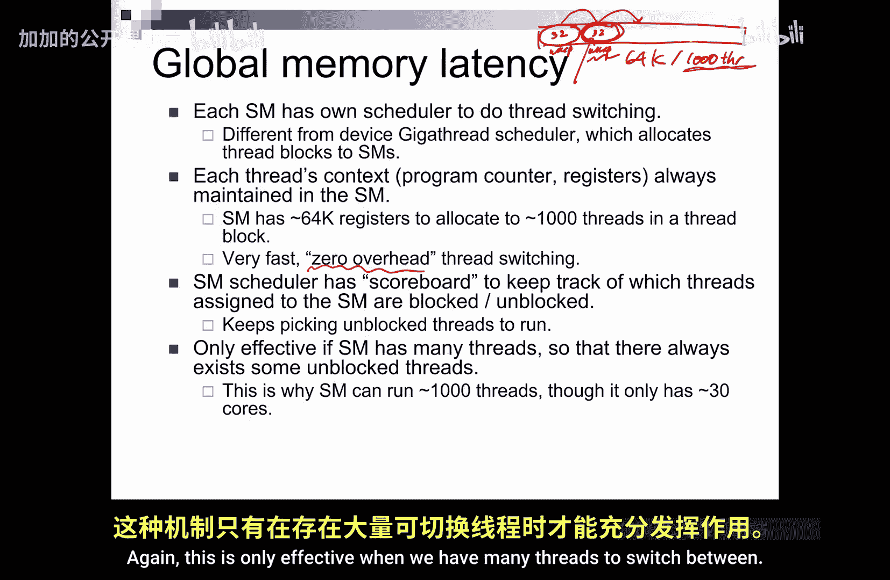

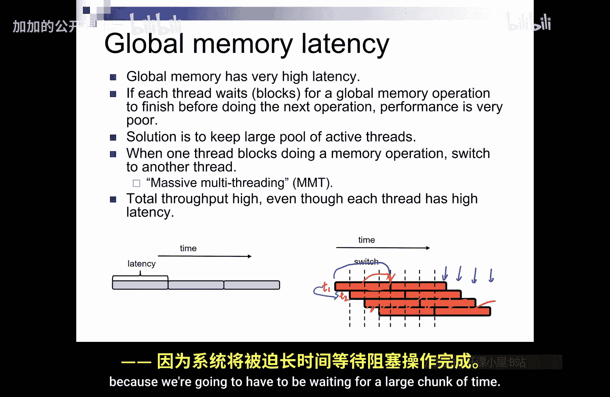

Okay and so this is why now each SM only has something like 32 coreds， let's say okay，32 or 64。

 something like that。 Okay so let's just say 32 cores。 Okay however。

 we saw that SMs usually you want to schedule several hundred or maybe even 10 threads onto this S so this is because if you schedule 1 thousand threads onto this S then you can run if you have 32 cores。

 you're gonna run chunks of 32 threads at a time and once this once one chunk of 32 threads blocks on a memory operation。

 you can switch to the next chunk of 32 threads So we need many chunks of 32 threads these chunks of warbs need many of these warbs to switch between。

Okay， so we need so if we have 1000 threads， then we can have up to 32 warbs that we can be switching between right so this helps us do our massive multi threading。

And this is also the reason why you want to maximize occupancy on an SM okay so remember from the previous lecture that we talked about you our goal in deciding things like block size or other parameters is to make sure that we can run as many threads as possible on an SM so why do we need to do that well it's because we want to be able to achieve this massive multithreading which is used to hide the latency of the global memory。

Okay， yeah， so we need a high occupancy。Okay， so now we've talked about the latency issue okay and the way to address high latency is to do this thing called latency hiding using massive multi threadreading okay however that's not enough okay because in addition to having a latency bottleneck we also have a bottleneck in terms of global memory bandwidth。

Okay， now remember that latency and bandwidth are not the same thing， right。

 you could have very low latency， but if you have a tiny bandwidth。

 you're still going to get very poor performance。Okay。

 so now we need to address the fact that the global memory has limited bandwidth。

Yeah okay so just to give you an idea how severe this problem is right so suppose you have a GPU which has a performance of 1。

5 tariff flops。🤧Every second it'll do 1。5 trillion operations right so that's fairly decent okay now suppose this GPU has a memory bandwidth of 200 gigabys now remember now suppose you're doing something like a matrix multiplication process okay。

So then there we have this。We have this partial sum that we were computing， right？

So if you look at the。So this computation is going to do some computations for example。

 this addition assignment but it's also going to do some memory operation for example it's going to read from this matrix M and then n so in total if you count this up we are doing a total of what is it we're doing a total of one23。

4，5，6 floating point operations right and to do that we need to do two memory operations we need to read from M and read from n and these things are stored in global memory because these matrices are too large to store in my shared memory。

うん。So therefore， the ratio of computation to memory operations。

 right so there's actually a name for this， it's like the compute to global memory access ratio is three to one。

🤧Okay now if you have a 200 gigabyte per second a bandwidth。

 okay so each floating point value is going to cost you4 bytes。

 so we're only going to be able to read 50 billion floating point values per second and for each floating point value you read right you're going to do three computations so therefore you can only do 150 billion computations per second。

Because of your memory bandwidth， okay， and this is only1/10th of what we can potentially achieve。

 which is like 1。5 trillion。Okay， so here we're very limited by the memory bandwidth。🤧。Okay， so。

So now to solve this issue of memory of limited memory bandwidth， okay。

 we're going to use this method called data reuse okay so basically we're going to try to minimize the amount of data that we have to read from global memory。

Okay， so the way so I'm going to illustrate this with an example of matrix multiplication again okay so suppose we're doing matrix multiplication and suppose you have a block of threads over here。

 this yellow block P and let's say the dimensions of this are tile width by tile width okay so we have that we have tile width squared number of threads within this threat block。

OkayNow if you do matrix multiplication in the naive way which is what I'm showing you above。

 then what happens is if you look at a thread in this threat block so then this thread in order to compute its value。

 it's going to have to read a bunch of values from M it's going to have to read these values actually it's got to read more values than that it has to also read the rest of this row but at least it has to read you know the first part of this row and it also has to read the first part of this column。

Okay， so all of those， if we just store M andN in global memory。

 each of those reads is going to be global memory aes okay so in fact。

 if the tile here has is going to be tile with by tile with right。

 then P here is doing tile with global memory aes for M。

 and then another tile with global memory aes for N。Okay。

 so P itself is reading a two times T width amount of data from global memory。Okay。

 and now in total you have a tile with times tile with so tile with squared number of threads right so in total so each of them does this many global memory aes。

 so in total we're doing a two times tile with cubed number of global memory aes。Okay。

 so that's going to hurt our performance a lot。Okay， now the thing about data reuse。

 So the property that we're going to exploit is the fact that。If you look at two different threads。

 okay so let's look at two threads on the same row okay now so this thread is going to be reading all this data。

 all of this data from M right but if you look at another thread from the same row。

 then it also needs this data from M right it needs the same block of data from M。Okay。

 so so if we have these two threads operating independently。

 then the first thread is going to read this chunk of M and the next thread is going to reread this chunk of M from global memory。

Okay so we're wasting a lot of so we're doing a lot of redundant accesses to global memory okay because these guys are duplicating their work okay and in fact。

 all of the threads on this row， they all need to read this part of the global memory okay so if they all operated independently they would all be reading the same data over and over。

😊，Okay now the same applies to columns okay so you know this thread needs to read this column of data from N right。

 but this thread also if it's on the same column， it also needs to read this data right and so does all the threads on this column okay and if all those threads operated independently。

 they would again be wasting a lot of aes to global memory because they'd be reading the same thing over and over。

Okay， so therefore the observation is that this the data in the purple blocks。

 okay so this little block of M and little block of N， okay this can be reused。

And what that means is if somehow we can load data this purple data from M&N。

 if we can load it from global memory just once。Okay and then then we can share that data between all of the threads in this yellow P tile。

O。Yeah and if we can do that， then what happens is how much data how much global memory aes do we need to make。

 well then it's just tile with squared right that's the size of this purple tile right and the same thing for the tile for n right so in that case it's going to be a two times tile with squared number of global memory aes that we need to make for these two tiles right and then we can compare that to previously we needed to make two times tile with cubed number of global memory aes。

O。So the idea is somehow we want to have all of these threads not load the data from M&N independently。

 because then they be doing redundant work， we want them to cooperate with each other and load this data just once。

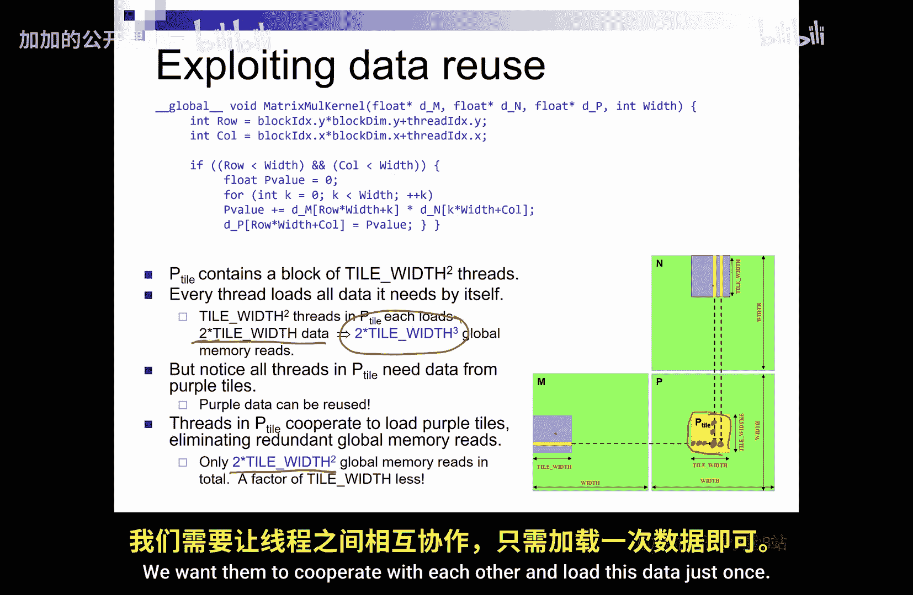

Okay， so then the way we're going to do this is that remember we have these little chunks of memory called the shared memory right so we have let's say 64 kilobytes of shared memory okay so what we're going to do is we're going to take this little chunk of data from N and N right and we're going to load it ones from the global memory to the shared memory。

Okay， just once， okay， so that's going to cost us two times tau with squared number of aes to load it from global memory to shared memory。

And then once it's in shared memory， then we can have all of these the threads in P tile access this chunk of shared memory。

Right， and and because shared memory has such it's going to be so much faster than global memory then and also have much more bandwidth。

 right， then we're going to get a big boost in performance by doing this。Okay。

 so so the actual way this is going to work is that well then you know you might be saying。

 okay well why not just load all of M and N into from global memory into shared memory just just just do it once and then you're done okay well the reason is that the shared memory is small right so we can't afford to load all of M and N into into the shared memory we can only load little parts of it at a time。

Okay so then what I'm showing over here are the parts of M so that we're loading each time so for example。

 in order for this thread to do its computation， it actually needs to to read this entire row and multiply by this entire column over here but we can't afford to store all of this purple data and from M and N in the global in the shared memory at the same time。

 we can only afford to store these two squares labeled one at a time okay。

🤧So then what's going to happen is our computation is going to proceed in phases in the first phase。

 we're going to be loading this one tile from M& N okay so we're just going to load the one tile and then we're going to load it from global memory into shared memory and the threads are going to do some computation on this one tile so basically they're going to read maybe this data times dot product that data and then they're going to get sort of a partial value for what this should be so then after that now we're going to go into the second phase and we're going to load load this second block of data from M and N so that allows them to get maybe the next part of this row and the next part of this column so that allows them to to get more to compute more of this partial value over here。

Okay， so now we can afford to store both you know， this squared from M and n in the shared memory at the same time。

 if we make these tiles small enough。Okay， and then in the third phase。

 we're going to evict the data from the second。Phase。

 we're going to take it out of the shared memory and now we're going to load the data from the third tile into the shared memory and that allows them to compute this part of the dot product and now this thread has computed the entire value okay because he's computed the dot product over here he's done it over here and he's got the third part so now he's got the entire value for for himself and at any time point all we needed to do was we only needed to keep two of these purple tiles。

 two of these purple squares okay in shared memory at a time。So if we make these tiles small enough。

 then they're going to fit just fine in the shared memory。🤧Okay， yeah， so。

So this just says what I was describing。 So the number of phases that we have is whatever this width of the matrix is right divided by the tile width。

はい。Okay and yeah， and in phase I， right， the threads in this P tile， this yellow tile here。

 they're going to cooperate in loading the data from the I tile right from the global memory into the shared memory。

And then in order to access this data right so this guy needs this data and this data。

 well well now these two things are now sitting in shared memory， okay。

 so this thread can access that data very quickly。Okay， and then after all of the threats have。

Have finished using all the data from this these two tiles， right。

 then we can go on to the next tile， the next phase。

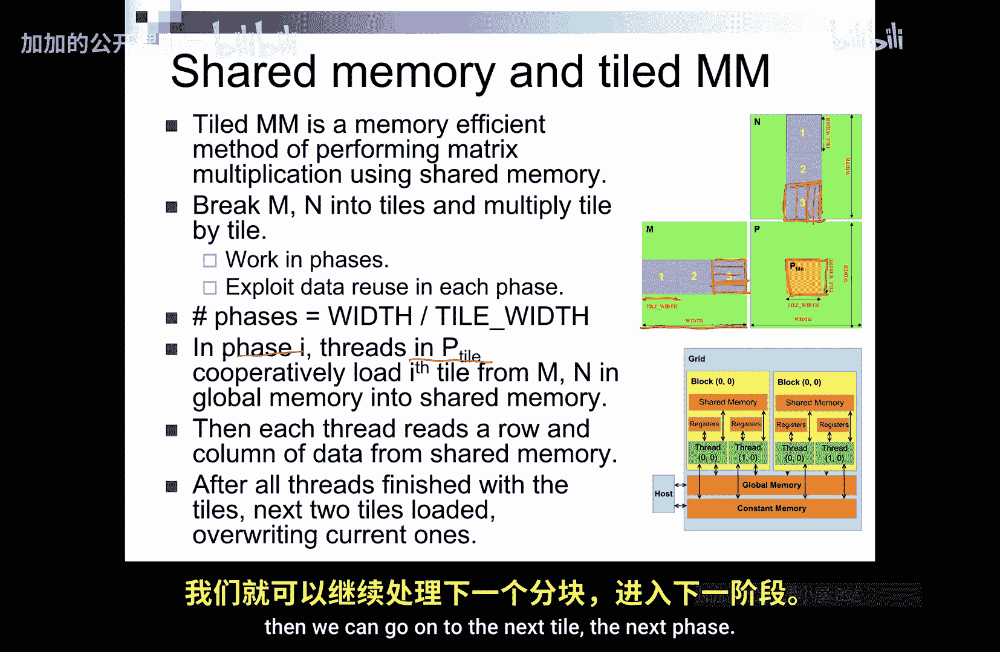

All right， so this is a summary of how this process goes okay so now the only thing we haven't talked about is how do we have the threads cooperate in loading these purple tiles well that's easy because you know here we have a bunch of threads like this and in order for them to and so on。

Right， in order for them to load this purple tile， we just have one element we have， for example。

 this element right he's going to load this part right the second guy。

 this guy he's going to load that data from from this purple part of M right so we just assign each thread to load one element of M from global memory into shared memory。

Okay， likewise， we're going to have these guys load the corresponding elements from n， okay。

 so each thread over here is you know processing 1p value and that thread is going to load the corresponding value from n from global memory into shared memory。

Okay all right， so then let's look at the code for doing this。

 so the code for doing this is first of all we need to allocate some shared memory in order to store these purple tiles so that's being done over here Okay so notice that we have to prefacees with double underscore shared to indicate that it's shared memory and the size of the shared memory is going to be tile with by tile with。

Okay。Allright， so next we have so the threads are going to have so they have their block ID and their thread ID okay now we did these calculations in the last last class so in order to calculate which row right so here you know each thread is going to process a row right and a column。

And to calculate that， we're going to do this calculation over here。And now。The thread over here。

 right， So it's basically so this thing over here is TX。 Okay， sorry。

 let me write this like that okay。So this is Tx over here Okay。

 and then this is this is T Y over here。 Okay， so this thread is located at where is it at Tx and T Y over here Okay within this type within this thread block Okay。

 so therefore this thread is responsible for loading the corresponding element from M and N。🤧Okay。

 so what we see here is that we're going to load。This element from the so D here stands for device memory。

 which is the global memory， Okay so we're going to load it from the correct position in the global memory so you can sort of work out this computation itself。

 but it's basically where is this item located in M okay and then we're going to load it into index T Y T X in the shared memory Okay in this so the shared memory is indicated by this little S over here。

Okay， and we do the same thing for n， okay， we load from the global memory into the shared memory。🤧O。

Now we need to make sure that all of the threads have finished loading all of this MBlock and this endBlock before we do any computations because otherwise each thread is just loading one piece of data right so if if this thread know it's loading sorry it's loading two pieces of data if it just goes on after it loads these two pieces of data right now this thread needs to actually compute this row dot product this column but what if and this column for example this value over here who's loading that value。

 what it's going to be this guy right now what if this guy hasn't loaded hasn't finished loading this value yet then the thread over here cannot do its computation。

Okay， so this thread over here needs to make sure that this other thread has finished loading this piece of data。

Okay， now how do we do that， well， we need the threads in this threat block to synchronize with each other。

 okay， we need them to all perform this data load operation。Okay， so we're going to use a barrier。

 Okay， so the barrier is going to say that all the threads which have finished their。

Loading their two pieces of data， they're going to wait here until every thread has finished。

 loading its piece of data。Okay， when every thread is finished。

 then we have this entire purple block of M and N being loaded。

And now we can go ahead and do our computation。 but we need to wait until this entire thread gets loaded sorry entire tile gets loaded。

Okay， yeah， so that's so in order to do the synchronization， this is called sync threads Okay。

 so sync thread lets all of the thread in a threat block。

 It creates a barrier for all the thread in a threat block Okay so this is basically a barrier。😊。

Okay， so next we're going do the actual computation。 Okay。

 so now we've got the the data from these purple blocks loaded into shared memory。 Okay。

 so now we can do the aes from shared memory。 We can do the computation from shared memory。😊，Okay。

 so now yeah， so this is the calculation， you can check that this code works correctly。

And then after so this is going to basically each thread is going to read from its respective row and column from shared memory and multiply and dot product them。

 and then add that into this P value thing。And now we want to make sure that all the threads have finished their computation before we go on the next phase because what is the next phase。

 the next phase is to like throw out all of this data and then load the next chunk of data right so we don't want to throw out this data until all the threads in this threat block are finished using these chunks of data so in order to know that all of the threads have finished using this chunk of data。

 we're going to put another barrier over here another sync threads which is to say that all of the threads have to are going to wait here are going to wait at the barrier until they've all finished their computation。

Okay， then and then when that happens， then we are going to go on to the next iteration of the for loop。

Okay， and the total number of iterations we have right is the number of stages that we have right we said that you know here we have like let's say three stages and this is equal to the width divided by the tile width。

 okay so the width divided by the tile width。うん。Okay， and in the end， this guy P here。

 he's going to end up with the correct value for this entire row times this entire column and then we can write that result back to the global memory。

Okay， so now by the way， these this value here， this is being， let's see。

 So should I talk about this now， Okay， so I'll mention this again later。 But， but these values here。

 Okay， so this is stored in registers。 Okay， so the way you know it's a register。

 it's being stored in registers is because。You know。

 variables that you declare as automatic variables okay they are by default stored in registers。

 so these things here are also stored in registers， Okay， so yeah。

 these BX all this stuff is stored in registers this stuff right because we preface it with shared。

 this is being stored in the shared memory okay and then this stuff here right。

 this is a memory that was allocated by by the CPU and that's global memory。

Okay so that is this tiled matrix multiplication algorithm right it's tiled because you know we read from these tiles and this algorithm because it's making use of the shared memory this can actually achieve much better performance than the naive algorithm so the naive algorithm was just where it's just this algorithm over here where every thread independently reads part of the row in column。

Okay， so let's see how much better performance we can get。

So suppose we have a n by n matrix okay and suppose that we broke it into tiles of size n by M now we said that the naive algorithm right it's going we're going to produce n squared elements of output right and then each so we have like n by M matrix over here we have this output matrix over here we have the the other matrix right so this is n by n right so each guy over here so we have n squared of these guys and each guy needs to read n values from n and n from n n values from n capital n so that is going to be two n global memory aes if we use the naive algorithm to n global memory aes for each element of output so that comes out to two n cubed。

Global memory aes。Now， if you now if we look at the shared memory algorithm， Okay。

 so the shared memory algorithm is going to break the stuff into these blocks， right into。

Into these blocks， okay， and the number of blocks is if you have an M by M matrix and the blocks are size M。

 right？Sorry， this is kind of hard to write over here。Okay。

 then we're going to have n divided by M squared number of blocks。Okay。😊。

And each block does n divided by M phases right so for example。

 you know these are the phases for this guy right 1，2，3 over here okay so how many phases are there。

 it's n divided by M okay？Now， in each phase， how many global memory access do we do Okay。

 so for example， in this phase right， we have so this is a M by M block right this is well it's too small to write over here。

 but this is this block over here right this is an M。This is an M by M block。

Okay so so we're going to read all of this data from global memory into shared memory once and we do this once for the n matrix and another time for the n matrix。

 so therefore it's going to be2 m squared number of reads from global memory into shared memory。

And this is per face。Okay and the total number of phases is n divided by m and in each phase where you do that number of global memory aes right and this is just for one block right this is for this threat block okay now in total you have this number of threat blocks right so in total if you look at how many threat blocks are it's going to be that many。

Okay， so then you multiply everything together and you get that the total number of global memory axises by the shared memory algorithm is 2 n cubed divided by M。

Okay， so now we compare this， let me erase this， we compare that to the total for the naive algorithm。

 and you see that we're doing a factor of M less global memory aes。Okay， all right。Okay。

 so first of all you might be saying okay why not make M as large as possible right because if you make M really large then you're gonna go much faster okay well the problem is that you know you have to be storing these tiles in the shared memory right so your shared memory is pretty small so you can't afford to make these tiles arbitrarily large there's like an upper bound on how large you can make them。

Okay now I want to mention that this doesn't so we've reduced a number of global memory aes okay but we don't really reduce a number of total memory aes because after you've read these little M by M tiles from global memory to shared memory right then these thread blocks right so remember we have these thread blocks right then this guy needs to read from shared memory。

Okay， and if you count up the total number of aes by this threat block from shared memory。

 actually from all the blocks， if you count up their aes from shared memory。

 it is still going to come out to 2 n cubed。So we're not reducing the total number of memory aes。

 but we are decreasing the number of slow aes from global memory and we're increasing the number of fast aes from shared memory and yeah and because shared memory is both faster and has more memory bandwidth then we get much better performance。

Okay， so so let's actually look at how much improvement in performance we can get Okay so we said that if we use m by M tiles。

 we reduce the number of memory aes by a factor of M okay so consider using 16 by 16 by 16 tiles then we reduce global memory usage by a factor of 16 so now you know previously。

We were getting something like well， we could read 50 billion numbers， okay from global memory。

 right， and we do three flops per byte that we read。But now。

 since we can effectively increase our bandwidth by a factor of 16， now we can end up doing 2。

400 gigablobs。Okay， compared to if we didn't have the shared memory algorithm。

 we could only do 150 gigabaws。Okay， so we've increased our performance by a factor of 16。

Okay and if we're using tiles of this size， then let's check that this does indeed fit in shared memory right so we have 16 by 16 tiles4 bytes each value right and then we need to store one tile from M and from n right so that just comes out to  two kilobytes of shared memory okay that's not a problem we have 48 kilobytes of shared memory。

Okay， so yeah， so even if you have let's say only 16 kilobytes of shared memory right so let's say we configure it to have 48 kilotes of L1 cache and 16 k of shared memory。

 you if for using 2k per block， we can still run eight blocks per SM and that can fully occupy fully occupy an SM。

Okay now sometimes you don't want to use like very large tiles。

 one is that it might not fit in shared memory and even if it fits in shared memory you could have run into problems like this。

 so for example if you use 32 by 32 tiles then you have 1。

24 threads per tile and so if you can only run 1500 threads。Per SM。

 then can only run you can't afford to run two blocks。

 so you can only run one block with a000 threads， so you only get two thirds occupancy。Okay。

 so in fact， in this case， we see that you don't want to use a larger tile because you get lower occupancy。

 okay。And using a 16 by 16 tile is already enough to saturate your performance。

 so there's no need to go to larger。To larger tiles。

Okay so now this basically this use of shared memory that we saw okay which is a way of like effectively increasing your memory bandwidth so this is very useful in practice it's actually the same principle as caches because you're reusing data so here we read those purple tiles and we reuse that data from shared memory instead of from the cache so this is a form of temporal locality and it's a very important technique it's not easy to use necessarily because we know that the shared memory is really small compared to global memory right however。

 if you can somehow redesign your algorithm to make good use of this shared memory or cache then you can get a big boost in performance。

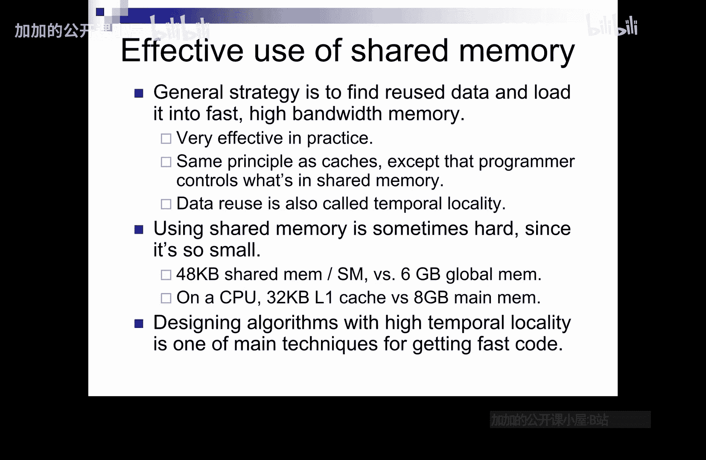

Okay so now let's just look a little bit at how we can declare these different types of memory right so the way that you declare a register is that again unless you make a special declaration then by default。

 the variables you declare are going to be stored in the registers so for the registers they can only be seen by the thread that created that declared this variable so the scope is for a thread and the lifetime of the data is when the thread terminate then the data goes away。

🤧OkayFor the shared memory， right， the way you declared is with this double underscore shared。

And this is visible to the entire block of threads okay so if a threat block declares if one thread from the threat block declares some piece of shared memory right then all the other threads from the threat block can see that and the is for the block block's lifetime。

and then you have this global memory right if you declare memory as being device like this right then it's going to be global memory。

 global memory is visible to all threads in your entire grid of threads and the global memory stays around for the entire application。

😊，And the same for the constant memory， which we didn't talk much about， but it's the same。Okay。

 so then yeah， so notice that automatic variables declared without any qualifier are in registers the exception is a that threads declare okay so if a thread declares a large array right so maybe that doesn't fit very well in the register right so in that case that those arrays are going to be stored instead in the global memory so that'll be much much slower so when you have threads declaring a raise。

 you' got to be careful and keep in mind where that's being stored。

Okay so now let's talk about synchronization okay so synchronization so we talked a bit about synchronization last time。

 so what we said was you could not synchronize between two different blocks but now here in the tile matrix multiplication algorithm we saw that there is a way to synchronize within a single block so and you need this sometimes because for example in the matrix multiplication algorithm we need to make sure that we finish loading the M and N tiles into the shared memory before we do any computations because otherwise if you start the computation too early maybe the value is not in the shared memory yet and so you would compute the wrong value。

And we saw that the way to synchronize within a block is to use this barrier synchronization。

 which is sync threads。Okay， so the scheduler for the SM will make sure that all the threads in the block are going to do the barrier at where the sync threads occurs。

Okay now there are a few things that you need to be careful about when you use sync threads so for example。

 if you have a bunch of threads that in a block and then if they do a sync threads。

 but suppose one of the threads for some reason goes into like an infinite loop okay so you had some bug in your code。

 so one thread goes into an infinite loop okay what's going to happen is the other threads in that block are going to be waiting for for this looping thread and so they would be blocked forever okay so so even though you only have one thread in an infinite loop。

 all of the other threads would also be blocked at the barrier。Okay。

 the other thing is that suppose you have a branching statement in your code okay then if you have a barrier in one branch right but then if you have some threads that go through the other branch without the barrier okay then again you're going have the threads are going to block forever okay because you have like part of the threads are blocking at the barrier in one branch and the other threads have gone into the other branch without the barrier okay so you'll never have all the threads reaching the barrier。

 so therefore all the threads will be blocked。Okay then so you have to make sure that the sync threads occurs in both branches。

 okay？And then you have to make sure that all the threads will go through the same branch。

And the final thing about sync threads is that it can sometimes cause wasted work。 Okay。

 so for example， if you have a sync thread over here， right， then the thread that。

And if some threads are slower than other threads， then one thread might reach the sync threads much earlier than other threads and so that fast thread would be waiting for the slow threads so you'll just be wasting his time and we said that one way you can deal with this is if you have fewer sorry if you have smaller thread blocks then you have less chance of this happening but we know that you don't want to have very small thread blocks because that's going to hurt issues like latency hiding and yeah。

Okay， so the upshot is that since sync threads causes these types of problems。

 then you want to sort of avoid them as much as possible。

 right of course sometimes you have to have these sync threads but you don't want to just put them in arbitrary places unless you really need to。

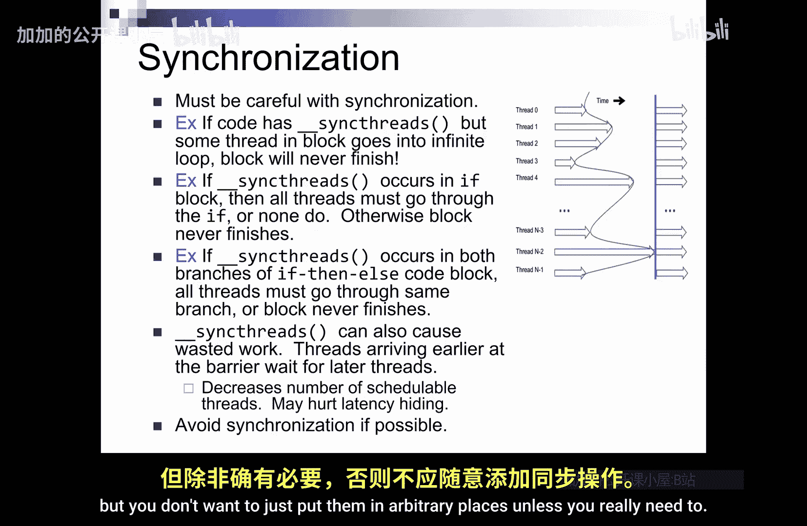

Right and this one just sort of repeats what I was mentioning last time。

 which is that different threat blocks cannot synchronize with each other okay so you cannot depend on the fact that know block2 over here is going to run after blocks zero because if you run on a different architecture。

 you could very well have blocks zero and2 running concurrently on different Ss。

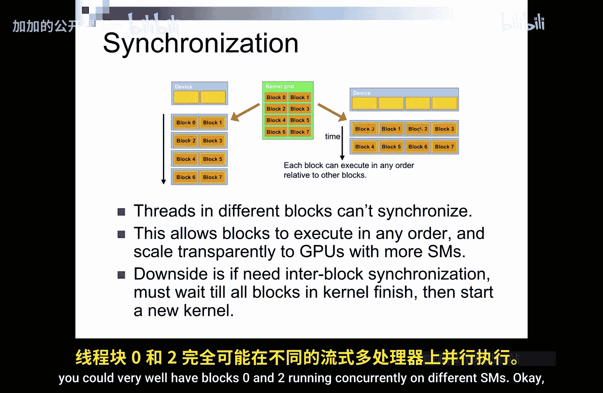

Okay， so now we're going to move on to the the second part of this， which is wars。 Okay。

 so wars are this so basically。So warps。So the reason wars come about is because you know in an SMM we have some number of cores。

 let's say we have 32 cores okay so now the goal so what the SMM hopes will happen is that all 32 of these cores will run the same instruction if they run the same instruction we then it's operating in a symptom fashion single instruction。

 multiple data fashion okay。Yeah， so in fact， the degree of Sdiness， okay。

 like how large your Sdi unit is， right， How many threads sorry。

 how many cores are running in the same operation that determines the size of a warp。

And that's usually 32 threads in current generations of GPUs。Okay。

 so then a thread block is actually divided into multiple multiple wars okay each warp has a bunch of consecutive thread ID values Okay so for example first warp has IDs 0 to 31 right second warp has 32 to 63 and so on。

啊。Okay， now the goal， what the GPU hopes to have happen is that your entire warp does somehow the same thing okay so now that same thing it can actually mean so they're different that means different things okay so I'm not saying that right。

So you want because you know a warp is supposed to represent a CD unit okay you want somehow all the warps to have the same behavior in some sense so I'll show you exactly in what sense you want them to behave the same way later okay there are several。

 in fact there are several senses in which we could understand that statement。

Okay now it is allowed for oh sorry， so first of all different warbs can do different things okay because the SMD unit is simply one warp right then if you have two different warps。

 they're not in the same SMD unit so it's fine if they do different things。

 you don't get any performance loss okay but if you have one threat within one warp doing different things then you will have a SD loss sorry performance loss。

Okay， so so what do we mean by doing the same thing Well， there are several issues Okay。

 so the first one is called coalescce memory aes， so we want the entire warp to make coalesced memory aes Also we want the warp to avoid flow divergence and also we want the warp to avoid bank conflicts Okay so these are the senses。

 so this is what we mean when we say that the thread should do the same thing Okay。

 we want them to do coalesce memory aes right we don't want them to diverge and we don't want them to have bank conflicts。

Okay， so now let me talk about。What these things are what is coalesc memory aes and divergs and so on。

 Okay， so first of all， memory coalescing Okay now the way the GPU memory works is that the global memory okay so this only applies to global memory so the global memory is actually divided into segments okay which are kind of like cache lines but anyways these segments are。

 let's say 128 bytes are large okay so that's 32 floating point values。Okay， now suppose an SM right。

 So an SMM， let's say has 32 cores and these 32 cores are doing a warp of 32 threads right。

 so one thread per core Okay， so this SMM is doing a warp of 32 threads and they're all executing a SID instruction right and let's say that this instruction is to read from global memory。

Okay， now let's look at where these threads are reading。 Okay， now。

 if it happens that the threads are all reading so the global memory is divided into these segments of 32 values right Now。

 if all the if this entire warp of threads is reading from the same segment。

Then the GPU hardware can actually detect this， and it's only going to transfer data from the single segment from the global memory to the streaming multiprocessor。

Okay and in that case， since we're only transferring one segment。

 this is called a coalesc memory axis。However， if we have a situation where the threads in a warp。

 if they're accessing data global memory locations from different segments。

 okay so here we're looking at three different segments。

 right the data resides in three different segments okay。Then， in fact。

 the GPU hardware is going to transfer all of the first segments so even though we just want you know these two pieces of data。

 the GPU is actually going to transfer the entire segment okay so it's going to transfer data that we don't even need but that's how the hardware works it's also going to transfer data from this segment so as long as long as say a threat access as any data from the segment the GPU is going transfer this entire segment including data we don't need okay and it's going to transfer third segment so we only need this one but we get all this other stuff we don't need so in fact if locations that's being accessed by this work。

 if they're in k different segment then in total we're going to be the GPU hardware is going to transfer all k segments and so that's going be k times 128 bytes because each segment is 128 bytes。

So in that case， we say that the axis is uncoolesced。Okay， and in fact， in the worst case。

 since you have 32 threads， they could each be accessing a completely different segment。

 so in that case you're going to end up transferring 32 times 128 bytes is 4 kilobytes。

Okay just to read 32 floating point values， you're transferring 4 kilobytes from global memory to the SMs so this is eating up a huge chunk of your global memory bandwidth we have very limited global memory bandwidth and now we're using and now we're wasting it in a big way。

Okay， so the idea is that we definitely do not want these uncoesced memory aes okay we don't want this situation where you read multiple segments。

 we want this situation where you only read from one segment okay so we want to make global memory aes as coalesced as possible。

Okay so let's do a concrete example of this okay so suppose you have a matrix over here right so remember that matrices are stored in row major format and yeah so then this is how the matrix is actually laid out in the data sorry in the global memory now suppose for this example that our global memory so it's got segments and suppose now our segments are four elements wide instead of 32 elements so that means that we can transfer four consecutive elements in one step。

O。And now suppose our warps also have four threads each okay now suppose you want the warps to iterate through this matrix。

 either row by row or column by column。Okay， now let's let's first look at it row by row okay if we iterate through this row by row。

 then we first want to access this entire red row right now how is a red row stored in global memory well all of this red row is stored consecutively in global memory right because that's how the row major format works。

So in we the first time we run this warp， we're reading these red memory locations。

And since they're all consecutive and they all lie in the same segment。

 then this is a cold as memory axis。Okay， on the next iteration of this warp。

 we're going to read these blue values over here。Okay the blue values are also consecutive in global memory right so they're within one memory segment。

 so it's we do another coales memory axis and then we read these are green values which we get a coales memory axis and then the yellows are also coales。

Okay， so in total， we've done four coalized memory aes。

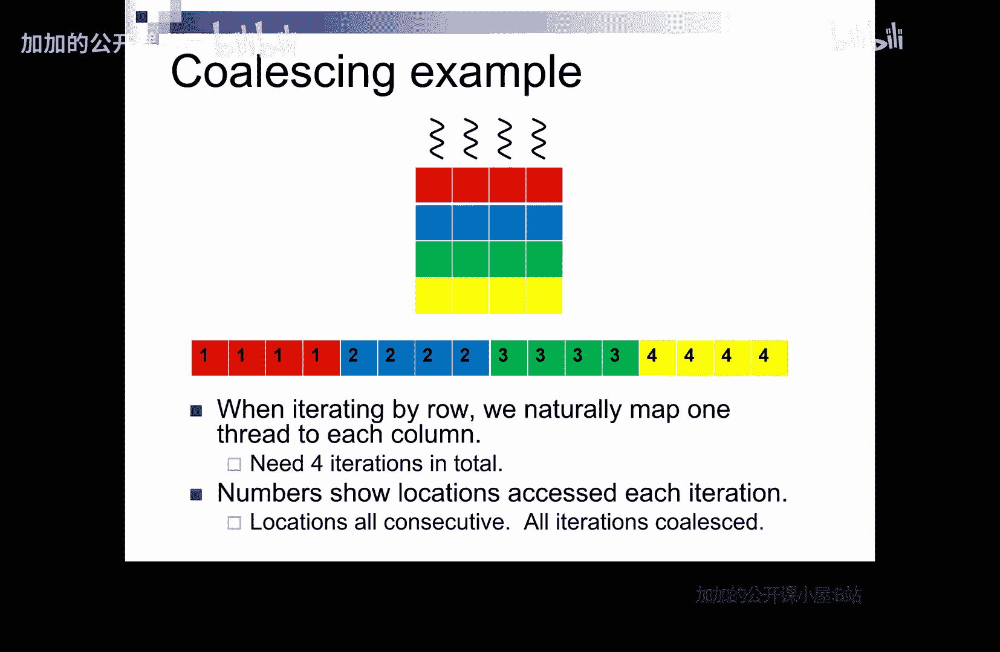

Okay， so now let's change this so that we access this matrix column by column。

Okay so column by column the first iteration of these four threads。

 okay we need to read these locations right， we need to read a red location， a blue one。

 a green one and this yellow one okay now where these location stored they're stored so so the first red location is over here right the first blue location right this is over here right the green one is over here and the yellow one is over here。

Okay now these four memory locations that the Swarpo thread is reading they lie in four different memory segments right each color here is a memory segment okay so they lie in four completely different memory segments Okay so we have a completely non coalesced memory axis on the first iteration。

😊，Okay， now what about the second iteration， second iteration， they're going to read you know。

 so this value， this value， this value and that value， okay。

 that so these values are lying at these locations。Okay， and again， these are non coalesced。

In the third iteration， we read this third column and again。

 so that's going to be at these locations marked by three， and they're again non coalesed。

So when we read column by column， then we get completely non coalesce memory aes。

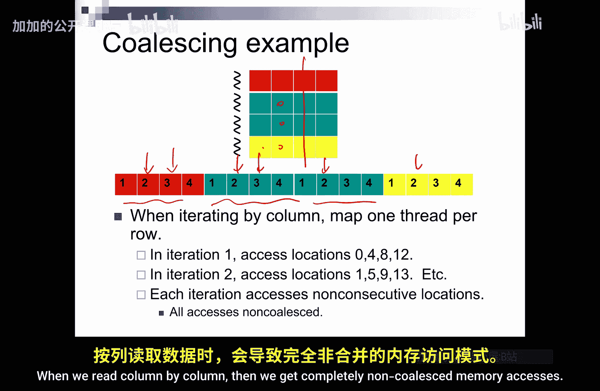

When you read row by row， everything was perfectly coalesced first iteration you read this segment and then second iteration that segment and so on。

 whereas once you read a column by column it's completely non coalesced。

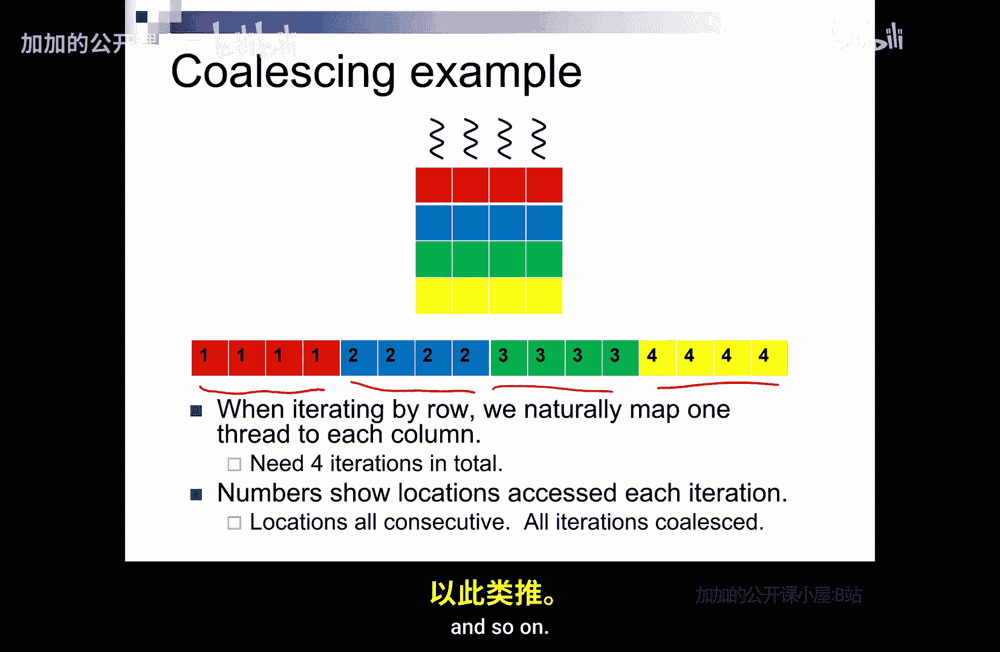

Okay， so then now what do you do okay because sometimes you might want to read this matrix column by column okay so we're gonna to try to improve coalescing and the way we're going to do this is we're gonna to make use of the shared memory again so suppose that yeah so if we want to so ultimately we want to read this matrix column by column okay like in this situation over here okay but in order to do this what we're going to do is we're going to copy so this matrix right initially we sitting in global memory now we're going to copy it over into shared memory。

And when you copy into shared memory， you don't have to read this matrix column by column。

 you can read it row by row right nobody requires you to read this column sorry when you're doing the copying。

 nobody's requiring you to do this column by column， so we're going to do it row by row。

And if you do it row by row， then we saw that you can do this in a perfectly coalesced fashion Okay。

 so this copy here is coalesc。Okay， and then once you've got it into shared memory。

 now you can read it column by column okay so shared memory does not have this issue about memory coesing okay memory coesing is only an issue for a global memory。

So therefore we get it into shared memory and now we read it column by column and we don't have any performance penalty。

O。Yeah， so okay， so that's our example for memory code lesson。 So next， let me talk about。

About warp divergence okay so warp divergence basically means that so our streaming multiprocessor is supposed to be a SD processor okay so it's got。

 let's say 32 processors or 32 cores rather， and the course are supposed to do the same thing so it's efficient when all the cores do the same instruction like they're all reading or they're all adding or something so if they all do the same instruction then we can actually the Sm can run the entire warp in one pass because we have 32 courses and we have 32 threads so in just one sort of iteration we can complete all 32 operations for the warp。

However， if the code has branches， then the threads might run different instructions。Okay。

 so for example you know some threads might be doing an ad and some might be doing a subtract okay or yeah let's see in this example you know we have three branches okay some threads are going to be doing an ad over here right so the ones which are divisible by three。

 they're going to be doing an ad the ones which are you know one modular3。

 they're going to be subtracting and then the other threads are going to be multiplying。Okay。

 so now the Warppo threads are trying to do three different instructions。

And because of the GPU architecture， they cannot do all three instructions in the same cycle。

 in the same iteration Okay， so in fact， we have to break these threads into three different cycles because they're doing three different operations。

Okay， so this is called warp divergence， right the threats are doing different things。Okay。

 so in fact， if your threats have within the warp have K branches， okay。

 so they're doing K different things okay， then the SMM can actually take K passes to run the entire warp because basically in each pass。

 it's going to do only the operations from one branch。Okay so for example。

 in the first pass it's going to take all of the threads which are so let's say we have threads which are you know0。

1，2，3，4，5，6 right let's just do a few more right8 so these guys right they're doing the ads right and then these guys are doing the subtracts right and then these guys are doing the multiplies so then in the first warp sorry in the first pass through this warp the SMM is actually gonna run only the threads doing the addition so three0。

3 and then6 in the next iteration it's going to do the ones which are doing the subtraction right so1。

47 and then it's going to do the the other threads okay so it's going take three passes so it'll be three times as slow。

So this is why you don't want warp divergence， okay。

 because what could have you know if these guys all did the same thing。

 it would have taken you one pass and now it's taken you three times as much time。

So in the worst case， all 32 threads are doing completely different things。

 so in that case it's going to take you 32 passes instead of one pass okay you'll get a slowdown of 32 times。

Okay， so let's see a practical example of divergence so we're going to look at a problem look at this reduction problem Okay so reduction remember we talked about this in MPI reduction just means that we take a bunch of values and you add them all together so how do you do reduction Well a simple way is using a reduction tree so the way this works is that suppose you have a bunch of threads over here they each have they each start with a value so the reduction tree is that we're going to pair up these threads and then add up their values so initially we're going to pair threads 0 and1 right so they're going to take their values and add it together and then store that in thread  zero。

Okay， and then threads two and three are going to take their values and add it together。

 and then thread two will be storing that value。RightTs of four， five get paired， six。

 seven get paired and so on， Okay， so initially we pair every other thread。Okay。

 and the next we pair。Thres zero and so now we have parts of this reduction stored at half of the threads。

Okay， now we're going to start pairing up these half of the threads that have part of the answer。

 okay， so we pair threads 0 and 2 right， and then 4 and 6 and then a 10 and so on。Okay。

 so then after this， we have a quarter of the threads and they each have the sum of four values。Okay。

 so now we pair every fourth thread， right， and then。

We add them up and now we have an eighth of the threads each having the sum of eight values okay and we keep doing that so each time we reduce the number of threads by a factor of two right and then each surviving thread has you know doubles the number the size of the sum that it has。

Okay， so therefore， if we have n numbers to begin with， right， then after a log n of steps of this。

 then we have one thread having all of these sum。Okay， so this is how we do the reduction， okay。

 we're going to do log n iterations where in each one we pair up some threads and then add together their values。

And then one thread keeps that sum， and then the other thread can become idle because it doesn't need to do anything else。

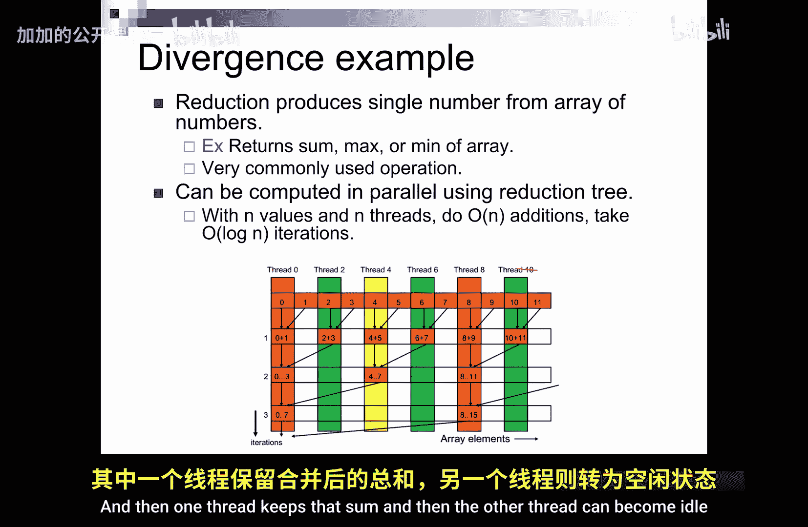

O。Alright so this is actually code for doing this right so what's happening over here is that so we have this variable called stride over here okay so stride is like controlling which threads we pair so initially we're gonna to pair like adjacent threads right and then so so the distance between the pair threads is one like we pair01 and then two3 and then next we pair threads which are distance two apart right so we pair024。

6 and so on and then after that you pair threads which are distance four apart so that is a stride right it's like how far apart is your partner and you see that the stride doubles every time。

Okay， so so we're going to run a for loop for basically login round where in each round。

Or each iteration， the stride is going to double。Okay and in each round what we're going to do is we're going take so we're going to take the threads who's such that if you take a modo2 times a stride okay so initially when your stride is1 you want to take the threads 02。

4，68 when your thread is2 stride is 2， then you want to take the threads 0 so this guy is going to do an addition when stride is 2 so here's stride equals 2 then you have threads 048 and so on doing the addition so anyways so the only active thread in an iteration is if your thread ID modo two times the stride is equal to0 okay if it's divisible by two times a stride and when this happens then you then this thread is going to take its own value and then also take the value if it's partner which is stride distance away and it's。

Im to add that up and store it in itself。Okay。And now the sync threads。

 the reason we need this is because we need to like complete all of these sums in the first stage sorry the first stage is over here。

 so we need to complete this entire first stage。This entire first stage before we start the second stage okay you don't want to mix up these stages。

 you don't want to run them concurrently okay so that's why if you do a sync threads here。

 what that's going to do is it's going to make sure all of these threads have a finished summing at this stage before you go to the next iteration of the for loop where you do the next stage。

Okay。Right so so this is just explaining what the algorithm does now I claim that this algorithm actually has a warp divergence and the reason is that you know the reason is that we have this if statement over here okay so this if statement splits the threads up into two types so there's this one type that's doing the addition right so for example。

 this thread is doing the addition and this is these threads are doing the addition and then the other guys are not doing anything because they're just like sort of the partner that's going to become idle。

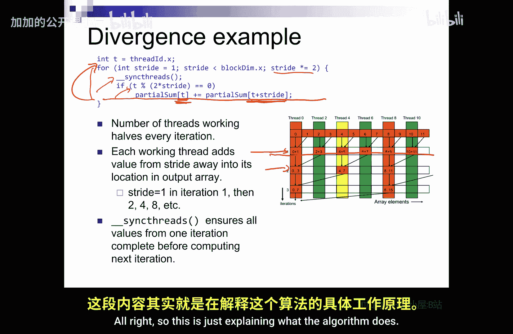

Okay。😊，RightSo therefore， since you have these two types of threads。

 then instead of running this running a warp in one pass。

 you need to take two passes so this is working sort of twice as slow as necessary。Okay。

 so now we want to see how we can mitigate this issue of divergence。 Okay。

 so what we're gonna to do is we're gonna change the algorithm a little bit。 Okay。

 and this new algorithm is going to have a lot less divergence。

 So the way this works is in the original algorithm。 You first so you keep picking these partners。

 right， And the partners are always a distance is stride away。 and the distance is going from one。

 right， So here the distance is  one， right， And then you go to 2 and then 4 and then 8。

 So the strides are increasing。Now you could also do reduction another way where you make the strides decrease okay and that's what's being shown on this right over here okay so what's happening over here is initially you don't pair0 with 1 you pair0 with let's say you have 512 numbers that you try to add up so then you pair0 with half of the numbers that you're adding up okay so 512 to divided by 2 is 256 so you pair 0 with thread 256。

You pair one with thread 257 and so on。So initially your stride is 256。Okay。

Now after you do this first phase， what you have is you also reduce the number of values you have from initially you have 512 values in the first row。

 and after you run this first phase， you end up with 256 values。Okay。

 now now that you have 256 values you're again going to partner up the nodes which are distance half of 256 apart。

 So now the stride distance is going to be 128， okay， 128。Okay。

 so and now that's going to reduce these 256 numbers down to 128 numbers and the next you're going to paras。

 which are distance 64 away。😊，So now here you see that the stride is reducing by a factor of two each time as opposed to the previous one where they were increasing by a factor of two。

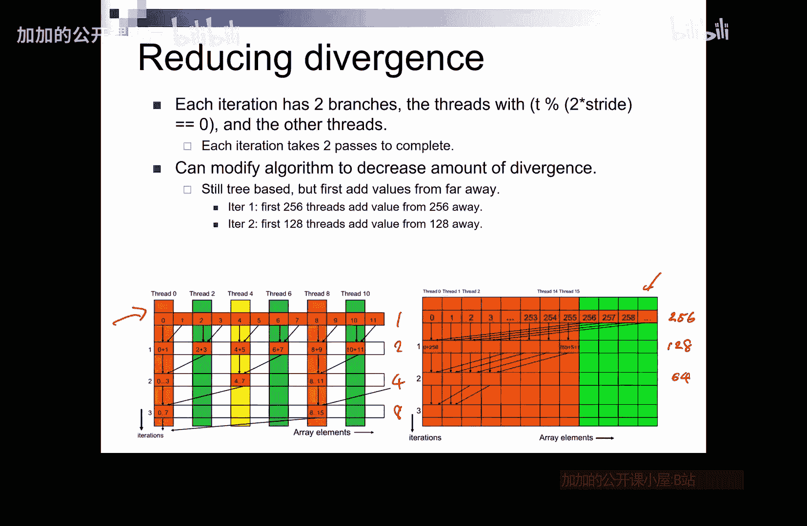

Okay now I claim that this new algorithm so first of all this new algorithm works correctly because eventually all these threads are going to combine into one thread and that guys gonna to have the sum of all the values so this is a correct algorithm just like the previous algorithm。

 but it's going to have a lot less divergence and the reason is that if you look at so let's look at the first iteration so here every thread is saying that so this is the new algorithm over here now if you look at a warp of threads。

 let's say a warp of threads only has four threads in it let me switch to blue to make it easier。

Okay， so。All right， so to switch it to blue so let's say that you have so this is going to be a warp of threads and then this is some other warp of threads okay now you see that the the first warp of threads okay they're all going to be doing the same thing because if you look at this this instruction over here right every since initially your str is 256。

Okay， then if you look at the first， I guess， let's just look at the first 32 threads in the war。

 Okay， you see that all of them。All of them， oops。The first 32 threads all satisfy this condition over here。

Right？Whereas for the previous algorithm， if you look at the first 32 threads。

 half of them satisfy this condition， but half of them do not satisfy this condition。

 so there were two branches in the first warp for the first example。

 whereas for this a new example there is just one branch because all 32 threads in the warp satisfy this condition。

Okay， now you can look at the next warp， so the next warp is going to have consist of threads 32 up to 63。

Because it's 32 threads per warp， they're also all going to satisfy this condition， strideus 256。

 so this entire warp satisfies the condition， so there's no divergence in this warp。Okay。

 for the next warp， right， that is what we have here，64 plus 32 is going to be 95 right。

 All those threads also satisfy the first this condition。

 Okay now eventually you get to let's say what is it the eighth warp， right or the ninth war rather。

 Okay， that is going to be threads 256 up to what is this 280287， Okay， right。

 now all of those threads， right， you see that all of them are larger than stride。

 So all of them do not satisfy the condition。So what I'm showing here is that for all of the words in the first iteration。

 they either all satisfy the condition or they all do not satisfy the condition。So therefore。

 there's no branch within the warp。Okay， there's only a single branch within the word。

 either you do this instruction or you don't do this instruction。Okay。

 so there's no divergence in the first iteration。Okay， now in the second iteration， right。

 what's gonna happen。 This stride is gonna become 128 Okay。

 so that now you can check again that for example， threads 0 to 31， right， they're all less than 128。

 no divergence okay， threads 32 up to 63， they're all less than 128， no divergence okay。

 threads 128 through what we have here 150159， Okay， right， they're all larger than stride。

 so no divergence。Okay， so in fact， you can go ahead and check that as the stride decreases。

 it's only when you get down to the stride being 16。

 that you could get any divergence because once the stride is less than 16 then for the first warp。

 half the first warp is less than 16 and the other half is larger than 16。O。😊。

And as a strike gets smaller， you also have divergence。

 but we've managed to get rid of the divergence for many of the initial iterations。Yeah。

 and then in fact， you can try to think about whether there's some way for you to get rid of the divergence even in the last four iterations of this code。

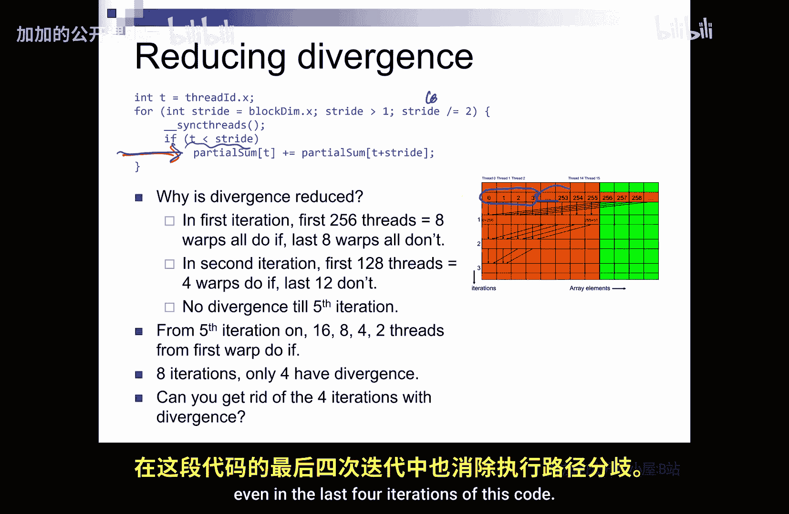

Okay， so now let me try to finish up here so the final thing we're going to talk about is bank conflicts okay so bank conflicts。

 this is something that occurs in shared memory okay so coales aes is for global memory and bank conflicts are for shared memory So the thing is that the shared memory is it's arranged into blocks Okay so we have 48 kilobytes and they're arranged into blocks。

And or sorry， they relation to banks， okay， sorry， they're called banks。

So a bank stores a set of memory addresses， Okay and and then a bank。U。Let's see。Okay。

 so different banks。can access I'm sorry， threads can access different banks at the same time。 Okay。

 so for example， if you have four threads and they want to access on these four banks， right。

 they can do that simultaneously。Okay。However。However。

 if you have two threads that try to access the same bank okay so suppose you have one thread that tries to access this piece of data and another one that tries to access this piece of data okay now if these two pieces of data are stored in the same bank。

 right then you get a bank conflict， then you cannot make these aes simultaneously you have to do them sort of one after another so now it takes you two time steps to do these aes。

Okay， so。Yeah， so currently， let me switch back to red over here。

Okay so currently GP so here I'm showing four banks so all the shared memory is being divided into these four chunks now in practice so current GPUs have 32 banks okay so we have 32 of these rows over here and you can figure out exactly where an address is stored which bank it stored in it's simply the address modo。

 the number of banks okay so basically the address modo 32。Okay， so as I said。

s if the threats within a warp， okay so if they access different banks。

 then it just takes one pass to do this okay so if they access banks 01，2，3， it finishes in one pass。

Okay，However， if you have multiple threats accessing the same bank， okay， if you have。

 let's say you know， three threads accessing the same bank， okay。

 then you get a K way bank conflict and now the aes take K passes to finish okay so K times slower。

Okay， the only exception is if all these threats， if they access the same bank。

 but it also happens to be the same value， okay in that case。

 the value gets broadcast and then all these a is still finishing one pass but if they access the same bank and they're different values。

 then it's going to take k passes。And also this is only applying for one particular warp， okay。

 if the threats from two different wars try to access the same bank。

 that's not a bank conflict right that will not cause a slowdown。Okay。

 so now let's look at an example of a bank conflict that can occur in practice and also let's see how we can solve this problem Okay。

 so suppose we have four banks okay so these each color is a bank over here right and then suppose your work only has four threads okay and suppose。

Our our block size is also four threads okay now let's say that what we want to do is we want the threads to load two values from global memory into shared memory okay we want each thread to load two values from global into shared memory now one way that you can do this is well thread zero can load so here I've label the memory locations so01。

23 up to 19 okay so one way to do this is just thread0 is going to load memory locations01 right thread one is going to do two。

3 thread2 is going to do4，5 and so on so to each however。

 if you do it this way right so the way to do this is so initially thread zero is going to read location 0 thread one is going to read two thread two is responsible for4 and5 so it's going to read4 initially and then three is going to read6 so here's the code。

AndNow if， if you look at the aes are making， you see that in the first instruction over here。

 you have a bank conflict between threads  zero and 2 because they're both accessing the red bank and different elements in the red bank。

And also you have a bank conflict between one and three because they're both accessing the Green bank。

Okay， so now these instructions are going to take two passes to finish， okay。

 each of these is going to take two passes to finish， okay。Sorry。

 that's just the first instruction on the next instruction right。

 you see that thread zero is going to access one right， but thread two is going to access5。

 so now both of these are in the blue bank so again you have a bank conflict。Okay。

 and same for the other threads， they have a conflict in the yellow bank Okay so therefore this instruction takes two passes to finish because of the bank conflict and same here。

Okay。Now to get rid of this bank conflict so there are various techniques。

 so later on we'll see something called padding and some other techniques。

 but here there's a very simple way to get rid of the bank conflict。

 which is that instead of having thread zero axis 01 and then thread1 doing23 where instead we're going to have thread zero do04 it's going to access these two thread1 is going to do15 so we're just going to change the order that the threads access the data so now you see that what happens is in the first iteration thread zero is going to read its zero thread one is going to read the one two is going to read two and so on so now all of these aes are to different banks and there's no conflict。

Okay， on the next iteration， right， they're going to read 4567， and again there's no bank conflict。O。

So yeah， so this is just an example of bank conflicts which can occur。

 which can really hurt your performance， and there are often ways that you can somehow get around these bank conflicts by sort ofdering either reordering your operations or sort of changing how your data is laid out。

 that can also help you avoid bank conflicts。Okay， so that's all we're going to talk about for this lecture。

 and so next time we're going to continue with more stuff about GPUs。

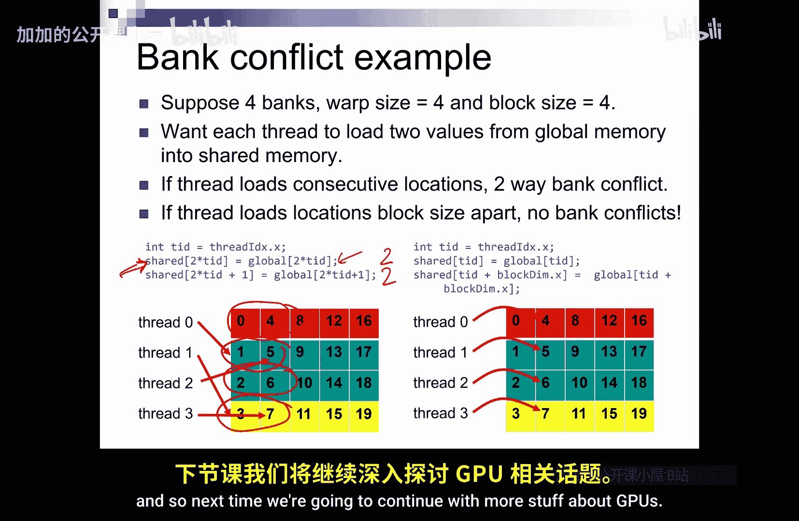