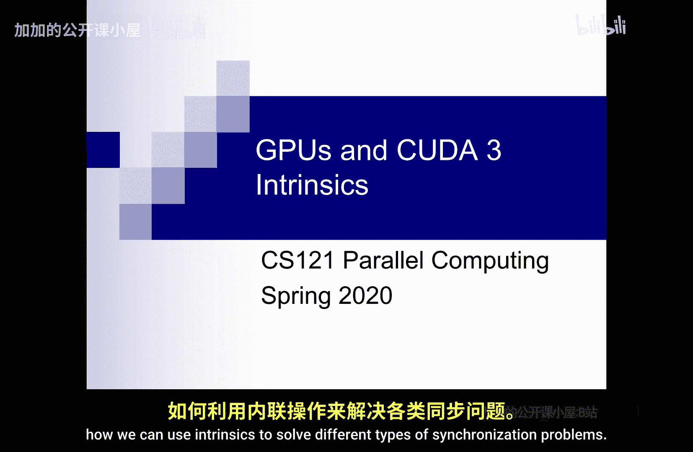
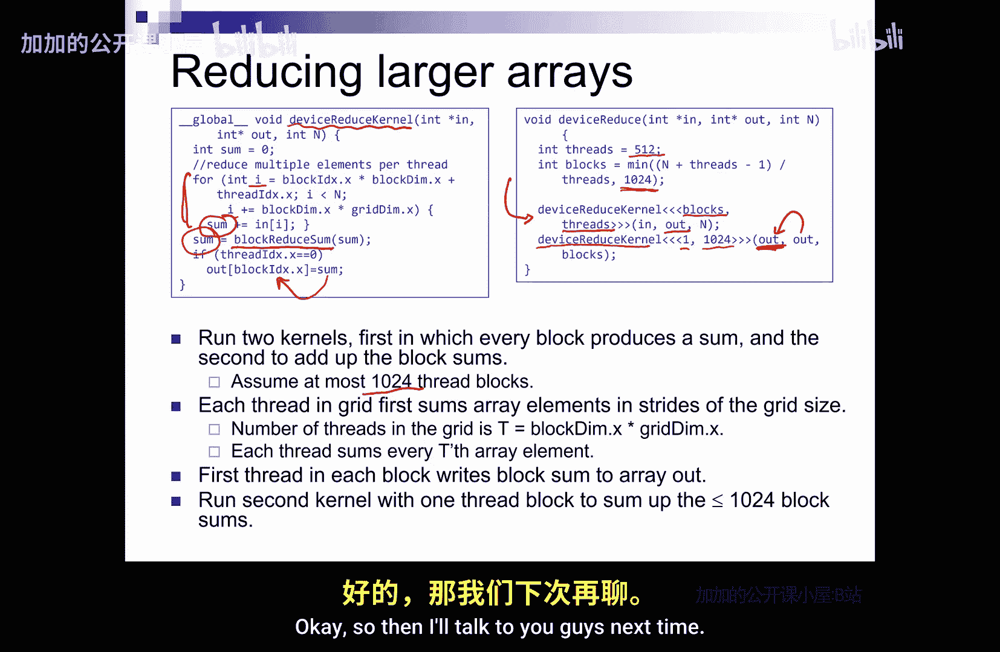

# 上海科技大学【中英⚡并行计算｜CS121 2020 Parallel computing】 p13 P13 CUDA 3 Intrinsics -BV1VqypBaEaP_p13-

Welcome back。So today we're going to keep talking about GPUs and we're going to look at a class of operations on GPUs called intrinsic operations。

And we're mostly going to focus how we can use intrinsics to solve different types of synchronization problems。

So in terms of synchronization， remember that we talked about the race condition problem in the context of distributed memory and shared memory programming。

So basically， whenever you have multiple threads， then the threads each execute a sequence of operations。

 but when you run the multiple threads together， these operations get interleaved in some way。

And different interleavings can perhaps cause incorrect behavior of the program。

And so this can happen in GPUs just as well as it can happen in distributed memory or shared memory settings。

And so for example， if we look at the program on the right。

 then what's happening here is that so this is a GPU kernel and we have this shared variable called DA。

 so this is a global it's a global memory variable so all the threads in the GPU can access this variable。

And what we're doing is we're starting a million threads in the GPU kernel。

 so we're starting 1000 threat blocks with 100 threads each。

And what the threads are supposed to do is that so each thread just takes the shared variable and increments it by one。

And so our goal is that in the end， the shared variable has the value 1 million because we started a million threads and they each increment this value by one。

But what can happen if you run this in practice is that you can get a very different value。

 So for example， you might end up with a value 88。the reason you could end up with 88 is because so here this increment operation。

 even though it looks like all you're doing is you're just taking value and adding one to it when you actually execute this instruction。

 it consists of multiple smaller instructions。And these smaller instructions can be interleaved in some strange way。

 and different interleavings can basically cause the value of D to be overwritten instead of incremented。

And so yeah， and so when you run this， you could overwrite this value many。

 many times and only increment it 88 times， and so that's why you get this incorrect answer at the end。

 and to deal with this on the GPU， we can use certain operations called intrinsics。Okay。

 so so these are specifically these are atomic intrinsic operations。

 so there are other types of intrinsic operations on the GPU for example。

 for doing different math functions like you know square root or you know exponential or something so so those we're not going to focus so much on those we're only going to be looking at the atomic intrinsic operations。

So these atomic intrinsic operations， they basically work like little critical sections。

 okay so they can allow you to take a piece of code and then sort of put that into a critical section so that when you execute this concurrently with many other GPU threads。

 you get the right answer。However， there's a limit on the nature of these critical sections。

 which is that if you use these intrinsics， the critical sections are only for very sort of small pieces of code。

 in fact they only apply to a single operation as we'll see。Okay。

 so then what about critical sections for larger pieces of code how do you use those on GPUs well first of all it's quite difficult to implement a general mutual exclusion algorithm on GPUs yeah and then also even if you could implement such an algorithm when you use a GPU。

 you want to have many， many threads right and if there's a block of code that's in a critical section then when you run those threads the threads would have to go sequentially through that block of code and so you would get very bad performance in that case so even if you could implement a critical section in QUuta you wouldn't want to because of the poor performance。

Okay， so let's look at these atomic intrinsic operations so these operations are only going to apply on variables and the variables can be stored in global memory or shared memory。

So the first operation is called Atomic increment。And here you give the operation an address。

 so the variable is going to be stored at this address。And this atomic ink。

 it's going to read the current value at this address， and it's going to return this value to you。

Furthermore， it's going to increment the value by one。

And all these operations are going to happen atomically。

 okay so you both get back the old value and then the value goes up by one。

 and this happens atomically。So next we have atomic ad。

So this is similar to atomic increment except for atomic increment。

 the value only goes up by one and for atomic add you can choose how much you want to change this value by so you can have another parameter here Val right and so when you do this atomic add you're going to get back the current value at this address and then you going to add value to it Val can be positive or negative and also you back you get back the current value at address and then you also add value to it。

Atutomically。Okay you also have atomic max， so here again you have an address and a value and this atomic max is going to read the current value at address and then it's going to set this value to the maximum of the current value and value。

Okay， and so for example， if the current value is 3 and vows 5， right。

 then you're going to get back the value 3， the current value， and then the value becomes5。Okay。

 but if if the current value is 3 and then your your value is 2， right。

 then you just get back the current value 3， and then the value doesn't change because two is less than 3。

Okay， you have this atomic exchange operation， which is going to return the current value at this address and then also just set it to this new value Val。

And then you have this operation called atomic Comp and swap。So this has three arguments。

 so it's got an address and it's got two values， an old value and a new value。

 so sorry these should both be ins over here。Okay， so this is a conditional operation and so we actually saw this earlier when we talked about how to implement mutual exclusion algorithms a few lectures ago。

 so what it does is that it's going to read the current value at address okay and it's going to give you back that value。

Furthermore， it's going to take that value and compare it to old the first or sorry to the second argument over here。

And if the current value equals old， then it's going to set the value to be the new value。

But if the current value is not equal to old， then it won't do anything。

 it won't change the current value。Okay， so you get back the current value and then you compare it to old and if it's equal。

 you change it to new and if it's not equal， you don't change it。

And so this is actually a very useful operation， in fact it's a so- calledled universal operation because you can use this in different ways。

 and this can allow you to implement basically any synchronization operation。

And the reason it's so useful is basically this atomic compare swap lets you tell if some other thread has changed the current state。

 so if it's change the current state， then you're going do one thing to make sure that nothing you're going to do something to make sure nothing goes wrong But there is no other thread that has changed the current state then you're going to do something else。

 so you just need a way to differentiate whether there is anothercurrent thread that has changed the current state。

 and the way this compare swap lets you do that is that let's say the current state is just a number So if it's a number and if I know what the current state is supposed to be。

 then so I know so suppose I know that the current state is supposed to be old assuming there are no other threats around then the current state should be old。

 So then I'll do this atomic compare swap and I'll do。

And if the current status is still equal to old， then I'll change it to this new value。Okay。

But if there's some other concurrent thread that has modified the value of this value， right。

 then the value would no longer be equal to old。And in that case， when I do the CA。

 nothing will happen to the state because if the value is not equal to old。

 then I will not change it to new。Okay， so yeah， so we have these atomic operations and a few other ones in Kuta。

Okay， so now let's see how we can use this to solve different problems。Okay。

 so the first problem that we'll try to solve is that we're given an array of numbers and we just want to compute the maximum value in this array in parallel。

Okay， so so the first thing that we can try is well we have this operation atomic max that sort of it seems like it can help us find the maximum value okay so the way we're going to write this code is that we have a bunch of threads right we have an array and a bunch of threads each thread is responsible for one item in the array okay and're going so it's going to be responsible for this item so we've seen this calculation before so this is going to allocate exactly one thread per item in the array。

Okay， and then so that thread is going to read the array value right and it's going to stored and it's registered called Val and then it's going to take the value that it read and try to do an atomic max with the global maximum value right now so the global maximum value is a shared value so let's say that it's stored in the global memory。

And so the threads are just trying to take the current value that they read from the array and see if it's larger than this globally max maximum value right now。

 and if it is， then the atomic max operation is going to change global max to our current value and otherwise nothing happens。

Okay， so if you run this code。Yeah， so this is going to work correctly and in fact。

 so it doesn't depend on the interleaving at all。 So for example。

 if you have two threads okay so if the first thread read a value of4 right and another thread read a value of 5 then in then whichever order the threads execute in right global max is going to end up with at5。

Assuming that global max is less than five right now。

Okay now but the problem with this code is that it's going to work very slow and the reason it works very slow is because all of the threads are sharing this one global memory variable and they're all doing atomic operations on the single variable。

And what happens is if you have multiple threads doing atomic operations on the same variable。

 then all these threads are going to get serialized。Okay。

 so so they're going to perform the operation one by one on this variable instead of in parallel。

And you know， if we have a big array， then we're going to have lots of threads and so potentially many threads are going to be calling this atomic max operation。

Okay so so now let's see how we can improve the performance of this okay so the basic idea is that the problem with the previous code is that all of these threads contended at the single global memory address。

So instead， we're going to try to split the threads up so that they don't have such high contention。

Okay， so now in this new piece of code， instead of having one global max。

 we're going to have basically multiple copies of this global max。Okay so in fact。

 we're going to have an array over here called local Max okay so local Max yeah。

 so you know so we're going to try to split global Mac into multiple copies。

 so let's say if we split this into 100 copies， then local Max would be an array of size 100。

And now instead of all the threads trying to update global Max。

 each of the thread is going to focus on sort of one location in the local max array。

And it's going to do all its updates at that location。Okay， so yeah， so to give an example of this。

 So suppose we make local max an array of four values。 Okay， so so let's say something like this。

Then we're going to have one set of threads which are going to be accessing this part of local Mac and another set is going to access different parts of local Mac。

And the way each thread figures out which index of local Mac it's going to update is it's just going to take its thread IDI here and then do it modlo the number of locations or the size of local Mac okay so here the size is going to be four。

Okay， and and so they're going to do the atomic max， not onto this single shared global max。

 but rather they're going to do it on the local max。And when they do this atomic max。

 they're going to get back the current value at this index and they're going to compare current value with this value vow。

Okay， now if the current value is less than v， then that indicates that v is then that means that v can potentially be larger than global max。

Okay， or let's say this another way， let's say that old max is currently larger than v or larger than equal larger than or equal to val。

 If old max is larger than or equal to val， then there's no way for val to be larger than global max。

And if vow is not larger than global max， then we don't need to do atomic max between vow and global max。

Okay， so the only time that we need to do an atomic max between v and global max is if the current maximum value at this array location。

 if a current value is less than v， then potentially our value is larger than global max。

 and in that case we're going to do this atomic max between v and global max。Okay。

 so then the effect of doing this is that well first of all the first atomic max right now we split the atomic max between many different memory locations instead of all focusing on one single location okay。

 so the first atomic max is going to be much faster。And also the second atomic max。

 while this is still all being focused at a single location global max， however。

 the second atomic max doesn't happen very frequently。

Because it only happens when old Max is less than that。Okay。

 so and if you go through this matrix right so if value sorry not matrix， but array。

 so if the values in this array are basically are kind of like random。

 then it's unlikely for old vow to be less than v。And so in that case。

 we're not going to execute this global max too much。Okay， now if you execute this。

 it still might not perform very well because。Yeah。

 because you could still end up doing a large number of atomic maxes onto the global max okay so there actually is a better method using something called reduction however。

 the point of this example is to show that whenever you have these synchronization bottlenecks that happen because you're focusing too much on a single variable one thing you can do is to split up that variable。

Okay， so。Yeah， so let's see another example of this methodology where you can sort of split up a variable and then improve your synchronization speed。

Okay， so here we're going to try to compute a histogram。So yeah。

 so here we're given so the input is going to be an array of values and we assume that there's some upper bound on these values Okay so first of all。

 we assume that let's say they're all integers and the range is going to be from 0 to k。

So then now we want to count the number of occurrences of each value。

 So we want to know how many zeros there are or how many。You know， how many case there are？Okay。

 so for example， suppose the array is is this thing over here。

 Okay so so now k here is1 right so all the values are between0 to1 and then what we want to output is just how many zeros are R right so there are three zeros and there are also two ones so 3。

2 is our output。Okay so the way that you can implement this or one way you can implement this is using this function over here。

 so yeah， so here each thread begins by computing an index I over here and also so in this example。

 we're not going to assume that you start the same number of threads as the size of your array。Okay。

 so if you have an array of let's say， a thousand0 elements， maybe you only start 100 threads。

So in that case， each thread will need to process 10 elements。Right， so therefore。

What we're going to do is we have this parameters or this value stride over here so then basically each thread is going to start at some index and then it's going to process that index and then process that index plus stride。

And then it's also going to process that index plus two times stride and so on。Okay。😊。

So as an example of this。Right， so suppose you have 100 threads， right。

 So suppose you number of threads is equal to 100， right， And then suppose youre。Oh， so。

Let me do this in a different way， so suppose you have a block dimension is how many threads there are per block okay。

 so let's say that there are 100 threads per block okay and let's say that you started 10 blocks of threads。

Okay， so therefore you have 1000 threads in total but suppose you have a million elements so you have an array of size。

 let's say n and here n is equal to 1 million so then what you need since you have 1000 threads is you need each thread to process 1000 elements。

Okay， so therefore we're going to start our threads so the threads are going to have so they're going to compute this value I over here。

 So the I is going to be between 0 to 9，99 and then whatever your I is。

 you're going to be processing all the threads， you're going to be processing I。

 and then also I plus 10001000 being equal to 100 times 10。Okay。

 and you're also going to process I plus 2000， right and so on。Okay， so。Okay。

 so then in this loop here， what we're going to do is we're going to look at we're going to read a current index in the array。

And then whatever value that is， we're going to increment that value in the histogram。Okay， by one。

 so we're going to do this atomic ad on this location of the histogram and then the location that we look at is equal to the current value that we're looking at。

Oops， all right， so as an example of this right， so you know if we go through this array。

 then the first thread is going to see that v of0 is equal to0 right so it's going to modify the histogram at one and it's going to set this to one。

OkayThe next thread is going to see that of or sorry vows of1 is equal to3。

 so it's going to change the location， so it's going to increment the value at a histogram of 3 to be 1。

And then you have these two next threads， so they're both going to see a value of one。

 so they're both going to go to location one in the histogram and they'll do two atomic ads at that location。

 so this thing will become a two over here。And then if you had another thread over here。

 it would go to A0， it would go over here， and it would set this to a two。And again。

 after you process your index I over here， you're also going to process I plus stride。

And you keep doing this until you've processed the entire array until I is larger than or equal to size。

Okay， so yeah， so this algorithm is going to work correctly because the only contention that you can have is when you try to update these values in the histogram。

 but nothing bad's going to happen because we always use these atomic ads over here you could also use atomic increment that would also be fine。

However， a problem again is that this is going to be slow so one reason it's going to be slow is that maybe so currently we're storing the histogram in global memory okay so accessing this histogram is going to be slow。

And also since all the threads are writing to the same histogram array。

 then there's could potentially be a lot of contention and that can also make things slow。

So therefore， what we're going to do is instead of all the threads contending on the single histogram。

 we're going to make multiple local histograms。Okay， so that is going to reduce the contention。

And also we're going to store these histograms in shared memory instead of global memory。

 so that will also improve the access speed。And then but at the end of this computation。

 we need to combine all of these local histograms into one big histogram so that final histogram is still going to be in the global memory。

 so we have to have this final step which combines a bunch of shared memory。

 local histograms into a single global memory histogram。Okay。

 so the code we have for doing this is like this， so here we're going to assume that there are only 256 different values in the array Okay。

 so for example， the values go from 0 to 255。And in that case。

 we're going to make a local histogram and the size is just going to be the number of different values that are。

 so 256。And we want to initialize this local histogram to all zeros。

 so therefore we're just going to take the first 256 threads in our thread block and then initialize this to initialize the values of the local histogram。

Okay， so now because we're storing this local histogram in shared memory。

 then each block of threads is going to have their own local histogram。

And we want to make sure that this histogram is completely initialized before we do anything else。

 okay， so we're going to put the sync threads over here to make sure that this entire histogram has been initialized to zero before we put anything into it。

Okay so next we're going to compute a starting index for each each thread right and we're going to compute a stride for the thread just like before。

 because again we're going to assume that we have potentially more items in the array than we have threads so each thread needs to process multiple items potentially and the items are going to be stride apart from each other。

And then next， we're going to go through basically the same while loop as before。

 except for now instead of。Do the modification instead of updating the global histogram。

 we're going to be updating these local histograms okay so again we read a value from the array and then we just update our local histogram by we increase it by one and we process we keep going until we process all the elements。

Okay， and then we do a sync threads here to make sure that all the threads in the threat block have processed all their elements。

And then the final step over here is to take all of these local histograms and then add them and then combine them together into a global histogram。

And the way we do that is， well since these local histograms only have 256 values in them so we only need 256 threads to do this each so we're going to take the first 256 threads and then each thread takes one index in the local histogram and it just takes the value in the local histogram at that index and then adds it into the global histogram at that index。

Okay so that way all of the different threat blocks are going to do this and in the end。

 the global histogram is going to have the sum from all of the different threat blocks。

So this is going to perform better than the previous algorithm。

 so one reason is that most of our atomic ads right so most of the time we spend so this while loop is where we spend the bulk of our time。

 so most of this is happening on the shared memory histograms。

And then there's also less contention because the only contention on the shared memory histogram is within a thread block for the previous algorithm。

 we had contention between all of the threads on the same histogram。

 but now it's just within a threat block。And then in the end， we do have some global contention。

 but this is we only do this for one step， because you just take the single value from the local histogram and add it into the global one。

Okay， so next we're going to look at a。Problem called aggregation。And then okay， so。

So one example of this， so aggregation is basically you take like a big piece of input data and then you want to somehow you know like find some statistics on it or something and then you want to sort of shrink that piece of data so an example of this would be filtering so here we're going to be given an input array source it's going to have n elements and we're also given like a predicate which is like a condition。

And then we're going to copy all of the elements from source that satisfy this condition into a destination array。

So as an example， suppose we want to take the input array source and we just want to pick out all of the positive elements and then copy them into destination。

Okay， so like a sequential program for doing this would be that we just go through all of the array elements if it's positive。

 then we're going to copy it into the destination array。就系。

And we have this pointer here indicating where we're going to copy the next value to okay。

 so each time we copy a new value from source into destination。

 we're going to increment this pointer。And at the end of this。

 the pointer tells us how many positive elements we actually copied。

So so now we're going to look at several different methods for implementing this aggregation or this filtering operation so the first one is going to be just the basic algorithm that's going to be done in global memory and then we're going to move this to shared memory and then it turns out that there's actually a coa library called thrust which has many useful functions built into it。

 and。One of those functions is this thing called copypy if。

 which does exactly this filtering operation。So it copies a value if it satisfies a predicate。

So we're going to compare the performance of these three methods。And then lastly。

 we'll look at something called warp aggregated filtering that。

That's going to introduce some new atomic operations which work at the warp level。🤧。Okay。

 so the first。So the first version of this is going to be the global memory version。

So here we're just going to take so we have a bunch of threads。

 they each compute an index All right now for this example。

 we're going to again assume you have the same number of threads as as array elements Okay so then each thread just processes one element。

So then each thread gets an index and then it checks whether it's index sorry the value from source at that index is larger than zero。

 and if it is right， then it's going to copy that source value into the destination。

At this location Nres right so Nres is basically the current number of positive elements that the threats have found right so it's going to copy it into this NreS location and then after that we need to increment Nres because we found another positive element so we increment NreS and we use atomic at to do that。

Okay， so now you can probably guess that this is not going to work very well because all of the threads are going to be contending at the single variable N res when they do the atomic ad operation。

Okay， so now let's try to improve this。So now let's try to split this so that we can do this in shared memory。

Okay， so what we're going to do is now let's see。Okay， so now each thread is going to。Pros， yeah。

 so each thread is going to process not just one element anymore。

 it's going to process this this number of elements， this M per thread。Okay。

 and what it's going to do is each thread is going to iterate in this loop over here。

 So this is a four loop over here。And the first thing it's going to do is So this。Yeah。

 so this L N is being shared between all the threads in the thread block Okay so。Let's see。

 So the first thing we're going to do。 so this L N is basically playing the role of N res previously。

 so the LN is counting how many positive elements the threads in this threat block have discovered。

Okay， NR counts the total number of positive elements。

 but LN only counts the number of elements for this local trap block。Okay， so first of all。

 we want to set Ln to be0， and we just need one thread to do this。

 so therefore we're just going to have the thread0 do this。And then after thread zero does this。

 then we can go on， so therefore we need a sync threads over here to make sure that thread zero has done this operation。

Okay， so the next we're going to read a value from source。

 right we're going to read the I value from source， and if it's a positive value。

 then we're going to increment this LN here because Ln counts the number of positive values。

And then we're going to make sure that all of the threads in the threat block have rather value and then incremented LN if necessary。

 so then we do a sync thread over here。Okay， and then now we basically so at this point。

 LN is equal to the number of positive values that this entire threat block has discovered and we want to add this number into the global number of positive values。

 so therefore we want to add LN into Nres。OkayBut we only need one thread to do this。 And so again。

 we're going to just have the first thread do this。 Okay， so we're going to call him the leader。

 So if if so the thread with ID0， he's going to do the atomic ad of LN into Nres。

And then he's also going to get back the current value of NreS。

Okay or sorry the previous value of Nres， So for example。

 if Nres currently is equal to let's say 10 right and if Ln here is5 because we found a total of five positive elements right then then here we're going to have LN be equal to 10 after this atomic add but then Nres becomes equal to 15。

Okay， so then we do a sync thread to make sure that the leader thread has finished Okay and then next now here we've just counted an updated Nres。

 right we've counted how many positive elements we found and then updated Nres。 However。

 we also want to store these positive elements into this destination array。 Okay。

 so the next part is going to store these positive elements。Okay。

 and what it does is that we're going to use these variables position here。 Okay。

 so position is basically， so we， we have a bunch of threads that in the thread block that we counting positive elements and position indicates for each thread。

It's position among all the threads in this threat block that found positive elements。Okay。

 so as an example of this， suppose you have four threads Okay in the threat block， okay， so 1，2，3，4。

 okay and suppose the values that they have are so let's say so this is the the source array right。

 So suppose the values are something like you know0，23 and then like negative  one。Okay。

 so then what we want is we just want the second and third thread to sorry let me change this a little bit。

 Okay， so this is like let's make this a three here and let's make this a one okay。

And this is the other thread I D。Okay， so then we want the second and third thread to copy their values into。

Into the the destination array。 Okay， so so the position here， right。

 what's going to happen is so the first thread is going to have a he's not。

 he doesn't have a positive value。 So therefore he doesn't do the atomic add Okay。

 So at this point so initially Ln is equal to 0 right So after so so the first thread。

 he doesn't increment Ln。Okay，The second thread does increment Ellen。Or sorry， let's do it this way。

 Okay， so we don't really know the order that the threads are going to execute it。 Okay。

 so potentially we could actually have thread3 execute first before thread2 Okay， so thread3。

 since he's got a value of one which is positive， he's going to do the atomic addd and he's going to get an LN value or sorry a position value Re。

Okay， of of one。 Okay， so L N is going to go from 0 to 1。 And then let's say that thread4 executes。

 Okay， so T 4 has a negative value。 So he doesn't do the atomic a。 Okay， so for him， the。

The value of position is still going to be one。 Okay， And then let's say that。What os， right， So so。

 so the order of execution。 Okay， so we first have a thread3， right， So first， it's gonna be sorry。

 thread1 and then thread 3 and then thread 4。 And then finally， thread2。 Okay， so then thread 1。

 its position is gonna be well it， it doesn't actually do this operation。

 So it doesn't even get a position。 Okay， so maybe I should write it this way。 So it just。

 it doesn't have anything here。 Okay， so I'll just write write an X over here。

And then thread2 runs last and then when he does， so he's got a positive value。

 so he's going to run this atomic ad over here and he's going to add one to LN and he's going to get a value of two。

Okay。So the point is that all of the threads with positive source values they actually they do this atomic ad so they get a position value and these positions are all going to be different from each other because each time you increment Ln by one so all the positions are different and these positions are going to tell these threads where they're going to write into the destination array。

Okay， so the way that this works is。Oh， okay， I'm sorry。 So I need to。 So these values are incorrect。

 Okay， so thread 1， right， let me go through this again。 Okay， I'm sorry about this。 So thread one。

 when he does this， he's got a negative value， he doesn't do the atomic ad。 Okay， so therefore。

 he doesn't have a position。 Okay， thread3 when he executes。 He does the atomic ad。

 but he's gonna get the old value。 Okay， so he's gonna。Get an old value of 0。

 and then L N is going to become  one。 Okay， it got incremented。 Okay， T 4。

 it doesn't do the atomic ad。 And then thread 2， when he does the atomic ad。

 he's actually going to get a value of one。Okay， for position， because he gets back the old value。

 which is one， and then LN becomes2。Okay， so now so finally， let's let's return over here。 Okay。

 so over here is where we actually write these source values into the destination so。Yeah。

 so imagine that you know we when we did the atomic add onto Nres right。

 suppose we got back the value 10 Okay so that would mean that all of the other threads have discovered 10 positive values already then what's going to happen over here is that each of the threads right if it had a positive value Okay so D is the value that it read from source and if this is positive right。

 then that thread would have gotten a position value also right so just like you know threads like two and three here。

 right， they got a position value okay and all of those position values are different as we said。

Okay， so then。So then the actual position that each thread should write into is equal to the number of positive values that have been discovered up to now globally。

 which is 10 plus the number of positive values discovered in this threat block。

 which are these position values。Okay， so it's so the threads are going take this value 10 over here and thread2 is going to add one to it right。

 and then thread3 is going add 0 to this。 Okay， so therefore， thread2 is gonna right into position。

 So let me write this down here， right， So thread2 is going write into position destination 11 Okay。

10 plus 1。 Okay， and then thread3 is going write into position 10。

And the value that they write is just the value that they read from source。Okay， so yeah。

 so after doing this， all the threads in the threat block have written their positive values right。

 and then since we're going to have each thread process multiple values。

 then they're going to continue with this for loop until they've processed all their values。Okay。

 so that is the shared memory version of this and yeah and if you run this in practice right so so this example comes from oh I'm sorry。

 I forgot to say this。 So the example comes from this website called dev blogs。

 Okay this is an NviDdia website where many of their employees are write articles about how to use Quta and GPUus to solve various problems in very efficient ways Okay。

 so this comes from this nice example that was given in the Nvidia blog。

And then so this article also did some benchmarks and what we see is so the benchmark is going to compare the global memory version of the aggregation of the filtering right with the shared memory version of the filtering okay so the green one is the shared memory version and you can see that the shared memory version is going to be quite a bit faster and the X axis here is the percentage of filtered items okay meaning so it's like the percentage percentage of positive items。

Now the more positive items there are right then the more contention there's going to be on these on these synchronization operations。

 on the atomic operations Okay so for example， if all of the items are positive right。

 then there's going to be a lot of contention on this atomic ad over here。Okay， yeah。

 so you can see that the performance actually decreases as the number of positive item increases okay。

 but for。But for all of these different percentages。

 you have that the shared memory algorithm is a lot better than the global memory one。

And then they also compare this to。Let's see。 So they also compare this to the thrust library。 Okay。

 so remember that thrust has this function called copy if。

 which here you would say copy if the value is positive Okay so it does exactly what what this filtering operation does。

And so the copy if actually works in a different way it uses something called a prefix sum。

 so it's working in a different way than this atomic implementation that we gave and because it works differently it actually has this property that the more filtered items you have。

 the better the performance the basic reason is that if you have very few filtered items very few positive items。

 then because the copy if is doing a prefix sum， there's actually not enough work for this prefix sum to do okay because there's very few positive elements and so therefore you get sort of poor overall performance because there's not enough work for all of these different GPU threads to do。

But as you increase the number of positive elements。

 then there's more and more work to do so then you can begin to saturate the GPU。 Okay。

 you can use up all of its resources， and so you actually see that the performance can increase a little bit。

Okay， so now we're going to look at one last version of this。

 And so this is going to be a warp aggregated atomics。 And this is going to use。New operations。

 which are these sort of warp based intrinsic operations， okay。

 so itll introduce some new tools for us。Okay， so yeah， so the workp based atomics。

 the way this works is so up to now we've seen operations where all the threads in a thread block can see。

 for example， shared memory locations， and they can do atomic operations。

 atomic intrinsic operations on these shared memory locations。Now these workp based atomics。

 this is an operation that is shared between the threads in a warp。Okay。

 so different warps cannot interact with each other using these warp based atomics。 However。

 threats within a warp can interact and synchronize with each other。

And the synchronization and interaction within a warp is actually much faster than between the threads within a thread block。

 so these warp based atomics are really fast compared to the sort of threat block based atomics。

And so you can get much better performance if you can somehow make use of these work based atomics。

Okay， so so the way this is going to work is let's just go through an example of this。

 So what we're going to have is suppose you have a。

Supp supposeose you have a warp of threads and so these x's indicate that other threads have already counted some number of positive elements Okay so we're again going to be just trying to filter out the positive elements and other threads outside of the warp have already found some number number of positive elements and now this warp of threads is going to be processing these elements right and some of them are going are not going to are not positive and some of them are positive and what we want is so each thread is going to process one of these elements。

 So we have eight threads over here。And so so the threats with zero values。

 they're not going to modify， they're not going to change anything because they won't be copying into the destination array。

And only the ones with the positive values want to copy into the destination array。

So each thread with a positive value needs to know where it copies its value into the destination array because all these threads need to copy into different locations in the destination。

Okay so what we should have happen is for example， we can have this thread copy into the first location so here the local offsets is basically saying for each thread if you're going to copy into the destination array where should you copy2 so for example。

 the first thread it should copy to one larger than the previous number of positive values okay so previously we found four values and so this thread number two over here should be copying into location5。

Okay， thread 6， right， It's also got a positive value。 So it should copy that into location 6。 Okay。

 threads so let's just label these。 So this is threads 1，2，3，4，5，6，7，8 Okay so threads 4 and 5。

 They don't copy anything because they don't have positive values right， and then thread 6，7，8。

 They do copy into the destination array， and they should place their items at locations3，4， and 5。

Okay， so this is what we want to achieve。 And the way we're going to do this is that now all of these threats over here。

1 through 8， they're in a world， right， So what we're going to do is we are。Let's see。

 So so the first thing we need to do is figure out how many how many old values how many positive value old positive values have been found。

 Okay， so here there are four old positive values。 Okay， so we only need one thread to do this。

 Okay so so therefore the warp is going to elect like a leader thread and the leader thread is going to go find out how many old positive values there are。

Okay， next， each thread is going to individually compute its own offset。 Okay。

 so these these different values here， right， they're being computed in parallel by all the threads within the warp。

Okay， and then the leader， right after discovering that there were four old positive values is going to broadcast this value。

 this four value to all of the threads， all the threads in the warp。

And then all these threads are going to take the old offset and then add their new offset to it。Okay。

 so the old offset is four， so this threat， for example， is going to go to offset5 okay。

 and this guy is going to go to offset 6 and so on。And once they find the right offset。

 then they can go ahead and write their value into this offset location。And when you do this。

 this guarantees that all of the threads will write to different locations that's the main thing we want to achieve is for all the threads to write their values into different locations and also for there to be no holes in these locations right。

Okay， so this is the code for doing this， so this introduces a bunch of these new atomic operations which are all these operations with the double underscores Okay so let's look at what these operations do。

Okay， so so the first operation is this ballot operation okay so you're going to call this ballot operation with a value and remember that this so this ballot operation only applies to a single warp and there are 32 threads if within a warp。

So the ballot is basically trying to find out which of these 32 threads is actually active。Okay。

Because sometimes you you could have some threads want to do something and some threads don't want to do that thing okay so we just want to count how many threads actually want to do this thing。

So here when you run this ballot operation with one。

 this is going to end up returning a 32 bit mask and each digit in the mask corresponds to one of your  32 threads and the digit says whether that thread is active or not。

Okay。Yeah， so if you get something like， you know。All right， yeah。So。Okay。

 so then we compute this mask and now we can figure out which active threats are。Okay， so basically。

 for our example， the active threads are going to be the ones with positive values。 Okay。

 the inactive threads are are not even going to call this function over here。 Okay。

 the only threads which call this function are the ones with positive values。

 And so they would show up in this mask。Okay， now we want to take one of these active threats， right。

 and we want to make him the leader。 So the so the leader is。

Is going be the one that finds the old offset。 Okay。

 so we want to have one of these active threads go find the the offset and。Let's see。

 And the way we do that is we're going take this mask and we're gonna use this operation here fine first set。

 Okay， so what that does is， you know， if you have a binary number， let's say like 10，1，1，0，1。嗯。Okay。

 oops。啊。Alright， so it's going to find the first set bit in this number。 Okay， in this case。

 it's going to be this bit over here， okay。嗯。Yeah， and you need to subtract one from those because because of this off by one thing。

 Okay， and then this is gonna be our leader。 Okay， so basically all so this is our our mask over here。

 Okay， so this is which threads are active in the workp。

 And suppose there are only five threads in the work。 Okay， so we have。

So now we're going to take this thread， the second thread to be the leader。Okay。

 and now the leader is going to find how many old positive values there are。 Okay。

 so this counter here is going to be the number of old positive values right so that was the the four the four in this example。

Okay， and then also he needs to so the leader also wants to allocate space for all of the threads in this work that have found positive values。

 So here we have five threads that found positive values。 Okay。

 so the leader actually wants to set the the offset to oops。

so the leader actually wants to change the offset to nine。

 the leader wants to make the new offset be at this position。Okay。

 so the way he does that is well he needs to count。

 how many threads from this warp have positive values。Okay， now remember。

 the mask is indicating which threads in this warp have positive values。

 so in this in this case it's going to be three warps。Sorry， three threads have positive value。

And so so the way to know how many positive values there are is just to count how many ones there are in this mask。

And that's what this operation does。 So this is called population count。 Okay。

 so here if you give if you give population count a 32 bit value。

 it's just going to count how many positive how many ones there are in that in that 32 bit value。

Okay， so in this example， it would produce three。And so therefore， when you do the atomic ad。

 you're going to increase the counter by three。Okay， and the rest here。

 this is going to be the old value of count counter。 Okay。

 so counter the old value in here is going to be4。And the new value would be， well。

 here it would become nine。Okay， now next， we said that the leader actually wants to tell all of the all of the active threats about the old offset。

 Okay， so this shuffle operation， this is actually kind of like a broadcast operation Okay。

 so the shuffle is going to say I want to broadcast this value So this value is the old counter value right And who is going to do the broadcast。

 It's going to be the leader Okay， so the second argument is who does the broadcast。

And the broadcast is only to the threads within this warp。 Okay。

 so all of these operations are with respect to only the threads in this warp。

 So only these 32 threads。Okay， and the final thing that we need to do is after all of the threads in the warp know the counter the old offset。

 then they need to add their value into the offset。And so in order to do that。Let's see。 Okay。

 so now we're up to this point。 Okay， so。Yeah， so what we want to do is。

 so every thread in the warp wants to find a position to write to。 Okay。

 and the position of the thread is basically now， in this example， we're gonna have threads。

 So let's say we're gonna。Work in this direction over here。 Okay。

 so now we we want to find a position for these threads。 So the first thread is going find position。

 let's say position one， right， This is going to find position2， right。

 The guys which which are not active。 The guys who are zero in the mask， right。

 They don't even need a position。 So we're gonna to ignore them。 Okay。

 and then this final thread over here， he's going to find position 3。Okay。

 so we want somehow for these threads to produce these numbers one， two， and three down here。Okay。

 so how do we do that， What we're going to do is each thread is going to count how it's going to go now look in the opposite direction towards the right。

And he's going to count how many threads before it actually have ones。

 how many one threads are there before it？Okay， so for example， the first thread。Over here， right。

 he sees that nobody before him has a one。Okay， so。

Let's see maybe I want these values to be off by one here。 let's see。So the population counts。Right。

 so I want these to be off by one。 So sorry，m gonna change these 3，2，1 to 2，1，0。 Okay。

 so this is what I want want to have happen。 Okay， so so the first thread over here， right。

 he should actually produce a value of 0。 So how does he do that。 Well。

 what he's going to do is he's going to take the mask。 Okay， this 1，0，1，1，0， right。

 And he wants to just keep the last two digits。Or sorry， the， the， the last digit。 Okay， the。

 the digits， digits before him。 Okay， so how does he do that， Well， what he does is he's going。

He'sHe's going to do a bit wise end of this mask with this number over here。

 which is one only in the final digit。Okay， so he's going to do an and over here and what is this going to do well this is only going to leave the final digit okay because all of these preceding digits are going to become zeros right and it's just going to copy over whatever is in the final digit。

 which also here happens to be a zero。Okay， so that's what's being done over here right？

 So the one shifted by lane I。 So lane I， Oh， I forgot to say this。 So the lane I right。

 So each thread has an I within the warp。 Okay， so for example。

 this is the the first thread within the warp。 So he's got a lane I of so the lane so he's got a lane I of 0。

 This guy's got a lane I of 1，2，3 and 4。 Okay， so the lane I is just basically which thread are you within the warp。

Alright， so then if you take a one shifted by the lane ID okay so for example。

 this thread right he's got a lane I of one， So then if he takes one shifted by lane I right so that's basically going to produce this number 10 here and then if you subtract one from that then that's going to produce the number sorry that's going to produce this number over here in binary。

Okay， because this number here is two right，2 minus1 is going to be just one in binary okay。Right。

 and then so he's so the first thread， he's going to produce this value all zeros。

 and then he's going to do a pop C on this。 Okay， so he's going to count how many ones there are in this value here。

 Okay， he's going to do this pop C over here。 and he sees that well， there are no ones in this value。

 Okay， and that's how he computes value of 0 over here。Okay， now let's do another example。

 let's take， for example， this thread over here。 Okay， so the fourth or sorry。

 the fifth thread who has a lane idea of4 Okay， so the fifth thread with the lane idea 4。

 what he's going to do is he's going to do this part right so he basically wants to keep all of the preceding four digits Okay so he wants to take an and of this mask。

 right， this is our mask over here， he wants to take an end of this with01，1。

1 Okay so how you get this value 01，1，1 right， you do one。

 you shift it by four right and then you subtract one。Okay。Yeah， and then when he does this。

 the output that he's going to get is okay， so that's just going to keep the so it's going to zero out the final the final bit over here。

 but it's going to keep all of the previous four bits。 Okay， so we're going to copy the 0，1，1，0。Okay。

 and when you do a population count on this， when you see how many ones there are。

 well there's exactly two ones， Okay， and so that's why this thread4 over here， right。

 he can compute a position of two。Okay， so that is basically what is being done by all of these threads by this instruction over here。

 all the threads are just counting how many previous ones are there for lower lane threads。Okay。

 so that tells them so that's basically the entire function that's being run by this warp okay so after the warp runs this function。

 then every thread in the warp gets a position then then the threads from the warp which have positive values。

 they're all going to get different positions and then they can write their source value the into the destination at that position。

Okay， and the way we call this function is that we only want to call this for the threads with positive values right so we're going to so now we have this function here。

 each thread is going to get an index and then if it's got a positive value。

 right it's going to call this this aggregate this work based aggregate function。

Okay and then it's going to get a position back。 So so Nres here is still going to be the the global number of positive values right。

 So initially， it's going to call this atomic aggregate increment with this Nres value。

And then it'll get back a position in the destination array。

 and then it'll write its value source into that position。Okay。

 so so that's our first work based algorithm。 And if you look at the performance of this， right。

 So so here the the same article from from the Nvidia blog， right。

 it looked at the performance of this so。Let's see okay so it actually looked at two different architectures。

 So so the first architecture was the Kepler。 So that's kind of an older architecture。

 And what they achieved with these wordbased operations is up here so they so here they're getting about 100 gigabytes per second of bandwidth so this is measured in terms of bandwidth because it's basically saying like how many values can you be filtering per second so you can be filtering up to 100 gigabytes of values per second so the higher this is。

 the faster your performance。 and And if you compare this。

 So they're getting about 100 gigabytes of performance And even if you just do something like simply copying values over if you just look at the global memory bandwidth on this Kepler card that is only about 180 gigabytes。

So they basically。They got about half the maximum possible performance based on the memory bandwidth bound。

 using these algorithms。Yeah， so so the performance actually improves with the filter ratio right so so the more positive elements there are。

 the better their performance and so this is because you know they write more values as you have more positive values。

And the global memory aggregation worked faster than the shared memory one。

 so Im not sure why this is， but that's what they observed。Okay。

 so then they also tried this on a different architecture， the Maxwell architecture。

 and here the Maxwell actually has pretty efficient shared memory atomic operations so even if you just go back to the method based on atomic ad。

 but doing that in the shared memory， that is this green line over here so even that gets pretty good performance。

嗯。Okay， at least for low percentages of positive elements。

 okay so if you have a high percentage of these filtered elements。

 then again you have a lot of contention and that's going to drive down the performance a little bit。

 whereas for the work based algorithms， they actually get better performance as you have more positive elements。

Okay， and overall the performance is lower over here because it's just it's a weaker card overall。

 Okay， this card only has like five Ss， as opposed to the K40。Okay。

 so so the final so now we're going to introduce a final set of atomic intrinsics。

And these are called the shuffle operations。Okay， so the shuffle operation is also a warp based operation。

 and it basically lets different threads within a warp share values。 Okay。

 so it's like communication between the threads in a warp。Okay， so again。

 let's let lane here be the ID of the thread within a warp and that's simply equal to the thread ID Moular 32。

Okay， so so it's always going to be a number between  zero to 31 because we have 32 threads in the warp。

Okay， so we're gonna to look at four different shuffle operations。

 So the first one is called shuffle up。 Okay， so here this is going take a value var and then an integer Delta。

And the v needs to be a register value for the thread。 Okay。

 so the thread is going declare a bunch of。Varis and some of them are going to be stored in registers and these shuffle operations allow you to exchange these register values between the threads and the warp。

Okay， so the var is going to be a local register value and then what this shuffle up does is that it's going to take so all the threads in the warp are going to have a copy of var right sorry each thread in the warp has its own copy of var right and they can all be different。

And what the shuffle up does is that it allows a。It copies the value of R from one thread in the warp to a different thread。

 and it's going to copy from a thread that's deelta lanes lower so if you're a thread。

 then the shuffle up is going to copy the value of R from a thread that's delta lanes lower。Okay。

 so for example， let's say we have four threads， right， And then if Delta here is equal to 2， right。

 then it's gonna。It's going to copy so we have one，2，3。

4 right so it's going to copy from lane 1 into lane 3 and it's going to copy from lane 2 into lane 4 and then these two threads right when they try to do the copy。

 they're actually going to exceed the number of threads in the warp so they actually are not going to do anything so the threads above lane 31 minus delta don't do anything but all of the other threads are going to basically shift their their value of R up by deelta lanes。

Okay， so shuffle down is just like shuffle up， except for you're going to copy your var to somebody who is deelta lanes lower than you are。

And then the shuffle Xor， so this is going to take a value over here this lane mask and what you're going to do is take your own lane and then exort it with this lane mask Okay so that's going to produce a different lane。

 it's going to produce a number between 0 to 31 right and then you're going to copy this value of R into that new lane into this exor lane。

And then lastly， the shuffle operation， so we actually saw this for the filtering function。

 so the shuffle operation is going to take this register var and it's going to copy it over from whatever the source lane is。

Okay， so if all the threads have the same source lane。

 then this is equivalent to a broadcast of this value var from the source lane to all the threads within the warp。

Okay。Let's see Okay right So here we have to be slightly careful。 So if you have a warp of threads。

 then they don't all have to do the shuffle operation right because you could have， for example。

 a branch and then some of the threads do go to one branch which has a shuffle operation and some go to a different branch which doesn't have a shuffle so so the threads which actually do that shuffle operation。

 we're gonna say those are the active threads and the restriction is that you can only read values。

 So these shuffle operations are gonna let threads read values and you can only read values from an active thread which is doing the shuffle operation if you try to read values from a thread that doesn't even do the shuffle。

 then you can get undefined behavior。Okay， so let's use these shle operations to to do something。

 So the first thing is let's just try to do a simple reduce operation right。

 So reduce we're going to do a simple sum reduce。 So in this example。

 we're just trying to add up all of the values in this array here。 Okay。

 so there are eight threads and then so the sum should be 8。

So the way you do you do that is we're just going to call shuffle down a few times okay so suppose in this example your warp only has eight threads。

 so the first thing you're going to do is you're going to shuffle down by the size of your work divided by two okay so shuffle down by4 and you're also going so after you do the shuffle down you're going to take your current value and then add it to the shuffled value。

So what that does is so the shuffle down is going to have these threads 4，5，6。

7 they're going to move their so they have this value var over here sorry。

 not var but v so they have this value v here and the threads 4，5，6。

7 are going to move their value of V down by four lanes and then the threads 0，1，2，3。

 they're going to take their current value of v and then add it to this new value that they receive so the first fourth threads are going to add end up with values2。

So next we're going to again do a shuffle， but this time we're only going to shuffle down by two right so these are the V values and if you shuffle down by 2 and if you add it to your current value right then now you get two fours and then you're going shuffle down by one and then you add these two fours together and you get the eight。

Okay， so if you have 32 threads。Then you need to so in practice your WordPress Pass 32 threads。

 so then you need to do this shuffle by five times。

And if you compare the performance of this shuffle based reduce versus something that let's say uses shared memory。

It can actually be a lot faster， it's like two to three times faster based on their measurements。

And then also this will free up your shared memory and you can use it for other things because as we know。

 the shared memory is really small。Okay now you might wonder whether you need to do any synchronization on this。

 so here the nice thing about the shuffle operation is that because it's happening in a warp and it's happening only among the active threads within the warp right then remember then all these active threads are actually Cindy right all these active threads are doing exactly the same instruction at each time point。

if you have a warp where the threads are doing different instructions。

 then they would not do those at the same time point。

 you would actually break those different instructions into multiple time points and at each time point all the threads which are operating only do the same instruction so therefore all of the active threads are doing the shuffle down and the plus plus equals and so therefore you don't need any synchronization because everything is automatically synchronized due to the SD。

Okay， so right so we can also。Uses to do something and all reduce。

 So all reduce is So the previous example reduced the values down to one thread。

So of course you could have that thread just broadcast the value to all the other threads and then you can all reduced。

 but there's another way to do this to do this and it shows an example of using the shuffle XOR。

Okay so what we're going to do is we're going to shuffle Xor and then the exor requires like a value that we're going to exor with so so each thread is going to take its own lane I and then Xort with this I over here so the I is going to be just the powers of2 So it's going to be 1。

2，4，8 and so on and so the way this works is that so so it's useful to look at the the Is of the threads in binary Okay so here we have we have 16 threads Okay so we can write the。

The IDs using four bits。Right， so this guy is in lane 0。 This guy is in lane 1， right。

 I'll do a few more of these oops，10。Okay， this is 1，1， right， This is 1，0，0。Okay。

 let me let me do two more。 Okay， so this is going be 0，1，1，0。 and then this is 0，1，1，1 Okay。

 and then， and then so on。And so the way that this shuffle based all reduce works is that whenever you do this shuffle Xor right So initially the value of I is going to be1。

 So therefore， for example， if you take node0 over here when he x sources with one。

 he's going to get one So therefore he's going to say that his value node zero is going to say that he's going to take his current value of value right he's going to take his current value and then also take the value from from his I X or1 and he's going to add them。

Okay， now if you look at thread one， right， he's going to take1 x or1， and that's going to be0。

 And so he's going to take these two copies of value and add them。Okay。

 now this thread over here the 00，1，0。 If you shuffle with sorry， if you x or with 1。

 you're going get 0，0，1，1， right， So he's going to do these two additions。And the 00。

11 is going to do these two additions。Okay， and so on， so in the so the first time that you do this。

 right， you're going to see that you get these like butterfly operations over here。 Okay。

 so each thread is just going to take the next thread and then add add that value to itself。

Okay so so we have a four loop here so the first iteration is you just take the next thread and you add the value the next iteration of the for loop is that you're going to take notes which are distance2 away and you're going to add their values because now in the second iteration the value of I is 2 and so for example if you take 00。

00 and then you x are with2 you're going to get exactly0010 likewise 0001 x or2 you get that right so you get yeah so you get all of these patterns。

Okay， so on the second layer， you extor withm sorry。

 you add with all the guys which are distance to away。In the third layer。

 you're gonna so I here is going to become four So you're going to end up x sorry adding with all the guys who are distance four away and so on。

 Okay， so if you do this all the way up to up to 16。 then in the end of this at the end of this。

 you're going to have all the threads。Are going to end up with the sums of all the values。

Because here right after you do one step， you've added the the sum with you know。

 you combine these two values， Okay， and these guys have combined these two values。 Okay。

 now when you do this， right， this ends up combining all four values。Okay。

 and then when you do this thing over here， right， well， you know， let's see。 So by this point。

 all all of these threads have come have combined。The values at all these threads is equal to the sum of all of them of all four of them。

 okay and same thing over here， so when you do this operation over here。

 you end up combining all eight of these values。So each time you do one of these layers。

 you double the number of values that you combine。Okay。

 so the final thing that we're going to do is we're going to look at。

We're going to use these so previously we've used these operations just at a warp level。

 but of course you want to add up more than just 32 values， you want to add up many more values。

 so we're going to see how to combine these warp based operations like with global operations。

So first， we're going to see how to do reduce on a block of values。Okay。

 and let's assume that the block has at most 1024 threads。

 so that's usually enough to to get good performance so that we'll make that assumption。

So what we're going to do here is that each thread， first of all。

 it's going to compute its lane within its warp Okay。

 so remember that's just going to be the thread ID modo the warp size is always going to be 32 in our examples。

Also it's going to get it a warp ID so its warp ID is just basically so each warp has size 32 right and your thread block has some number of threads so your warp ID is just going to be your thread ID by divided by 32 right that's which warp you're in。

Okay， and then and then each work of threads is gonna to call。

 So suppose we call the previous function， right the。The function over here， right？

 supposeose we call this guy war produce sum。 Okay。

 so this is going to take this is going to allow a warp of threads to do a reduce。 Okay。

 so we're going to call that oops， war produce sum right。

 And then so each warp of threads is going to call this war reduce sum right。

 So that's going to combine 32 values Okay， from the warp。

 and it's going to produce a single value vow。And now we're going to have the leader in each warp。

 which is like the zero the first thread within the warp right he's going to take the sum of his entire warp right and then write it into this shared memory location right and the location is going to be based on which warp piece in based on his warp IDd。

Okay， we make sure that all of the warps within the thread block have done this， right。

 so we use a sync threads over here。And then finally。

 so since if you have at most 1024 threads in the block， and then each warp has 32 threads。

 then at most you have 32 wars。Okay， so this is why we made a shared memory array here of size 32。

 because at most the threat block produces 32 warp based sums。Okay。

 and then so the final thing is that we want to add up all of the values in the shared array。

 and that will give us the sum of all the values in the threat block。看。And so to do that。

 we're first of all going to copy the so we want to use the work based algorithm again。

 so then we're going to copy the values from the shared array into into registers Okay because the workp based so the shuffle operations only work on the registers right so we need to copy from the shared memory to the registers and to do that so each we only need the first。

Let's see。Yeah， so we only need a thread from the first warp to do this Okay。

 so if your thread ID is less than a dimension divided by the warp size right。

 then then you're going to copy from your lane of the shared memory into your register okay and otherwise you just you don't copy okay otherwise the value is going to be0。

OkayAnd then finally we're going to take the first warp of thread right because we only have 32 values at most in the shared memory array。

 then we only need one warp of thread to add them up so we're going to take the first warp of thread and they're going to do the word produce sum to add up all of these values。

Okay， and at the end of this， the vow over here is going to be the sum of all the values in the。

In the array， and the array can have at most 1024 values。Okay。

 so then the final thing to do is now what if we want bigger arrays， right。

 What if we have more than 1024 values， Okay， then then， of course。

 we're going to need more more than one threat block， okay so。Okay， so this example。

 they're going to they， they want to limit the number of thread blockss in this example。 Okay。

 so they're going to say that at most， you're going to use 1024 threat blocks。

 You don't have to do this。 but but this is what they do in in the example。 Okay， so。

So therefore if you have12 so they're going to have at most 1024 threat blocks and then each threat block is going to have well now they change it to 512 threads okay so previously we could actually deal with 1。

24 threads but here they only have 512 so that means that you can only deal with about 500。

000 elements right because if you assign only  one thread per elements。

Right because you have 500 threads per block and you have 1 thousand00 blocks。Okay。

 so now if you want to deal with more elements， more than 500，000 elements。

 then each thread will now need to process multiple elements。Okay， so therefore。

 they're going to do this for loop here。 Okay so each thread is going to start at this index location right。

 and then it's going to keep incrementing by this block dimm times the grid dimm so this is what we've seen before。

 this is basically the total number of threads。 Okay so if you only have 500000 thread， right。

 but let's say you have 5 million elements then each thread needs to process 10 elements Okay so it's going to process the if element and then also process I plus the total number of threads and then I plus two times the total number of threads and so on。

Okay， so first of all， each thread is going to go through all of these elements， right。

 let's say 10 elements， and it's going to add that into this local something over here。Okay， so。

Right， and then after that， each thread in the block will now have a value sum。

 and then now we can call this block reduce sum。 So the block reduce sum was this algorithm over here right which works for up to 1024 elements。

Okay， and then。Right， okay， and then the and then so this is going to produce one sum value per thread block。

 Okay， and then we're going to write this sum value into this output array add this block I D over here。

so at this point， each threat block has produced one sum。

 so we still don't have a global sum yet because we need to add up these blockbased sums。

 Okay so what's going to happen in the overall kernel is that first of all。

're we're going to call this this function over here right we're going to call it once using you know sum number blocks less than 1024。

 and then we're going to use 512 threads per block。

 so that's going to produce however many threat blocks you have。

 let's say you have 100 thread blocks。 Okay So then that's going to produce so then this output array here。

 it's going to have 100 values in it。 each value is going to be the sum from that threat block。

And then the final thing you need to do is you need to do a。A reduced kernel on the output array。

 and that's going to add up all of the values in the output array。Oh okay。

 so here's actually why they only use 1024 threat blocks。

 Okay it's because the each block based reduce kernel can only work with 1024 elements right so here when they call this reduced kernel right if they call it with only one block right then this can only deal with 1024 elements and so therefore they need to make sure that this out over here only has at most 1024 elements Okay so out you know there's there's one value of out for each thread block so therefore you can have at most 1024 threat blocks so I guess that's why they do do it this way。

All right， so then you call the device Red kernel and then this is going to take all of the values from out and then combine them well here they're going to write this back out to out。

 but this other out is only going to have one value in it。

 which is like the sum of all of the values that you have。Okay。

 so and and this can work for any number of threads sorry any number any size of array， right。

 So if you have a million elements right， then then each thread is initially going to have to process multiple ones of these elements。

 but then you call these reduced kernels twice and then you get the sum of everything。Okay。

 so so that's all we're going to say about these。Intrinsic operations so as I mentioned there are other intrinsic operations。

 for example， for fast math calculations， so you can take a look at the Nvi documentation and that's got more details about the other ones okay but these are the ones that you would use for synchronization and then the warbased the workbased functions they're not strictly necessary right because you can do everything that you can do with the work-based intrinsics using just like shared memory but they work faster than shared memory and so yeah。

Okay， so then I'll talk to you guys next time。

