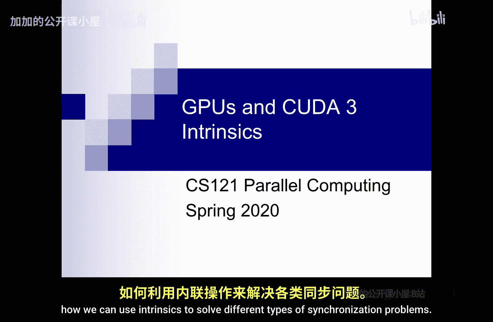
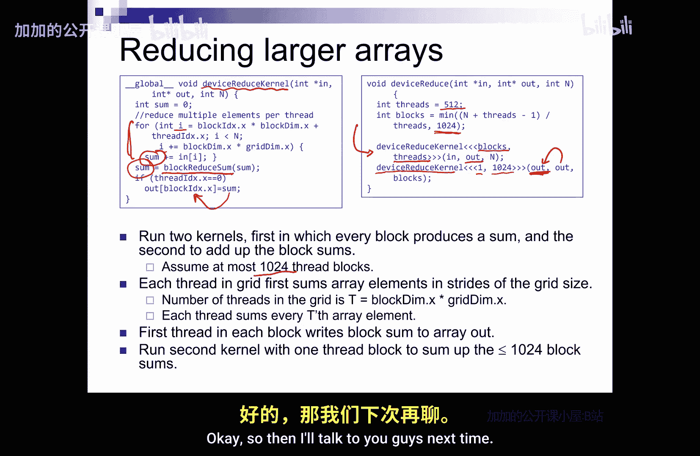

# 并行计算：13：CUDA 3 内联函数

在本节课中，我们将继续探讨GPU编程，并学习一类称为内联函数的GPU操作。我们将主要关注如何使用内联函数来解决不同类型的同步问题。

## 同步问题回顾

上一节我们介绍了分布式内存和共享内存编程中的竞态条件问题。当多个线程并行执行一系列操作时，这些操作会以某种方式交错执行。不同的交错顺序可能导致程序行为不正确。这个问题在GPU编程中同样存在。

例如，观察右侧的程序。这是一个GPU内核，其中有一个名为`DA`的共享变量，它是一个全局内存变量，所有GPU线程都可以访问它。我们启动了1000个线程块，每个块有100个线程，总计一百万个线程。每个线程的任务是将共享变量`DA`的值加1。因此，我们的目标是最终`DA`的值变为一百万。

然而，实际运行时，你可能会得到一个完全不同的值，例如88。这是因为`DA++`这个递增操作，虽然看起来只是一条指令，但实际上由多个更小的指令组成。这些微指令可能以奇怪的方式交错执行，导致`DA`的值被覆盖而非递增。最终，变量可能只被正确递增了88次，从而得到错误答案。

为了在GPU上处理这个问题，我们可以使用一类称为内联函数的操作。

## 原子内联函数

我们将重点讨论原子内联函数。GPU上还有其他类型的内联函数，例如用于快速数学计算（如平方根、指数函数等），但本节课我们只关注用于同步的原子内联函数。

这些原子内联函数本质上类似于小型临界区。它们允许你将一段代码放入临界区，确保当多个GPU线程并发执行时，能得到正确结果。然而，这些临界区的性质有限制：它们只适用于非常小的代码片段，实际上只适用于单个操作。

那么，对于更大的代码段，如何在GPU上实现临界区呢？首先，在GPU上实现通用的互斥算法相当困难。其次，即使能够实现，由于GPU需要运行大量线程，如果有一段代码处于临界区，所有线程都必须顺序执行该段代码，这将导致性能极差。因此，即使能在CUDA中实现临界区，由于性能原因，我们通常也不希望这样做。

接下来，让我们具体看看这些原子内联函数。这些操作仅适用于变量，且变量可以存储在全局内存或共享内存中。

以下是几个核心的原子内联函数：

*   **`atomicInc`**：原子递增。它读取给定地址的当前值并返回，然后将该地址的值原子性地加1。
    *   **代码**：`atomicInc(address)`
*   **`atomicAdd`**：原子加法。与递增类似，但可以指定一个增量值`val`（可为正或负）。它返回地址的旧值，并将`val`原子性地加到该地址的值上。
    *   **代码**：`atomicAdd(address, val)`
*   **`atomicMax`**：原子最大值。读取地址的当前值，并将其原子性地设置为当前值与给定值`val`中的较大者。返回旧值。
    *   **代码**：`atomicMax(address, val)`
*   **`atomicExch`**：原子交换。返回地址的当前值，并原子性地将其设置为新值`val`。
    *   **代码**：`atomicExch(address, val)`
*   **`atomicCAS`**：原子比较并交换。这是一个条件操作，有三个参数：地址、旧值`old`和新值`new`。它读取地址的当前值并返回。然后，如果当前值等于`old`，则原子性地将地址的值设置为`new`；否则，不进行任何更改。
    *   **代码**：`atomicCAS(address, old, new)`

`atomicCAS`是一个非常有用且强大的操作，被称为“通用操作”，因为它可以用于实现各种同步原语。其核心作用是检测当前状态是否被其他线程修改过。如果状态未被修改（当前值等于`old`），则执行更新（设置为`new`）；如果已被修改（当前值不等于`old`），则放弃更新，从而避免错误。

## 应用示例：寻找数组最大值

现在，让我们看看如何使用这些原子操作来解决实际问题。第一个问题是：给定一个数字数组，我们想并行计算其中的最大值。

一个直观的方法是使用`atomicMax`操作。我们启动与数组元素数量相同的线程，每个线程负责读取一个数组元素，然后尝试使用`atomicMax`更新一个存储在全局内存中的共享变量`global_max`。

这种方法在功能上是正确的，无论线程如何交错执行，`global_max`最终都会是数组中的最大值。然而，它的性能会很差，因为所有线程都在竞争同一个全局内存变量`global_max`。当多个线程对同一变量进行原子操作时，这些操作会被序列化，导致并行性丧失。

为了提升性能，我们需要减少竞争。基本思路是将单一的全局变量拆分成多个副本。

改进后的算法使用一个名为`local_max`的数组（例如大小为100）来代替单一的`global_max`。每个线程根据其线程ID对`local_max`的大小取模，决定更新`local_max`数组中的哪一个位置。这样，竞争就被分散到了多个内存地址上。

具体流程如下：
1.  线程首先对`local_max`中对应的位置执行`atomicMax`，将读取的数组值`val`与该位置的当前值`old_max`比较。
2.  如果`old_max`已经大于或等于`val`，说明`val`不可能是全局最大值，无需进一步操作。
3.  只有当`old_max`小于`val`时，才需要进一步使用`atomicMax`更新真正的全局变量`global_max`。

这种方法的优点是：第一次`atomicMax`操作因为分散到多个地址而更快；第二次对`global_max`的`atomicMax`操作虽然仍有竞争，但发生的频率大大降低（仅当本地最大值可能更新全局最大值时才执行）。如果数组值分布随机，这种情况并不频繁。

这个例子的核心在于：当同步瓶颈源于对单一变量的过度竞争时，一个有效的策略就是将该变量拆分。

## 应用示例：计算直方图

接下来，我们看另一个应用拆分变量策略的例子：计算直方图。

给定一个输入数组，假设其中的值是0到K之间的整数。目标是统计每个值出现的次数。例如，数组`[0, 3, 1, 0, 1]`，K=3，输出直方图为`[2, 2, 0, 1]`（表示0出现2次，1出现2次，2出现0次，3出现1次）。

一个简单的实现方法是：每个线程处理数组的一部分元素（使用跨步循环）。对于每个元素，读取其值`v`，然后对直方图数组`histogram[v]`的位置执行`atomicAdd`或`atomicInc`操作。

这个方法同样存在性能问题：所有线程都在竞争更新同一个全局内存中的直方图数组，导致大量竞争和慢速的全局内存访问。

为了改进，我们使用共享内存和拆分策略：
1.  每个线程块在共享内存中创建自己的**本地直方图** `local_hist`，并初始化为0。
2.  线程块内的每个线程处理分配给它的数组元素。对于每个正数元素，对`local_hist[v]`执行原子加操作（现在竞争仅限于线程块内部，且在更快的共享内存上）。
3.  使用`__syncthreads()`确保所有线程完成本地直方图的计算。
4.  最后，由线程块内的部分线程（例如前256个）负责将`local_hist`中的每个值累加到全局内存的最终直方图`global_hist`中。这一步虽然仍有全局竞争，但每个位置只被少量线程（每个块一个）更新一次，开销很小。

这种方法的性能提升主要来自两点：大部分原子操作发生在快速的共享内存上；竞争范围从所有线程缩小到单个线程块内部。

## 应用示例：聚合（过滤）操作

现在，我们来看一个称为“聚合”的问题，其中一个典型例子是过滤操作。

给定一个输入数组`source`和一个谓词条件（例如“值大于0”），我们需要将所有满足条件的元素复制到一个目标数组`destination`中。同时，我们需要知道总共复制了多少个元素。

一个简单的全局内存版本算法是：启动与数组元素数量相同的线程。每个线程检查其对应的`source`元素是否为正数。如果是，则执行`atomicAdd`获取一个全局偏移量`offset`，然后将元素写入`destination[offset]`，最后再执行一次`atomicAdd`来递增全局计数器`Nres`。这个方法性能很差，因为所有线程都在竞争`Nres`。

我们可以使用共享内存来改进：
1.  每个线程处理多个元素（`M`个）。
2.  在线程块内，使用一个共享变量`LN`来累计本块内找到的正数元素数量。
3.  线程块内的线程协作处理元素，更新`LN`。
4.  由块内的一个“领导”线程（如线程0）使用`atomicAdd`将`LN`累加到全局计数器`Nres`中，并获取累加前的旧值`old_Nres`。
5.  每个找到正数元素的线程，需要计算自己在块内的“位置”（通过原子操作递增`LN`获得）。它写入目标数组的最终位置是 `old_Nres + local_position`。

这种方法将大部分竞争限制在了线程块内部的共享变量`LN`上，减少了对全局变量`Nres`的竞争。根据NVIDIA开发者博客的基准测试，共享内存版本的性能显著优于全局内存版本。

该博客还比较了使用CUDA Thrust库中的`copy_if`函数的性能。`copy_if`使用前缀和算法实现过滤，其性能特点不同：当过滤出的元素（正数）很少时，由于工作量不足，性能一般；随着正数比例增加，性能会提升，因为能更好地利用GPU资源。

## 线程束级原子操作与洗牌函数

为了追求极致性能，CUDA提供了更底层的**线程束级原子操作**和**洗牌函数**。这些操作允许同一个线程束（通常32个线程）内的线程直接、快速地同步和交换数据，速度远快于基于共享内存或全局内存的原子操作。

线程束级操作的核心思想是利用GPU的SIMT（单指令多线程）特性。一个线程束内的线程是“锁步”执行的，这为它们之间的无锁、快速通信提供了可能。

以下是几个关键的洗牌操作（`shuffle`）：
*   **`__shfl_up_sync`**: 线程从索引比它小`delta`的线程获取变量值。
    *   **代码**：`__shfl_up_sync(mask, var, delta)`
*   **`__shfl_down_sync`**: 线程从索引比它大`delta`的线程获取变量值。
    *   **代码**：`__shfl_down_sync(mask, var, delta)`
*   **`__shfl_xor_sync`**: 线程从索引为 `lane_id XOR mask` 的线程获取变量值。常用于实现蝶形交换，是高效归约算法的关键。
    *   **代码**：`__shfl_xor_sync(mask, var, mask)`
*   **`__shfl_sync`**: 从指定源线程索引广播变量值到线程束内的所有活动线程。
    *   **代码**：`__shfl_sync(mask, var, src_lane)`

参数`mask`是一个32位掩码，用于指定线程束内哪些线程是参与此次同步操作的“活动线程”。这非常重要，因为线程束内的线程可能因为分支而执行不同代码路径。洗牌操作只能从活动线程读取数据。

### 应用：线程束级归约

利用洗牌函数，我们可以实现非常高效的线程束级归约（如求和）。例如，对线程束内所有线程的某个值`v`求和：
1.  首先，每个线程执行 `v += __shfl_down_sync(0xffffffff, v, 16)` （对于32线程的线程束）。
2.  然后，执行 `v += __shfl_down_sync(0xffffffff, v, 8)`。
3.  接着， `v += __shfl_down_sync(0xffffffff, v, 4)`。
4.  继续， `v += __shfl_down_sync(0xffffffff, v, 2)`。
5.  最后， `v += __shfl_down_sync(0xffffffff, v, 1)`。

经过这5步（log2(32)步），线程束内第一个线程（或其他指定线程）的`v`值就是所有线程`v`值的总和。由于线程束内线程锁步执行，无需显式同步，且所有操作在寄存器间进行，速度极快。

### 构建分层归约

对于大规模数组的归约，我们可以结合使用线程束级归约和块级、网格级归约：
1.  **线程块级归约**：每个线程块包含多个线程束。首先，每个线程束使用洗牌函数完成内部归约，得到一个部分和。然后，由每个线程束的第一个线程将这个部分和写入共享内存的特定位置。最后，再由第一个线程束使用洗牌函数对这些写入共享内存的部分和进行第二次归约，得到整个线程块的总和。
2.  **网格级归约**：如果数据量超过一个线程块能处理的范围，则启动多个线程块。每个线程块计算出自己的总和后，将其输出到一个全局数组。然后，再启动一个或多个后续的内核，对这个全局数组中的块级结果进行归约，最终得到整个网格（即整个数据集）的总和。

这种分层归约策略是CUDA高性能并行算法的典型模式，充分利用了线程束级操作的极速和共享内存的带宽，有效减少了全局同步的开销。

## 总结

本节课我们一起学习了CUDA中的内联函数，特别是用于同步的原子内联函数和用于线程束内高效通信的洗牌函数。

我们首先回顾了GPU编程中的竞态条件问题，并介绍了`atomicAdd`、`atomicMax`、`atomicCAS`等基本原子操作，它们如同微型的临界区，能保证对单个变量的操作原子性。

接着，我们通过**寻找数组最大值**和**计算直方图**的例子，学习了当单一变量成为性能瓶颈时，如何通过**拆分变量**和利用**共享内存**来减少竞争、提升性能。

然后，我们探讨了**聚合（过滤）操作**，比较了全局内存、共享内存以及Thrust库`copy_if`等不同实现方式的性能特点。

最后，我们深入学习了更高级的**线程束级编程**。利用`__shfl`系列洗牌函数，线程束内的线程可以在寄存器级别直接交换数据，实现无锁且极其高效的归约等操作。我们掌握了如何利用这些函数构建线程束级归约，并进一步将其组合成线程块级乃至网格级的分层归约算法，以应对大规模数据计算。

理解并合理应用这些内联函数和同步模式，对于编写高性能的CUDA程序至关重要。它们允许我们在保证正确性的前提下，最大限度地挖掘GPU的并行计算潜力。