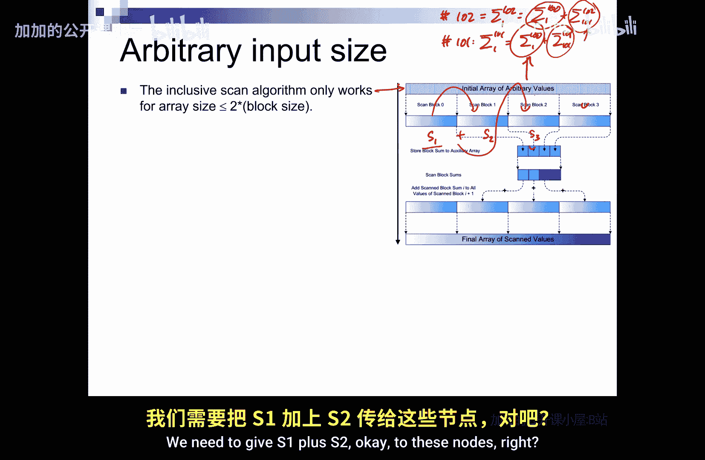
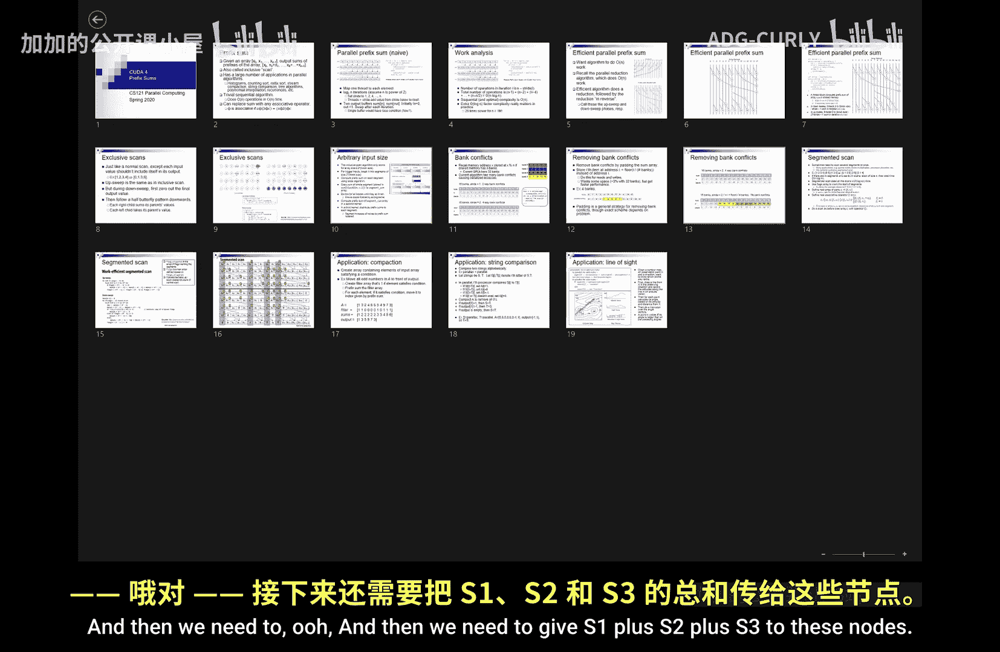
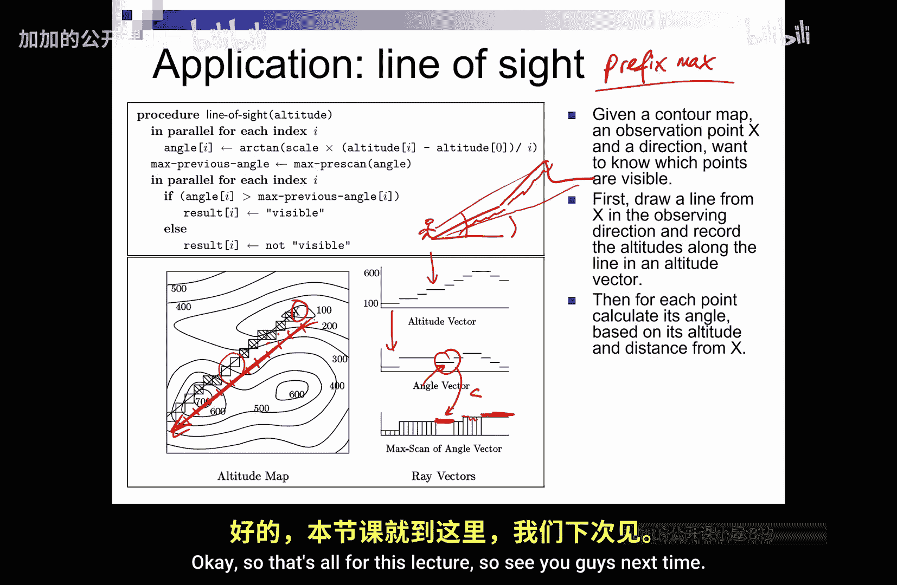

# 上海科技大学【中英⚡并行计算｜CS121 2020 Parallel computing】 p14 P14 CUDA 4 Prefix sum -BV1VqypBaEaP_p14-

Okay， welcome to our fourth lecture on Kuda。So in the previous few lectures。

 we looked at the KUuda language and how to write programs in KUa。And so starting from this lecture。

 we're going to look at a few important problems that we can solve using KUuda。

So the first problem is called prefix sum。Okay， so the definition of prefix sum is quite simple。

 so the input is an array of numbers， x1 up to x n minus1 or sorry x0 up to x n minus1。

And the output should be the prefix sums of this array。

 so what we want to do is for the first value right。

 so the first output value should be the sum of the first one input values。

The second output value should be the sum of the first two input values， so x0 plus x1。

The third output value should be the sum of the first three input values， so x0 plus x1 plus x2。

And so on， and then the final output value， the n output value should be the sum of all n input values。

Okay so this is called a prefix sum because each of the outputs is a sum of a prefix of this input array。

And this prefix sum operation is also called a scan。And in fact。

 we call this an inclusive scan because for the Ive output， this includes the I input。

 so for example， the second output right it includes the second input value。

Now you could imagine this prefix sum being shifted over to the right by one okay if you do that。

 then the I output is the sum of the first i minus1 inputs。

 and so it does not include the I input And in that case it would be called the exclusive scan Okay so we're going to look at the exclusive scan also。

All right， yeah， so we're going to focus on this scanner prefix sum operation today。And you know。

 it seems like a very， first of all， a very basic operation， and second。

 it might not actually seem all that useful， right like why would I want to add up prefixes of all these inputs？

But as it turns out， this prefix sum operation actually has a huge number of applications in parallel computing。

Okay so you can use this basic prefix sum operation to build up many。

 many other algorithms okay so if you can efficiently implement prefix sum。

 then you have efficient implementations of many other parallel algorithms so here I've just listed a few right there are many more you can use them to compute histograms you can use them in various sorting algorithms。

 various types of filtering algorithms， different tree algorithms。

 recurrences and many other applications。Okay， so today we're going to look at。

We're going to look at both how to implement prefix sum efficiently。

 and we're also going to look at a few applications of prefix on。

Okay so I just want to mention that this prefix sum operation is so fundamental to parallel computing that people have considered putting the prefix sum operation into hardware so just like sequential hardware has basic operations like the Earththmetic operations like add subtract and multiply because those are fundamental to sequential computations so there have been proposals in the past saying that prefix sum is so fundamental to parallel computations that parallel hardware should actually include specific hardware to compute prefix sums and people have built like prototype chips which which can do that。

So nowadays， because parallel computing is mostly being done on just a large collection of normal sequential computers。

 sequential processors， then today we do not actually have this prefix sum operation in the processor itself。

 but nevertheless， this is a very important operation for parallel computing。

Okay so it's actually of course very easy to compute a prefix sum in a sequential setting right all you do is you just go through your array right so for the first output。

 it's just the first value and then for the second output well you have to keep a running sum of your previous output so for the second output since you previously output x0 the next output is just the previous one plus x1 and then the third output is the previous one plus x2 and so on。

Okay， so therefore， if you do this sequentially， it's going to take you just an operations basically。

 so you can solve this in linear time。Okay and so when we have a so this linear time algorithm。

 so this is clearly the most efficient algorithm， the one that does the minimum amount of work because in order to produce these n output values at the very least you're going to have to read all of the input values right so there are n input values and so since we're doing order n operations。

 then this is asymptotically the most efficient possible。Okay。

 so the absolute minimum amount of work we need to do is linear in n。

 and so what we will try to do in these parallel setting is to find parallel algorithms that also in total do order n amount of work。

Okay， so remember that yeah。Okay， so also before we actually look at some prefix sum algorithms I should mention that we don't really have to do just prefix sum。

 we can do any sort of we can replace the sum operator by any associative operator okay so remember associative just means that it sort of it doesn't matter which ordering you do the do the operations in right like if you have three inputs like if this plus here is an associative operator right then if you have three input。

 you can either do it in the first order or the second order and if you get the same result then this operator is associative。

OkaySo there are many associative operators， for example。

 multiplication is associative the min operator right where you find the minimum of two numbers。

 that is associ， right the max operator， there are many other associative operators。

And so this is actually quite a useful statement that can if we have a efficient algorithm for prefix sum where the operator is just addition。

 then you can use the exact same algorithm for but you replace the sum operation with some other associative operator。

And as it turns out， by using the right operator， you can solve some pretty interesting problems。

 including ones that don't look like they have a parallel solution。

 but if you can define the right associative operator to sort of capture the operation。

 then you can phrase that problem in terms of prefix sum。

 and then you can solve it very efficiently in parallel。Okay。

 so we're going to start with a very basic prefix sum operation or algorithm。

 okay so let's just look at the diagram on the left here。

 so what we're trying to do is we have these eight input values。

And the way we're going to do this is we're going to basically we're going to pair up some of these values and we're going to add them Okay。

 and then eventually that that's going to produce the right prefix sum。

 So so for the pairing for which processes we're going to pair。 well， we're going to we have this。

This parameter here called okay， so this is actually not defined in the code on the right。

 but we're going to call this parameter a stride parameter。 Okay。

 we're going to use the same terminology for some of the other prefix sum algorithms。

 So the stride here is just the distance between the values that you pair So for example。

 in the first phase over here right we're pairing every other value So so the stride here is equal to1 Okay because we're pairing like x0 and x1 and we're going to add them。

 and you pair x1 and x2 and you add them and so on。 Okay so all the pairs are distance one apart。

Okay， next。Okay， so then you pair these values and then you add them and what happens is well x0。

 initially he doesn't have a partner。 Okay， because there's nobody to his left。

 So then his value after you So then we do a phase where we we pair all of the nodes which are distance one apart。

 Okay and we add them。 So all this is being done in parallel。Okay。

 so then after this first parallel phase， what you have is since x0 doesn't have a partner。

 then his value after this phase is still just x0。And then this is written as just the sum from x0 to x0。

 so this notation is useful in other parts of this diagram。

 but here it just means that x0 has its own value。Okay， so for the next node， right。

 since we're pairing x1 and x0 then and you add them， then afterwards。

 this x1 is going his value changes to x0 plus x1。Okay， so the x2 he gets added to x1。

 and so his value changes to x1 plus x2。And so on。 Okay， so then after the first phase。

 you have these eight new values。Okay， and then now we're going to do another phase and here the stride is going to be is going to be two。

 Okay， so this means that every node is going to pair with a node that's2 to the left of it。Okay。

 so for example， this node over here like the third one， he's going to pair with the first node。

 and then he's going to add his value。So currently he's got the third node has a value of x1 plus x2。

 and the first node has a value of x0， so if you add them， you get the sum from x0 up to x2。Okay。

 likewise this guy over here right he's going to pair with the node that's2 to the left of him。

 so he's currently got a sum from x2 to plus x3 and this guy has a sum from x0 plus x1。

 So when they add they're going to end up with a sum from x0 up to x3。Okay。

 so that so you do that for all of these nodes， the only thing is that this node doesn't have anyone which is on two to the left of it。

 Okay， so the first two nodes are not going to get paired with anyone because they don't have anyone to their left。

Okay， and then after that after so again， we do all of these so these are additions over here。

 we do all of them in parallel okay， so then after that we're going to end up with these values over here Okay。

 so yeah， and then we're going to do another phase。

 but this time we're going to double the stride again okay。

 so the stride used to be one it got double to two and now it doubles to four。Okay， so then。

We're going to pair node which are distance4 apart。 right。 So， for example。

 this fifth node over here is going to pair with the first node， right。

 The fifth node already if you， if you check from the second phase， Okay。

 the fifth node ended up with the sum from x 0， I'm sorry， from x 1 up to x 4。Okay。

 and then this guy， the first node has the value x0。 So when they add。

 they get the sum from x0 up to x4。Okay， so now you just do this for every node which has a partner okay。

 so he takes his own value and adds it to his partner who is four spaces to the left。

The only thing is that these first four nodes， they don't have any which is force faces to the left。

 so they don't change their values。Okay。And now if you look at the output after that， right。

 then what you see is that all of these node actually now have the correct prefix sum。

🎼Okay so for example， if you look at this seventh node over here right so after the third phase he had the sum from x3 up to x6 and he got paired with who so he got paired with this guy from x0 who had a sum from x0 up to x2 okay so then if you add these two together。

 you just get the sum from x0 up to x6。Okay， and you can check this for for every node that。

He's going to end up with the sum from x0 up to whatever his own index is。Okay。All right。

 so so basically let's sort of try to argue why this algorithm is is working。 Okay。

 so I'm not going to give a full proof of this， but let's at least try to understand what it's trying to do。

 okay。🎼So what is happening with this algorithm is that let's say after phase one。

 where these stride was one， right， then what happens is that every node has a sum from the previous two nodes。

So if the stride is one， then after this phase， every node has a sum。

 which is the sum of the previous two nodes。So for example， this guy right this he's got a sum from。

 I'm sorry， let's write it this way。 Okay， so the second guy。

 he's got a sum from himself and the previous node， Okay， so he's got a sum of two values。Okay。

 this guy also has a sum of two values of of himself and the preceding value。 Okay。

 so you see that all of these guys have the sum from two consecutive values。Okay。

 the only difference is at the first node， okay， he just has his own value。Okay。

 but also notice that the first note already has the correct prefix on。 Okay， so let's， in fact。

 circle this guy。 Okay， because he's already got the right answer。

 And so he doesn't need to do anything anymore。 right， The other guys don't have the right answer。

 Oh， I'm sorry。 this guy。This guy， the second guy also has the right answer， okay。

 because he's just trying to output the sum of x0 and x1 and he already has that after one stage。So。

 in fact， in the first stage， the first guy already have the right value。 Okay， in the second stage。

 you have。Two nodes that have the correct values and all the other nodes have。Have a sum。

 which is the sum of two consecutive values。Okay， then now we go to the third stage and here the str is4。

And what happens is， first of all， you can see that the first four nodes。Have the correct value。Okay。

 and all of the other nodes have a sum which includes the previous four values Okay。

 so for example this fifth guy right， he's got the sum of x4 x3。

 x2 and x1 okay so he's got a sum of the previous four consecutive values。And likewise。

 this guy has a sum of the previous four consecutive values and so on。Okay， and then so in general。

 if we're in a if we're in a phase and if the stride is some value k， All right。

 then what's going to happen is let's see at the at the beginning of this phase where the stride is k。

 you have that the first k nodes。Already have the correct prefix on。Okay， just like for example。

 for this phase where the str is4， the first four nodes already have the correct prefix sum。

And all of the other nodes have a sum， which is like the sum of their value and the previous k values or previous k minus1 values。

Okay， so， so they have part of their prefix sum， right。

 So they have k values out of this prefix sum computed。 Okay， so just like， for example， this guy。

 Okay， right， He's got part of his prefix sum。 He's got like four values out of his final prefix sum computed。

Okay， and of course， he needs to go go on and get some more values， but he's already got part of it。

 In fact， he's got K values when the str is K。Okay。

 so that's the basic invariant that we have okay when the str is k。

 the first k nodes half the correct prefix sums and all of the other nodes have the sum have part of the correct prefix sum。

 which includes the last k values in the prefix sum。Okay， so now。

So that's the invariant and you can go ahead and prove that this is actually an invariant。

 that each time we do a phase we satisfy this invariant。And。

So I'm not going to go through that full proof but you can think about that and then the upshot of the invariant is that if you do this for so since our stride is doubling each time okay then if you have n nodes then let's assume that n is a power of2 for simplicity then after log n steps we're going to have that the stride is going to be n because the stride doubles every time and so therefore by the invariant every node is going to have the correct。

Correct prefix up。Okay， so this this algorithm is going to run for log n phases in each phase we have a lot of parallel addition operations happening。

Okay， so so let's actually write out this algorithm in some sort of pseudocode。 Okay。

 so the pseudocode is that we're going to go for login phases， as we said， Okay， so for each phase。

 we're going to have all of the threads work in parallel。Right。

 and then what we are doing is let's see。 So we are taking so we're pairing up the nodes。 Okay。

 so we're pairing up the node at index T Id over here。

 And then also the partner node is going to be stride distance away。 Okay。

 so remember that the stride is somehow is is a power of2。 Okay。

 so therefore in the I iteration of this。 this is going to be our stride。 Okay，2 to the I minus-1。

And so we're going to pair the node at index T IDD with the one at TID minus 2 to the I minus1。Okay。

 and we're going to add those together and then store it in the。In this output sum okay。Okay。

 so now notice that the sum actually has so the sum here actually is a2 by n like little matrix。

 Okay， so it's got two rows， okay， and then n columns。

And the reason we we have two rows is we're going to call one of the rows。

 the in row and one of the rows， the odd row， the out row。 Okay， so what's going to happen is。

mAnd we're doing this just to save space here in our implementation， Okay。

 so imagine that this is our sum array。Okay。So we're going to have one of these rows we call the in and one of these be called the out。

 Okay， so basically what's going to happen is in different iterations。

 we're going to switch between these two rows。 Okay， so imagine that in the current iteration。

 we have we computed a bunch of these values。 So let's say that in this iteration。

 we computed a bunch of these values。 Okay， and suppose other being stored in the the top row over here。

 right， so there's n values in this row。 So we stored all of the values in the in the second phase。

 Okay， then in the third phase。😊，So this phase over here right well this phase needs to get values from the second phase right so what we're going to do is in the third phase we're going to use this out over here and this is going to be reading values over from the second phase like that。

Okay。😊，All right。Okay， and then so after this， I I'm going to have to redraw this。 Okay。

 so then after the third phase。The outputs of the third phase are going to be stored in the out row okay so they're going to be stored down here okay and then previously we had some stuff in the in row。

 but that was for the second phase and now if we run a fourth phase we don't need the data from the second phase anymore so we can simply reuse the top row。

 the in row。Okay， meaning that in the fourth phase， right。

 the fourth phase is going to read data over from the outrow， Okay。

 which is the output of the third phase。 Okay， so we're gonna we're gonna you know read data like this from the from the third phase。

 And this is being used in the fourth phase okay。And so after the fourth phase。

 we're going to have a bunch of values in the in row。and then for the fifth phase， fifth phase。

 right， we don't need the stuff from the third phase anymore， which is currently in the out row。

 so we're just going to reuse that。So therefore what we're doing is we're just swapping back and forth between these two rows and we do that just so that we can reuse the space from previous phases that we don't need anymore。

Okay， so that's what's happening with these swap things over here。Okay， yeah。

 so this text just says what I was describing previously。Yeah。

 so so the reason that we actually need two rows here okay is that if you try to implement all of this stuff using just one array of size n you would get race conditions okay it's very hard to eliminate these race conditions so for simplicity we're just going to go for two rows。

Okay， so that is the basic algorithm over here。Now let's look at how good this algorithm is Okay。

 so we're going to count how many total operations this algorithm does Okay。

 so now the claim is that in iteration I， if you have a stride of I。

 then the number of operations is going to be n minus a stride。Okay， so for example。

In the first phase， the stride is going to be one。And you see that every node needs to do an addition except for the first node。

 So you see that， for example， x1 here right， so he's going to do this addition right X2 is going to do that addition and so on。

 Okay the only guy that doesn't do anything is this guy x1 sorry x0 because he's already got the right value。

Okay， so so likewise， if you go to this node well， to this row， let's say， okay， so in this phase。

 we have a stride of4 right， And you see that for example， these nodes， right。

 they all need to do some some sort of addition。Okay，However。

 the first four nodes already have the correct values so they don't need to do anything。Okay。

 so in general， the number of operations in iteration I is just whatever the stride。

 you subtract that from N。Okay so then then the total number of operations is well in the first phase strus 1。

 so you do n 1 operations， second phase strtus 2， so you do n -2 and then n minus4 and so on and in the final phase the str is going to be n over 2 so you do that many operations。

And if you add this up， right， So we have a log n phases over here。

 Each of these phases is at least n over2。 right， You can see all these numbers are at least n over 2。

 So the total number of operations is going to be n log n。Okay。

 now remember that the sequential algorithm， that had a linear complexity because it just iterated through this array。

Okay， whereas for this parallel algorithm we have a n log N complexity， okay。

 so we're off by a factor of log n。And this factor of log n is actually pretty important in practice。

 okay because in practice if you have a million numbers which is know you could often have a race with which are that large。

 then this login is going to become 20 so then that means that this current algorithm is 20 times slower than the best possible algorithm。

And that's a big deal right， so you know， that's a difference between waiting one second and 20 seconds Okay or one hour and 20 hours okay。

So therefore， we want to make this algorithm more efficient。Okay。

 so so now we're going to look at some efficient， more efficient prefix some operations。 Okay。

 so in fact， we're going to have。Algorithms that do linear work。

 parallel algorithms that do a total linear work。Okay。

 so the basis for these algorithms is that we're going to go back to a somewhat related operation。

 which is the reduction operation。So the reduction operation is to say that we have an input array and we just want to add up all of the values。

Okay so that's kind of like the final output value of prefix sum right because in prefix sum。

 the final node， his output should be the sum of all of the input values。

The other nodes need to output like a prefix sum， but the final node is going to output the entire sum。

Okay， so the reduction is like what the final node does in prefix up。Okay。

 and the reduction algorithm， we had a linear work reduction algorithm Okay so basically that's being shown in this in this structure on the right over here right so we have this thing called the reduction tree so this is a tree。

And remember the reduction tree was we proceeded in phases and we also had this stride concept。 Okay。

 so in the first phase every node is going to is going to pair with somebody who's stride distance apart and stride initially is going to be one here right So every node pairs with just this neighbor immediate neighbor and add。

Add those values。Okay。😊，And then in the so that's going to take all of the input values and it's going to combine them into half as many elements okay so previously we had 16 values now after the first phase we combine them into like eight different locations and then for these eight locations we're going to pair them again and and here our stride is going to be now two because you see that these nodes now are distance two apart and if you add them and those eight values get combined into four values which are distance four apart you pair those and then you get two values which are distance eight apart and so on。

Okay， so then the total amount of work being done in this algorithm is that in the first phase where str is 1 you have an over two amount of work。

And then when strus 2， you have N over4 amount of work。

 and then you have N over8 amount of work and so on。

 So this is actually a geometric series right To work is N over 2 plus N over 4 plus N over 8 and so on so this adds up to linear work overall so this reduction algorithm is linear work。

And it turns out that if you take this reduction algorithm right so this is of course not solving the prefix sum problem。

 but if you somehow take sort of like two copies of this reduction algorithm。

 then you can combine them to solve the prefix sum algorithm problem。Okay。

 so so you have this the first prefix sum algorithm we're going to look at is this one by Brent and Coon and this is kind of like you so this has like two phases Okay。

 so the first phase is just a reduction okay so the top phase here is just a reduction so time is going downwards。

Okay， and then the second phase is kind of like a reduction in reverse somehow， okay。

 so I'll show you exact details later。Okay。Yeah， so and so we're going to call these two phases the up sweep phase and then the down sweep phase Okay so this is the up phase and then this is the the down sweep phase。

Okay， so let's look in more detail on what's happening in these in these two phases。 Well。

 for the for the up sweepep， this is just a。A reduction。 Okay， so for this part。

 it's just a reduction。Oops。Alright， so my pen is not working so well today。Okay， all right。

 so I'm now going to talk too much more about that。 I've already described it。

 And then for this down sweep phase。 Alright， actually， I should say something。 Okay。

 so for this reduction phase， what do you get after you do this reduction phase。 Okay。

 what you get is that some of the nodes have parts of these prefix sums computed。Okay so for example。

 if you look at all of these nodes， the odd nodes the 1，3。

5 and so on right so what value do they have after the after the first phase over here。

 so after the first phase they have the value from the first from the previous two nodes like this this guy one right he's got the sum of0 and1 okay this guy3 he's got the sum of two and three。

5 has the sum of form5 and so on。Okay so here where the stride is well let's say one， right。

 then you have the sum of the previous S times 2 nodes。Yeah。Okay。

 so then if you look at the next phase， okay， then some of these nodes don't do anything。

 So for example， this node one， okay， he doesn't do anything in the next phase， but this node 3。

 he's going to end up with a sum of all of these values Okay。

 so here' strideite equals2 right and then now he's got the sum of the previous four values。

And this node 7 also has some of the previous four values okay。

 this has some of the previous four values， and this does too。Okay。

And then if you look at the next phase some of these nodes don't do anything。

 so for example of thread3 over here he doesn't do anything but node 7 over here he does a sum and so he's going to end up with the sum of the previous eight values。

Okay， and then this node is also going to end up with sum of the previous eight values。

Okay and then finally， this node over here， right this node 15 over here， after the reduction。

 the up sweep phase， he's going to have the sum of all 16 values。Okay。

 so that's sort of the outcome that has occurred after the。After the down sweep phase， Okay。

 is that we have parts of these。Let me actually erase this thing over here。

 so we have parts of these prefix sum being computed。Okay， and in fact。

 one of these nodes actually has a correct prefixt sum， right， for example， the final node over here。

 he's got the sum of all of the other values， and that's what he's supposed to end up with。Okay。

 now in the down sweep phase， right， we're somehow going to distribute some of these values we've already computed to the other nodes so that they also get the correct values。

Okay， so in the first phase， we collect some of these partial values。And then in the second phase。

 we distribute these partial values and combine them in some way so that everybody has the correct value at the end。

Okay， so the way to look at this distribution process is we should look at these nodes in terms of their binary representations。

Okay， so let's let's pick a note。 So for example， this is the 13th node。 Okay。

 so he's node number 13。 So we're， first of all， going write his I is this 13 in binary。 Okay。

 so this is written as 1，1，0，1 in binary。Okay， and now the way we're going to think of this is that if you're the 13th node。

 okay， so。So we're the 13th node， right， So we want the value。

 Let's say we want the first value up to the 13th value。Okay。

 so so this is actually equal to the sum of the first eight values right plus the sum of the next of9 to what do we have here of 13 right oh sorry of 12。

Okay， plus the sum of the 13th value。Okay and the reason I write it this way is because sum of the first eight values。

 that is going to correspond to this digit over here。Okay， now the first digit， right。

 this represents8。Okay， so the first eight values， we're going to think of it as the first digit in 13s binary representation。

Okay， the next four digits， we're going to think of it as corresponding to this digit over here。

 right this that's the digit for4 Okay and the final one over here。

 we're going to think of it as the corresponding to this digit over here。Okay。

 and now the reason we want to think of it this way is because so now we're trying to focus on this node over here。

 right， So our focus is on this node， the 13th node。RightNow let's see if we do these operations。

 what is the value that he ends up with Okay well， the value he ends up with is now what are the what's happening over here is that initially we progress through this reduction phase right and at the end of the reduction phase。

 we have this node7 over here well let me say it this way Okay so in fact。

 let me switch to a different color so that can we can sort of differentiate this from the previous parts so let's switch to blue over here Okay so now what is the 13th output value Okay let's look at the operations that occur in order to produce the 13th output value。

So first of all， we have this addition over here。Okay。

 now this addition involves this value right and this value。

OkayBut where does this left value come from， it comes from over here， right？Comes from over here。

 So this also involved an addition between this value and this value。Okay， now the left value here。

 what did that come from， Okay， that came from over here。And the right value。

 where did that come from， that came from over here。Okay。

 so so basically the 13th output value consisted of oh and then this this value over here， right。

 where did that come from， that came from the original input value。

Okay so the 13th output value comes from summing this value over here， and this value and this value。

Okay， now let's look at these three values。 Okay， now let's， first of all。

 look at the first value here， the first value over here。Okay， this is the value that。

This node number seven ended up with。After the reduction phase， okay。

 because here we've already once we're up to this point， we've done the entire reduction phase。

Okay and what value does node 7 have at the end of the reduction phase。

 he's got the sum of all of the first eight values。That's what we said， right。

 the node number7 here after reduction hass to sum of the first eight values。Okay。

 and and why is that good， it's because when we're trying to sum the first 13 values。

 we need the sum of the first eight values。It's okay。

Now over here another part of what goes into 13th output is this value over here okay and what value does this guy have whoops。

 well at the end of of the reduction phase， he's got the sum of the previous four values right he's got all of these four values computed right so these values are going from actually so this is since these things are off by1。

 so this is actually index 99 to 12 okay which is this part of our sum。Okay， and then finally。

 the final part of 13th output is this value over here， which is actually the 13th value。

 So that's this part of our sum。Okay， so the way to look to see that every node， allright。 And then。

 of course， if you add these together， right， if you add the the first eight values and then values 9 to 12 and then 13。

 right， you get the sum of the the first 13 values。

 And this is why node number 13 over here has the correct value at the end。Okay。

 so the way to see that every node after the down sweepet phase， after this entire algorithm。

The reason it's got the right value is that you can look at the。The value of the node。

 you can write the ID of the node in binary and then wherever the one digits are in this binary representation。

 right you can see that this algorithm is going to pick exactly those values from this overall tree structure and it's going to add those together and then get you the right output。

Okay， so in fact， let's just do one more example。 just to see this thing in action here。 Okay。

 so let's do one more example。 Let's see if I can。 Okay， great， alright。

 so let's erase all this stuff。 And then let's let's pick a different note here。Okay， so fact。

 I'm going to get rid of all of this。Okay， so let's pick a node。 what Let's pick node number 9 over。

 Oh， not 9。 Let， let's pick 10 over here。 Okay， so 10。 Okay， so if you write。Let's pick 11。 Okay。

11 has more 1 digits。 Okay， so now 11， if you write this in in binary， this is equal to 1，0，1。

1 in binary。 Okay， And if you look at node 11， right。

 then what kind of what goes into the output of 11。 Well， oh， I'm sorry， this is node 12。Okay。

 what I should be looking at is so this is actually a node 11。 Okay， so this is 11。

 This is the 11th node。 Okay， his index happens to be 10， but he's actually the 11th node。

 So his binary representation is like like this。 And what goes into his output is that if you look at this value。

 right， So this is the sum of this value in that value。

 So the right value actually comes from the 11th value。 okay。From X 11。And then this value over here。

 this is the sum of this value here and then that value， and if we trace this back， we get that。

 this is the sum of this value right and then if we trace this back we get that this is the sum of that value。

Okay， so what's happening for node 11 here is that this is the sum of the first eight values over here right and then the next two values。

 so we have eight values over here and we have two values over here and then we have just this value over here right the final value。

So again， you see that if you break this nodes index into a binary representation。

 then this algorithm is just going to combine exactly the right parts to form its output。Okay。

 so that is the Brenncoon efficient prefix sum operation algorithm and we can implement this in parallel。

 so the way we're going to implement this， so this is some sort of kudo code。

 it's not the entire code， but it's the part that implements these up sweepep and down sweep parts。

Okay， so this so the first part is the up sweepep， right， So this。Switch back to red over here。Okay。

 so the first part is the up sweepep and what it's doing it basically is on。It's well， let's。

 let's look at this operation。 Okay， so in the first phase， right。

 we don't need all of the threats to be active because the only threats that we need are the ones that do this addition。

And you see that if we have 16 elements， we only need to do eight additions。

 so we only need eight active threads。And then in the next phase。

 we only need four active threads because we just need to combine eight values using four threads。

Okay， so the number of active threads actually decreases by a factor of two each phase。Okay。

 so this algorithm is going to run in this way。 Okay。

 what it's going to say is that initially suppose you have a bunch of threats。 Okay。

 so suppose you have threats like。あ。狗。Okay， so suppose you have eight threads initially， Okay。

 so in the first phase， all of them are going to run。😊，Okay， in the next phase。

 we're only going to pick half of these threats to run。Now， which half Okay， we're going to pick。

 sorry， let me just rebrand this five here a bit nicer。 Al right。

 we're going to pick the first half of threads to run。And the other half is just going to be idle。

 okay， we don't need them。Okay， and then in the third phase， we're going to pick again。

 half of these threads to run， okay， the first half。Okay。

 so so the number of active threats decreases by factor two each time。

 and it it's always going to be the first half of the threads from the previous phase。Okay。

 now these other phases， so now you might say that oh， we're just wasting work for the other phases。

 okay， but I'm sorry， so so the other threads that are not running in a phase。

 okay you might say that we're wasting work for these threads。

But those threads are actually so when you execute them on the GPU those threads would be in some warp right and because those warps don't have any active work anymore then those warps will not be scheduled by the GPU scheduler and so remember that these warps are executing on the SMs so if those warps are not even being scheduled。

 then they're not wasting time on our SMs。Okay， so in when you actually execute this on the GPU。

 you have these active threads and only those are going to be using the Ss right and the number of active threads keeps decreasing and so。

So we can actually always fully utilize like a single S。Yeah。

 so we're not actually wasting our SM resources， okay。

 even though we're decreasing the number of active threats per phase。Okay。

 so that's that's just to tell you like which threads are actually executing and the way this happens is that。

If you look at this algorithm what you have here is you have this I thing over here and then you have a stride right and the I is basically indicating which indice which indices are doing the addition in each phase so for example。

 in the first phase， the indices doing the addition are like the 13，5。

7 and so on and then in the second so that's the first phase the 13，5。

7 are doing these addition operations over here in the next phase the only indices which are doing the addition are the three and what do we have here 7 and then 11 and 15。

Okay， so so that's what's so after you compute this I over here， right， then you do。

In addition between two indices from I and then I minus stride。

And then you're going to double your stride for the next phase and then we have to do a sync threads over here because we have to。

 for example， finish all of these additions over here before we can do any of these additions otherwise because there's a dependency between these editions and if we don't have the same threads we might get the wrong answer。

Okay， so the top part implements the down sorry the up sweep and then the second part over here implements the down sweepep。

And for the down sweep， you see that the stride is initially larger right so initially the stride is like four right and then it drops to like two right and then it drops to one。

So therefore for the second part， our stride is going to start out large。

 and then it's going to decrease by a factor of two each time。Okay， and again。

 so I'm not going to go through this too carefully。

 but we have some way of computing these indices corresponding to the places that do the additions。

Okay， so。All right， so now this algorithm here is written for one thread block and the thread block can compute the prefix sum of an array。

 but there's a limit on how large the array is and so at most the array can have size two times the block size so if you look at this code it'll only work correctly for up to that size up to that size array。

Okay so so for example， in this example over here， right， we're talking about a block size of eight。

 so we have eight threads in the block okay and they can process 16 elements。Okay， so that is the。

So that's the algorithm and it's efficient because again in the upwe phase right we have a geometric series in terms of the work that occurs so there's order end work in the in the top part and then in the bottom part there's again order end work okay so altogether we're doing linear amount of work for this。

For this algorithm。Okay， so now we're going to look at so that was for the inclusive scan。

 inclusive prefix sum where like for example， the 15th element should output the sum of all 16 values。

你放诉。Now you can change this slightly to the exclusive scan， okay， so again。

 that just means that the I value should output a prefix sum。

 but it should not include its own value。Okay， so for example， if your input is like this 1，2，3。

4 here， right， then for example， the third node right， he doesn't do the sum of 1，2， and3。

 he just does the sum of one and 2 and the fourth node， right， he does the sum of  one，2， and 3。

So of course you can compute this exclusive scan using an inclusive scan right so you just compute the inclusive scan and then at the end everybody subtracts his own value。

Okay。However， we're going to look at an algorithm， a pretty elegant algorithm to do this without having to do this extra step at the end。

Okay， and then we're also going to use this algorithm when we do this segmented scan operation towards the end of this lecture。

Okay， so the way this algorithm works is it's again going to have so it's quite similar to the Bncoon algorithm for inclusive scan。

 So again， it's going to have two phases， the up sweepep and the down sweepweep okay so in fact。

 the up sweepep is exactly the same as for the Brenncoon algorithm It's again just a reduction operation。

But for the down sweep this is where we're going to have a small difference and so here we can look at these the down sweep part as doing these things called half butterfly operations Okay。

 so let me just show you in pictures what this is actually going to do。Okay。

 so so we again have these two parts， the up sweepep and the down sweepep。

 so the up sweepep is just a reduction as we had before right？And then the down sweep part。

 So what's going to happen is before you sweet you start the down suite part， you are going to。

You're first of all going to set the final value over here to be0。😡。

Okay so after the end of the up sweepep， after the reduction。

 you have that the final node over here is going to have the sum of all of the values。

But when you do an exclusive scan， you don't need any node to output the sum of all of the values。

Even the last note should only output the sum of all of the preceding notes， excluding itself。Okay。

 so therefore， we're first of all， going to make the final value here be a0。Okay。

And now on each phase of this down suite part， it's going to consist of， again。

 node are going to partner with some other node which are distant stride apart。

 and the stride is going to keep decreasing geometrically and initially it's equal to half the size of the array。

Okay， so initially we have the final node is going to pair with this node distance 4 away。

And what's going to happen when you partner with somebody is that so the left node。

 so let's call these guys A and B， okay。Or sorry， let's call them left and right。Yeah。

 so this is going to be the left node。 and this is the right node。 right。

 So the right node is just going give his value to the to the left node。 Okay。

 so what's happening is over here。 If we look at the code for the for the down sweep。 right。

 So this here， the x at index K plus 2 to the D -1。 Okay， so this complicated thing represents oops。

The left node， Okay， so index K plus 2 to the d minus1 is going to be the left side。

And then this K plus 2 to the d plus 1 minus1， this is going to be the right side。Okay。

 so first of all， the right node is going to give his value to the left node。

Okay and and then the right node is going to take the left node value and then add it to his own value。

Okay， so initially the right node is going to store the left node value in this temp variable t right and then he's going to add both the so this is going to be the left value left node value and the right node value。

 and this is going to be stored in the right node value。Okay。

 so that's being shown in this picture over here， so the right value is going to give his value to the left guy and the left guy is going to combine his value with the right guy。

Okay。😊，Yeah， and the same thing is being done later on when we do these so this is called a half butterfly because you know this little structure over here。

 this kind of looks like a butterfly right， but now we're only doing half of this because we're not doing doing the left part of this。

Okay now you can see another so we're doing half butterflies everywhere。 So for example。

 if you take the 1，2，3，4 right then this value is going to in the second phase it's going to be paired with this 56 thing and then so so now this is going to be the left and that's the right。

 So again you give the left value the right value to the left and then you combine these two values on the right Okay so you take the5。

6 value and then you add it to  one，2，3，4。Okay， so you do a bunch of these half butterfly operations and that's what's being done in the down sweepep。

Okay， now the way to to sort of understand this algorithm is what what's actually happening is。

You can think of these values as being a broadcast。 Okay， so for example， the 1，2，3。

4 value right now， first of all， it's being passed to this right hand side over here。

And then after that， you can you can see that this value get sort of distributed to this entire subree over here right。

 So like there are four node in the subre and you see that all of them are going to end up with1，2，3。

4 as part of their output right Like this guy just has 1，2，3，4 as its output right， This guy has 1，2。

3，4 as part of its output right， all of these guys sort of receive 1，2，3，4。Okay， now。

 why is the value being broadcast Because or rather， how is the value being broadcast right。

 the the way that it's being broadcast is that the left value， right， we give it to the right value。

 right， So the so the right node here is going to add the left value and its own value。 Okay。

 so now the right guy's value is going to include 1，2，3，4。

Now this guy is going to do these like half butterflies with other nodes and whenever it does that。

 this  one，2，3，4， for example， when you do a half butterfly with 5，6， the 1，2，3。

4 gets passed to the left node and then also it stays within the right node also。Okay。

 so initially you just have one copy of this  one， two，3，4。

 and then after this half butterfly you have like now two copies and then after the next set of half butterflies。

 you have four copies。Okay， so the number of copies of this  one，2，3，4 is doubling。

 and then you can see that eventually it gets sent to all of the node in this sub over here。Okay。

 so all of the node in the subre are going to end up with a value  one， two，3。

4 as part of their output。Okay and this is what you want because when you do the exclusive scan。

 okay， so this is the the fifth node over here， So his value should include 1，2，3，4 and in fact。

 all of these node after him should also include 1，2，3，4 in their outputs。However。

 everybody to his left should not include one， two，3， four in their outputs。Okay。

 so therefore we're going to take this  one，2，3，4 and then just broadcast it to all of these guys that should have one。

2，3，4 as part of their outputs。Okay， now likewise， we're going to take this value 56 and then also do a broadcast okay。

 but it's going to be to a smaller subree over here。In this subre。

 all of the node in that subre should have five6 as part of their output。Okay。

 and you can think of the seven over here as also being a broadcast to this just， you know。

 this very small sub over here with one node。Okay so we're basically we're taking these the way this is working is that we're taking these sums that were computed in the up sweepep and we're sort of broadcasting it to the subrees that need to have this sum as part of their output。

Okay。😊，Yeah， and then by combining these， then we get the right values。

 right output values in the end。Okay， so that is the exclusive scan operation Okay。

 so next we're going to look at some implementation issues when we actually put this on the GPU Okay。

 so we looked at some code for doing this， but the problem with that code was that it only worked for one thread block and that thread block could only handle an array of size at most two times the threat block size。

Okay， so if you have 1000 threads right in your block。

 then you can only do prefix some on 2000 elements。Okay。

 but what if you have more than that what if you have many millions of elements。

 so in that case we're going to just break up this entire big array of let's say millions of elements。

 we're going to break it into blocks or sorry chunks of size two times the threat block size。

Okay so that's what's being shown over here。 So we have like a big， big array of values， okay。

 millions of values， and then we're going to break it into chunks and each of these chunks is going to be two times the block size。

And now we're going to run our so we already have an algorithm to do prefix sum on each block。

 so we're going to run that algorithm on this block， okay。However， after that。

 we just have a bunch of individual prefix sums right so we have a prefix sum in this part。

 we have another prefix sum in this part， but it doesn't know anything about the previous part right and this part doesn't know anything about the first two parts。

Okay， so these aren't correct yet。So what we need is to sort of fix up these small prefix sums in order to get the big overall prefix sum。

Okay， so how do we do that， Well， the thing is that。

If you look at let's say this prefix sum over here。

 okay so so what's happening is that now these values are incorrect。

 but the reason they're incorrect is that they're missing the sum from this part。Okay， so now。

So let's say there for concreteness， let's say there are 100 values。 Okay， in each block。 Okay。

 so we have 100 values here。Right this a bit nicer with 100 valveels， right。

 we have 100 valveels over here。we have 100 values over here and so on now when you look at the second block。

 what it's missing is actually the stuff from the first100 values。Okay， and in particular。

 every value here is sort of it's going to be too small and the amount its too small by is actually the sum of the first 100 values。

Okay， so for example， if you look at the first value over here， this is value number 101。

 right So here the value number 101， right， What it should be is the sum of the first 101 values from 1 to 101。

Okay， but this equals the sum of the。Of the first 100 values right plus the sum of the 101 value。

Okay， and this sum over here is exactly this thing over here。All right， now likewise。

 see if I have space to do this。Okay， right， the second value in this chunk。 Okay。

 so the second value would be this guy over here。 Let's say okay。

 he should be outputing the sum from one to。One to102。

W which is the sum of the first 100 values plus this。The sum of the first two values， okay。

 101 up to 102。 Okay， now this part is just exactly equal to the to the sum of the entire first block。

Okay，Where's this part， right， this is what he gets at the end of his prefix sum。

Okay so the nodes over here， right when they do their prefix sum。

 they're computing just this sort of second part over here right each node starts at index 101 and computes a prefix sum up to his own index The thing they're missing is this part from the first block。

But they're all missing the same amount from the first block， and in particular。

 they're missing the sum of the first 100 values。Okay， so therefore， okay。

 so I'm going to like free up some space over here if we can sum the first 100 values， right。

 So let's say that this comes out to， let's say S1。

Then what we should do is we should just give this S1 to all of these nodes over here。😡。

And then if these notes all add S1 into their prefix sum。

 then they get the correct value for the final prefix sum。O。

Now like now let's look at block 3 over here， okay so block 3 has a similar situation where it's actually missing some values so it's already done a prefix sum okay but these values are not the final values it should output the final values it should output is actually equal to well it's missing something it's missing all of these S1 values。

Right because you know these values should be incorporated into these outputs and it's missing us some values from the second block right in fact what we should do is we should sum up the second block right and let's call this value as2 over here and this S2 should also go into the third block。

Okay， so now you see the pattern， which is that in the I block。

 what we should do is we should take all of the preceding blocks right 0 to I minus1。

 we should sum each of those blocks， right the entire blocks sum。

And then we should add that sum into our own values。

And then that will give us the right values for ourselves。Okay。

 so then that is going to be the next phase of our algorithm。 Okay。

 so the first phase is for each block to just compute these individual prefixt sums Okay。

 but that's not quite right because then next we need to add up each of these blocks Okay。

 and then we need to take these some values。 So now let's start erasing and so we can see this more clearly right。

 we're going to take these some values right and we're going to store them in an array Okay。

Now we need to add up the sum of all of these values。But actually after you compute the prefix sum。

 you already have that value because that's simply the final value from your prefix sum right like this guy over here。

 the final thread right， he actually adds up all of the values so we just take his value and then put it into this array and that's equal to this this S1 over here which is the sum of all the block one values S  two。

 we just look at the final guy over here and put his thing in in this array and so on。Okay。

 and now we said that what we need to do is to add up some of these right。

 we need to do S1 plus S2 and then give all this stuff to to block 3 right。

 and we need to add S 3 and then give all the stuff to block 4。Okay。

 so then that means that we need to now look at this。 Okay， this is a prefix sum again， because。

Because。We have S1， S 2， S3， right， We need to give S1 to why does this happen。

 We need to give S1 to these nodes， right， We need to give S1 plus S 2， okay， to these nodes。

Right，And then we need to， oh。Oh， okay。 and then we need to give S 1 plus S2 plus S 3， right，2。

These notes。Okay， so this is also a prefix sum operation。Okay。

 so that means that after we do these copies， we want to do another prefix sum on these values。Okay。

 so then we do another prefix sum， and this is the output of this prefix sum。

Okay so the inputs to these prefix sums again， are these SI values where each of these Ss is the sum of an entire block。

O。😊，And then we do a prefixt sum on these block sums， okay， to get this。

And then we distribute these prefix sums。Okay， to the different blocks like S1+ S2 gets distributed over over here。

S1 plus S2 plus S or I'm sorry， S1 gets distributed over here。

 Okay S1 plus S2 gets distributed over over here and S1 plus S 2 plus S 3 gets distributed over here。

Okay，And then all of these nodes are going to add in the value that they receive to their so previously。

 they have the value from their own little prefix sum within the block， right。

 and then they receive this new value， and then they add that in。And after that。

 they have the correct them。Okay。So in summary， there are basically， let's count how many steps are。

 Okay， so actually let's。Show all of the steps over here， right， So the first step， right。

 So actually， we're going to do each of these steps in a kernel。 So therefore。

 the first kernel is going to be this kernel， which is doing prefix sums。 Okay。

 blockwise prefix sums。Okay， and then we copy all these values into this global memory array。

 and then the second kernel does a prefix sum on that global memory array。Okay。

 and then we distribute the output of this to all the other blocks。

 and the final kernel is going to take all these distributed values and add it to the values from the first prefix on。

And that's our output。Okay， so that lets us handle arbitrary so no matter how many input values we have。

 we can just break those into blocks and then do it this way and then that lets us handle the arbitrary size inputs。

Okay， so next I'm going to talk about another issue that we face， which is bank conflicts。 Okay。

 so bank conflicts are so when we implement this these algorithms。

 we're going to try to use shared memory as much as possible because it's more much more efficient than than global memory but remember that the shared memory is broken into banks So usually 32 banks for GPUs and the way it works is that if you have an address at X。

 then it's going to be stored in x modo N where n is a number of banks。So for example。

 if you have just four banks， then the memory addresses would be stored like you have on the right。

And remember that if multiple threads try to make concurrent aes to the same bank。

 then they're going to have a bank conflict and these aes are going to be executed sequentially。

 so if you have two threads that want to access values of one and five。

 they're both in the blue bank， and now it's going to take two time steps for these aes。Instead。

 if they wanted to access let's say one and two indices 1 and two。

 they can do that in parallel because they're in different banks。Okay。

 now it turns out that the current algorithm that we have， okay。

 once we try to run this in shared memory， we're going to have a bunch of bank conflicts。Okay。

 so the way to see this is let's just do an example。

 so the code over here this is copied over from the previous our previous code of the Bncoun algorithm Okay。

 so we have these these eyes are the indices from the array that we're accessing。Okay。

 so for example， we access us this index I over here and then index I minus tried。

OkayNow let's look at these indices that we're accessing。

 So if you if so the stride keeps changing over the different phases， but if in the current phase。

 the stride is one right and suppose we have 16 banks instead of 32 banks so I can draw this example then the indices I which are being accessed。

 if you compute this， it's going to be I is going to be like all of these odd numbers here one up to 15 well it's just all of these odd numbers now if you have 16 banks。

 then where these different indices being stored so for I equals one up to 15。

 they're just being stored in exactly that bank but for example， for I equals 17。

 this is being stored in bank 17 modo 16， which is bank1。Okay，19 is being stored in Bank 3 and so on。

And so therefore， index i equals 1 and 17 are both being stored in Bank1。

Okay and when threats access both1 and 17， they're going to have a bank conflict。Okay， so in fact。

 you see that these indices， we're going to have two way bank conflicts because for each bank。

 we have exactly two threads that access the same bank。

Okay now the bank conflict actually gets worse as the stride goes up so remember that each iteration。

 we double the stride so when the stride becomes four， then I'm sorry when it becomes two。

 then you actually get fourway bank conflicts because when the stride is two then the eyes that we're going to compute So this involves the stride。

 So this is going to come out to the eyes are going be going be like every fourth number so37。

11 and so on and then the banks that these are being stored at is for example。

19 is being stored in bank 3 this is being stored in bank 7 so you see that every bank is being accessed by in fact。

 four different threads。Okay， right， so you have a four way bank conflict on Bank 3， 7， 11， and 15。

Okay， so this is going to make the performance much worse as you take larger strides。

So we're going to try to get rid of these bank conflicts and the technique we're going to use here is called padding。

So basically we're going to sort of shift all of the storage over by a little bit。

I mean well not all the storage okay， we're going to shift different parts of the storage by different amounts and the shifting is the padding part okay so basically the way this is going to work is normally you would just store the I item at address I right and then the bank would be equal to I modo the bank number。

Okay，However， now instead with padding， we're going to store the I item at at address I plus this thing plus we're going to take I divided by the number of banks and then floor that and add that to I。

So that's where we stored the I item。Okay， so we do this for both read and right。

And so let's so I'll talk about this waste part later。 Okay。

 but let's see how this works with four banks。 So suppose you have an array with with these 12 items in there。

 Okay， so now normally， you would just store this。You know， item I in a re location I。

 but with padding， right， if you have four banks， then for for the first four items， right。

 if you if you have I from 0 to to 3， right， then this。So when you do this computation over here。

 you just get that you still store these in locations zero to three。Okay， but location but index4。

 for example， right， if you plug4 into here so。Right。

 so this is four plus the floor of4 divided by 4， right， which is one， right？Okay。

 so this is actually going to go into location5 over here。Okay， likewise。

 if you have a five over here， right， then this is going to be stored in location 6。Okay。

 so these four items are all being shifted over by one。

Okay and now these four items right 8 to 11 right you're going to see that when you do the this computation over here。

 they're going to be shifted over by 2 Okay so instead of so normally8 will be stored over here right but now it's being shifted over by 2。

Okay， so in general， the higher index elements are going to be shifted by more and more amounts。

Now when you do this shifting， what's going to happen is that you have some of these value blank locations where nothing is being stored。

Okay， and so so this represents some sort of waste of your of your storage okay。

 because you know you're not using these padded locations for for any useful storage。 Okay。

 so the amount of waste is in this example， it's going to be like a quarter of your space is wasted okay and if you have more banks like 32 banks。

 then you're going to have like one over 3 second of your overall storage being wasted。

 So that's like 3%。Okay， so that you do get some waste。

 but you're going to see that this is you're going to get much better performance with this。Okay。

 so in fact， padding is a good strategy for removing bank conflicts in general。

 okay of course you need to find a specific padding strategy for your problem。

 but in general you can try some sort of padding if you're getting bank conflicts。Okay。

 now to see that padding actually helps us with the bank conflicts。

 let's go back to the previous example where we had 16 banks and the strus2 right so we saw that you get these fourway bank conflicts so yeah。

 so then now if you use padding， then instead of storing each value exactly at its own index we're going to start at these padded indices Okay so that what that means is since you have 16 banks。

 then for example， this item 19 over here right。So this is now being stored at 19 plus the floor of 19 oops。

Divided by 16， so this is actually going to be stored at location 20。Okay， likewise。

 23 is not going to be stored at 23， but at 24。 Okay， you're going to shift it over by one。Okay。

 now for， for these elements for like， for example，35。 Okay。

 this is going to be shifted over by 2 because if you put 35 over here， right。

 you get then you get 2。 Okay， so all of these things are being shifted over by2。 Okay。

 so the colors represent the amount of shifting And then the final part is going to be shifted by 3。

Okay， now the nice thing when you do this is that if you now let's look at which banks each of these indices is being stored in。

はい。So now so these the first four threads， right， so they're accessing items in banks 3，7，1115。Okay。

 but then the next four threads right， the bank that so， for example， thread4 over here， right。

 he's accessing index 20， and this is in bank 20 modular 16 is4。Th five here。

 he's accessing index 24， which is in bank 8， and then 12 and then zero。Okay。

 and this is because so you see that these banks here are just these banks over shifted over by one。

Okay， and now these banks are the previous banks again shifted over by one and then these banks are shifted over by one。

So now you see that instead of each block of four banks。

 instead of them being the same and then conflicting。

 we keep shifting these banks over by one so that we end up with no conflicts。Over here， right？Okay。

 none of these banks have conflicts。Okay， so by just storing these elements at these locations。

 we can get rid of all of these bank conflicts in the previous example。Okay。

 so now let me move on to a somewhat different problem， So this is called segmented scan。Okay。

 so previously， the prefix sum was just called scan。 This is called segmented scan。 Okay。

 so so this is actually， it's basically like you need to do several scans at the same at once。

Okay and this has a bunch of applications， for example。

 if you're doing like some sparse matrix operations or like processor allocation or something。

 okay and we're going to consider the exclusive version of this segmented scan Okay。

 so the way this works is that now we're going to have an array。

 but we're going to break the array into multiple segments。

And you basically want to do an exclusive scan on each segment。Okay， so for example。

 if you have this one big array right， so here we were're supposed to have nine numbers。

 but you break it into three segments。Now， if you do an exclusive scan on each segment。

 then for example， the first segment， the exclusive scan is going to be you know this。

 the second segment， the exclusive scan is going to be like that， and then the third segment。Okay。

 so， so let's say that you have M segments。 Okay， and then let's say each of them is size N。

 Let's say they're all the same size。 Okay， then， of course， one way you can。Let's see。

 is this right？I'm sorry this is。If there are M segments， so this should be an n over here。

 I'm sorry， and this should be an n okay。Yeah， then the way that you can do this is since were we're basically we want to do M different scans。

 right， and each of them has size n。Now we saw with the previous algorithm that you could do a scan in log n phases。

 Okay， if you have an array of size n， then you can do log n phases to do that scan。And since here。

 if we have M segments and then we have M scans， right。

 then the total time would just be M times log M。If we do this in a very naive way where we do the scan in each segment separately。

Okay， now it's going to turn out that so the segmented scan， this is a new scan algorithm。

 it is going to be able to parallelize all of these scans。

 and it'll do everything in log m times n time。Okay。

 now M times n is the total size of the input right because we have M arrays each of size n。

Okay so the segmented scan does all of these different segments in this amount of time。

And the thing is that these segments do not have to be the same size。 Okay。

 if's if they're the same size， it's actually pretty easy to do this， but if they're different sizes。

 then it becomes harder to do this Okay， but the point of the segmented scan is that。

The amount of time it takes is log of the sum of all the segment sizes。Okay。

So the way this is going to work is that we're going to think of all these different segments as being part of one big array but you have to know where the segments are。

 so therefore we're going to mark them with a bunch of flags okay so the flags are going to indicate where the segments start So for example in this example over here So the first segment has four elements so therefore we're going to mark the first element with a one and then the other threes indicate that the rest of it belongs to the same segment the other three elements and then the next segment has two elements So we mark the first element right and then the zeros for the rest and then the third segment you again mark the first elements over here。

Okay， and and now we're going to define a new array of pairs。 Okay。

 so if previously you had a total of， let's say K elements。 Okay。

 we're going to define a new array also size K， but it's going to have pairs of values。 Okay。

 so the pairs are going to be both the flag at the previous index and the value at the previous index。

 Okay， so basically we're going to take this this flag array over here， right。

 and we're going we're going take this we're going think of this as one big array and we're going to combine them okay。

Yeah， so and then we're going to have this new array over here with both the flags and the values。

And now we're going to define a so currently we're trying to do a sum， right？

Let's writeite this nicer， right， so our operator。Is the Assoocative Operation sum。Right。

 but but now we're going to define a new operator， which is this sort of dot circle operator。

 So I'll just call this guy circle。And the way this works is that it's going to take two of these pairs and we're going to do a circle operation on this and what we're going to do is now each of these pairs is a boolean value here。

 0 or1 followed by some value x1。And the output is going to depend on the second of these boolean values。

 F2。So if F2 is0， okay， then basically what that indicates is that now imagine this F1 here is a1 okay。

 and this is a0 over here okay， so that's basically sort of looking at this situation over here where we have the start of a segment and then the zero indicates that this belongs to the same segment。

Okay， if it belongs to the same segment， then we actually want to add these two x values。

Because within the same segment right like within this segment you want to add like know one plus  two plus3 and so on Okay。

 so we're going to add these two values if if f2 equals zero so that we're in the same segment。

And for the flag， we're going to take the ore of these two flags。Okay so this is basically。

 if you take the ore， you get another one and this is saying like again， we're in the segment。Okay。

 now if you had both of these being zeros。 Okay， so both of these being zeros would be， for example。

 if you try to add these two values， right， so their flags are both zeros over here， and again。

 we should be adding them。 Okay， but the or is going to be a0 indicating that they're like not starting a segment right they're still just part of a segment。

O看。Now， on the other hand， if the second flag is one over here， then what would that mean， Okay。

 so imagine that this is a so suppose this is one and this is also one。 Okay。

 so what that indicates is that now we're looking at a situation like like maybe this one in that one。

 Okay， so suppose we're trying to add we're trying to process these two values。 Okay。

 now these two values are since the flags here are both one， then they cannot be in the same segment。

Okay。And so here the output value is going to be x2。

 because we know that x2 is in a segment by itself， and it should not get added to x1。Okay。

 so the output value here is just going to be x2 and the flag is going to be still be F1 or F2 to indicate that this is like in a segment by itself。

Okay so those are the two cases right so by looking at F2。

 we can tell that whether we're in the same segment or we've started into into a new segment right and in the first case we just we add the two x values and in the second case we don't want to include the x1 value because we're in a new segment。

Okay， and then once we define this operator， we can use the previous prefix sum operations okay using this new operator right so instead of doing sums whenever we have a pair of values。

 we're going to use this circle operator on those two values。Okay。

 so then the algorithm that we're going to have is going to work like this Okay so this code is provided from this lecture notes at CMU and so the way this is going to work is again it's going to have a up sweepep and down sweep phase right because just like the normal scan has these two phases and since we have this new associative operator。

 the circle operator we're again going to base it on the original。Original scanned algorithm。Okay。

 and then now all of these these various indices right so what what this is doing is that remember we have these F1 and F2 values right。

 so this is actually the this thing here corresponds to the F2 value and this is saying that if the F2 value is equal to0 right So remember that was the case where the2 x values are in the same segment。

Okay， so in that case， this is here， this here is actually the x2 value。 right。

 This is the the x1 value。 Okay， so this index is like the left index， and this is the right index。

Oops。Okay， so when you're in the same segment， you should be adding those two x values。Okay。

 and if this thing were a1 over here， right， if it were a 1， right。

 then you would just then the x2 value， right， you would not add the x1 value in there。

 you would just keep the original x2 value。Okay， and also we wanted to take the or of the flags after you do the circle operation okay so we're saying that the F2 here is now going to equal the what do we have。

 so this is the F1 and the or of the F2。Okay， so that is the up suite part。And the downstream part。

 this is going to be。So so again， let's sort of instead of looking at these indices。

 let's just sort of look at which values these correspond to。 So this corresponds to the x1 value。

 Okay so you have an x1 value on the left over here and then you have an x2 value and here you also have an f1 and then F2 and the index for the x1 value is going to be always these these things K plus2 to oops。

K plus。2 to the D minus1。 And then here it's going to be k plus2 to the D plus 1 minus1。Alright。

 so so this here is the x1 value and then and then you're first of all going to store the x2 value into the x1 value and then here you're looking at now now these flags you know as you do the upweep。

 they're going to get sort of propagated but you also keep track of the original flags the original flags are the flags that you started out with that mark the individual segments so you're going to look at the original flag at this location over here。

 which is basically this location plus one okay so you're going to look at the next location after here。

So if there's an original flag over here right， then you're going to well you're going to set this this correspond to the x2 value。

 you're going to set that to0 so I'll show you a diagram of this later but that's the first case。

 and then otherwise， if there's a flag at this is the x1 location。sorryrry， this is。あ。

What's happening？Okay， so this is the F1 location right if there's a flag over here right。

 then you're going to set the x2 value to be basically equal to the to what is it to the x1 value temp here is equal to x1 and then this final case。

 the x2 value is where you add the two values together。 So this is x1 here and this is x2。

 and that's where you add the two values。ok。Yeah， so so this code is kind of it's a bit puzzling what it's doing Okay。

 so I'm not going to try to prove that this code is working correctly。

 so that would take quite a while to sort of argue this because it's kind of intricate but I'll just show you an example of how this is going to work Okay so basically you see that there are these three branches for the if statement right so let's call these branches like the A branch right the B branch right and then the C branchop。

Okay。Alright， so now we're going to look at an execution of this algorithm。 And so here。

 this is going to be the up part， right， And then this is the the down part。 Okay。

 now the up part is basically， that's where you。Okay。

 you sometimes you have to so you're sometimes going to add the data right and then you need to take the ore of the flags Okay so as an example of this。

 so let's look at this operation over here。Okay so the flags are marked by these ones。

RightAnd the reason some of these rows are sorry these columns are highlighted is because these are the original flags right so so this the first column over here was the start of a segment and this is the start of a segment and so on。

 so we want to keep track of both of these both the original flags the original segments and also the flags are going to propagate over time So you see that the number of ones is going to increase over time。

Okay， but we want to differentiate the。Original ones and the new propagated ones。Okay。

 so basically what you see here is that for example in this situation， okay you have these two nodes。

 their flags are both zeros they don't have flags， so that means that their flag is0 so then when you combine them using this associative operator their new flag is still0 over here because you take the or of the previous two flags which is still zero and because F2 here because this guy had a zero flag then we actually add these two a2 and a3 together so end you end up with this a23 means that it's a2 plus a3。

Okay， so that's one example of one of these cases。 the other example is that if' the first flag okay so suppose you're looking at these two nodes okay now this guy has a flag of zero so when you process these two nodes right。

We're going to sum them。😡，Okay because as long as the second flag is 0， we sum a0 and a1。

 but the new flag becomes the or of 1 and0， so the new flag becomes1。Okay。

And then let's see if we have an example。 Okay so we have an example here where you know normally you see that we're summing all of these pairs of values Okay so normally if it's just a normal scan。

 we would sum this this a4 and a5 but because this thing because a5 right a5 is the F corresponds to the second flag right and this is the first flag is0。

 the second flag is1 when the second flag is1 right then you don't sum you just take the second value you take a5 here。

Okay， and then the new flag is a zero or1， which is still one。Okay， so you see that you know。

 we have these different cases occurring。Okay， another example would be you know。

 for example over here right so normally in a normal scan。

 we would just add this a89 over here with a 1011 Okay but notice that these two things are in different segments so you don't want to add them Okay so how do we know they're in different segments well because there's a one here right and there's a one here so so the F2 right this indicates that we're in a new segment Okay so therefore instead of adding this a89 right。

 we're just going to keep the a 10 to 11。Okay， so that are that is illustration of the the down sweep phase or sorry。

 the up sweep phase and the down sweep phase basically。You know we had these three cases。

 so one of the cases was that you know we're trying to do these exchanges in the down suite phase Okay so for example。

 one exchange would be between these these nodes okay so we pair up these two nodes and then normally we would just this new value here would be the sum of this value and that value okay if this were traditional scan you would get the sum over here but here in the segmented scan。

 what we want to do is now the left value it's going to look one spot to the right and see that oh okay there's an original flag here。

Okay， and that means that we're going to be in the the first case。

 Remember that we had three cases over here。 Right， We have three cases。 Okay， if。

If you take x2 and you look at the next location and if there's an original flag over here。

 then you're going to create a zero in this location， so that's where the zero came from。Okay。

 and as an illustration of the second case， let's see。 So the second case is， for example。

 here is an example of sorry， the case B。Right， case B is where。If you look at the F1 flag。

 okay then。If that is equal to one， then let's see。 then you simply copy。 so here you have x1。

 and then this is F1， and this is x2， then you simply copy x1 to x2。 Okay。

 don't you don't do the sum over here right， You just copy x1 to x2 Okay。

 so that's an example of the second case。And an example of the third case。

 case C is over here where there is no flag on this a 12 to 13 and so when you combine these two nodes。

 you simply add them together and you get a 10 to 13。Okay， yeah， so this segmented algorithm it's。

It works in a similar way to the exclusive scan so remember there the idea was that you took these values and then you somehow you broadcast them to a tree to a subte and you broadcast them to exactly the right subre that needed these values in the outputs。

Now the new wrinkle when you move to this segmented scan is that you need to block values from one segment from going into another segment because you need to do individual prefix sums in these individual segments okay so the way you block them is through this associative operator and also through these conditions that are down here in the down sweep。

Okay， so yeah， so I'm not going to have time to explain this too carefully。 but， but anyways。

 you can follow this algorithm and this algorithm is， again， work efficient because the。

Number of steps is again， it's linear in the total number of values。

 regardless of how many segments you have， you add up all of the elements and it's going to be linear work in that。

Okay， so finally， we're going to talk about some applications of prefix on Okay。

 so I said that you know this is useful for a bunch of things。

 so one thing first application will look at is compaction okay so compaction is basically we want to take an input array and then you want to take we're going to look at all the elements in the input array and we have a condition okay some of these elements satisfy the condition and some do not and we just want to take only the elements from the input that satisfied the condition。

Okay， so remember that we when we looked at the intrinsic operations， we had this filter operation。

 Okay， so the。Filter operation is is the same thing as the compaction。 Okay。

 now the filter operation， we used well we use these satomic operations to do that。 Okay。

 so now we're gonna to see a different way of doing this using prefix sum。Okay， as an example。

 I suppose you have an input array and you just want to move all of the odd numbers okay。

 to the front of your output Okay， so for example， you know if your input arrays is over here。

 then we just want to keep these elements right the only the odd values Okay like this one Oh yeah。

 I missed one okay。So now the way we do this is first of all， we're going to create a a filter array。

 which is just going to be which element from the input satisfies this condition Okay。

 so the condition is that the value is odd。 So in parallel。

 we can just look at all of these values right and then we can just mark which ones are odd Okay yeah。

So that's the first step that's obviously parallel。Okay。

 next step is we're going to do a prefixt sum on this filter array。Okay， if you do the prefix sum。

 then this is what you get。Okay。😊，And the final step is that now this prefix sum actually tells you how to take your input array and change it to the output array because what it's saying is that for example。

 for the first two values which have prefix sum values one and2 these should go into the first two locations so one goes over one goes over here and three goes into the second location so the third value over here we look at the filter value。

 we see that this is not even an odd value so we don't need to keep this so we don' we don't do anything for this the fourth value here。

 you look at the filter value， it's again， it's not odd。

 So we ignore this value so whenever you have a zero in the filter， you just ignore that value。

But when you have a one， right， then this means that you have an odd value and the prefix sum value here tells you the location that you should put this at。

And the reason is that now why is this value 3， it's because there were previously two other odd elements before the five。

Right， so this value is 3， because we added one plus  one plus one。

 So there must have been two previous。Od values， so therefore we're going to put the five into location number three。

Okay， so likewise， let's say if you， if you look at this this7 over here， right。

 So this has a prefix sum value of 5。 And that's because there were four previous。

Od values right the reason this is five is because we did a prefix sum on the filter and you know there must have been four one before this value over here。

And so therefore the seven the7 value should go into location 5 after all of the previous odd values。

Okay， so this is how you can do a filter or a compaction operation using in parallel using the。

Using the prefix sum， okay？Now once you have this compact operation。

 you're can do something like a string comparison okay so suppose we're trying to compare two strings alphabetically okay so the way you do this is you just go letter by letter right so for example。

 if you have these two words then they're basically the same all the way up up to the second L but then for the letter after that you have an A over here and you have an E over here so therefore parallelaxax comes before parallel alphabetically。

Okay， so our problem is that we're given two strings right。

 and we want to see which one comes alphabetically first。

And now this might look like a problem that you need to solve sequentially okay because know the way that you would normally compare two strings alphabetically is you just compare them letter by letter right you compare the first letter if they're not equal then you pick whichever one's earlier and that's the first string alphabetically but if they're equal you have to compare the second letter and then you have to keep going until eventually you end up with a letter that's not equal。

So it looks like it's a sequential process， right You have to keep going until you find an unequal letter。

But we're going to see how to do this in parallel。Okay， so to do this。

 let's say the strings are going to be S and T， and let's let S of I be the I letter of S and T of I be the Ih letter of T。

🤧Okay， so what we're going to do is。We're going to have a bunch of parallel threads。

 one thread per letter for S& T， okay。And the I thread is just going to compare the if letter of S and T。

 and if that letter， if the if letter of S is larger than the I letter of T。

 it's going to have this array A where and it's going to set that location to be1。Okay。

 so if S of I is equal to t of I， it's going to set a to be0， and then if S of I is less than t of I。

 it'll set a to be negative1。Okay， and if if S doesn't have an if letter or T doesn't have an if letter。

 you just set this to the a thing to be 0。Allright。

 and now we're going to compact a to remove all the zeros and then finally after you do the compaction。

 if the first output value is 1， then you're going to say that S is after t alphabetically and if it's negative 1。

 you're going to say that S is before t alphabetically。And if the output is 0 is empty。

 meaning that after you take out all the zeros that you don't have anything left， then S equals t。

Okay， so that's the claim。 And let's just see this an example of this。

 So the example is so we have these two words parallelax and parallel right so then we're just going to compare them letter by letter first two the first letter is equal right second letter is all a it's also equal so they're equal until we get to the point where we have an A over here and an E over here Okay and so here the S letter is before the t letter。

 So you put a negative1 over here。Okay， and then finally， the x is after the L。

 so you put a1 over here。Okay。And so now we're going to compact to remove all of the zeros， Okay。

 so when you do that， you're going to get rid of all of the zeros over here。

And so that basically corresponds to removing so remember that we have this big part of here that was equal between S and T okay so when you compact。

 you're just removing all of the equal part and you're jumping straight to the part which is unequal。

 which is a and E Okay， we're jumping to this part。

And then the negative one indicates that the S letter， the a comes before before the E Okay。

 so that tells us right away that S comes before T。Okay。

So therefore this entire algorithm is that we're going to do this step right we're going to create this a array that that can be done in parallel right because it's just every thread processes an independent letter and then you do the compaction and that's where you use a prefix sum and then finally you just look at the first first value whether it's a one or negative one。

Okay， so now we have a parallel way of doing this string comparison。Okay so one last algorithm。

 so the final algorithm is this kind of a fun little example， so this is a line of sight example。

 Okay so imagine that you know you're in the mountain somewhere okay and so the mountains mountains have different heights and you're trying to see if you can actually see a location somewhere out in the distance。

Now if the line to that object is not being blocked by the mountains in the middle。

 then you can see it， but if there's a big mountain in the middle。

 then it blocks your view and you can't see it。So what we're trying to do with this problem is to figure out so now suppose you know the heights of all of the mountain ranges around you and suppose now you cast a line in some direction Okay so suppose you're standing over here I'm sorry you're standing at the X I guess right and then you cast a line in this direction。

And now you want to figure out which locations can you see and which ones can you not see？你看。

So now there's a simple sequential algorithm for doing this。

 but we're going to look at a parallel algorithm where you can basically determine all of the locations that you can see or cannot see in parallel okay so for example here right these dark squares are the ones that you can see and the white squares are the ones that you cannot see because they're too low。

Okay， so this is kind of like these two things are kind of in a shallow area。

 okay and the other things are high so that you can see them directly。

So the way this is going to work is that we're going to cast this line and then from this line。

 you know， so you have the map of how high everything is in that direction。 Okay。

 so you're going to build this altitude vector Okay。

 so this is same like you know as you move away along the line as you move in this direction right。

 how high is everything Okay， is every thing that you encounter。Okay。

 so then once you know the height， you can actually figure out the the angle that these things are at right so if you know that this is at this height。

 then you can figure out this angle over here Okay， likewise， if you know this height right。

Then you can just do some trigonometry and you can figure out the angle over here。Okay。

 so the altitude vector， you can compute this in parallel because you know all of these locations that you want to be in the direction you're looking at and then from these altitudes。

 you can in parallel compute these angle vectors。Okay， and now the final thing is that suppose。

You know so initially all of these things are at this angle okay so so since they're at the same angle right so suppose this is you know。

 suppose you're standing we're here right so since they're at the same angle you have you know all this stuff that's at the same angle。

 you can see all this stuff right and now when you go over here you're actually at a different you're actually at a higher angle and you can see still to see this stuff。

However， oh okay， so I forgot to say so what we're going to do is we're going to take this angle vector。

And you're going to do a max。A prefix max on this。Oops。Prefix。Max， okay。

 so what that means is that every value over here， right。

It's going to be the max of all of the preceding values。Okay， so for example， over here right。

 so this value here is supposed to be the max of all the preceding values。 Now this value is small。

 but these values are big， so the max is actually going to be this value。O。Yeah。

 so so we're going to do a prefix max and you see that for example， these values here。

 they're also small right， but if you take the max of all the preceding values。

 then here you get the max and so here these values are large like this。Okay。

And now what we're going to do is we're just going to compare our angle。

 So we're going so for example over here， you're going to compare this angle with this prefix max angle Okay if the actual angle is less than the prefix max angle。

 then this indicates that you cannot see this object。 So for example， if we're over here right。

Oh well， yeah， okay， right， So now all of a sudden this angle has become small right。

 and this angle here is less than the max angle， which is this angle here。Okay。

 so if the actual angle over here is less than the max angle。

 then that is a location that you cannot see。Okay so that basically here we cannot see these objects。

 and then here we cannot see these objects。At all of the other locations。

 where the actual angle is equal to the max angle larger than or equal to the max angle。

 then you can see those locations。Okay， so again， this is something that we can compute in parallel。

 And this is so the the prefix max， right， the prefix。Max。

Is you can use the same algorithm as the prefix sum。

 the only difference is that you replace the max operation sorry the plus operation with the max operation。

Okay， yeah， so those are a couple of applications of prefix some and there are many。

 many applications。And yeah， so this is a really interesting and useful operation which as it turns out。

 you can also implement this efficiently on the GPU okay so therefore you can use the GPU to efficiently solve a bunch of problems that you know sometimes they don't even look like they can be solved in parallel。

 but by using this prefix sum， you can do it。Okay， so that's all for this lecture。

 so see you guys next time。

