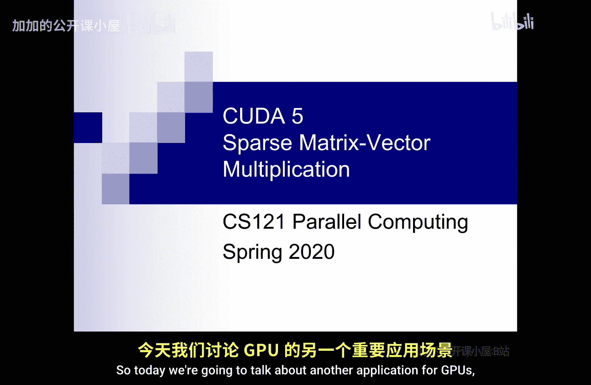
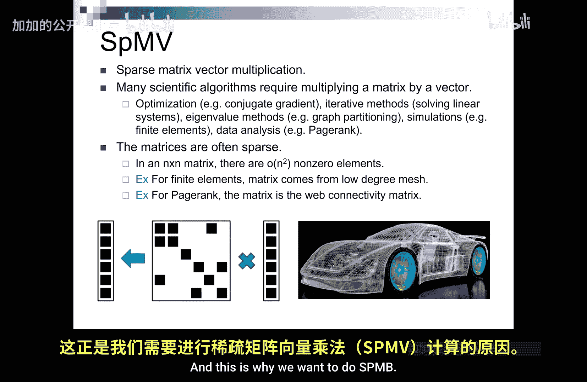
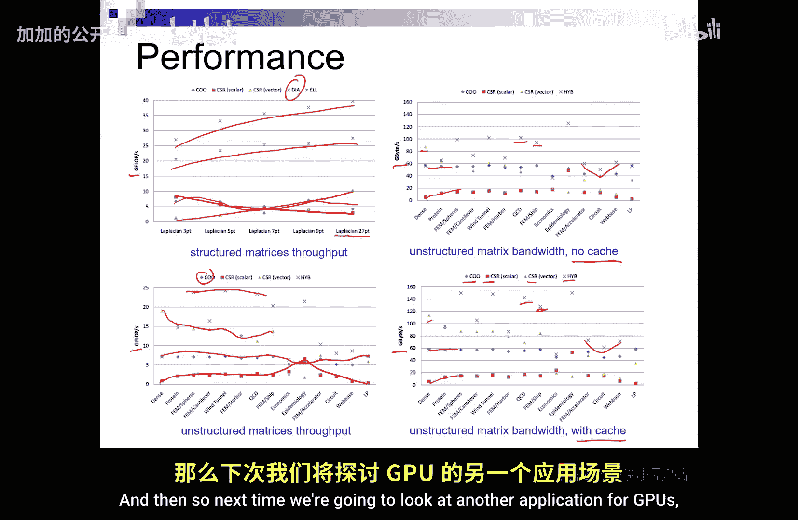

# 上海科技大学【中英⚡并行计算｜CS121 2020 Parallel computing】 p15 P15 CUDA 5 SpMV -BV1VqypBaEaP_p15-

Welcome back。So today we're going to talk about another application for GPUs。

 which is sparse matrix vector multiplication。

So another name for this is SPMV， right so that's the abbreviation for this problem。

Now before I start， you might be wondering why I'm talking about sparse matrix spectrum application。

 because I've actually mentioned several times previously that GPUs are not optimized for sparse matrix operations right I mentioned that they're excellent for dense matrix operations。

 but there are a number of properties of sparse matrix operations that make them not suitable for GPUs。

OkayHowever， today we're still going to focus on this problem and the reason is that well first of all。

 GPUs are so powerful compared to CPUs okay like a good GPU could be like 10 times faster than a high end CPU so it has so much computing power that even though SPMV is not the ideal application for GPUs if you run SPNV on GPs。

 you can still get higher performance on the GPU than the CPU okay just because the GPU is so much more powerful。

Okay and the other reason that we're going to study SPMV is that it's actually a very fundamental problem。

 which if we can do SPMV efficiently， we can actually use this as a primitive for solving many other problems。

Okay these include things in optimization， they include solving linear systems。

 they include likeig eigenvalue methods， which have other applications in themselves。

 they include things like simulations， which often for things like finite elements。

And then also for data analysis so many， many applications are actually built on top of this SPMV operation if you take these applications and you look inside them what you see at the end is some sort of SPMV operation so SPMV is actually really crucial to to many things and so therefore we want to study them and so even though this problem is not the best problem for GPUus。

 we're still going to look we're going to look at methods to try to implement this as efficiently as possible on GPUus。

Okay， so just to state the problem more concretely， so sparse matrix vector multiplication。

 so we have a sparse matrix and we simply want to multiply it by a dense vector okay so the example is over here right so we have a sparse matrix and what that means is that many of the entries in this matrix are zeros so only these black parts only these are the non-zero values。

RightAnd here， the matrix is about half nons half。Zeros， but in practice。

 if you were going to be working with very large matrices， right？

Dimenssions are going to be like a million by a million or maybe 100 million by 100 million。Okay。

 so those are huge matrices and only a very small part of those will be non zero okay。

 so you could have a million by million matrix， but each row has on average。

 let's say 10 nonzero values。Okay， so its that's like sort of one10000 of the matrix is actually non zero。

 okay so it's very， very sparse。Okay， we're going to take the sparse matrix and you're going to multiply it by a dense vector okay。

 so we're not assuming that many entries in this vector are going to be zero。 in fact。

 we basically assume that all of these entries are nonze。

 that's going to produce another dense vector。And that's it， that's the SPMV operation， okay。

 but it's actually very， very useful。Okay， now before I talk about how to actually implement this。

 let's see why we're concerned about sparse matrices and the reason is that many。

 many matrices that we deal with in practice are sparse so the definition again is we have an n by M matrix。

 but there's just a very small fraction of nonzero elements。And so where do we see sparse matrices。

 sparse matrices， well one example is if you work with finite elements to do some sort of simulation。

 for example， if we can use a matrix as a way of representing this car here。

 this sort of wire mesh for a car。Okay so the way you do that is you know you see that this wire mesh here is composed of a bunch of vertices and then edges between some of those vertices right so let's say there are 100。

000 vertices in this picture so then what we're going to do is we're going to make a matrix that's 100000 by 100000 so each row or column of that matrix corresponds to one of these vertices。

And then now whenever there's an edge between two vertices。

 we're going to put a non zero value in that corresponding row and column。Okay， so for example。

 if vertex 5 is connected to 7， okay， then in let's say row 5， column7。

 we're going to put a non zero。Okay， now this is going to lead to a very sparse matrix。

 and the reason is that you see each of these vertices is only connected to like you know very few other vertices。

 like maybe four other vertices。Okay， so that means that in each row， right。

 each row corresponds to a vertex right， And the non zeros in that row correspond to。

To connections to other vertices， edges to other vertices。 Okay。

 now each vertex only has four edges to other vertices， let's say。

 So that means that even though it's 100 by1000 sorry 100000 by 100000 matrix。

 there's only going to be four non zeros per row。 Okay， so it's a very sparse matrix。Okay。

 so that's one example another example is we can use these sparse matrices to represent something like the internet。

 and the connectivity between different， let's say websites on the internet。

Okay so so here what we're going to do is make a matrix where each row so suppose you have some number of websites on the internet。

 okay let's call that n websites， then we're going to make an M by M matrix and that matrix again represents the connectivity on the internet so if there's a connection sorry if there's like a hyperlink between web page I to web page J then we're going to put a non-zero value in row I column J of this matrix。

Okay， so therefore in each row， the only non zeros are the connections from that website。

 for the row to other websites。So each website is only going to connect to like maybe a few dozen or most a few thousand other websites。

 maybe 10 thousand other websites， but it's not going to connect to every other website on the web on the other hand。

 you have billions and billions of web pages so your matrix。

 the dimensions is going to be like billions by billions。

 but each row is only going to have maybe a few tens or maybe a few thousand non-zero values。

So again， that's going to be a very sparse matrix。Okay， and there are many。

 many other examples where sparse matrices come up。

Okay so so now yeah and using these representations。

 it turns out that you can compute many interesting things simply by doing by multiplying these matrices by a vector so for example。

 you know this's is a famous page rank algorithm by Google and this is basically taking the web connectivity matrix and then multiplying it by this vector and if you do that multiple times。

 then you basically end up computing something like an eigenvalue or sorry an eigenvector of this matrix and that tells you something about the popularity of the different websites and that's simply based on SPMV。

And this is why we want to do SPMB。

Okay， so now let's look at why it's hard to do SPMV okay especially on GPUs so now the operation。

 so just to be concrete what we're trying to do is we're given a sparse matrix A and then x is a vector and then you want to compute a times x so what that means is if the output is B right then the if entry of B is just you take the if row of a right and then you multiply that or you do the dot product with with the vector。

Oh， I'm sorry this should be an X over here，m sorry about that。Okay。

 and now this computation is actually memory bound。 Okay。

 what that means is that if you look at how many memory operations this this SPMV does versus how much computation。

 Okay， so you see that each time we for each index of B of I， right。

 So we're adding together basically。And of these products over here right so each time we need to get two values。

 one from a， one from X right and so those are memory operations and then you multiply them so that's an arithmetic operation and then you add that to your running sum okay so that's also arithmetic。

Okay so therefore we're doing two computes， the multiply and the ad for every two memory operations。

Okay， so that means that this computation is very much memory bound because usually we want to do many。

 many computations for each memory operation and here you're doing just you're doing basically memory one computation per memory operation。

Okay， so to give an example of how much this can impact performance。

 suppose you have a GPU right something like this card over here。It's a GTX card。

 and it can basically do 1。5 tariffra flobs， so 1。5 trillion。Computations per second。

 and it has about 200 gigabytes of main memory bandwidth。Okay， now if。

Now suppose that so 200 gigabytes basically means that you can read 50 billion。

Floating point values right and so for each floating point value you read because you're going to do one computation for that。

 you're going to end up doing 50 gigablobs of computations compared to 1。

5 teroflobs potentially right so you're actually getting only 130th of your potential computational power。

Okay， so this is one problem that this is one reason SPMV is hard， okay。

 because it's a very memory bound operation。Another reason it's hard to do is that the matrices we work with may either be regular or they could be irregular so sometimes they're regular so I talked about this finite elements operation sorry this representation right so in that case you could have we're basically using a matrix to represent something like a grid right and you could end up with something which is fairly regular so for example most of the nonzero values maybe along the diagonal of the matrix so you have a few other diagonals which are also non-zero but it's mostly the values of the nonzero values are on these diagonals so that's a regular type of matrix and it makes it easier to deal with because for example each row has about the same number of non-zes。

On the other hand， if you work with something like a web matrix。

 those could be highly irregular because there could be no pattern to where the nonzero values are。

 because there's not necessarily much of a pattern to the connectivity of different websites。I mean。

 there is some sort of pattern right， I mean they're kind of arranged in a hierarchical fashion。

 but more or less you can think of them as kind of like random random connections Okay。

 so if they're random connections， then this causes problems because well， for example。

 when when you go access these matrix elements or the corresponding vector elements right you might have to go to random memory locations。

Now， remember in one of our GPU lectures， we said that to good performance on the GPU。

 it's really important to get coalesct memory aes right so that means that if you access a data item you actually want to access all of the surrounding data items you don't want to just access a bunch of random data items because for each data item you access you need to get the entire memory segment surrounding that element so that's like 32 other elements and if you only want one of those elements。

 then you're wasting like a large large part of your bandwidth。Also。

 if these different rows have different numbers of non zeros。

 then depending on how you assign threats to the non zeros to do the work。

 you could have a lot of load imbalance。Okay， so for example。

 if you assign one thread per row to do the work， then you can get big load im balance because some of the rows can have a lot of nonzes。

 so that thread has a lot of work to do and some of them have very few nonzes。Okay。

 so those are some of the problems with doing SPMV， especially on GPUs。

Okay so now we're going talk about so we're going to talk about a number of different techniques that people have come up with to do SPNV on GPUs and they're basically based on different ways of storing the sparse matrix so the sparse matrix there are a bunch of zero values in there so of course you don't want to store all of those zeros in fact you can't store all of those zeros because the matrix will be too large otherwise so there are many ways that we can avoid storing these zeros right and depending on which way you choose you get different types of performance properties。

Okay， so and we're going to be looking at a number of these different ways。Now all of these methods。

 they're always going to be storing the matrix and the vector in global memory because these matrices and vectors。

 even though they're sparse， even though the matrix is sparse， it's still very large。

 okay it's like hundreds of megabytes or gigabytes in size。

 so it could only be put into the global memory。Okay。

Yeah now in terms of this computation to memory access bound right there's not much we can do about that because you know that's the nature of matrix vector multiplication is that you have to read you know two values and then you only do two math operations on them okay this is kind of unlike matrix matrix multiplication where if you read a few values you can actually do many。

 many computations on those right so here you know we're stuck okay because of the application that we're working with。

Now some of the other issues though we can try to deal with okay so one of them is the irregularity of the matrix aes right so the matrix is is sparse and the non- zeros can be in random places right but because we're only storing the non-zero elements okay then depending on we're going to talk about a number of different storage formats and some of them can actually lead to very good memory coalescing when you access the matrix。

ok。And some of these storage formats can also help us improve load balancing when you compute on the matrix。

Okay， and then also we can assign threads in a way to sort of minimize the divergence between the threads so we can try to ensure that the threads will be doing the same operations。

Okay， so we can to some extent by using these different storage formats。

 we can improve we can get pretty regular accesses to the matrix elements。OkayHowever。

 in addition to the matrix elements， you also have to access the vector elements right because for example。

 if we go back to this equation over here you see that not only are you going to access the matrix elements。

 you're also going to be accessing the vector elements in fact you do one each for every one of these products that you have。

And for the vector aes， so there are different ways of regularizing the vector aes。

 of making them less random and less jumpy， okay so one of them is to take a matrix and then you can somehow permute the rows and the columns so that the matrix becomes more regular has more structure。

So this is shown in this picture over here where you have one matrix on the left so this looks like a pretty much a random matrix。

 one mean other patterns， but the distribution of the nonzes is quite chaotic。

And then it turns out that you can actually do some operations on this and you can permute some of the rows and columns and after you do that。

 you're going to end up with a matrix on the right。

 which looks a lot more regular I mean there's still some irregularity to the matrix on the right。

 but it looks a lot better than the one on the left。

And when if you're working with a matrix on the right。

 then that helps you regularize your vector aes， okay。

 so instead of like jumping to a bunch of pretty much random vector locations。

 you can have much more regular aes to the vector。Okay now finding this permutation， right。

 finding this way to transform from the left matrix to the right matrix。

 so they're actually the same matrix right so they capture the same data except for you relabel the different rows and columns。

Okay however you have to somehow find this relabeling right and this is usually an expensive process there are many different algorithms for doing this。

 but they're all pretty expensive however the thing is that you don't have to do this over and over you can just do this once per matrix okay so once you know how to go from the left to the right right then you're just going to transform the matrix and you're always going to work with the matrix on the right okay so you pay that cost once and it could be worth it。

Okay now today we're not going to talk about on how to regularize the vector aes okay so that that can be like a lecture or even multiple lectures in itself okay we're only going to be addressing the irregularity of the matrix aes okay so we're going to be looking at these different matrix storage formats and how they can improve things like coalescing and load balancing。

Okay， so the first format we're going to look at is called the DI format or diagonal format Okay now I should say that the differences between these different format is that different format are suited to different types of matrices。

 they're optimized to different types of matrices So for example。

 this diagonal format Okay this is optimized to matrices that that basically consists of a small number of diagonals but nonzes are mostly on the diagonals Okay so for example。

If we go back to this matrix on the right， you see that most of the non zeros are on the diagonals。

Okay， I mean， you do have some nonzes on these。Non diagonal parts like over here and over here。

 right， which can cause problems， but by and large the the。No zeros are on the diagonal over here。

 okay so there's a few dis along within which all of the nonzes lie。Okay。

 and this also shows you why the right representation of the matrix is so much better than the one on the left。

 because the one on the left， you see that basically every diagonal right oops。

Why is this not working， right， You see that， you know， you canhu。Okay。

 you can draw any diagonal it's got and that diagonal would have some non zeros on it。

So if you try to use the diagonal format to represent the matrix on the left。

 it won't save you anything because you need to keep basically all the diagonals。

If you use it for the thing on the right， then you can basically you can throw away all of these diagonals because none of these diagonals have anything so you can throw all of them away you just have to keep the ones which are towards the main diagonal and then you do have to keep the ones which are sort of like over here but you can actually do something different for these things and these things。

I'm not going to get into that。Okay so anyways， how does this diagonal format work right so here's the example of a matrix right so we're going to just try to capture the data on the diagons okay so now which dis in this matrix are non-zero so you have this diagonal over here but that's only got zeros in it so we're going to throw that away okay you have a diagonal over here right so this has got nonzes in it so we're going keep it in this diagonal format。

Okay， this diagonal has only zeros， so you throw it away， this has non zeros， so you keep it。

 this has non zeros， you keep it， and then these two have only zeros， so you throw them away。Okay。

 so altogether， you just the only diagnoses we keep are the ones with the non zeros。

 so we keep three of them。Okay， and then we're just going to store the data that's in these diagonals。

Okay， so in particular， we're going to convert this matrix right into this data matrix over here。

 and the way this works is that this data matrix， each column is going to capture the non zeros in one of A's diagonals。

Okay， so for example， this diagonal over here corresponds to this first column。

 the second column corresponds to this diagonal on a。Okay。

 now now we need to know so now we know which dis we're going to keep。

 but how do we know where the nonze values in that diagonal are？

Okay and the way you know that is that where're can to extend each of these diagons oops。

In this fashion， okay， so they sort of meet up at this line， which comes at the top of a okay。

 so that means that there would be an element over here and an element over here。

If we extend this diagonal that contains five and6 to the top of the matrix。

 there'll be two additional elements， but we have zeros at those locations。

 or those values actually do not exist in the matrix。

 so therefore we're going to represent them with these stars over here。Okay。

 now for the main diagonal， the one with  one， two， three，4， right。

 this you know all the elements are occupied okay。And then for the next diagonal， the 7891， right。

 if you extend the diagonal， then you're going to end up with a zero element over here and that's going to be represented by the star over here。

Okay， so this captures all of the elements on each of these diagonals。Okay。

 so next you have to know which diagnose we actually captured。Okay， because yeah， you in this matrix。

 there are five potential diagonals or sorry， actually six of them。No， how many of them are there。

 There are。Let's see one， two， three，4，5， six， seven of them， okay， sorry。

 so there are seven potential diagonals right， and we only store three of them。

So how do we know which ones we stored so this is going to be stored in this offsets array okay so this offset basically tells you which diagonals you stored and the way to read this is that the zero here represents the main diagonal okay so that's like the longest diagonal in the matrix that's the 1。

 two，3，4 diagonal so this means that so the zero here indicates that we did store the main diagonal。

Okay， the negative 2 means that you actually store a diagonal that's like two left of the main diagonal。

 okay， so that's the 56 diagonal。Okay， and the one。

 the one over here means that you also stored a diagonal。

 which is one to the right of the main diagonal。Okay so therefore this diagonal format consists of two parts。

 it's got the data matrix which stores the elements， the values on the diagonals。

 and then if some of those elements don't exist， then you use a star at those locations。

And it's also got this offset array， which tells you which diagnose you stored。

 and these offsets are represented with respect to the main diagonal， which is labeled as zero。Okay。

 so that is the。So that is the diagonal format and this format is optimized only for certain types of matrices。

 only for the ones where there are only a few non zero diagonals。Okay。

 so you see you can see why because let me sort of clear this up a little bit Okay。

 so then so here we had you know three nondiagno sorry3 nonzero diagnoses Okay now if you had a matrix with basically all of the diagnose were non-zes then how big would your data matrix be。

 then your data matrix would be the same size as the original matrix。Okay。

 so then you don't save anything in that case。However。

 if all of your elements lie on just a few diagonals， right。

 let's say they lie on let's say three diagonals then your data matrix would only have three columns and then n rows instead of n columns n rows。

 so then you save a lot。Now， it turns out that there are。

Marices that we care about in practice that have this diagonal property so we can use so these matrices come from things like stencils or grids or these finite finite element things。

Okay so this agonal format has its uses， but it is specialized。Okay。

 so the next format is we're going to talk about the ELL format。 Okay。

 so this format is basically specialized for matrices where each row has about the same number of non zeros。

Okay， not necessarily exactly the same number of non zeros， but approximately okay， so for example。

 if you look at this a matrix here， then the first row has two non zeros right and then the next row has two non zeros and then three and then two。

Okay， so they have about the same number of non zeros。

 so in that case the ELL format can be efficient。So the way that the ELL format works is that you start with this sparse matrix A。

 and then you're going to represent it using two smaller matrices。

 the data matrix and the index matrix。Okay， and the way this works is that。

So assume that we know that a each row has so a is going to be an n by n matrix。 Okay。

 so this is n by N， right， but assume that we know that each row has at most M non zeros。 Okay。

 so I'm going to write nonze as N Z per row， okay。Pole。All right。

 and then the data matrix is going to be an N by M matrix。Okay。

 so now each row of the data matrix is just going to store the non zeros from that row of the a matrix。

And since we know that each row has at most n non zeros。

 then we only need to make n columns for data。Okay。

 and the indices also is also going to be an n by M matrix。Okay。

 so here if n is a lot smaller than n， then we save a lot of space by using the data in the index。

 the indices matrix instead of a。Okay， so the way that the data matrix works is that it just stores exactly the non zeros of a in each row of a。

 and it stores them by sort of in like a left justified manner。

 meaning that you push these nonzes as much to the left as possible。So for example， in the first row。

 you have two non zeros so therefore we're going to store them in the first two columns of data。

Okay yeah， so we're going to store 1，7 in the first row of data right and then you're going to store 2。

8 and then so on， right，5，3，9 in the third row and so on Okay。

 and you store them as much to the left as possible。And after that。

 so now we store the values from a， but you need to know which columns they come from。

And so that's what the index sorry， the indices matrix tells you Okay the indices matrix tells you for each of the values that you stored in the data matrix。

 right， what we know which row it comes from because if we're working with the I row in the data matrix。

 then it came from the I row in the a matrix so the row we already know however。

 what about the column so for example， for this eight value here so this is lying in the so the columns are going to be so we have0。

123 here right so we need to remember that a actually it came from column 2 Okay and the way you do that is that you just write column 2 okay。

Yeah， and then for example， for this nine over here， right， this came from column 3。

 so you just put a three in that location。Okay。Now because a right。

 so M here is the maximum number of non zeros per row of a。

Okay but you could have rows which have less than m non zeros。 And if that happens。

 then we're just going to store these stars okay to represent that we actually do not have M non zeros in that row。

Okay， and then likewise， in indices， you also store a star。Okay， so the。Yeah。

 so this is effective for pro matrices where you know you have more or less the same number of non-zes per row and if that's the case right then you're not going to have too many of these stars so the stars are like wasted space if you only have one row。

 which has a huge number of nonzes but all the other rows have。

 let's say one nonzero and let's say one row has1000 non-zes then you're going to have to make 1000 columns but for each of those columns right for all the rows which only have one non-zero。

 you're gonna have 999 of these stars so that's all being wasted。Okay。

 so you want basically all of the rows to have the same number of non zeros so that you don't have these wasted star things。

Okay， so next we have the COO format， so this stands for coordinate okay COO。

 and this is basically like it's a very general format and it just simply it's going to iterate through a in a row wise in a row major ordering。

And then it's just going to store all of the non zeros that you encounter in this ordering。Okay。

 so for example， the first non0 you encounter is going to be one right。

 so we're just going to store the one so the CO format is going to have three arrays to represent a。

Okay， so the data array is just going to store all of the nonze values。 Okay。

 so you see that all of these values，17，2，8 and so on。

 these are exactly the nonze values in the a matrix Okay in the order that we look at this matrix in the bro major order。

Okay now for each of these non zeros that we store right for example， for one。

 we just store which row and column it's in okay so for example。

 the one is in row 0 right and it's in column 0 so you just store these in the row and the indices arrays。

Okay， so likewise， on8 over here， right this is like the。The fourth are nonze element。

 and this is in the first row。So we store one here and it's in column two， so you store two here。

Okay， so this is why it's called this the coordinate format because for each non zero， right。

 you just store the coordinate of that nonzero in a。Okay。

 so this is a completely general purpose format because it doesn't care where the nonzes are for the diagonal format。

 we wanted the non-zes to be on the diagons for the ELL format。

 you wanted the rows to be at the same length， but for the CO format。

 you completely don't care where the nonzes are。Okay now there's a bit of inefficiency to this CO format because you see that you know for the values that lie in the same row right so for example。

 for phi39 right they all lie in row2 so then in that case we actually wrote down the value2 three times we repeat at the same value multiple times and this happens whenever you have multiple values in the same row。

 you can have to repeat that row multiple times in the row array。

Okay so so that's going to cause you to use more storage and when you read these arrays to do the computation。

 you have to also use more memory traffic。So is there a way that we can avoid this duplication in the row array？

So it turns out that there's another format called CSR， so this stands for compressed Sprse row。

So this is very similar to the COO format except for there's no repeats in the row array anymore in fact。

 it doesn't have a row array so the CSR format has an indices and data array just like the COO format。

Okay， and they and they represent the same thing。 So， for example。

 the data array just represents the non zeros in a， Okay， the non zero values。Okay。

And the indices represent the columns where these nonzes occur。 So， for example， the8 right。

 that's going to occur in column 2， right， the9 right， which is over here， it occurs in column 3。

 Okay， so you put a three over here。Okay so the usage of the data and the indices in CSR is the same as COO。

The only difference is that the CSR format， instead of using a row array。

 it's going to use this thing called pointer。Okay， let's point to our array。

 what it does is it tells you where the different rows start。Okay， so so in general， if you have。

 so let me just show all this stuff over here right so if you have an M by M matrix Okay。

 so then this and then let's say that in total， you're going to have let's say M non zeros， okay。

 total。Okay， then the indices and the data array are both going to have size M。Okay。

 but the pointer thing is going to have size n plus1。Okay。

 so you're going to have an index in the pointer array for each row of a。

And the values in the pointer array indicate where the different rows start in data in indices。Okay。

 so what I mean by that is where does the data for the first row start Okay。

 so the first row of a has one and 7。 Okay， now where's the data being stored in the indices and data array。

Well， the storage， so it's being stored over here， right， and the storage starts at index。

 So let me actually write these inices。 Okay， so 0，1，2，3，4，5，6，7。

So the storage for row0 actually starts at index zero over here。Okay。

 so that's what this zero represents。Okay， now the two right this represents where the storage for so this is going to be rows。

 Okay，0，1，2，3，4 Okay， so this is a row Okay， now for row1。

 the storage for that is going to start at index2 over here。Right， you see that for。For row1， right。

 we're going to store the data 2 and8 right so that's being stored over here and this starts at index2 over here。

Okay， and that's what this two means。It means that if you want to look at the data for row 1。

 go to index 2 in both the data and indices arrays。Okay。

 now what about something like let's say row 4 Okay。

 so suppose you want to get the data for or sorry， not row row 4， row row 3 Okay。

 so row 3 is this one right so we want to get the data that's that's over here right now how do we find where the data 4 row 3 starts Okay。

 well， you go to index3 in pointer and this says of value 7 So that means that all of this data starts at index 7 over here。

Okay， so that's how you interpret all of the values in the pointer array。Right the pointer array。

 the reason it's called pointer is that these are basically pointers that tell you where to go look in the indices and data array to get the values for the different rows okay for rows 0。

1，2，3。Okay， all right， now what about this final value for。For the pointer array， Okay。

 so this is basically telling you the size of the indices and data array。 Okay。

 and the size is equal to the number of non zeros in matrix A。

Because you store one element in data for each nonzero of a。

Okay so you see that a has nine non zeros and this is why the final value in pointer。

 that's not a pointer anymore that's telling you that there are nine non zeros in data and indices。

Okay， so now so in terms of some code， the way that we're going to look at these is that。

Suppose you want to get the data for the Irow。Okay。

 well then these indices are going to occur between pointer I and pointer i plus 1 minus1。Okay。

 so for example， if you want to get the data for for row 2， right， So let's clear this up a bit。

 We want to get the data for row2。which is being stored whereas is 53。

9 so this is occurring between indices 4 and 6 right And the way you know that is you go to pointer of2 and then you also going to go to pointer of3 and then you subtract one And so that tells you that the data is being stored between indices 4 and then6。

Okay， so you have so this is how you get this data。Okay， and now for the elements。

In the I row right that between these two that are between this index and that index so the way you tell which column each of those elements is in is that you go to indices right and then if you're looking for the J element in the I row then you go look an indices at location pointer I plus J。

Okay， so for example， if you're looking at。응。You're looking at element1。

In the in the what are we talking about in the in 2， okay。Let's see race this。

 so we're looking at element1 in row two right so that's actually element1 since you start counting at zero。

 element1 is actually this guy over here okay。So that means that you go to pointer of two。

 which is four， right， and you add one， so that's five。Okay。

 so that means that we should go look in index 5 in both the data array and the indices array。

So the data rate tells us so this two says that okay， all right。

 the element1 in the second row is in column 2 Okay， so the columns are we have 0，1，2。

3 right So this three is actually in column 2。Okay， and what is the value at that location right。

 what values is actually in column2 of row 2， well。

 then you go look in the data array and you see that okay， it's going to be a three there。Okay。

 so the way you can tell that is you go to data and then you go to index pointer I plus J。Okay。

 so it might be a little confusing the first time that you see this， but just remember。

 so another way that you can kind of think of this is that you can think of it this way。 Okay。

 so remember so this is going to point at over here this two is going to point over here so the rows are I'm going to mark where the data for the different rows are。

so then you can think of these pointers as being pointing to the start of each row。ok。All right。

 so that is the CSR format。And the final format we're going to look at。

 So this is a very widely used format。 Okay， it's very flexible because you can have nonzes in any location right so unlike DIA or ELL。

 you can have any kind of structure for your nonzeros。

 it's also quite efficient because unlike the CO format， right。

 we don't have any waste in the pointer and in the pointer array， unlike the row array for CO。

And then yeah， and it's a very popular format， which is used quite often。

 Okay And then so there's a very similar format called CSC。 Okay。

 so CSsR just means that the way you iterate through the rows is in row major format。

 So that's why it's called compressed sparse row So the CC is just compressed sparse column Okay。

 so that just means that you iterate through the nonzes in a column major format。 Okay。

 it's very similar。 Otherwise， it's just completely the same thing as CSR。Okay。

 so the final format we're going to look at is called the hybrid format。

 and this is going to be a combination of several previous formats。 Okay， so in particular。

 it's going to be a combination of the ELL format and the COO format。Okay。

 so when you would use this hybrid format is that if you have a matrix where most of the rows have the same length。

 let's say L have the same number of non zeros。However， you have a few rows with， let's say。

 a lot of non zeros。Then if you use the ELL format。

 you're going to have to make the size of the matrix。

 the number of columns be equal to the maximum number of non zeros in any row。Okay。

 so that could be like much larger than the average number of non zeros。

 so then it's very wasteful to use the ELL format。However。

 so the way we're going to so this hybrid format is going to combine ELL and COO and the way it works is that you're going to take all of the you're going to take this L。

 which is basically like the average length of the rows and then you're going to take for each row you're going to take L elements。

Okay， and represent them using C using E， L L。Okay。

 so ELL you requires that all of the rows have about the same number of elements。

 and that's fine for our case because we're just going to take L elements from each row and then put them into the ELL format。

Okay， however， that's going to leave some elements that we didn't that it's not going to cover some elements。

 Okay， so for example， in this matrix， right， if you take two elements per row and then put them into the ELL format。

 that's going to leave these green elements that you haven't covered yet。Okay。

 and then the way that you cover these few remaining elements is that you're going to use the COO format to store them。

Okay， so basically you use the ELL format to store this blue matrix over here right with all the blue values。

Okay， but you ignore the green values。And then for the leftover green values。

 right now imagine that the blue values are not there anymore。

 so you have a matrix with just four green values。Okay。

 so then you can use the CO format to store these green values。

And the idea is that since most of the rows， so the hybrid format is suitable when most rows have about the same length。

Okay， so that means that most of this matrix you're going to be storing in the ELL format。However。

 there's going to be a small fraction that you store in the COO format。Okay。

 so that's the hybrid format。Okay， and and this can actually represent also so you can use this to represent any matrix。

 right， because in the worst case， you just represent everything using COO。

But it's going to be very efficient when most rows have about the same length so that the ELL part is going to be large and the CO part is going to be small。

All right， so this is showing which kind of format you should use depending on the structure of your matrix。

Okay， so so if you have a and the way we're going to look at these is that you can go from very unstructured matrices to structured matrices so by or sorry from structure to unstructured so by structured。

 we mean something like you know these diagonal matrices so they have a lot of structure to them so in that case you can use something like the diagonal format。

Okay for the ELL format， right， you don't care what the non zeros are。

 but you try to ensure that you have the same number of nonzes per row。

So there's some sort of structure there for the ELL format。

 it's less than what you assume for the diagonal format。

 but you still make some assumptions and then for even more unstructured matrices。

You can use the CSR or the hybrid or the COO format。Okay， so。

So the right matrix format depends on the type of matrix that you work with so before you decide on a format。

 you have to think about the applications that you geared towards if you're geared towards things like stenczoos and grids and other types of regular matrices then you should go with these regular formats。

Okay， or you should have something in your code which says that you if I'm dealing with something regular。

 okay， then I'll use one format， okay if I'm using so dealing with irregular matrices。

 I'm going to use other formats。Okay so now we've talked about how to store matrices in different formats。

 so now we're going to look at how to actually do the SPMV computation when you have the matrix in different formats。

Okay， so I'm going to skip over the DIA format， so the first one I'll cover is the ELL format。

Okay so remember that the LL format is that assuming each row has about the same number of nonzes。

 so if you have a matrix A up here， we're going to form two matrices to represent this a。

 which is the data matrix and the index matrix。Okay。

 so the way that we're going to compute with the yellow format is we're going to assign one thread to process each row of data in indices Okay。

 so suppose you have four threads， then we're going to assign a thread0 to process the first row of data in indices right so zero so it's going to go here right and then one and then to three。

 so that's going to be four threads， one for each row of data and indices。

And what the threads are going to do is so the threads are going to run multiple iterations because each thread needs to process the entire first row or second row or whichever okay so it's going to do that in a for loop。

 so for the first iteration of the for loop all the threads are going to process the first element in data。

Okay， and indices also， right So they're going to process this one also。 Allright。

 and then in the second iteration， they're going to process the second element。 Okay。

 third iteration， third element， and so on。Okay， so。All right， so。So now first of all。

 since we're assuming all the rows have about the same number of non-zes then we see that if we do processing in this way。

 we actually get good load balancing because you know so the number of nonzero non-zes is basically the number of columns of data and indices and so we see that each thread it's going to process it's going to iterate through all the columns and since all the columns have about the same number of nonzes then we actually get good load balancing between all the different threads。

Okay， so next now there's something which I didn't mention about data and indices which is so these are matrices right so how do you actually store these in memory right you have to take this 2D matrix and store in a 1D memory and usually we store matrices in row major format。

Okay，However， for for the ELL format， we're going to store the two matrices in a column major format。

 Okay， so column major format just means that we're going to store them in this order。 Okay。

 and same for indices。Okay， so for example， you see that the data matrix。

 the actual way it's being stored is in column major order like that。Okay。

 now why do we store this in call a major format， Okay。

 it's because this is actually going to help us with memory coal lesson。Okay。

Because now consider the first iteration of all the threads。 Okay， so we have four threads here。

 So let's assume that the threads belong to a warp。 Okay。

 so a warp is going to be a consecutive chunk of usually it's 32 threads。 but in in our case。

 let's say it's going to be four threads。Now which data items is each thread going to access？Okay。

 in the first iteration， thread 0 is going to be accessing the is going to be processing the one over here。

 right， threadh1 is going to be processing the two right， this two over here right。

 and then thread 3 and then thread of sorry， thread2 and then3。

So in the first iteration of the loop that these threads are doing。

 they're processing these elements from data the 1，2，5，6。And now。

 because you store data in column major format， then you can see that 1，2，5。

6 are consecutive in memory。So you have these four threads and they're processing consecutive elements from memory。

So the four threads are going to belong to a warp， and now this warp is going to make these memory aes for 1。

2，56， and because it's consecutive， we're going to get a coaleslesc memory axis。Okay。

 so even though these 1，2，5，6， they're like scattered in some random locations in the matrix。

 however， once you represent them using this data matrix and then you store data in a row sorry column major format。

 then when you access these these matrix elements， you actually get a coalesc memory axis。Okay。

 and the same thing for the indices right， so in the first iteration。

 the threads are going to look at these indices the 0101。

 and these are going to be coalesced like that because theyre consecutive in the indices array。Okay。

 now what about the second iteration， the second iteration。

 the threads are going to be processing the the second element from each row。

 which are these elements。And then you can see that these elements。

Where they stored in data in indices， they're stored over here， okay？And again。

 these are consecutive。So therefore， we make coalest memory aes。Okay。

 so so that's what's being represented in this picture down here。 Okay。

 it's saying that in the first iteration of the of the four threads right， these are the locations。

 the 1，2，56 that we're accessing Okay and in the second iteration， we're going through the the 7，8，3。

4 and so on。So what you see is that by using this column major format。

 all of our memory aes are coalesced to the matrix。Okay。嗯。Now， finally。

 what is the actual code for doing this， Okay， so the actual code is so each thread is going to figure out a row that it's going to process right。

 and then it's going to go to that row and then it's going to go to the it's going to iterate through all of the columns in that row。

RightAnd then first of all， it's going to go look in the indices matrix or array rather and then it wants to figure out what is in the row row right so the row row right and then the currently it's processing column n Okay so what index is in that location。

Well the way this is being stored is that so currently we have four rows per column right yeah。

 so then this number of rows here right so this would be4 because you have four rows in this matrix so the thing that's actually being stored in column n and row row is the way you can get to that in this indices array is by doing this computation over here where this number rows is going to be4。

Okay， so that tells you which column of the matrix you're actually working with。Okay。

 and then you also need to get the value in matrix a at that location。Okay。

 so so to be sort of more concrete about this， so let's say that we are processing row2 right or sorry row1 okay。

 so row1 over here， and then you're processing column 1 okay。

So then in that case you would your end here be would be one right and then your row here would also be one so then we're going to look at indices in location so this is going to be four here so we're going to look at location number five right so this is。

0，1，2，3，4，5。 So we're going to look over here right and over here。

 So when you look in indices at location 5， what that is saying is that now this8， okay。

 this is in row 1。And。So we're looking at this。How do I say this Okay。

 so when you go look in this location at indices， okay。

 the fact that this is a two is indicating that the value whatever value is here is actually in column2 of the a matrix。

Okay， right， So this is column 2 of the a matrix， right， So this is 0，1，2，3。

 So the so this value says is actually in column 2 of the a matrix。 Okay， and what is that value。

 Well， then here we go look at data at location 5。 Okay， we see that the value there is actually an8。

Okay， so the value is going to be 8。 and the column is going to be。It's going to be two， right？

And then the final thing is that well， in order to do this SN V computation， right， sorry。

 So we're going to have to like multiply by this vector here， right， So this vector has four rows。

And what you need to do is you need to take this row and multiply by this vector。

 So therefore the8 needs to get multiplied by this is our x vector over here by whatever this value is。

Right， so that's going to be x of 2。 Okay， so we computed that x here is 2。 The value is 8。

 So then here we you need to do 8 times x of2。Okay。

 and then you're going to add this into your dot product， right。

 the dot product of this entire row with x。Right so that's how this works so the iterations of this for loop are going to go through all of these columns when you're in the n column of the data matrix and the indices matrix well the way you get the value is through this computation and then you're going to go look at the actual column that this refers to in a and the value and then now you need to go look into into this column of x multiply by the value。

Okay， and then yeah and then you keep adding this dot product into your overall Y value that you're producing as your output。

Okay， so that's the EL kernel。Okay， so next we're going to look at how to process the CSR format。

 So the CSR format， we're actually going to give two different ways of processing the CSR format。

 Okay， so the first one is going to be called the scalar kernel。

 So the way that this is going to work is that so the we're going to assign one thread per row of a Okay so。

So basically， the rows of A are given in this pointer array over here。

So that means that we're going to assign one thread per。Per row， right。

 so remember that the final value here just represents the total number of non zeros。

 so you don't have a thread there。And then once you do that。

So what that means is so the four threads are going to go look into this pointer array。

 So the first thread is going to see that its data starts at index 0。 right。

 That's what pointer that's what the 0 in the pointer means。

 Okay so the first thread is going to start over here。 Okay。

 the next thread is going to see that it its data is going to start at index2 Okay。

 so then thread 1 is going to start over here。 thread2 is going to start at 4， which is3 wait so 0，1。

2，3，4，5，6，7，8。 Okay， so these are the threads， right。

 So this is I So then thread 2 is going to start over here。 right Yeah。

 and then thread 3 is going to start over here。Okay。

So and the threads are just are going to process a row by row okay so thread1 is going to be responsible for this row or thread01。

2，3 and they're just going to be processing the nonzes in different iterations okay the nonzes in their row of a in different iterations so therefore in iteration in the first iteration right the four threads are going to process first the first nonzero in their respective rows。

Okay， so in the first iteration， thread zero is going to process element this element。

 thread one is going to process this element and so on。Okay， now in the next iteration， right。

 then thread 0 is going to process the next element in its row， which is located over here， right。

 threadhread one is going to be processing this one and then that one and then that one okay。

And then in the third iteration or in iteration2， the other threads 0。

1 and3 are done with their rows， because they only have two non zeros in the rows。

 but thread 3 needs to process or rather thread2 needs to process this final element。

 right the9 in its row。Okay， so this is how it's working。

Now there's a problem with the CSR kernel or scalar kernel， CSR scalar kernel。

 which is that it's not load balanced okay and the reason it's not load balanced is because you see that the amount of work that a thread does depends on how many nonzes are in its row。

Okay， so each thread gets assigned to one row， and the amount of work is just a number of non zeros in that。

And different rows can actually have completely different numbers of non zeros。Okay。

 so if you look at certain types of matrices like web matrices， which are irregular。

 they can have a huge variance in the number of nonzes per row Okay。

 so you could have some rows that have， let's say， just you know like one nonze okay where you could have other rows that have like a million non zeros。

Okay， because if you have a web matrix right the number of non zeros represents something like the number of websites that some website connects to okay so you can have a few like sort of or actually you could have a bunch of sort of unpopular websites that only connect to one other website so they only have one nonzero in their row。

Whereas you could also have very， very popular websites that connect to thousands and thousands of other websites。

Okay， so there's a huge variance in the number of non zeros in different rows。

 and that's going to cause a very large load imbalance if you use the CSR scalar kernel。

Okay and also another problem that you can see is that the scalar kernel is not is rarely going to be coalles okay because for example。

 in this example， you see that in the first iteration right or rather iteration zero right you see that the memory locations that are being accessed by the different threads so here you have four threads and they're going to be in a warp okay so ideally you want the warp to make a coales memory axis meaning that you're accessing completely consecutive memory locations。

Okay but here this is not happening because they're accessing like you know these memory locations。

 which are not consecutive。Okay， now if it happens that you know。

So here you're not getting horrible non coalescing。

 because these memory locations are still pretty close to each other because each you know。

 the first row， it's only got two elements right， So therefore the next thread。

 the memory location it accesses is just you know， two indices away。So that's not too bad， right。

 at least it's not like 100 indices away。Okay， so if you have very short rows。

 then you can still have some degree of coalescing， however， if， for example， this first row。

 if it had 100 elements， okay， then the next thread right would be accessing something 100 indices away。

 In that case， you would not have coalescing。 the only way to have coalescing is that the memory addresseses you you're accessing are in the same memory segment。

 which only has 32 indices Okay， so you can only be at most distance 32 away。

 if you want to have any degree of coalescing。Okay， so here you know。

 the distances are not that are not that large right， so you could have a bit of coalescing。

 but in general， if the rows are somewhat bigger than 32， okay。

 then you're going to have very poor coalescing。Okay， well that said。

 let's still try to figure out this is how the CSR scalar kernel works okay because next we're going to modify this kernel so that you actually get better performance okay so let's first figure out the scalar kernel and then we'll figure out how to modify this how to improve this。

Okay， so so the way that this is going to work is that each row is going to first figure sorry thread is going to figure out a row based on its thread ID Okay so it's going to do this computation here。

 and then it's going to figure out where is the data for its row located So remember that you know the way you figure that out is to look inside the pointer array Okay so the data for row row is located between pointer of row and pointer of row plus one。

So therefore we're going to have this index that is going to iterate between the start of this row and the end of this row。

Alright， and then we're going to look in data at this index。 right， So， for example。

 if our if let's do an example here。 So if we're talking about row 2， right then。

Clear this up a little bit。Okay， then pointer of row 2 is going to be4， right。

 and then this is going to be 7。And then so we're going to iterate between4 to6 right and then we're going to look in data location 4 initially right so data location 4 is going to be this right so it's going to be the5 which is namely this element right and then where which and then we need to figure out where which column5 is actually in in matrix A。

Okay， so which column of a is is this value 5 in。 Okay。

 so the way you figure that out is you go look in indices at at this for here。

 So then this is going to come out to to 0 right， So this is saying that 5 is in column 0。Okay。

 and so what that means is that if you have this x array over here， right，0，1，2，3， right。

 you're gonna to need to multiply this 5 by whatever is in the the zeroth index of x。 Okay。

 so that's what this thing over here is。 Okay， so you multiply these two values。 you take the five。

 And then you multiply this by x of0。Okay， and then you add that into your dot product right。

 and then you add that into your y value eventually。Okay， so this works。

 but it's not load balanced and you don't get memorycobu， usually。Yeah。

 so it's usually got poor performance。Okay， so so next we're going to improve the CSR scalar kernel and we're going to have a CSR vector kernel。

So the only difference here is that so for the CSR scalar kernel， you assign one thread per row。

 and here for the vector kernel， we're going to assign one verp per row。Okay。

 and if you assign one warp per row， then if you have many elements in your row， right。

 then each thread is going to have to process multiple elements。

 so therefore thread I right the I thread in the warp is going to process the I element in in its row plus the I plus 32th element。

RightBecause you have 32 threads in the warp。 Okay， so each thread is going to get sort of 1。

30 second of this entire row。Okay， and the indices it's going to receive are， it's going to be I。

 first of all， and then I plus multiplepoa 32。 Okay， so like 32， 64 and so on。🤧嗯嗯。Okay。

 so now if you look at what happens， Okay， if you let's first look at the memory axis pattern。

 Okay so so here， let's assume you have a bunch of wars like this。 Okay。

 so we're going assume assign the first warp to process row row0 Okay so this is row 0 over here。

 This is all stuff for row 2 row 1 row 2 and then row 3。Okay。

 so since you're assigning an entire ver to process this row， Okay。

 then this is going to be basically， how do I represent this。 Okay。

 so here this is the first thread in warb 0。 Okay， and this is the the second thread in warb 0。

And you see that these guys are accessing consecutive memory locations in indices and data。

Right like this guy is going to read these two things and this guy is going to read these two things right and these data locations are consecutive。

Okay， likewise you have Warp 1 you have two threads they're going to be accessing these So this guy is going to access this is one thread。

 This is a different thread， and you see that the locations they access are again consecutive。Okay。

 so in general， you see that all of the threads are going to be accessing consecutive memory locations。

Okay， so that means that we get much better memory code lesson。

Okay now you do have this problem that you know if your row is either too short or if it's not a multiple 32。

 then since you're assigning an entire warp of 32 threads to the row， okay if for example。

 your row is short， let's say it's only got like you know 10 items in there okay then 22 of your threads won't do anything right so you're going to waste a lot of work。

 if if your rows are very short。Okay， and also， if the row length is not divisible by 32， right， if。

 for example， you have a row that is like， you know， has 65 elements。 Okay， then most。

 most threads have。Have two elements， right， But one thread is going to have three elements。 Okay。

 so then in that case， you're going to have some threads which are imbalanced， somewhat imbalanced。

Okay however， so so this means that you can still have some sort of imbalance but within a sorry。

 you can still have some sort of waste within a warp okay and furthermore。

 different warps can have different amounts of workload because if you have a row with let's say you know let's say 10 elements and then you have another row with1 thousand elements right then in the first row。

 you have a warp assigned to that right so each thread only gets like one element or sometimes zero elements in the first row whereas for the the big row then each thread is going to get like you know1 thousand00 divided by 32 so like 30 elements。

Okay， so you're going to have a lot of load imbalance between the war。Okay， however。

 you get get it's better to have load imbalance between warbs than to have load imbalance within a warp。

Okay， right， so so intra warp load imbalance， Okay， within a warp。 Okay。

 this is more of a problem than load imbalance between wars。Okay， so， so let me try to explain this。

 Okay， so suppose you have a suppose you have two wars， right， So you have a warp 1。

Right W in a bit nicer way so you have warp1 and the warp2 okay and suppose you have suppose both of these warps are like within the warp itself。

 let's say okay they are severely imbalanced okay so let's say that basically you have like 95% imbalanced okay so like basically that means that one thread is going to do like 20 times as much work as some other thread okay and let's say that both threads are going to be are severely imbalanced like this okay now。

Remember that you have multiple threads executing on the same S， okay， so we have one SM here。

 and then let's say that both of these war are executing on this SM。

OkayBut because these wars have a lot of intra warp load imbalance right within the warp。

 they're imbalance， then no matter which warp you run on the SM。

 so what's going to happen is we keep switching between these two warbs and running these on the S until both wars are finished。

Okay， but whichever warp happens to be running on the S， because the warp itself is imbalanced。

 you're going to have a lot of imbalance。Okay， so overall， when you're running on this SM。

 you're wasting 95% of your time， because both warps that are running on this S are imbalanced。O。

All right， so this is to show that intra warp load imbalance is very bad。Okay。

 now I want to show that interorp load imbalance is not so bad。 Okay。

 so that means that if you have one warp， which is much larger than a different warp。

 this is kind of a kind of bad， but it's not so bad。

 Okay so the reason it's not so bad is suppose you have one warp。 And let me write it this way。 Okay。

 so this is to sort of show the size of a warp。 suppose this guy is like， you know，100。

 So he's a big warp。 Okay， he's got a lot of work to do in that warp。

 And suppose this guy is like you know5。 So he's a small warp。 Okay。

 he has a tiny bit of work to do in his work。Work。Now。

 when you execute these two warps on the SN the two warps are going to share the Sn so that means that when they run。

 you're gonna have some schedule between the warbs so maybe the schedule is something like you run warp1 first on the S and then you switch to warp2 and then maybe you run warp 1 again and then maybe you run warp 1 again just because you want to and then you switch back to warp 2 and then maybe you do war2 a couple of times or three times and so on So you keep switching between back and forth between warps 1 and2 now eventually since warp5 Warp 2 only has five units of work then after you schedule this warp 2 for five times iss going to be done so so in the schedule you're not gonna see warp2 appear again after five appearances however。

 warp 1 is not done yet because it needs to to do 100 units of work so you can still schedule warp 1 on the。

Some。Okay， so this means that the SM always has work to do， okay。

 because it's always executing at least one of the two ver。Once Warp 2 finishes fine。

 then the S is going to execute Warp 1 but the S is not idle at all， because it's executing Warp 1。O。

Whereas for the case where you know if this guy had like 95% load imbalance。

 then whenever you execute this warp， right， then that means that out of the 32 threads in the warp。

 most of them have already finished and there's just one thread that's actually working。Okay。

 so so your SMM has like 32 cores right so that means that if you have very high intratroub warp imbalance。

 right then only one of those cores is actually active。Okay。

 the other 31 core are like not doing anything， so that's like a severe waste of the SM resource。

Whereas for the interorp loading balance， right as long as I have at least one warp to run， right。

 which I always have at least one warp to run， right， Otherwise if I finish all my verbs。

 I'm going to be done with my threat block and I'll go execute the next threat block。

Right but anyways， I always have at least one warp to run。 And so it's not so bad。

 Okay the only bad thing about only having one warp to run is that if you remember when we started talking about GPUus right we said that you actually want to have many。

 many threads active on an SM at the same time you want to maximize your occupancy in order to do things like memory latency hiding right So you want to switch between warp whenever one warp did a memory access then that warp becomes blocked until you want to switch to a different warp to。

To do this latency hiding。 Okay， now， if you have imbalanced warbs where this guy is basically finished after a while。

 and then eventually you're just left with a single warp W1， right。

 then you can't do latency hiding anymore。 Okay， so you do lose some performance because you've lost latency hiding。

However， it's still better than having intra warp loan imbal。

so that's a very long explanation of why the difference between intra and intrawarp load imbalance。

 but hopefully that convinces you why this CSR vector kernel， which only has intrawarp imbalance。

 is going to be much better than the scalar kernel， which has intra warp imbalance。Okay。All right。

 so so then let's so we didn't talk about the code for doing this so the code is pretty simple so previously each thread process one row right so now you want each warp to process one row so you first of all need to figure out which warp a thread belongs to okay so that's just you take your thread ID and you divide by 32 and that's your warp I and whatever your warp I is that is a row that you're going process。

Okay， so just like before， you're gonna get the start and the finish of that row right and then we're gonna to be keeping。

 So so now you have a warp of 32 threads processing you know values from a row there so basically for this row。

 you need to do like a dot product between a row and the between a row of a right and this x vector here。

 Okay so now it's going to turn out that each each thread in your warp is going to have part of this dot product。

 and in the end， you need to add together all these different parts to get the overall dot product So so each thread is going to be processing every 3 second element of this row。

Okay， and it's going to be looking at these indices， which are the same for the CSR scalar kernel。

 except for now you just process every 3 second element of the row instead of every element of the row。

Okay， and then in the end， you're going each thread is going to have one over 30 second of the entire dot product right So therefore。

 you need to add all those 32 values together， So that means that you're going to do a reduction。

 so there's reduction is basically you know these values here，168 and so on。

 So if you remember we had a reduction tree which had a stride value So that's sort of like the know you pick another value that you're going to combine with you pick another value stride distance away that you combine with so so this is going to be a reduction tree where basically it's like you know the values are going to be 16 away and then 8 away and then 4 and then and then so on。

 So if you do this。It's going to end up adding together all of the 32 values from the warp and that is going to be the entire dot product between this sum row of a and the column and the vector X。

Okay。Y。Okay， so the final thing is going to be the COO kernel。 and for this one。

 we are going to so here we're going to assign one thread per nonze Okay so you know。

 all of these things are the nonze values and each one of them gets a thread。

Okay so the way to look at this is if you have four threads right。

 then we're going to process this entire vector in multiple iterations in the first iteration right the four threads are each going to get one value and then in the next iteration。

 they're going to get the next four values and then so on。So in this way。

 you see that in each iteration， all the threads get a value to process except for maybe the final iteration where some threads don't get a value。

 but more or less you have perfect load balancing right except for the final iteration。

Okay and also the memory aes are completely coalesced right because you know in the first iteration you you know you access this chunk of data right so thread zero here is going to access these data items and then thread 1。

2，3 and all of these things are consecutive。Okay， and so you get perfect memory co blessing。Now。

 the only sort of difficulty with doing this is that let's see。

So one warp might actually span several， several short rows。 Okay， because so as an example here。

 So suppose your your warp has four threads。 Okay， now the。

Then this actually covers two rows right so this the threads are going to cover this row。

 So this is two rows Okay and likewise， when you start processing the next batch of four values。

 this is also going to occur in rows2 and then also three。Okay。

 now what you want to have happen is that you want these two threads right。

 so they're both processing values from row 0。So therefore。

 each of them gets like part of the dot product from row zero。

And you want them to add it together to get the entire dot product for row zero。

So you want these guys to add their value together。 Okay， like to add their value here。Okay。

 now so but then for for the next pair of threads， right， So we're first of all。

 going to pair up the threads。 Okay， the first pair is going to be distance one apart and then distance 2 and then 4 and then 8 and so on。

 So just like we've been doing these reductions by doing these pairing things， right。

 we're going to do it again here。Except for we have to make sure that when you pair with somebody。

 he's actually got a value from the same row as yourself okay if he's got a value from the same row。

 then you should add it together to produce a do product for that row。

But if he's got a value from a different row then you don't want to add within right because yeah。

 because you don't want to add values from two different rows。 So as an example。

 if you have these two threads， okay so when they're being paired。

 they actually should not add together their values because this values is from row 0 and this is from row 1。

RightNow these two things should get added because they're both from row1 but for this pair of nodes they don't add because they're from different rows these two things are going to add because they're from the same row and these two things are going to add because they're from the same row the two。

 three don't add and the three，3 they do add。Okay。😊。

So then after this happens so this is for the pairing for distance1 for stride equals 1 so next we need to go for stride equals 2 and then4 and then 8 and so on so for stride equals2 if this guy tries to pair with somebody who's distance 2 away then you see that so for example。

 if we tried this pairing here now these two guys should not add because they're from different rows so let's just show the code over here so what is what these things are saying is that so here we're going for strides 12。

48 and so on and what this is saying is that if you look at the row at this location versus the row that you pair with sorry versus the row of the location that you pair with so we're pairing locations thread IDX and thread IDX minus1 if they belong to the same row。

Then we go ahead and add them。Okay， if they do not belong to the same row， you don't add them。Okay。

 and then next for distance2 for stride 2， right， you compare thread ID x and this location。

 thread ID x -2。 Okay， if they're from the same row， you add them。 Okay， so then， for example。

 we try to pair these two guys， but we see that they're from different rows， right。

 they're from rows 0 and1， so you don't add them。Okay。

 so now you see that none of these things you actually add except for when you get to this pairing。

 Okay， so so here right these two guys。Let's draw this again okay they actually get paired right because they're distance to apart okay and they're from the same row because when you check this this rows array right。

 you see that oh okay right these two guys are from the same row okay so then you add them。Okay。

 so when you add them， what do you get， Well， this guy， this guy on the left， right。

 when he did the first step over here， right， he got the sum of these two values， right。

 And now when you add this value and that value， right？

 So then that means that you're going to take So， so here this is。

This value here is equal to the sum of these two things right this value here is equal to this guy right so when you add them。

 you actually get the sum of all three of these things。Okay， right。

 so so then this here now youve got the correct sum for all three of them and the other guys， right。

 they've all got the correct sum for the two rows for the row of two items that they belong to。

Okay so anyways so you do this code， this is called a segmented reduction because you're actually you're doing reductions but you're breaking these into a bunch of segments right so remember that we had a segmented prefix sum earlier and that was also you do the prefix sum but you break it into chunks right and so here now you can see why you can see an example where you need to break things into chunks okay where the chunks represent different rows and only the same row should be added together。

OkayYeah， and then so there' are some restrictions to this code so by the way。

 all this stuff I'm talking about right I didn't say this up to now but this all comes from a very nice paper by by these two guys be and Garland in video guys so they wrote this paper way back in 2009 at supercomputing but it's a useful paper a lot of these formats that they introduced so these guys sort of got the entire SPMV stuff on GPU started so they introduced all these like different kernels and then they're still being used the CSR kernels and so on they're still being used so nowadays people have improved on these obviously but the basic ideas are still sort of adapted from the Bell and Garland paper so this paper has more details if you want to look in more detail at this kernel。

Or anything else about this stuff。Okay so the final thing is now let's look at the performance of all this stuff。

 Okay so we have a bunch of different storage formats。

 we set there they're suited to different types of matrices so to test this hypothesises。

 we're going to look at two types of matrices structured and unstructured so structured for the structured matrices。

 we're going to look at these so- calledled lapplaceian K point matrices。

 so they're basically they're diagonal matrices。 Okay so they're matrices where the only nonzes are on certain diagonals for example the 3。

1， you're gonna have three nonze diagonals the 5。1 you have five nonze diagonals and the diagonals are very are are anyways yeah。

Okay， so then what you see is that because they're diagonal， right。

 then here you're measuring So you look at different types of these structured matrices。 Okay。

 they're all diagonal ones。 Okay， and you can see that you get the best performance using the diagonal format。

 In fact， you get improving performance as you increase the number of diagonals you can use you can utilize more and more of your GPU So you're going to get somewhat better performance。

 Okay， so the ELL format is also going to work quite well because these matrices because they're diagonal。

 right。That's not a very straight line。嗯。Then you're going to get the same number of non zeros more or less per row Okay。

 so the ELL format is also going to work well。Okay。

 so these other formats are not going to work so well right， And in fact。

 I just want to say one thing， which is that so here， you know。

 these red things are the CSR scalar format， right and the。

The green one is the CSR vector format so you can see that the CSR scalar format is going to work more and more poorly as as you increase these the size of these matrices and basically what's happening is remember that one of the problems with the CSR scalar format was that let's see if we can find this was that you have this nonmemory coales because you have to jump around for to access different rows so as the slasty matrices get larger。

 the distance between the rows also increases and the bigger the distance the worse your memory coalesing so that's why as the matrices get bigger you get you get you get less and less performance。

Now， for the CSR vector kernel， right here， what you want to do is you're signing a warp per row。

 Okay so therefore， if your rows are very small， right。

 then then you're not using a large chunk of your warp。 Okay。

 so so this CSR vector is bad for like very small rows。 So therefore。

 as you increase these the size of these lowplium matrices。

 you're gonna have more and more elements per row。 right。

 So therefore you get less and less waste per warp。 And this is why you get。

You get better performance， okay？And then you can see that this COO format。

 it's basically got kind of like a flat performance， it sort of doesn't care。

You know how big the matrix is okay。So that's for the structured matrices。

 for the unstructured matrices。Al right， for the unstructured matrices。

 let's see what do we have here。 Okay， So yeah， so one observation is that well。

 the scalar kernel sucks。 Okay， right， so this is that the poorest kernel right， the CO format。

 basically it's sort of it doesn't care where the nonzes are。 Okay。

 it's got very consistent performance， regardless of which which matrix you're working with。 Okay。

 so so all of these things down here， the protein FM spheres and so on their names of different。

Of different sparse matrices。 Okay， you can actually go sort of download all of these sparse matrices。

 If you search for something like sparse matrix collection。

 you're gonna get a website which has thousands and thousands of these sparse matrices。

 so you can see what these guys look like， But sort of regardless of the structure of the matrix you have that the CO format。

 right， which is sort of agnostic to the structure， It performs more or less the same。 All right。

 you get you get much better performance。 So the CSR vector kernel， right。

 this is gonna be much better than the CSR scalar kernel。 Okay。

 but the best performance is actually the hybrid one。 Okay， so so the hybrid was a combination of EL。

 right， and。And COO， okay， so you get the best performance for hybrid。Okay。

And the final thing to say is that so so this GPU has a cache okay now the cache is on the GPU is different from the cache on a CPU so one thing is that the cache on a GPU is like really。

 really small it's like like 1 MBte or maybe 1。5 MBby compared to like 12 GB of main memory storage and also the cache is actually implemented in the main memory of the GPU so it's using physically the same same hardware as the global memory and it's located equally far away from the processing course And so therefore the cache on the GPU will not actually lower your latency because we know that the global memory has very high latency。

 It's got like 800 cycles latency and the other cache is located at the same location as the global memory。

 So it's not going decrease your latency however，C it basically allows that if many threads are accessing the same memory location then the cache will allow you to do like a broadcast operation to do all of these threads that are accessing the same memory location so it'll help with your memory bandwidth because instead of doing these individual sense of the same value to all these threads。

 you're doing a broadcast and so you can save some memory bandwidth。

And so what does these two final charts show on the right is that if you compare using no cache versus having a cache right and then here we're looking at the memory bandwidth so so previously we were looking at the number of computations that we could do for the SPNV but on the right we're looking at how much memory bandwidth we can achieve in SPMV and you see that the cache is actually going to help however。

 what is what's interesting is that。The memory bandwidth only improves so if you compare these two charts the top one and the bottom one right you see that for the CO0 and the CSR format right there's basically no difference in the memory bandwidth right If you look at the blue blue dots and the red dots on top and on the bottom they're basically the same the thing that does improve is the hybrid one right so that goes from basically like you know about 100 gigabytes per second to like something like 140 or11 yeah。

And then the CSR scalar also improves right It goes from like something like know8085 over here。

 something to like 110 over here。 Okay so I'm actually not sure why this is but it's just kind of interesting that you know for most of these kernels right you don't get the improvement however。

 for for the hybrid format， you definitely get an improvement not on every single matrix right because for example。

 over here for the hybrid format you're still not getting you're still not getting much of an improvement but there are matrices where you get a substantial improvement like like what like this FM ship one right you're going from like something like90 to 120 something。

Okay， so， so that's all I have to say about。About SPMV。

 and then so next time we're going to look at another application for GPUs。

 which is a breath first search。

