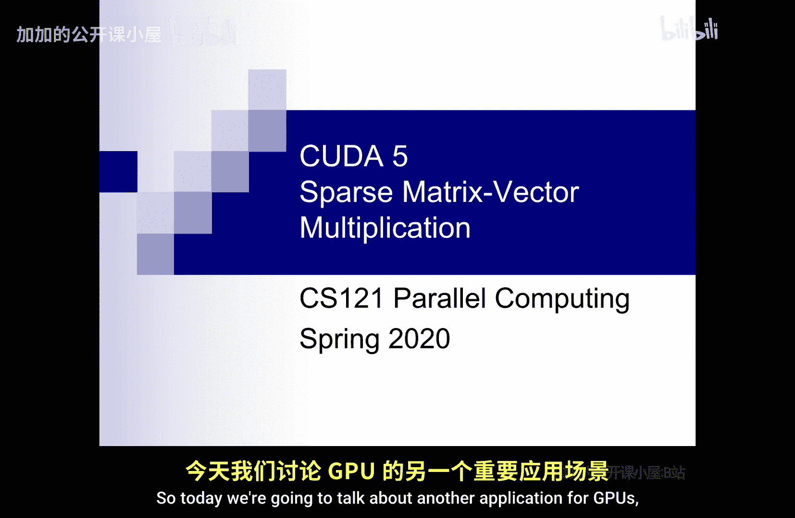
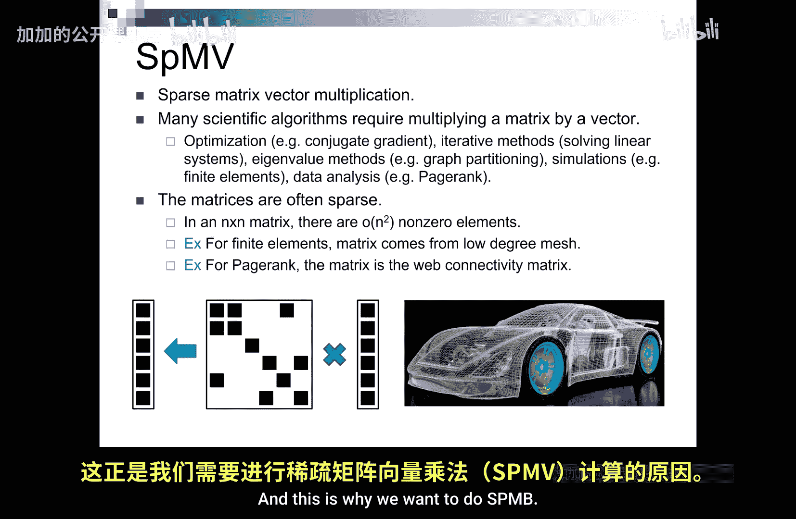
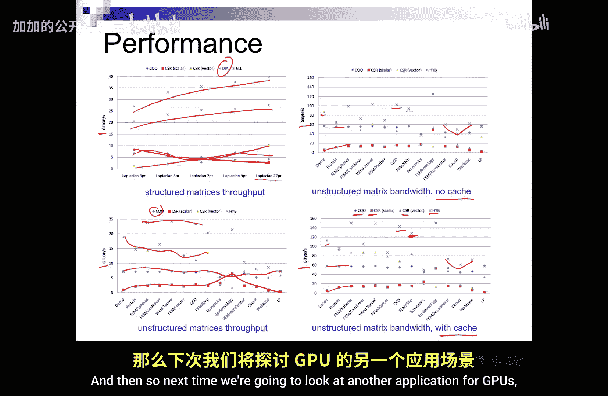

# 并行计算：P15：稀疏矩阵向量乘法 (SpMV) 🚀



在本节课中，我们将学习GPU上的一个重要应用：稀疏矩阵向量乘法。我们将探讨其重要性、面临的挑战，以及多种针对GPU优化的存储格式和计算内核。

## 概述

稀疏矩阵向量乘法是许多科学计算和数据分析应用的核心操作。尽管GPU在稀疏操作上并非最优，但其强大的计算能力仍使其成为执行此任务的可行平台。本节课将深入分析SpMV的难点，并介绍多种存储格式（如DIA、ELL、COO、CSR、Hybrid）及其对应的GPU内核实现，以优化内存访问和负载均衡。

## 为什么SpMV很重要且具有挑战性？



上一节我们介绍了SpMV的基本概念。本节中我们来看看为什么这个操作既重要又难以在GPU上高效执行。

SpMV是许多高级算法的基础构建块，例如：
*   **优化问题**中的迭代求解。
*   **线性方程组求解**。
*   **特征值计算**。
*   **有限元模拟**。
*   **网页排名（PageRank）** 等数据分析。

SpMV的挑战主要源于其**内存受限**的特性以及矩阵的**不规则性**。

**公式**：给定稀疏矩阵 **A** 和稠密向量 **x**，计算 **y = A * x**。对于输出向量 **y** 的第 `i` 个元素，其计算为：
`y[i] = sum(A[i, j] * x[j])`，其中 `j` 遍历矩阵第 `i` 行中的所有非零元素。

这意味着对于每个非零元素 `A[i, j]`，我们需要：
1.  从内存读取 `A[i, j]` 和 `x[j]`（两次内存访问）。
2.  执行一次乘法和一次加法（两次计算操作）。

因此，计算与内存访问的比例很低（约1:1），使得性能严重受限于内存带宽，而非GPU的计算能力。

此外，稀疏矩阵的非零元素分布可能极不规则，导致：
*   **非合并内存访问**：线程访问不连续的内存地址，浪费带宽。
*   **负载不均衡**：不同行的非零元素数量差异巨大，导致线程工作量不均。

## 稀疏矩阵的存储格式

为了应对上述挑战，人们设计了多种稀疏矩阵存储格式，避免存储零元素，并优化GPU上的访问模式。选择哪种格式取决于矩阵的具体结构。

### 对角格式 (DIA)

DIA格式适用于非零元素主要集中在少数几条对角线上的矩阵（例如，来自规则网格或有限元方法的矩阵）。

**工作原理**：
*   `data` 矩阵：每一列存储一条对角线上的非零元素。若对角线长度小于矩阵维度，用占位符（如`*`）填充。
*   `offset` 数组：指示 `data` 矩阵的每一列对应原矩阵的哪条对角线（0表示主对角线，负数表示左下方，正数表示右上方）。

**示例**：
对于一个矩阵，其非零元素主要在偏移量为 -2, 0, 1 的三条对角线上。
*   `data` 矩阵的列分别存储这三条对角线上的值。
*   `offset` 数组为 `[-2, 0, 1]`。

### ELL格式

ELL格式适用于矩阵每行非零元素数量大致相同的情况。

**工作原理**：
*   `data` 矩阵：一个 `n行 x m列` 的矩阵，其中 `n` 是原矩阵行数，`m` 是最大非零元数/行。每行从左开始依次存储该行的非零值。
*   `indices` 矩阵：与 `data` 矩阵形状相同，存储对应非零值在原矩阵中的列索引。
*   若某行非零元少于 `m`，则在 `data` 和 `indices` 中用占位符填充。

为了在GPU上获得合并内存访问，`data` 和 `indices` 矩阵通常按**列优先**方式存储。

### 坐标格式 (COO)

COO格式是一种通用格式，不关心非零元素的分布模式。

**工作原理**：
使用三个数组：
*   `data`：按行优先顺序存储所有非零值。
*   `row_indices`：存储每个非零值的行索引。
*   `col_indices`：存储每个非零值的列索引。

其缺点是同一行的行索引会被重复存储，造成一定冗余。

### 压缩稀疏行格式 (CSR)

CSR是应用最广泛的通用格式之一，它消除了COO格式中的行索引冗余。

**工作原理**：
使用三个数组：
*   `data`：按行优先顺序存储所有非零值。
*   `col_indices`：存储每个非零值的列索引。
*   `row_ptr`：长度为 `n+1`。`row_ptr[i]` 指向第 `i` 行非零数据在 `data` 和 `col_indices` 数组中的起始位置。`row_ptr[i+1] - row_ptr[i]` 即为第 `i` 行的非零元数量。

**代码**：获取第 `i` 行所有非零元素及其列索引的伪代码如下：
```cpp
for (int j = row_ptr[i]; j < row_ptr[i+1]; j++) {
    value = data[j];
    column = col_indices[j];
    // 使用 value 和 column 进行计算
}
```

### 混合格式 (Hybrid ELL/COO)

混合格式结合了ELL和COO的优点，适用于大多数行长度相近，但存在少数超长行的矩阵。

**工作原理**：
1.  选择一个基准长度 `L`（例如，平均每行非零元数）。
2.  用ELL格式存储每行的前 `L` 个非零元素。
3.  剩余的超额非零元素用COO格式存储。

这样，对于规整部分能享受ELL的高效，而对于不规则部分则用COO灵活处理。

### 格式选择指南

以下是选择存储格式的简要指南：
*   **高度结构化（如对角矩阵）**：使用 **DIA** 格式。
*   **行长度大致相等**：使用 **ELL** 格式。
*   **高度不规则，通用目的**：使用 **CSR** 或 **COO** 格式。
*   **大多数行长度相近，但有少数超长行**：使用 **Hybrid (ELL/COO)** 格式。

## SpMV的GPU内核实现

了解了存储格式后，本节我们来看看如何在GPU上为不同格式实现高效的计算内核。

### ELL内核

ELL内核假设每行非零元数相近，以实现负载均衡和合并访问。

**实现策略**：
*   **线程分配**：每个线程处理一行。
*   **执行模式**：所有线程同步循环遍历列。在第 `k` 次迭代中，所有线程处理各自行在第 `k` 列的数据。
*   **内存访问**：由于 `data` 和 `indices` 按列优先存储，每次迭代中所有线程访问的内存地址是连续的，从而实现完美的内存合并。

**核心代码逻辑**：
```cpp
int row = threadIdx.x; // 每个线程负责一行
float dot_product = 0;
for (int col = 0; col < max_nz_per_row; col++) {
    int index = col * num_rows + row; // 列优先访问
    if (col < valid_length[row]) { // 检查是否有效数据
        float val = data[index];
        int col_idx = indices[index];
        dot_product += val * x[col_idx];
    }
}
y[row] = dot_product;
```

### CSR标量内核

CSR标量内核是最直观的实现，但性能通常不佳。

**实现策略**：
*   **线程分配**：每个线程处理一行。
*   **问题**：
    1.  **负载不均衡**：不同行的非零元数可能差异巨大。
    2.  **非合并内存访问**：不同线程访问的 `data` 和 `col_indices` 元素地址可能相距甚远。

### CSR向量内核

CSR向量内核通过改变工作分配方式来改善负载均衡和内存访问。

**实现策略**：
*   **线程分配**：一个**线程束（Warp，通常32线程）** 共同处理一行。
*   **执行模式**：线程束中的每个线程处理该行中相隔32的元素（即线程 `t` 处理索引为 `row_ptr[row] + t`, `row_ptr[row] + t + 32`, ... 的元素）。
*   **优势**：
    1.  **合并访问**：一个线程束内的线程访问连续的内存地址。
    2.  **负载均衡**：将负载不均衡从线程束内部转移到了线程束之间。线程束内部的负载是均衡的，这比线程束内部的负载不均衡对性能影响更小。
*   **最后**：需要一个线程束内的归约操作，将所有线程的部分和相加，得到该行的最终结果。

**核心步骤**：
1.  每个线程计算分配给它的部分点积。
2.  使用规约树（`__shfl_down_sync` 等指令）在线程束内求和。

### COO内核与分段归约

COO内核为每个非零元素分配一个线程，天然具有完美的负载均衡和合并内存访问。

**主要挑战**：
不同线程处理的非零元素可能属于不同的行。计算最终结果时，需要将**同一行**的非零元素贡献值相加，而不能跨行相加。

**解决方案：分段归约**：
在归约过程中，每次合并操作前，检查参与合并的两个值是否属于同一行（通过比较 `row_indices`）。只有属于同一行，才进行加法。

**伪代码概念**：
```cpp
float value = my_value;
int my_row = my_row_index;
for (int stride = 1; stride < warpSize; stride *= 2) {
    float other_val = __shfl_down_sync(mask, value, stride);
    int other_row = __shfl_down_sync(mask, my_row, stride);
    if (other_row == my_row) {
        value += other_val;
    }
    // 更新 my_row? 在归约中，通常保留较低索引线程的行号
}
// 最终，每个“段”（行）的第一个线程持有该行的结果
```

## 性能比较与总结

最后，我们通过实际数据来比较不同格式和内核的性能。

**结构化矩阵（如对角矩阵）**：
*   **DIA** 和 **ELL** 格式表现最佳，因为它们充分利用了矩阵的规则结构。
*   **CSR标量内核** 性能随矩阵增大而下降（非合并访问加剧）。
*   **CSR向量内核** 在行较长时表现更好（线程束利用率高）。

**非结构化矩阵**：
*   **CSR标量内核** 性能最差。
*   **COO内核** 性能稳定，但与结构无关。
*   **CSR向量内核** 相比标量版本有显著提升。
*   **Hybrid (ELL/COO) 内核** 通常能获得最佳性能，因为它结合了ELL的效率和COO的灵活性。

**GPU缓存的作用**：
GPU的L1/L2缓存主要有助于节省带宽（通过广播机制），而非降低延迟。对于某些矩阵（特别是使用Hybrid格式时），启用缓存能带来明显的带宽提升和性能改善。

## 总结



本节课我们一起学习了GPU上的稀疏矩阵向量乘法。我们首先理解了SpMV作为基础原语的重要性及其面临的内存瓶颈和不规则访问挑战。接着，我们深入探讨了多种稀疏矩阵存储格式（DIA, ELL, COO, CSR, Hybrid），每种格式针对特定矩阵结构进行优化。然后，我们分析了对应的GPU计算内核（ELL, CSR标量/向量, COO），重点关注它们如何通过线程分配策略来改善内存合并与负载均衡。最后，通过性能对比，我们看到了针对矩阵结构选择合适格式和内核的重要性。掌握这些技术，是高效利用GPU处理稀疏计算问题的关键。