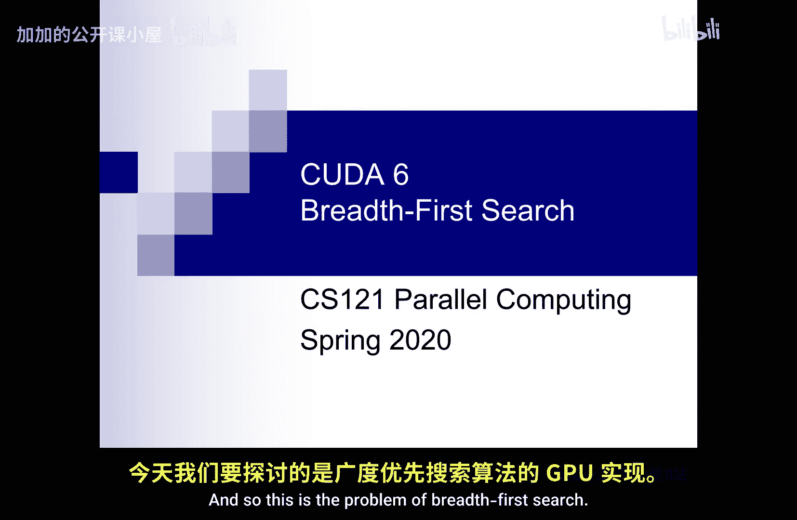
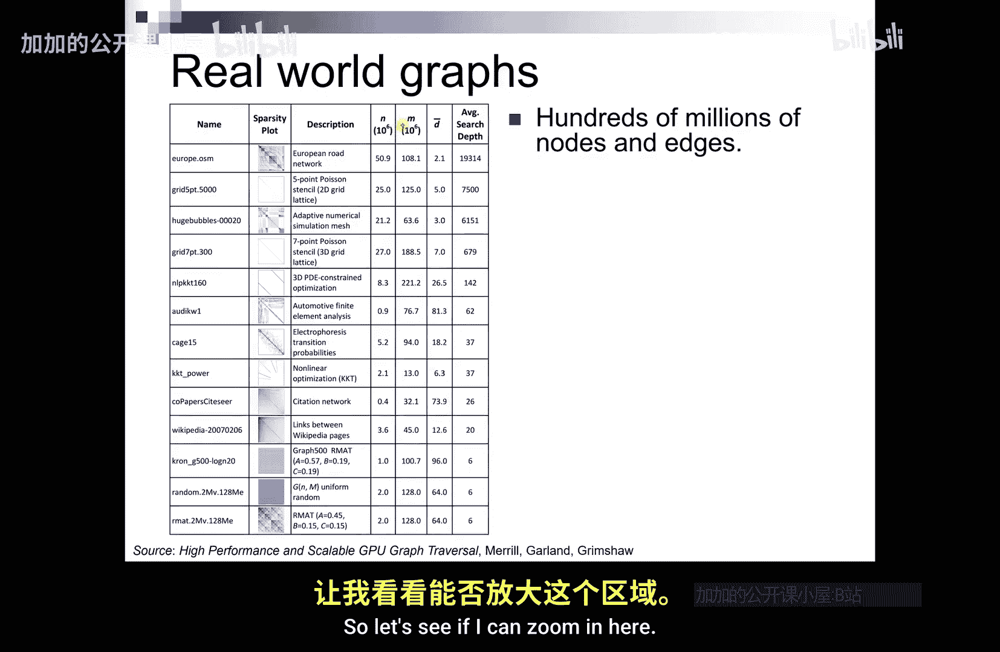
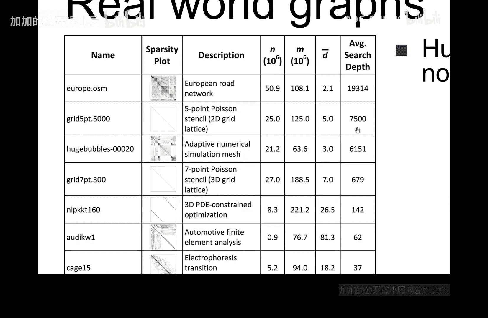
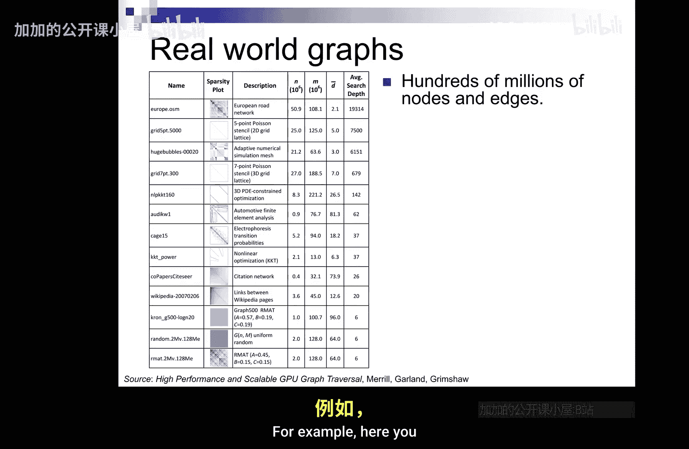
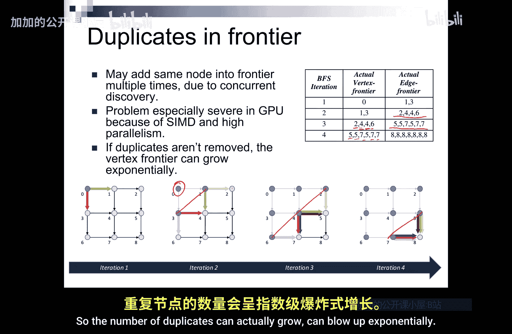
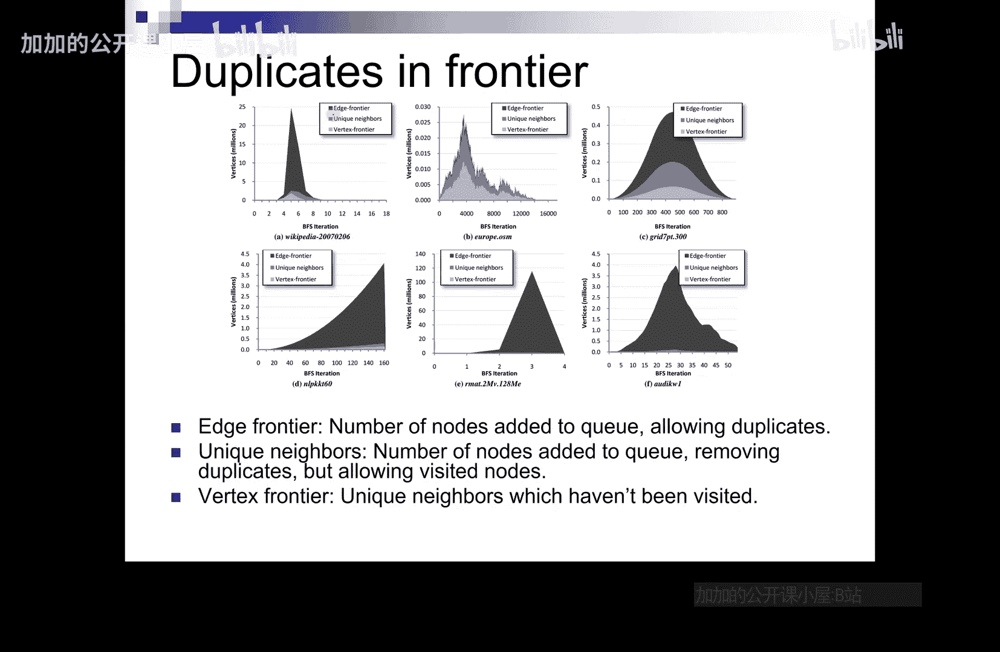
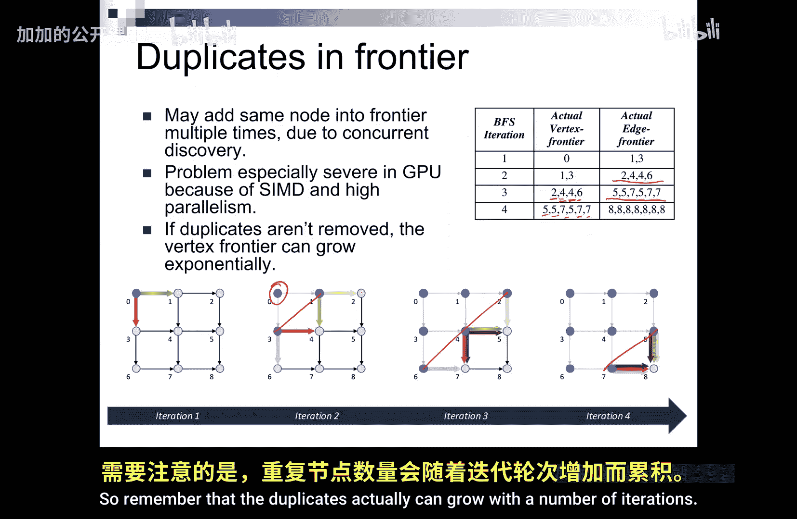
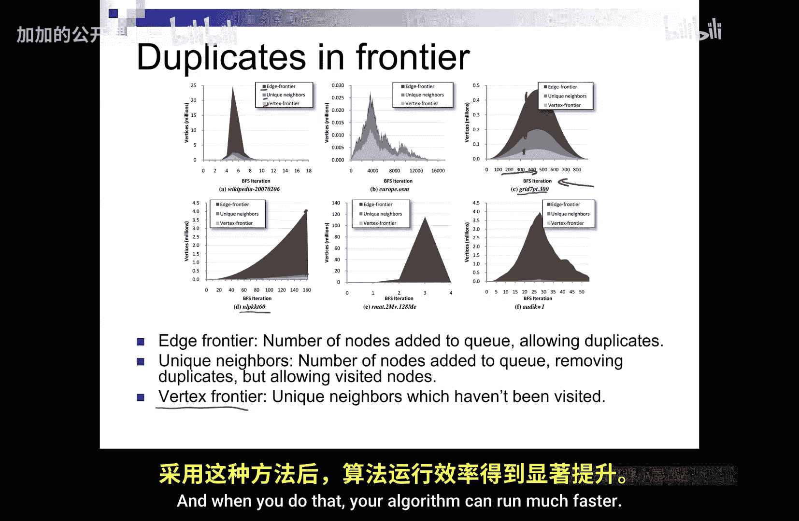
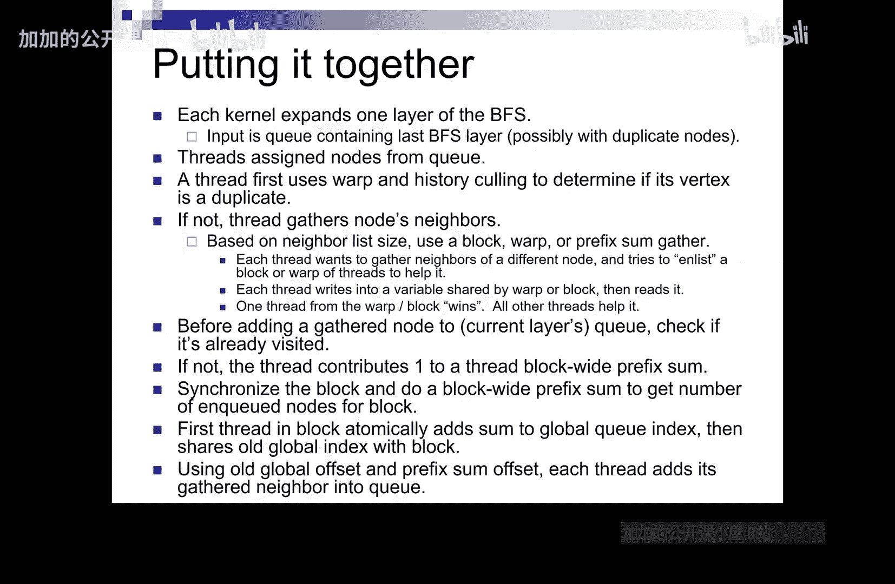
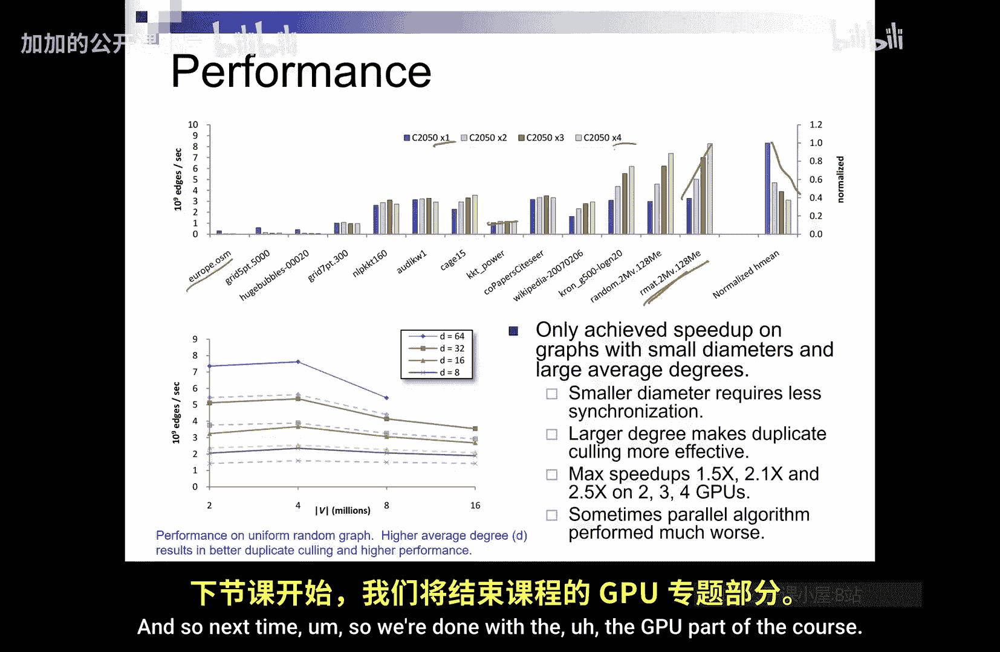

# 上海科技大学【中英⚡并行计算｜CS121 2020 Parallel computing】 p16 P16 CUDA 6 BFS -BV1VqypBaEaP_p16-

Welcome back。So today we're going to talk about how to solve a graph problem on a GPU。

And so this is the problem of breath first search。

So before we get started， I want to mention that so just like the problem we talked about last time。

 which is sparse matrix vector multiply right so breath first search also is not a problem which is ideally suited to GPUs so it's not a very regular problem just like SPMV however just like SPMV it's also it's an important problem which has many applications。

And and also by finding the right algorithm and the right optimizations for the for the GPU。

 we can actually get good performance for Bfs on the GPU right Okay。

 so so just to remind you what the BFS problem is it's basically， you want to take a graph。

 and you want to explore this graph and do it layer by layer。 Okay， And so in this example， right。

 sos suppose you start at a node S over here， So then in Bfs。

 you first want to find the neighbors of S。 Okay， so those are all these black nodes the ones label by one。

 So they're just one hop away from S And the next you want to find the two hop neighbors of S So so these are the。

The neighbors of the black nodes which are different from S， so those are the gray nodes marked by 2。

Okay， and so on。 And then you can also represent these nodes using a tree。

 right like you're doing on the right。 So that is the BFS tree。Okay。

 so so this B FS actually has a large number of applications。 So for example。

 if we're given a graph and the graph can represent many different things， for example。

 it can be like a social network can represent friends or something right one thing you want to do is to find the connected components right like who you know。

 who do I know through all of my friends Okay you can also do things like pathfinding using B Fs Okay。

 some BFS is used as a subrout in many other algorithms like maxflow algorithms now this。

This thing the Cuio McKee ordering okay so this was remember from the SPMV lecture we talked about a way to reorder a matrix so that you can get more regularity in the matrix so you can start with the matrix on the right over here which is looks like a completely garbled type of thing and then if you reorder these rows and columns you can actually get something which looks much more ordered right and then now you can apply one of these nice matrix formats like the diagonal format for this matrix and one of the methods for reordering matrices is the cutio Mckeyee ordering right and this is basically based on doing a BfS yeah so so that's another application for BfS and there are many。

 many applications for BfS。Okay BFS is also used in benchmarks to gauge the performance of computers like supercomputers。

 so for example we have something called the G 500 benchmark。

 which is basically the top 500 supercomputers but now not ranked by Li but instead ranked by their performance on basically BFS and then you have other benchmarks that also test BFS and these benchmarks are basically stressing the memory performance of a computer right so they're testing how good your memory system is because BFS requires you to do things like make a lot of random random memory aes so the stresses the memory system。

 there's very little computation and BFS。看。Okay so what kind of graphs do we want to deal with in BFS so typically we want to deal with these large real world graphs so for example。

 I've listed a few of them and you can kind of look at the picture in the second column to get some idea what they look like so for example the first map over here this actually represents the the road network of different European countries so so let's see if I can zoom in here so if you zoom in over here you can kind of see these block structures so the block structures basically represent different countries and the road network within a country because you're gonna to have a denser road network within a country then across different countries so maybe for example。

 this biggest square over here this might be the road network inside like Germany or something and then the next one might be like like France right and maybe maybe like England。

Or Italy or something like that。 Okay， right， so this is a large network。 So in fact。

 it's got 51 million nodes。 Okay， so I guess each intersection of the roads is maybe a node， right。

 So it's got 51 million of those right， And it's got it's got about 110 million edges。 Okay。

 so so I guess you know， between two intersections。 You have， you have one road， right， And so。

And then you have two directions right you have the like the at each intersection you have two roads crossing there。

 so basically you have like twice as many edges as you have as you have nodes okay so the average degree is like 2。

1 and also the search depth over here so this is referring to like if you start at some location some intersection now how many intersections can you go through what is the farthest sort of the farthest location in terms of the number of roads that you have to travel through。

Okay so apparently it takes you about like 19000 roads to get from maybe one side of Europe to another。

Okay， all right， so them but then you have graphs， which are very different from this road network。

 right， So this road network is somewhat dense。 actually， it's not， I guess， But anyways。

 it's got the structure， right， It's got this hierarchical structure。

 whereas if you go for the the grid five point thing。 So this has。

This definitely does not have this hierarchical structure。

 It's basically like you have I think five diagonal elements so here you can only see one of them because of the resolution so this also has like about 25 million nodes 125 million edges and the search depth here is going to be 7500 now so these have relatively large diameters in order to go from one side of the network to the other。

 you have to go through many edges but you also have graphs which are very large but they have small diameters so for example here you have a graph representing Wikipedia the connectivity between different Wikipedia pages and you have like 3。

53。6 million pages and then on average each pages is connected to 12。

6 other pages but to get from any page to another only takes you 20 links so you can basically hop from。

Any Wikipedia article to any other one by clicking 20 times Okay。

 so that's kind of interesting and then you have even。You have graph with even smaller diameters。

 okay， so these last three graphs are kind of like they're synthetic graphs， right。

 they're generated by some sort of random process。Okay， so in general。

 we're going to be working with these large graphs that have millions and millions of nodes and edges now in practice you could encounter even larger graphs that have billions or trillions of edges but the problem is that you can't fit these into the memory of a single GPU so one of the weaknesses of GPUs is that they have limited memory so the other thing to observe about these real world graphs is that they have on average low degree so the degree is shown over here。

 that's like the average number of non-zes in these matrices per row so you can see that even if you have millions of rows on average or millions of columns on average each row only has like 80 or maybe know in this case it's only got two non-zero columns and at most it's got like 80 nonzero columns or 96 rather。

Okay， however， there's a huge variation in the number of non zeros per row okay， so for example。

 in this Wikipedia thing right on average， each article has has 12 12 neighbors okay，12 links。

 but you could have some articles that just have one link right and whereas other articles could have like hundreds or thousands of links。

Okay， so the degree of different nodes is going to be very different in these real world graphs。Okay。

 and then you have these two different types of graphs which one type has like low diameter right so you know on the order of a few dozen or something and then you also have other node which are more like grids which have high diameter like you know the European road network right it's got high diameter。

一。Okay and I should mention that all of these this content is basically coming out of this paper called this written by these nvidia guys。

 Meryl Garland and Grmshaw so this is one of the earliest papers on doing efficient BFS in GPUs it's got lots of great ideas in there and basically stuff I'm saying today comes from that paper and this paper is also the basis for many other followup BFS works that follow ups so BFS on GPUs so even though people have been doing this for about a decade now。

 this is still like an interesting area of research。

 because we still don't have the best the best most optimal algorithms yet and so people are still trying to find improved ways of doing this given the importance of this problem and given the challenge of actually doing this efficiently on GPUs this is still an interesting research area。

Okay， so first of all， let's sort of recall the sequential algorithm for doing a BFS。

 which is going to be the starting point for our parallel GPU algorithm for doing BFS。

So since we're assuming the graphs is the graphs are sparse。

 we're going to store them in the compressed sparse role format， the CSR format， Okay。

 so the CSR format， remember from the SPNV lecture。

 this is some way of storing a sparse matrix or a graph right so the matrix on the graph are kind of they correspond to each other。

 Okay， so the so the way this works is that。Let let's look at this this example graph over here。

 Okay， so this graph has。Has eight nodes in it so this R vector here is basically so the C vector is giving the connectivity of the different nodes Okay and they're apparently there are 11 edges in total in this graph 11 directed edges and the R vector over here is showing where do the connectivity patterns for different nodes start So we have8 nodes over here。

 So for example， the fact that R1 equals 2 means that if you want to figure out the connections for node 1 right then you should go to index 2 so this is pointing over here。

 and if you look over here， what this is going to say is that okay。

 so since we're looking at R1 this is giving us the connectivity for node1 and node1 is connected to0 and to2 and to4。

And so that's why you have  zero2，4 over here。Okay， so you know， if if you look at some other one。

 if you look at node 4， okay node 4 is connected to in order to find its connectivity information。

 you jump to index 6 over here right and you see that it's connected to5 and7 so4 is connected to5 and to7。

Okay， so we store the graph in this CSR format，And now the algorithm to。

To do a BFS is we're going to use a Q。 Okay， the queue is going to keep track of the unvisited nodes in the BFS。

And what we're going to do is we keep taking a note from the top of the queue from the front of the queue。

 and then we look at which neighbors it has not visited yet。

And then we add those to the back of a queue。Okay， so the algorithm would be something like what we have on the right so these distance things are keeping track of how many hops does it take to get to different nodes Okay so initially we can't get to any node so we assume their distances are all infinite except for the source node right so we start at the source node So his distance is0 we put them in the queue right so this is the queue。

And then we keep taking things out of the queue right you decode something de something out of the Q and then this thing over here right this for loop is going to be looking at the neighbors of all of these of this node I so the way you get that is you go to you go to the I location in this R array right and the neighbors of I are located between indices R of I and R of I plus1 minus1。

They're located between these indices in the C array。

Okay so we go to the CR array and we look at all of these offsets and then for each of these nodes。

 neighbors of I if it's still unvisited， so distance would be infinite if it's unvisited then we set its distance to be the distance of I plus1 okay because we can get to node I through this number of hops and so that thing plus1。

 that number of hops we can get to node J。And then you add Jade into the queue。

And then you keep doing this until your queue becomes empty。Okay。

 and then you can show that this is going to visit every edge basically once。

 and so your running time is going to be order。V plus where v is the number of edges。Sorry。

 D is a number of our vertices and is a number of edges。Okay， and then if you do this， then this is。

This is what you're going to get okay。When you execute from node zero。Okay。

 so so now let's look at a parallel version of this algorithm。 Okay。

 so that was the sequential version for the parallel version。Let's see。

Okay so so the first parallel version so there were attempts at doing DFS before before the me paper。

 however， those attempts basically focused on making use of the large computational power of the GPU and completely focused on data parallelism so and those algorithms were not efficient and so they ran quite slowly and so I'll show you what efficient means。

 but basically the way that work is that they're going to start at a source node and set the distance of that node to be0。

 right so they started the source node over here。 and then they're going to run for D number of rounds where d is the diameter of this entire network so diameter is that if you start the source node and then you look at any other node and you look at how many hops it gets to that it takes to get to that other node Now what is the farthest node what is the maximum number of hops it takes to get to any node。

That's the diameter。Okay， so it's the maximum distance that you end up with in the。

In the BFS calculation。And these these early papers on BFS for GPUs okay。

 they for order they ran for D rounds， okay， where D is the diameter okay and basically in round I。

 you're going to identify all of the nodes which are at distance I。Okay， and and then to do that。

 it actually iterates through all of the nodes in the graph。Okay。

 including the ones that have already been visited。Okay。

 so you iterate through all of the node and if the node has been marked， right。

 then that means that it's already been visited。And now you market unvisited neighbors and as having distance I plus1。

Okay， so looking inside this code over here， right。

 so here is where you iterate through all of the nodes， Okay。

 for all the nodes in in this node set V， right， you look at okay。

 is this node the distance of this node， Is it equal to the current iteration。Okay。

 so we run for D iterations right， so in this iteration。

 we're trying to find all of the node at this distance。And then we look for their neighbors。

Okay so therefore， if the distance of a node is equal to this iteration thing right。

 then then we're going to go look for all of the neighbors of this node and then we're going to set their distance as honestly they have not been visited yet。

 we're going to set their distance to be iteration plus1。Okay， so there's a little bug in this code。

 So we should actually add this line that if the note has not been visited。 Okay。

 so if it' current distance is infinite， then we're gonna to set its。

Distance to be the current iteration plus one okay。

 and then after you've done this for all of the nodes in in the graph right。

 then you go to the next iteration。Okay， but next larger distance。Okay， so now so basically。

 the complexity of this algorithm is going to be V times E。 Okay， because， you know。

 the diameter can potentially be be up to order V right， because you you know， the only bound。

 the only upper bound you really have on the diameter is that it can't be more than the number of nodes。

 Okay， and in each。Each round， right each of these iterations of the let's see。

 where is it in each iteration of the while loop， okay， you could potentially visit all of the edges。

So therefore， the overall running time， the upper bound is going to be order v times E。Okay。

 and in general， this is going to work it works okay for small diameter graphs Okay。

 because for small diameters， you're not going to be running this wild loop for that many that many iterations。

 Okay， if your diameter is like 10， you're only going to run this for 10 iterations。However。

 as we saw with the previous chart， you sometimes have graphs with very large diameters like the road network had a diameter of like 20。

000 so then you would need to iterate 20，000 times through all of the nodes if you run this algorithm so it's inefficient for those large diameter graphs。

So what we want is a more efficient way of doing BFS。

And so we're going to look for this approach that does the same amount of work as the sequential algorithm。

 So the sequential algorithm does a linear work right order v plus E， not v times E。

 so now we want to look for a parallel algorithm which can do this the same total amount of work。

Okay， and the way it's gonna so so to start out with。

 we're going to simply adapt the sequential algorithm to to sort of work in a parallel setting。 Okay。

 so we're going to take parts of it and then parallelize it。 So for example。

 one thing that you can parallelize is that well， initially you need to assign all of the nodes to have infinite weight right because you haven't visited any of them。

 Okay so of course， you can do that assignment in parallel。 Okay。

 so that's one easy part to do in parallel and then you're going to be in queuing the initial source node。

However， now because you have parallel nodes。Sorry。

 parallel threads right you just want well first of all。

 you don't want to in queue the source known multiple times and also now you have a queue which can be accessed by multiple threads at the same time。

So when you access this queue， you need to lock the queue in order to make sure that you don't get any concurrent aes which can mess up the Q okay。

 if you just allow the threads to access the queue without any synchronization。

 then you can sort of mess up the queue okay so it can hold incorrect information。So therefore。

 anytime you want to access the queue in the parallel algorithm， you're going to have to lock it。

Okay， so this is why we do a locked in queue now。Allright。

 and and then we're going to go into this while loop。

 which is like the the while loop for the sequential algorithm where you keep taking things out of the queue and then。

Now。Let's see for I in the Q。Okay， so。Yeah， so now we're going to take all of the things out of the queue。

 and we're going to process all of these different items in parallel。

 all the different items in the queue。 we're going to process in parallel and。

And for each of those items， we're going to find all of those neighbors of this node I okay so for each I in the queue。

 we're going to find all their neighbors right， and if the neighbor hasn't been visited。

 then we're going to incu that neighbor into the queue。Okay， however， when you do the in queue。

 again， you have to do a locked in queue， you have to lock the queue first and then do the in queue。

Okay， so now this algorithm is going to work， but there are two big bottlenecks。

 a performance bottlenecks to this。So the first one is that since we're using the queue and we have to lock it。

 this locking operation is very expensive。 Okay， and it's going to take away。

 it's going to be it's going。Really hurt the parallelism of the algorithm also because you could only have one threat lock at a time。

OkayAnd the other problem is that so since we're processing all of these different nodes in parallel right。

 so different nodes have different numbers of neighbors and the time that you run this for loop for depends on your number of neighbors so different threads can run for different very different amounts of time。

 so you have a lot of load imbalance in this algorithm。Okay。

 so then so next we're going to try to sort of fix these two problems Okay。

 we're going to try to not use an explicit cube right and then try to find some way to avoid having to lock things okay because that's very expensive。

And also， we're going to try to find a better way to load balance between threads。Okay， so so first。

 let's figure out how to avoid using a locked queue or a lock with a queue Okay so so to do this we're going to keep track of two cues okay one queue represents the nodes in the current layer and then the other queue represents nodes in the next layer and then after every iteration。

 main iteration of the BFS right So after we found each layer of the BFS and we're going on to the next layer。

 then we simply swap the cues and that way we can keep reusing the same memory。

RightAnd then we do we process each layer in a separate kernel。Okay。All right。

 so then for each node in the first Q， okay， we're going to take all its neighbors and add it into its second queue。

However， the problem here is that some of these neighbors from the first queue。

 some of the notes some of the neighbors of the node from the first Q do not actually belong in the next B F S layer。

 Okay， for example， some notes have already been visited。 Okay， so suppose you have a node over here。

 right， suppose you have two visited node over here。 Okay， and they。嗯。Well， let's see。 yeah。 So。

 so this guy has been visited and this guy has been visited。 and this guy has not been visited。 Okay。

 right， so then if we're processing this node， right， and if he's got edges to both nodes， right。

 then we should only add this node into the queue。 We shouldn't add this node Okay。

 because he because he he's already been visited。And so we need some way to figure out which nodes have them visited or not okay now it turns out that if we want to test each node and whether it's been visited。

 okay， it's kind of expensive to do this。So we want to find some more efficient ways of figuring out whether a node has been visited or not。

 and I'll show you methods to doing this later。Okay。

 another problem is that we might be adding duplicates into the second Q。 Okay， so to show this。

 suppose we have a situation where you have nodes， right now suppose this this top node has well。

 okay， so suppose it's unvisited okay and now you have one thread processing this node right。

 and then you have a different thread processing this node So then both these threads will try to add this unvisited node into the queue Okay。

 and it would get add twice into the queue So we would have duplicates right， So we could have。

 in fact， many duplicates if you have more threads that want to add the thread into the queue。Okay。

 so。So we have these two problems， one is that testing whether a note has been visited or not， I。e。

 whether it belongs in the queue or not， explicitly testing this is inefficient。

The other problem is that we may be adding duplicates into the next layerss Q。

And so we'll see how to address these problems later， but for now。

 we just want to see how we can be adding things into the queue without using explicit locking。

And the way we're going to do this is we're going to use prefix sum again。

So the idea is that suppose each node knows how many。How many neighbors it has， Okay。

 and how many things it wants to add into the Q。 Okay。

 so suppose note has suppose a node I has n sub I neighbors。 Okay。

 so then it wants to add all of its neighbors into the queue。

Then what we're going to do is we're just going to reserve n sub I slots in the cube for this node。

Okay， so as an example of this， suppose that you know the first node wants to has two neighbors。

 so it wants to add two things into the queue Okay the next node has one neighbor right wants to add one thing。

 the third node doesn't have any neighbors and the fourth node has three neighbors。

so now we want to reserve enough spaces in the queue for the neighbors of all of these threads。

So what we're going to do is we're going to do a prefix sum on the number of locations that each thread needs。

Okay， we're going to do an exclusive prefix sum。And the result of the exclusive prefix sum is going to tell you the index in so we're going to think of the Q now as just an array and the result of the prefix sum is going to tell you the index at which each node should be putting its neighbors。

Okay， so to make this more concrete right， if you do a exclusive prefix sum on this this array here。

210，3 right you're gonna get these answers right so that means that the the first node who wants two spots He should start at location 0 okay so that's what the zero means and then the next node which wants one spot。

 he should start at location 2 because the first guy is already reserve two locations So the next guy should start at location 2 right The third guy should start at location 3。

And the fourth guy should start also at location three because the third guy doesn't have any neighbors。

Okay， so so therefore， by doing this prefix sum， right， we can figure out exactly。

Which locations in the queue to reserve for each thread？

and now each thread can just go ahead and add its neighbors into those locations。

And there will not be any conflicts between these， so we can be doing all of these additions into these inQs into the queue in parallel。

 but there won't be any conflicts now because for example。

 thread0 and thread1 they're in queuing into completely disint locations， so there's no conflict。

In fact， there's no conflict between any of these threads because they're going to be inqueuing into completely different locations。

And the only thing we needed to do was to do a prefix sum， which we can do in parallel。

 and then after that we can do all of the in queues in parallel also。

And we don't need to use any expensive logs， so this is a way to get rid of logs。Okay。

 so now that we we don't have to use locks anymore， now let's figure out how to do load balancing。

Okay， so so basically the idea is that since different nodes have different numbers of neighbors。

 then we're going to need to assign different numbers of threads to gather the neighbors of different nodes okay。

 so the notes that have lots of neighbors， you need to assign more threads to process their neighbors。

Okay， so so the way we're going to do these allocations threads is that we're going to say that if a node has a moderate number of neighbors。

 okay so moderate means so it means something and I'll talk more about that later。

 but if you have a moderate number of neighbors， okay then we're going to assign a warp of threads。

 warp with 32 threads to help gather the neighbors of this node。Okay， the problem is that you know。

 you have these 32 threads and initially they might all be trying to process different nodes but now since you found a node with a moderate number of neighbors。

 now you don't want these threads to process different node。

 you want them all to focus on one node and to cooperate on getting the neighbors of this one node so how do you get these threads which initially are working on different things to come together and work on a single node。

 So what they're going to do what we're going to do is have the warp of threads vote to find a single node to work on。

Okay， and the way that the threads are going to vote is that they're going to write to a common memory location right and then read it。

 Okay， so， for example， you， so you write their。You write your I D to a common memory location。

 and then you read that common memory location。 Okay Now one of those rights is going to happen last。

 And so therefore， the final value at that readloc is going to be whichever right happens last。 Okay。

 so like if you have 32 threads， they have Is 0 to 31。 Okay。

 so then they're going to write to a common memory location。

 And if it turns out that threat number 18， right was the last one to write。

 then the final value of that memory location is going to be 18。

 And so that means that 18 wins the vote。 Okay， so that means that whichever node 18 wanted to process This entire warp has to go help 18。

 they can't do their own notes anymore。 They have to because 18 won the vote。

 they all have to go help 18。Gather the neighbors of 18's node。

Okay so that's for a moderate number of neighbors is we assign a thread of sorry a war of threads to help and if if a note has a large number of neighbors okay so again。

 what is large mean well you it depends it's like a parameter that we have to tune but if it has a large number of neighbors。

 then we're going to use an entire block of threads to help with the gather like if you have like thousands and thousands of neighbors then maybe we want to assign like several hundred threads to help you get your neighbors。

Okay and then for the remaining notes that have just a small number of neighbors。

 then we're just going to do like a simple then each of them is just going to gather their own neighbors。

 okay， like if you have three neighbors， okay we're not going to assign a warp to help you out。

 you're just going to get your own three neighbors and then you're going to use a prefix sum method to say that I have three neighbors right give me three locations in the in the queue。

Okay， so there is going be some load imbalance right We haven't so this method does not completely remove all load imbalance。

 Okay， however， it is better than just having than just assigning one thread for every node okay because in that case。

 you can get humongous load imbalance right if one thread has like 10000 neighbors and another thread has one neighbor。

 that's tremendous load imbalance Okay so here instead we're going to have some load imbalance。

 but it's not going to be a severe。Okay now the actual size of moderate and large okay so this needs to be tuned for the implementation right yeah so there's no predefined figure。

 but you can imagine that you know if you assign a warp of 32 threads。

 the moderate kind of means you know maybe up to a few hundred neighbors。

 we're going to process them using a warp of threads okay whereas if you have many thousands of neighbors right then that's going to be a large number of neighbors and we use a block of threads for doing that。

Okay， so it's not a perfect solution but it's helpful。Okay。

 so next we need to look at before you add a node into the queue。

 you should know whether it's been visited or not right for the next layer right so yeah。

 so you need to know whether it's been visited or not。

 so one way to do that is you can just have a flag for the node indicating whether it's been visited。

Okay， however， if you have a flag for every node indicating its visitation status。

 then that's going to cause quite a bit of memory traffic to look up those flags okay because every time you process a node like if I'm a node and I'm trying to add my neighbors okay for every one of my neighbors。

 I need to go look up its visitation status and if that's stored in a flag then I need to do a memory access just for that flag。

So we kind of want so we want to reduce this memory traffic Okay。

 so what we're going to do is in fact， we're going to use an integer to represent to store the status of 32 nodes at the same time。

Because the status is just whether you can visit it or not。

 so that's just a single bit right so if we have an integer。

 then we can actually use that to store 32 visited statuses within the single integer so the integer is going to be a bit mask。

OkayBut the problem is that now since we're modifying these visited status bit masks。

 we're modifying them in parallel then the different parallel aes can actually clobber each other so they can interfere with each other so as an example of this suppose you have suppose we have just four bits so suppose four bits are in the integer right and and now we want to change the visited status of some nodes so let's say that one thread is going to visit this node。

 another thread is going to visit that node So the first thread wants to change this to so the first thread is going to read the visited status of all the nodes's see said none of these nodes have them visited。

And so it wants to indicate that it has visited the second node。

 so it's going to change the visited bit mask to this okay to 01，0，0。 now concurrent to that。

 you have， let's say another thread which is visiting the third node Okay。

 so it also read this visited status and it just wants to mark the third bit as one。Okay。

 so then now you have this situation and now both of them are going to write are going to write their new bit mask back to this bitmask location and now it just depends on whose right happens last so for example。

 if the guy on the right， if his right happened last。

 then the final bit flag array is going to end up as as this。Okay。

 so basically that means that the visitor status for one sorry for node2 didn't change。

 it got overwritten。OkayAnd this is because you had two threads running concurrently。

OkayNow if the two threads were not running concurrently right。

 if the first thread completely finished right so let's say you have a different situation where the first fly completely sorry the first thread completely finished right and then it so it read of this right it changed the 20100 and then you have the other thread comm okay then the other thread is going to read a 0100 and it's going to change a 20110。

Okay， so that's not a problem okay， so the problem comes when you have multiple threads reading this concurrently。

Now one way that you can avoid this situation is you can use these intrinsic atomic operations right you can sort of do the get and set operation。

 for example， and that would avoid these problems however the atomic operations are kind of slow so in this paper they wanted to avoid using atomic operations so instead they just use these normal read and write operations and when you do that。

 you could get these problems okay you could get the cling problem okay0100 and then 0010。However。

 they're going to treat the way they deal with this is that they treat the bitmask conservatively okay so suppose you have the situation and the final state ends up being 0010 now if you want to know whether this node has been visited。

 you check its visited status okay so if it's one， then that means that it's definitely been visited。

Okay，Because if it's one， then somebody must have written that one and so that node you。

 so this a thread visited that node。So whenever you see a one bit。

 you can be guaranteed that the note has been visited。Okay， however， let's see。Right。

 so if if the bid for node is set， it's definitely visited but if it's not set right， so for example。

 if you read this bit right and you get zero right that doesn't necessarily mean that the note has not been visited right it could have been overwritten。

Okay， so therefore if it's  zero， then have another we're going to have another label， right。

 which is going to be the visited status for this node。Okay。

 so every node is both going to have a completely different we're going to have a completely different integer flag for every node and we're also going to have these 32 bit bit masks for keeping track of the nodes。

And we're going to read the bitmas first， okay， if we see a one there。

 then we know the note has been visited and we're done。If we see a zero。

 then we cannot be sure the note has not been visited。And so therefore。

 we're going to go to this private label for the node to check whether it has really been visited or not。

Okay， now these private labels are not going to have this。This clvering problem。

 right because every node has a different label。 and so they're not going to overwrite each other。

Okay，But the the nice thing about having both the bitmask and the labels is that usually we're checking the bitmask first and as long as the bitmask says one。

 then we don't need to check the label。Okay， and only when it says zero。

 do we need to check the label？Okay， so so usually we're only checking the bitm and it's much more efficient to check the bitm because it's got 32 pieces of information you know。

 in the same integer。Okay compared to the label， which only has information for one node in the integer。

Okay so the idea is that usually we're going to save by doing this。Okay。

And so these so in this paper， they did some experiments to see how effective having this mechanism of both the bitmaasks and the labels is so the bit maskasks were cached in the GPU's texture cache and it turned out that their bitmask system this method was effective for low diameter graphs and for high diameter graphs。

 it didn't work as well so one of the reasons is that each layer of the BFS was processed in a separate kernel and each time you start a new kernel you flush the cache。

So therefore。Since a bitmas were cached， right and you kept flushing this cache。

 it didn't work that well。And it also didn't work well when you have these small frontiers。

 so frontier is like the how big your next BFS layer is okay because if you have a small frontier。

 then the cash values aren't reused too much。🤧嗯。Okay。

 so so they did some experiments on different types of graphs right So the X axis here represents different types of graphs and they compared the amount of memory traffic for each edge using either just the label lookup where you just have a a label indicating the visited status of a node。

 Okay you don't use a bitmask or you use a bitmask plus the label lookup。

 So then you go to the bitmask first， right And if it says zero。

 then you have to go to the label also。Okay， so they compare these to methods so for some some graphs。

 right， so for the high diameter ones， Okay， so usually so these graphs are kind of ordered in by order of their diameter Okay。

 so these are sort of in order of decreasing diameter。Okay， so for example。

 the map graph had very high diameter， and it turned out that using both a bit mask plus a label was actually worse。

 okay， so it incurred like twice as much memory traffic。

And the same thing for other high diameter graphs。But as you move to low diameter graphs。

 then this method of using both a bitmask and a label becomes more useful， so for example。

 for some of these graphs you actually incur like three four times as much memory traffic per edge using just the labels。

Okay， and on average， it turned out that using adjust the labels was going to be about twice as bad as using bitmask+ label。

Okay， so in general， it pays to have both the bit mask and the label， it's a good idea。Okay。

 so this is how you can make looking up the visitedor status more efficient。

 so the next thing is we have this issue about a duplicate in the in the frontier in the next layer of the BF okay and to give a concrete example how this can happen so suppose you have in the first iteration。

 you just have a single node node  zero over here so then its frontier。

 its next layer is going to be nodes1 and1 and 3。Okay， now once you have nodes one and three， right？

Then if you don't synchronize between these threads and then you just have them add all of their neighbors into third into the third layer okay so so this is the first layer right this is the second layer right and now once we have the second layer we're processing the third layer we're trying to form the third layer and if you don't do anything and you just have all the node from the second layer add all of their unvisited neighbors then what's going to happen is you're going to add two right two is a neighbor of one。

 it's not visited right and one is also going to add four but three is also going to add four and then three is going to add6。

Okay， so if you don't synchronize between one and three， right。

 then you're going to be adding four twice。Okay， so that shows that this frontier is going to have two copies of four。

Okay， now now let's just say that you continue from this process Okay。

 so you have two copies of four and now let's say that you assign different threads to process this Okay。

 so you don't try to get rid of the duplicates Okay just you just accept that you have two copies of four Okay and you assign different threads to all four nodes。

Then what's going to happen is that。AndNow you're going to be adding the neighbors of the third layer right so6 is going to add7 right4 is going to add7 right but you also have this other copy of four that's also going to add a second7 and then the four is going to add the five and the other four is also going to add the five and the two is going to add the five Okay so now you have like three copies of five and three copies of seven。

Okay， and finally， if you just assign threads to all of these these nodes right。

 including the duplicates， then you're going to end up with like what is like seven copies of eight。

Okay。Yeah， so or I guess six copies I don I don't know why they're showing seven， but anyways。

But you're going to have more and more duplicates as you go on。

And this issue about having duplicates is actually more problematic in the GPU because the GPU is CD。

 so unless you do some sort of duplicate removal， okay if you don't do duplicate removal than because the GPU is SD and because you have many。

 many parallel threads， then you could really potentially assign different threads to all of these nodes and there can be duplicates within these nodes。

 and that's going to cause even more duplicates in the next layer which is going to cause even more duplicates okay so the number of duplicates can actually grow can blow up exponentially。

Okay so these guys， the authors of the paper， they did some experiments on how big of a problem this duplicate issue is okay so what they compared was that so for different graphs they looked at different iterations of the graph okay so remember that the duplicates actually can grow with the number of iterations and so they looked at three different measures so the first measure is the size of the edge frontier and this is just where you look at the number of nodes in the next layer and then you allow duplicates so you don't do anything about duplicates。

So next they looked at unique neighbors， okay， which is that you allow duplicates。sorry。

 you get rid of duplicates， but you allow visited nodes。 Okay。

 then how many nodes would you have And finally， the what you actually want is you want this thing called the vertex frontier。

 which is that you want the you don't want any duplicate neighbors right And then you also don't want any visited node。

 so this is what you actually want。And now， if you look at different graphs。 Okay。

 so let's maybe look at this graph。 it's the clearest one。 Okay。

 so we're going to look at different iterations of the BFS。 Okay。

 so this one runs for 800 iterations。 So that basically means that you know。

 this graph has a diameter of like 800 or something。And you can see that if you allow duplicates。

 okay and visit it nodes， you're going to get so this top thing， right， the black curve， okay。

 that's where you allow all of these bad things to happen， you allow duplicates and visit nodes。Okay。

 so the gray one， right， the dark gray is going to be where you get rid of the duplicates。

 but you still allow these visited nodes， which you don't want。 Okay。

 So and then the light gray is going to be the correct answer。

 So you can see that when you allow duplicates and visited nodes。

 you're gonna get a lot of extra nodes。 Okay， a lot of extra incorrect nodes that you want to take out later。

 Okay， if you only allow these previously visited nodes， you still get some sort of redundancy。

And this is for this graph over here， this grid7 point graph。

 and it's not extremely severe in this graph。But if you look in some other graphs。

 you can see that the problem is actually very severe。 Okay， so for example， if you look at this。

This N LPK graph， right， You can see that when you allow duplicates， right。

 you have this number of nodes。 Okay， you have what is this like 4 million nodes， okay。

In the final iteration， whereas if you take out the duplicates。

 you have something you have know less than a point you have less than half a million nodes so this is causing a huge number of duplicates in certain graphs。

Okay， so so one of the contributions of this paper was to have some way of removing the duplicates。

 have an efficient way of removing the duplicates and when you do that。

 your algorithm can run much faster because if you don't remove the duplicates。

 then you have all of this redundant work being done you process five。

 three times you do three times as much work as necessary。

Okay，Where if you take out all the duplicates， right， then you just have two notes to process。Okay。

 then so then they call this process a duplicate colorlling okay。

 so they're going to call or remove all of these duplicates。

And the way they do this is using a hash table Okay now the hash table is not going to remove all of the duplicates。

 but it's quite effective Okay， so if previously you had like you know 10 duplicates， okay。

 then it might get rid of like nine of them Okay so you still have a few duplicates。

 but it's much better than before。And they have different ways of implementing this calling。

 so the first way is using warp calling okay so here every warp is going to be is going to create a hash table。

 let's say with 128 entries in the shared memory。OkayAnd then when you insert a new node。

 you want to figure out whether this new node is a duplicate or not so therefore you're going to hash it to some location in your hash table and if it's currently empty。

 if that location is empty， then this is definitely not a duplicate yet because this means that you have not inserted this node into the you've not visited this node before。

Or sorry， you've not inserted this node into the queue before。 Okay， so the table entry is empty。

 then you simply store in the in the table entry Okay。

 and you also add this node to the queue because you're sure it's not been added to the queue yet。

But if the table entry is filled， okay， then you're going to check whether so then the table entry is going to store which node has already been added to it。

 Okay， so you're going to check whether that entry equals your current node。Okay。

 and if it equals your current node， right， then you know that this node has already been added to the Q。

So in that case， you don't add it to the queue。OkayAnd otherwise。

 if the entry is not equal to your current node， then what happened is that you have two different nodes。

 which happen to hash to the same location。Okay， now。

 now you aren't sure whether your node has already been added yet because because the current table entry is storing the information for for a different node。

 Okay， so you know that different node has already been added to the Q。

 but you don't know whether your node has been added to the Q。 Okay， so in that case to be safe。

 We're going to add our node to the Q。 Okay， because maybe it's not in the queue yet。

So that's the warp cu method， okay where each warp has its own hash table and the history cu method is basically the same idea。

 except for you're not going to put the hash table in the shared memory。

 you're going to use the SML1 cache to do the cu process。Okay。

 and then the entire block of threads is going to share that L1 cache okay so the warp calling is sort of calling based a per warp hash table and then the history calling is going to be a per block hash table。

Okay， and it turns out that even though the hash tables are quite small right， so the warp cutting。

 you only have 128 entries and then for for the history cutting， you have the L1 cache。

 which is quite small right so that can store maybe like a few thousand elements。

 but it turns out that despite these small sizes of these hash tables。

 this is still quite effective Okay so so this is showing that。Log， okay， this is actually the log。

 Okay， so this is showing the amount of redundancy if you don't do history color。 sorry。

 if you don't do any type of color。 Okay， so let's see。Now， this is this grid grid5 point。嗯嗯。Okay。

 so not sure whether these values are just normal values。

Oh I guess this is a log yeah okay so so yeah， so we should just read these as normal values okay。

 so this is showing that for the European road network right if you don't do culling youre you're going to get 1。

1 times。😊，You're going to get like 10% redundancy right so it's 1。

1 times what you get if you do if you do do the color if you do do the color okay now you get even better improvement apparently on this grid5 point graph okay so if you don't do the coloring right if you just do the simple method right then you're going to get you know four times as many nodes as necessary right whereas if you do do the coloring yeah you're going to remove that okay so in general it's showing that。

know the effectiveness of this cu method is different on different graphs。

 but if you average everything， then it turns out that you can get rid of like 30% of duplicates using this cu method。

看。And and here this graph over here， I guess is showing that you can actually combine all of these different methods。

 Okay， so you can also。You can use a bit mask also The bitm and label method， right。

 So that was for the visited status。 But you can actually use this method also to check whether you've added duplicate into。

嗯。Into your queue， Okay， and furthermore， you can do you can add on top of that。

 You can add the hash table， the the per warp hash table， or you can add the per block hash table。

 Okay， so what this is showing is that if you as you add more and more of these methods， right。

 you're going to be removing more and more of these unnecessary duplicate nodes。 Okay， so。Yeah。

 so right， and then the effectiveness overall is going to be。

 you know that this is like the average effectiveness of these methods。Okay。

 so so now we're going to combine all of these methods okay。

 so now we've at we've looked at how to not use a lock when we're processing the queue right we looked at how to determine the visited status of nodes and we looked at how to remove duplicates Okay so now we're going to put all these elements together and we're going to build our BFS algorithm。

Okay， so the algorithm is， as we said previously， layer of the each layer of the BFS is going to be computed in one kernel。

 okay so if you have 100 layers， you need to run 100 kernels， you need to start 100 kernels。Okay。

 and the input to this kernel。 Okay， so we're trying to compute one layer and our input is a previous layer。

And the previous layer might actually have duplicate nodes in it。Okay， and now we're going to。

Take our threads for the current kerneldo and assign them to the input queue， the previous BFS layer。

Okay， and then the thread is first of all，'m going to use either warp or history color or maybe both to determine whether it's the vertex it's been assigned right so each thread is assigned some vertices and it's going to determine whether each of its assigned vertices is a duplicate or not。

Okay， if it's not a duplicate， then the thread is going to go ahead and gather the notes neighbors。

 it's going to try to take the notes neighbors and then add them into this layer's queue。

Okay and then based on how many neighbors we have right we're either going to use a block or a warp or just the thread itself to collect these neighbors right so if the thread has many。

 many neighbors， we're going to have an entire this thread is going to try to grab an entire block of threads to help that read the neighbors okay if the thread just has a few neighbors right like know two neighbors。

 it's just going to grab the neighbors themselves itself okay by itself。Okay， so yeah。

 so so here this is just saying that right so initially each thread might want to process a different node but if it turns out that if a thread sees that it has a huge number of neighbors。

 it's going to try to enlist additional threads to help it collect these neighbors either a block or warp of threads depending on how many neighbors it has and it does that by writing to a shared variable and then reading from the variable and then whoever is the last to write that guy wins and all of the remaining threads in the warp or the block has to go help that thread。

Okay and then now we're starting to actually collect these neighbors and add them into the queue but before doing that。

 we need to check if it's already been visited so if it has been visited and we can determine that using both the bitmask or if the bitmask has zero。

 then we're going to check the label so that way we can guarantee that we're not going to add previously visited nodes to the queue so if we figure out that our node that we're currently processing our neighbor that we're currently trying to add into the queue if it has not been visited yet。

 then we want to reserve one spot in the queue for that neighbor so to do that the thread is going to contribute one to to a prefix sum。

So remember the prefix sum for each value that you put into the prefix sum。

 you get one location in the queue Okay， so now we found an unvisited neighbor。

 so we're going to add one to the prefix sum to get that guy a location。

Okay and then we're going to do a sync threads across the entire block of threads and then we're going to do a prefix sum on this entire block to find out how many locations this entire block of thread has reserved for its neighbors。

Okay， and then we're going to pick one thread in the block to take so after we compute how many total spots we need right for this entire block of threats。

 then we're going to take one thread and that thread is going to write to a global global value which is keeping track of the global Qs size right so for example。

 if this block wants to reserve like you know 2000 locations for its neighbors then we're going to have one thread in the block right increment the global Q size by 2000 so that's going to reserve 2000 locations in the global Q for the neighbors of this threat block。

And then it's going to take the old value of the Q size and return that to the threat block。

 so now the threat block knows where to start writing in the queue。Yeah。

 so this is the offset for our prefix sum and then each thread can now know like where the queue starts and it can also know its locations within the queue and we're guaranteed that different threads have non- overlapping locations and so now the thread can just start writing in parallel can start writing their neighbors into these locations parallel and there's no conflict。

Okay， so then after we put all this stuff together we can look at the performance。

So now the previous method was actually called the contract expand method because it first takes the current layers at frontier right and then it removes all of the duplicates okay so it contracts it。

And then it expands into the next layer frontier and the next layers frontier can actually contain duplicates。

You can do this in the reverse order so you can do expand contract okay so this is going to expand the current vertex frontier and then contract it to remove the duplicates to get the next layers frontier Okay yeah right and then there's also something called so all of these proposals are from from this paper from the marrow paper and then there's also something called two phase which is going to do the expansion and the contraction in two different kernels so previously you could do the contract and the expand in one kernel。

 but you can also do them in two kernels。And then they have the hybrid method。

 which is going to combine the。The contract and expand， which is like one kernel with the two phase。

 which is like two kernels， and then they're going to use the two phase for iterations with large frontiers。

And yeah， so so you know there are many variations on these methods and I'm not going to get into too much detail about these about these different variations。

 In fact， I don't I don't know the variations too well。

 I don't I don't know the details that well Okay but the basic idea is what we had on the previous slide and so you can expand you can combine these in various ways。

 Okay， this contract expand or vice versa two phase and then and then you would use them and they have different performances on different types of graphs。

 Okay so as you can see from this。From this chart over here， right。

 different methods are going to work differently on different graphs and so they differ in the amount of like memory traffic and latency and parallelism that they have。

Okay， and。And they say that the performance of the hybrid algorithm is mostly determined by the average degree。

 Okay， so as the average degree， let's see， as the average degree， I believe increases。 Okay， yeah。

 so it increases。 So they listed all the graphs over here， right， And as you go down。

 the average degree tends to increase。 Okay， And then the performance actually tends to get。Well。

 it's not monotonic definitely， but it tends to improve as you。

As you improve as you increase the degree， then the speed up that you get so here they measure the speed up of a GPU compared to an eight cored CPU okay so this is a speed up that you get and you can see that youre usually getting quite substantial speed up so it's definitely worth doing this on a GPU compared to even an eightcorord CPU you're getting like 10 times speed up oftentimes up to like 30 times speed up。

Okay， yeah。Okay， so this algorithm works quite well and people are still sort of doing more research on BFS and they continue to have more and more improved BFS algorithms on the GPU。

Okay so now one way that you can improve the previous algorithm is that maybe you can expand it to multiple GPUs so multiple GPUs。

 now this paper was written quite a few years ago and back then multiple GPUus could only communicate through PCII has very limited memory bandwidth like 6 gigys so nowadays you have many other ways like of communication between the GPUus so for example you have M link which has hundreds of gigabytes of bandwidth between different GPU but back then they only had PCI and so they tried to use PCI and have multiple GPUs work together in order to to do multiple GPU BFS。

So the way they did this was that if you have P GPUs。

 okay then you're going give you're going to evenly divide the vertices among these GPUs。

 so each GPU is going to get n divided by P vertices and it's a total number of vertices and then for each vertex the GPU is also going to get all of the corresponding edges。

Okay and they assign the vertices in round robin order so they give so if you have like four GPUs they're going to iterate through all of the vertices and give them to GPUs 1。

2，3，4， 12，3，4， and so on， and they do that for load balancing but this is going to disrupt the locality of the graph when p is large because usually the vertices in a graph are organized in some way that know if you iterate through the vertices。

 they tend to be the neighboring vertices tend to be close to each other。Okay I mean。

 the vertices don't have to be ordered that way， but usually the way that graphs are formed。

 they are ordered that way okay so therefore if you give you know consecutive vertices to completely different GPUs。

 then you break the locality between the vertices so this is maybe not such a great idea for in terms of locality。

Okay， and then each GPU is going to run the previous algorithm on its own vertex cube， okay？

Just like what we had before。And then but now for the for the next layer that so this is going to form the next layer of the BFS right so every GPU is going to form the next layer of the BFS using the vertices that it has in its queue however some of these vertices so remember that different vertices are assigned to different GPUs so if I'm a GPU and I computed my next layer then within my next layer some of those nodes belong to me but some of those nodes belong to other GPUs。

Okay， so therefore I have to take my next layer， and I have to sort them into these P bins。 right。

 Each bin is the vertices that belong to one particular GPU。

and then we're going to synchronize this operation by doing a barrier。And then after that。

 after I sorted my frontier into these P bins， then we're going to have the other CPUs pick out of my bins。

 whichever vertices belong to it。Okay so that means that we're going to run p minus-1 kernels where in the I kernel。

 the Ith GPU is going to look at every other GPU and for each of those it's going to go look in the bin that corresponds to itself so if I'm the third GPU I'm going to go look in the third bin of every other GPU and I'm going to take the vertices from those third bin which belong to me。

Okay， so then after doing that， right， then so after each GPU has done that， right。

 then each GPU has the vertices that belong to it that are in the next layer。Okay。

 and so now we can go back to this step over here and now we can form the next layer after that。Okay。

 so we form things layer by layer， but each time we form a layer every GPU has like a mixture of nodes from different GPUs so we need to make sure that every GPU grabs its own vertices first before we go on to the next layer。

So they tested the performance of this algorithm also so they tested this on anywhere from one to four GPUs okay so one to four GPUs and then yeah so they looked at the performance of this and you can see that there are some graphs like for example this graph you actually get some somewhat better performance as you scale to four GPUs you definitely don't get four times the performance but in general you get better performance but but you still get better performance however。

 there are other graphs where you either get no improvement by having more GPUs or there are even graphs where you get you get a huge decrease in performance as you go to more GPUs。

Okay， so for example， on this roadmap graph right for the European roadmap so I'm not sure what these numbers are。

 but it seems like with four GPUs you're going much much slower than just even having a single GPU。

And the reason is that you have to do all the synchronization between the GPUs right because for each of these layers right so each of these layers if think process in a kernel and every time you do a layer you have to do this distribution thing of the of the node in the next layer。

 you have to go distribute those among your GPUs so this is very very complicated and time intensive。

Okay， so they only managed to achieve speed up on the graph with small diameters so this graph was one of these random graphs that had a very small diameter and a large average degree。

Because if you have a small diameter， you don't have to do this node distribution thing too many times You don't have to start too many kernels you have one kernel per layer of your diameter and you know these for graphs like Rmat。

 you don't have too many layers so you don't have too many kernels and too much synchronization but for the roadmap graph right so there you have like 20。

000 layers okay so you have to do 20000 you have to do this synchronization process like 20000 times and that's hugely expensive。

🤧Okay， so so on average， okay， it was they found that it was not worth it to do to do the。

To use multiple GPUs， okay so on average you actually perform worse when you use multiple GPUs。Yeah。

O。And so that's all we have for this lecture and so next time so we're done with the GPU part of the course and so next time we're going to start on some new topics Okay。

 so see you guys next time。

