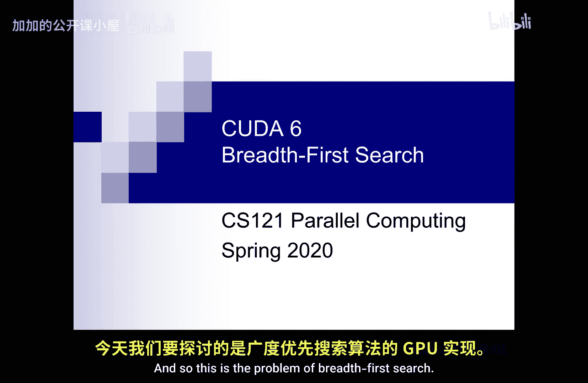
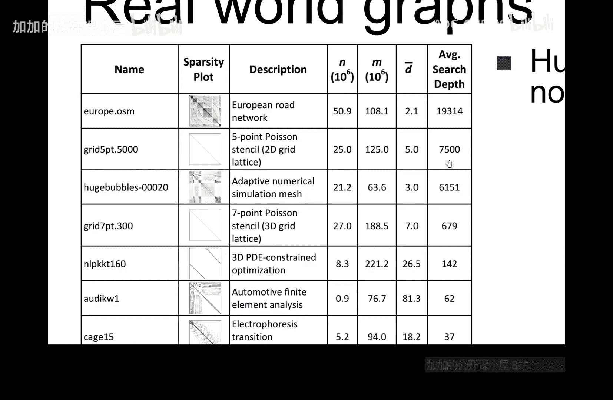
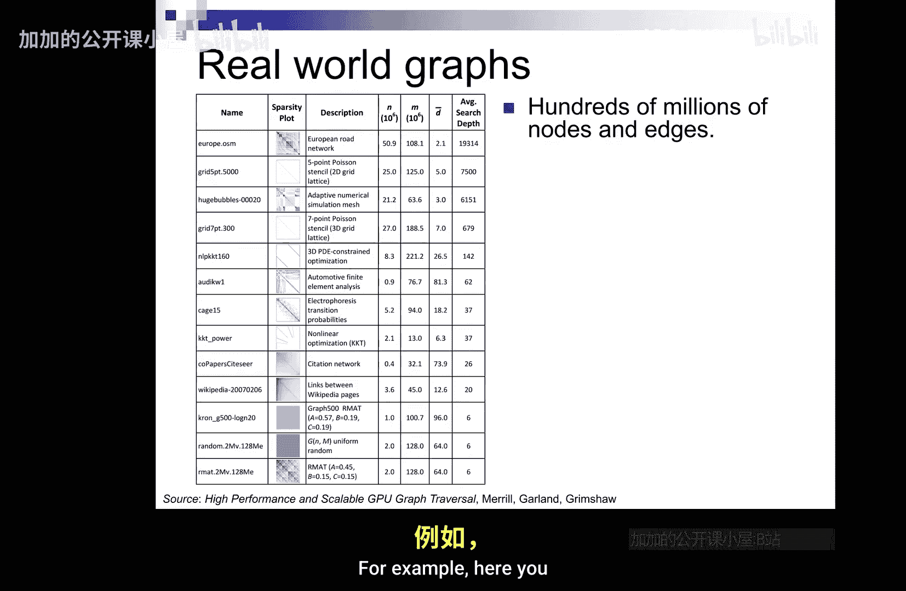
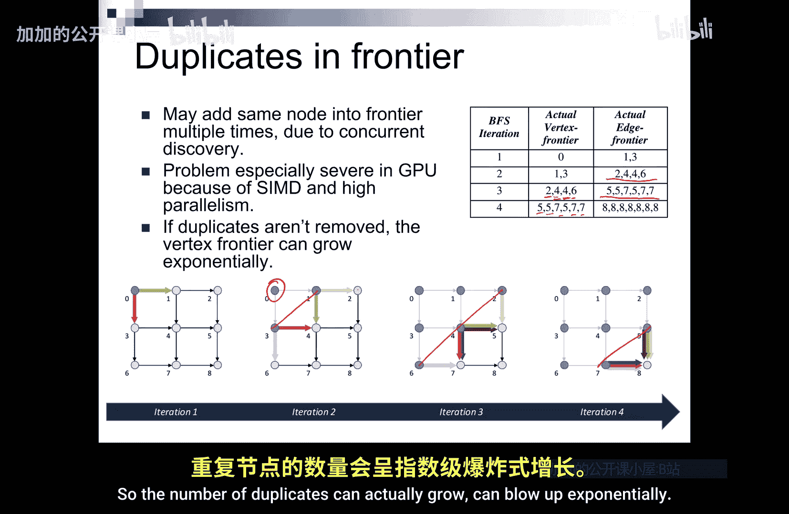
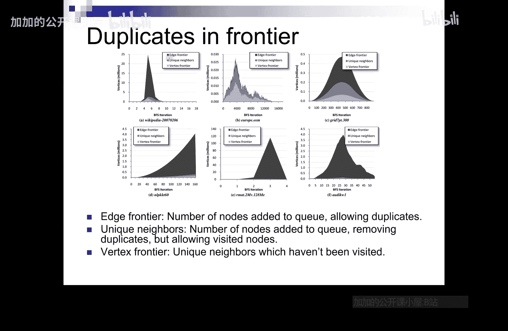
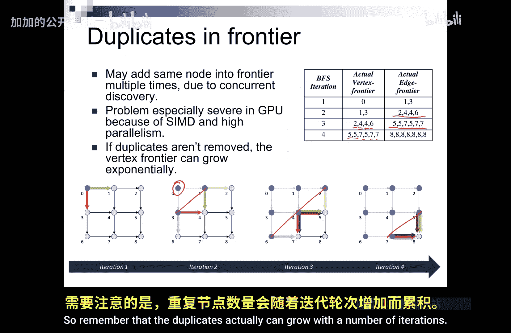
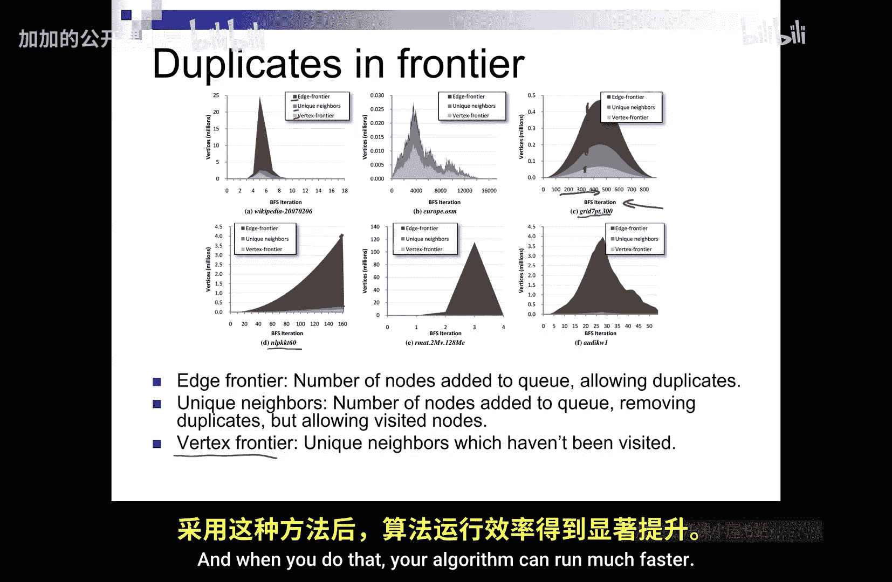
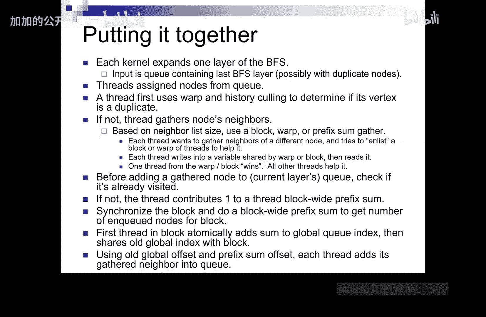
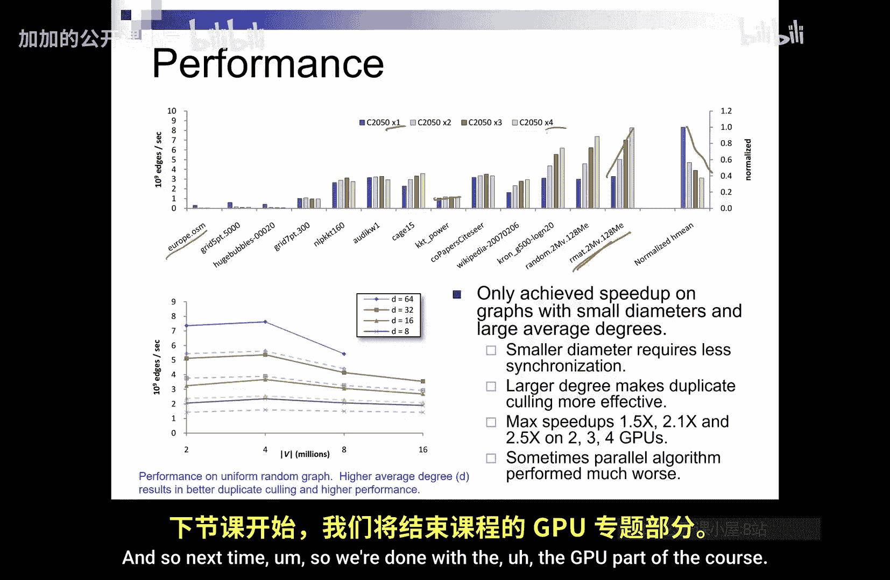

# 并行计算：P16：GPU上的广度优先搜索（BFS）🎯



在本节课中，我们将学习如何在GPU上解决一个图论问题——广度优先搜索（BFS）。我们将探讨BFS的应用、面临的挑战，并深入讲解一种高效的并行BFS算法，该算法通过巧妙的优化来克服GPU上的性能瓶颈。

---

## 概述


BFS是一种基础的图遍历算法，它从源节点开始，逐层探索图中的节点。虽然BFS的计算模式不规则，并非GPU的理想任务，但通过设计合适的算法和优化，我们仍然可以在GPU上获得良好的性能。本节课将首先回顾BFS的串行算法，然后逐步构建一个高效的并行GPU版本，重点解决锁竞争、负载不均衡和重复节点等问题。

---





## BFS的应用与挑战

上一节我们介绍了稀疏矩阵向量乘法（SPMV），它同样是一个不规则问题。BFS也是一个重要的不规则问题，在许多领域有广泛应用。

以下是BFS的一些主要应用场景：
*   **寻找连通分量**：例如，在社交网络中找出通过朋友关系可以连接的所有人。
*   **路径查找**：作为许多其他算法（如最大流算法）的子程序。
*   **矩阵重排序**：例如，在SPMV中提到的Cuthill-McKee排序法，其核心就是执行一次BFS，以增加矩阵的规整性。
*   **基准测试**：用于衡量超级计算机等系统的性能，特别是内存系统的性能，因为BFS涉及大量随机内存访问，计算量却很小。

我们通常处理的是大型现实世界图，它们具有以下特点：
*   节点和边的数量达到百万甚至千万级别。
*   平均度数较低（例如，每个节点平均连接2到96个邻居）。
*   不同节点的度数差异巨大（存在度很高的“中心”节点）。
*   图的直径（任意两点间最短路径的最大长度）差异很大，例如社交网络直径小，而道路网络直径大。

本节内容主要基于NVIDIA研究人员Merrill和Grimshaw的论文，该论文提出了许多高效GPU BFS的核心思想，至今仍是该领域研究的基础。

---

## 串行BFS算法回顾

在深入并行算法之前，我们先回顾一下在CPU上标准的串行BFS算法。我们假设图以**压缩稀疏行（CSR）**格式存储。

**CSR格式包含两个数组：**
*   `R`数组：长度为`V+1`（V为节点数），`R[i]`指向`C`数组中节点`i`的邻居列表的起始位置。
*   `C`数组：按顺序存储所有节点的邻居ID。

串行BFS算法使用一个队列（Q）来管理待访问的节点，并维护一个距离数组`dist`记录每个节点到源点的跳数。

**算法伪代码如下：**
```cpp
for all nodes v: dist[v] = INFINITY
dist[source] = 0
Q.enqueue(source)

while Q is not empty:
    u = Q.dequeue()
    start = R[u]
    end = R[u+1]
    for idx from start to end-1:
        v = C[idx]
        if dist[v] == INFINITY:
            dist[v] = dist[u] + 1
            Q.enqueue(v)
```
该算法会访问每条边一次，时间复杂度为 **O(V + E)**。

---

## 简单的并行BFS尝试及其问题

本节中我们来看看如何将串行算法并行化。一个直观的想法是让多个线程并行处理队列中的节点。

一个早期的低效并行方法是运行D轮（D为图直径），在每轮中检查所有节点，标记当前距离为i的节点的未访问邻居。这种方法复杂度为 **O(V * E)**，对于大直径图效率极低。

我们希望找到一个总工作量与串行算法相同（**O(V+E)**）的并行算法。一个直接的并行化思路是：
1.  并行初始化距离数组。
2.  使用一个**带锁的队列**，线程在出队和入队时需加锁，以避免并发访问导致数据错误。
3.  并行处理当前队列中的所有节点，检查其未访问的邻居并将其加入队列（入队时仍需加锁）。

这个方法存在两个主要性能瓶颈：
1.  **锁竞争**：对队列的加锁操作非常昂贵，严重限制了并行性。
2.  **负载不均衡**：不同节点的邻居数量差异巨大，导致处理不同节点的线程运行时间长短不一。

接下来，我们将着手解决这两个问题。

---

## 优化一：消除锁竞争

为了消除昂贵的锁操作，我们不再使用一个需要并发访问的队列。取而代之的是，我们维护两个节点集合（可以看作数组）：
*   `当前前沿（Current Frontier）`：当前BFS层待处理的节点。
*   `下一前沿（Next Frontier）`：下一BFS层将要处理的节点。

每一层BFS在一个独立的GPU内核（Kernel）中处理。处理完一层后，交换两个前沿的角色，复用内存。

现在，每个线程可以并行地将其节点邻居加入`下一前沿`数组。但这里有两个新问题：
1.  需要判断邻居节点是否已被访问过，避免重复加入。
2.  多个线程可能尝试加入同一个未访问节点，导致`下一前沿`中出现重复项。

我们先解决如何无锁地分配写入位置。假设每个节点`i`有`n_i`个邻居待加入。我们可以为每个线程预留`n_i`个槽位。

**具体方法是：**
1.  每个线程计算自己需要多少槽位（即未访问邻居的数量）。
2.  对这些数量执行一次**前缀和（Exclusive Scan）**运算。
3.  前缀和的结果给出了每个线程在`下一前沿`数组中写入的起始偏移量。

这样，每个线程都能无冲突地并行写入自己负责的邻居节点，完全避免了锁的使用。核心思想是利用**前缀和**进行全局协调。

---

## 优化二：改进负载均衡

解决了锁的问题，我们再来看看负载均衡。由于节点度数差异大，让一个线程处理一个节点会导致严重负载不均。

我们的策略是根据邻居数量动态分配计算资源：
*   **少量邻居**：由单个线程处理。
*   **中等数量邻居**：分配一个**线程束（Warp， 32个线程）**协作处理。
*   **大量邻居**：分配一个**线程块（Thread Block）**协作处理。

关键是如何让一个Warp或Block内的线程从处理各自节点转为协作处理同一个节点？这里采用一种“投票”机制：
*   线程将自己的节点ID写入共享内存的同一位置。
*   最后完成写入的线程“获胜”，其节点ID被所有线程读取。
*   整个Warp或Block的线程转而共同处理这个获胜节点的邻居。

通过这种方式，我们将计算资源动态分配给需要更多工作的节点，缓解了负载不均衡问题。







---

## 优化三：高效的状态检查与去重

在将邻居加入`下一前沿`前，必须检查它是否已被访问。为每个节点维护一个访问标志会导致大量内存访问。



**高效的状态检查（位掩码+标签）：**
*   **位掩码（Bitmask）**：一个32位整数可以表示32个节点的访问状态（每位代表一个节点）。首先检查位掩码。
*   **标签（Label）**：每个节点有一个独立的访问标志。
*   **检查流程**：先查位掩码对应位。若为1，则节点已访问。若为0，则不能确定（可能因并发写入被覆盖），需进一步查询该节点的独立标签。
*   **优势**：大多数检查只需访问紧凑的位掩码，节省内存流量。论文实验表明，此方法对低直径图尤其有效。

**重复节点消除（Culling）：**
允许多个线程写入同一节点会导致`下一前沿`中出现重复项，且重复数量可能随层数指数增长，造成大量冗余计算。

**去重方法（基于哈希表）：**
*   **Warp Culling**：每个Warp在共享内存中维护一个小哈希表（如128项）。插入节点时，计算哈希值。
    *   若槽位为空，插入节点并加入队列。
    *   若槽位已有相同节点，说明是重复，不加入。
    *   若槽位有不同节点（哈希冲突），为安全起见，仍加入队列。
*   **History Culling**：整个线程块利用L1缓存作为共享哈希表进行去重。
*   **效果**：即使哈希表很小，也能消除大部分重复。实验显示，平均可减少约30%的冗余节点。结合位掩码检查，效果更佳。

---

## 完整的GPU BFS算法整合

现在，我们将所有优化整合起来，形成完整的GPU BFS算法。

**算法框架：**
每层BFS由一个独立的内核计算。内核的输入是可能包含重复的`当前前沿`。

**内核内的步骤：**
1.  **去重（可选）**：线程使用Warp/History Culling判断其分配到的顶点是否重复，只处理唯一顶点。
2.  **邻居收集与负载均衡**：线程读取其节点的邻居列表。根据邻居数量，可能召唤整个Warp或Block来协作。
3.  **状态检查**：对于每个待加入的邻居，使用位掩码+标签的方法检查是否已被访问。
4.  **槽位预留**：每个未访问的邻居对应一个待预留的队列槽位。线程块内对所有需要预留的槽位数进行**前缀和**，得到块内偏移。
5.  **全局分配**：线程块派一个代表，原子性地将本块所需总槽位数加到全局队列大小计数器上，并取回旧的全局偏移量。
6.  **并行写入**：每个线程根据块内偏移和全局偏移，计算出最终写入位置，将邻居节点无冲突地写入`下一前沿`数组。

**算法变体：**
论文还探讨了不同执行顺序的变体，如`收缩-扩展`（先对当前层去重，再扩展）、`扩展-收缩`、`两阶段`（扩展和收缩分两个内核）以及`混合`策略。不同变体在不同特征的图（如前沿大小、直径）上性能各异。



**性能结果：**
整合了所有优化的算法相比8核CPU实现了显著的加速（通常10倍以上，最高可达30倍），证明了在GPU上高效执行BFS的可行性。

---

## 多GPU扩展的挑战

最后，我们简要探讨将算法扩展到多GPU的尝试。早期研究通过PCIe连接多个GPU，采用轮询方式将顶点划分到不同GPU。

**多GPU算法流程：**
1.  每轮BFS，每个GPU在本地计算`下一前沿`。
2.  由于`下一前沿`中的节点可能属于其他GPU，需要根据节点ID将其排序到对应的“桶”中。
3.  进行全局同步（Barrier）。
4.  每个GPU从其他GPU的对应“桶”中取回属于自己的节点，形成自己下一轮的`当前前沿`。

**挑战与结果：**
*   频繁的全局同步和数据交换开销巨大。
*   对于高直径图（如道路网络，有2万层），需要同步上万次，性能急剧下降。
*   实验表明，仅在低直径、高平均度数的图上能获得有限加速，平均而言多GPU性能反而不如单GPU。这凸显了不规则通信模式下的扩展性挑战。

---

## 总结



本节课中我们一起学习了如何在GPU上实现高效的广度优先搜索。我们从串行算法出发，逐步解决了并行化中的锁竞争、负载不均衡和重复项处理等核心挑战。关键优化技术包括：使用双缓冲区和前缀和消除锁、基于位掩码和标签的高效状态检查、利用小哈希表进行去重，以及动态的Warp/Block级负载均衡。尽管将算法扩展到多GPU仍面临通信开销的严峻挑战，但单GPU上的优化算法已能取得令人瞩目的性能提升。BFS在GPU上的优化仍然是并行计算中一个活跃且富有价值的研究领域。