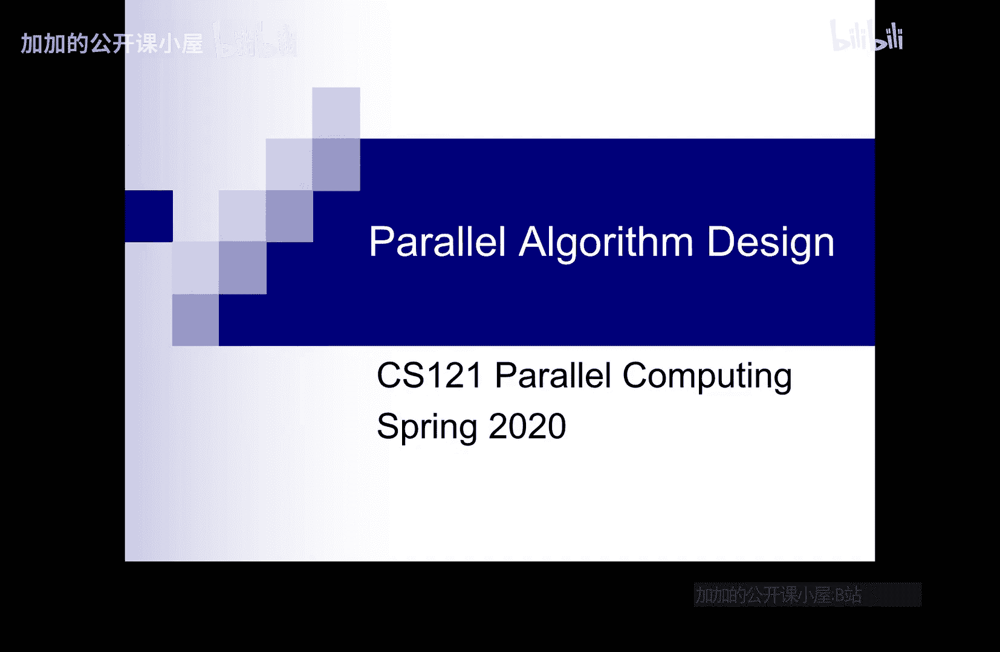
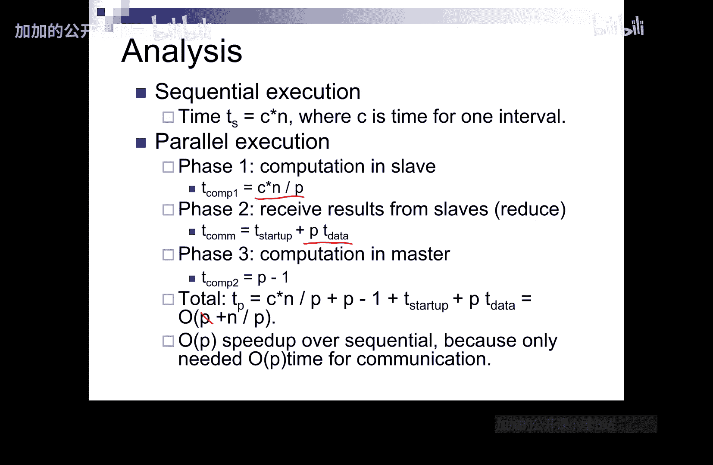

# 上海科技大学【中英⚡并行计算｜CS121 2020 Parallel computing】 p17 P17 Parallel algorithm design part 1 -BV1VqypBaEaP_p17-

Hello， today we're going to start a new topic and we're going to talk about the process of designing a parallel algorithm。

So we'll begin with something called Fosters design methodology so it's a methodology。

 so it's basically a thought process that you can use when you want to design scalable algorithms。

 especially for the distributed memory setting。So this is kind of like how divide and conquer or greedy algorithms are techniques or sort of thought processes that you would use to design sequential algorithms。

 okay， so this is working in a similar way but for parallel algorithms。

And it encourages the development of scalable algorithms by sort of pushing all of the details about the actual hardware until the final steps of the design process。

Okay so we know that when you design a parallel algorithm。

 we do have to consider the hardware that we run on because that has a big effect on the performance overall。

 but we want to leave those considerations until the very end and sort of stay at an abstract level of the design process as long as possible。

So this technique was developed by Ian Foster， and if you want to read more details about it。

 then you can actually go online and read this monograph that he's written。

So there are basically four steps to this process Okay， so there are the partitioning， communication。

 agglomeration and mapping steps， so I'll talk in more detail about what these steps are。

So what we're going to do is we're going to first give an overview of the methodology。

 and then we'll see an example of using this to design a parallel algorithm for the Floyd Warho shortest path algorithm。

And then we'll talk about- so part of Fo's methodology is the partitioning step。So in fact。

 we'll talk about two types of partitioning later， we'll talk about data and also algorithmic partitioning。

Okay so there are four steps to this methodology okay so the first step is partitioning and this basically means that you want to take your problem right。

 which starts out as just being one big problem and then you want to break it into many smaller parts and you want the parts to be pretty much independent so that you can solve these parts separately individually in parallel。

Okay， so then after that， well these parts do need to interact in some way。

 usually you're not going to end up with completely independent cell problems。So after partitioning。

 we have the communication step where we figure out which tasks tasks。

 so the tasks have these little circles and then we need to figure out which ones of these need to communicate with each other。

Okay， so we're basically。We're going to add these sort of edges and they indicate communication between the tasks。

And then next we're going to do the agglomeration step。

 so agglomeration basically means that we're going to take some of these small tasks and we're going to combine them into larger tasks and the reason for doing that is that we can reduce the amount of communication and then improve performance。

And then lastly， we're going to take this sort of diagram that's representing all of the agglomerated tasks and then we're going to map them onto the physical hardware so here on each of the big pictures sorry big circles is indicating like a processor and each processor is running several of these agglomerated tasks。

Okay， so then now we're going to get into more details about each of these steps。Okay。

 so the first step is the partitioning step。And the point here is that we want to take a big application and then break it into a number of smaller tasks that can be executed in parallel。

And as I mentioned， there are different ways of partitioning a big problem so one major method that we're going to talk about is called data partitioning。

So here we're going to take the data that the application processes。

 we're going to divide those into parts。And then we have tasks that operate on different parts of this data。

Okay， so basically， once we break up the data into parts。

 then we need to associate the computations with the data。

Okay and this is also called a domain decomposition sometimes because it's basically so the domain is the data that we're working with。

 and so we're decomposing that。another type of partitioning is algorithmic partitioning。

 so here instead of partitioning the data that we're working with。

 we partition the algorithm into a number of tasks that can be executed in parallel。Okay。

 and then after that， we need to say how the how the data is associated with the tasks， okay。

 so which data is being processed by which tasks。And oftentimes， as we'll see。

 this is going to lead to a pipeline of the tasks。And this is also called functional decomposition because we're taking the function of the algorithm and decomposing that。

Okay， so as an example of this So first， let's see data partitioning。 So data partitioning。

Suppose that we want to work with a data structure of this sort okay so we have this cube over here right and then there are a number of coordinates in this cube and at each of these coordinates we need to do some computation。

Okay， so then now we can so our data consists of all of these black dots on the left。

So now we can somehow partition those black dots into tasks。And we can do that in different ways。

Okay， so one way is that so， for example， we can just create a few tasks tasks so we can make like a one D decomposition where。

Basically。Let's see。So we have so we're going to treat this as like three so we're going to treat this entire cube over here as just like sort of three faces。

 Okay so then this is like one phase right， and then this is behind that is another phase and behind that you have a third phase。

Okay， so then each of these faces， we're going to treat as a task。Okay。

 so then we end up with three faces and we have three tasks。

Okay another way that we can deal with this is that we so this only produces three tasks。

 okay and maybe that's not enough parallelism for your hardware because maybe you have many。

 many processors， so you want more than three tasks。

so then another way that we can decompose this task is that we can take this big cube on the left right and then we can treat sort of each row of these tasks Okay。

 so each row of these dots right so there are multiple computations here。

 but we can treat each of these rows as as one task。Okay。

 so then if you do that right then the the number of these rows that we have right so we're going to be ending up with basically 12 of these rows okay so there are some that you can see in the front face and they're more in the back right？

And in that case， we're going to end up with this 2D structure that we have on the right over here。

And then a final way that we can partition the data is that we can just have a very fine grain partition where you say that each of these black dots so this is some sort of computation and we're going to treat each of these individual computations as like an individual task。

Okay so in the data partitioning， you start with all of your computations and then you decide how to combine them into these primitive tasks and you can combine either a lot of data or if you combine a lot of data。

 you get something like this 1D partitioning that we have or if you combine just small bits of data。

 you get the 2D or the 3D partitioning。So that's data partitioning now for algorithmic partitioning。

 we're not going to partition the data， instead we're going to partition the algorithm itself。Okay。

 so in this example， we have something like an algorithm to process MRI images or X ray images。

 something of that sort。So then if you think about what tasks need to be done in this application in this MRI application。

 well first of all， you need to acquire the images you need to actually do the imaging process right so you need to control of the MRI machine to actually take the picture okay。

And then next you need to register these images and then you need to do things like track the position of your instrument and then sort of figure out the image locations and then maybe you have something like you have to display the image。

So you can take this big application of MRI and then you can break it into these subtasks and the subtasks have some relationships between them。

 like you have to first acquire the image before you can register it before you can determine the image locations。

Okay， so there's some sort of。Precintence between these subtasks。

And then whenever you have a piece of data right so a piece of data would be like a person that you're imaging okay。

 so then this imaging process， it actually has to go through different stages of this pipeline。Okay。

And then you could have multiple patients that you're trying to image and all of them would need to go through this overall process and because there are multiple steps in this process。

 then we can actually pipeline together these different patients and we can get parallelism that way。

Okay so that is partitioning， so it's basically how do we break up the problem and whether we use data partitioning or algorithmic one depends on the type of problem that you have so if you have a very uniform problem where you have a lot of data。

 but you perform basically the same computation on all of the data then the data partitioning makes more sense whereas if you have an algorithm which is like very complicated and has several parts then you can decompose these parts and then the algorithmic partitioning would make more sense。

Okay so there are several things we want to achieve when we do the partitioning right so first of all。

 we want to make sure that we have enough tasks to occupy all of our processors so know a rule of thumb would be that maybe you want 10 times as many tasks as you have processors because if you have exactly the same number of tasks as processors then basically you can only assign one task per processor and then you could have issues like you know if these tasks are not equal to each other if some tasks are much larger then you have load imbalance and issues like this whereas if you have more tasks than processors then you have more freedom in how you assign the task to the processors and so you can overcome some of these problems like load imbalance。

Okay now also when you partition the tasks， sometimes you might want to do redundant computations so this would mean that for example。

 if two processes both need a certain value okay so one thing you can do is you can have the first process compute that value and then later send that value to the second process right but that requires communication。

So something else you can do is you can just have both processes compute that value Okay so now you've done some redundant computations。

 but you've removed the communication， and so this could actually go faster in some cases。 however。

 you don't want to do too much of this redundant computation and also sometimes you might want to store the same data at multiple locations so that you don't have to to send the data but again。

 you don't want to replicate this too much So yeah。

 so we want to minimize the amount of redundancy that we have。

And now you want your tasks to be about the same size okay because if they're the same size。

 then they're easy to load balance right sometimes you can't achieve that they're all exactly the same size。

 but you try to make them as equal as possible。And then also as your problem gets larger right。

 you want to make sure that you have more more tasks okay so for example。

 in the previous data partitioning example right so if we're working with some sort of domain。

 then the larger the domain the more of these tasks that we should generate。

And the reason is that when you work with a larger domain， so there's more computation overall。

 so you want to use more processors but if you want to use more processors。

 then of course you have to have more tasks so the number of tasks needs to grow as your problem size gets larger。

Okay， so that's partitioning， so the next step in the design methodology is communication。

So communication is basically determining what kind of data needs to go between the different tasks。

Okay so the tasks need to do some communication， so here we're going to figure out which ones of these are going to communicate and what data they're going to send。

So there's two types of communication， there's local communication， and there's global communication。

So local is that。It kind of corresponds to point to point messages where a process or a task rather。

 only needs values from a few other tasks。Okay， so then in that case。

 you can just do point to point communication between these tasks。Whereas for global communication。

 this is where a task needs data from like all the other tasks。

 so this corresponds to like a collective operation in NPI。嗯。Okay。

 so then so there are some properties that we want for this communication also。

 so just like we want the tasks to be balanced， you also want the amount of communication between the tasks to be balanced right you don't want one task doing a huge amount of communication and then the other one's doing doing far far less。

And then we want to minimize communication as much as possible。

 so ideally each task only communicates with a small group of tasks and ideally those tasks are nearby so that this communication is fast so you should try to just talk to a few neighbors if possible。

And then we want to make sure that these communications can actually happen concurrently okay so for example。

 we don't want all of the communication to have to go through one communication edge because then that edge would become a sequential bottleneck and we need to wait for the messages to get sent one by one through that edge okay you want the communication to be spread out between the tasks so that you can make use of all of your communication channels at the same time and then eliminate the bottlenecks。

And then also you can actually over you can often overlap communication with computations so that means that while you're communicating right you can be computing something else and then once the communication is done。

 then hopefully the computation has already has also finished and then now you can communicate the result of that computation so at every time point you're making use of all of your resources right you're trying to use as many communication channels as possible concurrently。

 but at the same time you don't want your processors to go idle so you're also making use of your processing resources concurrently。

Okay， so the next step is agglomeration， so agglomeration basically means to combine a bunch of these small tasks into bigger tasks Okay。

 we're going to call the bigger ones the super tasks。

And the reason you want to do agglomeration is because if you look at the communication between these small tasks。

 then there can be a lot of communication because you're trying to create many of these small tasks and so there'll be a lot of communication between all of them。

And so you don't want to have so much communication because that is a big overhead on your computation。

 so what you want to do is group your set of many small tasks into a smaller set of big tasks and then that's going to eliminate a lot of the communication between these big super tasksasks。

Okay so as an example of this right so suppose on top we have two small tasks now if you agglomerate and combine them into one one big supert。

 then you know previously let's say these two small tasks needed to do some communication but if you agglomerate them into one task then you can run that one task just on a single processor and now this processor won't need to to do sort of network communication anymore so it might still need to do some sort of communication like shared memory communication within that processor but it won't have to go on the network anymore and so that's going to improve performance a lot。

Okay another example would be in the example on the bottom right so you have these two pairs of tasks right so previously to communicate they would have to send two messages but now if you agglomerate the left two tasks and the right two ones then now you can instead of sending two messages。

 you can just send one message so the message basically includes the information from both both of the previous messages。

 but it's combined into one message and so you pay less overhead for sending that message right because every message you have overhead like you know like the headers and the routing and all that stuff Okay so now you only need to do that once。

Okay， so in terms of what you want to achieve for agglomeration。

 so we're trying to reduce communication through agglomeration right so another way to say that is that the locality of the algorithm should improve okay locality basically means that you don't need to go to remote processors to do something right you don't need to communicate with remote processors you can stay within your own local processor。

嗯。Yeah， and then this is again， what we talked about earlier。

 which is that sometimes want to replace you might want to replace communication by doing some extra computation。

Okay， so of course， you don't want to do too much of that。

 so you have to be somewhat careful about that。And you can also replicate the data to reduce communication。

 but again， you don't want to do too much of that either。

And then you want to make sure that so we always want the tasks to be balanced right so even when we created the small tasks right we wanted them to be balanced and now once you combine these into the big supertask。

 you also want to have load balance between them， so these supert should have similar computational costs and also communication costs。

And so this agglomeration comes right before the actual step where you map the tasks the supertasks onto the processors Okay so now here's the time when you need to make sure that the number of agglomerated tasks right sort of is a match for your targets for your target system okay so for example。

 if your target system has a certain number of processors then you should have at least that number of supertasks。

So that you can make sure to use all the processors。

And then sometimes the parallel code and the sequential code you might have to make a lot of so typically you start with sequential code and then you gradually parallelize it but you want to make sure that you don't need to dramatically change the sequential code to get the parallel code yeah。

Okay， so then the final step to this methodology is that once you have these supertasks right。

 then we're going to map the supertasks onto the processors so the supertasks are the computations that we plan to do are the units of computation right and then finally you need to decide you know which units of computation go on to which processors。

And then yeah， so here our goal is that for each processor。

 we want to balance the workload on the processor， and then also you want to minimize the communication through the processes。

Okay， now sometimes the these two goals actually conflict with each other Okay。

 so load balancing and minimizing communication are often you can't achieve you can't optimize for both at the same time Okay。

 for example， if you want to completely minimize interprocess or communication right。

 then you can just put all of the processes onto sorry all the tasks onto one processor Okay。

 in that case， you don't have any interprocessor communication。

But of course that's not going to load balance at all and if you want to load balance then you want to spread out all of the tasks between the processors。

 but then that would increase the amount of communication。Okay。

 so you have to look for some sort of trade off between these two objectives。Okay。

 so as an example of this， suppose this figure A here right suppose each of these circles now represents one of your super tasksasks so then if you have three processors。

 then in figure B here， this is sort of one mapping that you could have between the processors between the tasks and the processors。

Okay， so so now if you look at this in terms of both load balance and communication right so load balancing。

 so each of these circles represents some sort of computation and if we just assume that the computations all take the same amount of time each circle has the same amount of computation。

 then you can see that this mapping is not really a good load balancing because for example。

 the middle processor has twice as much work as the other processors。Okay。

And then in terms of communication， so the communication between processors would be for example。

 you know， here you have some intraprocessor communication okay。

 and here you have some intraprocessor once Okay， so it's basically all of the communication going between processors right you could also have a communication within a processor between these tasks like from A to B right but those are。

Those are much more efficient because you're doing it within one processor。Okay。

 so so some things we want to achieve for our mapping are。Okay。

 so one thing is that we can do static so here you know we want to figure out how to allocate the tasks to the processors。

 so one way is that you can do static task allocation so so here for example。

 if we're in the simple simple situation where the tasks have the same computation time right then we can just agglomerate them in order to to minimize the communication。

Okay and if they have different computation times， then we can sort of we can assign them so we need to figure out how to assign these different tasks to the processors so you can maybe just iterate through the tasks in a round robin fashion okay and assign them to your processors so if you have like four processors right then you go through all of your tasks and then you assign them to processors like 12。

3，4，1，2，3，4 and so on。Okay so in this way， you're trying to sort of each processor would get a diverse set of tasks and the hope is that this diverse set of tasks。

 all the different sets of tasks being allocated to the different processors somehow end up being pretty close in overall load to each other。

Okay so you can improve the load balancing this way。

So that's for the static task allocation where you have to allocate the tasks to the processors sort of at the start of your computation。

And another way to do task allocation is you can do it dynamically， so for example。

 sometimes you don't even know what tasks you have at the beginning so you might sort of spawn a new process and so that would be an additional task that you create at runtime and then or maybe you don't know running times of your tasks so for the static task allocation。

 you have to know the running times before you can do either before you can do the mapping。

And if you don't know these， then you can do something like a dynamic task allocation。

 So one example would be work stealing so work stealing is where on each process has a queue of things that it wants to do。

 puts all the tasks that it's doing in the queue and then the process keeps taking stuff out of the queue to do。

But sometimes if the process runs very fast， then it can finish all of the processes in its queue so it's out of stuff to do So at that point。

 instead of just idling the process can go to the queue of a different processor and maybe that other processor still has lots of things to do So now the first processor can just steal something out of the work queue of the second processor So the first processor is actually helping the second processor by doing the stealing but this is way that if dynamically and runtime。

 you find out that all of a sudden you're out of things to do。

 then you can just go take some stuff to do from other processors。Okay。

 but of course this comes with some overhead because you have to have like a process like a task allocator to manage all of the stuff right。

 to manage the stealing and also。Yeah， right， so there's some overhead to doing this and so you want to make sure that you don't use a very expensive scheduling algorithm so that the manager doesn't become a bottleneck。

Okay， so now let's so those are the basic steps to Fo's methodology right。

 so it's going to be partitioning， communication， agglomeration， and then mapping。Okay， so then next。

 let's apply this methodology to solve a problem。 Okay， so the problem is going to be。

The all pair shortest path problem。 So then here we're going to have a directed graph okay and then it's going to be a weighted graph so you know you have these weighted edges between nodes。

And then what we want to do is to find the shortest path between every pair of nodes。

Okay so for example， the shortest path between let's say node A to C so that would be what you could go from I'm sorry from a to D。

 let's say okay so you could go from a to C to D and that's got a path of length8 or you can go from a to B to D and that's got length 7 and then O okay so there's an even better one you can actually go from a to C to E to D and that actually has a length of 6 and so the shortest path is actually from a to C to E to D。

Okay， and then you want to find the shortest path between every pair of notes。

Okay so there are many applications for this allP shortest path right so if you're in a communication network or a road network you want to find the fastest way to communicate or to travel and then also you can use these graphs to represent sort of abstract things like a state space for some sort of computation and if you want to do that computation efficiently。

 then you also want to find shortest paths in that state space。

So there are many applications to doing this。 So you've probably seen this algorithm before。

 So we're going to use the deployedy Warho algorithm。

 Okay but let's just sort of do a recap of how this is going to work。 So first of all。

 we're going to represent the graph using an adjacency matrix。

 So the adjacency matrix is's just going give the distances between the different pairs of nodes so for example。

 there's an edge from a to B So we have an edge from a to B， and that's got a length of 6。

 So therefore， we're going to put the value 6 in the in the a row and then B column And if there's no edge from a node to another node。

 For example， there's no edge from a to D as we can see A cannot directly go to D。

 then you're going to put an infinity there。And then for every node to itself， from a to a。

 we're going to put a zero there， because there's no cost to doing that。

Okay and then so that's our input matrix and then we want to produce an output matrix out of this and the output matrix should just be the shortest paths between all of the different nodes so for example we saw that to go from a to a to D right the shortest path has length6。

So then this is what we want to have。When I output on， you know， A to D is6。Okay。

 and we're going to assume in this algorithm that we don't have any negative weight cycles Okay so you could have cycles let's see yeah so you have for example。

 a cycle in this graph right you can go from a to B back to a but the weight of doing that is positive。

Okay so then to remind ourselves how the Floyd Warshaaw algorithm works。

 so it's basically a dynamic programming formulation of this all para shortest paths。

So we're gonna to consider certain types of paths。 Okay， so the type of path is going to be。

So suppose you want to go from a node I to a node J and suppose you're restricted to only using a subset of the nodes as intermediate nodes Okay。

 so the path from I to J， I only allow you to use nodes1 up to K okay for some K。Okay。

 and if it's not possible to go from I to J using only the subset of nodes。

Then you're going to indicate that the distance is infinite， at least using that set of nodes。Okay。

 now assume that it is possible to go from I to J， okay then。As intermediate nodes， sorry。

 assume it's possible to go from I to J using only nodes1 up to K as intermediate nodes。

Then there are two possibilities， so either this path from I to J it could use node K as one of the intermediate nodes or maybe it doesn't use node K as an intermediate node。

Okay， okay， so then if it uses node K as an intermediate node right。

 then that's what's being shown on in the figure on the bottom。

 So then we're going from I to J right and then somewhere in the middle So all of the intermediate nodes were allowed to use are between1 to K。

 we don't consider we don't allow using any other nodes。Okay， now， if K is an intermediate node。

 then the path is going to look like this。 Okay， it's going to go from I to K and then from K to J。

And then also when you go from i to K， all of the intermediate nodes are going to be between 1 to k minus1。

Okay，So so remember that you're only allowed to use nodes1 up to k and here we're going from I to K and the claim is that these intermediate nodes have to be between 1 to k minus1。

And this means that in particular， it's not possible to have another copy of K in here。 Okay。

 this cannot happen。Okay， and the reason it cannot happen is because if you had another copy of k in here。

 then that would mean that you first go from I to K， and then somehow you go from K back to itself。

Okay，However， we said that there are no negative weight cycles in this graph。So if in fact。

 let's assume that all cycles have positive weights。

Okay so that means that if you have k in the middle here， if you have another K in the middle。

 then here you're going from K to k， so this is actually a cycle from K to k and if this is a shortest and the cycle we're assuming is going to have positive length。

So now since we assume that overall you have a shortest path。

 then if you have a cycle here with positive length。

 you can just cut out that cycle and you'll get an even shorter path right that still goes from I to J。

 but that's a contradiction because we're assuming we already have the shortest path from I to J using only these intermediate nodes。

So that means that you cannot have another intermediate copy of K。Okay。

 and so that means that when you go from I to K， the only intermediate nodes you can use are1 up to k minus1。

Okay and likewise， when you go from K to j you cannot have another copy of k in the middle of this right so therefore the only intermediate nodes you can use are from1 to k minus1 again。

Okay， and so that's the first possibility where is actually where you actually go through k on the shortest path from I to J。

And in the other case， right where you don't use node K， then of course。

 the only nodes you can use are from 1 to k minus1。Okay。

 so now we're so we set we're going to set up some sort of dynamic program to solve this problem。

 So the dynamic program is going to be that。We're going to have these we're going to define these values a DIJ of k and this DIJ of K is going to be the minimum distance from node I to J where you can only use nodes one up to K as your intermediate nodes。

Okay， and then what we're going to do is we're going to run a dynamic program where you're so initially the K is going to be like is' going to be zero okay。

 and then eventually we're going to increase k all the way up to n where n is a number of nodes。

Okay so when you increase K up to n， then what that means is that you're allowed to use any node from one to n as an intermediate node。

Okay， and so in that case， that would mean that you can use any path you want as an intermediate node so that's like a so that imposes no restrictions on the path and so basically that means that TJ of N is simply equal to the shortest path from I to J。

Okay so yeah so so we're going to start with a very restricted path where k is0 right so basically you cannot use any intermediate nodes in the beginning and then gradually we allow you to use more and more nodes until eventually when K equals n。

 you can use any path you can use any node you want and so that would produce the actual shortest path from I to J and that's what we want to compute okay。

And the way the DP works is that。So assume that you've already so assume we're in the case stage and we've already run all of the other stages。

 so that means that we know DIJ of k minus1 for all I andJ。Okay。

 so then now we want to compute D Ij of K。And what we have is that DIj of k， if k is equal to0。

 then that means that you cannot use anything as an intermediate node。

And so now if you want to go from I to J and you can't use any intermediate node。

 then you can just look at the edge between I to J so if there is an edge。

 then the distance is just the weight of that edge WIJ and if there's no edge。

 then WIJ is going to be infinite。Okay， so for k equals0， DIJK is just WIJ。

That the weight of the edge from I to J。And then for k at least equal to1。

 then you have that Dj of k is equal to the minimum of these two quantities so so what these two quantities are is that so the first quantity is so remember we have this observation that if you want to go from I to j using the shortest path with only one up to k as intermediate nodes then the two cases are that either you can use k as an intermediate node or you do not use k as an intermediate node now if you do not use k as an intermediate node then you can only use nodes 1 up to K minus1 as intermediate nodes。

And so in that case， the shortest distance from I to j using only one up to K minus1 as intermediate node is just this value over here。

 okay， DJ of k minus1。Okay， so that's the first case and the other and DIj of k minus1。

 you know we've already computed this value right because we perform this DP stage by stage。

 so we assume that we've already found DIj of k minus1。

Now the other case is where you do use k as an intermediate node。

 but in that case we said that if you so we're going to go from I to k。

 but this path from I to K cannot use k again， it can only use nodes 1 up to k minus1。

So therefore the minimum path from I to k using only nodes 1 up to k minus1 is given by this quantity here and then we need to go from k to J using only nodes 1 to k minus1。

 and that's given by this quantity over here。Okay， now all of these quantities that I underlined。

 right， they were computed in the previous k minus1 stage， so we have all of these values。Okay。

 so therefore we can plug them in and we can get the DIJK values for the stage。So that is the DP for。

For Floyd Warsholll。And now we're going to look at how to parallelize this。

 and we're going to use this phos methodology for doing this。

So the first step is to partition the problem so partition the problem for each so we're going to look at each stage of this dynamic program separately okay so for the K stage we need to compute all of these DIJK values and so for partitioning naturally we can just use each of these DIJK things okay values we can use as one task。

Okay so for different I's and Js， we have different tasks Okay so if you have n node in total right then you have n squared different values for I andJ。

 and so we produce n square tasks， one for each pair of I andJ。Okay。

 and then we have different values of k。 and then these also lead to different tasks。 Okay， so。

 so we just so we have this。So we have this formulation over here right so we have a triple loop okay so the outer iteration the outer loop is going to be over the K variable because you have to compute k from 0 to1 to 2 and so on all the way up to n。

 and then for each value of k， right， we need to figure out DIJ of K for all values of I andJ。Okay。

 so those are the second and third layers of the loop。Okay， and then for each INJ， right。

 we're going to use this this Dp equation to compute these。 Okay。

 so initially on all of the AI Js are were initialized to WIJ Okay， so for k equals0。

 right this is a correct formulation and then for for larger K。

 we're using this this expression down here。Okay so now we have all of these tasks and now we need to figure out which ones of these can be done independently we want to figure out what the dependencies are between these tasks now there's a dependency now for each value of k okay so this depends on all of the tasks for lower values of K okay。

 meaning that if we want to solve this DIjK right， we need to solve all of these we're going to solve all of the tasks for DIjK minus1 before we try to solve DjK。

Okay， so there's dependencies between different k values。OkayHowever。

 dependency are there dependencies between the different DIJ values？

Okay so once you fix a value of k， are there dependencies between the different DIJ K values？

And the claim is that there are no dependencies once you fix a value of k。so for a given value of k。

 we have that AI J and then a of I prime J prime can be computed in any order。Okay。

 so that's the claim。And the reason this is true is because in order to compute AIJ， right。

 so AIJ to compute that， you need to compute AIK and then aKJ。And then and then now AIK here， right。

 So AIK is equal to this okay。You know， if you plug this in the same equation。

 so AIK equals this thing over here and aKk is equal to0 so basically what this is saying is that AIK does not change in iteration K。

Okay， and likewise， aKJ does not change in iteration K。Okay， so。And then。Yeah。

 so so because AI K does not change at all in this iteration K right for the outer K。

 once you fix it， then AIK doesn't change and aKJ doesn't change。

 then no matter when you compute this AIJ always you always get the same value。

 because neither of these two things changes。Okay， and likewise。

 whenever you compute AI prime J prime， you also always get the same value because you。

 then you have AI prime K， which never changes and a K J prime， which also never changes。Okay。

 so so what that's saying is that you can compute AI J and AI prime J prime any time within the cave iteration。

 and you always get the same value。Okay， so therefore there is no dependency between AIJ and AI Prime J prime。

 you can compute them in any order that you want。Okay， so yeah。

 so therefore our algorithm is going to be going to be like this。

 So we're going so the parallel algorithm is going to have n phases and sequential phases。 Okay。

 one for each K right， So K equals 0 and then one and then up to n n minus-1 And then in each of these phases right。

 We're going to have n squared of these little tasks for the AI Js。

And then all of them can be done completely in parallel。

 there's no dependency between any of these tasks。Okay。

 so that is how we partition the problem right so now we've ended up with a bunch of tasks and we know all their dependencies。

So now we're going to figure out the communication between the tasks。Okay， so。

So so to do this let's do an example。 So here assume that K equals1 Okay。

 so let's say that k equals one in this example right。

 So then what you need to do So then you have let let's say 0，1，2，3。

4 over here right and then you have 0，1，2，3，4。And then suppose you need to compute one of these values。

 Suppose you want to compute value on a 3，4 over here。 Okay， so a 3，4 is going to depend on centing。

We're in phase k equals 1， this is going to depend on a31 and then a14。O。

And so therefore you need to do some communication between a31。

 you need to send this value of A31 and then also the value of A41 to whoever is doing this task A34 right that guy needs to get these two gray values。

Now， if you look at now， likewise， if you take any other node on this same column， okay。

 then this node is also going to need。So then this node will need again， it's going to need a14。

 right， however， it's going to need a different different column， a different value over here。

 it's going to need a21。ok。 but the point is that if you take any task on this column。

 it's all going to have to read the value a14。All of the tasks in the fourth column need to have the value A14。

Okay， likewise， all of the tasks in row 3 will need the value A31。O。Yeah。

 so therefore the communication， what we need is that since all of the tasks on for example。

 the fourth column need a41 sorry a14 right， then we're going to take this value of a14 and we're going to broadcast it along this entire column。

Okay， now similarly， all of the tasks in this third column over here， they all need the value A13。

Okay， so therefore， we're going to take this a1，3 value。

 and you're going broadcast it along that column。 Okay， so that everybody has it。 Okay， so， in fact。

 for every column， we're going to broadcast。For column J。

 we're going to broadcast the value A1 J to the entire JF column。Now also for the rows right。

 so everybody on the for example， the third row is going to need the value a a31 there so you're going to take the a31 value and you're going to broadcast it to that entire row。

And likewise， all of the other rows， right， they all need the value in column1 from that row Okay。

 so then you're going to take these all of these gray values and you broadcast each one of them along its row。

Okay， then so this is our communication pattern。You do these column wise broadcasts of the Ca row。

 and then you do these row wise broadcasts of the Ca column。Okay。

 so then next we're going to do the gllomeration and the mapping steps Okay so yeah so we're going to have we know up prior how many tasks we have for each value of k so we have k squared tasks yeah so the tasks are not created are not being created dynamically and also all the tasks are just so each task is just doing this this computation over here right so all of the tasks have the same size。

Okay。And now we're going to try to agglomerate these tasks and combine them to minimize communication。

And then after doing that， we're going to run this in MPI and we're going to have one MPI process per super task that we gllomerate。

So in terms of figuring out how to agglomerate， we can either do it。Yeah。

 so we're going to consider two ways。 either we're going to do this row wise or we're going to do this column wise。

 Okay， so so row wise means that。Means that so we have these tasks corresponding to all of these different entries of this matrix that you have Okay。

 so rowwise agglomeration just means that we're going to take several rows of these tasks and then put them together into one one supertask and then you're going assign that supertask to a processor Okay so like here we have we're going to have three super tasksask and then three processors。

And columnwise just means that you do the same thing， but you take several columns of tasks。

 and then you assign them to a processor。Okay， so when you do these row wise。

So if you if you were to a gllomerate row wise right then remember that we needed to have two types of communication Okay。

 so so for example， if we're in the K equals one stage right。

 then we need to take the the first row right and then sort of and then broadcast that。

Along each column， right？Okay， and then also you needed to take the first column right and then broadcast that along each row。

Okay。Alright， now the thing is that oops， let's redraw this。Okay。Now， if you agglomerate row wise。

 then you actually don't need these row wise broadcasts because the reason is that for example。

 this value， right， you typically you wanted to broadcast this value to this entire row。

But if you do rowwise agglomeration and then after you gllomerate。

 you're going to put all of these tasks onto the same processor。

 then this processor already already knows this value。Okay。

 there's no need to do a broadcast okay so likewise。

 if you take let's say this value over here right then this is sitting on the second processor right and this value should be sent to all of these tasks。

 but all of those tasks are on the same processor and so again， you don't need to do any broadcast。

Okay， so you only need to do so the in fact， the only communication you need to do are along the columns。

 Okay， so for example， if you have this value over here， right。

 then this value you this should be broadcast to this entire column right So this means that this value should be sent to this process right。

 and then this process Okay， so you need to do these columnwise broadcasts。But not the row wise ones。

And then for the columnwise agglomeration， it's reversed， okay。

 you need to do the row wise broadcasts， but you don't need to do the column wise ones。Okay。

 so now so now we've decided how to so we're going to agglomerate the task based on we're going to go with a rowwise agglomeration。

 Okay， we're going take a bunch of rows and combine them into a supertask and then we're going to send assign that supertask to a process Okay。

 so now we've basically design our algorithm and lastly。

 we're going to look at some code for actually implementing this algorithm okay。So。

S you have an M by M matrix and we're running on P processors and let's say that。

And divide and it's divisible by P and then let's say that for each processor。

 it's going to have several rows of values and then we're going to say that part IJ is going to be is going to be the rows held by the I processor。

And right so we're going to ignore sort of the the initialization phase of the program where you need to distribute the matrix right and then also at the end you need to collect the results Okay so we're not going to look at that。

 we're just going to focus on the computation so the computation is that okay so first we're going to have that this S here is going to be the number of rows that each process has okay so if you have n rows。

 totalmp processes， it's got S rows each process。And then。Let's see。 Okay。

 So then now we're going to go through all of the the rows。 Okay。

 and now if we're in if we're in the K stage， right， So so K is going to be from 0 to n。 Okay。

 when we're in the K stage。oops。You need to broadcast the case row and the case column。Okay。

 so now and we said that you actually don't need to do these these row wise broadcasts。 Okay。

 so we can ignore this part。 Okay， however， you do need to do the the column wise broadcasts。

 okay so。Oh， I'm sorry。 I era raisedse the wrong part。 so you need to do。Yeah。

 so we need to keep the K row over here， right and then you need to broadcast these values。

Now we need to so we're going broadcast these values let me actually not draw it that way。

 we're gonna broadcast， let's say switch to a different color Okay。

 so what I want to draw here is that here you have three processes okay you have like P P0 P1 and P2 and then you have some row which I'm going now draw in blue we have some row that you actually want to broadcast okay and this row let's say it's sitting over here。

So， and this is like the K row if you're in the K stage。 Now the thing is。

 you have to figure out which process actually has the K row right， So for example。

 P0 does not have the K row， right， So he's not going to do a broadcast it's P1 that's got the K row。

 So therefore you have to figure out who has the K row。

 and the way you figure that out is that if there are if each process has S rows。

 right So we said that each process has S rows， then if you do K divided by S right and you take the the floor of that。

 then that process has the K row。So we're going to call that process the root process。Okay。

 so then what we're going to do is that if you are the root process。

 then you're going to first of all， collect up all this data from the K row。Okay。

 so so this is what this this part of the code is doing over here。

 It's collecting the data from the K row。 Okay， so for example， this this root process， right。

 which is equal to K divided by S。 He's only got S。

He's only got s rows okay so therefore he needs to figure out the offset。

 he needs to figure out which row k corresponds to in the S row set he's got okay。

 so he computes this offset and then all this stuff is to copy the K row that he has into some sort of a temporary array。

And then we're going to broadcast this temporary array and it's going to be the root doing this。

Okay so this is similar to MPI code。 It's not exactly MPI code remember that but it works in a very similar way right so here this is saying that we're broadcasting this piece of data there's m pieces of data and this is coming from the root process so the root is doing the sending and all of the other nonro processes are doing the receive so remember that's how the broadcast worked in MPI and we're doing this among all the processors peak group。

Okay， so then all of the the processors are going to do this broadcast step and the route is going to be sending the other guys are receiving。

And then once they receive this temporary variable right then now they can go ahead and do the computation right so yeah。

 so this part it just corresponds to doing the computation for all of the rows that they have so they have S rows each with n columns and it's being stored in this part thing for each process and so this implements the DP equation that we had。

Okay， so this is how you implement。The Floyd Warho algorithm。 Okay， so lastly。

 let's look at the whether this implementation is sufficient or not。 Okay。

 so so we're going to look at the sequential running time of the algorithm sequential running time is basically Floyd Warho has three nested loops right If you go back to the to the code over here right we've got three nested loops each of size n。

 So the sequential running time is going to be n cubed。Okay， for the parallel execution。

 So we're going to look at each phase separately。 So each phase has a communication part and a computation part。

 Okay， so the communication part is we need to broadcast a row of values to other processors。 Okay。

 so the time for doing that， the T communication is going to be the startup time plus the amount of time that。

Plus， the amount of data that we're sending。 Okay， and then so that that's going to be let's say four times n。

 Okay， so we're sending n pieces of data， right， because the row has n pieces of data。

 let's say that each piece of data is like 4 Btes or something。 Okay。

 And then let's say that T data is the time to send1 byte。 So therefore。

 the total broadcast time is going to be this。Right。And。And the computation time is going to be。

So each process has so we have n squared values in the matrix in total。

 and then you evenly divide that among the P processors。

 so each process has n squared divided by P values and let's say that C is like some constant here that's like the amount of time to do a computation。

So therefore， the total computation computation time is going to be this n squared divided by P here。

And so the total time is like the just the sum of the communication and computation times。

 so it's going to be it's going to be this basically okay and the total time we need to multiply by the end。

Right， by the n phases that we're doing in total， Okay， so altogether。

 it's basically order n squared plus n cubed divided by P。Okay。

 so now we can look at how efficient this algorithm is。

 so we compare the parallel running time with a sequential running time right sequential running time is n cubed and parallel running time running time is n squared plus n cubed divided by P。

Okay， so unless P is very large right， then know the speed up。

 the Ts divided by the Tp is going to be order P。Okay。

 so this means that we're actually getting a linear speed up with this algorithm because we're getting because the parallel running time is p times faster。

 is order p times faster than the sequential running time？

So this Floyd Warshoaw algorithm is actually a very parallelizable algorithm。Okay， so。

Al so now we're going to do another example here so we're going to look at some examples of data partitioning okay so so the first example。

 so we'll look at several ways of doing data partitioning So the first way is going to be just the simple data partitioning so this means that we're going to take the data from the problem and you're going to chop it into fixed sized chunks and this is based on how big your overall data is and the number of processors you have and and then after this we're going to do some computation So the overall time is going to be both the it's going to have three parts So we initially the data is all sitting on one process so then you need to communicate that data to the other processes So that's part of your cost to the distribution and then you do the computation and then at the end you collect back these individual。

Use from all the different processes， so there's another communication part over there。

So that's where the simple data partitioning where you chop the data into fixed size parts。

 you can also do a type of divide and conquer partitioning where here you don't know how large you want to make the parts initially you're going to keep dividing the data until you meet some sort of criteria so initially you don't know how big the data is and then you're going to solve each part on a processor and then because you don't know how small the parts are。

 you also don't know how many parts you're going to produce。

And this divide and conquer usually is going to produce a tree structure if you look at the communication pattern。

 it's going to produce a tree structure and the advantage of divide and conquer over simple data partitioning is because you can get better load balancing for simple data partitioning。

 if you divide things into into fixed- size chunks then if each task has the same size as all the other tasks then you get good load balancing。

 but if some of the tasks take more time than other tasks。

 then because everybody has the same number of tasks the amount of work they have is actually not equal because some tasks are bigger than others。

whereas for divide and conquer， if you end up with a big task or sorry if you end up with a lot of tasks。

 you can keep subdividing until you end up with a much smaller number of tasks where the total work for those tasks is equal to the work on other processors。

Okay so you can get better load balancing this way。

 but because you have to keep subdividing and you have to subdivide on the fly。

 So there's some overhead that you have to pay for for doing that。Okay。

 so we're going to start with the the simple。Simple data partitioning。

 And the first example is just going to be， let's see。

 So the first example is just going to be we're going to add a list of n numbers。 Okay。

 so initially the list is sitting on just one processor。

 And then he wants to get a bunch of parallel processors to help help add this list。

So the initial processor is going to divide the list into a bunch of chunks all of the same size。

 and then he's going to give one chunk to each other processor。Okay。

 so initially you have this master processor， let's see。Let's switch back to red over here。

Okay initially you have a master processor with all of the values and it's going to scatter these values to the slaves。

 the slaves are going to help do the computation， and then you're going to combine all the values together okay so what it looks like is so this is just showing the combined stage so initially you have the master you would first of all distribute the data to the slaves and then the slaves are each going to end up with the same number of values so the first slave gets know so every slave gets n divided by P values and then they're going to add up those values and then that's going to produce a single number and they're going to send all those numbers back to the master who's going to add up all of these numbers。

Okay so so this is the code for doing that right so you have the so let's say p0 is the master right he's going to scatter n divided by p values to each each other each slave and then each slave is going to go through and then all the processes are going to go through the values they get right so they get S values so they add them up right and then finally you do a reduce a sum reduce back to the master so that adds up all of the results from the slaves。

Okay， so let's look at the time for doing this。Alright。

 the sequential running time for adding adding n numbers is just M minus-1。

Okay now for the parallel algorithm right so there are three phases， as we said。

 so the first phase is you distribute the data and then you add up the data。

 so you do the computation and then you combine all the results。Okay。

 so for the first phase where you send the data the to the slaves。

 right So here this is going to take so in total， we're sending n pieces of data because you have n values that you're sending to the slaves right so and this is all being sent from the master。

 Okay， so the master himself needs to send n pieces of data， so therefore。

 it's going to take the master n times t data amount of time to do this。 Okay。

 T data is the amount of time to send one piece of data。 Okay plus the startup time。

So the time for the first phase is T startup plus n times T data。Okay。

 and then next we're going to do the computation right so each slave has n divided by p values。

 so let's say the computation time is just n divided by p minus1 because yeah because you do one less addition。

And then finally， we're going to get back all of the results from the slaves， okay。

 so we're going to get back P values。And then yeah， we do a reduce to to get back those values。 Okay。

 so one way that you can do this is that you can just collect you can collect the values from the slaves sequentially Okay。

 so then in that case， if you have P slaves， it's going to take you this much time because each slave is just sending one value right。

 he's sending the sum of all the values sent he got Okay so he's sending one value。

 you get this from P P slaves， so that's how much time it takes。

You could actually do this more efficiently using a reduction tree， yeah。

 but actually it doesn't improve the scalability in the end。

And then after the master gets back these P values， he's going to add them up， okay。

 so that's going to take another p minus1 time for the master to add these。And so altogether。

 if you add up the times for all of these different phases， right。

 you get that the total time is going to be order n divided by p plus order p plus n so basically the order n divided by P is this computation phase over here。

And the P and the N are the you know this is this part of the so the P comes from this part。

 and the n comes from this part。Okay， so now is this actually scalable。

 so the problem is that this is not scalable okay， because the sequential time is basically it's just n minus1 whereas the parallel running time you see that here you have that the parallel running time is order n。

Okay， so the parallel running time is not any less than the sequential running time。

And the reason is simply that in the beginning so the really expensive phase was this initial phase where the master has to send all the data to all the slaves so that took end time by itself just to do that communication so therefore it doesn't matter how fast the other phases are just the first phase already took too much time。

Okay， so there's no speed up in this case to add the end numbers。However。

 you know the reason this was not a scalable solution was because initially you had to send all the values to the slaves now there are similar situations where you actually don't have to do that initial communication stage and if you can avoid that stage。

 then you can get a much more efficient algorithm。So the next example is going to be a numerical integration so numerical integration is just okay。

 well I don't have the picture here， but it's just you know you're given a function F and you want to compute the area of F from this in this interval A to B okay。

And so the way to do that typically is that you're going to take the interval A to B and you subdivide it into these smaller intervals of size delta and then so then now you're going to get a bunch of these intervals and then you're going to add up the the area of F within all of these little subintervals and the way you can do this in parallel is that you can give chunks of these small intervals to different processors。

Okay so in total we're going to have this number of intervals okay each interval is going to be size delta right so we have that many intervals in total and we're going to give if you have P processors you give n divided by P of these to each processor。

And then to compute the area of F within each interval。

 we're going to use the the trapezoid approximation so the trapezoid approximation is that just you know if if you want to know this area。

 then you're going to approximate it by a trapezoid by foresightd trapezoid。

And then the width of these trapezoids is going to be deelta so that as you make delta smaller。

 you get better approximations。So the algorithm for doing this is just this right so this is the pseudocode。

 the MPI pseudocode， so we first of all you find out S& D are the size of a region and the size of an interval and then each process is going to figure out which parts of this overall interval it's responsible for based on its rank right？

And then's going to apply this it's going to go through all of the little intervals that it's responsible for and it's going to add them up using the trapezoid method。

And then we're going to do a reduction onto the。Onto the master process。

 and that's going to add up all of these chunks and that's the total integral area approximately。

And the key over here is that initially you see that there's no initial data distribution stage。

OkayIn the previous algorithm， you had to send the values to all of the other processes but here we don't have a stage to distribute distribute the data initially。

 and this is because we assume that every process knows the entire function So the only thing you need to tell the process。

 Well actually you don't even need to tell the process so the processes know the function and let's say they know the overall interval from interval from A to B。

 So then they know exactly the parts that they're responsible for that's based on their rank right that's over here。

 And so they can just go ahead and add that up without without doing any communication with the master So the only communication we need is at the end the master needs to get all these values back。

Okay， so now you can do the time analysis for this， so you see that the sequential execution。

 this is going to take times c times n right where n is your number of interval intervals and C is the time for one interval and the parallel execution is going to be well each slave is going to get n divided by P number of intervals so' computation time is like that。

And then after that we need to do this reduction thing。

 so we need to give get all the values from the slaves and for simplicity。

 we're just going to say it's linear to P this time and then you add up all these P values which takes you P minus1 time。

And so the total amount of time is basically taking order P plus and divided by P。

OkayAnd unless P is very， very large so n is usually going to be much larger than p。

 So then this basically you can ignore this p term over here Okay so now if you look at the scalability you have that the sequential running time is order n and the parallel1 is order n divided by P so you get a P times speed up。

Okay， so so for this algorithm， because we could remove a lot of the communication。

 then we actually get good， we actually get linear speed up。

