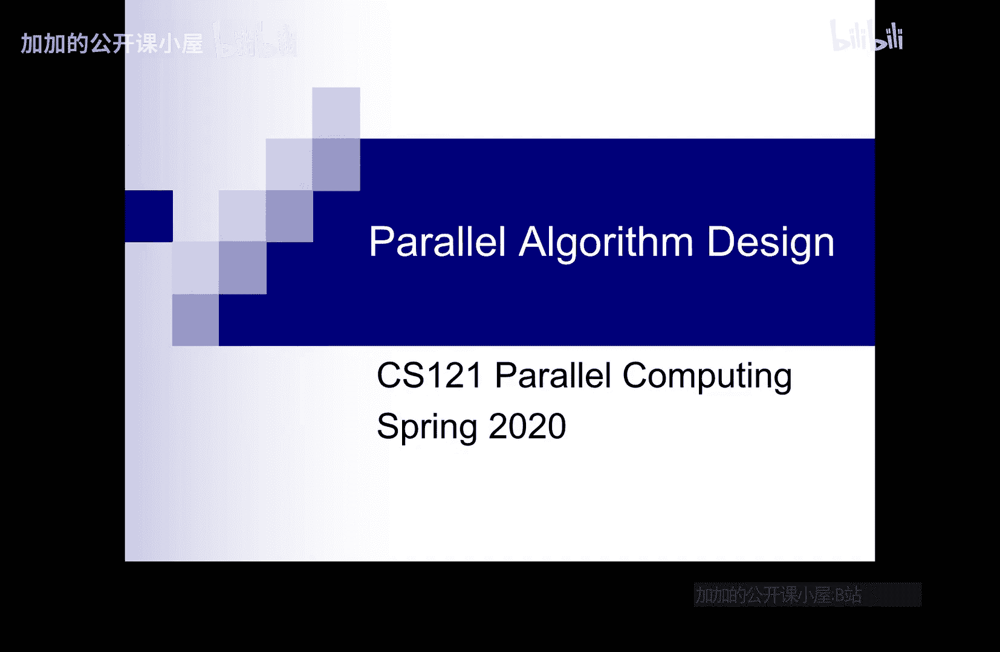
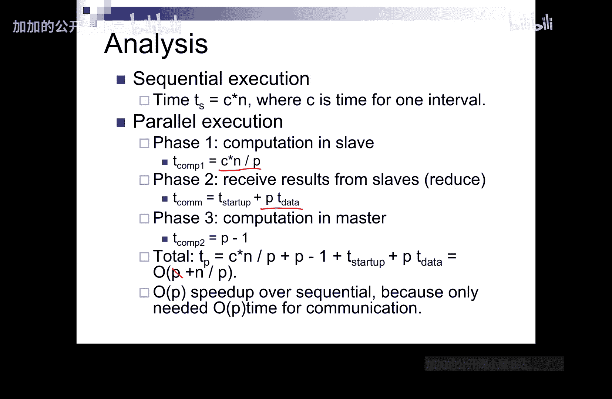

# 并行计算：P17：并行算法设计第一部分



在本节课中，我们将开始学习并行算法的设计过程。我们将重点介绍一种名为 **Foster设计方法学** 的系统化思想流程，它特别适用于设计可扩展的分布式内存并行算法。这类似于设计串行算法时使用的分治法或贪心算法等技巧。该方法鼓励在设计过程的最后阶段才考虑具体的硬件细节，从而专注于算法本身的抽象设计。

## 概述：Foster设计方法学四步法

Foster方法学由Ian Foster提出，包含四个核心步骤：
1.  **划分**：将大问题分解为多个可并行执行的小任务。
2.  **通信**：确定这些任务之间需要交换哪些数据。
3.  **聚合**：将多个小任务组合成更大的“超级任务”，以减少通信开销。
4.  **映射**：将聚合后的任务分配到实际的物理处理器上执行。

接下来，我们将详细探讨每个步骤，并应用该方法来设计**Floyd-Warshall全源最短路径算法**的并行版本。我们还将讨论两种主要的划分策略：**数据划分**和**算法划分**。

## 第一步：划分

划分的目标是将一个大型应用分解为多个可以并行执行的小型任务。有两种主要的划分方式。

### 数据划分

在数据划分中，我们将应用程序处理的数据集分割成多个部分，然后创建任务来分别处理这些数据部分。这有时也被称为**域分解**。

例如，假设我们有一个三维数据立方体，需要在每个坐标点（图中黑点）进行计算。


我们可以用不同方式将这些数据点分组为任务：
*   **一维划分**：将整个立方体视为几个大面，每个面作为一个任务。这产生的任务数量较少。
*   **二维划分**：将立方体中的每一行数据点作为一个任务。这会产生中等数量的任务。
*   **三维划分**：将每个单独的数据点（即每次计算）作为一个任务。这会产生大量细粒度的任务。

在数据划分中，你从所有计算开始，然后决定如何将它们组合成原始任务。组合大量数据会得到类似一维划分的大任务，而组合少量数据则会得到更细粒度的二维或三维划分。

### 算法划分

在算法划分中，我们不划分数据，而是将算法本身分解为多个可以并行执行的子任务。这有时被称为**功能分解**。

例如，在一个处理MRI图像的应用中，整体算法可以分解为多个子任务：**采集图像**、**配准图像**、**追踪器械位置**、**确定图像位置**、**显示图像**。这些子任务之间存在依赖关系（例如，必须先采集图像才能进行配准）。



这种划分形成了一个**流水线**。每个患者（数据）都需要依次经过流水线的各个阶段。通过让多个患者同时处于流水线的不同阶段，我们可以获得并行性。

### 划分的目标与考量

在进行划分时，我们需要考虑以下几点：
*   **足够的任务数量**：通常希望任务数量是处理器数量的10倍左右。这样在将任务映射到处理器时，有更大的灵活性来应对**负载不均衡**等问题。
*   **权衡冗余计算与通信**：有时，让两个任务都计算某个值（冗余计算）比让一个计算后发送给另一个（需要通信）更快。但需要谨慎使用，避免过多的冗余计算或数据复制。
*   **任务规模均衡**：尽量使各个任务的计算量相近，以利于负载均衡。
*   **可扩展性**：当问题规模增大时，应能生成更多的任务，以便利用更多的处理器。

上一节我们介绍了如何将问题分解为任务，接下来我们需要看看这些任务之间如何协作。

## 第二步：通信

通信步骤旨在确定不同任务之间需要交换哪些数据。任务（用圆圈表示）之间通过边进行通信。

通信主要分为两种类型：
*   **局部通信**：一个任务只需要与少数其他任务交换数据，对应于MPI中的**点对点**通信。
*   **全局通信**：一个任务需要来自所有（或许多）其他任务的数据，对应于MPI中的**集合**通信（如广播、规约）。

理想的通信模式应具备以下特点：
*   **通信负载均衡**：避免某个任务承担远多于其他任务的通信量。
*   **通信最小化**：理想情况下，每个任务只与少量“邻近”的任务通信。
*   **通信并发性**：通信应能同时进行，避免所有通信都经过同一条链路造成**顺序瓶颈**。
*   **计算与通信重叠**：尽可能让通信进行的同时，处理器能执行其他计算，从而充分利用所有资源。

在确定了任务间的通信模式后，我们可能会发现通信开销过大。接下来，我们将通过聚合来优化这一点。

## 第三步：聚合

聚合是指将多个小任务组合成更大的“超级任务”。这样做的目的是减少任务间的通信开销。

例如：
*   如果将两个需要频繁通信的小任务合并为一个超级任务，那么它们之间的通信就变成了同一处理器内的内存访问，无需经过网络，性能大幅提升。
*   如果原本需要发送两条消息，在聚合后可以合并为一条包含更多信息的消息发送，从而减少消息传递的固定开销（如包头、路由等）。

聚合的目标包括：
*   **提高局部性**：减少需要与远程处理器通信的需求，更多计算在本地完成。
*   **用计算换通信**：在合理范围内，可以用少量的冗余计算来避免昂贵的通信。
*   **维持负载均衡**：聚合后的超级任务之间，其计算成本和通信成本应保持相近。
*   **匹配目标系统**：聚合后超级任务的数量应至少等于目标系统的处理器数量，以确保能利用所有处理器。
*   **代码转换便利性**：从串行代码并行化时，应避免对原始代码进行过于剧烈的改动。

完成聚合后，我们得到了一个由超级任务组成的计算图。最后一步就是将这些任务分配到具体的硬件上运行。

## 第四步：映射

映射是将聚合后的超级任务分配到物理处理器上执行的过程。我们的目标有两个：
1.  **负载均衡**：平衡每个处理器上的工作量。
2.  **通信最小化**：最小化处理器间的通信量。

然而，这两个目标常常是冲突的。例如，将所有任务放在一个处理器上可以完全消除处理器间通信，但会导致严重的负载不均衡。反之，将任务均匀分散到所有处理器上有利于负载均衡，但可能增加通信。

### 任务分配策略

任务分配主要有两种方式：
*   **静态分配**：在计算开始前就确定任务到处理器的映射。
    *   如果任务计算时间相同，可以简单地按顺序或轮询方式分配。
    *   如果任务计算时间不同，可以采用**轮询调度**等方法，使每个处理器获得一组多样化的任务，以期总负载接近。
*   **动态分配**：在运行时动态分配任务。例如**工作窃取**策略：
    *   每个处理器维护一个任务队列。当某个处理器快速完成自己队列中的所有任务后，它可以从其他负载较重的处理器的队列中“窃取”任务来执行。
    *   这种方式能更好地应对任务大小未知或动态产生的情况，但引入了任务调度管理的开销。

现在，我们已经了解了Foster方法学的四个步骤。接下来，让我们通过一个具体例子来实践整个设计流程。

## 实例应用：Floyd-Warshall全源最短路径算法

我们将使用Foster方法学来设计Floyd-Warshall算法的并行版本。该算法用于求解加权有向图中所有节点对之间的最短路径。

### 算法串行形式回顾

算法使用邻接矩阵 `D` 作为输入和输出。通过动态规划求解，其核心递推公式为：

`D[i][j]^(k) = min( D[i][j]^(k-1), D[i][k]^(k-1) + D[k][j]^(k-1) )`

其中 `D[i][j]^(k)` 表示只允许使用节点 `1` 到 `k` 作为中间节点时，从 `i` 到 `j` 的最短路径距离。

串行算法是一个三层嵌套循环：
```
for k from 0 to n-1:
    for i from 0 to n-1:
        for j from 0 to n-1:
            D[i][j] = min(D[i][j], D[i][k] + D[k][j])
```

### 并行化设计

#### 1. 划分
我们专注于外层 `k` 循环的每一次迭代（一个阶段）。在每个 `k` 阶段，需要计算所有 `i` 和 `j` 对应的 `D[i][j]`。**关键观察**是：在固定的 `k` 阶段，对于不同的 `(i, j)`，其计算 `D[i][j] = min(D[i][j], D[i][k] + D[k][j])` 是相互独立的。因为该阶段用到的 `D[i][k]` 和 `D[k][j]` 值来自上一阶段 `(k-1)`，在本阶段计算中保持不变。
因此，我们可以为每个 `(i, j)` 对创建一个任务。对于 `n` 个节点，每个 `k` 阶段有 `n^2` 个任务，它们可以完全并行执行。不同 `k` 阶段之间是顺序依赖的。

#### 2. 通信
在 `k` 阶段，任务 `T(i,j)` 需要 `D[i][k]` 和 `D[k][j]` 的值。
*   对于固定的 `i`，所有 `j` 不同的任务 `T(i,*)` 都需要同一个值 `D[i][k]`。
*   对于固定的 `j`，所有 `i` 不同的任务 `T(*,j)` 都需要同一个值 `D[k][j]`。
因此，通信模式是：将第 `k` 行的所有值**广播**给所有列，将第 `k` 列的所有值**广播**给所有行。

#### 3. 聚合与映射
我们选择**按行聚合**：将矩阵的若干连续行分配给一个处理器（一个MPI进程）。假设有 `p` 个处理器，矩阵大小为 `n x n`，则每个处理器获得大约 `n/p` 行。
*   **优势**：在按行聚合后，行广播（即 `D[i][k]` 的广播）变得不需要了，因为所需的值已经位于负责该行的处理器内部。我们只需要进行列广播（即 `D[k][j]` 的广播）。
*   **映射**：每个聚合后的超级任务（一组行）映射到一个处理器上。

#### 4. 并行算法伪代码（核心部分）
假设 `part` 是每个处理器本地存储的部分矩阵，`s = n/p` 是每个处理器的行数。
```
for k = 0 to n-1:
    // 1. 确定拥有第k行的根处理器
    root = floor(k / s)
    // 2. 根处理器准备并广播第k行
    if my_rank == root:
        offset = k % s
        broadcast_buffer = part[offset][0..n-1] // 复制第k行本地部分
    MPI_Bcast(broadcast_buffer, n, root, comm) // 所有进程参与广播
    // 3. 每个处理器并行计算自己负责的行
    for i_local in my local rows (0 to s-1):
        for j from 0 to n-1:
            part[i_local][j] = min(part[i_local][j],
                                   part[i_local][k] + broadcast_buffer[j])
```

#### 5. 性能分析
*   **串行时间**：`T_seq = O(n^3)`
*   **并行时间（每阶段）**：
    *   计算：每个处理器计算 `O(n^2 / p)` 个元素。
    *   通信：广播一个大小为 `n` 的数组，耗时 `O(log p + n)`（使用树形广播）或 `O(n)`（简单广播）。
*   **总并行时间**：`T_par = O( n * (n^2/p + n) ) = O(n^3/p + n^2)`
*   **加速比**：当 `n` 较大时，`T_par ≈ O(n^3/p)`，加速比接近 `p`，即**线性加速比**，表明该并行算法非常高效。

通过这个例子，我们完整实践了Foster设计方法学的四个步骤。最后，我们再简要看两个数据划分的简单例子，以对比通信开销的影响。

## 简单数据划分示例对比

### 示例1：列表求和（通信密集型）
**问题**：求 `n` 个数的和。
**简单并行策略**：
1.  主进程将 `n` 个数划分为 `p` 块。
2.  将每块数据**散播**给一个从进程。
3.  每个从进程计算本地和。
4.  从进程将本地和**规约**到主进程。
**性能瓶颈**：第一步的数据散播需要主进程发送 `O(n)` 数据，通信时间为 `O(n)`。这使得总并行时间至少为 `O(n)`，而串行时间也是 `O(n)`，因此**无法获得加速**。

### 示例2：数值积分（计算密集型）
**问题**：使用梯形法则计算函数 `f(x)` 在区间 `[a, b]` 上的积分近似值。
**并行策略**：
1.  将区间 `[a, b]` 等分为 `n` 个子区间。
2.  每个进程根据其秩，**自动确定**自己负责哪 `n/p` 个子区间，无需主进程分发数据（因为区间公式已知）。
3.  每个进程独立计算所负责子区间的局部面积和。
4.  将所有进程的局部和**规约**到主进程。
**性能优势**：避免了初始的数据分发通信。每个进程的计算时间为 `O(n/p)`，最后的规约时间为 `O(log p)` 或 `O(p)`。总并行时间 `T_par = O(n/p + p)`。当 `n >> p` 时，`T_par ≈ O(n/p)`，相比串行时间 `O(n)`，获得了近似的线性加速比。

## 总结

本节课中，我们一起学习了并行算法设计的核心方法——**Foster设计方法学**。该方法通过**划分、通信、聚合、映射**四个系统化的步骤，引导我们设计出可扩展的并行算法。我们详细探讨了数据划分与算法划分两种策略，以及通信、聚合和映射过程中的关键考量因素，如负载均衡、通信最小化和局部性优化。

通过将该方法应用于 **Floyd-Warshall全源最短路径算法**，我们实践了完整的并行化设计流程，并得到了一个具有线性加速比的高效并行算法。最后，通过对比列表求和与数值积分两个简单例子，我们强调了**减少初始通信开销**对于获得良好并行性能的重要性。


掌握这一设计方法学，将为你应对各种复杂的并行计算问题提供有力的工具和清晰的思路。