# 上海科技大学【中英⚡并行计算｜CS121 2020 Parallel computing】 p18 P18 Parallel algorithm design part 2 -BV1VqypBaEaP_p18-

So we looked at simple data partitioning and now we're going to look at divide and conquer based partitioning。

So the difference is that in simple data partitioning， you take your data and you divide it once。

 okay， and then you allocate that to your processors。However， in divide and conquer partitioning。

 you take your data， you divide it， and you don't necessarily stop at that point。

 you might divide again and the criteria is that if the data is too large okay you're going to divide。

And then if after that division， you find that the data that each process has is still too large。

 you're going to keep subdividing。Okay so we keep taking a problem and dividing it into smaller parts until eventually the parts get to be small enough that they can be solved directly。

So sort of algorithmically you can say that so we have a problem and then we look at the size of the problem and if it's too large then let's say that we divide this into two parts。

 part0 and part one， so we're going to solve those parts individually。

 and then we're going to combine their answers to get the overall answer to the problem right and if the problem is of small enough then we're just going to solve the problem directly。

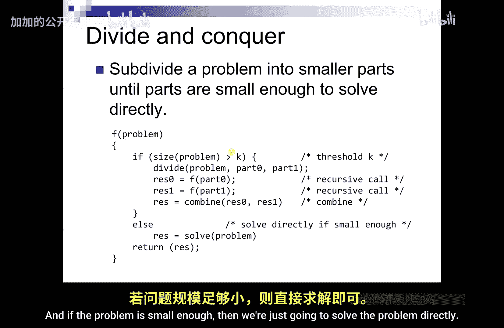

And so you can think of this process as happening on a tree。

 so initially you have a problem and then you if it's too large。

 you subdivide it into smaller problems and then you look at these smaller problems if they're still too large。

 then you're going to subdivide each you're going to keep subdividing until you end up with these final tasks that you can do individually。

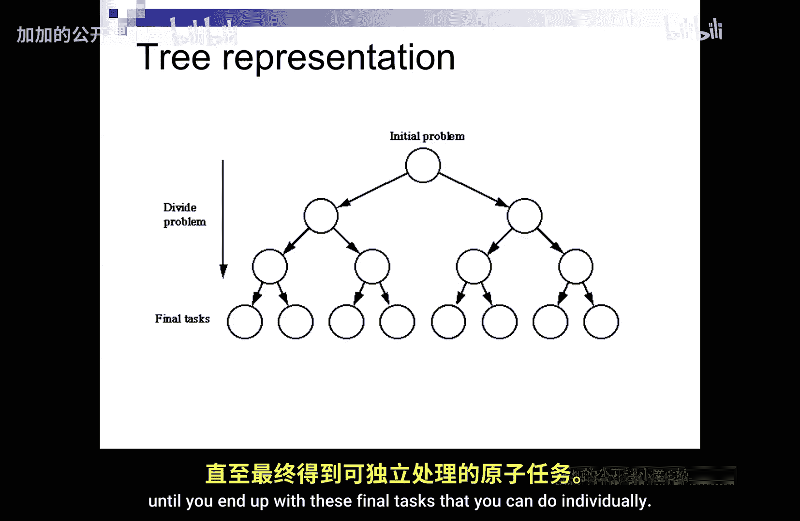

So so just to give a concrete example of this， so if we apply this divide and conquer to our sum of numbers example。

 right so where we just want to sum a bunch of numbers， then in the simple data partitioning。

 we just took this list of numbers and divided them into P pieces with P processors and then each processor got a P。

So here instead we're going to use the divideiding conquer approach and this is just going to look at the set of numbers and if there are number sorry too many numbers right so as long you have a list of more than two numbers we're going to keep subdividing that list okay so then you're going to form the first half of the numbers and then the next half of the numbers。

 you're going to add those individually and then you add together the result to get the sum of everything。

And if there are only two numbers or one number， right。

 then we're going to just add those individually。

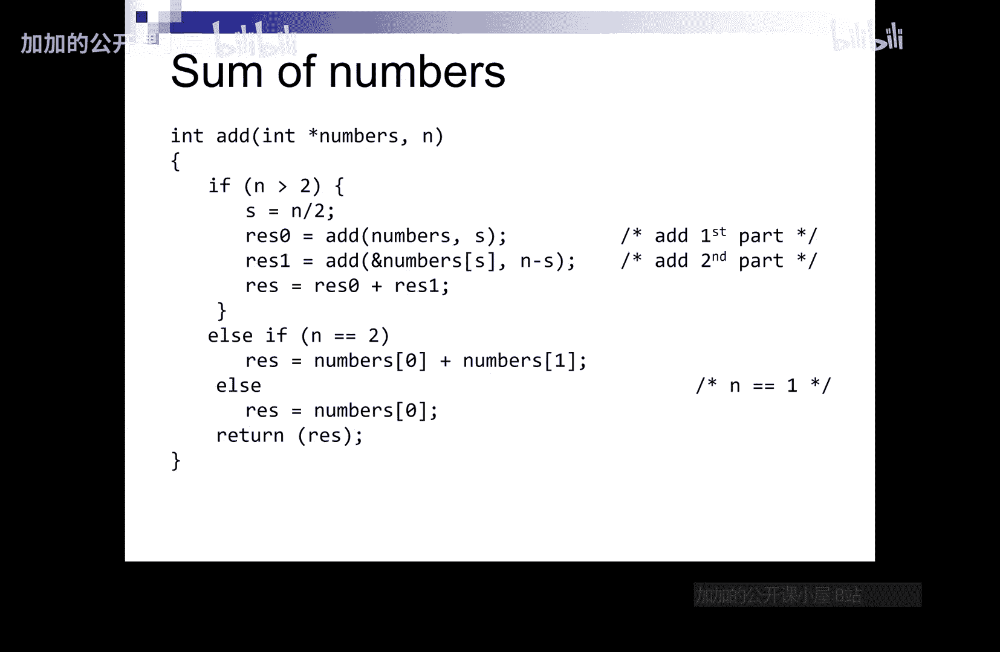

Okay， so now we can do this in a parallel fashion also。Okay so in a parallel fashion。

 we take the big problem and then we subdivide it and now the point is that the subdivision process okay can be done in parallel because once you've divided the problem into some number of pieces right then these pieces are now independent of each other。

 they're independent subproblem and so we can independently look at each each subproblem and decide if we need to subdivide that farther okay further so then we have a bunch of subproblem and in parallel we're going to look at all of them and see which ones that we need to subdivide some more。

So then eventually after the subdivision process finishes。

 we're going to end up with a bunch of small tasks and those small tasks can also be done in parallel。

Okay， and then finally， after we solve the small tasks。

 we need to combine their answers back together to get the overall answer。

So the combination phase can also be done in parallel so the divide and conquer approach naturally lends itself to a parallel formulation。

And we can also write everything in terms of a recursive function， which I'll show you later。 Okay。

 so there's a nice way to sort of to phrase everything。 So the issue here is that since。

We're doing this divide and conquer and initially you don't know how many pieces you're going end up with right then it's kind of hard to write this in an iterative fashion because usually when you write an iterative program you you need to specify。

 let's say how many processors you're going to have and how many pieces of data you're going to work with Well here or how many parts of data we're going to work with Well here we don't know how many parts that are going to be because we keep selfdividing until we don't know when we stop necessarily so therefore it's it's more tedious to write this in a iterative fashion and so instead we'll write this in a recursive fashion as we'll see。

And then after you form all of these tasks， you need to assign them to processors so the tasks can be represented in this tree structure and we're going to see how to assign tasks from the tree structure to a bunch of processors。

And then we'll also try to reuse processors at different levels of the tree。

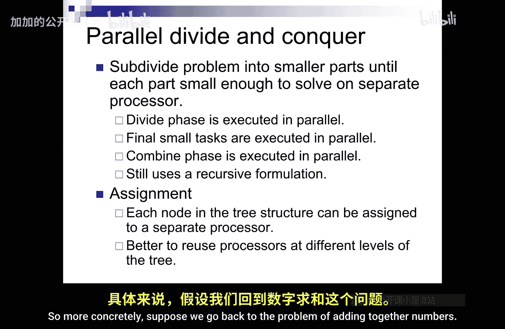

More concretely， so suppose we go back to the problem of adding together numbers， okay。

 so we have a list of numbers that we want to add。And so what we're going to do is we're going to have a bunch of processors here okay so we have like P0 and then P1 P2 so we have a bunch of processors okay and then we're going to take our original list of number numbers and then we're going to split as long as that list is too large。

 we're going to split the list and give different parts to different processors。Okay。

 and you see that we have this this special way of allocating the processors to the tasks。 Okay。

 so if we have eight processors， then basically we're going to allocate so the the list is going to start out on the on processor 0。

 let's say。 And then if we subdivide the tasks。 we're going to give。

Half the tasks to the first half of the processors， okay so that's going to be p0 up to P3。

And the other half of the tasks are given to the other half of the processors， P4 up to P7。Okay。

 and then if we're at a certain point in the computation。 So， for example， P4s computation， right。

 And if we need to further subdide this， then we're again， going to split the。

Split the processors in the subre in half okay and then so we're going to split the processors p4 up to P7 in half。

 so we have P4 and P5 on one side and then p6 p7 on the other side and then we're going to give the first half of the problem to the first half of the processors and then the second half to the other processors。

Okay so we always do that so at any point in time you have a problem and then you have a set of processes that can go ahead and solve this problem and if you want to subdivide your problem。

 you're going to give half the problem to half of the processors and then the other half to the other processors。

so this represents the divide phase of divide and conquer and eventually we need to so then eventually we end up with all of these little tasks that are assigned to the processors and we go ahead and individually do those tasks and we do them in parallel and oh notice that the division phase can also be done in parallel as I was saying because once you've divided the data between p0 and p4 then a P0 needs to further subdivided its data it doesn't need to interact with p4 it can just do this by itself P0 can act independently a P4 and P4 doesn't need to interact with p0 so therefore the next layer of division can be happening in parallel。

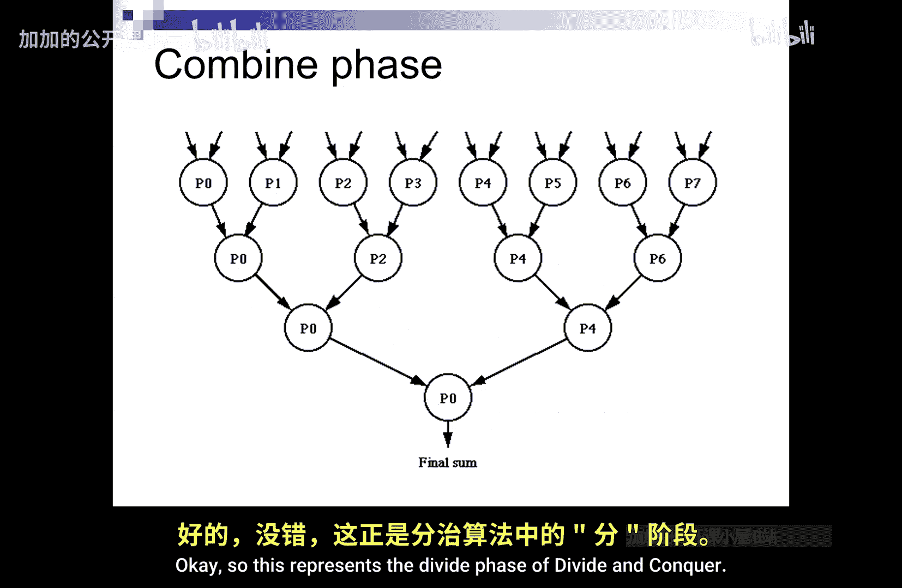

Okay， so all the division is happening in parallel。

 the solutions of the small problems at the bottom layer are happening in parallel。

 and then the combination phase where you combine these answers okay。

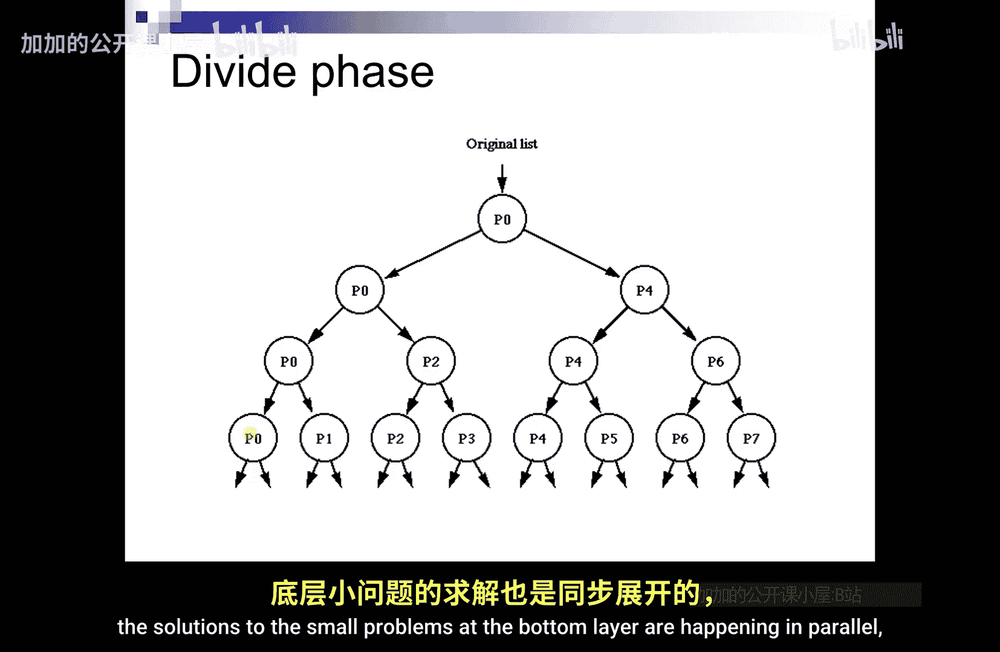

So these are also going to happen in parallel， so now when you combine the answers。

 since you've split the problem onto multiple processors， when you combine。

 you're going to merge the answers onto back onto one processor。

OkayAnd the processor you're gonna pick is whoever spawned these two processors， these two processes。

 Okay， that's the one that's going to continue after you do the merge。 So， for example， p0 here。

 he was the one that if you go back to this So p0 here。

 split into p0 and P1 He gave half the task to he kept half the tasks and he gave half to p1。

 So then later on when you combine these two guys we're going we're gonna combine back into p0 and likewise here。

 p0 spawn p0 and p2。 So when you combine you go back to p0。

 So then eventually everything is going to go back to to the original processor P0。

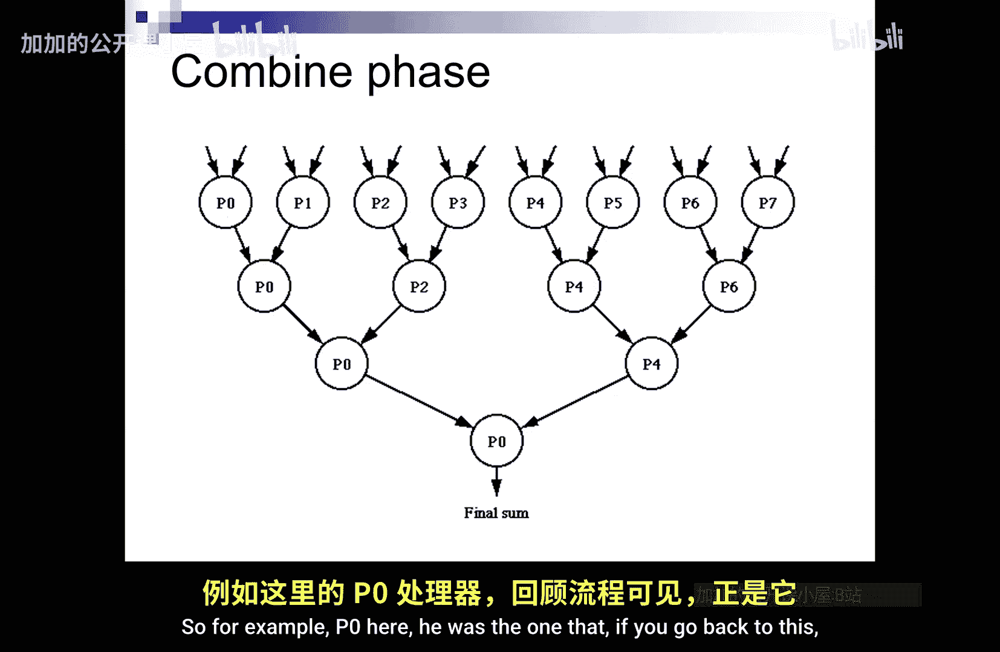

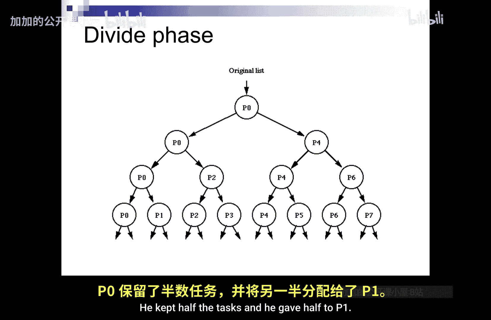

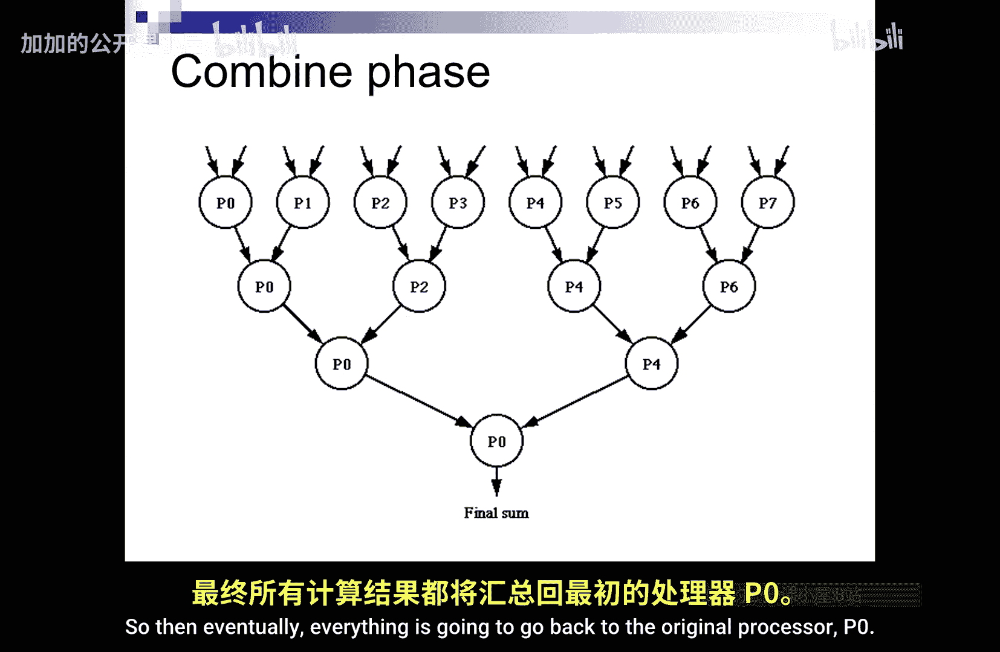

Okay， so then let's try to write some code for this。

 So we'll we'll figure out how to do this in a recursive fashion， right， because as I said。

 this is easier than writing this in an iterative way。All right。

 so then the first thing we need to do is that you notice so here I've just redrawn the picture from the previous slide over here just so that we can look at it okay。

So so the first thing is that you notice that these processes are receiving data from other processes like initially P4 doesn't have any data itself okay and so it's waiting to get data from P from somebody okay and we have to figure out who that somebody is so we can see from this picture it's going to be P0 okay but in general。

 given a processor， how do we know who it's going to receive data from。Okay。

 so the way that we can know that is actually we can so if we divide sorry。

 if we spawn processors in this way right where we give half the problem to half the processors。

 okay then you can see that the way to figure out for each processor to figure out who it's going to get data from is to look at the binary representation of that processor and then from that you can actually figure out who to get data from。

So， for example。So you know， process zero right， oops， so binary representation would be all zeros。

And this guy， his binary representation would be 10，0 and then， for example， process 6 over here。

 right， his binary representation would be 1，10。Okay now the way you can figure out who you're gonna to get data from is you can kind of see this is that if you look at the the right most set bit okay。

 right that tells you who to get data from so for example， if you look at the six here okay。

 if you look at the right most set bit that is this bit corresponding to two over here right right this bit over here Okay。

 now if you turn that bit off okay， what do you get Okay， if you turn it off， you get 10，0。

Okay and that's actually who six should be getting its data from， okay， it's process 100， which is4。

Okay so if you find the right most set bit in a process and you turn that off。

 then that's who you get your data from okay likewise you know if you look at for over here。

 if you find the right most set bit right well that's just the first one right if you turn that off you get zero okay and that's who you get your data from。

Okay now maybe another example right so if you have 100 here right so here you have process 101 process 5 right so the right most bit is this one。

 if you turn it off you get four， which is exactly who5 gets its data from。Okay， so therefore。

 the way that you figure out who to get data from is you turn off the right most bit。Okay。

 now now that is what's being done over here。 Okay， so this receive from is so this is， this is。

 again， kind of like MP pseudocode。 Okay， so for the MP pseudocode， when you receive。

 you need to know who you receive from。 And this is computing who you receive from。

 So this this command over here。 Okay， this kind of cryptic command。 Okay。

 this is actually turning off the most right the right most bit。Okay。

 so what it's actually doing is it's taking my rank it's taking the rank of the process in binary。

 and then it's doing a binary and， a bitwise and with my rank minus1。Okay。

 so so just to give an example how this works right So our goal here is to turn off the right most bit set bit of my rank Okay。

 so for example， if my rank is something like 10，11 then my rank minus-1 is going to be 10。

10 right if I do the end over here right then you see that this is going to be 10。

10 and so basically here， I've turned off the right most bit。Okay， another example。

 if you had a different number here。So he had 101，0 here， right if you subtract one。

 you're going to get what we get， we get 1，0，0，1 right， if you do the the bitwise and right。

 you see that you're going to end up with 1，0，0，0 Okay， so again。

 you've turned off the right most set bit。Okay， so that's what this received from。

 that's how that works。Okay， so next， so now we figured out how to who to receive from。

 But what about how much data we want to receive， Okay。

 so now in terms of how much data you want to receive， right， so， for example，4 over here， right。

 if you have let's say8 values。 Okay， so for simplicity， let's first assume that。

We're going to have the same number of processors as the numbers， and both， let's say。

 are a power of two。So in that case4 process4 is going to receive four pieces of data from P0 because we have eight pieces of data overall right so it's going to be a4 over here and then so let me try to clear this up a bit。

Yeah， and then for example， this six over here， right。

 this is going to receive two pieces of data from P4。Okay。

 so we need to be able to figure out these quantities like the four and the two and so on。

And the way you do that is we're going to use this thing receive count over here。

 So now you see that the way you can figure out how much data you need to receive okay is that you can look for the you can find the right most set bit Okay so we're not trying to turn off the right most set bit anymore we're just trying to find the right most set bit。

And that will tell you how much data to receive。Okay， so for example。

 the right most set bit of P4 is going to be this one thing over here， and that corresponds to4 Okay。

 so that tells you that P4 needs to get four pieces of data。Likewise。

 you have this P6 over here right is right most set bit is going to be the two bit。

 the bit corresponding to two， and so he gets two pieces of data。Okay， now as another example。

 so let's see。 so this guy is 10，0 right， this guy is 101 right。

 So the right most set bit is the one bit right And so that tells you that P5 is going to get one piece of data from P4。

O。All right， so then so then this is so then we need to find the right most said bit and again we're going to use this sort of bit trick to find the right most said bit and then so I'll just give you an example how this works So my rank so suppose my rank here is something like four okay so then what this is doing is it's taking the end of this with the negative of my rank。

Okay， so the way that we can write the negative so we're going to use the two complement。

 So what that means is so the way to compute the twos complement is we're going to take the the number my rank。

 you're first of all going to flip all the bits。 Okay， so if you flip all the bits， you get a 10。

11 okay and then you add one to that okay。And then if you do that。

Let me try to give myself a bit more space over here。

 so we're going to flip the bits so we're just computing the twos complement if you remember how that works。

So so that is flipping the bits， it's adding one to it and then what does this give us。

 it gives us 11，0，0 okay， and then。And then if you take the bitwise and of this 1100 with with my rank。

 then you see that you get exactly this bit over here and this is indeed the right most set bit。Okay。

 so so that's what， yeah， so we have these two sort of mysterious looking commands。

 But all they're doing is they're finding the right most set bit， right。

 And then they're also taking that out， taking out that bit。

 right And this tells us who to receive from and how much to receive。Okay。

 so now so now after we've computed all that， so let me clean this up a bit， okay。All right。

We don't need this anymore。 So then now this hoops。

This part over here right So then this is saying that what initially all the data is on the is on process P0 right so the guy with rank 0 So then he's going to call this function over here。

 This is a recursive function this function is the add function right and he's going to say that okay I want to add these numbers their n numbers here and my rank is0。

Okay。Now so that and this is because P0 initially had all the numbers， but if you're not p0。

 then initially you don't have any numbers， So the first thing you need to do is to get some numbers and the way you do that is you're going to get these numbers and you're going to receive this number of values right so where we computed this over here and you get it from the sky okay。

All right， so then after you get these numbers， now you can go ahead and call this this add function to add them up okay and then after you add them up。

 right。You're going to get a single result right， and then you're going to send this back to whoever you got the numbers from。

RightLike， for example， P P3 over here Well he got some values from P2。

 So after he computes these values， he's going to send his answer back to P2。 Okay， and likewise。

 P2 got the numbers from P0。 So he he'll send it back。 Okay， that's what the final send does。Okay。

 and lastly， we have this recursive add function right So the recursive add function is going to say that I'm getting count numbers right and I actually keep I want to keep subdividing this until I'm down to two numbers So if I have too many numbers right now。

 I'm going split this in half I am going to I'm going to send half of these numbers to somebody okay now who do I figure out who to send to so it's actually gonna be it's my rank plus the number of values I have so for example。

 here right P4 okay so his rank is4 and he got four values So he wants to send out two values and so he's going to send this to rank plus S which is4 plus 2 which is6 so P4 sends to P6。

Okay and for the remaining numbers for the remaining remaining half the numbers。

 he's going to add them himself and then after that he's going to so he over here he sent half the numbers to somebody to rank plus S and here he's going to get back the sum of those numbers from rank plus S。

And then he computes sum of both numbers right and then that's his output and otherwise if he's just got two numbers or one number。

 then he just returns the direct sum of those numbers。Okay。

 so that is how we can implement this divide and conquer approach in MPI。

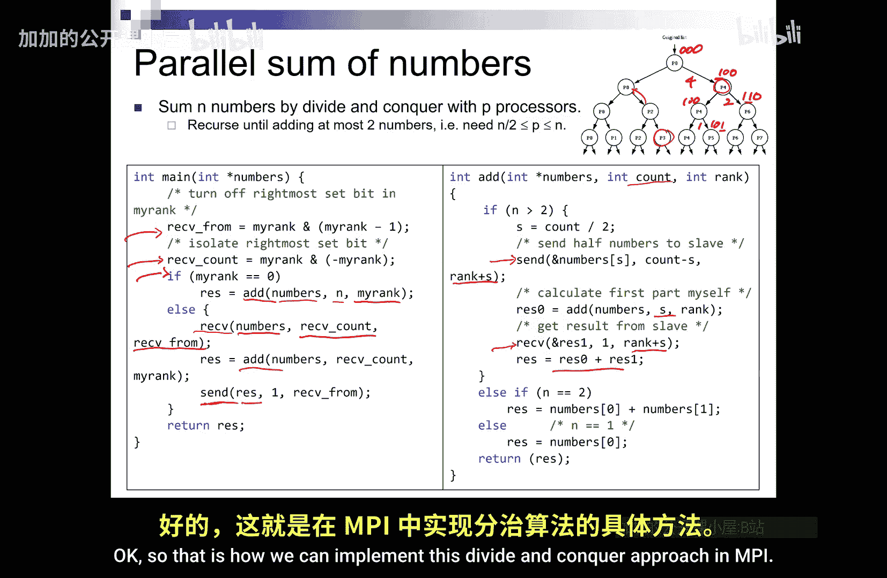

Okay， so now in terms of the。Oh， right。 So then here we have the same number of processes as numbers。

 right， So unfortunately in general， you， you don't have to do that。

 You could have you could have fewer processes than numbers。 Okay。

 so you could have a million numbers。 but you， you just want to add them on like 1010 processors。

 Okay， so then here， what you can do is。You can keep subdividing。

Until the list of processors that is in your subre， so whatever that list of processors is。

 those are the guys who you can use to help you solve your sub problemblem。Okay。

But if you're only down to a single processor in your soft tree。

 then there's nobody else left to help you。 So in that case。

 youve got to go solve the problem yourself。Okay， so therefore the way to express that is we're going to keep subdividing the problem until we're down to like one processor。

Okay。And then you just have to solve the problem yourself。

And so basically is going then net effect of this is going to be that this is going to assign n divided by P numbers to each of the processors。

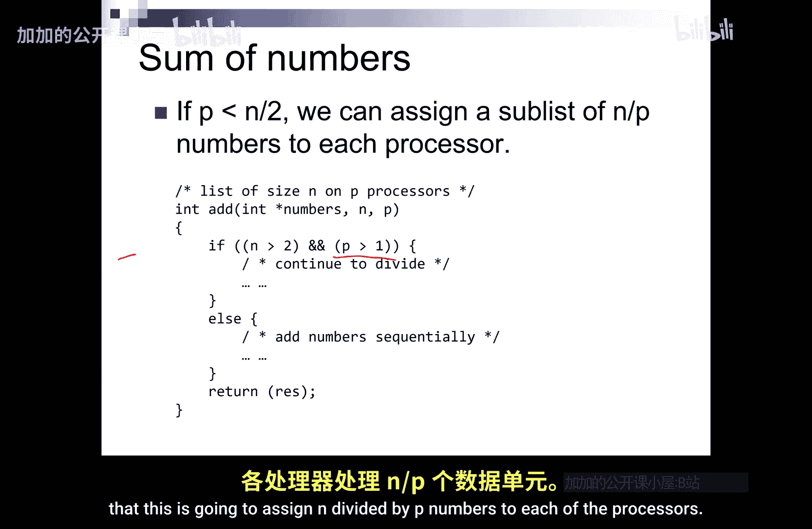

Okay， so let's look at the efficiency of this algorithm so assume for simplicity NM are both powers of two so then for the first part for the division part so we're going to keep subdividing until we're down to one processor so therefore this is going to take log P steps because we're sort of going to double the number of processors we use in each step。

Okay。Right， so and so the computation time for this step is going to be log P。

 That's the number of steps。 the amount of communication that's happening right So initially all the data was on a single processor and he sent half to somebody and then whoever got that half of data he had sorry so he processor 0 right sent half his data to somebody and then he sent a quarter of his remaining data to somebody else right and then he sent an eighth of it to a third person to a third process and so on so yeah。

 so if you look at it over here right so initially he sent four pieces of data to P4 and then he sent two pieces of data to P2 and then one piece of data to P1 so in general P0 had to keep doing this until he was down to n divided by P pieces of data。

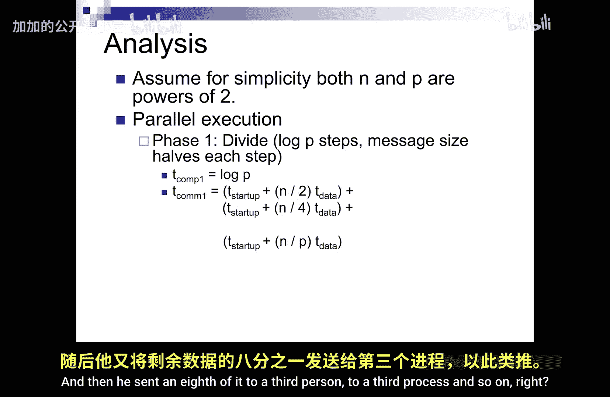

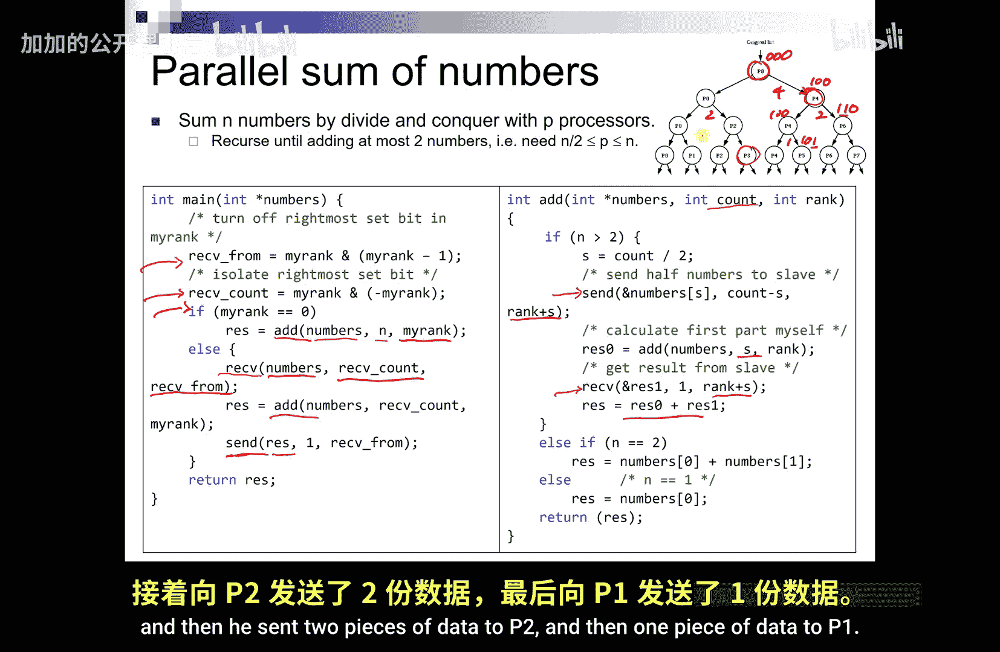

Once he got to that point， then that data would have been sent to just one process okay and that one process and at that point in P0's subree there was only one processor left so after sending that amount of data。

 then P0 has to just take whatever data is left and solve that problem himself because there are no more processes to help him。

Okay， so if you add this up， this is going to add up to a geometric series and the sum of all of this stuff is just going to come out to something like this so。

嗯。Allright， all right， so that that's good。 Okay， so yeah， so that's the total time for that。

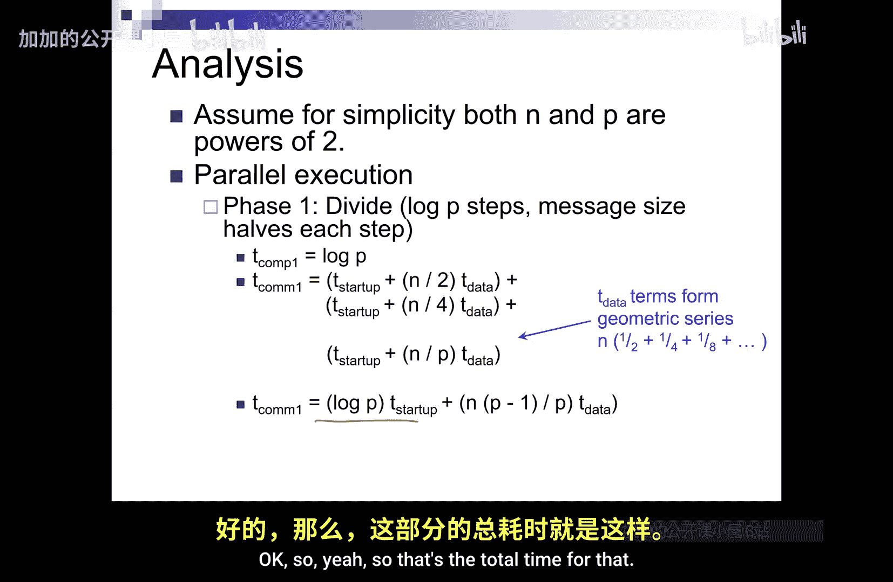

Okay， so next we're going to look at the， so that was for the the division part of the algorithm right where you keep subdividing。

Okay， so the next part is to actually do the computation。 So so for the computation。

 each node ended up with n over P pieces of data。 Okay， N over P numbers， basically， okay。

 so you just add those up。 and that takes you like n divided by P time， or maybe that same -1。

And then and then you have to go back and you have to combine these numbers Okay so that so the combination part is also going to be log p steps。

 However， when you combine the messages are always going to have size1 because you're just sending your your sum to to your parent process。

 so instead of sending multiple numbers you send the sum And so each message has size1 So therefore the computation time for that is going to be log P because theyre log p layers and the communication time in total is what you do this log p times and each time you send one piece of data So yeah。

Allright， so then you add all that stuff up and then it's going to come out to some expression like this。

 Okay so it's something like order n plus order log P plus order n divided by P so here is the time to add。

 Here's the time for communication right this is like how many layers of communication you have to do And then this is the total amount of data that you had to send。

Okay， so unfortunately here， again， we don't really get any speed up because the sequential running time would also be order N。

 And then our parallel running time is order N。 And so， you know， because you had to。

Send the data out at the beginning， we don't get speed up。

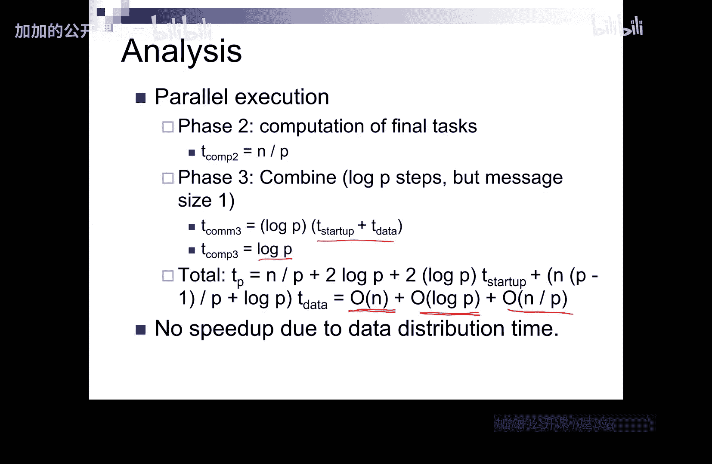

Okay， now。Even though we don't get speed up in this case。

 that doesn't mean that parallel divide and conquer is not useful。 so for example。

 if we apply this to our previous numerical numerical integration example so here's a nice instance where we can apply this so yeah so the reason you might want to do divide and conquer data partitioning as opposed to simple data partitioning is that might you might have a function where you need to subdivide certain subproble more than other parts of the subproble so so an example of that would be so if you have a function which changes a lot in some area and changes very little in some other area then you would want to have a finer subdivision in the places where it changes a lot versus a coursears or subdivision where it changes a little so this is kind of being illustrated over here where you can kind of see that。

There's less error on this parts less error on the shaded part than on the white part over here。Okay。

 or we can do a more sort of dramatic example where suppose you have something like this。 Okay。

 suppose you have a function which kind of looks like this。 Alright。

 so then if you were to just subdivide the pieces。We sort of draw this so that they look like they're the same size as each other。

 So if you subdivide the pieces so that they're all equal to each other okay so that they're all so it's like delta here and then delta here okay then since we're using a trapezoid approximation for the area then you see that we're going to have a pretty large error over here just because the function is changing a lot So it doesn't actually look like a trapezoid whereas over here you're going to have a very small error you can hardly see it。

Okay， so then what that suggests is that on the left hand side。

 you actually don't want to use very coursear a very coarse subdivision。

 You actually maybe want to subdivide this guy a bit more。 Okay。

 oops so my functionist was looking like that。Let's just redraw everything。 Okay， so。

 so we had a function that was looking like that。 Okay。

 so now if you just so you might actually want to subdivide the the left side。

 left hand side some more。 Okay， so if you do that。

 then you see that we're going get we're going to substantially reduce the amount of error。

 then the error is just going to be these two slivers up there。Okay， so yeah。

 so this shows that in certain parts， right， you want to use a smaller subdivision and paralleliding parallel divideiding conquer lets you do that because you can say that I given a problem。

 right， I can keep subdividing until I'm happy with with whatever size I have。

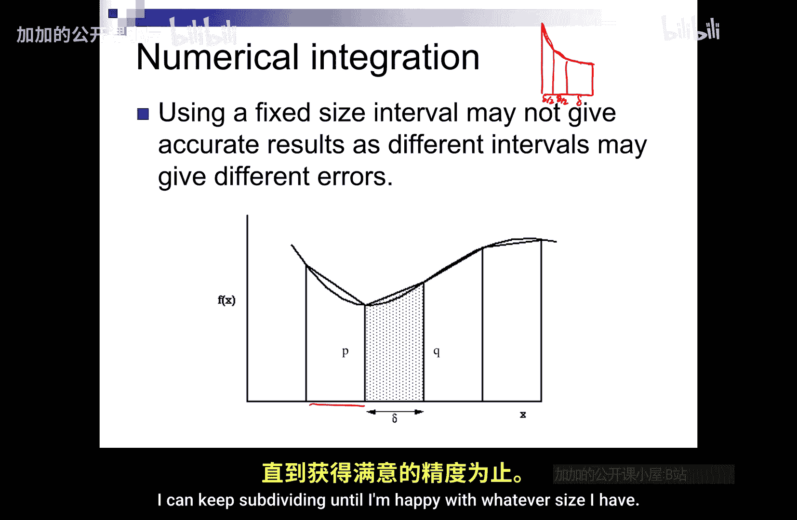

So when you do this， you can call this adaptive quadrature because it adapts to the error that you encounter and so this can help you increase your accuracy so we're going to take a region that so a processor is assigned some region to integrate and it's going to take that region and then keep subdividing it and then allocating different parts to to its sort of helper processes until the error gets small enough。

Okay， so then we might end up subdividing some regions a lot。Yeah。

 so it adapts to the shape of the curve and then and then we we can represent this computation using a tree。

 Okay now this time it might not be a complete binary tree right because so for example， you know。

 if you start with the initial problem and then you subdivide it right。

 So then you get two sub problemsble So maybe this guy wants to sub divideivide some more and this guy also wants to subdivide right。

 so now here you might have this problem is still you still need to subdivide here Okay。

 and then maybe this one you need to go farther。 Okayops。Okay， but maybe for this problem。

 you're already happy with the accuracy， Okay， so you can just stop at that point， right。

 and maybe this guy you're happy with and then this guy you want to subdivide some more。

 and then you're happy。So you see that you can still represent the overall set of subprobles as a tree。

 except for you don't have to have a complete binary tree because you don't have to subdivide to the same degree everywhere。

Okay， yeah， and so now because it's not a complete binary tree。

 it becomes a bit more challenging to allocate processors to this tree okay so later on we're going to talk about how to allocate we're going to talk about sort of the scheduling problem and the processor allocation problem okay in another lecture。

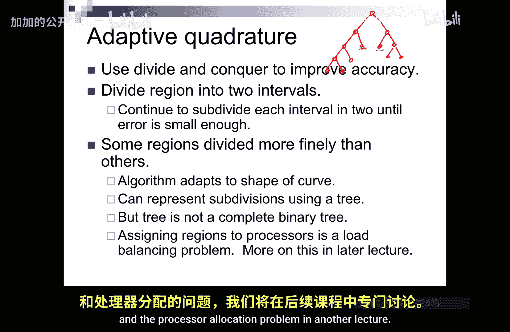

Okay， yeah， so just pictorially， you know， this is what it would look like。 Okay。

 so if you had a big problem like this， right， then you see that this would cause a substantial error over here。

 Okay， and then so so this is too much。 So therefore we're going divide this into two sub problemsble。

 Okay， and then that's going to reduce the error。 right。

 So now we're not going gonna have C as being the error。 we're just going to have these you know。

 these slivers up here as being the error。 Okay， so so basically。

So this is saying that what criteria can you use to decide when to stop subdividing Okay。

 the criteria that you can use is that you can form this this triangle C over here so triangle C is taken by if I have a let's see So if I have this region over here then what I'm going to do is I'm going to take the midpoint of this region and I'm going to form this triangle if this triangle has a large area。

 then this is saying that I'm going to get a large error。

 if I just use this this trapezoid region as is if I just use that trapezoid。

 I'm going to get at least this triangle C worth of error。So then if the C is too large， right。

 then I'm going to decide to subdivide。 Okay， I'm going to divide this in half。 Okay。

 and then once I divide in half， then in both A and B， I'm going to run the same test。 Okay， so。

 for example， in。B over here right I'm going to try to see if B is good enough and the way I figure that out is I divide this in half right。

 I form this triangle over here and then I look at whether I'm happy with the size of this triangle。

Okay， so I set some threshold for that。

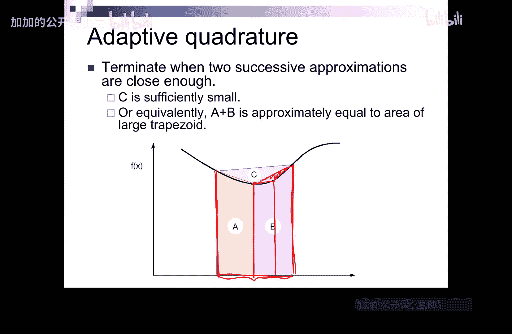

Okay， so so that is how we do divideiding conquer partitioning and so that covers the two types of partitioning data partitioning we're going talk about so next we're going to move on to algorithmic partitioning okay so algorithmic partitioning remember is that we're going to not break the data into different parts。

 but we're going to break an algorithm into different parts and then each part of the algorithm is going to sort of take turns processing the data。

And so a good example of this would be a pipeline computation。So， here。

Suppose you have a computation and you manage to break it into like you know six parts and there could be even more parts out here okay and so what's going to happen is you're going to have a piece of data right so the data is going to come in and it's going to be processed by every one of these parts。

Okay， right， so we need to do so each of these parts does some operation on the data and the overall algorithm。

 we need to do all these parts。 So the data gets passed through these parts one by one。Right。

 and they have to be executed in this order。 the the steps have to be executed in the order shown and then。

Yeah， and then we can assign the so if we have a bunch of steps and a bunch of processors。

 we can have some sort of mapping between the steps and the processors。

 So in this example we're showing sort of each processor is just doing one step。

But we could actually have we could have， for example， more steps than we have processors Okay。

 so in that case， we can actually break up some of those steps and we can put multiple steps onto one processor right so here you know we have four steps and then we can run all four on one processor right and the next four on the next processor and so on。

Okay， so an example of this would be suppose you want to compute a power series。

 Okay so so suppose you want to compute the value of sign。

 So usually the way you do that is through a power series。

 right And so now you can represent this power series as well， first of all。

 we can write a sequential way to implement this power series Okay so we have a loop over here。

 right So the loop is just going to compute these individual terms。

🤧And then it's going to add them together。 to form the sum is basically going to be the value of sine theta。

 so the sum is so the first term in the sum is just going to be the theta right so that's the first term in the power series and then after that we're going to form these subsequent terms。

 and the way you do that is you notice that for each of these terms。

 you could either just compute the term by itself。 so for example。

 this term over here you can just take theta to the fifth power and divide by5hi factorial but then that would take you quite a number of operations。

 and so you can observe that it's actually faster that suppose you've already computed the previous term then you can compute the next term just by taking the previous term and then if you multiply this by theta squared and then you divide by5 and then by4。

 then you can get the next term this term over here。And so that's what we're going to do okay。

 we're going to take the previous term， we're going to multiply by theta squared and then divide by some stuff。

 and then we're going to get the next term， and then you add the next term into your sum okay。Okay。

 and then if you unfold the loop， you see that you're going to get exactly the same computation as the power series。

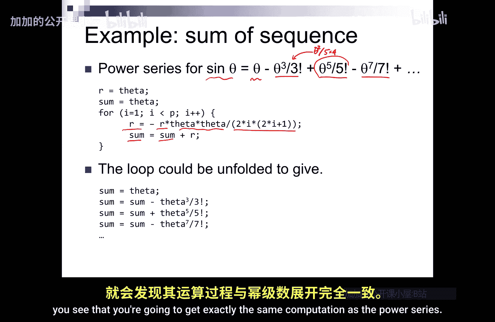

Okay， so now the way that you can do this in a pipeline is that。Yeah， so then you can use。

A bunch of different processors。 and each processor is responsible for adding。

 so each processor is given a single task and that single task is to add one more term to the power series。

 Okay， so for example， the P1 guy， right， he's going to add this term to the power series。 Okay。

 the P2 guy right， He's going to add this term。 Okay， and so on。

 And so if you have a bunch of processes， they're going to end up adding a bunch of terms。

 And then the the output of the final process is going to be。

It's going to be the value of sine theta。Okay， so actually。

 we'll do this in more detail in a later slide。 Okay， but， but before that。

 I want to talk about different types of pipelines that we can have Okay， so。

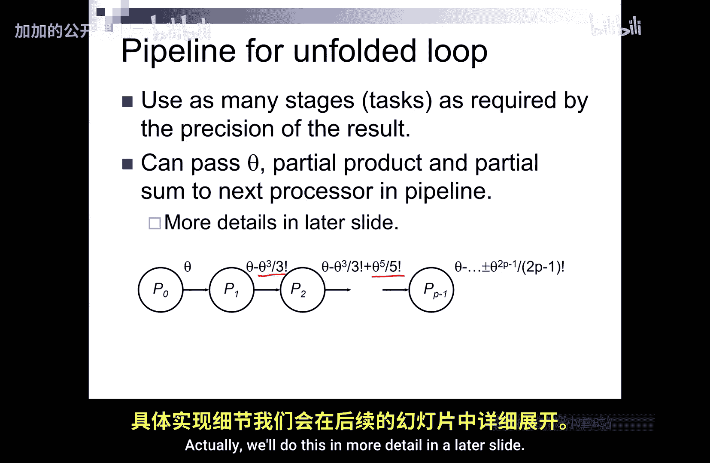

Yeah， going so the process is to take a problem and divide it into a series of sequential tasks and then run these tasks in a pipeline fashion。

 and then this can actually increase our speed as we'll see。So。But in order for this to happen。

 we actually have to be able to run the pipeline okay so if you want to execute a a pipeline computation。

 you need to have certain properties okay so for example。

 one situation where you can run a pipeline is if you have more than one instance of the problem to solve。

 if you just have one instance of the problem to solve。

 then maybe you cannot execute this in a pipeline， but if you have multiple instances。

 you can run the multiple instances concurrently through the pipeline。Okay。

 another situation where you can use a pipeline is if you have a series of data items to be processed。

 okay and then each of those data items requires multiple operations so requires going through the pipeline。

 and then you have multiple data items， then you can also set up a pipeline。

And the third situation is where if you have a bunch of processes and they're running concurrently。

 but the information that the next process needs， okay。

 so the processes are in a chain and the information the next process needs can be acquired from the previous process before the previous process has finished all its computations。

Okay， so the previous process is doing some computations， but maybe like halfway through。

 it can already send some data to the next process so that the next process can get started。

If you have this type of situation， you can also get a pipeline。

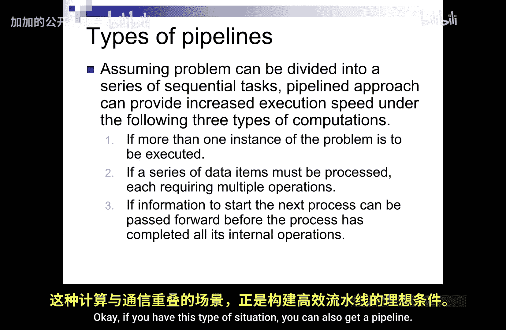

Okay， so we can look at this more pictorially to make things more clear so here。

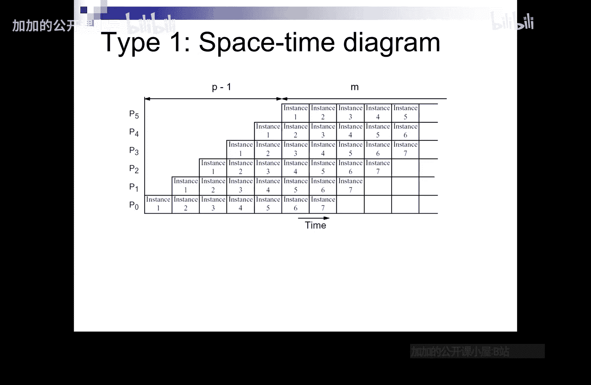

So we're going to say that we have these three types of pipelines，1，2 and3。 Okay。

 so the first type is where you have more than one instance of the problem to solve。

 And so illustration of that would be would be like this。 Okay。

 so you have a pipeline computation like this with multiple stages。

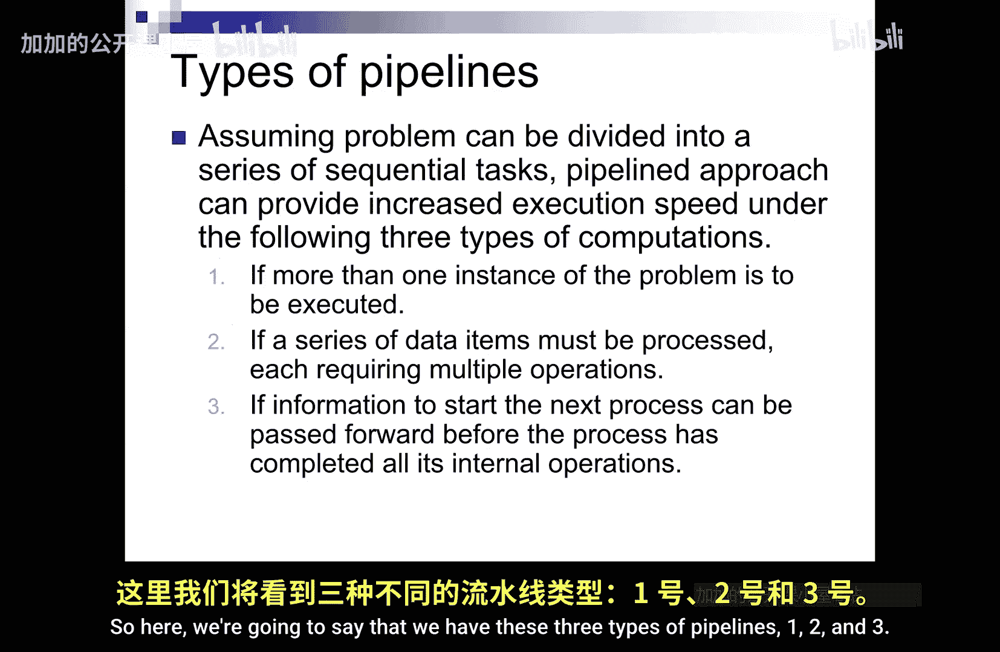

Right， and every instance of the problem needs to go through all of these stages Okay and so we have time going in the horizontal direction。

 And yeah， so this is a P stage pipeline with P processors and suppose you have M instances of the problem Okay so the first instance comes at the first time step。

It's processed by the first stage of the pipeline。And then it moves on to the next stage of the pipeline。

 but then at the same time， you can do the first stage of the second instance。Okay。😊。

And then at the third time step， you can do the third stage of the first instance。

 the second stage of the second instance， and the first stage of the third instance。Okay。

 and then you can just keep doing this until each of the instances has passed through all P stages of the pipeline。

And you can see that the total execution time， if you have M different instances right Well it's going to take a p minus one time for the first instance to get to get to the final process And then after that you see that at the final process for each additional time step。

 you're going to get another instance being processed by the final process so then since you only have M instances。

 then after M additional time steps， you finished all the all the instances so the total execution time is going to be p p minus one time to get the final process started right and then M more time to finish everything So altogether it's going to be this。

So all right， so for the type 2 for the type 2 type pipeline we can again use some sort of this type of representation to to understand the situation So we're going to call this a spacetime diagram so what is going to happen is so again you have a bunch of stages of the pipeline right so you have P stages of a pipeline and then you have now a single data item needs to go through multiple stages of the pipeline Okay and then you have multiple data items Okay so D0 is the first data item right it's going to go through all of these pipelines and then D1 is the next data item。

 It's also going to go through all the pipelines。And if you have n data items and you have a P stage pipeline。

 then again， the total execution time is going to be p minus1 steps for the first process sorry for the final process to get started and then n more steps to finish everything Okay so the total execution time is n plus p minus1。

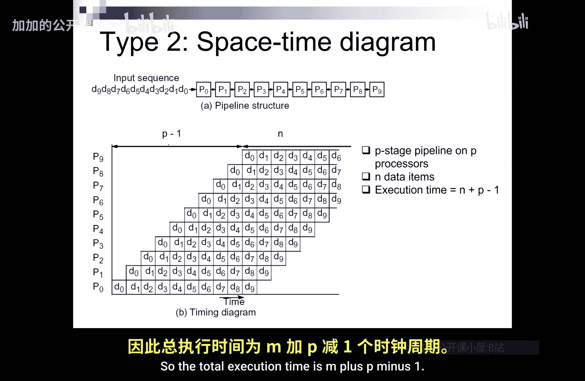

Okay， and the final type of pipeline is where you have a process that even after it has even before it finishes。

 it can already pass some data on to the next process。Okay。

 so an example of this would be that so you have a process P0 over here right so overall the data needs to traverse through all of these stages of the pipeline okay so there are like six stages overall here。

And then so the data is being processed by p0 and it takes this much time for p0 to finish。 however。

 even after p0 has partially process the data it can already send some data over to P1 once P1 gets that data it can start its computation and overall P1 needs to compute for this amount of time。

 but even after computing for a short while， P1 can now already pass some data over to P2 so now P2 can start and it can do the same thing and pass to P3 and so on。

Okay。So that's one example where so you know here all the processes。

 we assume that they have the same execution time， you can do the same thing if you even if the processes don't have the same execution time okay you can still have a situation where you've done part of your computation and then you send whatever data you have over to the next process so that he can also start right instead of having him just wait for everything。

RightI mean， the alternative to running this in a pipeline would be that if you do all of p0 right so you could so let's see so I'm going to switch to blue here right。

 So if you don't do this in a pipeline fashion， then you would have to wait for P0 to completely finish before you。

Before you give all the data to P1， Okay， so then P1 would only be able to start after P 0 finishes。

 right， and then maybe。And then maybe P2 here can only start after P1 finishes。 Okay。

 if you don't use a pipeline。 so you can see that if you don't use a pipeline。

 the overall running time is going to be much larger than if you do use a pipeline。

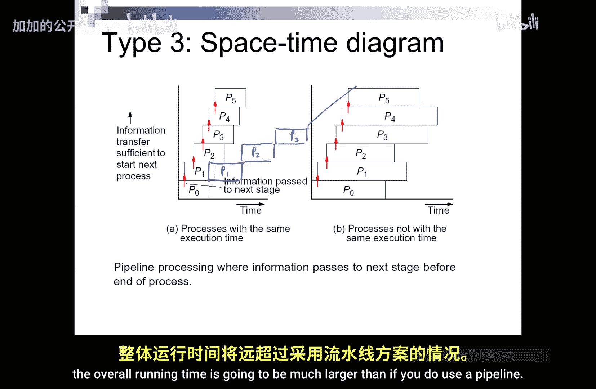

O， now。So let let's， let's do a more detailed example of the first two types of。Of pipelines。 Okay。

 so， yeah， so we're gonna assume P processors， P tasks。 So P P stages， right。

 So then each stage we're going to assume is。It's going to do some sort of computation。

 we're going to call this a basic unit of computation。Okay， and so we're gonna assume that。Let's see。

Yeah， so we're gonna assume that all cycles of all tasks take about the same amount of time。 So。

 yeah， so the basic computation takes T cycle amount of time。 Okay。

 so then the let's see the parallel execution time。嗯。Alright， So this， yeah， this N C is the。

Is see the number of cycles that we're gonna do。 Okay， N C is back to red。I think red is actually。

Easier to see。Yeah， all right。 so then N here is the number of cycles we're going to do。

 and then Tc is the amount of time for one cycle。 So therefore the total execution time is going to be T cycle times N the number of cycles。

And the time for one cycle is so that's going to have two parts。

 the computational part and the communication part Okay。

 so it's going to be the sum of these two things。And then the number of cycles is going to be so you can get that from the previous diagrams Okay。

 so for example， for the type1 pipeline， we had the number of cycles was m plus p minus-1 because it took again。

 it took p -1 cycles for the final process to start and then we had M problem instances。

 So yeah so that's the total number of cycles and so the execution time would just be you know this N here times t T computation plus t communication。

And then for type 2， the number of cycles was the number of data items plus P minus1。

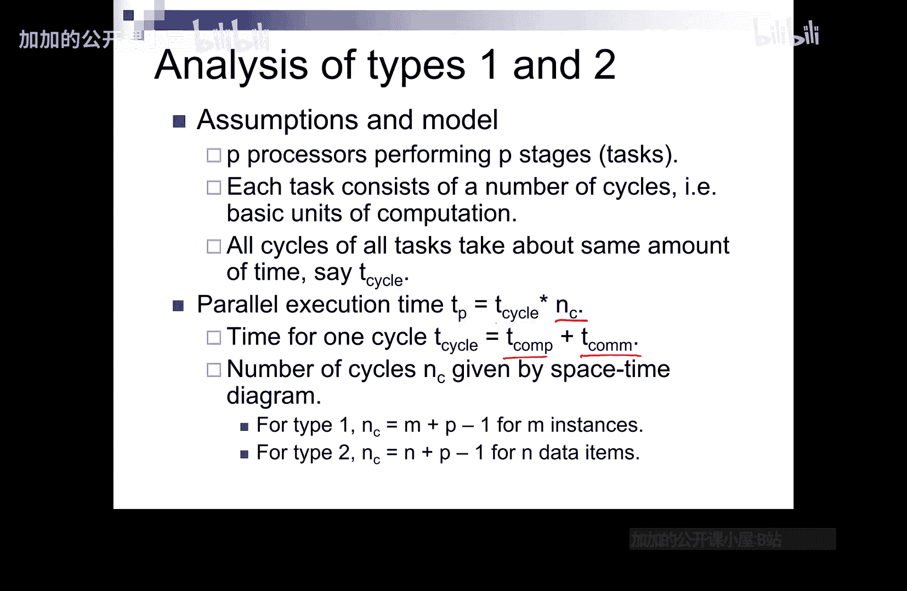

Okay， so so more concretely。 So let's look at an instance of the type 1 pipeline。 Okay。

 so here we can we can say that。Suppose we have a pipeline to compute the power series。

 the sign function。 Okay， so the pipeline is， again。

 different stages of the pipeline are going are going to add different terms。 Okay。

 so the the stage adds this term as P2 adds this term and so on。

Okay so you can write this out so we're going to use some sort of MPI pseudocode over here。

 So what we're going to say is what the first process right。

 He is a guy that starts with the the value theta Okay。

 so he's just going to so if if I'm the first process， I'm just going to send my value over to P1。

Okay， and otherwise， all the other processes are going to first receive a value of theta。 right。

 And then they're going to receive a value of R and then。Let's see。 What is Okay。

 So R is going to be the partial sum。 Oh， no， I'm sorry。 R is the previous term。 Okay。

 so R is like the so， so these things are the R。 Okay， so there are these terms that we compute。

 Okay， and the sum is going to be these partial sums that we compute。

Okay and the theta is just this value over here。 so each process is going to receive a theta value。

 He's going to receive the previous term that was computed and he's going to receive the previous sum that was computed。

Okay， and then he's going to take the previous term。 And so， for example， this。Let's see。

 this is still R here。 let's write it this way。 Okay， so for example。

 P2 is going to receive this theta cube divided by three factorial term， the R from from P1 right。

 he's going to do this type of thing to it， So that's going to get the his R term right。

 the theta to the fifth power and then he's going add that into the sum that he also got from P1 And then if he's not the final process。

 he's going to send this to the next process。And then you see that the final process will end up with the output Okay。

 so then this is a pipeline。

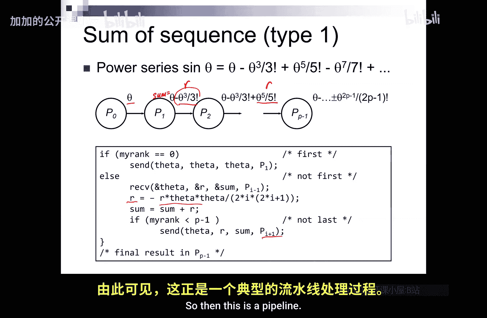

And。And the way to bound the running time of the pipeline is that so here you see that the basic cycle that So what is the basic computation that these processes do。

 Okay， the basic computation is that every process is going to do this part of the computation。

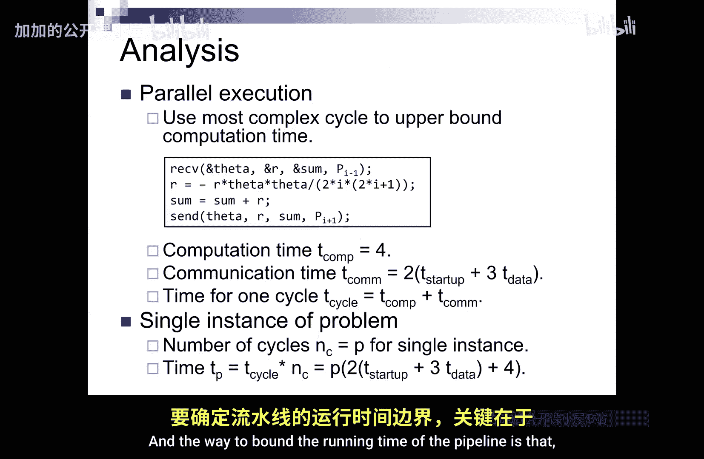

Right， so then we just have to figure out how much time this is going to take。

 So this is going to be our basic cycle here。 right。

 And the amount of time it's going to take is just we we count the computation time。 So let's see。

 I'm not sure how I'm getting this for over here。 okay， so anyways。

 so the computation is just you know， how many arithmetic operations we do。 Okay。

 so somehow like I had， I put a number four here。 I'm not sure what I was counting exactly。

 but anyways。

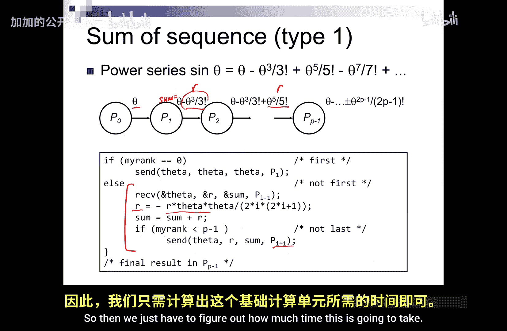

It's some sort of constant， Okay，4，6，8， something like that。

 And then you have the communication time。 So the communication is being done over here， right。

 so this is communication。 And then this is also communication right and the communication is you know。

 each time we're sending like three pieces of data right three pieces of data。

 And then you do that twice。 Okay， so this is the computation communication time。Okay。

 and the time for one cycle is the sum of these two things， right。

 And then the the total number of cycles is going to be Well， so。

 so now if you just have a single instance of the problem。 Okay。

 so suppose you're just trying to compute。

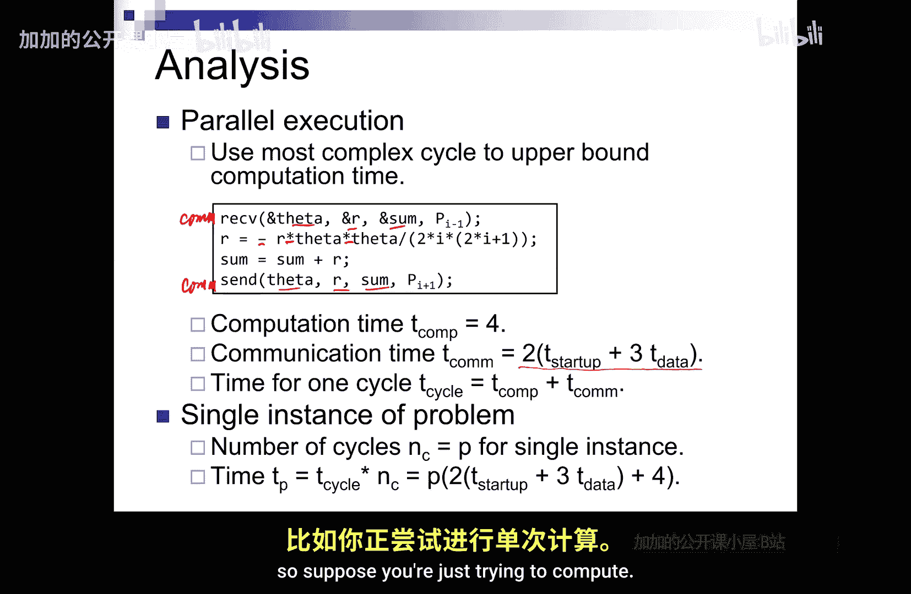

Let's try to clear this up， supposeupp you're trying to compute just a signine of one one value。

 okay， signine of one theta value。Then you have exactly P stages of this pipeline。

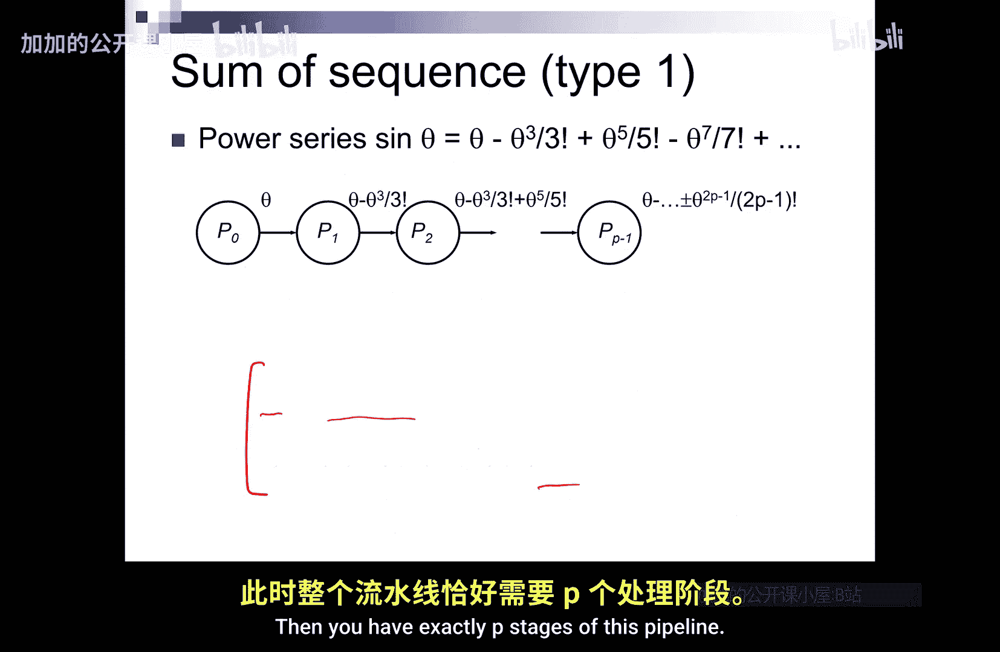

So therefore， the number of cycles， if you have a single instance， is going to be P。

And so the total running time is going to be like this。 Okay。

 it's something like p times a constant right， this this constant over here。

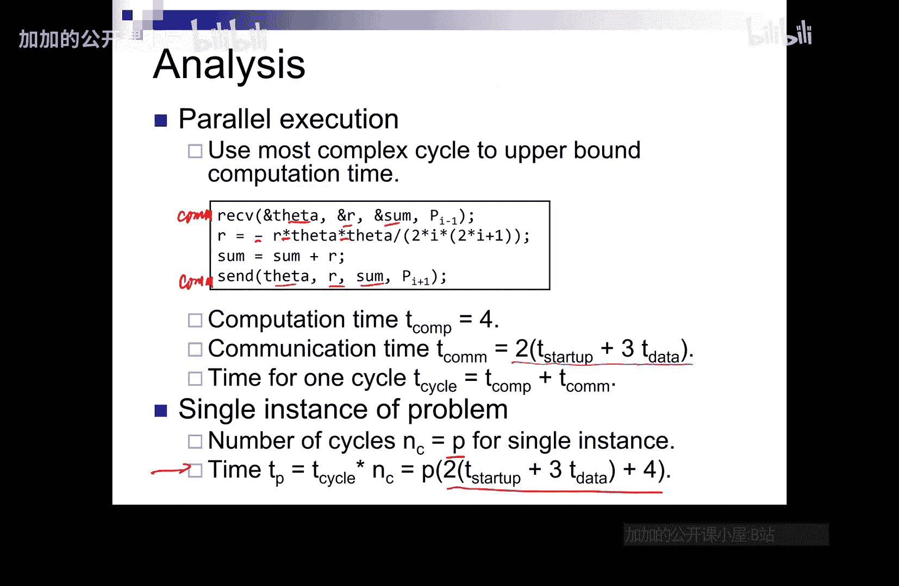

Okay， however， this is not efficient。

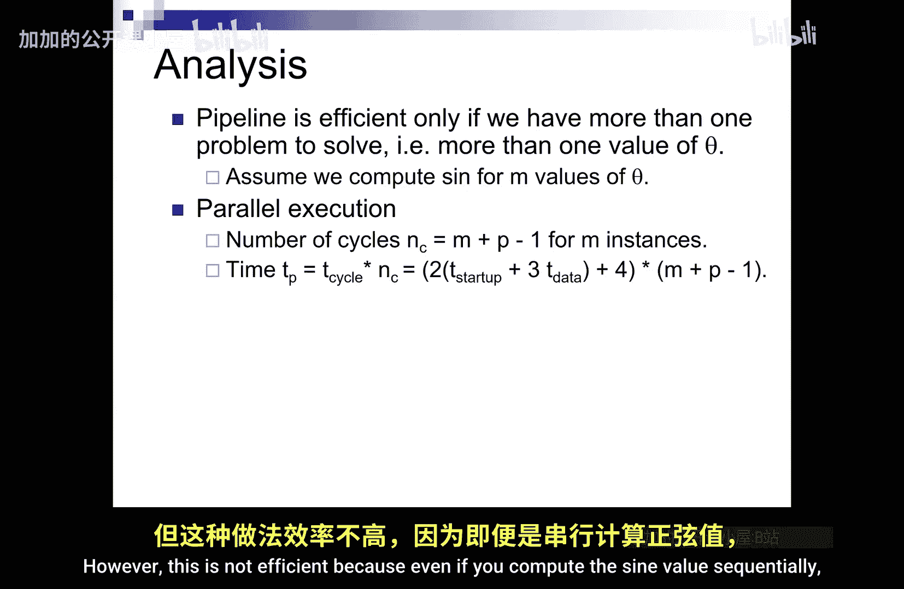

Because even if you compute the sine value sequentially right So you eventually you're going to get P terms over here。

 So if you do the sequential computation， that would also take you order P time。

 So if you just do one instance of the signine computation using a pipeline。

 you don't get any improvement inefci。

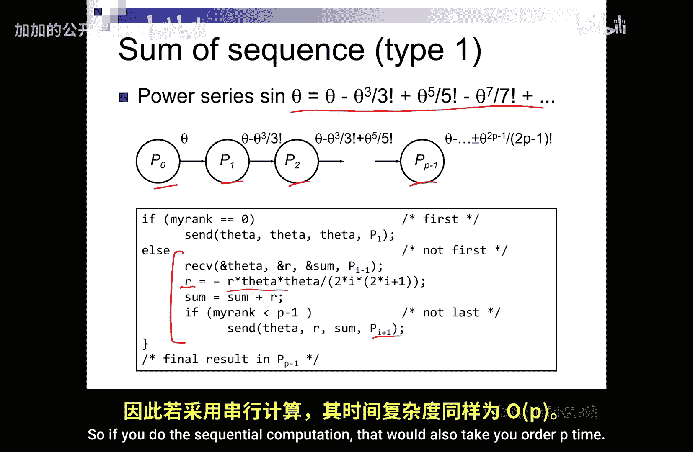

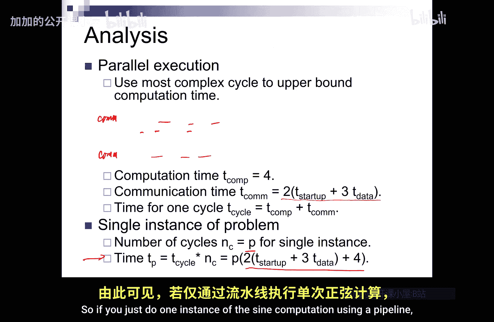

However， if you have multiple values of theta， okay， suppose you have M values of theta。

 then now we can go back to the previous analysis。And now the total number of cycles to solve all M instances is just m plus p minus1。

And so if you plug that into the formula， right then。

We have the T cycle time times the number of instances and now the average amount of time per instance。

 okay is going to be this execution time divided by M， which is going to be this thing over here。

Okay。And so basically， this is saying that for large values of M， okay。

 then if you're computing many， many signs of many， many different value。

 then basically this whole thing is just going to come out to a constant。Okay。

 so if you compute many signs， then it basically just takes you a constant amount of time to compute each sine value。

And there， of course that is a speedup right， because if you compute this sequentially。

 it's going to take you order P time Where if you compute this per instance。

 Where if you compute this with a pipeline， it takes you constant time per instance。

 So here you get a perfect speed up， you get an order P speed up。

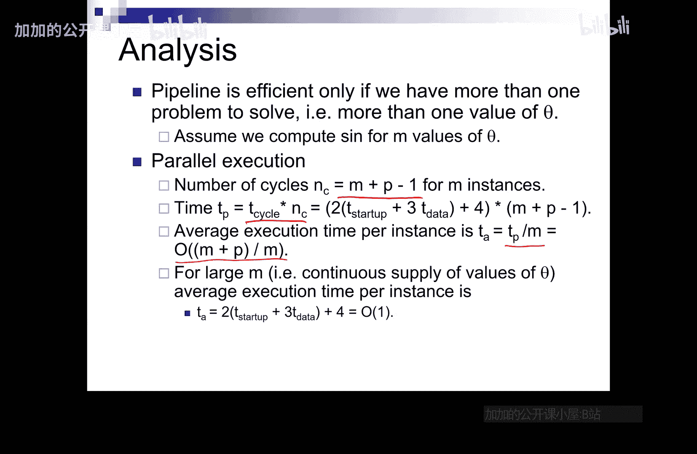

Okay， another example of this would be so now here we have an example of the type2 pipeline where you process multiple pieces of data in the pipeline。

And so here， I' suppose we look at insertion sort。 Okay， so insertion sort。

What we're going to have is we're going to be sorting， let's say， n numbers。

 and then we're going to use end processors to do this。And we're trying to sort the numbers。

 let's say in decreasing order， so what's going to happen is each processor is going to whenever it receives a value。

 so it's currently storing some value and it receives a new value and if the new value is larger。

 it keeps it， it keeps a new value and it sends the previous value that it was storing to the next process otherwise if the received value is smaller。

 it'll just pass the value it received onto the next process。

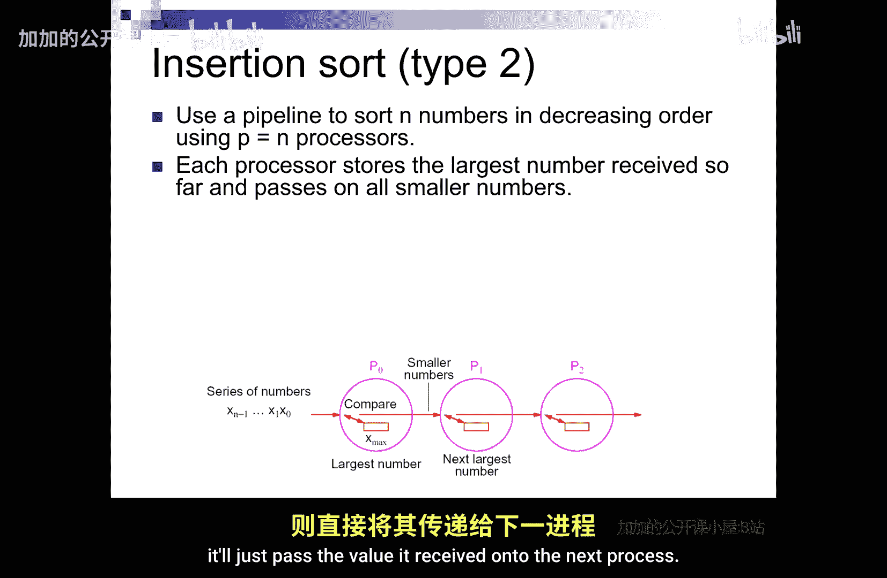

Okay， so so here's an example of this right So suppose you're trying to sort five numbers over here right So we're going to use five processes and suppose the numbers are in this order over here。

 So5 is first going to be sent to process process P0 and then and then p0 doesn't have any numbers。

 So it stores 5 and then you send two to process p0 right and then two is less than 5。

 So p0 just passes2 on the next process and then。The next process is going to store2。

 and then also one， you send one to P0， but P0 is going to pass one onwards and so on。

 And so and then you keep doing this。 And for example， at some point。

 you see that3 is going to get passed from p0 to P1 right Now， P1 used to be storing2。

 And when it gets the three， it's going to keep the3。And when it gets the four。

 it's going to keep the four and then send the three to the next guy。Okay。

 so you see that if you keep doing this， right， then eventually after all the stages of the pipeline。

 right， So there we have we have let's say， n numbers here。 and then we have N。M processes。

 so the total number of stages is going to be n plus n minus1， so 2 n minus1。

 after that number of time stepss， we're going to sort all the values。Okay， so then。Yeah。

 and the basic cycle is going to consist of we're going to store value and then we're going to compare the value with our current value and maybe pass on the value。

Okay， yeah。 And so this is the code for doing that。 right， You receive a number。

 you compare to your current number， and then maybe you send that number onwards， okay。

You send either your current number or you send either your previous number or you send the new number onwards。

Okay。And so this is our basic cycle。And yeah， so the process I is going to pass n minus I minus1 numbers onto process I plus1。

Okay， because you have that many processors to the right of process eye。

So then it's going to execute the basic cycle that number of times。Okay， so all right。

 so it's going to basically process I is's going to execute the basic cycle M minus I times。

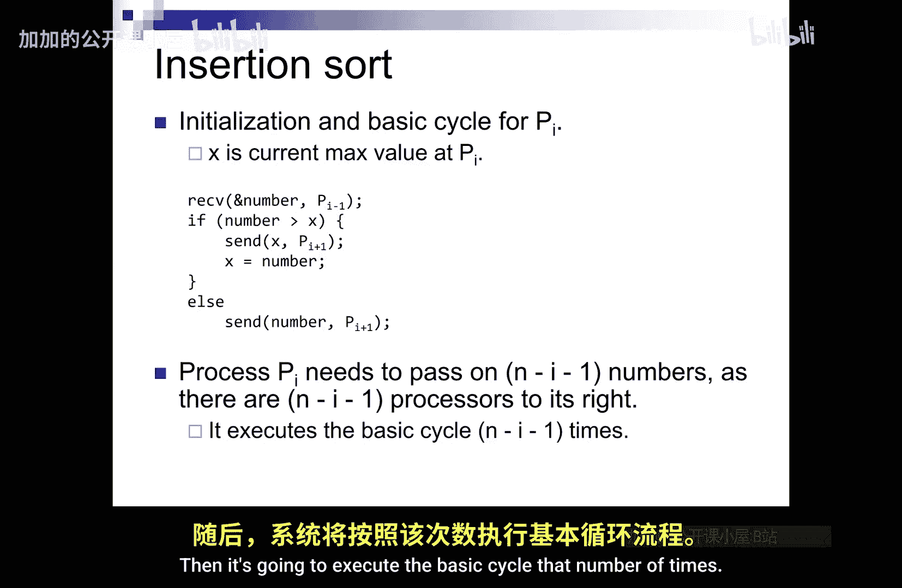

so therefore the sequential running time of this is that process1 is going to execute the basic cycle n minus1 time times process0 is going to execute this n minus1 times process1 is going to execute this n minus2 times and so on so altogether you're going to execute the basic cycle order n squared number of times。

In a sequential setting。In a parallel setting， so the basic cycle is going to have a receive asend。

 and then this comparison operation。 Okay， so the computation time is going to be。

 let's say three steps right The communication time is on each time you just send one piece of data。

 So the communication time for each cycle is going to be just this thing over here。

 sorry you receive a piece of data and you send it。 So it's going to be two times this thing。

And so the time for one cycle is just the sum of these。

 and the total number cycles is going to be n plus p minus1 where p is equal to n。

 so it's going to be 2 n minus1。And so the total computation time is going to be the cycle time times the number of cycles。

 so it's going to be something linear in n。Okay， so the parallel execution time is linear in n。

 and then the sequential time is going to be order n squared。

 and so you get a factor n speed up right so you get a linear speed up in this case。

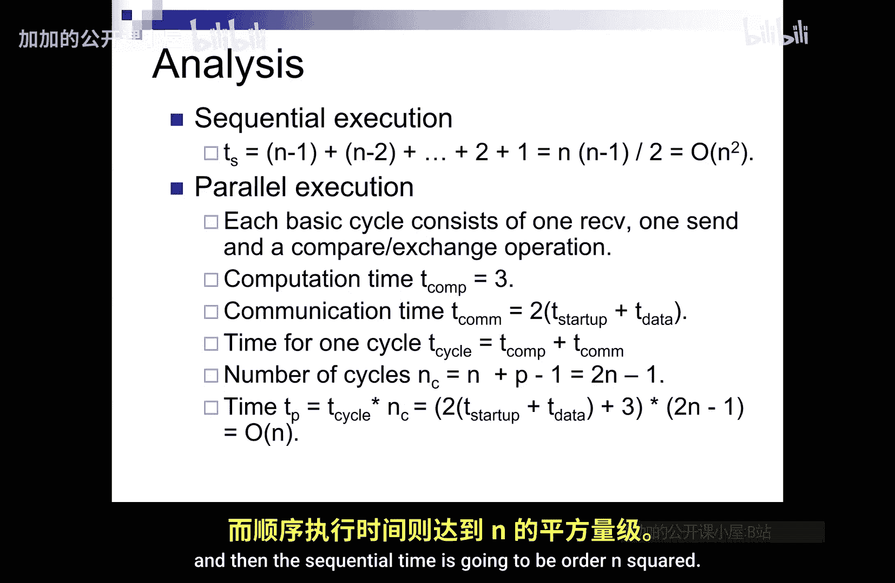

Okay， all right， and the final example is going to be an example of the the third type of pipeline where you can start the next stage before the current stage finishes okay。

不。And the example we're going to have is。So suppose you're trying to solve linear equations where the equations are written in this upper triangular form。

Yeah， and this is used in things like Gaussian emination。

Now I'm going to show you more concretely what I mean by this。

 but basically first what's going to happen is that each process is is going to do this Okay。

 so each process PI is going to receive a partial solution from the previous solution from the previous process。

And it's going to take that partial solution and pass it on to the next process。 Okay， P plus one。

 and then it's also going to use that partial solution to sort of update its its computation。

 P is going to use that partial solution to update its computation。Until eventually。

 PI finishes its computation。Okay， and then P is going to send the the solution that it produced over to P plus1。

Okay so initially it's just passing these partial solutions that it received from the previous guy over to P plus1 but eventually PI itself is going to produce some sort of solution。

 which it's also going to send to P+1。Okay， and here， in fact。

 we're going to have the different processes are going to compute for different amounts of time。

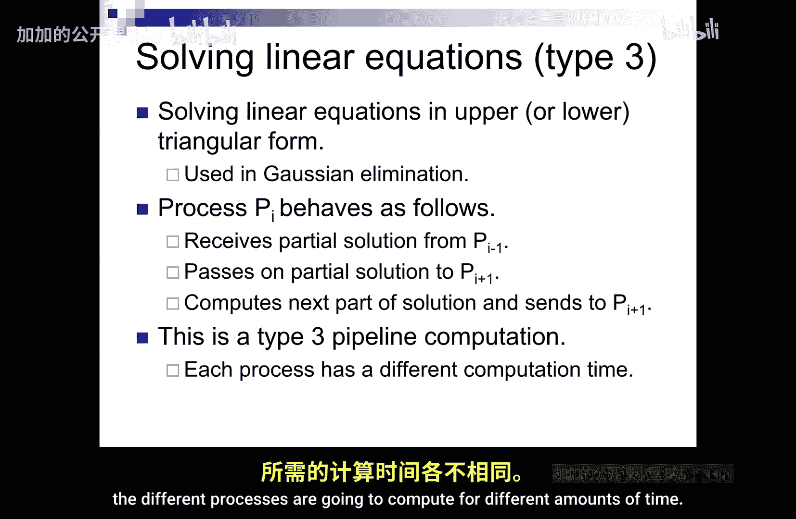

Okay。All right， so now more concretely， we're going to solve these upper triangular equations。

 these systems of equations and so that means that we have a set of equations and they're upper triangular because all of the coefficients below this diagonal are going to be zero。

So initially you're going to have a process p0， and he's going to have this equation you know a00 times x0 equals b0。

 Okay， so then he can directly just solve for x0 at x0 equals b0 divided by a 00。

So then once he knows x0， then he can send x0 over to B1。Okay。

 and then B1 can use that information to to compute X1。 However。

 B1 is also going to send this information over to B2 to P2。Okay， so in fact。

 as soon as P1 gets the value of x0 from p0， he's going to pass it on to P2。Okay。

 and then after that， P1 is going to compute the value of x1。And once he gets the value of x1。

 he's also going to pass that on to P2。Okay。😊，Now P2， once it gets x0。

 he's going to pass it on to P3。And then eventually， he's going to give the value of x1。

 which he's also going to pass on to P3。And furthermore。

 he's going to compute the value of x2 so once P2 gets the values of x0 and x1。

 then he can compute x2， and then once he's got x2， he's going to pass that on to P3。

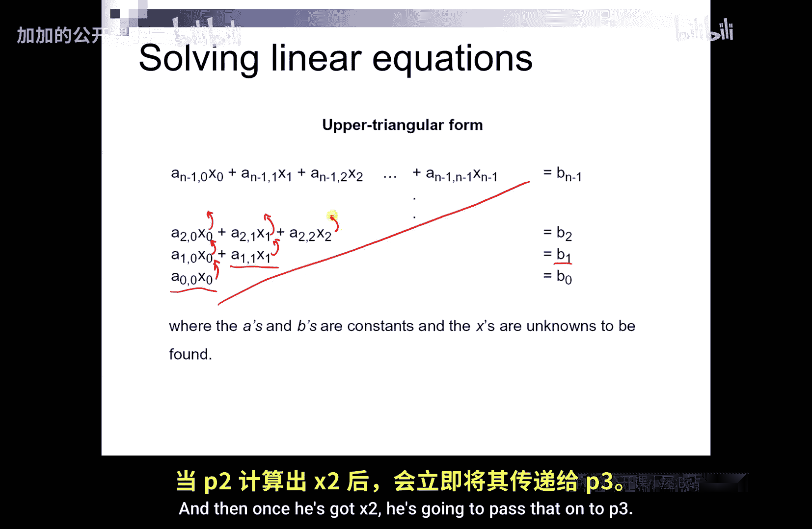

Okay。Right， and so these are the computations that each process does。 right。

 So the first process just computes B0 divided by this stuff， right by a 0，0， right。

 And then x 1 is going to compute。X sorry， P1 is going to get the value of x0。

 and then he can use that to compute x1 and then P2 is going to get the values of x0 and x1。

 and he can compute x2 and so on。

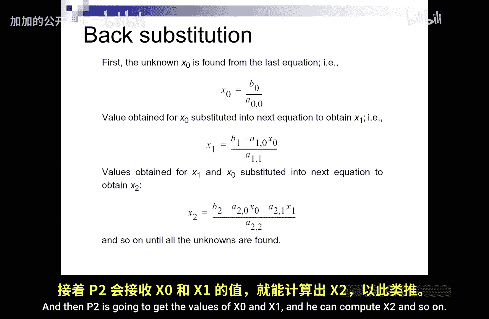

Okay， so if you look at the pipeline， then this is like a representation of the pipeline。Okay。

 so we're going to have if we have n unknowns， we have n equations and we're also going to use n processes。

Okay， so if we write this out， then what we're going what we're going to do is。Yes， that。Okay。

 so this is the code for P where I is larger than0 Okay so so every process besides p0 is first of all。

 going to so he's going to have the sum over here Okay。

 so the sum is just going to be this part over here， right？

Okay so the goal of the process of PI is to compute this entire sum。And once he's got the entire sum。

 then compute he can subtract it from BI and then divide by AII and then get XI。

But to compute the sum， right， he needs to get all of these other X terms， or sorry， Xj terms。

 where J is less than I。Yeah， so he's so Pi is waiting to get all of these Xj terms。 Okay。

 so each time he gets one of these Xj terms right， then he's actually going to pass this on to the next process because the next process also needs the Xj term right So yeah。

 so Pi gets it from gets Xj from Pi minus-1。 He gives it to Pi plus one And then he's going add。

One more term into his sum， okay as soon as he gets Xj， right， then he can add that into his sum。

Okay， so so eventually he's going to wait for to get I minus-1 pieces of data from P -1 Okay。

 and hes I's going to pass that stuff onto to I plus1。

And then he's going to have the sum value computed。 and once he's got the sum。

 then he can compute X I。Okay， and once he's got X I， he's also going to send X I over to to P plus1。

Okay， so altogether， he's going to send I pieces of data over to P plus one， right。

 He's going to send all this stuff， right， So here you have I minus1 pieces of data and then one last value for X I。

And then process zero， he's just going to send he can compute x0 directly and he's going to send that over to process 1。

Okay， so then we have n stages of our pipeline and in terms of execution time。

 now if you look at the total amount of work that needs to be done， right。

 so you see that process I needs to basically do I amount of computation。

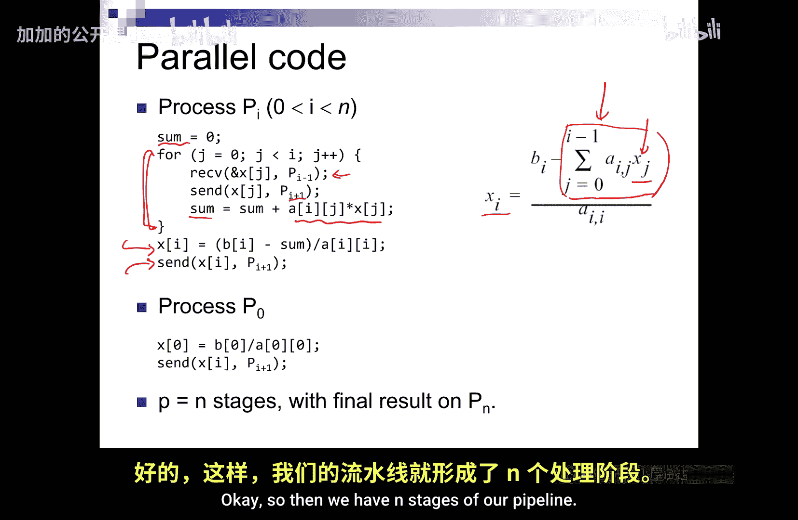

RightAnd so for the sequential execution time， know process1 sorry the process 0 is going to do one unit of computation。

 process one is going to do two units and so on， so altogether they're going to do order n squared amount of computation to compute all the X values。

All the x values。For the parallel computation process I is going to perform。

 You can see that process I is going to do I multiplications and additions。

 And then also so he's going to do basically。Process I is going to do like I operations over here。

 right these multiplications and additions， and then he's going to do like a subtraction and a division。

Okay， so process I is going to perform basically I amount of。Of computation。Okay。

 and also process I is going to do one receive and one send before the next process can start。

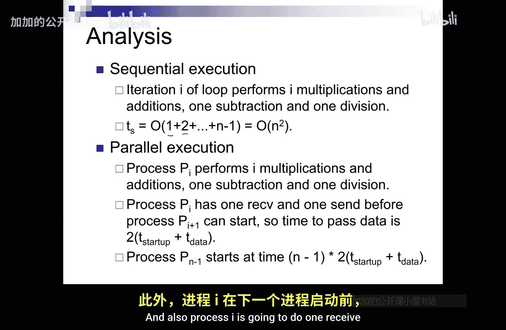

Right，Because you know， you can't start your computation on until you get your first value。 Okay。

 so now in order to figure out when the when let's say process I plus one can start， we see that。

 you know， process I has got to receive all these I values。Let's see。Oh， sorry。

 So process I has to receive a single value and send a single value before process I plus1 can start right so as soon as process I I receives a value and then sends it on to I plus1。

 then I plus1 can start。Okay， so basically。

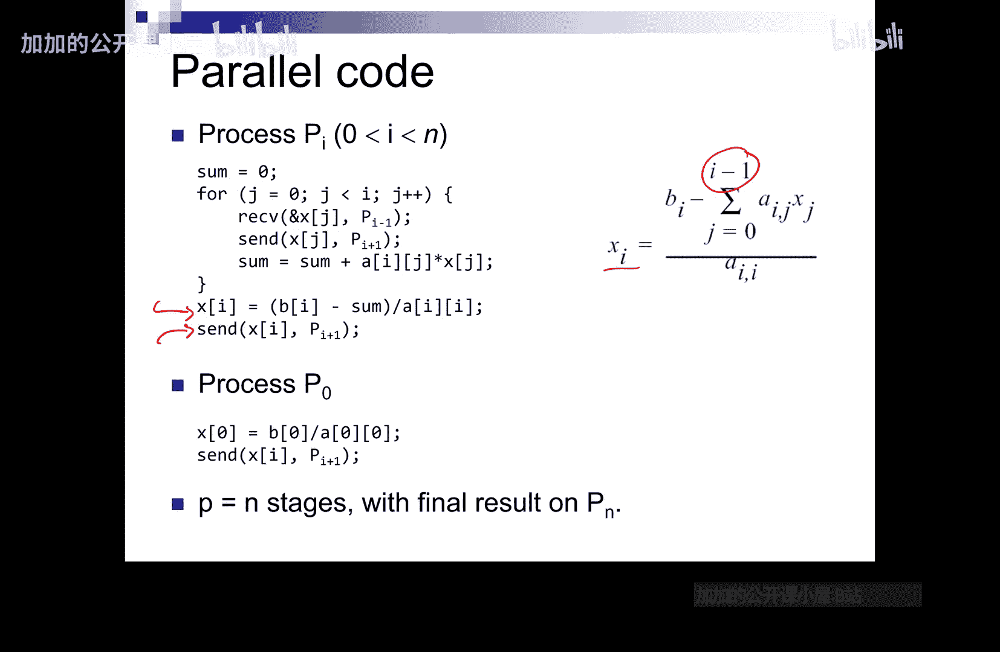

If you so to receive a value and to send a value， this is going to take this much time so this basically means that the second process can start after this amount of time the third process needs to start this amount of time plus when P2 started so P2 is going to start at this time so P3 is going to start at this one times you know two times this time and then P4 is going to start at three times this time。

Because P4 can only start after P3 starts and P3 starts at two times this time。OkaySo therefore。

 in general， you're going to have that p of m minus1 it's going to start at M minus1 times this time。

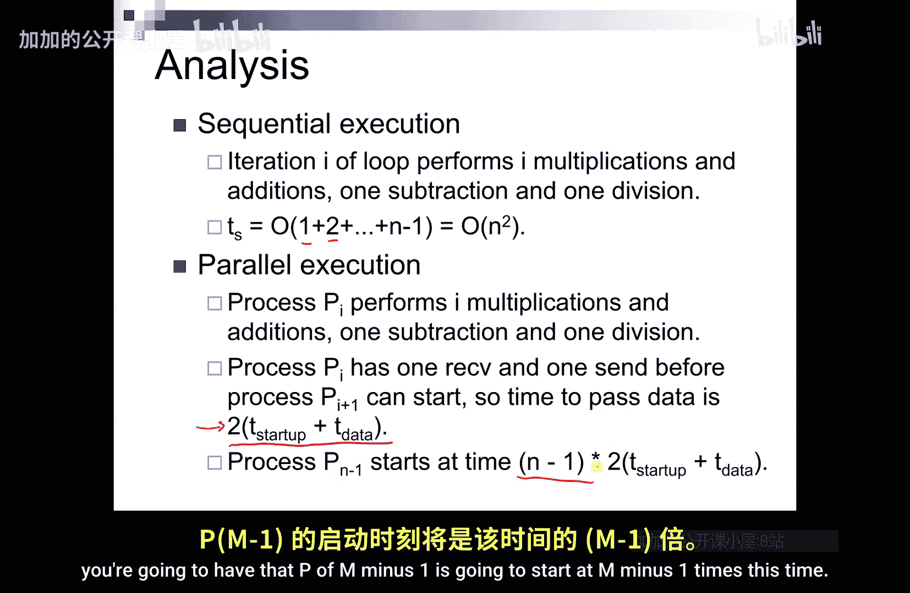

Okay， and then also process n 1 is going to perform n minus1 arithmetic operations right and so his computation is something like this okay。

And then process n -1 is gonna， let's see。 So he's going to do。Well。

 he's going to do M -1 receives Okay， and then actually just does one cent。 Okay。

 so there should just be a like a1 cent over here。 Okay。

 but to do the M -1 receives is basically going to take him this much amount of time Okay。

 so the comm because process M -1 keeps receiving these X values from the lower processes for I from1 to M -1。

Okay。Sorry for I from what0 to m minus2， I guess。Okay。

 and then so so process M minus-1 is going to spend basically linear time on the receives。

 He's going to spend a linear time on the computations right and he is only going to start at this time right because we said that P of M minus-1 can only start after。

After that amount of time and this is when he gets his first value okay and after he gets he receives his first value right。

 then he's going to do some additional receives and some computation and if you add all this together you get that the total computation time for p n minus1 is going to be linear。

Okay and so if you compare this with the sequential execution time。

 sequential execution time was quadratic right was n squared and now the pipeline running time is linear and so therefore you get a linear speed up okay。

 you get order n speed up using n processors。Okay， so that's all we have to say about this lecture next time we're going to look at so this one this current lecture focuses on designing algorithms in the distributed memory setting and so next time we're going to look at parallelzizing algorithms in the shared memory setting。

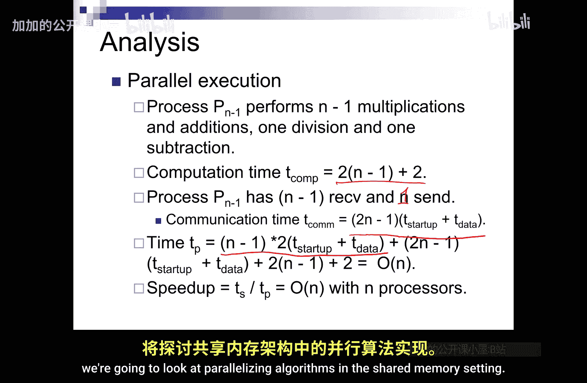