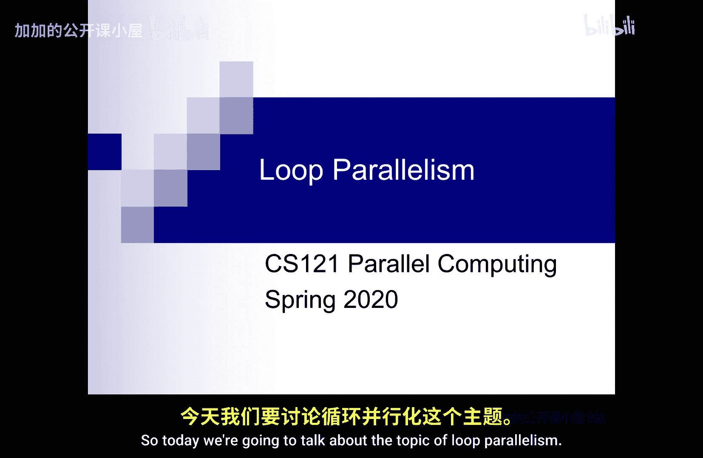
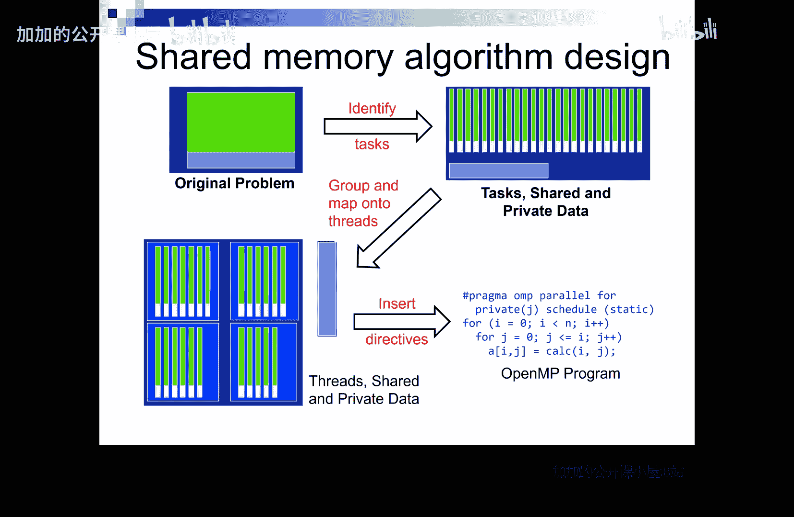
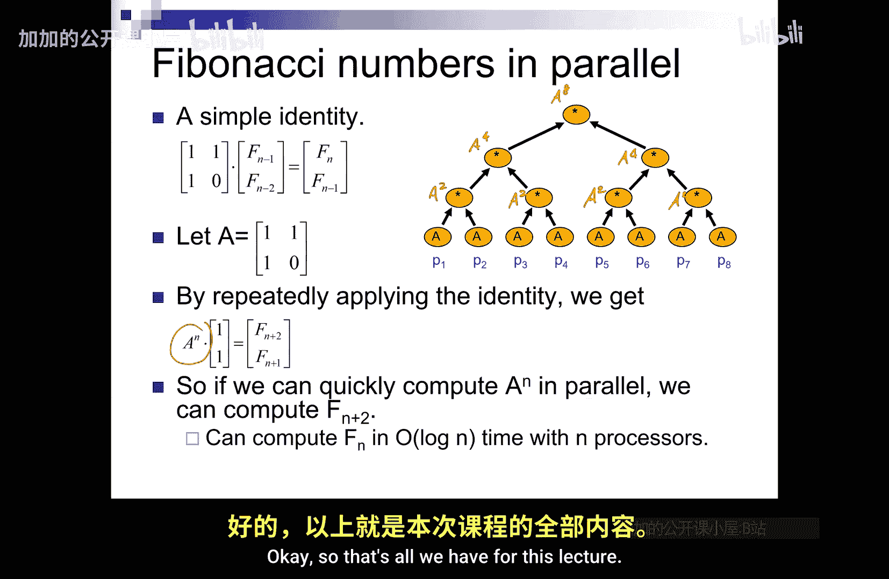

# 上海科技大学【中英⚡并行计算｜CS121 2020 Parallel computing】 p19 P19 Loop parallelism -BV1VqypBaEaP_p19-

Welcome back。So today we're going to talk about the topic of loop parallelism。

So the overall goal of this lecture is to create a methodology for designing algorithms in the shared memory setting。

So this is similar to what we talked about last lecture。

 where we talked about Fo's methodology and how to design algorithms in the distributed memory setting。

Okay， and the reason we're talking about loop parallelism is that most of the parallelism in shared memory programs happen within loops okay so if we want to design efficient shared memory algorithms。

 we're going to focus on how to efficiently parallelize loops。Okay， but before that。

 let's first go over the overall methodology for designing a shared memory algorithm so this is similar to Fos methodology where if you remember the steps in fosters were that you first partition the problem so you break it into many subproblem and then you group some of these sub problemsblem together。

 you agglomerate them or sorry you find the communication between the sub problemsblem and then you group the sub problemsblems together and then you map it onto your processors。

So in the shared memory setting， we're going to go through a similar set of steps Okay so our first step is to find is to basically take a big problem。

 the original problem and then break it into a bunch of sub problems。Yeah。

 so we're going to find what tasks there are in the original problem and we're also going to look for the dependencies between the tasks so basically we want the tasks to be independent or mostly independent because we're going to map them onto different threads later and the threads are not able to efficiently synchronize with each other so therefore if there's a lot of dependencies between the different tasks right then you're going to get very poor efficiency because you're going to have to add a bunch of synchronization operations like barriers between the threads right so that's going to really hurt your performance so if we don't want to have a lot of barriers then we want the tasks to be as independent as possible。

Okay， so we want to break the big problem into a bunch of tasks， which we hope are independent。Okay。

 and then after that， we're going to map these tasks onto threads。And during this mapping process。

 you have to be careful about things like load balancing。And then finally once we have the mapping。

 then we can just convert that into a program that we can run on a shared memory computer right and so for that we're going to just use open MP to do this。

Okay， so yeah， so that's the overall design process。 Now。

 there are several things we need to keep in mind when we do this so。Yeah。

 so we're going to take our original program and then break it into these tasks and the the tasks。

 sorry， all of the statements within the program， Okay。

 theres some sort of dependency between these different statements。

And so we said that we want the task to be independent。

 and so therefore we need to figure out what is the dependency between the different statements。

And to do that， we're going to use something called dependence analysis。

 which I'll show you later on。Okay， and then using this dependent analysis。

 you can determine what kind of tasks you want to form you want to form independent tasks and once you've done that。

 now you can take your independent tasks and then you can map them onto processors。

And when you do this， one of the big things is to load balance right so for example。

 we looked at methods in OpenM to load balance， for example using static or dynamic allocation of the work or using a block or cyclic allocation of the work。

We also need to be concerned about things like shared versus private variables。

 okay because if you share a variable that you aren't supposed to right。

 then you're either going to have a bug or you need to put like locks around these variables。

 but then that's going to hurt your efficiency so if possible you want to make variables private so that the different threads are not going to collide with each other。

Okay also we saw some examples when we talked about OpenM where if you want to do some sort of collective operation that involves some sort of synchronization。

 like you want to add together a bunch of numbers right you can either do that using shared variables but then you have to protect these shared variables or you can use something like these reduction variables which are much more efficient okay so we need to think about how we specify the different variables to achieve both correctness and efficiency。

嗯。Right， okay， and then we also want to think about things like if we're working with data structures like matrices。

 we want to think about whether we want to map these row wise or column wise。

 Okay so that can also affect performance because of like cache use， for example。Okay。

 so so our first thing is to figure out what kinds of tasks we can create okay so we need to create independent tasks and how do we tell whether tasks are independent so we're going to use this technique called data dependence analysis。

Okay so this technique is basically letting us determine whether statements in a program can be executed in different orders。

Okay， so suppose you have a sequential program and let's say that you have two statements in that program。

 okay， S1 and S2， so let's say that S1 occurs before S2 in the sequential program。Okay。

 now S1 and S2， there could be dependencies between these statements or they can be independent okay if the statements are independent。

 then we actually don't need to keep them in the order S1 S2 so currently they occur in the order S1 S2 in the sequential program but if the statements are independent then we could actually swap their order so you could do S2 first and then S1。

However， if the statements are dependent， then you have to do S1 before you do S2。

Because if they're dependent， then if you swap the order of the statement。

 you can actually get a different outcome for the program。Okay， so we need to make sure that。Right。

 whereas if they're independent， then even if you swap their order。

 you get the same outcome and same output from your program。Okay。

 so we need to make sure that anything that we do to the program。

 any transformation or parallelization， that's going to maintain the same output as the original sequential program。

So therefore， if these statements are dependent， then we have to make sure that they execute in the order S1 and S2。

 even when you parallelize。Okay， so now what kinds of dependencies can there be between these statements Okay so there are basically three types that we're going to look at so the first one is called read after write dependence okay or a true dependence and the way we're going to write that is we're going to write this S1 and then arrow T S2 okay the T indicates indicates that it's a true dependence。

And basically， what this means is that S1 is going to write to a memory location。

 and then S2 is later going to read from that memory location。

Okay so then S2 has to happen after S1 because you know S1 writes a value and then S2 reads it later now if you were to switch the orders of these operation so that S2 reads this location first。

 and then S1 writes it， then S2 could get a completely different value。

And then the program can behave differently。So we said that if you want to reorder these statements。

 you have to make sure that after the reordering， the program behaves the same way。Now。

 if there's a true dependence， then we see that we cannot reorder and still guarantee that the program behaves the same way。

Okay， so if there's a true dependence， then we have to make sure that S1 is always going to execute before S2。

Okay， another type of dependence is called antidepend or WAR， which stands for right after read。

Okay so this is where S1 reads a location， and then later on it's written by S2。Okay。

 so this is different from the read after write because read after write is you first write to a location and then later as to read from that location Okay。

 so here for the antidependence， it's that you first read the location and then somebody else later writes to it as to writes to it later。

But in this case， again you have to make sure that S1 executes before S2 because for example。

 if you read sorry if you run S2 before S1， then S2 could write a different value than the current value in that location and then in that case if you do S2 first and then S1。

 S1 can get a different value。Okay， and the third type of dependence is the the right after right dependence。

 Okay， this is also called an output dependence。 right。

 And then this is indicated by this arrow with the O。 Okay， so this is basically where S1 and S 2。

 both right to the same location， same memory location。So again。

 you have to preserve the order of these two statements because if currently you're writing S1 and then S2 right。

 but if you switch the order， then of course that memory location is going to end up with a different value at the end so because we need to preserve we need to guarantee that any kind of reordering preserves the behavior of the sequential program。

 then we cannot reorder these statements if they have this right after right dependence。Okay。

 so then so these are the dependencies that we have and if the statements do not have any sort of dependence。

 okay， if they're not read after write or write after read or write after write。

 then we say that they're independent。And if we have independent statements。

 then we can actually execute them in either order and it will not affect the outcome or the output of the program of okay。

Allright， so let let's do some examples。 so suppose you have these five statements over here right So they're just you know theyre assignment statements or they they read from a location and then they do some sort of assignment Okay。

 so now what kinds of dependencies do we have Well， for example。

 we have a true dependence from S1 to to S3 Okay， so this is a true dependence because so here X reads so we first read the value of x。

Or sorry， we first write to the value of x。 Okay， so we， we write 2 to the value of x。

 And then later S 3 is going to read X。 Okay， so that's a read after write。

🤧So that's a true dependence。 And you can see here that you know we cannot swap the order of these two statements because so let's say that initially all of these variables are0 so x。

 Y z are all0 in the beginning so then you see that if if you do them in the current order S1 and then later S 3。

 then y is going to become 2 at this point and x x and y are both two at this point。 however。

 if you switch the order of these statements then because x is initially0。

 then y is going to become 0 and then x is going to become 2。

So you see that doing these statements in the order S1 S3 is different than doing this in the opposite order。

And this is why you' are not allowed to switch the order。🤧くくく。Okay。

 so that's one example of a true dependence。 You also have a。Another true dependence。 So。

 for example， we have， let's see， we have， alright， So we have a true dependence from S 2 to S 4。

 because in S 2， you write to memory location Z， right， And then in S 4。

 you read from you read from Z Z。And also x， okay。Yeah， and again。

 you see that if you switch the orders of these statements， you're going to get different behavior。

Alright， another example。 So let's say right， So we have an anti dependence from S 4 to S5， right。

 Okay， yeah， so so we have an anti dependence from S 4 to S5 right， and this is because。

This is because we first read the value of read the value of z right into y。

 and then later you write the value of z Okay， so that's a right after read。And then okay。

 and then lastly we have some output dependencies， so for example we have an output dependence between S2 and S5 okay so they both write to the same memory location and if you switch their order then you're going to get a different value for Z。

Okay， so this is how we're going to do we're going to find a dependence statement， okay。

 we're going to look to see if they have a true antite or output dependence。Okay， yeah。

 so this statement just summarizes what I've been saying。

 which is that if you parallelize the program， okay。

 then you have to make sure that dependent statements are going to run in the same order in both the sequential and the parallel version。

Okay， and then that's how you guarantee that both the sequential and the parallel programs have the same behavior。

Okay if you don't satisfy this condition right， then you know when you run your program。

 sometimes you might get the correct behavior right。

 but this is not guaranteed okay so we want a completely solid guarantee that we we have correct behavior when you parallelize okay so so the parallel program must maintain the same dependencies as the original sequential program。

Okay now this dependence relationship， this is actually transitive okay so this means that if you know S2 depends on S1 and S3 depends on S2 and this can be any sort of dependency。

 it can be the you know the true dependency or the anti or the output dependency but if there's some sort of dependency between these3 statements then S1 sorry then S3 is also going to depend on S1。

Okay， so this basically means that S1， you have to run S1 first and then S 2 and then S3。Okay。

 when you parallelize。Okay， so a consequence of the statement that we have to make sure that dependent statements run in the same order。

 a consequence of this is that if you have dependent statements。

 you cannot run them on different processors。OkayBecause if you have two dependent statements and then you run them on different processors。

 there's no way that we can guarantee or actually there's no cheap way okay that we can guarantee that they're going to execute in the right order you could use some very expensive mechanisms to sort of ensure the relative ordering but know those cost so much that we don't want to use them and so if we don't use those expensive primitives。

 then we have no guarantee that these two statements are going to run in any particular order。

 so for example， if you have a statement let's say you have a statement S1 and there's some sort of dependency to S2 So now if you have two processors。

 P1 and P2 and they run you give statement to one of the processors and the other one to the other one then because these processors can run a different speeds then when you execute this thing in parallel。

 sometimes you might get that S1 runs。S2In that case， you might get the correct behavior。

 but sometimes you might get S2 runs before S1 and then you might not have the correct behavior。

So therefore， if these two statements are dependent。

 then you have to put them onto the same processor。

 either put both of them onto S1 or P1 or both of them onto P2。Okay， so yeah。

 so when you have dependent statements， you don't get parallelism okay。

 because you can you have to run all of them on the same processor Okay。

 so then in order to get parallelism， what we want to do is to find independent statements Okay。

 so we want to find statements where you know you do not have any dependency okay in that case。

 when you have independent statements， then you can indeed run them on different different processors。

Okay， so our goal， basically in order to get a good performance for shared memory programs is to find as many independent statements as possible。

 okay？And in fact， when we do this， we're going to focus on finding independent statements in loops。

So we're mostly going to focus on parallelizing loops。

Okay and the reason for doing this is because if you look at most shared memory programs。

 most of the computation is happening in some sort of loop okay so yeah so if we can get good performance on these loops。

 then we can probably good performance overall。Okay。

 so we're going to use some notation when talking about loops， so for example。

 let's let S be a statement in the program now if S is occurring inside of a loop then the loop has a bunch of iterations and iteration variables so for example if you have if you have a nested loop you might have iteration variables I and J so then we're going to write this notation over here。

 S square bracket IJ to denote the execution of statement S in the iteration IJ。Okay。

 so however many loop variables you have right， iteration variables。

 okay we're going to write s and then we're going to list out the iteration variables and that's going to denote the execution of the statement S in some particular iteration。

Okay， so now we're going to look at so previously we talked about dependencies between statements so now since we're trying to parallelize loops。

 we're going to look for dependencies between statements in different iterations of a loop so this is going to be called loop dependence analysis。

So， so we have different types of dependencies between statements and loops。 Okay。

 so one is we have something called a loop carried dependence。 Okay。

 so this means that we have dependencies across different iterations of the loop。 right。

 So maybe like a later iteration depends on a previous iteration。 Okay。

 so it's carried through the loop。And then you also have something called a loop independent dependence。

 okay， and that's actually saying that you have some sort of dependency。

 but it's within the same iteration of the loop。Okay。

 so some examples of this so suppose you have let's see some let's say some code like this right then so here we have three different four loops。

 So in the first four loop right if you look at this statement over here S1。

And then you actually have a loop carry dependence。Okay， between iterations I and I plus1。

So we have a true dependence between iteration I and iteration I plus1。

 And the reason for that is because。So this is going to be a read after write dependence and so what's happening is in iteration I we are writing to location AI and then in iteration I plus1 we're again going to execute the statement S1 and when you execute it when you do this part right then because we're in iteration I plus1 now so then what we're looking at here is actually I plus1 minus1 which is of course I。

So this means that in iteration I+1， we're going to be reading from A of I。Whereas in iteration I。

 we're writing to AFI。Okay， and because iteration I+ 1 happens after iteration I。

 then this is a read after write dependence okay we read A of I in iteration I+1 after you write A of I in iteration I。

Okay， and this is across two different iterations， so it's say a loop carry dependence。

You also have a loop independent dependence because here， even within the same iteration。

 okay you have a true dependence between statements S1 and S2， because for example in S1。

 you're going to write to A of I and in S2， you're going to read from A of I。

So that's a true dependence of read after write。Okay now let's do another example。

 so in the second example here， right second4 loop。

 so here we have a let's see we have a loop carry dependence from so we have two loops here okay so and we have a loop carry dependence from now this S3 of IJ right so this is talking about the execution of the statement S3 in the iteration I J I comma J and there's a true dependence to to the same statement。

 but in iteration I J plus 1。Okay and the reason is that， you know， in iteration I J。

 we're going to write to A of I J and then in iteration I plus1。

 we're going to do this sorry iteration J plus1， Okay， same I， but but we increase J。Allright。

 so in that case， in iteration I J plus1， you're going to be reading from I。

 and then this is J plus1 minus1， so that's A of Ij again。Okay， so yeah。

 so we first write to A of I J and then in the next iteration， next J iteration， we read from A I J。

 So therefore there's a loop carry dependence in the J loop。Okay，However。

 you see that there is no loop carry dependence in the eye loop。Okay because for the I loop right。

 yeah， I mean when you go to the next value of I right you're just looking at for any value of I。

 you're just looking at values of a A of I and then some sort of J okay， you don't carry。

 but you don't look at values from a of like previous I's。So therefore。

 there's no loop carry dependence in the eye loop。Okay， and then in this final example here。

 right in the third example， we have a true dependence from in the I loop， okay。

 because here you're writing to A of IJ and then for the next I loop。

 right you're going to read from A of IJ。However， there is no loop carry dependence in the J loop。

 because for every value of J， you just at you always look at a single value of J in statement as4。

Okay， so now we're going to introduce sort of a few sort of ways to help us look at dependency and dependencies。

 okay so there're sort of tools to help us with our dependence analysis。So the first one。

 we're going to create a graph to represent the various dependencies or iterations between the iterations of a for loop。

So the first one is going to be called the iteration state Traversal graph， or ITG。

And this is so this graph just shows the order that we stepped through all of our iterations of our for loop。

Okay， so so what this means is I'll just show you an example of this。

 Okay so if you have a loop of this sort， right， then you have a bunch of iterations right So we have iterations for I and J so now we're going to create node for each we're going to create one node for each iteration of this loop。

 so in total， we have like you know we have n squared iterations in total right for different values of I and J so our iteration traversal graph is going to have one node for each of these iterations。

 It's going to have n squared nodes。Okay， and then we're going to create edges between iterations that。

So the edges will indicate which iterations have to come after another one。 Okay。

 so the edges basically give the order of traversal of this loop。Okay。

 so so if you look at this loop right you have the outer loop I and then you have the inner loop J。

 So therefore we're first going to go through all of the J iterations。

 we're going to fix a value of I。 We're going to go through all of the J iterations for that I and then we go to the next I and then we go through all the J iterations again。

So therefore the order that we iterate through is we take the first value of I。

 we go through all of the J values and then the next I we do all the J values and then so on。Okay。

 so。Yeah， so this is going to give us our iteration traversal graph， okay。

 we're going to create an edge between two consecutive iterations in the ITG。Okay。

 we're also going to have something else so this is called the loop carry dependence graph okay so this graph is actually going to show the dependencies between these different iterations right so the ITGs showed the order that we iterate through and then the loop carry dependence graph is going to show which of these iterations actually depend on which other ones。

Okay， so yeah， so this LDG is going to show us all of the the true or anti or output dependencies Okay so in the LDG again。

 we're going to create notes for all of the iterations of the loop okay and then now the directed edges are not they don't represent the order of execution anymore rather they represent whether their dependencies between different iterations。

And so yeah， and so if we form this LDG， then we can determine from the graph where the dependencies are。

Okay， so as an example， suppose you have this loop over here right so this loop we see that there is a loop carry dependence in the J loop right and then there's no loop carry dependence in the I loop。

Okay so to represent this in the LDG， what we're going to have is so we have nodes for every iteration we have a node for every iteration and since you have a loop carry dependence in the J loop then you see that know for each fixed value of I right then if you look at one value of j and the next value of j there's going to be a true dependence there so we're going to make an edge there and you can label that with t for the true dependence。

so we have true dependencies between all consecutive iterations of J for each fixed value of I。Okay。

 so that's where all so these edges basically are because of this over here， okay。However。

 because there's no loop carry dependence in the i loop， then for these different values of I。

 we don't have any edges between any of these nodes for different values of I。Okay， so yeah。

 so that that's the LDG。 And basically once you have this LDG okay。

 then you can use it to tell you how you're going to parallelize your program because when you parallelize。

 you have to make sure that all of the dependent statements stay on the same processor or the same thread or something Okay so for example。

 you have to make sure that this row of statements this is all got to be mapped to the same processor。

That's the only way that you can guarantee that these statements are going to execute exactly in this order。

 J equals 123。Okay， and likewise， for the second row， right。

 you have to map those also onto the same processor and same for the third row。Okay， however。

 you don't need to necessarily map the first row and the second row onto the same processor because there's no dependence between any of the statements in these two rows。

Okay so even if you map them to different processors right then you so these could execute in some some weird interleaving now right so maybe this one you know maybe this one goes first right and and then that one right and then maybe that statement and then that statement and then these two right but this is fine because all we need to do is to guarantee that you know this statement executes after that one right and this one comes after that and then then same over here and we' guarantee that and so it's fine if we don't really care about the interleaving between statements like this or these statements okay。

All right， so this basically indicates that。For each connected component of the LGG。

 okay connected component is that you know you have these nodes and they all connect to each other。

 these all have to get mapped onto the same processor。

And this has to get mapped onto the same processor and then so on， however。

 different connected components can be mapped to different processors。

And that's where your parallelism comes from Okay you can map these three rows onto three different processors so you can get like 3 x parallelism。

Okay， so so that's the basic idea Now let's do some examples of this so first of all we're going to have a loop like this right so in these examples the first step is always to find out what the dependencies are right both the loop carry dependencies and the loop independent ones。

So for the for the loop carry dependencies， or sorry。

 So let's see So we have some true dependencies in this in this loop， right。

 because we have a let's see。 So here you're going to read from。Let's see。Yeah。

 sorry here you're going to write to a and then here you read from a right okay。

 so there's a loop carry dependence over here and then this is also a true dependence。Okay。

 so that' we have one dependence over here。Now we also have an antidepend because here you read from B right and then here you write to B okay so there's also an antidepend。

 but this is within the same loop， so it's a loop independent dependence。And for output dependencies。

 we don't have any。嗯。Okay， so those are all of our dependencies and now we can draw these ITGs and the LDGs right and so for the ITG we're going to iterate through the J iterations first right and then the I iterations。

And then for the LGG well we look for all of the loop carry dependencies okay so the only loop carry depend is over here and this is in the J loop right so we have these dependencies in the J loop right and then for each eye we have some loop carry dependencies in the J loop but we don't have any dependencies in the I loop okay so if you look at all of these dependencies right none of them involve the I loop。

And so therefore， our LTG is going to look like this。And so we have three components in this LDG。

 right， and so each of these components can be mapped onto a different processor。Okay so in general。

 you would have n components right you would have one component。

 each of these rows would be a component， so every different eye leads to a component。Okay。

 so yeah so therefore now remember the overall design process for the shared memory program is that first of all we're going to create these tasks right we're going to start with a big program and then you're going to break it into these tasks that can be run in parallel and then later on you're going to map the tasks onto the processors。

And so therefore， on our tasks， since you want the task to be independent。

 so what we see is that the independent tasks are for each eye， we have an independent task。Okay。

 so that's what we're going to do。 we're going to create n parallel tasks， one for each eye。🤧く咳咳。ok。

Now okay， so then the next step is once you have these tasks right so we have n tasks。

 but you might only have but you might have less than n processors。

 let's say you have P processors Okay so then now we need to map all of these tasks onto the processors。

And then one of our goals is to maintain load balance。And the way we can do that。

 So here all of the so each task is just one of these rows， right。

 so it's all of the iterations of the J statement。And all of these tasks actually have the same size。

 right because each of these rows does the same number of iterations of J。

OkaySo that makes the load balancing problem easier because we can just assign the same number of rows to each processor okay。

 we have a bunch of rows and a few processors， we're going to assign the same number of rows to each processor。

So for example， you can use something like a static mapping in OpenM。Okay。

 so now we can actually write a simple open MP program to represent this loop right so you know we start initially with with just these two four loops and to parallelize in openM。

 you just write these pragma O statements Okay so here we're trying to parallelize a four loop。

 So we're going to create a parallel for over here。

Right now this private J is so this parallel4 is only going to parallelize the outer loop。

 because we said that the parallel tasks are among the different eyes Okay。

 so the parallel of4 is going to parallelize different iterations of the I loop。

But it's not going to parallelize the J loop， so the J loops are still going to run sequentially and that's what we need because we have these dependencies between the J iterations。

Okay， now when you parallelize， you have a bunch of different processors and you want each of them to do its J loopbes separately。

So that's why you need each processor to have its own private copy of J。

So that's what this private thing is saying over here。 Okay。

 every processor gets a different copy of J。Otherwise。

 all the processors would share the same copy of J and that is a problem right because these processors are iterating through J at different speeds so they cannot so you don't want to have just one common value for J。

Okay， we're going to use a static schedule here， so that's basically going to give the same number of I iterations to each processor。

It's going to give n divided by P to each processor。

All right so next let's do another example so here we have a for loop like this okay now again。

 the first step is to find out what all the dependencies are right so here the dependencies are between so there's a true dependence from statement I to I plus2 and that's because you know in iteration I you write to a of I but then in iteration I plus2 you're going to read from a of I。

Okay and there are no other dependencies。Okay， so now let's form the ITG and the LGG okay so the ITG is well since you only have a single for loop here。

 then the ITG is just a line like this。And the LDG is that。

 well we have these so we have all of these iterations， a bunch of iterations of I。

 and because of this true dependence over here right from I to I plus2。

 then this means that there's a true dependence from one to3 and from three to five and so on。

 okay five to seven and so on。And also there's a true dependent from two to four and four to six and so on。

However， there is no dependence iterations between like one and two or three and four okay？Yeah。

 so this LDG shows all of the iterations sorry all of the dependencies that we have。

And now we said that the tasks are basically going to be the connected components of this LTG so we see that we have two tasks。

 okay， one for all of the odd iterations and then one for all of the even iterations。Okay。

 so we can get some parallelism because you， at least we don't have any dependencies between the odd and the even iterations。

 okay？And so so therefore we're going to form two tasks right And then so one so since you only have two tasks。

 we're not going to parallelize a for loop instead， we're going to use sections。 Okay。

 so remember that the way sections work is that。If you write pragma and P parallel sections。

 then you can create a bunch of sections， each section is a block of code。

 and each section will be given to a process and the different sections can be executed in parallel。

Okay， so here we have two sections that can be executed in parallel one is the the even iterations and the other one is the sorry sorry one is the odd iterations and the other one is the even iterations。

Okay。Right， and then we need to say that these two parallel threads that we have right one for this one section and one for that section。

 they each need to get their own copy of I okay， because they're iterating through the for loop independently。

Okay， so another example， so here we have a program like this。

 okay so it's again just a single for loop and then we have a statement of this form。

And now if we're going to look for the dependencies and you see that there is a dependence， in fact。

 a true dependence from a true loop carry dependence because here you write to AFI and in the next iteration。

 you're going to read from AF I right so here you're going to read from AFI in iteration I+1。

Okay so then now we're going to form the ITG and the LDG okay so the ITG is like this and the LDG is because because you have a loop carry dependence from iteration I to I plus1 then you have just a single component here you have a line for the LDG。

🤧。Now in this situation， it looks like we don't have any parallelism。Okay， because， you know。

 we said that we can only。Run different parts of the graph if they are in different components。

 and here there's just one component for the graph。Okay，However， if we take a look at this code。

 okay。so we see that this code has like sort of several parts okay。

 so well actually let's go back to the code okay， so we're doing some some computations so if you break this code into two parts like this。

Okay， you see that the only dependence is between this a part over here Now for the B part there's no dependence for the B sorry for the other part。

 Okay， involving B C and D， there's no dependence there because on the we don't have anything involving B C and D on the left hand side so so actually we do need to do all of these a iterations in sequence in order iterations 1。

2，3，4 and so on。However， all of these other。Other iterations involving BC and D。

 they're all independent of each other。So we don't necessarily need to do them in order 1，2，3。Okay。

 so because of this， we can actually take this loop and then break it into two parts okay so this is called loop fision fission is like breaking apart things so and then now we can take the single loop and we can distribute it into two different loops。

🤧。So if we do something like this， okay？嗯。So the top part here is the the second part of the loop。

 right， involving BD Okay， and what we're going to do is。We're going to do all of these iterations。

 but we're going to store these results in these temp variables。Okay， yeah。

 so we have a temporary over here。And then also for the iterations involving A。

We're going to do these in order， and then we're also going to add in the values from the temporary。

嗯。🤧。Okay。Allright， and now what you can see is that if you look at the different iterations of the first four loop。

 right？There are no dependencies between these different iterations， you can do them in any order。

🤧All right， whereas sorry。Talking too much today， whereas in the the second for loop。

 we do have a loop carry dependencies。 Okay， so you have to do them in the order， like 1，2，3。

 and so on。Okay， so that tells us that we can try to parallelze the first for loop， right。

 but we cannot parallelze the second for loop。Okay， so now let's， let's go ahead and do that。 Okay。

 so we're going to write an open MP program to parallelize the first part。 Okay。

 so we have parallel4 over here， right， We have a static schedule and we can run all of these iterations of the first four loop in parallel。

For the second four loop， right， so this is now outside of the parallel four section and so this is going to execute sequentially。

🤧But at least we got some sort of speed up overall。

 because previously you executed all of the statements sequentially Okay。

 and now you're going to execute like half the statements in parallel。Okay。

 so you another way to look at this is that if you say each of these statements， right。

 the BCDs part and the A part， let's just for simplicity say they each have a cost of one。Okay。

 then if you do n parallel loops right I'm sorry， if you do n loop iterations of the loop overall。

 then the sequential cost would be two times n because each iteration， you do this part。

 which we assume has a cost of one and the a part， which has a cost of one So so the parallel sorry sorry the sequential running time is going to be this whereas the parallel running time because you can do the first part in parallel。

 then we're doing n iterations of this in parallel but you can parallel lies across P threads。

Then the first part only takes n divided by P time and the second part still takes n time but you see that you're getting some sort of speed up here。

 maybe up to almost a factor of two if you have lots of parallel processes so this is still worth doing。

Now one problem with this is that here we stored all of these different B and D values right we store them in this temporary okay so we have n values for this temporary。

 so that's kind of like we need to store more things so that's storage overhead okay。诶。🤧Okay。

 so a way we can actually deal with that is that we can。We can do something like this， okay。

 so sorry there's a little problem over here， we should actually do it this way okay。Now。

 what this is saying is that we're going to now just create one big parallel four。

 and we're going to have these statements， the BCD statements over here。And the parallel4。

 if you have P threads， it's going what we're going to do is create P copies of this private variable T Okay so each thread has its own copy of this private variable T right and then after that thread computes this value right the BC and D stuff it's going to write that into T。

Okay。And then but all this is being done in parallel， however。

 we know that we need to do the A loops in order。Okay， so in order to do that。

 Open MP actually has a statement called ordered， right， So the ordered statement。

 when you write this， when you write this ordered statement within a for loop。

 that's going to force the execution to do these iterations in order of I。Okay。

 so we know that we need to do this for the for loop on the a in the order of I。

 and so by adding the statement over here， we get that behavior。🤧Okay， right， and。

And the advantage of doing it this way is that now each thread just has one copy of this variable T right and so。

Yeah， so in total， if you have K threats， right， then you're just using K amount of extra storage。

Whereas for the first example， if you have n items。

 then you're going to use n extra amount of storage and n is usually much larger than k。

 and so this second method is going to save time。Okay。😊，Now， also， I need to say that so here。

 the reason I changed this schedule here was yeah。 so previously you don't want to run this on a static using a static schedule。

 Okay， rather， you want to run this using something like a static schedule with a chunk size of let's say one So if you remember how this how this works when you use a chunk size of let's say one。

 what you're going to do is you have a bunch of iterations of this for loop right And so。

So let's say that you have three threads。 so you have threads1，2 and then three。

 Okay so the static schedule with a chunk size of one is going to assign these iterations the to the threads1 at a time So a chunk at a time and chunk is one here so that means that you're gonna give the first iteration to to T1 and then the second one to T2 and then3 and then iteration 4。

 you're gonna go back to T1 and then 5 and then 6 and then so on。O。Gops。Right。

 and the the nice thing about using a chunk size of one is because now you know。

 we we have to do these a statements in order。 Okay， and if you do a chunk size of one， right。

 then you basically you have that T 1 is going to run first and then T2 and then T 3 Okay so。Right。

 and what they're running is they're basically so they first need to do this statement right。

 so they can do let's call this statement S1 okay。And then here， let's call this S2。

 okay so they can do their S1s in parallel， okay。But they have to do their S2。Of。

Let's write this a bit nicer。So this so everybodys doing S1 in parallel so this is S1 for iteration 1。

 right， this is S1 for iteration 2 and this is S1 for iteration 3 okay。

Let me embrace the rest of this。 However， they have to do the S2 statements in order。 Okay。

 so this means that S2 here has to on iteration one has to happen first right and then S 2 on iteration2 and then S 2 on iteration 3。

However however， you see that you have a lot of parallelism in the S1 statements and then next we're going to do iterations4。

5 and6 right， so we're going to have S1 of let's say four， S1 of5 and then S1 of6。Okay。

 and this can be happening in parallel， but then you have to do the S two statements right in order。

 Okay， as two of five and then as two of。Well， I can't write this anymore， but anyways。

 here you do as two of six， okay？Yeah， so then here you actually have a lot of parallelism or actually at least a fair bit of parallelism for the S1 statements。

Now， if you do it differently， okay if you just have a static assignment。

 then what that's going do is it's going to give the first chunk of iterations。 Okay。

 let's say the first 10 iterations， it's going to give all of that to T1 and then it's going to give the next 10 iterations to T2 and then the next 10 to T3 so in that case。

 you're actually going to when when you look at how the execution proceeds。

 you actually do not get any parallelism on on the S1 statement anymore because T1 itself is going to do like know the S1 statement for iterations like1 to 10 and there's no parallelism there。

Right，And then only after T1 finishes can T2 start。

 because T2 due to this to this statement over here， right。Let's see。Yeah， right。

 so then it's got to do these statements for the S2 statements。

 T2 has to do those only after T1 has finished all of its T1 statements， S1 statements。I'm sorry。

 I said that wrong T2 has to only do it as two statements after T1 finishes it as two statements。

 Okay， sorry about that。Okay， so that is another example。 And then let's just do one more of these。

 So suppose we have something like this right So again。

 the process is that we're gonna to look for the dependencies。

 So here you have some true dependencies， you have S1 to S3， you have a true dependence。

 but it's a but it's a loop independent dependence because here you write AI。

 but then in the same iteration， you read you read AI you do have a loop carry dependence So that is among this that's within this statement over here Okay on the D。

And then you have a an antidepend， and that is going to be。Let's see S1 to S2。Right， okay， yeah。

 So here you read the B， and then here you write the B。 Okay。

 so there's an anti dependence over here， right， And this is also a loop carry dependence。Okay。

 so for the ITG and the LDG right， so because you have these loop carry dependencies from iteration I to I plus1。

 then the LDG is again， just this one big component over here。Okay。However。

 we can again do some kind of loop fission over here okay so what you see is that there is no dependence between so if you break the loop into two parts the parts with the A B and C right and the part with the D okay so we have these loop carry dependencies。

Within the within the first part， right because otherwise there's antidepend on the B variable from S1 to S2 so then therefore we need to do all of these iterations in sequence。

Okay， and then there's also this dependence， loop carry dependence for the D。 Okay。

 so then we need to do all of these iterations also in sequence。However。

 there is no loop carry dependence between these ABC statements and the D statement。So therefore。

 we can do these in different orders， we can interleave them arbitrarily。Okay and to represent that。

 we're going to put the first part in a section the first three statements in a section。

 and then the other statement we're also going to put in a section and these sections can actually execute in parallel。

So each of the four loops within the section is going to execute sequentially。

 but the two sections can be interleaveed。Okay， so that is these techniques of blue fision and so next we're going to talk about another technique called loop skewing okay so this is actually going to transform the loop so to talk about that I'm first going to introduce some notations Okay so I'm going to introduce this thing called distance and direction vectors。

So now lets now we're going to so previously we were using well， actually。

 let's let T1 and T2 be two different iterations okay。

 and suppose that there's some sort of dependency from T1 to T2 okay。

 we don't care what kind of dependency。So then we can represent so T1 and T2 are both represented as vectors as we saw。

 right like these vectors tell you the iteration that you're actually in。

So then we're going to define this distance vector to be just the vector for T2 minus the vector for T1。

Okay。So for example， oh right， and then the direction vector is just going to be the distance vector。

 but you just take the sign of that。Okay， so as an example。

 so suppose you have a loop like this right， then what you have is that iteration I J is going to depend on iteration I minus1 and then J plus 2。

Okay， so there's an so there's a dependence from。From this iteration， sorry。

 from this iteration to that iteration。 Okay So then the distance vector is just going to be this the iteration like I J minus this iteration I minus1 J plus2。

Okay， and if you do that， right， you're going to get a distance vector is going to be one here and then negative2 over here。

And then the direction vector is just going to be the sign of this。

 so this is positive and this is negative， so that is going to be the direction vector。Okay。

 another example， so suppose you have something like this right。

 so then here on iteration IJ actually depends on two different iterations， Okay。

 it depends on iteration I minus1 J and then also IJ minus1。so then in that case。

 the distance vectors are going to be for the first dependency。

 you have this IJ minus this thing is going to be 10 right and then for the other dependency。

 IJ minus this thing is going to be 01。And the direction vectors are。

 so this is a positive and this is zero， and this is a zero and this is positive。

Okay so that's what these direction and distance vectors are。

 and now what we're going to do is suppose we have a loop okay over loop variables I and J and let's say that J is the inner loop and then I is the outer loop。

Okay， so so basically， let's say that you have a situation like this， right。

 So so I is going to be the outer loop over here and J is the inner loop， okay。

Now we claim that there are certain direction vectors that are legal and other ones are not legal or impossible so we claim that these five direction vectors are possible and all of the other ones are not possible。

So what we mean by that， yeah， so these other four remaining vectors are not possible， okay。

 so they' are nine overall and five of them are possible and four of them are not。Okay。

 so what we mean by that is now since J is the inner loop right。

 then if you look at all of these iterations Okay so each of these dots here is an iteration and if you look at all of them。

 then the order that you perform these iterations is that you're going to take the first value of I and go through all the values of J Okay。

 so this is basically your iteration traversal graph， the ITG。Okay， and then you're going to go to。

The next value of I， and then you're going to go through all these values of J。Right。

 and then like that， Okay， so let me draw this a bit nicer。Okay， yeah。

 so we iterate through all of these iterations and we do it in the zigzag order where you go column first。

Okay， now why do I say that some of these direction vectors are possible， Okay， Well， basically。

 the only time you can have a dependency is so if let's say iteration T1 depends on iteration T2。

 okay， then you have to do T2 first。And then you can do T1， right， because T1 depends on T 2。 Okay。

 so the only time that you can have a dependence is if you know， if T 1 depends on T2。

 T 2 has to happen first。Okay， so for example， you know， this dependence over here， Okay。

 the negative sorry the plus negative dependence。 Okay。

 so I'm going to erase the stuff but just remember that we're we're going sort of in this zigzag order over here。

 Okay， now this is possible because we're going to do this iteration first right And then later on we're going to do that iteration。

Okay， so there can be a dependency from。嗯。I'm sorry for that wrong。Went。Okay。

 so there can be a dependency from here to here。 That is okay。 Allright， likewise。

There can be a dependency from here。To here， okay， because we're going to do this iteration first。

 right， and then we're going to do this iteration first and then that one。 Okay。

 so that is okay also right， And yeah， one more example right。

 So since we're iterating in this direction right， then we're going to do this one first and then that one。

 So this dependency is also okay。Okay， however， you notice that some of these dependencies are not okay right。

 so for example， this let's see negative plus， okay。

 so that would mean what that would mean something like this okay。So this would be a negative plus。

dependenceence， okay， and this is not possible， because。Because we're going to do you know。

 the zigzag order is that we're going to do this， right？We're going to do things in this order。

 Okay and so this means that this iteration over here， okay。

 needs to have some data from this iteration。 Okay， however。

 this iteration on the right is going to happen after the left iteration。Okay。

 so there's no way for this left iteration to read anything from the right iteration。 Okay。

 cannot depend on the right iteration because the right iteration is going to happen later。Okay。

 the I J iteration happens before the I plus 1 J minus1 iteration。

Okay so that's one of these things that's not possible。

 and then you can check that all of these other directions are also not possible because they would imply that an earlier iteration depends on something from a later iteration。

Okay， so we have these legal or possible directions， and then we have some other illegal ones。Okay。

 so now we can talk about this technique called loop skewing， Okay。

 so this is going to use these direction vector concepts。Okay。

 so so basically the idea is that sometimes you get this loop and it looks like using our previous techniques of like loop fission and other things。

 even if we apply those techniques， we cannot get any parallelism out of something a situation like this。

 Okay， so so here we have this loop over here right so these are four loops。

And what you have is that iteration I so we have these two loop indices。

 So i1 is the outer one and i2 is the inner one。 Okay so we're actually going in this in this order again and the situation is that this iteration I J sorry sorry I1 I2 Okay so this is going to both depend on iteration I minus1。

 I2 right and also iteration I and then I2 minus-1。Okay， and now if you look at this。

It seems like there's no parallelism， Okay， because everything is in one big component。 Okay。

 if you try to parallelize over the eye loop， right， Well， you can't do that because。

If you you parallelze over the eye loop， okay， so you try to do these different i2s in parallel okay so for example。

 you try to do this I2 you know， you try to put these into onto different processors okay well this you can't do because for example。

 this statement right depends on this statement。Okay， and if you put these on different processors。

 you cannot enforce that the statement in the statement sorry this statement is going to happen after the statement。

Okay，And likewise， you can't parallellyize across the I1 loop， right。

 because if you try to parallelize this way， then again。

 you have these dependencies and you have no way of ensuring that this statement is going to happen after this statement。

Okay， so it looks like we cannot parallelize on either the I1 loop or the I2 loop。Okay。

 so it looks like we don't really have blue parallelism over here。Okay，However。

 the way loop skewing works is that we're actually going to sort of skew the way that we look at these iterations。

 Okay， so now imagine that instead of looking at these iterations in these in these orthogonal directions。

 Okay， so imagine that you look at them in a skewed way。 Okay， so basically we're going to do。

We're going to do this iteration first， right and then these two iterations。

Now notice that these two iterations are actually independent of each other because as long as we do these two statements after this statement。

 okay， if we do these two things after this one， then we can do these two statements in either order because this statement。

 for example just depends on this one and this thing depends on this thing right。

 but they don't depend on each other。Okay， so therefore they can be done in either order。Okay。

 so yeah so。嗯。Right， and then。Let's see and then these statements right the two and these statements。

 okay， these three of them， they're also independent of each other okay as long as you do these two statements first sorry before the other three statements。

 then these three can happen in any order okay。So what you see is that overall。

 if you look at this loop in a skewed way， then for each of these diagonals。

 all of the statements on the diagonal are independent of each other。Okay， however。

 you have to do the diagnose the in the order of the di， okay so you have to do the first diagonal。

 all the statements on the first diagonal before you do all of the statements on the second diagonal before you do all of the statements on the third diagonal so there's dependencies between these different diagon。

 but within each diagonal there is no dependence。 so because there's no dependence within a diagonal。

 then now we can parallellyize across these。Okay， so that's the basic idea of this loop skewing。Okay。

 now another way。 So so now we can we can sort of look at the previous situation another way， okay。

So we're going to go from so we're basically going to transform the loop indices。

 So in the original formulation in the original loop， you have loop indices I I1 and I2 Okay。

 so you have these I indices。 Now we're going to transform these to new indices K1 and K2 okay。

 so the K indices。And what we're going to do is that we're going to say。

So for the for the K so now we're going to form a nested loop over the K1 and K2 indices。 Okay。

 so it's going be something like4 K1， Okay， and then for K2 Okay for K1 equals 1 to something to x right。

 and then for this also1 to something to y， let's say。Okay。

 butre we're going to transform the i loops to the K loops。And now we're going to say that。Let's see。

 so。Yeah， so now we're gonna we， we need to do all of these outer iterations sequentially。 Okay。

 however， so this is going to be sequential。But this， we can actually parallellyze， okay？

Okay we can parallelize over the inner K2 loops， but we're going to do the K1s sequentially so the way to see this is that you know as long as we do this sequentially then we're going to do this first right and then when it comes time for K1 equals1 then for the different K2 instructions。

Or sorry， iterations rather， these iterations can be done。

 they don't have dependencies on each other so they can be done in parallel。Okay。

 likewise over here for for K1 equals 2 right we have these three K2 iterations and they can also be done in parallel because they do not depend on each other。

 They only depend on the stuff from from K1 equal So all the K1 equals two stuff only depend on stuff from K1 equals 1。

O， now。Yeah， so therefore what we can do is。Yeah， so then we can parallellyze across this， right？嗯。

Okay， so now the way that we can represent this， okay。

 the situation of looking at the loop in a skewed way is we can use some linear transformations to represent this。

 Okay， so we're going to look at a unimmodular linear transformations。

 so the linear transformation can be modeled using can be represented using a matrix and a unimodular linear transformation means that the matrix is going to have a determinant of either negative one or one。

Okay and basically the reason we have to use unimmodular linear transformations is because after you transform this loop these loops right then you need to make sure that all of the iterations you did in for the I iterations every one of them you have to also do in the K iterations you can't skip any work the only thing you can do is you can try to do these I iterations in some different order。

Okay， now that different order still needs to preserve all of the dependencies in the i graph right so once you move to the K graph。

 you need to preserve all of these dependencies。And furthermore。

 you have to do everything in the i graph you also have to do in the K graph。Okay。

 so this is why you use these unimodular linear transformations because they can ensure that all of the iterations in the I loop get mapped onto some iteration in the K loop so you don't skip anything。

Okay， so then now we're going to go for a unimodular transformation to represent this loop skewing so the matrix we're going to use is this matrix U over here right and so this is a unimodular matrix because you know it's a lower triangular and then the determinedant iss just a product of all of these diagonal values。

And the way that it the way that it works is that if you start with an iteration I1 I2， right。

 then when you when you look at these K iterations， Okay。

 so what is actually being done in iteration K K1， K2 Okay， this is actually this K1。

 K2 corresponds to what was done in。Let's see so so for example。

 this iteration right corresponds to this iteration over here， okay。

 this one right corresponds to this one okay， this one corresponds to that one Okay。

 so there's just a one to one correspondence between the I1 iterations and the I2 iterations okay。

And also， whenever you have。Let's see。 So whenever you have an i1 i2 iteration this is going to get mapped onto a K1 K2 iteration and what is that K1 K2 iteration。

 it's going to be i1 plus i2 and then i2 so for example。

 this iteration over here This has a corresponding iteration in the among the K iterations And so what you're doing is you're taking this thing。

 which is iteration 12 in the i space and then you're mapping this to something which is let's see you're mapping this to32 in the K space and this three here。

 you get this by just taking the i values and adding them。

RightSo this three here is one plus2 and this two here is just the two over here。

So for every iteration in the I space， when you apply this matrix u to it。

 you get the corresponding iteration in the K space。Okay。

 now there are several things that we need to ensure about this transformation。

 so we need to ensure that all of the dependencies are well， first of all。

 we need to ensure that all of the the same work is being done in the I iterations as the K iterations okay so the same computations are being performed。

And this this is true because you see that you know， so the first I iteration right。

 is going to get mapped to the first K iteration right And then after that。

 since we're doing you know， these two things。After we do  zero， you see that in the K iterations。

 right， these are going to use the same data and get the same values in the K iterations as in the I iterations So for the I iterations。

 you're going to get the data this way and in the K iterations。

 you're also going to get the data this way And since we've already computed this node 0 here in both the I and the K iterations。

 then these two nodes。Are going to obtain the same value。

 whether we're using the I iterations or the K iterations。

 whether we're on the left here or whether we're on the right。Okay。

 so these two guys get the same values。Right and now you can check that these guys these three nodes or three iterations they also get the same values both in the I iterations and the K iterations and you can do that inductively because you know these nodes get have the same value on the left and on the right。

 And so if they have the same values then for example。

 this guy he's going to get the same value on the left and on the right because his values are going come from this one and then that one right and then over here。

 it's also going to come from the same two iterations。O。

Yeah so therefore we compute the same values and we perform exactly the same computation in the I iterations and the K iterations the only difference is that we do things in a different order okay。

 but the final outcome is going to be the same in both the left and the right。Okay， right。Yeah。

 so in fact， another way to see this is that you have these dependence vectors on the left。 Okay。

 so for example， in the I iterations， right， we have this dependence vector so this is what this is 10。

 right。Okay， because one represents the outer。L index。 Okay， and then this is a 01 over here。 right。

 So what you see is that the the 1，0， right， gets mapped， gets changed to this kind of dependence。

 Okay， so this is。So this is still a 1，0 dependence over here。 Okay， but the 01， right。

 So this is going to get mapped to a。Let's see。So yeah。

 so the 01 is going to get map to this vector over here， and this is a 11 dependence。Okay。

 now both of these dependencies are legal okay， because we we talked about the set of legal dependencies。

 and so we said that for example， if we go back a few slides right。

 So the11 dependence right so that's corresponds to like the plus plus direction Okay。

 so that's legal right， and then the the10 thing corresponds to plus zero Okay so that's also legal。

Okay， and basically， it's because， you know， when when you do this iteration， right。

 then you've already done these two first。 Okay， so it's it's， it's fine to do it's fine to do this。

 It's fine for this thing to depend on these two iterations because we're going to iterate through。

We're going to iterate through everything in this order。 So let's actually draw draw out the order。

 So we're going to go in this。Order。Oops。No。Wait wrong。Right， we're going to go in this order， okay。

Yeah， and so it's fine for this statement to depend on these two ones because they were or sorry。

 it's fine for this statement to depend on these two ones because they were done earlier in the execution。

🤧Okay。All right， so yeah and so the other thing is that we can so the direction vectors here they were so we had direction vectors plus0 right and then you had a direction vector 0 plus right and so this got transformed to another plus zero and then this thing actually got transformed to plus plus。

Okay， now notice that both of these so this is in the I space and this is in the K space。 Okay。

 now notice that in the K space， both of these direction vectors are positive in the so this is the K1 coordinate。

 right， and this is the K2 coordinate。 Okay， so they're both positive in the K1 coordinate。

 K1 is like the outer loop。 Okay， so。Yeah， so you have K1 is the outer loop and then K2 is the inner loop。

 Okay so because they're both positive。 Okay， then what this means is that when you're doing a particular K1 then let's say K1 you're doing this this iteration K1 equals3 because these dependencies are positive in the K1 coordinate。

 then that means that these things are the K1 equals3 iterations are only depending on things from K1 equals2 or1 or something less than3 because they're positive over here now turn in fact they only depend on the K1 equals two part。

 but they could also depend on you know K1 equals1 or whatever but it's also positive。

 then they're only depending on。K1 equals value smaller than3。

And so that means that when you have K1 equals 3， you can actually do all of these K2 iterations in parallel。

Because each of these for different K2s， right， they are only depending on something with a smaller K1。

And we know that we've already executed everything with smaller K1s。

Because we execute things in order of the K1s， so you only start the K1 equals3 part after you're done with the K1 equals two part。

Okay， and when you do the K1 equals3 part， you're only depending on things for the K1 equals two part。

 and you've already finished all of those。And so therefore。

 you can do all of these computations in parallel。Okay， so what this is so to sort of summarize this。

 this is saying that if you have this coordinate， for example， K1 over here。

 where everything is positive then this means that you need to do this K1 stuff in sequence right K1 equals1。

2，3 and so on， but you can do all of the K2 stuff in parallel。ok。All right。

 so so now we're going to try to summarize these sort of two statements that we made。

 so the first thing is that when you transform this loop using this unimodular U thing okay you have to make sure that the transformation is going to be legal and you want it to be parallelizable。

Okay， now we saw that it was legal because you transform these。

Direction vectors into these new direction vectors and all of these new direction vectors are legal。

OkaySo so we can make a theorem out of that， which is that if we have a unimodular transformation。

 and if you apply this to go from like the I iterations to the K iterations。

And if all of the distance vectors in these k iterations， if all of them are legal。

 then you have a legal transformation， then it's actually okay for us to transform from these I iterations to these K iterations via this U matrix。

Okay， right， yeah。 so so again， if you actually do the computations right。

 So the U equals this right So one of the distance vectors in I was this 01 thing And if you transform that。

 you get 11 and the other dependence vector in the I iterations was10。 you transform it。

 you still get 10 and so then the direction vectors are so this is going to be plus plus and this is plus 0。

 and both of these are okay So our transformation U is okay。

Now this is summarizing the second thing about what we said。

 which is that if you have one of these coordinates， right the K1 coordinate， right。

 if all of these are positive over here， okay， then you can actually parallelze。

On all of the lower coordinates。Okay， so here you just have you have two four loops right you have a just a singly nested for loop right however。

 you can imagine that you know there are more coordinates over here like K3 or something but however many coordinates you have right you can actually parallelze across all of these as long as you ensure that here you have a coordinate which is all positive。

Okay， so you find one of these coordinates which is all positive and then everything。

 all of the iterations so this is like an outer iteration and all of the iterations inside of that okay all of the inner iterations after that point right so here you have the outer iteration and all of these inner iterations so you could have another K3 here and so on these can all be parallellyzed。

Okay， and so。Yeah， so this is what we have over here。 right？ So we have that previously。

 you had you know， a loop like this， right， And then now this gets transformed to to this kind of。

Under you， this gets transformed to this。Right， and then you see that this can be parallelzed because you know once you since we're going in the order since a K1 is the outer loop right and we're doing all of these in sequence then once you finished some K1 then for the next K1 right you can do all of the different K2s in parallel okay so yeah。

Okay， yeah， so this is talking about what kind of loop transformations what kind of loop skewing you're allowed to use Okay so we have to use a unimodular matrix so that we actually do the same number of iterations in the original space and the new iteration space and all of the distance vectors so the first theorem is saying that all of the distance vectors need to be or the direction vectors need to be legal after the transformation。

Okay， and the another property that you want is， well。

 the point of doing the transformation is to parallelize， right。

 So when can you parallelze while you can parallelze when if you look at the direction vectors for a loop。

 right， So if there's some I coordinates， Okay， where all of the。

The direction where it's positive where it's all positive in the I coordinate。 Okay。

 then for all of the loops deeper than level I。 Okay， so like for K2 and maybe K3 and so on。

 right you can run all of those in parallel。Okay， so we are basically trying to look for these use。

 which are unimodular， they're legal， and they give this property that they produce some coordinate I。

 which is all positive。Because once we have that， then we can parallellyze in all of the deeper layers。

Okay， now something else we have to figure out is so once you go to these K iterations so what data is actually being accessed in the in the K iterations Okay so now when you have these I iterations you're going map these to the K iterations via this U matrix So then so then you can just multiply by the inverse of this and you get that if you're in this K iteration right what is which I iteration does that correspond to。

 well you just multiply by the inverse of U。And so you get that， you know， for this K iteration。

 this corresponds to this I iteration。Okay。And so therefore， in this K iteration。

 the data that you're accessing is actually from this iteration of the original loop。 Okay。

 because we， we know all all the data accesses in the I iterations， right， Because， you know。

 like if you。嗯。Yeah so so like we have this program here right and so this is the original program。

 this tells us all the data aes in the I iterations and now we have to figure out what the data aes are in the K iterations but since we know the mapping between the I in the we can map back from a K iteration to an I iteration and then we look in the I iterations to see what the data aes are and that tells us what the data aes are in the K iteration。

ok。Yeah， so。Okay， right， So we go from the K iteration back to the I iteration。

 and then we look at the data axises in the I iteration， and then we get。

We get the data aes so as an example， if u equals this right then u inverse is going to equal that matrix。

 So for this K iteration that corresponds to some I iteration right and so this is actually going to be equal to so I1 here is going to be equal to K1 minus K2 and I2 is equal to K2。

And now what we know is that in iteration i1， i2， what we accessed was we accessed a of I1 minus1 i2 and then a of I1。

 i2 minus1。Okay， and now this thing here， the I1 right。

 this is equal to k1 minus k2 this is equal to k1 minus k2 and this here is equal to k2 Okay。

 so therefore that means that in this iteration right we were accessing K1 minus K2 minus1 and then in this iteration right。

 we were accessing K1 minus K2 and then K2 minus1。Okay， so that that tells you that in this。嗯。呃。

Right， yeah。Okay， and then finally， you notice that the bounds of the loops are going to change when you go from the I to the K iterations。

 Okay， so if we go back to this picture here， right。

 So the bounds of the loops are so it's going to be 0。

3 here and and then 03 for both I1 and i2 but here right you see that K1 is actually go going to go from0 to 6。

 and then K2， right so it bound it bounds actually change。 Okay， so for example。

 initially K2 can only be 0 and then when K1 equals 1。

 this can be1 or2 so it bounds actually change so we actually so we need to go compute the bound for K1 and K2 so to do that。

 So this is the final thing we're going to do here。

 we're going to compute the loop bound after you do this loops queing So now we have that。You know。

 over here， we we're saying that I 1 equals k1 minus K2， right， and then I2 equals K2。 Okay。

 And then also what we know is that the I， so we know the balance for the I I iterations。 Okay。

 so I1 is between 0 to 3 and I 2 also okay。And so if you plug that in。

 right so K1 minus K2 equals I1， so you get that this is between  zero to3 and then K2 is also between 0 to 3。

Okay， so。So as since K2 is less than 3， you can just know add most。

 this is going to be a three here so this tells you that at most K1 is going to be a6 okay so K1 is between 0 to 6。

And then also。Yeah so then you have so if you start with this right then you get this inequality right so K1 minus3 is less than K2 right and also you have that that0 is less than K2 so K2 is at least equal to K1 minus3 and at least0 so K2 is going to be at least the maximum of 0 and K1 minus3。

Okay。And then you can use like a similar derivation and you can get that K2 is going to be at most the minimum between 3 and K1。

 okay， so it's at least going to be this and at most that。

Okay so so here we just sort of computed these things directly so in general。

 so this all this loop skeing stuff works for multidimensional loops okay so here we have two dimensions。

 but you could have more dimensions so you can imagine that this is if you do this directly it's going to be very complicated in higher dimensions but there's a general method called the fourier modcan method which can let you compute all of these loop bounds。

 so after you do the loop skeing， your bounds are going to change。

 but then you can compute them using this four year modcu method。

Which we're not going to talk about right So this so the Fourier mouse method basically it just it sort of automates this process that we're doing manually currently。

Okay， so then now we're going to put all this stuff together okay so now we figured out that we have this transformation。

 which is legal right， it's parallelzizable right so we looked at which which data items are being accessed right over here and then we looked at the loop bounds over here Okay so so this means that we're going to do this entire transformation from the I iterations to the iterations to the K iterations okay。

Right and in iteration K1 K2， we're going to be accessing this location over here and we're going to be setting it equal to to this thing plus that thing and this is going to be our blue bound for K1 and K2。

And then these two computations are going to produce the exact same outputs。

so the A values are going to end up to be exactly the same after you do this one or this one。

 and then furthermore， for this K algorithm for the K loops， you're going to do the K1 sequentially。

 but you can do the K2。I don't know why that didn't work， but you can do the。

You can do the K2 iterations in parallel。Okay， so that is loop skewing。 Okay。

 now the final thing we're going to talk about is。So here we've been sort of transforming these loops in various ways to get more parallelism but it turns out that sometimes there's nothing you can do to the loop to actually get more parallelism you sometimes you just have to change to a different algorithm to solve the same problem of course right so you have a problem that you're solving with one algorithm but whatever you do you can't really parallelize the loops in the first algorithm so then you try to switch to a different algorithm so we're gonna to call this type of situation algorithmic analysis because we're changing the algorithm to obtain more parallelism so so now this is very specific to the problems that you' to the problem that you're trying to solve so there are some problems where you can transform the algorithm and get better parallelism but other ones it might not be possible to do this。

Yeah， so one example where where you could change a different algorithm is that some algorithms are for example。

 some of them calculate an approximation okay so so later on we're going to look at some iterative algorithms and they try to compute some result but it's an approximation so because you're getting an approximation answer in those algorithms。

 then you can actually even if you were to restructure the algorithm you would end up with another approximation but maybe both approximations are good enough。

Okay so in those situations， maybe you can actually change your algorithm and get still correct still compute an acceptable answer。

 an approximation that is close enough， but you can do it in a more parallel way。

Okay so that's one example。 but we're going to look at another example of this， a different example。

 So here we're going to try to compute the Fibonacci numbers。

 Okay so the Fibonacci numbers are this it's a sequence of numbers So it starts out one and then one and then for for the remaining values。

 it's going to be the sum of the previous two values so I think you've seen this sequence before right so the sequence goes like 1。

1，2，3 right so the5 is equal to 2 plus 3 the8 is equal to3 plus5 and so on。Okay。

 so if you compute this sequentially right， then this is going to take you just linear time because you can just compute this stuff one by one。

 right，13 equals 5 plus 8 and so on。Okay， so now let's see if we can compute this in parallel。 Okay。

 so so if you try to form the loop dependence graph for this， right。

 So you have a for loop to compute this thing sequentially。

 And then if you look at the loop dependence graph， right。

 that's going to each iteration is going to depend on the previous one。 and then two iterations back。

Okay， so the loop dependence graph is going to look like this。

 and so this is all just in one big connected component。And so our priori。

 you don't have any parallelism here。And if you look at the loop over here。

 you also it's hard to do any changes to this loop to get any sort of parallelism。

So it seems like this Fibonacci numbers， you would have to compute them sequentially because it looks like in order to compute the end value you must have already computed the previous two values and so it looks like you simply have to go in the order of these values in order to compute them and so there would be no way to parallelize this。

However， it turns out that if you reformulate this problem okay。

 if you try to apply a different algorithm to this。

 then you actually can get parallelism okay and this new algorithm is based on this very simple property so suppose you take two consecutive values for the sequence and let's say that you multiply by this little matrix here so then what you get is that the first value of the output is going to be of n minus-1 plus f of n minus2 and that is going to be equal to f of n by the Fiubbonacci。

By definition。Okay， and then the second value here is going be equal to。To just F of M minus1。Okay。

 so what this shows is that you can go from two consecutive values of the Fibonacci sequence。

 and if you multiply it by this matrix here， then you get the next two consecutive values。Okay。

 and if you multiply by this matrix again so now if you take F of like n and then n minus1 here。

 then you're going to get the next two values you would get this。Okay so in general。

 what this means is that if you just keep multiplying if you start with so lets let this matrix be let's call it a okay so then if you just start with the first two values in the femenacci sequence right then as you keep multiplying by this a get you get these later values so in fact if you multiply this by A n times you're going to get the n plus second and n plus first values。

Okay。And so this shows that in order to compute these values。

 all you need to do is to compute a of n quickly， if you can compute a of n quickly。

 then you can just multiply that by this 11 here， and that will get you the m plus second and m+ first values。

Okay， so now the only question is can we compute a of n quickly and yes。

 we can do this So we're just going to use a reduction tree to do this right so suppose that we're trying to compute a of N and let's say that you have n processors so then each processor is just going to start with a copy of a right and then they're going to proceed up in this multiplication tree in parallel so you're going to first pair up these processors they're going to multiply their A's and so here you're going to get a squares everywhere。

And then then you're going to pair them again and they're going to multiply and then you're going to get a to the fourth everywhere。

 and then you do it again and you get a to the eighth。Okay。

And so this basically shows that in order to compute a to the N。

 if you have M processors to start with， then after just log n of these steps。

 you're going to compute a of N because the exponent of a keeps doubling every time you go up on a level。

Okay， so this shows that you can actually compute if you have M processors。

 you can compute F of n in log n time。 Okay， just by computing a of n in log n time。

 Okay instead of the sequential time， which would be order N。Okay so now again。

 this depends on the problem that you're working with okay so other problems。

 you maybe if you think about it hard enough you can actually come up with other transformations from a very sort of something that looks like it's sequential。

 you can maybe transform that to something more parallel but there are problems that you know even though people have been working on these for a long time。

 they still don't do not have a good parallel version of these algorithms so this yeah so this is a very problem dependent technique。

Okay， so that's all we have for this lecture， see you guys next time。

