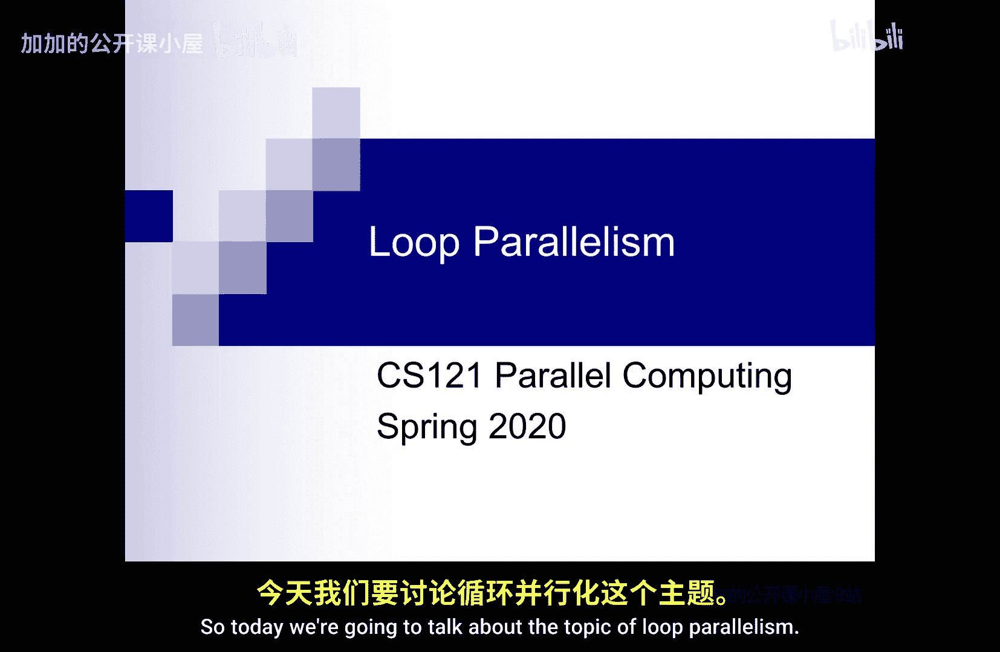
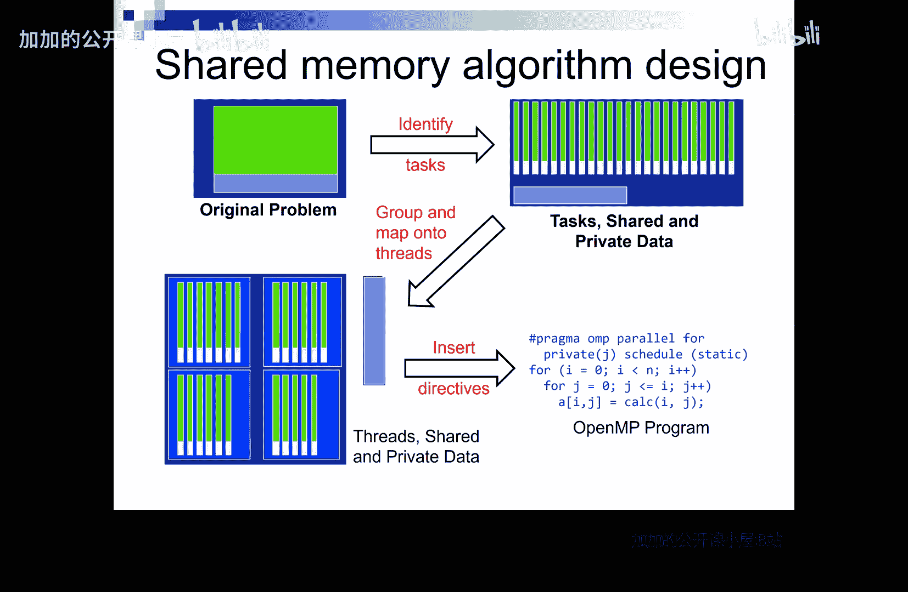
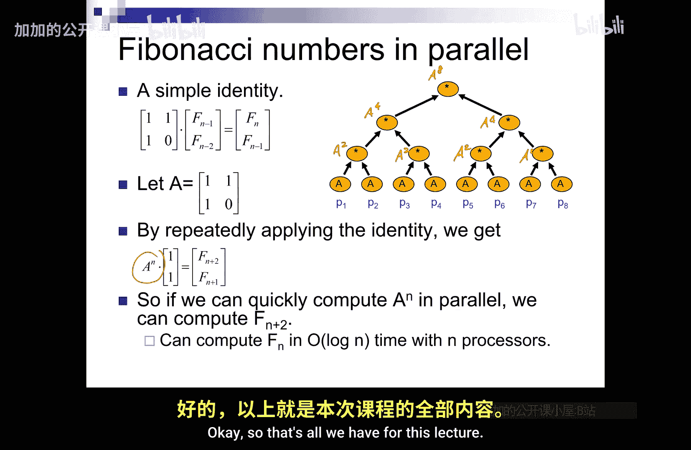

# 并行计算：第19讲：循环并行化 🌀



在本节课中，我们将学习如何在共享内存环境下设计并行算法，核心是掌握循环并行化的方法。我们将从任务分解和依赖分析入手，逐步介绍如何识别独立任务、处理依赖关系，并最终使用OpenMP实现高效的并行循环。



---

## 概述：共享内存算法设计方法论

上一讲我们讨论了分布式内存环境下的Foster设计方法学。本节中，我们将介绍在共享内存环境下设计算法的类似方法。

共享内存程序中的并行性大多发生在循环内部。因此，要设计高效的共享内存算法，我们需要专注于如何高效地并行化循环。

共享内存算法的设计过程包含以下步骤：
1.  **任务分解**：将原始问题分解为多个子任务。
2.  **依赖分析**：识别任务之间的依赖关系，目标是让任务尽可能独立，以减少线程间昂贵的同步操作。
3.  **任务映射**：将独立的任务映射到不同的线程上执行，并注意负载均衡等问题。
4.  **程序实现**：使用OpenMP等工具将设计转化为可运行的程序。

在设计过程中，我们需要考虑以下几点：
*   **依赖分析**：确定程序语句间的依赖关系，这是形成独立任务的基础。
*   **负载均衡**：例如，使用OpenMP中的静态或动态工作分配，或块/循环分配。
*   **变量作用域**：正确指定共享变量和私有变量，以确保正确性和效率。尽可能使用私有变量以避免冲突。
*   **归约操作**：对于涉及同步的集体操作（如求和），使用归约变量比保护共享变量更高效。
*   **数据结构访问**：对于矩阵等数据结构，考虑按行或按列映射，这会影响缓存使用和性能。

我们的首要目标是找出可以创建的独立任务。为此，我们将使用一种称为**数据依赖分析**的技术。

---

## 数据依赖分析 🔍

数据依赖分析技术用于确定程序中的语句是否可以以不同的顺序执行。

假设在一个顺序程序中，有两个语句S1和S2，且S1在S2之前执行。
*   如果语句**独立**，那么我们可以交换它们的执行顺序（先S2后S1），程序的输出和结果保持不变。
*   如果语句**存在依赖**，则必须保持S1在S2之前执行。如果交换顺序，可能导致程序产生不同的结果。

因此，任何并行化或程序变换都必须保证与原始顺序程序具有相同的输出。这意味着，在并行化时，我们必须确保存在依赖关系的语句以相同的顺序执行。

### 依赖类型

语句之间存在三种基本类型的依赖：

1.  **写后读依赖**：也称为**真依赖**。记作 S1 ->T S2。
    *   **含义**：S1写入一个内存位置，随后S2读取该位置。
    *   **原因**：S2读取的值依赖于S1写入的值。交换顺序会导致S2读取到旧值或未定义值。
2.  **读后写依赖**：也称为**反依赖**。记作 S1 ->A S2。
    *   **含义**：S1读取一个内存位置，随后S2写入该位置。
    *   **原因**：如果先执行S2写入，S1随后会读取到被S2修改后的新值，而非原始值。
3.  **写后写依赖**：也称为**输出依赖**。记作 S1 ->O S2。
    *   **含义**：S1和S2都写入同一个内存位置。
    *   **原因**：必须保持写入顺序，因为最终该位置的值由后执行的语句决定。

如果两个语句之间不存在以上任何一种依赖，则称它们为**独立语句**，可以任意交换执行顺序。

### 依赖关系示例

考虑以下包含五个语句的程序：
```c
S1: x = 2
S2: z = x + y
S3: y = x
S4: x = z
S5: z = 5
```
假设所有变量初始值为0。

以下是存在的依赖关系：
*   **真依赖** (S1 ->T S3): S1写入`x`，S3读取`x`。
*   **真依赖** (S2 ->T S4): S2写入`z`，S4读取`z`（和`x`）。
*   **反依赖** (S4 ->A S5): S4读取`z`，S5写入`z`。
*   **输出依赖** (S2 ->O S5): S2和S5都写入`z`。

### 依赖关系的性质

依赖关系具有**传递性**。如果S2依赖于S1，且S3依赖于S2，那么S3也依赖于S1。这意味着在执行时，必须保持S1、S2、S3的顺序。

一个重要的推论是：**存在依赖关系的语句不能在不同的处理器上运行**。因为如果没有昂贵的同步机制，无法保证它们在不同速度的处理器上仍按正确顺序执行。因此，依赖语句必须被分配到同一个处理器上。

为了获得并行性，我们的目标是找到尽可能多的**独立语句**。在共享内存程序中，大部分计算发生在循环中，因此我们将重点放在并行化循环上。

---

## 循环依赖分析 🔄

为了分析循环，我们引入记号 `S[i]` 或 `S[i][j]`，表示语句S在循环迭代`i`（或嵌套迭代`i, j`）中的执行实例。

循环中的依赖分为两类：
1.  **循环携带依赖**：依赖关系跨越不同的循环迭代。例如，后一次迭代依赖于前一次迭代的计算结果。
2.  **循环无关依赖**：依赖关系发生在同一次循环迭代内部的不同语句之间。

### 循环依赖示例

**示例1：**
```c
for (i=1; i<n; i++) {
    S1: a[i] = a[i-1] + b[i]; // 写a[i]
    S2: c[i] = a[i] + d[i];   // 读a[i]
}
```
*   **循环携带依赖** (真依赖): `S1[i] ->T S1[i+1]`。因为`S1[i]`写入`a[i]`，而`S1[i+1]`读取`a[i]`（计算`a[i+1-1]`）。
*   **循环无关依赖** (真依赖): `S1[i] ->T S2[i]`。因为`S1[i]`写入`a[i]`，`S2[i]`读取`a[i]`。

**示例2：**
```c
for (i=0; i<n; i++)
    for (j=1; j<n; j++)
        S3: a[i][j] = a[i][j-1] + 1;
```
*   **循环携带依赖** (在j循环): `S3[i][j] ->T S3[i][j+1]`。因为写入`a[i][j]`，随后在`j+1`迭代时读取`a[i][j]`。
*   **无循环携带依赖** (在i循环): 对于固定的`j`，不同`i`迭代的`S3`语句访问不同的`a[i][j]`，互不依赖。

---

## 依赖分析工具：ITG 与 LDG 📊

为了辅助依赖分析，我们引入两种图表示法。

### 迭代遍历图

**迭代遍历图** 展示了循环所有迭代的执行顺序。图中每个节点代表一个特定的迭代（如`(i, j)`），边表示迭代执行的先后顺序（通常是循环嵌套定义的顺序）。

例如，对于嵌套循环 `for (i) for (j)`，ITG 的边会先连接固定`i`下的所有连续`j`迭代，然后再连接到下一个`i`的起始迭代。

### 循环携带依赖图

**循环携带依赖图** 展示了不同迭代之间的依赖关系。图中每个节点同样代表一个迭代，但**有向边表示的是依赖关系**（真、反、输出依赖），而非执行顺序。

通过分析LDG，我们可以确定哪些迭代是相互依赖的。**LDG中的每个连通分量必须被映射到同一个处理器（线程）上执行**，以保证依赖顺序。而**不同的连通分量则可以映射到不同的处理器上并行执行**，这正是并行性的来源。

### LDG应用示例

考虑以下循环：
```c
for (i=0; i<n; i++)
    for (j=1; j<n; j++) {
        S1: a[i][j] = a[i][j-1] + b[i][j]; // 写a[i][j]，读a[i][j-1]
        S2: b[i][j+1] = c[i][j] + 1;       // 写b[i][j+1]
    }
```
分析依赖：
*   **循环携带依赖** (真依赖): 仅存在于`S1`的`j`循环中，`S1[i][j] ->T S1[i][j+1]`。
*   **循环无关依赖** (反依赖): `S1[i][j]`读`b[i][j]`，`S2[i][j-1]`写`b[i][j]`，但这是同一`j`迭代内的依赖？需要仔细检查下标。这里主要关注循环携带依赖。

构建LDG：
*   对于每个固定的`i`，`j=1,2,...,n-1`的`S1`迭代通过真依赖连接成一条链。
*   不同`i`值对应的链之间没有依赖边。

因此，LDG 有 `n` 个连通分量（每个`i`对应一条链）。我们可以创建 `n` 个并行任务，每个任务处理一个特定的 `i`（即内层`j`循环）。然后，将这些任务负载均衡地映射到 `P` 个处理器上。

使用OpenMP实现：
```c
#pragma omp parallel for private(j) schedule(static)
for (i=0; i<n; i++) {
    for (j=1; j<n; j++) {
        a[i][j] = a[i][j-1] + b[i][j];
        b[i][j+1] = c[i][j] + 1;
    }
}
```
*   `parallel for`: 并行化外层`i`循环。
*   `private(j)`: 每个线程需要自己私有的`j`变量用于内层循环。
*   `schedule(static)`: 静态调度，将`i`迭代块平均分配给各线程。

---

## 循环变换技术 🛠️

有时，直接分析循环无法获得并行性，我们需要对循环进行变换。

### 循环分布

循环分布**将单个循环拆分成多个独立的循环**，将原本混合在一起的、具有不同依赖模式的语句分离开。

**示例：**
原始循环：
```c
for (i=0; i<n; i++) {
    a[i] = a[i-1] + b[i]; // S1: 有循环携带依赖
    b[i] = c[i] + d[i];   // S2: 无循环携带依赖
    c[i] = e[i] * f[i];   // S3: 无循环携带依赖
    d[i] = g[i] / h[i];   // S4: 无循环携带依赖
}
```
依赖分析：`S1`存在真依赖（`a[i]`依赖于`a[i-1]`），其他语句间无循环携带依赖。

变换后：
```c
// 第一部分：可并行
#pragma omp parallel for
for (i=0; i<n; i++) {
    b[i] = c[i] + d[i];
    c[i] = e[i] * f[i];
    d[i] = g[i] / h[i];
}
// 第二部分：必须串行
for (i=0; i<n; i++) {
    a[i] = a[i-1] + b[i];
}
```
通过循环分布，我们将可并行的部分分离出来，获得了并行性。但注意，这引入了额外的存储开销（可能需要临时数组存储`b,c,d`的中间结果），且第二部分仍然是串行的。

更优的实现（使用OpenMP `ordered`子句和私有变量）：
```c
#pragma omp parallel for private(temp) schedule(static, 1)
for (i=0; i<n; i++) {
    // 可并行部分
    temp = c[i] + d[i];
    c[i] = e[i] * f[i];
    d[i] = g[i] / h[i];
    // 必须有序执行的部分
    #pragma omp ordered
    a[i] = a[i-1] + temp; // 使用本线程计算的temp
}
```
*   `private(temp)`: 每个线程有自己的`temp`变量，避免共享冲突，且存储开销仅为O(P)。
*   `schedule(static, 1)`: 块大小为1的静态调度，有助于`ordered`子句有序执行。
*   `#pragma omp ordered`: 确保循环体内部的这个代码块按迭代顺序`i=0,1,2,...`执行。

### 循环倾斜

循环倾斜**通过线性变换改变迭代空间的坐标轴**，从而改变依赖向量的方向，可能将原本无法并行的循环转换为外层串行、内层并行的形式。

**核心概念：距离向量和方向向量**
*   设迭代 `T1` 依赖于迭代 `T2`。
*   **距离向量** = `T1的迭代坐标向量 - T2的迭代坐标向量`。
*   **方向向量** = 距离向量各分量的符号（`+`, `-`, `0`）。

对于嵌套循环，只有某些方向向量是“合法的”（即与迭代执行顺序兼容）。例如，对于 `for (i) for (j)` 的顺序，方向向量 `(+, +)`、`(+, 0)`、`(+, -)`、`(0, +)`、`(0, 0)` 是合法的，而 `(-, +)` 等是不合法的。

**循环倾斜的目标**：找到一个**幺模线性变换矩阵U**（行列式为±1），将原始迭代空间 `(i1, i2)` 映射到新空间 `(k1, k2)`，使得：
1.  变换后所有依赖的方向向量仍然合法。
2.  在新的依赖方向向量中，存在某个外层循环索引（如`k1`）对应的分量**全部为正**（`+`）。这意味着所有依赖都指向“更大的`k1`值”。

如果条件2满足，那么`k1`循环必须串行执行（因为后面的迭代依赖前面的）。但是，对于每个固定的`k1`，内层的`k2`循环的所有迭代之间**没有依赖**（因为依赖都指向`k1`维度），因此`k2`循环可以完全并行化。

**示例：**
原始循环（类Jacobi更新）：
```c
for (i=1; i<n; i++)
    for (j=1; j<n; j++)
        a[i][j] = (a[i-1][j] + a[i][j-1]) / 2;
```
依赖分析：存在两个真依赖，距离向量为 `(1, 0)` 和 `(0, 1)`。在原始`(i,j)`空间，无论并行化i还是j循环，都会破坏依赖。

应用循环倾斜变换：令 `U = [[1, 1], [0, 1]]`。则新旧坐标关系为：
*   `k1 = i + j`
*   `k2 = j`
*   逆变换：`i = k1 - k2`, `j = k2`

在新的`(k1, k2)`空间：
*   依赖 `(1, 0)` 变为 `(1, 0)`。
*   依赖 `(0, 1)` 变为 `(1, 1)`。
*   两个新依赖向量的第一个分量都是`+`。因此，`k1`循环必须串行，`k2`循环可以并行。

变换后的循环边界需要重新计算。最终并行代码结构如下：
```c
for (k1=2; k1 <= 2*(n-1); k1++) { // 串行循环
    #pragma omp parallel for
    for (k2=max(1, k1-(n-1)); k2 <= min(n-1, k1-1); k2++) { // 并行循环
        i = k1 - k2;
        j = k2;
        a[i][j] = (a[i-1][j] + a[i][j-1]) / 2;
    }
}
```

---

## 算法级分析：改变算法以获得并行性 🧠

有时，无论怎样变换循环，固有的依赖关系都限制了并行性。此时，可能需要从根本上**换用不同的算法**来解决问题。

**示例：计算斐波那契数列**
传统迭代算法：
```c
f[0]=1; f[1]=1;
for (i=2; i<n; i++)
    f[i] = f[i-1] + f[i-2];
```
该循环存在严重的循环携带依赖，难以并行化。

**并行算法**：利用矩阵幂运算。
观察发现：
```
[ F(n)   ]   = [1 1] * [F(n-1)]
[ F(n-1) ]     [1 0]   [F(n-2)]
```
因此：
```
[ F(n)   ]   = [1 1]^(n-1) * [F(1)]
[ F(n-1) ]     [1 0]         [F(0)]
```
问题转化为快速计算矩阵 `A = [[1,1],[1,0]]` 的 `(n-1)` 次幂。这可以通过**并行归约树**实现：
1.  每个处理器持有一个A的副本。
2.  通过 `log(n)` 步，两两配对进行矩阵乘法，不断得到 `A^2, A^4, A^8, ...`。
3.  最终组合得到 `A^(n-1)`。

这样，使用 `P` 个处理器，可以在 `O(log n)` 时间内计算出第 `n` 个斐波那契数，而串行算法需要 `O(n)` 时间。

这个例子说明，通过深入理解问题并改变算法，有可能突破循环依赖的限制，获得显著的并行加速。然而，这种方法是高度问题相关的。

---

## 总结 📝

本节课我们一起学习了共享内存编程中循环并行化的核心内容：

1.  **设计方法论**：遵循任务分解、依赖分析、任务映射和实现四个步骤。
2.  **数据依赖分析**：理解了真依赖、反依赖和输出依赖三种类型，以及它们对语句执行顺序的约束。
3.  **循环依赖分析**：区分了循环携带依赖和循环无关依赖，并引入迭代遍历图和循环携带依赖图来分析和可视化依赖关系。
4.  **循环变换技术**：
    *   **循环分布**：将混合依赖的循环拆开，分离出可并行部分。
    *   **循环倾斜**：通过线性变换迭代空间，改变依赖方向，从而暴露出内层循环的并行性。
5.  **算法级变换**：认识到当循环并行化受限时，考虑更换更并行的算法可能是根本解决方案，并以斐波那契数列的并行计算为例进行了说明。



掌握这些分析和变换技术，是设计高效共享内存并行程序的关键。