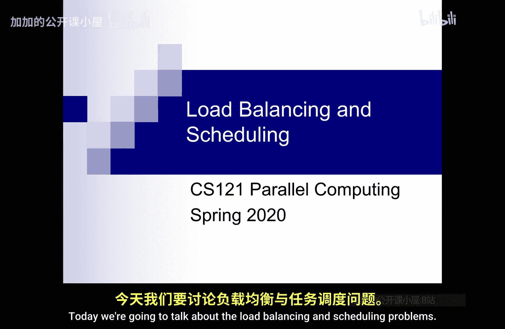
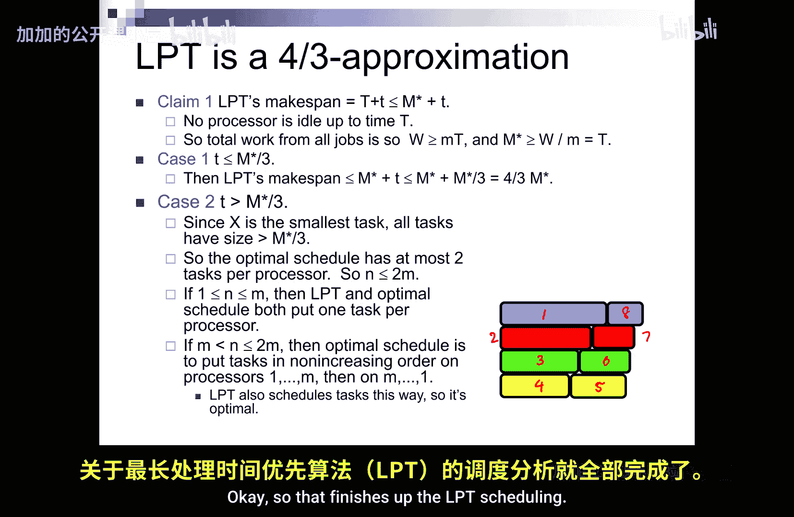
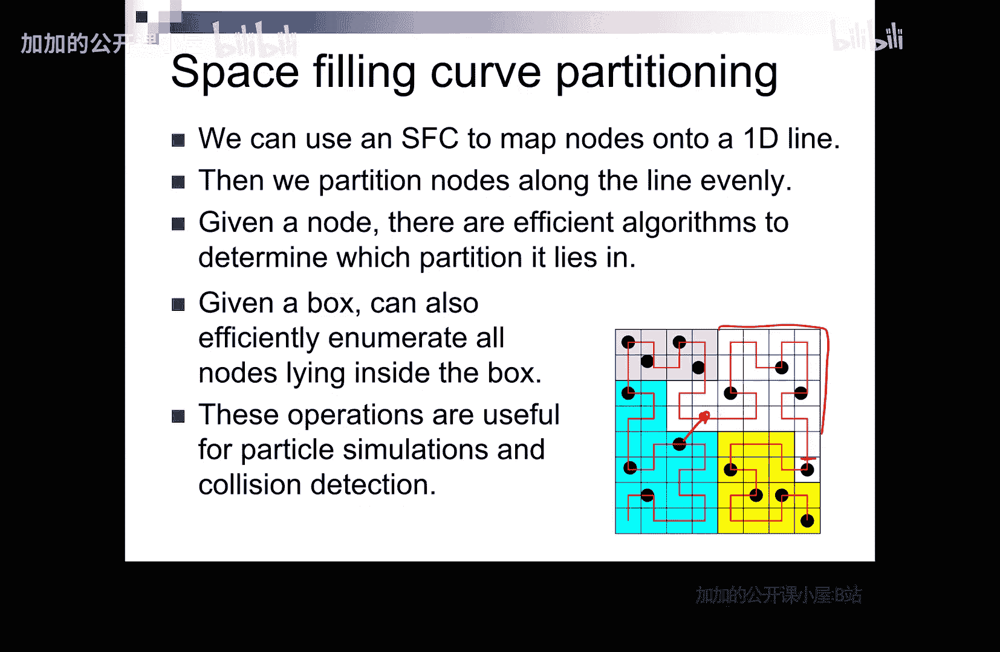
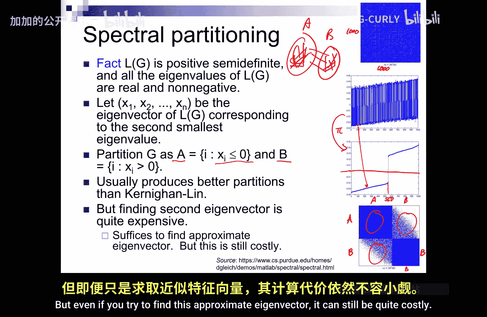
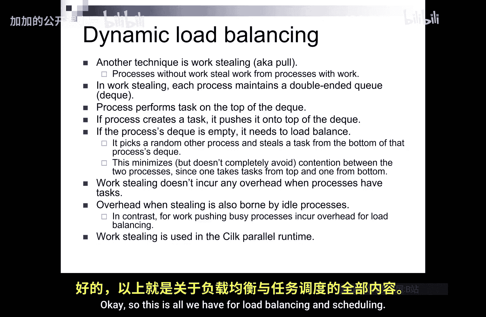

# 上海科技大学【中英⚡并行计算｜CS121 2020 Parallel computing】 p20 P20 Load balancing and scheduling -BV1VqypBaEaP_p20-

Welcome back。So today we're going to talk about the load balancing and scheduling problems。

So the goal for both problems is that we're given a set of tasks and a set of parallel processors。

 and we simply want to finish executing all of the tasks on the processors as quickly as possible。

Okay so for example， we want to make sure that our processors don't idle and so in other words。

 they all of them do about the same amount of work。Okay。

 so the load balancing problem is to decide which tasks to allocate to which processors。Okay。

 and then the scheduling problem is related to to load balancing。 But here the。

The problem is to try to figure out once we've allocated these tasks onto the processors。

 what is the order that we execute these tasks？And the execution order can affect things like fairness or responsiveness of the execution。

So both of these problems have a huge amount of research devoted to them in many fields。

 including parallel and distributed computing， operating systems， operations research。

 and many other fields。And there are also many different ways of representing the load balancing problems okay so there are many different models for computation。

 many different ways that we model the computation and communication there could be constraints between the problems like precedent constraints there are different models to represent those things and then also to represent the hardware itself so we might have homogeneous or heterogeneous systems with different types of processors and so there are many types of considerations that we have and many。

 many a huge amount of forecast but developed for this。Okay。

 so today we're going to cover some of the basic ideas for load balancing and for scheduling。

And there are also many practical softwares that you can use to perform load balancing scheduling。

 so for example the So language has a scheduler right and then there are also many other schedulers like ADLB。

 there's sort of Zottan， Chombo， Parets， all of these are used to do load balancing also。

🤧Now the issue is that for most of the types of problems so as we said。

 there are many different types of scheduling problems and for most instances of these types of problems。

 if you want to find the optimal solution， it's actually infeasible to find the optimal solution so you know if you want to completely minimize the amount of time it takes to finish all your tasks。

 it might be infeasible to compute such a schedule so therefore but since we have to use these algorithms in practice right we actually do do load balancing and scheduling in practice。

 then the goal of our algorithms is that we want them to work quickly， however。

You want them to produce pretty good answers also okay so we're going to rely on a bunch of heuristics and these heuristics turn out to work well in practice and some of them even have performance guarantees okay and then we have to make sure that these heuristics are themselves efficient so that we don't waste too much time computing the right schedule right。

Okay， so there are different types of scheduling problems so the first type is the difference between static versus dynamic scheduling okay or load balancing so for example in the static situation sometimes you have applications which are where you know everything that you need to do in the application ahead of time okay you know all the tasks that you need to perform and the amount of computation that they have right and you also know the communication pattern。

So examples of this would be like if you're doing a dense linear algebra operation。

 then you know exactly which computations you're going to do and where the communication is happening。

And even if you do sparse linear algebra， then as long as you know the matrix matrices that you're working with。

 then you also know the computation and communication patterns likewise。

 if you're doing something like FftT right fastsphoier transform so there it's also a very structured problem and you know exactly what's going to happen in the problem a priori even before you start the computation。

And so since you know everything what you need to do in the computation。

 then you can do the load balancing just once at the beginning of your computation so。And so in fact。

 you can afford to spend more time at the beginning to sort of get a better load balancing。

 okay because you just need to do it once。Okay， so next we have a class of problems called semitatic problems。

And so here for the semistatic problems， we sort of know information about the tasks that we're going to do。

 we get periodic information about these tasks so maybe the algorithm runs through a bunch of phases and at the start of each phase。

 you know some information about your tasks so examples of this would be like if you're doing a particle simulation so some particle simulation as you have a bunch of particles and they're moving around and interacting with each other so there the load balancing might be based on where these particles are located so of course。

 as you run the simulation， the positions are going to change so you can't just do the load balancing once at the beginning because the positions will change over time。

🤧But the positions don't change that quickly and so can you can run the simulation for a while right so you know at the beginning。

 you know where the particles are right and they don't change that quickly so you can do the load balancing based on the initial positions and you can run based on these positions for a while and eventually when the positions change a lot then you can start a new phase and you can do some new load balancing based on the new positions and then you can run with that for a while and yeah and then you keep going like that Okay so you just periodically rebalance。

🤧。And since you're going to do this rebalancing multiple times。

 then you need to have a pretty efficient algorithm for doing the load balancing。

And the last type of problem are completely dynamic problems okay。

 where you only know what you're going to do in the computation at runtime， so for example。

 if you run a search type algorithm okay so imagine that you're building a search tree okay so you only know what nodes are going to be in the tree as you do the search process because each node can potentially create a bunch of other nodes。

 so you only know whether that happens as you do the search process。So therefore。

 you need to constantly rebalance this operation on the fly。And to do this。

 so since you're doing the rebalancing very often， then you're going to need to have very very efficient algorithms for doing this。

Now we can also load balance at different granularities okay so what that means is that if you have a large set of tasks。

 you can look at these as individual tasks so that can be a fine grain load balancing and if you do that。

 then since you're looking at sort of the most detailed information about the tasks。

 you can get the best results for the load balancing。But if you have a lot of tasks， right。

 then this is going to take a lot of time for you to look at all of them。

 okay and also lots of memory。And so instead of doing that。

 you can also group together a bunch of tasks and then you can take these groups and do your scheduling or load balancing on the groups okay so this is a course grain load balancing。

another type of difference between different types of load balancing is that we could have centralized versus distributed balancing。

So centralized balancing means that we're going to gather all of the information about the tasks at one node。

 and then that node is going to compute like what is the optimal way to balance everything？Okay。

 so so here that OneNote has global information about everything that's happening in the system Okay。

 so presumably it can compute the best results because it has all the necessary information。However。

 that node itself is going to become a performance bottleneck because that node needs to do all the work about computing the right load balance。

Now， the other way to do this is that you can do distributed load balancing where you let many nodes make the load balancing decision。

So here you're going to let the notes communicate with each other and they themselves are going to work out how to balance their load。

Okay so it's no longer centralized and so it becomes more scalable and also this distributed load balance balancing can be more can react faster to changes in the system because you don't have to gather all the information at a central node and do a lot of processing。

 you can do it sort of concurrently everywhere in the network。However。

 the problem is that since you don't have any node having global information about everything in the system。

 then you might not be able to make a globally compute globally optimal result。

 to do the best possible load balance。And even though you could get faster reaction time because the node need to communicate with each other。

 you could actually it might take a long time before you can settle onto a good solution okay so you might need to iterate this distributed load balancing algorithm multiple times。

 and this might take a long time to converge。We can also combine both the centralized and distributedtriive methods so we can use a hierarchical method Okay so so basically here we're going to have a we're going have we're first of all going to co grain our computation okay we're going to combine many of these tasks into bigger ones。

 So now we have a co grain load balancing problem。And then you can use a centralized node to solve the coarse grain problem。

And this is not going to take too much time because there are only a few course grain tasks。

 so the centralized node can still operate quickly。

And then then so this centralized node is going to compute some sort of preliminary load balancing。

 and then it's going to distribute that to all of the other nodes。

 and then now all of the nodes can now do distributed load balancing based on the partial load balance that the centralized node produced。

Okay。Yeah， and so this sort of combines the advantages of both centralized and distributed load balancing。

 okay so get speed so we get both speed and good and high quality。Okay。

 now some other issues that we need to be we need to take into account when you do load balancing。

 so the first one is well when you balance the load right so this assumes that you know how much the load is for different tasks Okay so we need to even before we can do the load balancing。

 we need to have some way of estimating the load。And also we need to sort of predict what the communication pattern is okay。

 so if we have like a nonst computation okay so for static computation。

 you know what the communication is， but if it's not static right then you have to sort of guess what the communication is going to be and how much communication will happen。

Okay， so sometimes you can just infer this from the code itself but other times you might have to run the task and then profile it to see how it behaves and then the hope is that whatever your profile that you obtained that this is actually going to be valid in the future。

 so you hope that the future behavior is going to be similar to the previous behavior to the past behavior that you observed。

Okay so the advantage of doing the profiling is that you can automate this process okay and so unlike the first method where you have to go through the code to figure out what the load is for the profiling you can just run that automatically and this obtains all this information and this oftentimes works quite well。

 especially for like scientific computations and simulations because those tend to be pretty stable in terms of their performance。

 so whatever you observe in the past， oftentimes is going to carry over to the future。

Okay another way that you can do this is that you can actually build a complete model for the task behavior。

 but this is going to take a lot of work because someone has to do this manually and also if your program changes。

 then you have to rebuild your model。Okay yeah， so we have to estimate the load and also so if the load changes。

 okay， then we have to either redo the load balancing or sometimes you're just going to move tasks from one to another from one node to another but then there's a cost associated with moving these tasks because you know you either have to move the code or the data or both。

Okay， so those are some of the main issues that we're going to be considering when we do load balancing。

So now I just want to start out with sort of the simplest model that we have for load balancing。

 okay so this is just a very simple problem and we're going to look at this and see if we can get any we kind of sort of learn anything about this problem that we can carry over to other more realistic and more complicated load balancing problems。

Okay， so this basic problem that we're going to look at is that we have a set of tasks and the only thing that we care about these tasks is that they have certain sizes。

 okay so the size of the task is the amount of computation that you need to do for the task。However。

 we're going to ignore things like precedentnce constraints between the tasks， okay。

 so we allow you to do these tasks in any order。And you also ignore communication between the tasks。

 okay， so we assume that there is no communication。

So clearly this is not a very realistic model for parallel computation still we're going to look at an algorithm in this setting and we're going to see some interesting things that we can use in more realistic settings。

And it also it turns out that even this very simple problem right where the only thing that you have is the task size。

 okay， you don't care about anything else， but even in this problem。

 it's actually very hard to get an optimal schedule okay， so it's MP hard to get an optimal schedule。

Yeah， so because it's hard to get into a schedule， then in practice we're not going to try to obtain the optimal schedule okay instead we're just going to try to obtain an approximation to the optimal okay so as long as the approximation is not too bad and as long as you can get the approximation very quickly。

 then we're satisfied with this。Alright， so the model for the so the model we're working with is that we have n tasks。

 Okay， they have different sizes and they're independent so they can be done in any order。

 And also you can do any task on any processor Okay。

 so we have a set of processors and you can do any you can do any matching between them you want so。

All right， so we have M processors with the we have M processors and we assume that they all have the same speed and then each processor can only do one task at a time。

And our goal here is to do all of the tasks as quickly as possible。

 and the way we say this is we want to minimize the make span， okay。

 so the make span is simply when the last process finishes。So for example， I'm here。

 if you have four processors and then you have these tasks， right。Rectangles here。

 and they have different sizes than the than the way that we're scheduling them right now。

 the make span is just。When the final task of this red one finishes。Okay。

 so it turns out that minimize finding the minimum makes span okay ismp complete and this is true even if you just have two processors okay so like the simplest setting right we just have different problems of different sizes and you want to schedule them onto two processors。

 but even then if you want to minimize the finishing time， this is MP complete。Okay。

 so just to show why this is， well， first of all， the decision problem for this sorry the decision version for this problem is an MP okay。

 like if you tell me that you can finish within some make span。

 then you just have to give me a schedule which achieves that makes span okay。Allright。

 and then but to show that it's MP complete， right。

 So then we have to reduce some MP complete problem to this problem。 Okay。

 so the way so what we're going to do is reduce this problem called subset sum to the to the make span minimization problem。

 Okay， we're trying to show make expand minimization is MP complete。

 So we're going to take this subset sum problem。 And we already know that this subset sum is MP complete。

 And if we reduce it to to make span scheduling， then that will show that。

The expanded scheduling is also MP complete。So the subset some problem。

 just to remind you what we're doing is you're given a set of numbers S and a target value T and the question is。

 can you find a subset of these numbers which adds up to T？So for example， if your set is like 1，3。

8 and 9 and if your target value is going to be 9， then there is a subset， namely one and8。

 they add up to9 so this is a yes instance of subset sum。And if you have the same set。

 but now your target is 14， then you can check that no subset of S is going to add up to 14。

So therefore， this is a no instance of subset sum。Okay， and this problem is MP complete。

 we know that it's MP complete and we are going to reduce it down to two processor may expand scheduling。

Okay， so to do this， suppose that you have an instance of subset sum okay so this is a set S and a value T。

And also let's let little S be the sum of all of the elements in S。Okay。

 so then now we're going to reduce this to to two processor makepan scheduling。

 so we're first of all， going to create a set of tasks for for the make band scheduling Okay and the tasks right they're just going to be all of the so SSA set of numbers right so we're just going to make a set of tasks which have these sizes。

Okay， so for every number in S， we're going to make a task with that size。

And then we're going to add one additional task。 Okay。

 so that new task is going to have size S minus2 T， Okay， where S is the sum of all of the elements。

 right， and then2 T。So M thenT is our target。Let's assume that S is larger than 2t。

And then we'll try to schedule this onto two processors。Okay。

 so what we're going to show is that subset sum has a solution。 Okay， so there is a subset of S。

 which adds up to T。 If and only if the minimum makes span of this of this set of tasks。

 Okay if the minimum makes span is a certain value， then subset sum has a solution。 and vice versa。

 So that that shows that subset sum reduces down to to minimum makes span。Okay。

 so then the claim is that so first of all， suppose that subset sum has a solution， okay。

 meaning there's a subset of S that adds up to T。Then we claim that the minimum makes span of this set of tasks。

 J is going to be S minus t。So the reason is that suppose so since we have a subset of s that adds up to t。

 so let's say that s prime right this subset adds up to T so now you're going to put all of the tasks in S prime onto processor1 and also we have this new task of size S minus2 T right so we're also going to put that onto processor 1。

Okay so then the total finishing time for processor one is going to be that。

 well in order to do all this stuff S prime， this takes t time and then it have this additional job which took S minus2 T time So therefore the total time is going to be S minus t right processoror1 finishes at time S minus T。

Okay， and then next， since you put all of the tasks in S prime and also this additional task onto processor 1。

 then processor 2 is just going to do all of the things that are left over so the only things that are left over are the tasks in S minus S prime。

Okay。Now， since S is the total size of so we have little S as a sum of all of the tasks in S and we set that S prime right。

 this thing adds up to T。So therefore， the amount of tasks in S minus s prime is going to be S minus t。

Okay， so processor two finishes at time s minus t。And then processor 1 also finishes at time S minus t。

 so therefore both processes finish at the same time at S minus t。

And S minus T is going to be our make span。Okay， so that shows the claim。

 So this is one direction of the reduction。 The other direction is that now we have to show if the minimum makes span of the set J。

 if that is equal to S minus T then the claim is that there exists a subset of S。

 which adds up to T so in that case， subset sum has a solution。

And the reason this is true is because well let's suppose that processor1 is going to do the S minus2 T task right so one of the processors does that one。

 assume it's processor1， then because the make span is S minus T this is our assumption that the makes span is S minus t and if processor1 does the task of size S minus2 T then the other tasks that processor 1 does must have size so this is the total size that processor 1 does minus the size of the single task so this comes out to T。

So that means that the other tasks that processor one does adds up to T。

And the other tasks all come from the set S， so that means that there is a subset of s which adds up to T。

Okay so now we've shown both directions， we show that S is a yes instance of subset sum if and only if the minimum makes span equals S minus t so this shows that minimizing the makes span is MP complete。

Okay， so because minimizing Makepan is MP complete。

 so then we're not going to try to minimize the makes span。

 so instead we'll try to find some sort of approximation algorithm which can give us a solution with a good make fan。

 but not necessarily optimal。Okay， so and the algorithm we're going to look at is called it's a very simple algorithm。

 it's called list scheduling。Okay， so it's a simple greedy algorithm。

And what it guarantees is that the schedule that you produce this is going to have some make span and the list scheduling make span is could be worse than the optimal make span。

 but at most it's going to be twice as long as the optimal makes span。

so though optimal make span takes 10 time units， then at most the list scheduling makes span is going to be 20 time units。

Okay， so we're going to call this a two approximation because it's at most two times as bad。

So this algorithm was developed or invented by this guy Graham many， many years ago。

 so this is a very old algorithm。And it's a very simple algorithm and the algorithm is simply that we're going to take the take the tasks and then just list them out。

 just order them in any order okay so you're given 10 tasks。

 just list them out in some order and then we're just going to assign these tasks to the processors in this order。

And the way the assignment works is that if there is a processor who is idle， okay。

 so he's not doing anything， then you just give him the next task in the list。Okay。

 so anytime you find an idle processor， you give them the next task from the list。Okay。

 so list scheduling does not is considering independent tasks tasks without any precedent's constraints。

 However， you can take basically the same algorithm and you can it still works with precedents constraints。

 Okay， so if there are ordering requirements between the tasks。

 then you can just modify the list scheduling so that you allocate a task。

 whatever it's available and a processor is idle Okay。

 so so the task is going to be available if all of the preceding tasks have finished。 Okay。

 so if you find if you find an an idle processor right， and then you just look look through。

The next task which is available， which has all of its preceding tasks finished。

 and then you assign that task to the processor。And it turns out that if you do this， right。

 then you still get a two approximation。看。Yeah， so this is a very simple algorithm。

 It's very cheap to run this algorithm and you get a solution which is guaranteed to be at most twice as bad as optimal and in fact。

 in practice， it's usually it's not going to be twice as bad。

 it's going to be maybe just know 10% as bad as optimal so in practice。

 this is a both an efficient algorithm and it gives you reasonably good solutions。Okay。

 so just to sort of show an example of this algorithm right so suppose you have three processors and then you have a bunch of tasks。

 Okay， so they have sizes you know，2，3，3 and so on And now you can list these tasks in any order。

 Okay， so I just I have some arbitrary order for these tasks。And now at the beginning。

 all of the processors are idle so this scheduling is going to say that whenever you have an idle processor。

 just give him the next task on your list。So， for example。P1 is initially idle。

 so he gets the first task，4。And then P2 gets the task 5 and then P3 gets the task 3。All right。

 so then now they each have a task and they're going to run for a while。

 right they're going to execute the task。 And like， for example。

 P1 is going to execute for four time units。 Okay， but P3， since you gave him the smallest task。

 then he's actually going to finish his task at time 3。 So once you get to time 3。

 then P3 is going to be idle now。And since you have an idle processor。

 then you're going to give it the next task in your list， which is two。Okay。

 so then you're going to give P3 the two task。And then that's going to keep P3 dizzy for a while。

 and you see that next， when you hit time。4， then P1 is going to become idO again。Okay。

 so then you give P1 the next task， which is6， right？And then at time5。

 right you have P2 and P3 both becoming idle and then so you give them the next task so you can give them something like that。

And so yeah， and so this finishes the algorithm and you see that the overall make span is going to be whichever one finishes last。

 so that's going to be processed two and the makes span is 13。Okay。All right。

 so then the claim is that list scheduling is actually not too bad， that in the worst case。

 it gives you a makepan， which is two times longer than the optimal or sorry。

 which is twice as long as the optimal。Okay， so yeah。

 so let me show you an example where list scheduling actually does poorly okay and then this example is actually useful because we're going to use this example to come up with a better algorithm。

So now so we have M processors right， and suppose you have M squared tasks， each with length one。

And then you have one more task， which has length M。Okay， and now so you have in total。

 you have m squared plus1 tasks and you can list them in any order for this scheduling。

 And so let's list them from from smallest to largest。 Okay。

 so we have a bunch of ones followed by an M。And now if you execute this list using list scheduling。

 then what's going to happen is so you have M processors and then you're just going to give all of these processors the one tasks and then eventually at the end you're left with a single task of size M and let's say that you give that to processor1。

Okay so then for list scheduling， what you have is so since you have m squared of these one tasks and you have m processors then for the first part it's going to take time M to run all these small tasks and then one of the processors is going to run the big task and so in total the total makes span is going to be two times M。

Okay，However there's a much better way to run these set of tasks tasks。

 and that is to basically sore first we're just going to give the big task to one processor okay and so that's going to leave us M minus1 processors and these M minus1 processors we're going to give them all of these size1 tasks。

Okay， so then。So then they're going to run for M time units over here right so we have M minus1 processors。

 they're going to run for M time units right and so that at the end of that that's going to leave M additional small tasks and then we assign each one of those to each processor。

And if you do that， right， then the total make span is going to be well the first part here takes time M and then you have one more。

 So in total you take M plus one time。Okay， whereas the make span， I'm sorry。

 whereas the list scheduling， right， that had a make span of two times M and the optimal is M plus1。

 Okay， so you see that list scheduling is basically going to do twice as bad as the optimal。

And you can actually show that yeah， so this is actually the worst possible case for list scheduling right and you can prove that list scheduling if it produces a schedule with Make span M and if your best possible makes span as M prime。

 then M is going to be at most two times m prime。Okay。

 so we're not going to do that proof so instead we're going to try to improve list scheduling okay and then we'll prove that the improved algorithm actually does better than list scheduling so the improved algorithm is going to be is going to be called LPT okay so this stands for longest processing time。

So the basic observation for LPT is that， well why did list scheduling or when did list scheduling fail。

 Okay， it failed when so the worst case occurred when we had a big job that was scheduled at the end。

Okay so right so if you go back to this example， so up up to time M right。

 we had very good load balancing okay everybody had the same load had perfect load but then all of a sudden you get this big task right and this big task is now going to disrupt everything right so previously everybody was balanced but now once you get the big task then you're going to have a very large imbalance between the processors。

Okay， so the problem was with this big task， and the problem was that you got the big task at the end。

So we see that sort of these big tasks are dangerous in some sense at the end。

And so what we'll try to do for LPT scheduling is that we'll just try to schedule the big tasks first。

Okay， we'll try to schedule the longest jobs first。

 So this is why it's called longest processing time scheduling。

And LPT works just like list scheduling okay so again you make a list right and then you just assign this list to the id processorcesors。

 but the only difference is that now you have to make the list in decreasing order of the task sizes okay so you first sort the tasks in decreasing order of their size and then you allocate them。

Okay to the processors， so for example， you know， if you took the previous example with these tasks。

 then LPT would first sort them in this order and then it would assign these tasks to the processors in this order。

And if you did that you would end up with a makepan of 11。

 whereas for the previous normal list scheduling， we had a mixedpan of 13。Okay。

 so it turns out that just by making the small change okay then you can get a much better guarantee on the performance so remember that list scheduling in the worst case it can be twice as bad as the optimal。

 but LPT even in the worst case， it's only going to be four thirds as bad as the optimal okay so you only lose like 33% in the worst case。

Okay， but that said， even though LPT has a better approximation ratio guarantee。

 list scheduling actually still has some advantages okay over LPT， in fact。

 it's used more often in practice Okay， so one advantage is that list scheduling。

 because it doesn't require you to order the tasks okay then whenever you get a new task。

 you can simply assign that。So you can you can schedule tasks dynamically。Okay。

 so you know if you're in a situation where the tasks are just being created on the fly。

 right then this scheduling can deal with that because each time it gets a new task right then all you need to do is just find find an idle processor and assign it。

Now in contrast， LPT cannot do that because LPT requires you to sort all of the tasks in decreasing order so if all of a sudden you get a new task then you no longer can schedule it in the decreasing order。

And also list scheduling in fact doesn't even care about the sizes of the tasks。

 okay you never look at that， you just say if somebody is idO， if a processor is idO。

 I'm going to give him the next task， I don't care how big the task is。

 whereas an LPT of course you have to know how big the tasks are to sort them。So therefore。

 load sorry list scheduling is very easy to run because you don't need to estimate the load of the taskss。

Okay， so that in itself， estimating the load could be quite difficult。 yeah。

 so list scheduling is actually more practical in many ways than LPT。Okay。

 but but still we want to look at why LPT gets us a good approximation ratio。

 Okay so so the claim is that if if we're given a set of tests and if the minimum if the minimum possible makes span is M star then LPT is going to produce a schedule with makespan M and M is going to be at most four thirds as big as M star。

Okay， so to show this， suppose we look at the schedule produced by LPT。

 and let's let X be the last job to finish in this LPT schedule。Okay。

 and suppose that x starts at a time capital T， and suppose the size of x is a little T。ok嗯。Yeah。

 so now we can actually assume that so X is a last job to finish right so X is the job that defines our make span right because the make span is just whichever job finishes last。

 you at that you look at that guy okay so X is the guy that determines the makes span but not only is so by definition it's the last job to finish but we can also assume that it's the last job to start。

Okay。And the reason is that if x is not the last job to start， Okay， so x starts at time T。

 right and。Suppose you have another job Y that starts after time T。But by definition。

 x is the one that finishes last and so since so we have a job X over here right so this is job X and then this is starting at time T right and it's running for T amount of time so therefore x finishes a time capital t plus little T。

And so why must finish before that time， Okay， because our wise is not the last job to finish。Okay。

 so if you have a job Y that starts after time capital T。

 then it has to finish before time big T plus little T。

 and in that case you can simply remove y and it's not going to affect your makepan at all。

So anytime you get a job which starts after X okay since it doesn't affect your makepan。

 you might as well assume that this problem doesn't exist Okay。

 so you can just remove that sorry you can assume the task doesn't exist so you can just remove that task。

Okay， now okay， so now we we can assume that X is a last job to start okay and because X is a last job to start and because we're doing LPT scheduling right so we're scheduling big tasks and then we're scheduling tasks and decreasing order then because X is a last job to start。

 it must be the smallest job。Because you assign jobs in decreasing order of their size。Okay。

 so now we have this claim so the claim is that LPTs make span is going to be at most the optimum make span plus little T Okay so so remember that LPT's make span is big T plus little T because LPTs make span is determined by this process by this task X which is the last one to finish and x starts a time big T and runs for time little T Okay so LPTs make span here。

 the claim is that it's going to be at most this。And the reason this is true is because now X。

 the final task started at time big T and it must be that up to time big T， no process was ever idle。

OkayBecause if a process was idL before time big T right。

 then since task X is available to run a time big T， if there was an idL process before time big T。

 then we could have put X onto that process。and then x would not have run at time big T。

 it would have run earlier than time big T。So that means that there is no idle process before time big T。

Okay so that means that so now let's look at how many tasks we did in total Okay。

 we know that if there's no idle processor up to time big T and since we have M processors total。

 right， then the total amount of work that all of these processors did up to time big T is equal to M times T because none of them were idle。

And so the total amount of work is at least m times t。

 and this means that the optimum makes fan has to be at least the total amount of work divided by the number of processors so remember that we have something called the work law right so the work law was saying that if the total amount of work that your computation does is W right and if you have M processors then the minimum amount of time that the processors need to run for is at least w divided by M。

Okay， so therefore， even the optimum makespan is going to be at least w divided by m。

 which is equal to big T。Right， okay， so then so therefore you get that M star is going to be at least as large as big T。

 right， And so so therefore。So therefore you get this inequality over here， okay。

 M stars is at least as big big team。Okay， so now we can finish up with proof Okay so we're going to consider two cases so the first case is where x is small okay where in fact。

 if x is less than m star over3 so then what we have is that LPs make span is going to be less than M star plus T where t is m star over3 okay so then LPs make span is going to be less than four thirdds of M star。

And so that shows that LPT is a4 third approximation。Okay， the other case is where。

It's where x is large， x is larger， so then here if x has size larger than m star over 3 now we said that x is the smallest task right on the last page so therefore if x itself is bigger than M star over 3 right then all the tasks have to have size at least m over3 it has to be larger than m over 3 strictly larger than m over3。

And so that means that in the optimum schedule， okay， there can be at most two tasks per processor。

Because if there were more than two tasks per processor。

 then since all of the tasks have size at least have sized more than M star over three。

 if you put three or more tasks on a processor， the make span is going to be more than M star so therefore since the optimal makespan is M star then in this optimal schedule。

 you cannot have three or more tasks on a processor， you can have at most two tasks per processor。

Okay so therefore the number of tasks is that it's going to be at most two times the number of processors。

Okay， so now let's break this into two more cases， so the first case is if if the number of tasks is at most the number of processors okay so n is at most M so in that case LPT and optimal are both both LPT and optimal。

 the optimal schedule is just going to put one task per processor。Okay。So in that case。

 you have that LPT achieves the optimal schedule。And the other case is where n is the number of tasks is between M and then 2 m but then in that case what LPT is going to do is that well it's going to sort all of the tasks by decreasing size okay。

 and then it's going to allocate them to the processors Okay it's going to allocate them exactly in this order。

And then and then the task to finish is whoever is allocated the smallest task and that guy is going to be the first to finish right and then so LPT is going to allocate another task this to this guy right so he's going to allocate the next biggest task right so here the tasks are in order from biggest to smallest right so this is the biggest task that's two over there you can't see it。

But this is a 1，2，3，4。 Okay， so let's put the two over here， right， and then。

This is going to be the fifth biggest task right and he's put onto this yellow processor here because he's the first one to finish right and this is going to be the sixth biggest right so this is going be seven here and then that's going to be8 so that is what LPT is going to do simply based on how it works。

 This is the schedule that LP produces however， you can check that this is also the optimal schedule so the optimal schedule is to pair up。

 So what we did was we paired up the biggest task with the smallest task and then the second biggest with the second smallest and so on so that actually is is the best possible thing that you can do so that is the optimal schedule。

So again， when n is at most 2M， then LPT is going to produce the optimal schedule。

So this shows that in all cases， when the final task is small， then LPT is a4/3s approximation。

 and when the final task is big， then in fact LPT is going to produce the optimal solution。Okay。

 so yeah so that is so that we're gonna finish so that finishes up the LPT scheduling。

 So next we're going to move on to this topic of geometric load balancing So so list scheduling this was more or less an abstract model of computation right because all we did was we talked about the size of a task right we didn't we completely ignored any sort of communication or other issues right and we also don't we completely abstracted away what kind of task it was。

So now for the geometric load balancing， we're going to focus on a particular type of task okay so here we assume that the tasks have some sort of coordinates have some like geometric coordinates and also we assume that the communication will only be between nearby tasks so if you have very far away tasks they're not going to communicate。

So one example of this would be a particle simulation where you have a bunch of particles that are flying around in space。

 let's say in 3D space， and maybe the particles are going to collide with each other or interact in some way。

 but the only interactions are between nearby particles。And the particles， of course。

 have some geometric coordinates。Okay， so here we're going to assume either a static setting where the let's say the particles don't move or a semi static setting where they move。

 but then we can periodically redo the load balancing。

And we also assume that all the tasks have the same size， okay。

 so basically the amount of computation you do for each particle is going to be the same。Okay。

 so now we want to do some sort of load balancing and we also want to not only balance the load。

 we also want to minimize the communication so if you balance the load。

 then that means that you divide these tasks sort of evenly among your processors。

 but if you try to minimize the communication， then since the communication is only between nearby nodes。

 then if you have nearby nodes， you want to put them onto the same processor so that they don't need to communicate。

Okay。Yeah， and then we assume that task sizes are known。

So we're going to represent each task by some coordinates。

And we're going to partition the coordinates into M sets， Okay， M is your number processors。

 and then we're going to assign one set per processor。Okay。

 so the first method we're going to have of doing this it's called recursive bisection。

So here what we're going to do is so assume that we're working in 2D space and the tasks are just these dots over here right so they have some geometric coordinates and then maybe the nearby tasks are going to communicate with each other。

So the recursive bisection is going to take all these tests and it's going to try to divide them as evenly as possible。

So to do that， it's first going to look in the x direction and it's going to pick a vertical line that splits these points in half exactly so half on the left and half on the right。

Okay， so we're going to so the first time we're going to use this red line that's going to put half the dots on the left and half on the right。

Okay， and then after that， you know， on the left here。

 maybe there are still too many tasks for one processor to do。

 so we have to keep keep subdividing this。 Okay， so now we're going to go in the y direction okay so。

So we're going to try to make a horizontal line where half the dots are going to be above it and half are going to be below it。

Okay， so that's where the left half of the dots。And for the right half of the dots。

 we're going to do the same thing。 Okay， we're also going to find a horizontal line where half the dots are below and above and below。

Okay and we keep doing that so first we cut in the x direction and then you cut in the y direction and then if you have to keep subdividing。

 you're going to cut in the x direction again so you keep alternating between the x and y directions。

Okay， so that is a recursive bi section。 It's pretty easy to do。

 All you need to do is just sort the points and it could so one problem one sort of issue with this recursive bi section method is that you could end up with partitions which have large aspect ratios Okay and and that would cause a lot of communication。

 So basically the aspect ratio would be something like you know， if you。

If you have a bunch of tasks like this， right？Right so a high aspect ratio would be something which is not square。

 Okay so if you make a square cut like this right， then what you see is that the the surface area。

 Okay， so the only communication is along this sort of the boundary of the square and so there's not actually that much boundary because we have a square So most of the communication is between node which are within the square's there's not too much communication across the boundary of the square however。

 if you have something which is。High aspect ratio then that means that you have a cut which is very not。

 very much not a square。 Okay， so maybe you have a let's see， maybe you have a cut like this Okay。

 so that's very unsquaish And there you have less communication within this partition and you have more communication across the partition。

Okay， so that would be bad， right， because we actually want to cut this in a way to minimize communication。

And by doing this recursive bisection， you could actually end up with a situation like this where you have a very non squish region。

Okay， now another way that we we can do geometric load balancing is that we can use something called a space filling curve。

Okay so a space curve is basically it's a 1 d curve okay so it's some sort of line however。

 this line is going to have the interesting property that it passes through all the points in a like a 2D region or a 3D region。

Okay， all right， so for example we here you have a well let's look at this the final example first okay so here you have just a line like this right and you can see that it's basically you know it hits all like many。

 many points in this region and in fact if you make this even more detailed version of this right you can see that eventually in the limit this line is going to hit every point in this square。

Okay， so this is called a Z curve and it's built up recursively so you can kind of see the recursive construction over here。

 Okay so you have these you basically you built these you first break the space into like four points and then you first your first level construction is' just like a a Z going through these four points And then next you can take each of these regions and you can break these into four more points and you can put a little z in there and then you can put a little z in there and then you connect all of these and then yeah。

 and then you keep doing this layer by layer and eventually you get a spacefil curve which can fill this entire space so this is called the Morton curve。

 this z curve is called the Morton curve or the Z ordering。

And there are other types of constructions for example。

 this thing is called the Hilbert curve so this again is some kind of recursive construction and then yeah。

 and then as you iterate this over and over， you're going to end up with a completely space living curve because eventually this Hilbert curve is going to go through every point in the square。

Okay， and we even have like so this is for 2D and we even have like 3D versions of these things Okay。

 so this would be like a 3D Hilbert curve。Okay， so then so we're going to use these space filling curves to help us do the geometric load balancing。

 Okay， so the idea is that what we're trying to do is we're trying to take a bunch of points right and then so the points represent tasks and then you want to divide them between processors Okay so the way we're going to do that is。

We're going to draw one of these space F curves， and this is going to go through every one of the points because the curve goes through in fact every point。

 including the points that we care about over here。

And so now all of these points lie on this single curve over here so this curve lie on the spacefi curve now you can imagine that this curve it's just a line right except for it bends and now you can just take the single line and you can cut it so that you get the same number of these black points in each of the cuts。

Okay， so if you imagine taking this red line over here right。

 and if you cut like if you make a cut over here and then if you make another cut。

 let's say over here and then you make another cut over here。Then what's in happiness？

In the first cut you're going to have four points in the next cut you're also going to have four points right so by making these cuts。

 you see that each of these partitions we get each of these the blue and the red and the other partitions。

 each of them is going to have the same number of points。Okay， and so that by doing that。

 we achieve load balancing。Okay。Yeah， okay。 so now even so after you make this cut， right。

 we need to be able to determine given a point which which of these So there are four regions here。

 right the blue， the red and the white and the yellow。

 So we need some way to determine given a point， which region does a align does a align the blue one or the red one or which one it lies it Now it turns out that there are efficient algorithms to to very quickly determine which partition a point lies in。

And also if we're given a box， okay， so like for example， if we're given a box like this。

Then we can also quickly figure out what are all the points that lie within that box okay。

 so this box belongs to the white processor and we can quickly figure out what are all the points that belong to that box。

So there are algorithms for doing both of these。And once we have these algorithms。

 then we can use them to do like particle simulations and also collision detections。

So yeah basically what's going to happen is all of these points are going to be moving around and so as they move around then you know they're going to switch to different so for example if this node moves over here then it's going to maybe switch to a different processor yeah but because of these efficient operations we can quickly keep track of which partition a node belongs to which of these four partitions a node belongs to。

Okay， another way to do geometric load balancing is called inertial partitioning so the idea is that suppose you have these nodes over here now if you want to partition these nodes evenly right one way is that you can partition them so you can make a vertical cut over here and then you can put half the points on the left and half on the right and this is actually a good partitioning because you see that the only communication is between the cut right so there are only like sort of four communication channels that you need edges that you have between the cut so that's a good partitioning。

However， you could also partition it so that you put the top half of the nodes in one partition and then the bottom half in another one but then now this is not a good partitioning in terms of communication because now you have a lot of communication between the two partitions。

Okay， so what we want is we prefer to have the top partition compared to the bottom partition。

So then how do we get something like the top partition well so the idea for inertial partitioning is that you see suppose we want to have a a partitioning line okay so then to figure out what that line is we want a line which cuts across very few edges of communication so to figure to figure out what that is we're going to draw a line perpendicular to the cutting line okay so that that is this line L over here and then。

Yeah， so in higher dimensions we would have a cutting plane over here and then you draw a line perpendicular to that cutting plane but in any case you want a line like this L over here and now imagine that you take these points okay so we have a bunch of these black points over here and imagine that you rotate these points around the line so you imagine that you sort of you form this yeah so you rotate all of the points around the line just imagine doing that。

Now similarly， over here。On the bottom example right you can also so we're cutting across this dotted line over here So if you make a line perpendicular to that。

 this L thing right you can also imagine rotating all of the points around or sorry about this axis the central axis L so this is your axis of rotation this L so then yeah so youre going to have some of these nearby points that just rotate around L but you're also going to have these far away points so they're going to do this big rotation around L。

Okay， so now you look at your moment of inertia of the rotations Okay。

 so the moment of inertia is like if you do the top rotation， okay， then intuitively。

 you know that you don't have to use a lot of effort to do the rotation because most of these points are close to this rotating axis L。

so the moment of inertia is small in the top case， but in the bottom case。

 if you rotate around this L， then you have lots of points which are very far away from the axis rotation。

 so you're going to have a large moment of inertia。

And so what we want is we want to find an axis rotation。

 one of these L's that minimizes the moment of inertia。Okay so and in fact。

 it turns out that you can find a close form solution， so given the given the points right。

 there's actually a formula that can tell you which line is going to minimize the moment of inertia of all these points rotating around that line。

Okay， and once you have so that's going to produce this line L over here。

 and once you have that line L right then。That tells you how to partition Okay， partition the nodes。

 because what you can do is once you're given L， right。

 you can take all of your notes and you can project them onto this line。 Okay。

 and then you can take the median of this line。 Okay。

 so the medium would be like half the points are on one side of the line and then half on the other side。

 Okay， Yeah， so then you can take the medium point right， and then you can put。

And then you can make a cut， which is perpendicular to this line。

 and then you can put all the points on one side in one partition and then for the other one on the other partition。

Okay， yeah。And then so this is going to get you two partitions of the nodes and if you want more partitions。

 so if you have M processors， you might want M partitions right so then you can just recursively apply the same procedure on both the left side and the right side Okay so for example。

 you can cut over here again and then you can cut you can cut over here。Okay， so yeah。

 so those are some techniques， so the recursify section。

 the space filling curve and then the inertial partitioning。

 so those are all for dealing with the situation where the points have actual coordinates and we want to partition so that nearby points go to the same processors so that they don't need to communicate。

Okay， so next we're going to move on to the problem of graph partitioning。 Okay。

 so in graph partitioning， we are we're given a graph which represents the computation。 Okay。

 so the notes in the graph are the tasks that we need to do。And yeah。

 so the notes in the graph are the tasks that we need to do and the notes can have a weights on them okay so that would mean that the tasks have different sizes。

And the edges on the graph are the communication between the tasks okay so if there's communication。

 between two tasks， we're going to draw an edge， and then we can also represent the amount of communication by the weight of the edge。

So we have a weighted graph with both weighted nodes and edges。All right。

 so now the graph partition sorry the graph based partitioning is that we're going to take this graph which represents our computation and we want to put different parts of this graph onto different processors。

Okay， so and so to start out with， let's just try to divide this graph in half okay。

 so let's say about you have two processors and you put one half of the graph on each processor。Okay。

 so if you have more than two processors， you can actually do this recursively okay so you put one half on one side and then if that half is too large。

 you can subdivide again and then you can map those quarter parts onto more processors。Okay。

 but the basic problem is just to partition the graph into two parts， once we know how to do that。

 then we can also partition onto more parts。And now there are some conditions that we want for the partitioning。

 so for example， you want both sides of the partition to have about the same number of nodes。

 or if the nodes are weighted， you want them to have about the same weight of nodes and that would represent that the amount of computation in each partition is about the same。

Okay， so that is for load balancing。And you also want that this partition minimizes communication so the communication is represented by these edges。

 so if you put nodes in different partitions， then every edge which goes across these two partitions is going to represent some sort of communication that you have to do between the processors。

And so therefore， you don't want to cut many edges or you want to make sure that for the edges you cut the total weight on these edges is small。

And that would minimize the amount of communication between the tasks on the different processors。

Okay so so let's sort of see an example of this right so for example in this graph so each of these nodes represents some sort of computation。

 some tasks and then the edges are the communication between the tasks so one way that we can partition these notes is if you make a cut over here then the left processor has to do all these tasks and the right one also has these tasks So it looks like they have about the same number of tasks and the communication is for all of the edges that go between these two partitions this represents communication between the first processor and the second processor。

If the edge is within a partition， then this is sitting on the same processor and so therefore you don't well。

 you have this communication， but it's not an expensive communication because it's local communication。

So the expensive ones are between the processors。Now。

 what we want to do is we want to make sure we want to find a cut which has the same size of nodes。

 same weight of nodes on both sides， and at the same time it's going to minimize the amount of edges cut。

Okay， so that's called the graph partitioning problem。 And this is also an MP complete problem。 Okay。

 so we're not going to be able to find the optimal partition。

 So instead we're going to look at a bunch of heuristics for doing this。

So we're going to look at three types of heuristics so the first one is going to be local search and the next one is going to be spectral partitioning and then we also have multi level partitioning。

Okay， so for the local search， there are different types of lo search algorithms。

 one one of them which is very popular is called the Carnegan Ly partitioning。 Okay。

 so the way this works is it's basically a greedy algorithm。 Okay。

 and what it does is that you start out with a partitioning and then you try to make this partitioning better。

 Okay， you try to takes。You try to perform some some greedy moves in order to improve the quality of this partitioning。

 okay， and you keep going until you can't improve the quality anymore and then you whatever partitioning you end up with。

 that's your output。Okay。😊，🤧So。All right， so the way this is going to work is that。

We're going to start with an arbitrary partitioning， okay？

🤧Were half the notes on one side and half on the other。 Okay， so you have a， so you just。

You arbitrarily divide the nodes in some way， okay， half on one side， half on the other。All right。

 and then we're going to run for so if you have end node。

 we're going to run for n over two iterations。And for each iteration。

 so the two partitions are called A and B right and for each iteration。

 you're going to pick a node A， a node AI for the I iteration。

 you're going to pick a node AI and BI that have never been sort of used before Okay。

 and then you're going to swap them。 and then you're going to see。Okay。

 so you look among all of the unused nodes in a and all of the unused node in B and you're gonna pick whichever pair of nodes from A and B。

 such that if you swap them you get the smallest cut our goal is to minimize the cut over here so currently we are cutting like1。

2，3，4，5，6 edges。 so we want to cut as few edges as possible。

 So we're going to look through all of the unused nodes in A and all of the unused node in B right and then for example。

 if we find that if we find V and U now if you swap V and U。

 then you still end up with the same number of nodes in A and B however。

 you see that by swapping them right， then these two edges from U， which used to be cut。

 they are no longer cut of course you introduce this extra edge， which is cut over here。But overall。

 if you swap U and V， you're going to reduce the number of cut edges by one。Yeah。

 so so we're going to look for the best pair of nodes to use Okay。

 so consider all pairs of nodes between A and B， which we have not used before right and whichever one gives the the smallest cut。

 we're going to use that。Okay。And we're going to call the cost of the partition after swapping A and B。

 We're going to call that C。 Okay， so for example， here， the cost is going to be 5。

Okay so we're going to right so then this loop is going to run for n over two times right so each time we use two of these nodes okay so eventually after N over2 iterations。

 we've used all the nodes and then we stop right and then each for each iteration we have one of these C values that's obtained by swapping the best pair of nodes。

And then we're just going to choose whichever CI was the best one。Okay。

 so we had N number two of these， whichever one was the best one。

 right that's the one we're going to use。Yeah， because it could happen that these Cs actually increase okay so it could be that even if you pick the best possible nodes at some stage okay if whatever node you pick at some stage。

 maybe it could be that at some stage， whatever node you pick when you swap them。

 you actually get a bigger cut than if you don't swap them。Okay。

Right so the CIs could actually increase， and so overall we're going to pick the CI with the minimum cost to use。

And if Cs cost is actually an improvement over what we currently have， Okay。

 so currently we have like six cut edges。 Okay， if we ever find a partitioning with better than six cut edges with less than six cut edges。

 then then we're going to go with that partitioning and we're going to restart the algorithm and otherwise。

 if all of the Cs have larger cost than the current partitioning， then we're just going to。呃。

Then we're going to go with the current partition okay。And in practice this algorithm。

 this heuristic is going to work very fast， it's not guaranteed to give you the best partition。

 but it works very fast and it gives pretty good partitions。Okay。

 so the next method is something based on it's called spectral partitioning。 And to do this。

 we first need to look at these matrices called lapplaceian matrices。

 graph lapplaceian matrices so the way this is formed is that we're going to take So you have a graph right and then if the graph has n edges sorry n node you're going to form an n by n matrix Okay and and this matrix is kind of like the adjacency matrix of the。

Of the graph。 Okay， however， there is a difference in that if you have two nodes which are connected。

 Okay， so so for any edge in the graph， you're going to put a negative one in that position。 Okay。

 so for example， you we have that node，4 and 5 are connected。 Okay， so therefore， in position 4，5。

 right， we're going to put a negative  one。O嗯。Right。

 and then you have let's say you have let's say one and node1 and2 are connected right， so in one2。

 you're also going to put a negative one Okay so unlike the adjacency matrix where you just put a positive one right here。

 you're going to put a negative one。And then in addition for the graph theplian， for each node。

 you're going to put the negative of the degree of the node on the diagonal entry for that node Okay so for example。

 for node 5 right This is this thing is the diagonal entry for node 5 right This is position 5。

5 and here you're going to put the negative or sorry。

 you're going to put the degree of node 5 over here。

 So node 5 has degree 4 right because it's got four neighbors you know over here right this is the the diagonal entry for node 3 right and node 3 has has。

Let's see，1，2，3。worse， oh okay， no three is over here， Okay， right。

 and it's got two neighbors so that's so you put a two there。All right。

 so then that is the Laplium matrix right， and then you set all of the other entries to zero okay。

All right， now it turns out that this Laplium matrix， if you find the eigenvectors of this matrix。

 it turns out they have some interesting properties now first of all。

 so I'm not going to prove any of these properties， but you can just take them as facts。

 So the first fact is that the Laloium matrix of a graph of any graph is positive semidefinite。

And because of that， then all of the iconigenvalues of the lapplaceian matrix are going to be real and non negative。

Okay， so now let's take the second largest eigenvalue of the graph Laplaceia。Okay， now。

 I'm not going to say why we take the second largest value。

 but suppose you were to take the second largest eigenvalue。 Okay。

 then there's you would have a corresponding eigenvector。

 And so suppose the eigenvector is like this。 Okay， so it's an n by M matrix。

 So the eigenvector has n values。 now some of those values are going to be positive。

 and some are going to be negative。 Okay， and so let's just do an example here。

 So suppose you have a。A graph with so this is going to be the adjacency matrix or the graph。 Okay。

 so you have some， you know， some graph and it's got some complicated adjacency adjacency pattern。

 Okay， so apparently this graph has like you know， about 250000 nodes。

 So now you you're going to form the Laplaceia matrix for this graph。

 and you're going compute the the second second smallest iconenvalue。

 and you find the eigen vectorctor corresponding to that。 Okay， So here I've listed like100 oh。

 I'm sorry， this is a this matrix is actually。1000 by 1000， okay， yeah。

So this Nz here is talking about the number of nonzero entries。 so it's 1000 by 1000。

 So there could be a million entries and turns out in this case， there's 250，000。

 that's non-zero right so anyways， so we have this1 thousand00 by00 matrix。

 you find the second smallest eigenvalue and the eigenvector for that eigenvalue so that's 1 thousand values in that eigenvector and if if you just write out the values so you list out these values。

 So there are1 thousand values and then you just list them out then you get this sort of this figure over here now you can't really see anything from this but except to say that there's 1 thousand0 values in here but they go up and down so you can't really see anything。

So now what we're going to do is we're going to sort all of these values okay from an increasing order。

 so if you sort them， you see that you have a bunch of small values and a bunch of big values。

 and if you sort them you're going to get this。Okay， so then you see that some of the values。

Right so the values oops。Okay， so the values are over here。 Okay。

 so this is about what 550 or something， right， So the values on the left here， right。

 are going to be。Are going to be negative， and the values on the right here are going to be positive。

Okay， so now you're going to use this to form a partitioning。Okay。

 so basically your partition of this graph is going to be you're going to take so now each of these nodes sorry。

 each of these values， okay， they correspond to one of these nodes。

Okay so initially this is this ordering from 0 to 1000 is just the initial ordering of all of these nodes Okay now after you sort them。

 right， then these nodes are going so after you sort them。

 the nodes are going to change order they're going to get permuted in some way Okay so for example。

 you know this node right which used to be node 100， maybe it becomes， I don't know。

 node 200 over here， Okay， something like that。 Okay so all of these nodes get permuted。

Now you're going to take all of the nodes which have their iconigenve value is less than zero and you're going to put them on one side Okay so you're going to form a partition A。

And then all the ones with positive values in their eigenvector。

 you're going to put on the other side。So that's going to get you two partitions， A and B。はい。Okay。

 and then if you now we're going to partition the graphless way， okay， you're going to say a。

 all of the nodes with these negative values over here。

 they go on one side okay and the ones with the positive values， they go on another side。

And now if you do this， okay then what you're going to see is that after you permute the nodes this way right so so there's some sort of a permutation。

 okay I'm going to denote this by pi， so there's some sort of permutation from the initial ordering of the00 nodes to this new ordering right the sortded ordering of the thousand0 nodes so now this is using this this bottom graph bottom matrix over here is using the sorted ordering。

And what's going to happen is that in the sorted ordering。

 you're going to have these two dense blocks over here。Okay。

 and what these correspond to is that this is so this is going to correspond to a。

 and then this is going to correspond to B over here。

And what this is showing is that the fact that this is dense over here is showing that there are many edges between these a nodes and there are also many edges between these B nodes。

However， this is B here right， and this is B over here。However， the fact that over here。

 in this section it's very sparse， this indicates that there are not many edges from this A part to the B part。

Okay， so you you have a graph， and then we ended up with like two partitions， A and then B。 Okay。

 so what we have was what you see over here is that there are many edges within a and likewise。

 there are many edges within B。However， there are not that many edges going from A to B。

 because all the edges from A to B are represented over here and all the edges from B to A are represented over here and you see that these parts are very sparse。

 and so that means that there are not many edges crossing between A and B。嗯。

Okay so this is a way to partition this graph and it's almost an even partition right so here a has a bit more nodes than B so it's not exactly even。

 but it's almost an even partition and it's a good partition because the sparsity of these two areas indicate that we're actually cutting very few edges。

Okay so this is spectral partitioning and usually it gets better partitions than the K and Ly partition。

OkayHowever， the problem with this is that you have to find this a second eigenvector which can be quite expensive Of course you don't have to find the exact eigenvector。

 you can just go for an approximation because all you need to know is which values are less than zero and which are larger than zero so you don't need the actual exact values。

 but even if you try to find this approximate eigenvector it can still be quite costly。

Okay， so then the final graph partitioning algorithm is this a multilevel partition okay so here the idea is that well we know that spectral partitioning and Caral limb partitioning they're both pretty slow to run。

 especially if you have a big graph so what we're going to try to do for multi-level partitioning is we're somehow going to make the graph smaller。

Okay， so we're going to actually coar in the graph。

 we're going to find a coursear version of the task graph。Okay so in fact。

 you might need to coaren the graph several times each time you coson。

 you reduce the number of nodes， okay。And then eventually。

 once you have that the coursearsson graph is small enough。

 then you're going to do your partitioning on the coarsson graph。

Okay and that's going to be fast because you just have a few nodes in the course graph。

And then once you partition this course graph， then you can somehow use that partitioning for the course graph to get a partitioning for the original graph with lots of nodes。

And then furthermore， you can do some sort of refinement as so when you recover the partitioning on the original graph。

 you can even do some sort of refinement to get an even better partitioning。

so this multi-level scheme， this is to get you a good trade off between the quality and speed okay so you have speed because you only apply the partitioning。

 whether it's like spectral or KL or something， you only do that on this small course graph and then it's good quality because as you go back to the partitioning on the original graph。

 you can actually refine the partition。Okay， so as an example of this。

 so suppose you have a graph starting on the leftover here right so then we have these weighted edges between the nodes。

 so that represents the amount of communication between the nodes。

So now how are we going to course on this graph， but one way is that we can actually compute a matching between the nodes on the graph okay and so for the match nodes。

 we're going to combine them into like one big node。Okay。

 so so we don't need a like an optimal matching。 Okay。

 we're just going to go for any type of basically any type of matching。

 So we're going to find a maximal weight matching Okay。

 so that means that we're going to try to max sorry， match。Pairs of notes。

 and when you match them you want to maximize the total sum of the edges。Okay。

 the reason you want to maximize sum the edge weight is because we're going to combine these two nodes eventually into like a single big node and these are going to go into one partition。

OkayNow you don't want these notess to go into different partitions because since there's a lot of communication cost over here。

 if this value heres big， then there's a big communication cost over here。

 so you don't want these to go into different partitions。Okay。

 so we're going to try to find these large high weight edges and then combine them into one node and when you do that。

 you guarantee that both of these nodes are going to go into the same partition。

 so this reduces your communication。Okay。😊，All right。

 so we're going to find some sort of a maximal weightedging matching and then this is just done by like a greedy algorithm right so you maybe look for like a high weight edge right and then like you find this high weight edge you match them right and then you keep looking for all of the high weight edges and these just match them。

Okay， so then after you do that， you're going to get a situation like this， Okay， and now this graph。

We have these new nodes， which are like pairssome nodes that we matched。 Okay。

 so that's why we're going to say that their weight is now2 because each of these nodes actually represents two computational tasks okay。

And then furthermore， the communication between the tasks okay well since if you match these two nodes and then you match these two nodes right well the communication you're going to have to do this communication and that communication Okay so the total communication you're doing between these two nodes is actually one plus two。

 it's going to be three。Right， and then， you know， likewise， if you match these two guys， right。

 then you also have like， you know， here you have communication and here you have communication between these pair this pair of nodes。

 So that's also gonna be three。 Okay， so that's three。Okay， so anyways。

 so you do the matching and then you。You might have to do this several times to get fewer and fewer nodes Okay。

 so eventually you're going to end up with a course graph。And then for this course graph。

You're going to do a partitioning based on the course graph okay so suppose that you know we've already courses in this graph sufficiently。

 so then you're going to do this partitioning over here okay this partitioning you can do either using spectral partitioning or some sort of local search and this is going to be quite cheap because this graph is small and then finally after you do this partitioning you need to take the coursein partitioning and then go back to the go back to you have to find some partitioning on the original graph using the course in one and the way that you do this is simply that you just take these course and node right and then you expand them back into the original node from the original graph。

Okay。Yeah， and then after you get this partitioning right you can further refine this partitioning using something like Carnegan Ly。

 okay so Carnegan Lynn is again the sort of where you exchange notes between these two partitions if that can improve your partitioning so once you get this initial partitioning to like to start out with right then you can try to see if you can improve that。

Okay， so the final thing we'll talk about is how to do dynamic load balancing Okay。

 so the previous schemes were were mostly for either static or semist settings Okay for dynamic load balancing。

 so we have a task being created on the fly right so for example。

 in a search algorithm or maybe in a recursive algorithm right you decide on the fly whether you want recursse or not。

Okay。So in this case， because the tasks are being created like all over the place like different processes are creating tasks。

 then it's better to do distributed load balancing because you don't want to centralize this because you don't know where the tasks are going to be created and so you don't want these different processes to keep sending information to the central process。

Right so we're going to look at how to do distributed load balancing。

 so one way is called the diffusion method or it's also called like push based load balancing Okay so here on the idea is that if one process has too many things to do has too many tasks it'll just send some of these tasks to nearby nodes or nearby processors。

And if now after a nearby processor receives some additional tasks。

 maybe it becomes overloaded also okay so then it'll also send some of its tasks to other processors so you can kind of think of these tasks as like diffusing over this graph of processors Okay so they're spreading out over this graph of processors and if you do this the right way。

 then eventually this is going to stabilize and all of the threads。

 all of the processes are going to end up with the same number of tasks once they end up with the same number of tasks。

 then you know then they're not going to send send out tasks anymore then the situation stabilizes。

However， the problem with this is that it could take a long time for the graph to stabilize。

 so you might have to have many processes and they keep sending out tasks until eventually after a long time they end up with the same number of tasks。

And also each time you do this， you do this diffusion thing， right， you send to your neighbors。

 you incur communication。 Okay， so this could be a lot of communication that needs to occur。Okay。

 so another way to do dynamic load balancing is called work stealing Okay so this is also called the pull technique。

 Okay， so the other one is push and this is pull。 So here basically the idea is that if a process ever runs out of work to do Okay。

 then it's going to go look for some other process which does have work and it's going to steal some work from that other process。

Okay， yeah， so so this way， if I'm completely done right， and somebody else is not done。

 then I'm going to go help that guy out right I'm going to take some of his tasks。Okay。

Al so the way that you actually implement this is that each process is going to have a doubleended Q okay so usually yeah。

 so the Q is's going to have two sides right and what we're going to do is so from the top of the Q。

 we're going to take things out so the Q so each process has has its own double ended Q and the process is going to take tasks out of the top of the Q to do so the Q has any tasks。

 then the process is going to take from the top of the queue， the next task to do。And also。

 if the process creates a task， because dynamically it can create a task。

 then it'll just put the task into its own queue and it'll put it onto the bottom of the queue。Okay。

 so as long as there are tasks in the queue， then the process can just keep taking tasks out of the queue。

However， if the queue ever becomes empty so the process has finished all those tasks。

 then this process is going to go steal some tasks from other processes。

So now it doesn't know which other processes have work to do right。

 so it's just going to pick a random other process okay and then it's going to go try to take some tasks out of the bottom of that process queue。

OkayNow， if that other random process， if it's also got an empty Q， right。

 then this process will just go pick another random process。 Okay。

 so it'll keep trying random processes until eventually it finds a random process。

 which has some work in its queue， and then it'll take some tasks out at the bottom of that queue。

Okay now the reason that you know so you take tasks out of the top of your own queue。

 but if you go steal from somebody else， you take from the bottom of their queue okay so the reason that you know we do this we differentiate between the top and bottom here is that if you look at another process so that process if it's got lots of jobs in its queue。

 then it's taking stuff out of the top of its queue and if I try to steal from that process。

 I'm stealing from the bottom okay so therefore there's no conflict between between us because he's taking stuff out of the top of his queue and I'm taking stuff out of the bottom so there's no conflict and so we actually don't need to do any synchronization。

Okay， actually， there's only one situation where there could be a conflict。

 which is if there's only one job in that queue okay then that process will try to try to take that job from the top and I'll try to be taking that job from the bottom and there you could have a conflict so there you do need to synchronize okay but usually if there are many tasks in that guy's queue right then we don't have any conflict with each other and so we can avoid synchronization。

Okay， so this work steal is actually quite efficient okay one is that you know we don't need to do this synchronization and also as long as I have work to do right then I don't need to go steal from anybody else so there's no overhead for me as long as I have work to do。

Okay and in fact， the only overhead that is paid right， is when I go steal。

 but when I go steal work from other people， it's because I'm completely finished with my own work so the only overhead is being taken by the idO processes that don't have any work in their own cues。

OkayNow if you compare that to the pushing method right to this diffus diffusion method。

 so there even so there if you have a very busy process with lots of work。

 okay well that process now needs to incur even larger overhead in order to push its work onto other processes。

Okay， so it's already busy， very busy with lots of work， but it's got to incur even more overhead to。

 to like push some of this work onto other processes。 Okay， in contrast。

 this work stealing is much better because。Because the only time you pay overhead is when you're completely done with all your work。

Okay， so this work stealing is used quite often in practice， for example。

 in this language called silk， right so this is based on work stealing。Okay。

 so this is all we have for load balancing and scheduling， okay so see you guys next time。

