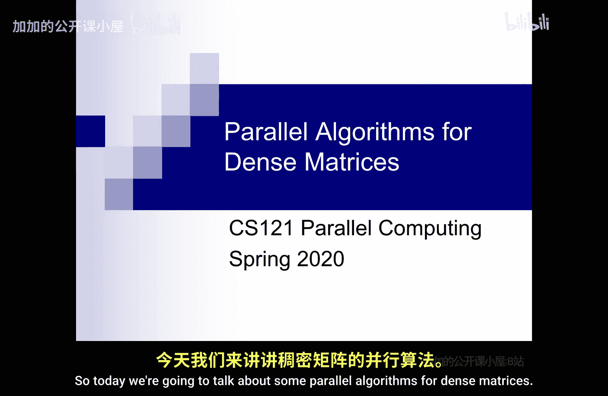
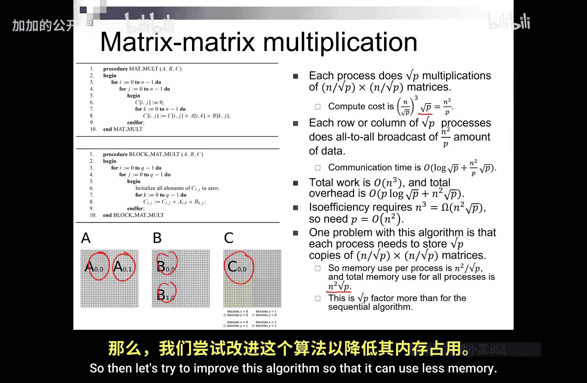
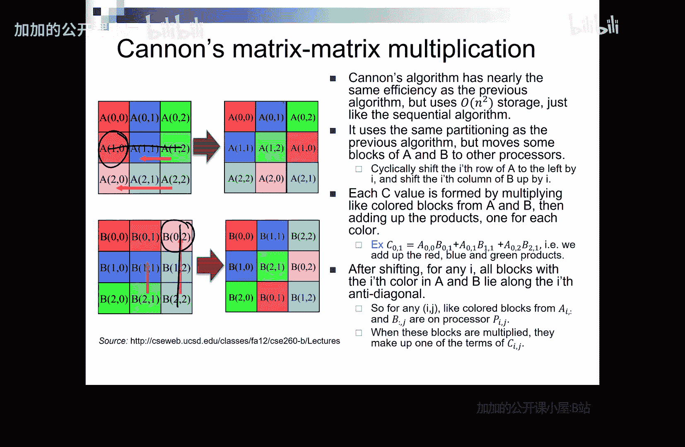
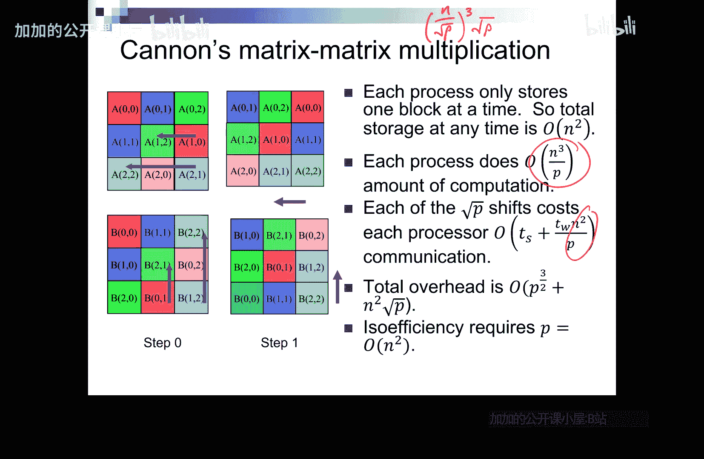
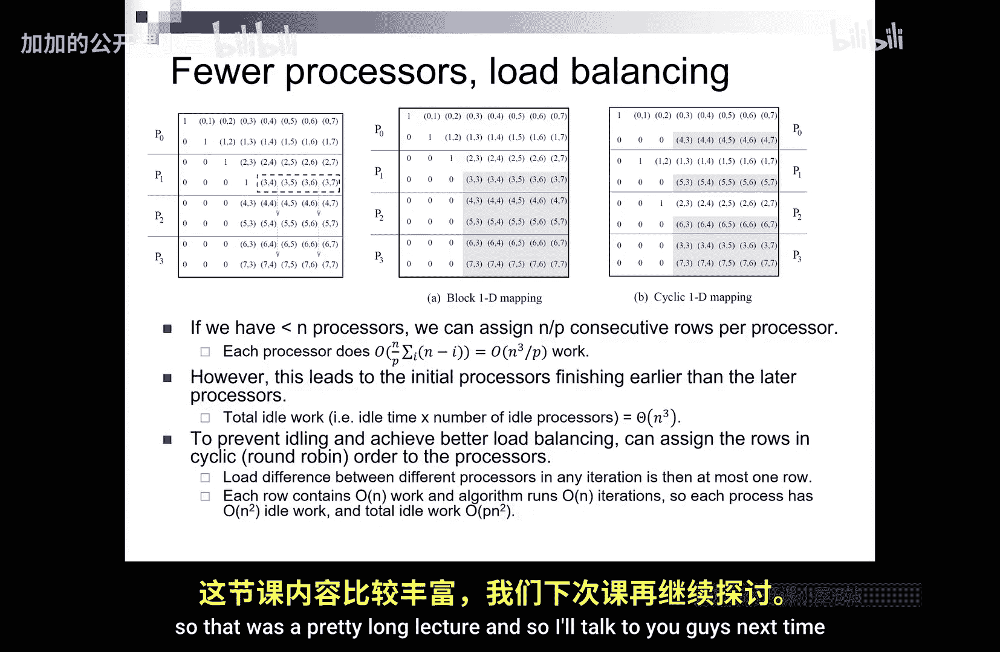

# 上海科技大学【中英⚡并行计算｜CS121 2020 Parallel computing】 p21 P21 Dense matrix algorithms -BV1VqypBaEaP_p21-

Welcome back。So today we're going to talk about some parallel algorithms for dense matrices。

是。So remember that dense matrices are matrices where most of the elements are non-ze earlier we talked about sparse matrices where most elements are zero。

 but here we're going to assume that most of the elements are not zero。

 and dense matrices just like sparse matrices， they also have a lot of applications， for example。

 in various types of optimization problems and to model various types of physical phenomena。Okay。

 so so the dense matrices because all of the values are most of the values are nonzero。

 then it turns out that these dense matrix operations are typically compute bound especially dense matrix matrix multiplication。

 their compute bound， and this is unlike sparse matrix operations which are typically memory bound right so and also because the matrices are dense。

 then we basically have are going to do computations involving all of the matrix elements。

And so therefore， the computation has a very regular structure and because of this regularity。

 then this allows these operations to be highly optimized。

So there are various implementations for dense matrix operations， including parallel implementations。

 for example， the packages I'm listing here。Okay， so today we're going to look at a few basic operations。

 so we're going to look at how to do matrix vector multiplication and then also matrix matrix multiplication。

 and then we'll see how to do how to solve equations using Gaussian delimination。Okay。

 so we're going to start out with a matrix vector multiplication Okay so here we're assuming that we have a M by n matrix A。

 and then you want to multiply this by an m by1 vector x。Okay。

 so we're gonna to look at two different ways of doing this。

 And so these two methods differ in how we assume in how we distribute the matrix among the processors。

 Okay， so in the first implementation， we're going to。

Assume that we're going to take this matrix a and divide it up among the m processors Okay。

 and we're just going to do this row wise。 So if we have P processors over here right。

 then we're going to take every n divide by P rows of a。

 and we're going to give it to a different processor。And then likewise。

 for the vector right we also assume that the vector is distributed among the processors so initially we're going to say that each process is going to have n divided by P values of this vector x。

Okay， so then the way the algorithm works is just that well each process has a has several complete rows of a however。

 it's only got a part of the values of x。And so in order for a process to do the matrix vector multiplication。

 we're first going to give each process the entire vector X。Okay。

 so then since the vector used to be distributed among all of the different processors。

 then what we're going to do is， so for example， P0 right he's got this little part of x right so we're going to have P0 broadcast his little part to all of the other processors。

Okay， P1 is also going to broadcast his part of x to all the other processors。 and so every。

Process is going to take its part of the vector X and then broadcast it to the other processes。Okay。

 so so we're， we're gonna to do an all to all broadcast。

 So each all the processes are going to do very sorry。

 the the set of processes are going to do an all to all broadcast of and the the data that they're broadcasting is just their part of the the overall vector。

Okay， all right， so then after that， each process is going to end up with the entire vector on its yeah。

 every process is going to end up with the entire vector and then all you do is each process just takes the rows of the vector that it has of the matrix that it has and then multiplies it by this vector。

And then after doing that， each process is going to end up with some of the rows of the output vector y right so we're computing y equals a times x。

 and so each process will end up with some of the rows of y and then that's the entire computation。

Okay yeah， so the first step is that so this is how the data is initially partition among the processes so the step B over here is the all to all broadcast the step C is that after the broadcast all the processes have this entire vector and they do the computation and then after the computation。

 this is how the result the output is going to end up on these processes。Okay。

 so then now let's look at the the complexity of this algorithm。 Okay。

 so we're going to assume for the rest of this lecture that the underlying communication network for all of the processors is a hypercue。

 Okay， so we have and then we're going to use the。Expressions that we derived for various communication primitives on the hypercube。

 we're going to use that in this analysis。Okay， so first of all。

 the compute time that each process does Okay so so basically the compute time is going to be n squared over p and the reason is that each process is going to have n divided by p rows of this overall matrix and then it's got and then there are n columns here so for each of the rows that it has the process in step C over here it's going to multiply that row by this entire vector so that's n computations and it's got n divided by p rows。

 so altogether that's going to be n squared divided by p computations。Okay。

 then next the communication time， okay， so here so the communication。

 the only communication step is in step B over here， right where every process hours。

 although the processes are going to do and all to all broadcasts。

So yeah so if you look back a few lectures when we talked about how to do allto all broadcasts on the hypercubee we said that basically the amount of time it's going to take is something like this expression over here so here TS is the startup time to do a broadcast right and we're going to multiply this by the number of hops basically so this is log P over here。

And then also you need to multip so TW is the time to send one word and the total number of total amount of data that we're sending among all the processes is n because if you look at every process it's going to end up getting the entire vector so initially it only had one piece of the vector right it had n divided by P number of values from the vector and then after the all to all broadcast。

 it ends up with the entire vector of n values so that's why we have this n here because this is basically the amount of data that each processor is receiving。

Okay， so then if you look at the total cost for all the processors for communication， okay。

 it's just going to be this communication time times times p。Okay， and the total amount of work。

 the computation that the processes are doing is going to be p times this computation time over here。

 so it's going to be n squared。Okay， so。Alright， so then and notice that n squared is the amount of time that a sequential algorithm needs to do this matrix vector multiplication because a sequential algorithm is just going to go through all of the rows of this matrix here right and then multiply each of them by this vector so each row has n elements and then you have n rows so the sequential algorithm does n squared work and then this parallel algorithm in terms of the computation。

 it's also doing n squared work。Okay， so now we want to figure out how large we can make P and still have this be scalable。

 have still make sure that the communication overhead does not dominate the overall work。

Okay so this is our communication overhead for P processors right and this is our total amount of work for P processors。

 so if we want if we want to achieve this IO efficiencyfiency criteria right so we want to achieve maintain the same level of efficiency even as the number of processors grows。

Then we need that this computation here is going to increase at least as fast as the overhead here。

Okay， so。Right， okay， so if if you work this out， you see that as n is as long as P is order of n。

 then this this term over here is going to be less than n squared。Okay。

 so this algorithm can scale up to n rows， so we can have as many processors as we have rows。

Okay so so next we're going to look at a different algorithm。

 but also for matrix vector multiplication。 So this is a so called 2D algorithm for matrix vector multiplication。

 and the previous one was we're going to call that a 1 d matrix vector multiplication algorithm。

 Okay， so the reason it's 2D is well， for the 1 d algorithm。

 each processor if you look at which part of the matrix it' stored It stored several rows of the matrix。

Now in this 2D matrix vector multiplication， what we're going to have is each processor is only going to store a little square chunk of the matrix。

Okay so overall， we're going to have P processors and we're going to assume they're laid out in this 2D fashion。

 so in a root P by root P grid。Okay， and then each。

And then each processor is going to store just a small chunk of this overall a matrix and the size of that chunk is going to be。

 well since you have root P processors so since you have a grid of root P by root P processors and since the matrix is n by n。

 then each processor is going to store a part of the matrix that's this large n divided by root P elements times n divided by root P elements。

Okay。😊，And then likewise， so the vector is also going to be distributed among the processors initially。

 but we assume that it's going to be only stored by the processors in the last row。

so then here you have I'm sorry last column so then here you have root P processors in this last column and each of them is going to store n divided by root P elements at this x。

Okay， so then yeah。 So the way this is going to work now is that。So previously。

 in order to do the computation， you needed each processor to get the entire vector X。

 Okay now here we are not going to require that anymore。 Okay， instead。

 what we want to do is just that we want to take each chunk of x so here if you look at x。

 it's then broken into root P chunks So we want each processor just to get one chunk of x Okay so for example。

 we want all of the processors in this first column here。

 Okay sorry in this first column over here So they each have a few rows of the a matrix。

 Okay and what you want to do is you want to make sure that they can take the rows and multiply it by the corresponding part of x。

Okay， so if they have。So for example， if this guy has one of these parts of the first row of8。

 then all you need for him to do is to get basically you know this part of X。Okay。

 if he gets that part of x， then he can take this part of a and multiply by that part of x。

OkayAnd likewise， the first processor is going to have this part of a okay。

 part of the second row of a， and he can take that second row， that part of it。

And then I'll also multiply by his part of X。Okay， so what you want is you want yeah。

 so you want the first processor to you want the processor over here just to get this part of X。Okay。

 now also this processor over here， right， again in the first column。

 he's only got part of the this row of a。 Okay， so all he needs is this part of X。

And the same goes for all of the processors in the first column。

 they all have only part of the corresponding row of a， so they just need a little part of x。

And so what we're going to do is just take this first part of x right and then broadcast it in this column。

Okay，Now if you look at the second column right， so each of these guys has a part of a row， again。

 a part of a row of a， but and what they want is they want a the second chunk of x。

 Okay so they want the part of x that's over here。 They have that part。

 then they can take the part of the row of A's that they have and multiply by the part of X。

OkaySo everybody in the second column， all of the processors in the second column want this second part of x。

And then all of the processors in the third column want the third part of X over here。Okay。

 and so on。And so what we're going to do is we're going to take these small parts of X and we're going to broadcast each of them in the corresponding column。

Okay， now before we can do that， we said that initially all of these parts of X。

 they were sitting in the final column right， And so， but we actually want， for example。

 the first part of x。 We want to broadcast that in the first column。 Okay， and the second part of x。

 we want to broadcast that in the second column。 Okay。

 so what we need to do is we need to take the data， which。The x vector， which used to be over here。

 right， and we need to send it to the proper locations， okay。

Right yeah so the first part goes to the first column or if the first processor in the first column。

 the second part goes to the second processor in the second column and so on Okay so we're going to do that first of all。

 and then once the data gets to the right place， then those corresponding processors are going to broadcast that part of X in their column。

Okay， so after they do that， then this entire each of the columns of processors is going to have the sort of the right part of x okay and so for example。

 this guy right he's got a bunch of rows of a and then he's got you know this part of x right and so you can just multiply those little parts of the rows by this part of x。

Okay， and after you does that， so if you take that you take the part of a row and multiply by the part of x right you're going to get let's say you're going to get some value over here Okay so thats that's part of the overall sum for the first row so the first process ends up with part of the overall value for the first row。

also ends up with part of the overall value for the second row for the third row。

 and so for all of the rows that he has， he's going to end up with part of the value for that。

And the same host for all of the other processors。Okay。

 now what about the guys in the second column well they're also going to end up with the rows part of the value for the sum in that row。

Okay， so for example， you know they might this guy over here he's got a few rows of a right parts of those rows。

 he's got this little part of x right， if he multiplies you know the row and the column。

 then he's going to get part of the overall sum for the first row。Okay。

 so then once he takes all of his you know， these three rows here and he multiplies it by this part of x。

 he's going to get these partial values also okay so then basically all of the processes are going to end up with these partial values。

Okay now we need to combine these partial values to form the overall sum in the first row。

 for example， and the way you do that you're just going to do a reduction among all of these processes okay so you're going to take these the partial values for the first row right you're going to combine them right using a reduction and that's going to be this first row value over here。

Okay， for the second row value， right， you're going to take these values。

 okay from the second row partial values and you're going to add them up and that gets you the second row of the output。

Okay， and so on。Alright， so then the next step after okay， so the steps that we have so far are。

 first of all， we take this X and we distribute it to these diagonal processes。 Okay。

 and then in part B over here， the diagonal processes are going to do these broadcasts right so that。

Yeah， so they're going to do the broadcasts then and then after the broadcast。

 all of the processes are going to do these computations to get these partial values over here。

 right these partial values。And then they're all going to do reductions in order to add up these partial values into the overall values。

 into the final output values。Okay。So those are the steps that are going to happen。Yeah。

 okay so then now let's look at the and then this reduction will be so we're going to reduce all of these values onto the final column okay so in the end the vector will be sitting on the final column of vectors of processors okay so just like in the beginning the input vector was on the final column of processors in the end the output is also on this final column。

Okay， so now in terms of the complexity for doing this。Okay。

 so first of all the computational complexity， so you have that each process is going to store this a chunk of x sorry a chunk of a which is this large it's going to be n divided by root P times n divided by root P so in total that is going to be n squared divided by P values。

Okay， now so that's going to consist of multiple you know rows of a。

 parts of rows of a right and then for each of the values that it stores。

 it's going to multiply this by part of the vector。

So therefore the total number of computations okay so for each each of the values that it stores。

 okay it's going to multiply this it's going to perform one or two arithmetic operations on that value right so for example。

You know， if it's storing you know these values。 Okay。

 so here it's storing like four values over here right So for each of these values。

 it's going to take this value and multiply by that value and then add it into a running sum and then it's going to take the next value and then multiply by this value and then add it into a running sum。

 So basically for every value it stores， it's going to do a multiplication and an addition。

 So because it's storing n squared divided by P values overall。

 it's also going to do n squared divided by P computation each process is' going to。Okay。

 so then that is the computation and then in terms of the communication right so we have we have several communication steps。

 so the first communication step is for is to send all of this X stuff right onto the diagonal elements onto the diagonal processors okay。

And the amount of time to do that is， well， it's just。

Basically proportional to the size of the data that you're sending Okay so so this process for example。

 is sending over here right and how much is he sending he's just sending this part of x which has size m divided by root P。

AndAnd all of these processes in the first column， they do this in parallel。

 so therefore the time to do all these sends is just this thing over here， the A part。Okay。

 and then next。All of these processors are going to do broadcasts right and they're going to do the broadcasts concurrently okay so the broadcast is that well first of all this is the amount of data that you're broadcasting right because you're broadcasting this entire chunk of a over here and then you're broadcasting this among root P processors so you need to multiply this by another log of root P over here right so if you look back on our notes for doing these communication primitives you see that this is going to be the cost for the broadcast。

Okay， and then part C， you need to do a reduction， right。

 so part C over here you're doing a reduction。But when you do the reduction， again。

 you have each process，op each process has。And divided by root P values of these partial values that it's reducing。

Okay， so therefore the reduction part is also going to take this much time。

Okay so parts B and C both take that much amount of time。Okay。

 so then the total time per process is just the sum of all of this stuff right and the sum is just it's going to come out to be this。

Okay， and the communication overhead is just we're going to take the communication part this of this time right so this is the computation and this is the communication and if you multiply this by all of the processes。

 then that is the total time paid for communication by all of the processes or sorry total cost of communication paid by all the processes。

Okay， so again， we want to look at how scalable this is， right， so how。

How do NMP have to increase with each other to maintain ice efficiency？

 So here you want the amount of work right to be at least as large as the overhead which is this part over here。

 Okay So then yeah， so then you have this expression。

 And so if you solveulfur this right you see that eventually you're going to end up with P equals order of n squared divided by log squared of P。

Okay so so this can basically scale up to almost n squared processors even when you have almost n squared processors。

 you can maintain I efficiencyency， whereas for the 1D algorithm。

 you can only maintain is efficiencyency up to order n processors。Okay。

 and the basic reason is that so this algorithm， the 2D1 is more scalable and the basic reason is that you know。

 all of the communication that you're doing， you're doing less communication because previously for the previous algorithm。

 you had you had to send data， which was like。Let's see you have to do this all to all broadcast right and so that had a time of n Okay。

 so something linear in n and then here your communication time is basically going to be something like n divided by root P。

Okay， so you have this extra root P factor over here and that extra root P less communication this factor over here。

 so that allows it to scale better。Okay， so that is vector matrix vector multiplication。

 so next we're going to talk about matrix matrix multiplication。Okay， so for this we're， we're。

 first of all， going to start with a simple algorithm。

 So this is a block based matrix matrix multiplication algorithm。 Okay， so the idea is that well。

 the basic matrix multiplication algorithm is that you just take you know。

 a row multipplied by a vector。 right， so each output value is a row multiplied by vector。 Okay。

 now for the block based matrix multiplication algorithm。

 What you observe is that you can actually take a multiple rows。 Okay， so you can treat。

So you can break up your matrix into these blocks like this you can break up the a matrix and the B matrix and then you can multiply sort of a row block okay so it's a row of blocks multipplied by a column of blocks。

Okay so we're going to take and what you do there is you take all of these elements in this entire block of a okay multiply by all the elements in this block of B and then you add that to know a01。

 this block times B10 and that's going to get you a block of the outputs of C。Okay。

 and you can do this with any size blocks， any size square blocks。 Okay， so we are going to。

So the size of the blocks we're going to choose is we're going to have root P processors arranged in a grid。

 so it's going to be like sort of root P by root P processors and the blocks are going to have size n divided by root P times n divided by root P。

Okay， and then。Right， and then each processor is going to store like one block of A and one block of B。

Okay now， however， in order to do the multiplication and produce a block of the output C。

 right each processor needs not just one block of A and B。

 it needs this entire row of blocks right and this entire column of blocks of B。Okay。

 so therefore the the first thing that we're going to do is each of the so all of the processors are going to。

So in each row I， okay， all the processors are going to do an all to all broadcast of the a block that they start with。

Okay so for example， this guy starts with this block。

 so he's going to broadcast this to his entire row of processors and the second process is going to start with this block and he's going to broadcast it to the first row also of processors。

And you're going to do the same thing with the B vector。

 but you're going to broadcast along the columns， okay。

 so this guy broadcasts this along the column and then this guy also broadcasts that along the column。

Okay， so these are going to be all to all broadcasts。

And then now each process is going to end up with all of the data that it needs to do this entire multiplication so for example。

 each process in the first row is going to end up with both of these blocks of A and he's also going to have both of the blocks of B and then he can multiply them to get this block of output of C。

Okay， and so that's the entire algorithm， okay？Yeah you just do these all to all broadcasts of your blocks of A and B in the rows and the columns。

 and then after you get that data， you can multiply。Okay， so in terms of efficiency for doing this。

 okay， so then each process is going to be multiplying these is going to be doing these block multis Okay。

 so the blocks are size n divided by root P times n divided by root P。

And multiplying two matrices of the size is going to actually take you n divided by root P cubed amount of time。

Right so each each of these， okay， so like a 00 times b00。

 that's going to take you n divide by root p cubed right， However， to get this as c00。

 you actually have to do this for this entire row of a blocks and column of B blocks。

 so there are root P matrices in this row or column。Okay。

 so you need to multiply the per block multiplication cost by the number of blocks。

And then when you do that， that's going to come out to N cube divided by P。Okay， and then。All right。

 and then next we need to look at the communication cost。

 so here each process is going to broadcast its block of A and B。

 right they're going to do this all to all broadcast Okay。

 so the block of blocks of A and B right they have this much amount of data in them n squared divided by P。

RightBecause other're the size， so they have n squared divided by P amount of data in them。Right。

 and then。Yeah， and and then the total amount of data data that each process receives is it doesn't just receive one block。

 right It receives the blocks from this entire row right so the entire row has has root P blocks in total Okay。

 each block has this amount of data。 So so therefore。

 the time for the allto all broadcast is going to be just the total amount of data that you're receiving basically。

 okay， so it's going to be this expression more or less。Alright。

 and then so the so now if you look at the total work。 Okay。

 so the computation is going to be for each process is n cubed divided by P。

 So the total total computation is going to be n cubed。 Okay。

 so N cubed is just the amount of computation for regular matrix multiplication。

 so here for this for this parallel block based multiplication。

 You're still doing N cubed overall work。 Okay， so the。NC computation overall。

 so we're not increasing the computation。And then the communication overhead， right。

 it's going to be this， okay， so it's just this time multipied by P。For all the processes。And so。

We want to look at how scalable this is， right， so then you want the the computation to be at least as large as the communication。

 right so we can just focus on the second term over here。

 and we see that this is going to scale all the way up to P equals on order n squared。Okay。

 so this is highly scalable because because you know the A and B matrices only have n squared elements。

 Okay and here you can be using up to like n squared processors， Okay。

 so you can use like almost one processor per element。 So this is a very scalable algorithm。

Now one problem with this algorithm is that each of the processes has to store a lot of copies of these matrices because remember that to do the computation each process initially just starts with one block of A and B so the one block has n squared divided by P elements however。

 since you have to the first thing you do is you broadcast these blocks in the know along the rows or the columns then each process is actually going to end up with root P of these matrices because it's going to end up with each process ends up with all of these blocks along you know the first block a row of blocks。

And all of these blocks in the first column them。Okay， so they're going to be root P of those。

 each of those is going to have size n squared divided by p。So therefore。

 the total amount of memory that each process uses is going to be n squared times root P。O我啊。

I'm sorry， it's going to be n squared divided by p times root P。

 so it's going to be n squared divided by root p。Okay。

 and so the total storage that all the processes use processes use is going to be n squared is going to be this thing times p。

 which is n squared times root P Okay， And so so this right。

 the total amount of storage is actually a factor of root P more than like than sort of the minimal storage that you can use Okay。

 so the minimal storage would be that all of the processor together。

 they store a single copy of a and a single copy of B right， but here it's like you know。

 the processes altogether， they're storing a root P copies of a and B。Okay so this algorithm。

 even though it scales well， it uses too much memory。

 uses a factor of root P more memory than necessary。Okay。

 so then let's try to improve this algorithm so that it can use less memory。

Okay， so so then now we're going to talk about this canon's matrix matrix multiplication algorithm。

 Okay so this is a pretty famous algorithm， So it's got the same efficiency as the previous block based multiplication algorithm except now it's also memory efficient so instead of storing root P copies of the matrix。

 we're going to store just like sort of one copy of the matrix overall among all the processes。Okay。

 so to understand how this works， it's best to look at some pictures Okay。

 so now imagine that we're trying to multiply this A matrix over here by the B matrix。Okay。

 now we're going to color all of。 So again， this is going to be a block based matrix algorithm。

 So the first thing is we're going to divide A and B into these blocks。 Okay。

 so it's going to be root P by root P blocks。 And again。

 the blocks are going to have size N divided by root P times n divided by root P。

 Okay so the first step is the same。 Okay， we break into blocks。Okay， but now let's。

 let's color code these blocks because that's gonna tell us about which multiplications we actually want to do in the computation。

 Okay， so the way we're gonna color them is that a， right。

 we're gonna color them by so so the first column of these blocks。 Okay。

 we're gonna give them all like red colors。 Okay， different shades of red。 Okay。

 and then second column， we're gonna color them blue and third column green。 Okay， and now for B。

 we're gonna color the first row， red， different shades of red。

 and then and then blue and then green。Now， the way we do sorry。

 the reason you do this is because now， if you look at the computation that you need to do。 Okay。

 so let's see， so maybe。I think maybe I should switch to a block over here because。Okay， right。

 so what you need to do is you need to take this first row of blocks and multiply by this first column in order to get like you know this value of the output。

 okay， you're going to take the first row of blocks and multiply by the first column of blocks。

OkayNow you notice that when you do this， right， you're matching up the colors in your multiplication。

 Okay， in other words， you're taking the red block of a and multiplying by the the red block of B。

 right You're taking the blue part of A and multiplying by the blue part of B right and then part。

 green by green。Okay， so all of the colors match up when you do this。Okay， in fact。

 this happens in every multiplication that you want to do。 Okay， so suppose you want to get， oh。

 let's say this value of the output。 Okay， so， so in order to get that value of the output right of the C matrix。

 Okay， what you need to do is to take this row of a and multiply by this column of B。

RightAnd so again， you see that we're going to match up。

 we're going to multiply the red part of a in the red part of B。

 the blue part of A and the blue part of B and the green part and the green part。Okay。

 so so you see that for every part of the output that you want to produce right。

 we're going to take the corresponding row and column and then the multiplications are going to involve blocks multiplying blocks with the same color red by red。

 blue by blue and so on and then adding that。Okay， so we want to make sure that when when we do the multiplication。

 we actually get we actually get this matching of colors Okay。

 so we need to ensure that we get this matching of colors。

 so the way we achieve this in cannon's algorithm is that in the first step so initially the a matrix and the B matrix are distributed like this now what we're going to do for cans。

 the first step is that we're going to shift this data so in the first row we're not going to shift any of the blocks okay but in the second row of blocks。

 we're going to shift everything over to the left by one。Okay， so for example。

 this a11 here gets shifted over here。 Okay， this a12 gets shifted over here。

 and this a10 it gets wrapped around and shipped and shifted over there。Okay， so yeah。

 so then after the shifting， okay， so we shift by one to the left and after that we end up with this data distribution right before the second row。

Okay， for the third row， we're going to shift over by2 okay so like this a22 is going to end up over here right this thing is going to get shifted all the way over here it's going to wrap it wrap around。

 it'll shift by two， but it'll wrap around and then this thing will get shift shift over it here Okay so then we end up with this data distribution after the shifting。

Okay， so that's for the a matrix where you shift。You shift different rows by different amounts Okay now for the for the B matrix。

 we're also going to do some shifting now we're not going to shift the first column okay。

 but for the second column we're going to shift up by one Okay so everything gets shipped up by one So you end up with this configuration over here。

And then in the third column， everything gets shifted up by two， okay。

 so you end up with this configuration。Okay， so that is the first step of Canon's algorithm is are these shifting steps。

 Okay， so we do all of those concurrently。And now the thing is that after the shifting step， okay。

 let's see how the data is distributed。 Okay so now if you compare the a matrix and the B matrix。

 okay， you see that now for each position， okay， so let's pick a random position like this one Now you see that here the colors of A and B are now matching because for example。

 this processor so there's some some processor at this position， Okay。

 so he's got like a blue chunk of a and a blue chunk of B。Okay， when he multiplies those。

 he gets exactly part of what he needs in order to produce the output at this location。Okay。

 so imagine you want to produce the output at this location in C。 Okay， well， what do you need to do。

 You need to take this row of a and multiply by this row of this column of B。 Okay。

 and then part of that multiplication involves taking this blue chunk here and then multiplying by this blue chunk here。

 Okay， so you need to take a01 and multiplying it and multiply by B1，1。Okay。

 well now you see that after the shifting， this processor， right， exactly has a 01 right。

 and he has B11。Okay， right， because each processor has one block of a and one block of B Okay。

 so after the shifting right， so so initially the processor already has this a01 Okay。

 but after the shifting， he's going to get this block B11。Okay， and he can multiply those two things。

 and then he can get part of the output。Of C at this location， right， the blue part of the output。

Okay， and this is actually true for all all the processors。 Okay， so， you know。

 if you pick any other processor， So let's I don't know， let's pick let's say this processor。 Okay。

 right， so this processor， he wants to produce this output of the C matrix。Okay， and so to do that。

 he's going to have to take this row times this column right。

 And then you see that so here he's going to have to take the this a A10 and multiply by B0，2。

 Okay well， after the shifting， he's got this this processor has a 10。 Okay。

 and he also has B02 So if he multiplies those。 then he ends up with part of the C output。

 the red part of the C output。Okay， and you can see that this is true for all of the processors。

So the upshot is that all of the processors they're going to get some part of A and some part of B and the colors are going to match and so they can just multiply those two blocks and then that will produce part of the output of the final output they want to produce。

Okay， so basically in this first step right after the shifting the processes are going to do these local multiplications。

 Okay， they take their part of A and multiply by their part of B okay and that gets them part of the output right in this case it gets them one third of the output because we have three blocks。

Okay， so yeah， so all of this stuff just this text just sort of says what I was showing you over there。

All right， so next， but but now they've only got part of the overall output。 Okay。

 so now they want to get compute more of the output。

 So what happens is that now after the initial shifting。

 this is the situation after the initial shifting Okay。

 the processes have these parts of A and then these parts of B。

 Okay so next we're going to shift again。 Okay，And then when you shift again。

 you just shift everything over。 So for all of the a blocks， okay。

 you shift everything over to the left by one Okay， so for example， a10 goes over here Okay。

 a12 goes over here and a11 wraps around Okay， so everything just gets shifted over by one。Okay。

 and then for the B blocks， right， you're going to shift everything up by one。Okay。All right。

 and then after this shifting just by one position。

 you're going to end up with these configurations and you see that these configurations。

 you still have that the colors so for each process they have matching colors for AM andB。

Because before the shifting， everything matched and now you just shifted everything over by like either of。

You know， horizontalorizontly or vertically， and the colors are still going to match。And so。

 for example， and so now each process can again take its block of a and its block of B and just multiply them。

 And that will get give them another block of their output。 Okay， so for example。

 if you look at this process。 Okay， so in the first step。

 it multiplied this so so this process wants to produce this this output。

 this part of the output in C， right， so it's going to take this row， right。

 and multiply by by this column。 Okay， now in the first step， it did this part where it。

It multiplied the red thing by the red blocks and then also it needs to multiply the blue blocks。

 okay so it needs to multiply this a11 by the B12 and you see that after you shift things then this process is going to end up with the blue blocks on its for itself。

Okay and then okay， so this is the second step of cannons and then the third step would be again。

 you're going to shift everything over to the left or upwards by one more and then after that shifting。

 you're going to see that for example， this process will end up with this green block over here and this green block of B and he multiplies them。

Okay and then and then if you add all those together right so so the process is keeping track of the sum of all the blocks that he had and then he multiplies so each time he gets some new blocks。

 okay you know that the colors are going to match so the process is going to multiply those blocks and then add it to this running sum that he has。

Okay， so then in the end， he's going to have he's going to multiply the the red blocks。

 the blue ones and the green ones add them together。 and that produces this。

So that's going to produce this output of this part of the output。Okay。

And this and you can see that this is going to be true for every process so every process is always going to for each stage of Canon's algorithm。

 they're always going to have matching colors for the A and the B blocks and then they're going to multiply them and then they shift and then they keep multiplying and shifting。

Okay。Yeah， so altogether theyre going to be so sore going there's going to be root P stages Okay。

 because we have root P processors right， So the blocks initially we had root P blocks by root P blocks right and so we need to just sort of shift all of those blocks through each processor Okay。

 so yeah， so we have exactly root P of these shifts okay。Right， okay。All right。

 now to look at the complexity of all of these things now first of all。

 at any time point so the advantage of so the main goal of Cannon's algorithm is to make sure that you don't store extra copies of these matrices and the reason that it achieves this is that you see that at any time point so we have root P stages of Cannon's algorithm and every in every stage each process only stores one block of a and one block of B。

So each block has size n squared divided by P。Okay， so at each stage。

 the P processes together store n squared values。And then in the next stage。

 we just shift all the blocks over to the next process。So again， in the next stage。

 each process stores n squared divided by P values of A and B。

 so altogether they use n squared storage。So therefore， at every stage， okay。

 the processes are using just n squared storage。Okay， whereas for the initial block based algorithm。

 right， that one just had sort of one stage where in the first stage you collect root P blocks。

 each having size n squared divided by P。Right here。

 each process only stores one block of A and one block of B at a time。Okay。

 so therefore the total storage at any time point is going to be order n squared。

 and that's what we want， right。And then also the the amount of computation that it does is going to be。

Let's see it's going to be so you have these blocks of size。So let's switch back to red over here。

Okay， so you have these blocks of size n divide by root P right so the amount of and then you have to multiply these a blocks and the B blocks。

 so that's going to cost you this much amount of time and then you have to multiply this by the number of stages that you have right so therefore this is going to be your computation time and cube divided by P。

Okay， and then finally for the communication time， the only communication you need to do is for this for the shifting okay and when you shift you're just shifting one block right and the blocks have n squared divided by P values so you do all the shiftings concurrently in parallel。

Okay， so that is the time for each processor to do the communication。

And so the overall communication overhead is just going to be P times this， right， and then。

Let's see。 So it's gonna be。Oh right， and then you need to multiply this by root P shifts right so it's going to be so each of the shifts cost you this much。

 you have root P shifts and then if you do this for P processors。

 then this is going to be your total communication overhead。Okay。

 and your total computation is going to be P times this。 So it's going to be n cubed right So for。

So for Iuffi， you need n cubed to be larger than this thing and you see that this happens when P is going to be order n squared。

Okay， so this is also scalable all the way up to p equals n squared。

 so just like the previous block based algorithm， it's equally scalable。

 but it's going to use less memory。

Okay， so next we're going to talk about another matrix multiplication algorithm。

So this is an improvement on。On Canon's algorithm。 And so one problem with Cannon's algorithm is that。

So Canon's algorithm basically you can only run this for square matrices。 Okay。

's it's I don't know if there's a version of Canon's algorithm where the matrices are not square。

 Okay， it's kind of because you know， Can's algorithm is very much based on matching up these you know the corresponding parts of A and B Okay。

 and you can do this when the。When the matrices are square。

 but it's hard to do this when they're not square and also you have to make sure that n is actually divisible by root P because again in order to match up these parts。

 if you don't have n divide by root P， it's hard to match up these parts。Okay。

 so basically it's got these two requirements that you need in order to run Canon's algorithm。Okay。

 so so if we want a more flexible algorithm。 So， for example， dealing with a non square matrices。

 Okay， then we can use this algorithm called a summa。Okay。

 so the way that summa works is that now normally when you do matrix multi。

 you're going to do these inner products， so meaning you're going to take a row of the first matrix and multiply by a column of the second matrix。

So this can be the row each of the elements and the row can be like blocks of values。

 just like in both cans and the first matrix multiplication algorithm。

 you take a row of blocks and you multiply by column of blocks。Okay。

 but still you're doing a row times a column。 Okay， you're doing these inner products。

 So so for the summa algorithm， we're going to switch this around and we're going to do outer multiplication。

 So here we're going to do a column of a times a row。

 we're going to take a column of a and do the outer product by a row of B。Okay， so yeah。

 so what's going to happen is now。So yeah， so to see how this works。

 So let's do like a smaller example。 Okay， so suppose you have so this is gonna be your a matrix。

 right， this is your B matrix。 Okay， now how can we express this matrix multiplication in terms of multiplying like columns by rows。

 instead of rows by columns， we want to do this columns by rows。 Okay。

 now suppose you you have a column like this， And you have like know values in the first column。

 let's say， let's call them 1，2，3， So it's not actually these are the values。

 but let's just label them as 1，2，3。 Okay and likewise for the B。

 let's label the values in the first row by like ABC。Okay， so I know I'm using A and B C twice。

 but but you know， this A right is not， is not the say。 Okay。

 I'm just giving names for these values here。 Okay。

 now what what do you need to do in matrix multiplication， right now in by the way。

 the matrix multiplication is defined， right， You're going to take this row， right。

 and then multiply by this column and that's going to get you。Part of your output。

 it's going to get you this part of your output。Right， okay。

 so now if you just take the single value here this one value and multiply by this a。 Okay。

 so that's only gonna produce part of this output over here。 not the entire output。

 but it's part of that output。Okay， now you can also take this row this row the first row， right。

 then multiply by the second column here， right and then that will produce this output value。

And if you just take only the first value here， the one value and multiply by B。

 so that will just produce part of this output over here。And likewise。

 you can take this one and multiply by C and you can produce part of the output over here。Okay。

 and in the same way， you take you can take this row and multiply by this column right。

 that will get you this output and if you only took two and multiply by a。

 that will get you part of this output。If you take two and multiply by B。

 that'll get you part of this。Okay， so basically what you see is that if you take this one here。

 okay， and you multiply by all these values in the first row， okay， A B and C。

 that'll get you part of these first row values。Okay， if you take two and multiply by A， B， and C。

 right， that'll get you part of these second row values。Then then you take three and multiply by ABC。

 you get part of these values。Okay。All right， so and so now so by doing that。

 you get part of the output values but now if if you need more。

 if you want to have more of the output values， then you can shift to the。

 let's say the second row of second column of a and the second column of B so now if you take this value and if you take the one and you multiply by ABC。

 you see that you're going to get part of the you're going to get a different part of the first row of the outputs。

Okay， if you take two and multiply by ABC， you get another part of the second row of the outputs。O。

So， so this is what summa does。 Okay， so summa is going to work like this。 Okay。

 it's initially going so you have the a matrix and the B matrix。

 right So you're first going to take the first row sorry， first column and first row。

 And when you multiply them， you're just going to take this value and multiply by every value in the in the row of B。

 Okay， so this is A and this is B。Okay， and then you're going to take the second value here。

 multiply by。By all the values of B， Okay， and the third value here。 Okay。

 So that's gonna So if you look at this， this is what's what's being shown in this outer product formulation over here。

 Okay， so this is like a column of a。 And this is a row of B， right。

 And you just take the first element and you multiply by all these B elements and you put them up here。

Okay， take the second element， multiply by these B elements， put them down here， and then so on。Okay。

 so that's the first outer product Okay， so this is for K equals1。Okay。

 so this is the the first column and the first row Okay now you're going to do this also for k equals 2 and there you're going to take the second column right。

 So this is the second column here right and this is the second row of A and B okay。

So this is k equals 2， and you're going to add these together。Right， so for this one， right。

 you do it in this way for this one， you also do it in this way， and you add them。

OkayAnd then you and then you're going to go to the third row here right sorry。

 third column times the third row。Okay， and so so we're going to just basically take these columns and rows of A and B。

 right， I'm going to take the K column N row and for K from one all the way up to n。Okay。

 for each of those cases， you're going to do this outer product over here。

 and then you add them all together。Okay。So that is the outer product formulation of。

Of matrix multiplication。 Okay， the inner product formulation is just the one that。You know。

 you usually use its the it's the rows times the columns， right。

 and the outer product formulation is the columns outer product， the rows。

And then you add them up for all the different values of K。Okay。Yeah。So in fact。

 you can see that the the inner and the outer product approaches。 Okay。

 all you did was use sort of so in in in the basic scheme for matrix multiplication。

 you have these three nested loops， right over the different indices。 Okay。

 so the inner product approach corresponds to one of these。One way to iterate sorry sorry。

 one ordering of these three nested loops。 Okay， so it's like the I J K order， Okay， the the I。

 the J and the K order， Okay， and the the outer product approach just represents a different ordering。

 Okay， it's the K I J ordering。So in fact， you can order these three loops。

 you can order them anyway， okay， so theyre like you know six ways that you can order them and all of these actually give a valid matrix multiplication algorithms。

Okay， so yeah， so the K。The summa algorithm is the KIJ way of ordering matrix multiplication。O。

Alright， so so now let's look at actually how to implement the summa algorithm， Right。

 So what we need to do is we need to come。See braces over here。 right， So the。

 So the main thing that you need to do in summa is you need to compute these。

These outer products over here。 Okay， and in order to compute the outer product， right， you need。

 for example， you need to take this value and multiply by this entire row， right。

 and you need to take this value multiply by by this entire row。 Okay。

 so we're going to do some some。Yeah， so we're going to assume like this sort of grid layout for the processors this is not necessarily a square grid anymore because in summa you allow it's actually possible to deal with nons matrices but in this example。

 I'm still going to show a square grid of processors so for the square grid of processors each processor is initially if we're in the k stage right then only some of the processors are going to have the Ca column of a and the k row of B So yeah。

 so initially those columns are going to be sitting on some of the processors and these processors actually want to broadcast the values from this column or row to the other processors so for example。

 if you know in this stage if this processor has you know some values of a it's going to broadcast those to all of these other processors over here on its row。

Okay， and this guy is going to also broadcast to its row。

OkaySo we're going to broadcast the A values along the rows。

 and then the B values are going to get broadcast along the columns。Okay。

 so then what happens in that case is that every process will end up with like one value of a right。

 and then also one value of B， and it just multiplies those two values in order to do the outer product。

So if you look at the outer product calculation over here。

 you just take one value of a times one value of B and that gets you one value of your outer product。

Okay， so after the broadcast， each of the processes can produce one of the values of the outer products。

Okay， and again， these don't have to be single values over here。 They can actually be。

Be an entire block of values。Yeah and then okay， so they so they so this is for for k equals one right。

 And then you switch to k equals2 right， So for k equals1， you do all these broadcast。

 you do the multiplication and then you go a k equals 2， you do the broadcast。

 you do the multiplication and you add to the value from the previous K right。

 and you just keep doing that Okay for all the K。Okay， and yeah。 and again。

 summa does not require the the matrices to be like square， right？ So， for example， you could have。

 you could have something like， you know， you can multiply oops。This matrix by that matrix right。

 something of that shape right， And what you need to do is so now you have a bunch of stages each stage you like。

 for example， you take this column times this row right you do the outer product and then you take the next column and next row and so on。

 Okay so you have the same number of columns as you have rows and so that's how many stages you run for。

Okay， and also， yeah， and because you don't have to deal with square matrices。

 you can have a more flexible mapping of your processors to the blocks。Okay。

 so we're going to do one more matrix multiplication algorithm。

 So this is going to be called the 3D matrix multiplication algorithm。

 Okay so previously all of the previous algorithms were only scaling up to like up to n squared processors but the total amount of computation you have to do in matrix multiplication is n cubed so since you can only use up to n squared processors。

 all of these algorithms are going to have you know at least omega n running time the total number of operations divided by the total number of processors there's no way to get sublinear running time。

Okay， so now we're going to talk about a new algorithm， this is called 3D matrix multiplication。

 right it was invented by these three guys here， decochonesssemia Sony。

 and this thing can actually use up to N cubed processors。Okay， and when you use N cubed processors。

Well， okay， so I'll show you this later， but basically the running time be can be order log n as opposed to order N Okay so this can get you subline running time。

So the way this is going to work is that if we're going to use NQ processors。

 we're going to arrange the processors in an n by N by N cube。So the matrix itself is n by N。

 but we're going to use a M by N cube by n cube of processors。Okay， so。

And then each of the processors is just going to compute one of the values of the output Okay。

 in particular， this process processor P I JK， He's going to produce compute this value of the output。

Okay， so this is one of the values that you need at the PI J position right。

 and he's just going to compute one of these values for one particular value of K。 Okay。

 K is something from one to n。Okay， so sorry， those should be less than over here。Okay。

 so each of these k processors is going to produce one of the values in this from CIJ okay so this is one of the values of CIJ right and then if you sum if you sum all of the processors sum across all the processors for different K。

 then you're going to get the entire value for CIJ。So this PIJK processor has this value。

 but if you sum all of these across different values of k， you're going to get CIJ。Okay， yeah。So。

Right， yeah， and the way the processors are going to be distributed is that so we have this cube right so this is the the vertical direction here is the K direction。

 Okay， so different ones of these processors and these are the I and J directions。

 So different ones of these processors if you look at different the different layers over here。 Okay。

 they're going to have these different AI K times B KJ values。 Okay， in the different layers。Okay。

 now， how are you going do this， right？ So because initially。

 let's say that the matrix is just sitting on n squared processors because you only have n squared values in the matrix。

 So even though you have N Q processors， initially only n squared processors have half the values。

 Okay， So so therefore you need to distribute the values to the processors in some way。 right。

 so the way this is going to work is so so this 3D matrix multiplication algorithm。

 its somehow kind of similar to the to the summa algorithm。

 Okay in the sense that it's also doing some sort of outer product formulation of matrix multiplication。

 Okay， so what you can think of it as it as is so suppose you so for the outer product。

 you're taking you're taking a column of a So you're taking a column and then you're doing the outer product with a row of B。

Right。😊，Okay， and then you do that for different columns of a and different rows of B。

 Okay so so what this 3D algorithm does is that so we're going to have n layers over here So in summa。

 you have n stages n stages of this operation of taking the columns and multiplying by the rows and then here the stages in the 3D algorithm are going to be represented by these n different layers over here。

 Okay， so basically the first first layer of this 3D algorithm is going to correspond to the first stage of summa。

 Okay， so the first layer over here。You can see that what's happening is you're taking like multiple copies of this first column of a。

 Okay， so so on the left here， you have the a matrix and on the right you have the B matrix。

 So you're taking multiple columns of the first first column of a and multiplying by the by multiple copies of the first row of B right you see that all of these rows over here。

 Okay， they're all the same。They're all copies of the first row of B。Okay and here for the a matrix。

 right， you have a bunch of columns over here and they're also they're all copies of the first column of a。

Okay， and now if you do these corresponding multiplications， right， So for example。

 this value gets multiplied by that one， right， every every pair of corresponding values get multiplied。

 Okay， if you do these corresponding multiplications， then you see that， you know。

 this is exactly what's being done in the。In the outer product computation。Right。嗯。Okay， right。

 and so so therefore， the first layer of this 3D multiplication corresponds to the first stage of the outer product matrix multiplication。

Okay， now the second layer of of this 3D thing of this 3D multiplication， right。

 So here you're taking so these values right， these are all copies of the second column of a。 Okay。

 you see that the second column of a is over here right。

 and these things are all copies of the second column of a。

And then these things over here are all copies of the so's sort of be racist。

 so now we're going to take the second column of a and the second row of B and here you can see that these rows over here are all copies of the second row of B。

Okay， so therefore the second layer of the 3D multiplication corresponds to the second stage of summa for k equals 2。

Okay， the third layer of 3D multiplication is the third stage of summa and so on。Okay。

 so each of these layers corresponds to just a single stage of summa。Okay， right。

 so that's so that's how you can see that this algorithm So that's how this algorithm is working。

 Okay， this is why the algorithm works correctly。 Okay， however， we also need to figure out you know。

 how do we get this data distribution Okay so initially the data is distributed like this Okay。

 now we somehow want to end up with this data distribution for a。

 So this data distribution is taking different columns of a and it's replicating them right。

 So each layer， the cave layer is taking the cave column of a and just copying it across all the processors。

Okay， and then for B， we're taking the cave row of B right and copying it across all the processors。

 right， How do you get that type of layout， Well， the way you do this is， for example。

 the way that you get the a layout， Okay， is， well。

 the first layer wants a copies of the first column of first column of a。 All。

 second layer wants copies of the second column of a。 So to do that。

 we're just going to send the second column of values of a to the second layer。Okay。

 so that's what's being shown over here。Okay， the the third layer should get copies of the third column of a。

So we'll just send it up here。 Okay， and that's whats what's being shown over here。 right。

 And then you send the final column。To the top layer， okay， over here。All。

 so that's the first thing that you do。So that gets the column of a to the ca layer。Okay，And next。

 you just need to replicate this across the entire layer。 Okay， so to do this， for example。

 to replicate all of these values across the layer， right。

 then this process is just going to broadcast the 0，0 value to along the first row。

 This guy's going broadcast along the second row and so on。Okay， and likewise。

 this guy's kind of brought。This guy' is going to broadcast， right。 So yeah。

 so then all you need to do is for each of the processes to just broadcast the values along their row。

Okay， so there are two steps。 Okay， the first step is you're going to move the ca column to the cave layer。

 Okay， and second step is the processes are just going to do a broadcast in their row。

And then after that， you see that you're going to end up with this a data distribution。Okay。

 so for the B， it's the same thing except for now you're going to take the different rows of B right and you're again going to send them to the to the proper proper layer。

 the K row to the K layer， and then you again do a broadcast and that'll get you the data distribution for B。

Okay， so， yeah， so that's。So that's that's what I'm saying over here right。

 And then once you're in once you're in this data configuration， okay。

 then you can just multiply these values， right。So you multiply all of the corresponding values。

And then finally， in order to get the overall output right you need to sum so for the IJ value of the output。

 okay， so for value CJ okay you're just going to take the so you're going to look in the IJ position right so here's I and here's J so you're going to look in one of these positions or let's say the zero zero position and you're just going to sum across all the layers。

Okay， and likewise for the what we have here for the1 two position， right。

 you're going to sum all of these four values。Okay。

 so you just take the corresponding IJ position and you sum across all the Ks。 Okay。

 and the summing can be done by a reduction。Okay， so yeah。

 so there are basically three communication steps right there's the the send over here。

 there's a broadcast in the step， and then there's reduction in the final step Okay。

 and so the broadcast and reduction， they can both be done in time log n。Okay， so then finally。

 in terms of efficiency。So the overall time for this algorithm is going to be log in because yeah。

 because of the time for the broadcast and the reduction okay？And then you have N cubed processors。

 so the total amount of work you're doing is actually N cubed times log n。Okay。

 so even though you're going faster than linear time， right， you're getting log n running time。

 but your total amount of work has also increased by a factor of log n。

 Okay compared to the previous。Mattrix multiplication algorithms。

 which were only doing order N cubed work。Okay， so to make this more efficient。

 you can instead of just having each processor process one value。

 you can actually have it process a block of values okay so were have we're going to divide the matrix into blocks of size Q by Q where Q is going to be basically it's going to be the cube root of P。

Okay， right， and then we're going to have。Well， I'm sorry， so we're going to form Q by Q blocks。

 divide the matrix into Q by Q blocks。 Okay， each block is going to have size n divided by Q by n divided by Q。

Okay， where Q is the Q root of P。And then we're going to just run the same algorithm。

 this 3D matrix multiplication algorithm on the blocks instead of the individual values。Okay， so。

 allright。 So when you do this， then the the broadcast and the reduction， right。

 They're not going to be on single values anymore。 They're going to be on blocks of values， right。

 And the blocks have size。N divided by  Q squared and so this is going to be the time for the broadcast and the reductions and when you do the multiplications that's going to be take time n divided by Q to the third power each of the multiplication multiplications takes that much time。

Okay， so then yeah， and then we have that Q is the cube root of P right。

 So then the total computation time is going to be n cubed divided by p plus we're going to stick this Q in over here。

 right， And so you get this expression over here。 Okay， And that's for each process。

And then for isSO efficiency， so this is for each process， for all of the processes。

 you just multiply this thing by P。And then for I efficiency。

 you want the computation over here to be as at least as large as the communication right So if you work this out right you see that this is you're going to end up getting that P can be almost P can be ordered and divided by log n to the third power。

Okay， whereas previously we could only use basically n squared processors here。

 you can use almost n cubed processors and still have constant overhead。Okay， so for this final part。

 we're going to look at how to solve systems of linear equations。

So we are given this system of equations over here right so we have these n variables x right and we want to find out the values for x that make this linear system be like this。

Okay so we're going to use a process called Gaussian elimination and we're going to take this system over here and you're going to convert it to an upper triangular one so basically we want to so here all of the a values these coefficients all of them can be nonzero potentially but we want to convert it to this upper triangular form where everything in the bottom triangle all those coefficients are zeros and once you have it in that form then you can use this thing called four substitution to solve this entire system so the forward substitution is that well you start with the the final equation over here so you know the value for the final x you substitute it into the and then you go up one equation so that's got two variables one of them xn minus1 and then xn minus2 so you substitute in the value for x n minus-1 that allows you to get the value for x n minus2 and then you just keep doing that you go upwards and then。

You get all of the values of x。Okay， yeah， so we're going to see that Gaussian elimination is going to take you order n cubed steps Okay n is the number of variables and then this back substitution is going to take you n squared steps okay and so altogether we can solve everything in order n cube steps。

Okay， so so the Gaussian elimination， if you run this slightly differently。

 you can also compute what's called an L factorization of the a matrix。

 So the a matrix is just the matrix with all of these a values and L factorization is basically you're going to write a as a product of L and U So these two things are also n by M matrices and the L is going to be lower triangular meaning that you know so the L is going to be like this so all of these values are going to be0 and then the u is going to be upper triangular So it's going to be like this where all of these these bottom values are0 so you can write a as a product of a of L and U。

RightAnd the reason you might want to do this is because if you write a as this L times u right。

 then given any B， then what you can do is you can solve this by first you can define you can define y equals u times x so we're trying to find x and you can define y as u times x So the first thing is you solve L times y equals B and you can use back substitution for doing that and and then that tells you what y is and then you have to solve for x but x is u times x and u is this upper triangular thing And so again。

 you can use back substitution to solve to solve that and then you can get x and this entire process if you know L and u then this entire process。

 you just have to do two back substitutions each one of those is n squared time so therefore you can solve this overall equation。

In n squared time。Okay， assuming that you have LNU。Okay， so yeah。 and so computing L and U。

 that is going to take you。That's going to take you n cubed time right because you have to use Gausian elimination for that。

 but once you have that， you can solve this for any B in n square time so so this is useful where if you have to solve Ax equals B and then if the a matrix doesn't change for some reason so you have an application where you have the same a matrix all the time。

 but the B vector can change then you just have to do the L factorization for a once which takes you n cubed time and then for any B now you can solve it in n squared time。

Okay， so the main question is how do you do this Gaussian elimination So hopefully you remember this from your linear algebra class。

 So I'm just going to slightly review this process。 So for the Gaussian elimination。

 know so let's start over here So what we're trying to do is we're trying to basically we're trying to make all of these values be0 so those are the lower triangular values and the way we're going to do this is you do it column by column okay so you first make all of these values0 right and then you make this values0。

And the way you can make the first column 0 is if you。

 let's say you multiply the first row by negative5 okay。

 then you're going to get negative5 here and the negative5 here and this becomes negative 10 And then if you add that first row to the second row now。

 then that's going to make this0 right this is going to become negative 2 here。

 And this is going to become negative 12。🤧Okay， right， Okay， so that eliminates this value here。

 It makes the5 into a 0 now， and then。And the next you want to eliminate you want to make this value also into a0 and you can do that by multiplying this by negative 2 and then and then adding so basically what you do is you take a row the first row over here and then you first of all need to make this diagonal element into a1 so if it's not a one if it's like you know a 10 right now。

 then you just divide the first row by by 10 whatever that diagonal element is。

 you divide by that and then after that， you're gonna look at all of these other values in the column。

 and then you just multiply this by negative of this value in the column like by negative5 or by negative2 you multiply this entire row by that and then you add this you add the first row or whateverever row into your into the row that you're trying to eliminate。

Okay， yeah， so so this over here gives the Gausian elimination algorithm right。

 so if we're at the K step of this， Okay， so what's happened is we've already made all of these values into zeros okay and now our goal is to make the cave column。

 we're trying to make everything below the diagonal in the cave column be zeros Okay。

 we're trying to eliminate all of these。And so the first thing we're going to do is we're going in this for loop here。

 in5 and6， we're going to take this k row and you're going to divide everything by aKK by this diagonal element over here。

🤧Okay， and then。Okay， so that's going to make this into a one right And then next you want to take this K row and then use it to make all these value 0。

 Okay， so in particular， if we're talking about the I throw， right。

 if we're trying to make this into a0 right， then we're just going to multiply this entire row。

 So we've already divided this row by akk and now you're going to multiply this row by by。

By by this value over here， which is AIK and then and then yeah so you're going to multiply this by AIK times this AKJ over here right so AIK times AKJ and then you add it negative of that and you add it into this AIJ over here and you do this for all of the elements in this room。

はい。Yeah， so that is this computation over here， okay？

And right and then overall you have three nested loops okay so we first need to iterate over the k right so the K is just we're going to go through all of these diagonal elements for each of them we are going to for each k right you're going to need to do this elimination onto all of the values in this K column Okay so for each of the。

So for each of these rows that we're processing right we need to do all of these operations for the different J values right so there are n of those j values or order n of those j values and we do this for all of the order n rows in this K column so that's going to take us n square time and we need to do this for every k from one to n and so altogether that's going to take us n cube time。

Okay right， and then if you just if you run the Gaussian elimination algorithm somewhat differently。

 so you skip over some of the lines， then that can actually produce this LD composition that we talked about。

Okay， so now let's see how we can actually do this process Okay。

 so in terms of doing this in parallel what we're going to do suppose we're in the k iteration so we are trying to so now we're focusing on this value over here right and we're trying to eliminate all of these values so now the first thing is that we're going to make this row we're going to divide this entire k row over here by the diagonal element okay so that's what's being done over here。

And then we need to eliminate all of these。 Oh， okay。

 so I forgot to say that let's say that we have as many rows as processors。 Okay。

 so we we're gonna to assign each processor one row。 Okay。

 so there's some processor assigned this row over here。

 And then this processor wants to eliminate all of these other values in its column。

 And then it's just going broadcast。So you see that in order to do this elimination。

 what you need to know is for example， if you want to eliminate this value okay right so you need to compute all of the new values for for this row and to do that。

 for example， to compute this value， you need the 63 value and you need the 36 value and to compute this value。

 you need these 63 value and the 37 value。Okay， so basically this this P6 guy， right。

 He needs all of the values in the P3 row。 He needs all of these values。

 right because he needs all these things Okay and likewise， P5 right also needs all of the P3 values。

 Okay， so he needs all these values。So therefore， we're just going to have a P3 do a broadcast of his values right so he's going to take all of these values and just broadcast it to all of these other nodes。

And once these other nodes get these values， then they can just go ahead and go through their values and then they can eliminate the first one and then modify the other values。

Okay， so。Right。Okay， so then the computations so if if you do this for all all the processes right so so step A and step C。

 that's where the computation is。 And in general in the K stage。

 you just need to eliminate these n minus k minus1 values right。

And if you sum that up over all of the different case stages。

 then the total computation time is going to be order n squared。嗯。Right。

And then the communication time you need to sorry shouldn't erase that。

 but anyways P3 needs to do this broadcast to all these other processors and then here you have n minus k minus1 values and you're broadcasting to end other processors so this is how much time it's going to take so yeah so that's for one iteration and if you do this over all the n iterations。

 it's going to take a total of this n squared log n time。Okay， so then we have M processors overall。

 and then it's going to take this much time to do all the communication。

 So the total work is going to be n times this so it's going to be n cubed log n Okay whereas you know we're trying to do August Gaussian elimination in order n cubed work because we can do that sequentially so this is not optimal。

And so what we're going to do is try to improve on this。

 So the reason this is not optimal okay is because here we're basically waiting for P3's entire stage to finish before we start P4 stage so P3 stage is to eliminate all of these things and we're going to do that entire process Okay。

 we're going to wait to eliminate all of these values right so then these all become zero right these become one right before we're going to start p4 stage right so P4 is trying to eliminate these values。

But you finish P3 stage before you start P3 stage in this current implementation。

Now to make this more efficient， we're actually going to pipeline these computations。

 So that means that we're going to so as P3 is trying to eliminate these values。 Okay。

 we're also going to have P4 try to eliminate these values concurrently okay or as concurrently as possible。

 So now you have multiple ones of these stages happening in parallel。Okay， so yeah。

 so basically we're trying to do all of these eliminations pipeline with each other。Okay。

 so so the way this is going to work is that。So each of these processes is going to。Yeah。

 so it's going to work like this。 Alright， so initially we have these values。 Okay。

 and initially we're trying to eliminate these values。 Okay， so yeah。

 so the first thing is we're going to divide the first row by the by the diagonal element。

That's going to produce a one over here right so that's this one right And then after doing that。

 we're going to send all these values to the other processors。 Okay。

 so you see that there's a sending over here。Right， we're not going to do a broadcast。 Okay。

 we're going to send these values one by one。 Okay， so first of all。

 we're going process the first process send to the second process。

 Okay so that's what's being shown with these little arrows that it might be hard to see， but yeah。

 and then as soon as so now the second process is going to receive these values from the first process。

 and then as soon as it receives them， it's going to send them off to the next process so it's going to do another send over here and at the same time。

 So once this process has received these values。 then it can try to eliminate this value over here。

 it can try to start doing that elimination Okay so so this process is going to receive some values sended and then try to eliminate in particular it's going to eliminate this value first of all。

So it's always going to do these so now each process is going to go through these three basic steps okay and it's going to repeatedly go through these three basic steps。

 so the steps are you're going to receive some values right you're going to send them to the next process and then you're going to eliminate using the values that you received。

Okay so for example， let's look at another process so for example。

 this process over here right so here it received some values right it sent them to the next process and then it's going to try to do this elimination over here okay so and then after this elimination it's going to get this zero value in in this column and then it's also and then so we're going to do this cycle where we do this thing over and over Okay you first receive and then you send to the next process whatever you received and then you use what you received to do elimination。

And then you receive the next batch of values， you send them to your next process。

 and then you use this new batch of values to do another elimination。Okay， so for example。

 if you look at this process over here， okay this process okay， so it received a value。

 it sent it right and it did the elimination， so it got a0 over here and then it receive some new values。

 it sent these values and then it does some computation over here which allows it to do a new elimination。

and then at this point it's done because all that this process needs to do is to eliminate the first two values。

Okay， all right， so there's a cycle of receive， send and eliminate。Okay。

 so maybe let's do one one last example of this。 So if you look at this row over here， Okay。

 so this row。Now， now the third rowver here received some data by the third time step。 Okay。

 so it could start the cycle by the third time step。 Now the fourth rowver here。

 or the fourth process， it only received the first chunk of data by the fourth time step Okay so it could only start this cycle by the fourth time step。

 but once it receive this data right， then it sends it and then it does some computation and eliminates and then it receives a more data sends it off does the computation and eliminates and then receives sends and then eliminates。

 yeah， so that's how it works。 Okay， so that's how that's what every process does。 Okay。

 it waits to receive the first batch of data and then it sends it to the next process and then uses that batch to eliminate。

And then as soon as it's eliminated， then it'll receive the next batch of data， send it off。

 eliminate again， and then so on。O。Yeah， so that is。That is what's happening in this algorithm。

 So now let's call this these three steps that each process performs the receive send and eliminate。

 let's call that a cycle and you can see that for each of these cycles right like for example。

 for this guy right for the fourth node over here， fourth process over here right。

 every cycle it can eliminate one one variable right， so that's from the first cycle right。

 and then it eliminates a second it runs a second cycle。

 eliminates a second value right and then it does does the third cycle。Okay。

 so every time we run a cycle， we。we can eliminate a new value。 Okay。

 now the thing is that some of these processes， right。

 they cannot start their first cycle until they receive their first batch of data， okay。

And so since this data is traversing through all of the processes node by process by process。

 it's going to take n cycles before the final process here even receives the first piece of data right so you can see that here。

 the final process is only going to receive okay well I guess it's here so the first the final process only receives the first chunk of data after like four time steps and once it receives that chunk of data then it can start doing this the cycle over here in fact the final process does not need to send any data right it's just going to receive data and then do the elimination and then it's going to receive more data and then do more elimination but all of the other processes are going to receive send and eliminate。

So anyways so this final process will start the cycle thing right these steps over here。

 it'll start that after like order n steps because that's when the first message reaches it but as soon as it gets one of these messages then every new time step or every new cycle it can eliminate another variable and it just takes a constant number of time steps to eliminate sorry it takes a constant number of time steps to run each cycle so therefore this entire algorithm finishes after order end cycles。

Oh sorry， I set that wrong Okay so everything finishes after order N cycles okay but each cycle involves order n computations because you're getting like you know you're getting all of this data let's say you're getting all of this data from the previous node and then you have to take that M pieces of data and then you have to use that to do all these computations on your entire row in order to eliminate one of these values so we run for order n cycles and each cycle takes order n time。

Okay， so therefore this entire algorithm takes order n squared time。And yeah。

 instead of the previous algorithm which took order the non pipeline version took what is it n squared times。

Times log n， right， this one only takes n squared time。

 so therefore the total work is going to be n cubed in this algorithm。Okay。

 and then just to finish up。 so now this pipeline algorithm， right it's more efficient。

 but it's not load balanced。 Okay， so even though asymptotically。

 it's doing asymptically and cubed work， it's sort of the constant factors are not so good。

 And the reason it's not load balanced is because know each process is going to finish。

 so if we have let's say first of all， let's say we have more rows and we have processes so you have maybe 1000 rows and 10 processes。

 So then you give 100 rows to each process。 Okay now each process is going to finish。

 as soon as all right， so so we need to somehow assign these rows to the processes。

 So the simplest way is this just the rowwise。Splitting， okay， the rowwise partitioning。

 so you assign the first 100 rows to the first process， the next 100 to the next process and so on。

Now if you do that， then each process is going to finish as finish executing as soon as it eliminates its rows okay so for example。

 the p0 here right as soon as it eliminates these two rows。

 then it's going to stop executing okay and so it can basically and this is going to happen very quickly because p0 just eliminate eliminate the second row。

 which only involves one column here okay so it just has to run one of these cycles before it can finish。

P1 over here needs to run three cycles， but these later processes need to run more cycles before they can finish。

Okay， and as soon as they finish， they're going to idle yeah。

 so so therefore the initial processes are going to finish earlier than the the later processes and you can look at the total amount of id length so this is going to be the total idol time for each process times the number of idol processors so for example。

 this p0 here。 he's going be idle for like n squared time because the entire algorithm is going to run for n squared time and he's basically done he's done very。

 very quickly So he's idle for almost the entire execution。

 which is almost n squared time and then this guy is going to be idle for something less than n squared。

 but it's still going to be close to n squared and so so in general。

 the average idol time is basically going to be n squared time order n squared time for these different processes。

 and we have n processes， So therefore the total idol time is going。Order N cubed Okay。

 so the total idol time and the total computational time are of the same order。

 so like we're wasting basically half of our time on average。Okay。

 so then a way that we can achieve better load balancing okay and have less idle time is to not assign a consecutive rows to a process。

 but rather to do it in round rowbin order Okay so this is what's being shown over here where you assign if you have let's say four processes in eight rows right you assign the rows in round rowbin order So you give row one to process one right row two to process two and then3 and then 4 okay and then row 5 right you give to process one again okay and then6 and then7 and then 8。

Okay， so yeah。 So this is a cyclic mapping of the rows to the processes。 Okay。

 And when you do the cyclic mapping， you see that now you're going to have much less load imbal。

 Okay， because。Yeah， in fact， the you know， each process can only finish like one iteration ahead of its previous ahead of the next process right So for example。

 this guy right this P0 here， it can only finish after it process this row 4 over here and that can only happen one iteration ahead of when P1 finishes right and P1 can finish one iteration ahead of P P2 and so on okay。

 so the maximum difference between the maximum difference in work between two consecutive processes is one iteration。

Okay， yeah， and now each row has order n work， right， And then in total。

 we run for order n iterations or order n cycles。And so therefore each process。

Yeah can have at most order n squared idle work right because yeah。

 it can be idle for order n iterations， right， and each iteration has order n work。

 So at most it has order n squared idle work。Okay， and different processes have since they only differ in one iteration between consecutive processes。

 right， then the total idol work is going to be order p times n squared P being the number of processes instead of order n cubed。

So by doing this cyclic assignment， then we can get better load balancing also。Okay。

 so that was a pretty long lecture and so I'll talk to you guys next time。

