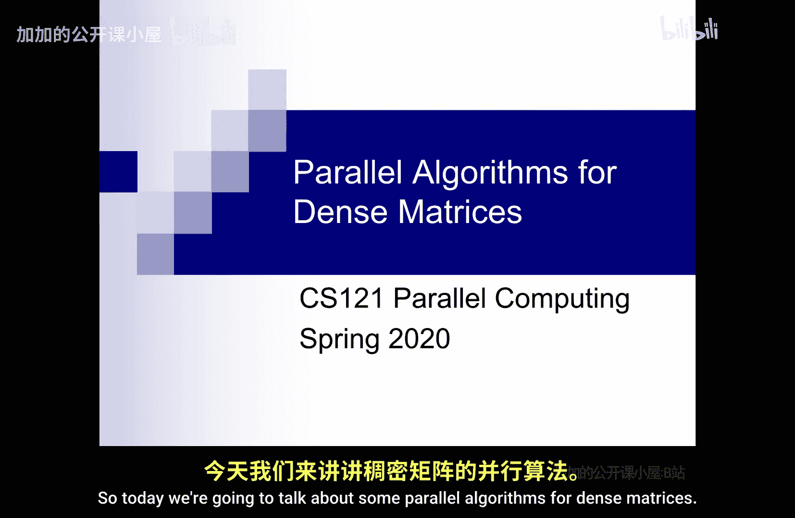
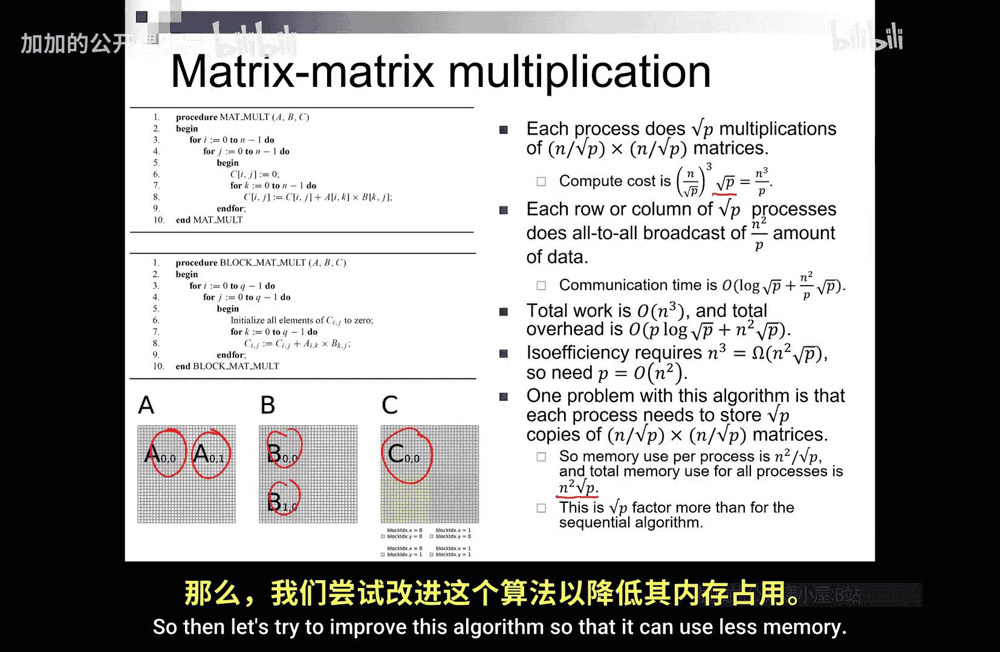
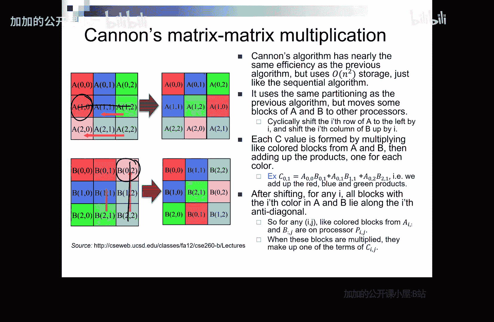
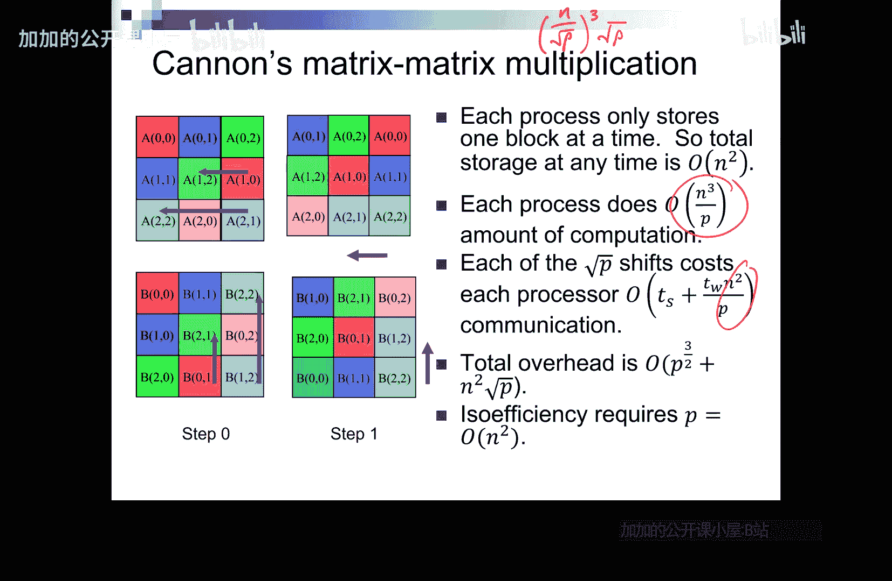
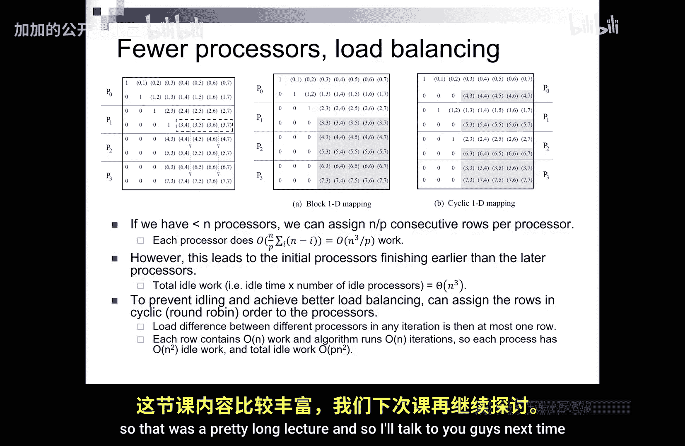

# 并行计算：第21讲：稠密矩阵算法

在本节课中，我们将学习几种针对稠密矩阵的并行算法。稠密矩阵是指大多数元素非零的矩阵，与稀疏矩阵（大多数元素为零）不同。稠密矩阵运算，尤其是矩阵乘法，通常是计算密集型的，并且由于其规则的结构，非常适合进行高度优化。我们将从矩阵向量乘法开始，然后探讨矩阵矩阵乘法，最后学习如何使用高斯消元法求解线性方程组。

## 矩阵向量乘法

上一节我们介绍了稠密矩阵的基本概念，本节中我们来看看如何并行地进行矩阵向量乘法。我们假设有一个 M x N 的矩阵 A 和一个 N x 1 的向量 x，目标是计算 y = A * x。

### 一维算法

首先，我们介绍一种一维划分的并行算法。该算法假设处理器按行划分矩阵 A。

**算法概述：**
我们假设有 P 个处理器。矩阵 A 被按行划分为 P 块，每个处理器获得 N/P 行。向量 x 初始时也被划分为 P 块，每个处理器拥有 N/P 个元素。

**执行步骤：**
1.  **数据广播：** 每个处理器将其拥有的那部分向量 x 广播给所有其他处理器。这通过一个“全到全广播”操作完成。
2.  **本地计算：** 每个处理器在获得完整的向量 x 后，使用其拥有的那部分矩阵 A 的行与向量 x 进行乘法计算，得到部分结果向量 y 的若干行。
3.  **结果收集：** 每个处理器计算出的结果就是最终输出向量 y 的一部分，无需进一步合并。

**复杂度分析：**
*   **计算时间：** 每个处理器进行 (N/P) * N = N²/P 次运算。
*   **通信时间：** 全到全广播的时间复杂度为 **T_comm = (t_s * log P + t_w * N)**，其中 t_s 是启动时间，t_w 是传输一个数据字的时间，log P 是超立方网络上的跳数。
*   **可扩展性：** 为了保持等效率（即计算量增长至少与通信开销一样快），需要 N² ≥ P * N * log P。这推导出 P 最多可达 O(N) 量级。因此，该算法最多可扩展到与矩阵行数相当的处理器数量。

### 二维算法

为了提高可扩展性，我们引入一种二维划分的算法。该算法将处理器排列成 √P × √P 的网格，每个处理器存储矩阵 A 的一个方块。

**算法概述：**
矩阵 A 被划分为 √P × √P 个方块，每个方块大小为 (N/√P) × (N/√P)。向量 x 初始时仅存储在处理器网格的最后一列。

**执行步骤：**
1.  **向量分发：** 将向量 x 的各个块从最后一列处理器发送（或广播）到网格对角线上的对应处理器。
2.  **列内广播：** 对角线上的每个处理器将其拥有的向量 x 块在其所在的列内进行广播。
3.  **本地计算：** 每个处理器用其拥有的 A 矩阵方块与接收到的 x 向量块进行乘法，得到一个部分和（即输出向量 y 的某个元素的部分结果）。
4.  **行内规约：** 每个处理器将其计算出的部分和在其所在的行内进行规约（求和）操作。规约结果最终存储在最后一列处理器上，形成完整的输出向量 y。

**复杂度分析：**
*   **计算时间：** 每个处理器进行 (N/√P) * (N/√P) = N²/P 次运算。
*   **通信时间：** 主要开销在于步骤1的发送和步骤2、4的广播与规约。每次通信的数据量约为 N/√P，在 √P 个处理器上进行广播/规约的时间约为 **t_s * log √P + t_w * (N/√P)**。
*   **可扩展性：** 等效率条件要求 N² ≥ P * (N/√P) * log P。这推导出 P 最多可达 O(N² / log² P) 量级，远优于一维算法。基本原因是通信量从 O(N) 减少到了 O(N/√P)。

## 矩阵矩阵乘法

在掌握了矩阵向量乘法后，我们进一步探讨更复杂的矩阵矩阵乘法 C = A * B。

### 简单分块算法

首先介绍一个基础的分块乘法算法。

**算法概述：**
将 A、B、C 矩阵都划分为 √P × √P 个方块。处理器排列成 √P × √P 的网格，每个处理器初始存储一个 A 方块和一个 B 方块。

**执行步骤：**
1.  **A 的行广播与 B 的列广播：** 每个处理器将其拥有的 A 方块在其所在的行内进行全到全广播。同时，每个处理器将其拥有的 B 方块在其所在的列内进行全到全广播。
2.  **本地计算：** 广播完成后，每个处理器获得了计算其 C 方块所需的所有 A 行块和 B 列块。然后，它执行本地分块乘法并累加，得到最终的 C 方块。

**复杂度与问题：**
*   **计算时间：** 每个处理器进行 (N/√P)³ * √P = N³/P 次运算。
*   **通信时间：** 广播的数据量为 N²/P，在 √P 个处理器间广播的时间约为 **t_s * log √P + t_w * (N²/√P)**。
*   **可扩展性：** 可扩展至 P = O(N²) 量级。
*   **内存问题：** 每个处理器最终需要存储 √P 个 A 方块和 √P 个 B 方块，总存储量为 O(N²/√P)。所有处理器总存储量为 O(N²√P)，是必要存储量（2N²）的 √P 倍，内存效率低。

### Cannon 算法

为了解决内存效率问题，我们学习 Cannon 算法。它在保持相同计算效率的同时，显著减少了内存使用。

**算法核心思想：**
Cannon 算法也使用 √P × √P 的处理器网格和分块。其关键是通过巧妙的初始数据移位和后续的循环移位，确保在每个计算阶段，每个处理器本地的 A 方块和 B 方块正好是正确配对的，从而可以直接相乘并累加到结果 C 方块中。

**执行步骤：**
1.  **初始移位：** 对矩阵 A，第 i 行的所有块向左循环移位 i 个位置。对矩阵 B，第 j 列的所有块向上循环移位 j 个位置。
2.  **计算并移位：** 重复以下步骤 √P 次：
    *   **本地乘加：** 每个处理器将其本地的 A 方块和 B 方块相乘，并将结果累加到其 C 方块中。
    *   **循环移位：** 所有处理器的 A 方块向左循环移位 1 位，所有处理器的 B 方块向上循环移位 1 位。

**优势分析：**
*   **内存高效：** 在任何时刻，每个处理器只存储一个 A 方块和一个 B 方块，所有处理器的总存储量仅为 O(N²)。
*   **计算与通信：** 计算量为 N³/P。每轮移位通信的数据量为 N²/P。总通信开销与简单分块算法同量级，可扩展性相同（至 O(N²)），但内存占用大大减少。

### SUMMA 算法

Cannon 算法要求矩阵是方阵且尺寸能被 √P 整除。SUMMA（Scalable Universal Matrix Multiplication）算法提供了更灵活的替代方案。

**算法核心思想：**
SUMMA 基于矩阵乘法的外积形式。它将计算 C = A * B 转化为一系列秩-1 矩阵（外积）的求和：
**C = Σ_{k=1}^{N} (A[:, k] * B[k, :])**
其中 A[:, k] 是 A 的第 k 列，B[k, :] 是 B 的第 k 行。

**执行步骤：**
对于 k 从 1 到 N（或分块后的块数）：
1.  **广播列与行：** 将 A 的第 k 列块在其所在的行内广播，将 B 的第 k 行块在其所在的列内广播。
2.  **本地外积计算：** 每个处理器用接收到的 A 列块和 B 行块计算外积，并累加到其部分结果 C 块上。

**优势：**
*   **灵活性：** 不要求矩阵为方阵，处理器网格也不必是方阵，支持更通用的矩阵形状和处理器映射。
*   **通信模式规整：** 通信模式是简单的行广播和列广播。

### 三维矩阵乘法算法

前述算法最多能有效利用 O(N²) 个处理器。为了利用多达 O(N³) 个处理器以实现亚线性时间，我们介绍三维矩阵乘法算法。

**算法概述：**
使用 P 个处理器，将它们排列成三维网格，尺寸为 P^{1/3} × P^{1/3} × P^{1/3}。将矩阵 A、B、C 也进行相应分块。

**算法思想：**
该算法可以看作是 SUMMA 算法在三维空间上的展开。第三维（K 维度）对应了 SUMMA 中不同的外积阶段 k。
1.  **数据重分布：** 将 A 的第 k 列块发送到第 k 层（三维网格的 K 维度），并在该层内进行行广播，使得该层所有处理器都拥有该列块的副本。对 B 的第 k 行块进行类似操作（发送到第 k 层，列广播）。
2.  **本地计算：** 每个处理器将其本地拥有的 A 块和 B 块相乘。
3.  **规约求和：** 对于结果 C 的每个块，需要将三维网格中 K 维度上所有处理器计算出的部分结果进行规约求和，得到最终结果。

**复杂度与可扩展性：**
*   当每个处理器只处理单个元素时，运行时间可达 O(log N)，但总计算工作量增至 O(N³ log N)。
*   通过使用分块（块大小为 N / P^{1/3})，可以使每个处理器的计算时间为 O(N³ / P)，通信时间为 O((N² / P^{2/3}) * log P)。
*   等效率分析表明，该算法可扩展至 P = O(N³ / log³ N) 量级，远超二维算法。

## 线性方程组求解

最后，我们探讨如何并行求解稠密线性方程组 A*x = b，其中 A 是 N x N 矩阵。核心方法是高斯消元法。

### 高斯消元与 LU 分解

高斯消元法通过一系列行变换将矩阵 A 化为上三角矩阵 U。同时，这些变换可以隐含地生成一个单位下三角矩阵 L，使得 A = L * U。
*   **求解过程：** 先解 L*y = b（前向替换），再解 U*x = y（后向替换）。
*   **复杂度：** 高斯消元（LU 分解）需要 O(N³) 时间，而每次求解（两次替换）仅需 O(N²) 时间。因此，当需要多次求解不同 b 但相同 A 的方程组时，LU 分解非常高效。

### 并行高斯消元

**简单并行化（非流水线）：**
将矩阵 A 按行划分给各个处理器。在消元第 k 步时，拥有第 k 行的处理器将其行（经过规范化后）广播给所有其他行号大于 k 的处理器。这些处理器收到后，用其更新自己的行。
*   **问题：** 通信开销大，总工作量为 O(N³ log N)，不是最优的。

**流水线并行化：**
为了优化，我们采用流水线技术，使多个消元步骤重叠执行。
*   **核心操作：** 每个处理器循环执行“接收-发送-消元”操作。
*   **流程：** 拥有主元行的处理器在规范化该行后，并不一次性广播整行，而是将其依次发送给下一个处理器。每个处理器在收到数据后，立即将其转发给下一个处理器，并同时利用收到的数据消去自己行中的对应元素。
*   **优势：** 实现了计算与通信的重叠，并将总工作量降低至最优的 O(N³)。

**负载均衡：**
简单的按连续行划分会导致严重的负载不均衡，先完成工作的处理器会长时间空闲。
*   **优化方法：** 采用**循环划分**，即将行以轮询方式分配给处理器。例如，有 P 个处理器，第 i 行分配给处理器 (i mod P)。
*   **效果：** 这大大改善了负载均衡，将空闲时间总量从 O(N³) 减少到 O(P * N²)。

## 总结

本节课中我们一起学习了稠密矩阵的多种并行算法。
1.  **矩阵向量乘法：** 比较了一维和二维算法，二维算法通过减少通信量获得了更好的可扩展性。
2.  **矩阵矩阵乘法：**
    *   **简单分块算法** 易于理解但内存效率低。
    *   **Cannon 算法** 通过循环移位在保持性能的同时实现了内存高效。
    *   **SUMMA 算法** 基于外积形式，更加灵活。
    *   **三维算法** 通过利用三维处理器网格，理论上能使用 O(N³) 个处理器，实现更高的并行度。
3.  **线性方程组求解：** 重点学习了基于高斯消元法的并行LU分解。通过**流水线执行**和**循环划分**策略，可以有效优化并行性能，减少通信开销并改善负载均衡。

这些算法展示了如何针对稠密矩阵运算的规则结构设计高效并行的方案，其中通信模式优化、内存布局和负载均衡是关键考量因素。