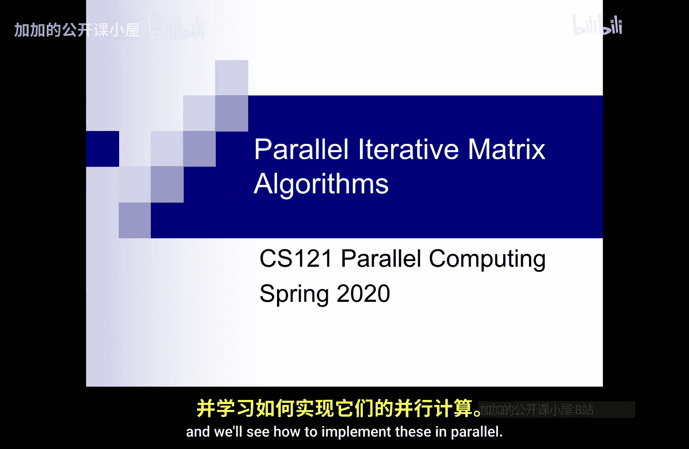
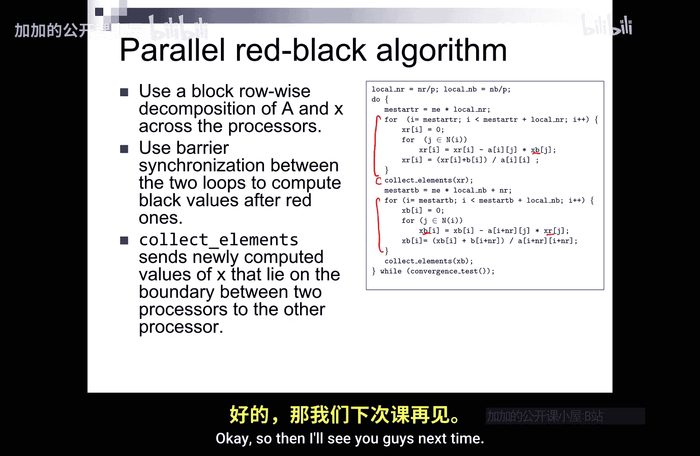

# 上海科技大学【中英⚡并行计算｜CS121 2020 Parallel computing】 p22 P22 Iterative matrix algorithms -BV1VqypBaEaP_p22-

welcomecome back。So today we're going to look at a class of matrix algorithms called iterative matrix algorithms。

 and we'll see how to implement these in parallel。

Okay， so remember from the previous lecture we talked about solving systems of linear equations right so we have the system A x equals B。

 so a is a dense matrix， it's an M by M matrix right and we're trying to solve for these variables X。

And we had a method called Gaussian elimination， which could solve this system in order N cubed time。

 and is the number of variables that we have。And we can run this in parallel also， however。

 it turns out that in practice we sometimes need to work with very large A's so so the A can have millions of variables or more so in that case since we have this the amount of work for Gaussian emination is n cubed then even if you run this in parallel。

 it's going to be way too slow for very large matrices。

So what we need is we need some faster algorithms to solve these equations。

And what we're going to see today is that we're going to look at first of all。

 some certain types of structured matrices， okay， so what are called banded matrices。

And we'll see that for these special matrices， we have these iterative solution methods。

 which can help us solve this AX equals B much more quickly。And in general。

 if we have general sparse matrices， then we can use these iterative algorithms to get approximate solutions to Ax equals B。

Okay， so we're not going to find an x which has exactly ax equals B。

 but we're going to find x is where Ax is very close to B。

And reason are called so these are approximate solutions and the reason these algorithms are called iterative is because we're going to sort of create these solutions step by step okay so we're going to initially start with a very poor solution some initial x vector and then we're going to do these iterative algorithms and then that's going to improve the quality of the x vector so AX is going to get closer and closer to B。

 the more times we iterate this process。And eventually we want the x that we produce to converge to the right solution。

 we want that eventually AX is exactly equal to B。Okay。

 so the way we're going to do this is so let's let a be an n by N matrix we're going to write a as as M minus n where M and N are also two matrices to n by N matrices and the first requirement is that we want M we want the inverse of M to be easy to compute。

Okay， so for example， if M is a diagonal matrix， then we can easily compute its inverse because it's just the inverse of all the diagonal elements。

Okay， so we're going to split a in this way and， yeah we want M inverse to be easy to compute。

And now suppose you have a solution to a x equals B， Okay， so let let's let this be x star。

Then since a equals m minus n， then just plugging that in。

 we have that M times x star equals n times x star plus B。Okay。

 so now we're going to define this matrix C over here。 Okay。

 so C is going to be equal to M inverse times n right。

 So remember that we want we have M inverses easy to compute。

 so therefore we can also easily compute C。Okay， and then D is going to be m inverse times B。

 so d is a vector， right？Okay， so then now if you just if you look at the previous formula here。

 So what we have is if you， if you multiply both sides of this formula by M inverse， Okay。

 then you're going to have。We're going to have this right。

 So we're going to multiply this by M inverse and on the left it's going to cancel。

 So we just have an x star on the left And on the right。

 the first term is going to be since we're defining C to be M inverse times n right。

 then the first term here is going to be C right And then the second term here is going to be D。

So therefore， we have that x star is going to equal c times x star plus D。Okay。

 so now the way we're going to run this iterative algorithm is that we're just going to repeatedly apply this formula over here。

Okay so what that means is that initially we're going to start with some value， some vector x0。

 let's say we're going to plug x0 into this formula， so we're going to compute c times x0 plus D。

Okay， so that's good that's going to get a new value for x， right， let's call that x1。

 then we're going to plug that x1 into the formula again。 so you compute c times x1 plus d。

Okay that gets you a new vector x， which let's call that x2， and then you plug that back in。Okay。

 so you just keep doing this and then so let's say that after doing this for k times。

 you get a certain vector x of k。So then for the next iteration。

 you're going to compute x of k plus 1， which is equal to c times x of k plus d。

Okay so remember our goal was that as we keep iterating this process。

 we get closer and closer to the actual solution of the equation。

 so we're trying to solve this equation over here and we hope that as we iterate this process。

 we get closer to the true solution X star。Okay， so the way we can express that is。

We want to say that the iterates converge， and so we're going to say that as you take k to infinity。

 then x of k eventually converges onto the correct solution x star。

And this x star solves this equation over here and then once you get this x star right。

 then we have that x star also solves this original equation so we have a of x star Aa times x star equals B。

Okay， so then how do we know so these iterations do not converge under all conditions okay。

 so we need some special situations in order to guarantee that these things converge okay so how do we what are the criteria that can ensure that these iterations converge？

🤧Okay， well， the way we're going to do this is let's， first of all。

 write that So we have that x of k plus one equals c times x of k plus d。 Okay。

 so now if you subtract x star from both sides Okay， so then。

What you get is that so on the left here you get x of k plus 1 minus x star and this equals if you subtract x star over here。

 right it equals this okay。But you see that d minus x star okay so suppose we subtracted x star over here。

 okay， so if you do d minus x star over here right and then suppose you move you know the c times x star to the other side os so you see that d minus x star this term over here is equal to c times x star。

Okay， so therefore this term here is so we have this is equal to c times x star sorry this is a negative of c times x star so this is equal to negative of that so then you factor off the C and you get that the right hand side is equal to c times x of k minus x star。

Okay， so we have that the left hand side is going to be x of k plus 1 minus x star。

 and this equals c times x of k minus x star。so this gives us some relationships these between the convergence so so basically what we're looking at is we want these these x of k to eventually converge to x star So then here on the left hand side this is like the error in x of k plus1 because you're just subtracting x of K plus1 minus x star and then this is saying that the error for in the k plus first iteration is equal to c times the error right so this is the error in the K iteration。

 it's equal to c times the error in the K iteration。Okay， so that's what this formula indicates。

And now you can also so here you know k can be just any value。

 so therefore if we can just do the same process and you can also get that the error in the K step is equal to c times the error in the k minus first step。

Okay and in general， if you do this for k times， what you see is that the error in the K step right so each time you do this you're basically you're going to multiply by another factor C over here because you know here error in the K plus first step is equal to c times the error in the K step which is equal to another c times the error and this thing over here is equal to c times error the error in the k minus first step。

Okay， so so each time we expand these terms right we get that the error is equal to eventually we get that the error is equal to c to the K power Okay times the initial error right so this is the initial vector that we started with so this is the initial error in that vector。

Time C to decay Cap power。Okay， and so we want things to converge。

 we want this to eventually go to zero。Okay， so then how do we know whether this goes to zero， Well。

 it depends on what happens with the C over here。So now if you let a row of C so we're going to compute the largest eigenvalue of C and let's let row of C be the magnitude of that largest eigenvalue。

Okay so then we have this theorem right so basically the theorem says that if the largest eigenvalue if the magnitude is less than1。

 then these iterates are going to converge。Okay， in other words。

 so if the magnitude here is less than1 right， then C to the K power。

 if you take that to the limit K equals K approaches infinity， then this is going to be 0。Okay。

 and if this is zero， right if this term is zero over here， then that means that eventually these xs。

 these iterates are going to converge onto the correct solution。Okay， and furthermore。

 this happens for any initial x because if this is0 over here。

 then it doesn't matter which x you start with any x is eventually going to converge to the right solution。

Okay so this is the basic iterative method。 Okay we're going to take a matrix A。

 You're going to break it into two parts M and N where M is M inverse is easy to compute and then you want to make sure that this matrix C over here。

 which is equal to n inverse times n You want to make sure that this guy has a eigenvalue。

 the largest eigenvalue is less than one in magnitude。If this is true。

 then you can run the iterative algorithm and you can get the solution。Now。

So we're going to decompose a equals M minus n but I haven't specified what M and N are The only requirement is that M inverse is easy to compute but there could be different matrices。

 different Ms where their inverses are easy to compute so which M and N are we going to use。

Right so now depending on the M and N you use， we're going to have different iterative algorithms。

 so the first iterative algorithm is called the Jacobbe method。

 so here we're going to take this matrix A and you're going to write this as three terms okay so the D term here is just going to be the diagonal elements in a。

Okay， so we have a matrix A over here， right so we have some diagonal elements， okay。

 and that's the D term。Now， below the diagonal， you also have some elements， okay。

 so let's call that L。Okay， and then above the diagonal， you have some elements， let's call that R。

Okay， so then L or negative L rather is going to be the lower triangular part of a。Okay。

 so we're going to take away D， and then if you look at the lower triangular part， right。

 that's going to be negative L。And then the upper triangular part， that's going to be negative R。

Okay and now we're going to set M to be just the diagonal elements。And then for n。

 we're going to set that to be equal to L plus R。Okay， so in that case。

 we have that we have a equals M minus M。Right。And then also we wanted to make sure that M inverse is easy to compute。

 and this is true in this case， because if you just set m to the diagonal elements。

 then we can easily compute the inverse just by taking the inverse of all the diagonal elements。啊。

Okay， so now we have that C equals m inverse D sorry， m inverse n。

And so that's just equal to a D inverse times l plus R okay， And then this vector here。

 D is equal to d inverse times B。OkayNow we can actually compute this C matrix explicitly because if you look at the IJve entry。

 okay so if so let's say this is the matrix A over here right and let me draw a again right so if you take the IJve entry okay then if it's let's see。

So if it's on the diagonal。Okay， then。So then notice that this L plus R has only zeros on the diagonal because we've taken out because the way you form a is or sorry。

 the way you form these L and R is that you don't include the diagonal elements so L plus R has zeros on the diagonal okay so all these Cis are going to be zero and then off of the diagonal。

 then you just have that the C matrix is exactly equal to the a matrix。Okay。

 so then so then in the IJ position right of C， you just have that this is equal to a negative AIJ。

Okay， and now you want to multiply this by。 I'm sorry， in the。So before you multiply by d inverse。

 okay in the IJ position of L plus R， you have that this is equal to AIj negative AIj and then once you multiply by d inverse then we know that D inverse is simply the inverse of all the diagonal elements so if these are the diagonal elements right so if we have like1。

3，2 right then the inverse is just going to be it's going to be one and and then one third and then one half。

Okay， so each of these， so when you multiply by the inverse here。

 you simply divide by the diagonal elements of a。So therefore。

 the IJth element of C is just going to be negative AIJ divided by AII。Okay。

 and that's for all the non diagonal elements and then for the diagonal elements。

 it's all going to be zeros。Okay， and then for D right。

 so D here you just you divide by all of the diagonal elements of a because again。

 D is simply the inverse of all those diagonal elements。Okay。

 now it turns out that if so we these we have these conditions to guarantee convergence Well it turns out that if you have this condition over here。

 okay if the diagonal elements so for each diagonal element okay AII okay if you take all of the other non-diaagonal elements and if AI AII is actually larger than the sum of all those non-diaagonal elements。

 okay they are absolute values， then we have that we can guarantee the iterative process is going to converge。

Okay， so in that case， we say the matrix is diagonantally dominant。

so if you have that the diagonal elements are very large compared to the non diagonal elements。

 then the matrix is diagonally dominant， and then it's guaranteed that the iterative algorithm will converge。

Okay， so now now let's try to run the iterative algorithm。 Okay。

 so the basis for the iterative algorithm is that we need to keep using this formula over here。

 And so the way you do this is well now we know all of the the values。

 the components of C and also D so we're just going to plug those into this formula over here。

 so now so we have we've already computed this x of K。

 so we're gonna to take these components of x and K。

 we're gonna multiply this by c and then add D to it。

 and then we're gonna to see what we get so in particular， if you look at x of k plus1。

 and you look at the I component of that。 what you see is that what you simply need to take let's see。

 how do I represent this， so let's say that this is our C matrix over here okay。

So let's see raise all this other stuff And then you need to multiply it by this x of k K or x of k right And so yeah。

 so we're just going to go through a row of C and then multiply by this x of K over here So in general。

 if you're in the I row then if you look at these values for the I throw So these formulas tell you what exactly what values are in the I throw of C you see that when you do this multiplication。

 you're going to get that so this part over here is going to be equal to to C times x X of K this part over here And then this part over here divided by the AI this is going to be equal to the I component of D。

Okay， so therefore， the I component of x of k plus 1 is going to be equal to this。

Now the reason you have a J not equal to I over here is because remember that the diagonal element of C is actually zero。

 so we add up the entire i throw of C except for we skip over the diagonal element。🤧嗯嗯。Okay。

 now if you look at this formula， okay， you see that in order to compute the K plus first value of x。

 the K plus first iteration of x all you need are the values from the K iteration of x。RightSo yeah。

 so x of k plus1 only depends on values from x of k and also you notice that different coordinates of x of k plus1。

 they don't have any dependencies on each other。Because for example， this coordinate， right。

 the I coordinate， this only depends on values from the I row of C。

And so every coordinate of x of k plus 1 depends on a different row of C。

 so they don't have any dependencies on each other。So therefore if we've already computed x of k。

 then since that's all we need for x of k plus1， and since all of these coordinates don't have any dependencies。

 then we can compute all the components of x of k plus1 in parallel。Okay， so yeah。

 so before we give the parallel algorithm let me just show you like an actual example of doing this JacobB iteration okay。

All right， so the basic formula that we have over here is so this is just a formula from the previous page。

And if you want to apply this on a concrete example， then suppose you have this matrix A over here。

Okay， now this matrix a is diagonally dominant， okay。

 because these diagonal values are larger than the sums of all of these non diagonal values。Okay。

 so then the way that you form the way you do the JacobB method is you're going to take all of these diagonal elements。

 right and then。You're going to take away all of these diagonal elements Okay right so you're going to take away the 10。

 11，10 and 8， right and so that leaves you with all of the non non diagonal elements。

And then you're going to multiply that matrix okay so here we've taken away the diagonal elements and then you multiply that matrix with x and that gets you the next iteration of x。

So for example， if you start with。If you start with x is the x being all zeros。

 then if you multiply by the L plus R matrix， then you're going to get this thing over here。

 and then if you divide by these diagonal elements， then you're going to get these values over here。

Okay so that's one iteration of this iterative algorithm you start with all zeros and then you get a new estimate for x and then you can plug this into the overall equation and you can see that when you use this x you get a much closer solution to this overall equation than when you use this initial value for x。

Okay， and then for the next iteration， you would plug these values into this formula over here。Okay。

 and then that'll get you some new values for x， which will be an even better solution。Okay。

 so now let's see how we can actually run this JacobB method in parallel so so since all of these components of x of K plus1 are independent。

 we can use up to end different processors to run this。Okay， so so when we do this。

 so let's say that you actually use P processors， so P can be as large as n。

So the first thing is how do we distribute the matrix among these P processors and we're just going to use the traditional rowwise block format okay so if you have a matrix like this right and if you have P processors。

 we're just going to break the matrix into chunks of n divided by P rows each and then you give each chunk to a processor。

Okay， so here so this is going to be an M by M matrix right。

 and then each of these chunks is going to have n divided by P roles in it。and likewise。

 you're going to break the B vector also into n divided by P entries each。

OkayNow the way this code is going to work is that it's going to compute。

 So x of k plus1 is going to be called x new in this code。 Okay， so this is MPI code over here。

 and I'll go through this in more detail soon。 Okay， but let's first look at it at a high level。

 So x of K plus1 is x new and x of K is going to be called x old。Okay。

 so now in order to do this operation over here， okay， to do one iteration of the Jacobbi method。

 you see that each processor needs all of the values of x。Okay， and so what we're going to do is。

Let's see。 Okay， So n local is the number of rows that each process has。 Okay。

 it's equal to n divided by p。 Okay so we have the the old sorry。

 we have this is going to be the new value that we're trying to compute for x。

 and this is the old value for x。 And so what we are doing is that for each of the rows that we have。

 Okay so each process will be responsible for n divided by P coordinates。 Okay。

 so each process has n divided by p different values of I that it's trying to compute apply this formula for。

 And then so here in this loop， we're just applying this formula。

Okay so the i global here is going to be sort of the row that the process is working with Okay so for example。

 if there are let's say let's say there are 50 rows。

 let's say n is equal to 50 Okay and let's say you have five processes right then each process is going to have 10 rows and so so n local here is going to be equal to 10 right me this is going to be the I of the process Okay so if we're talking about process 2 right。

Then if it's working on its let's say first row， right。

 so then that actually corresponds to sorry that corresponds to the 21st row overall。Okay。

 because since we're working on process two， then the previous two processes already received 20 different rows。

 Okay， so the first row for process 2 is actually the 21st row overall for all the processes。

 so that's what we're computing in this eye global over here。Right， now this part。

 this line over here is just sort of so you notice that the first thing we need to do is we need to do B divided by AII Okay。

 so this part over here is copying the B's into the into this local X vector over here。Allright。

 and then next we're going to do this so we're going to do these four loops。

 now the four loops correspond to two parts， so you have this overall sum over here so the sum actually goes from one up up to I minus1 and then it goes from I plus1 to n because we want to skip over coordinate I over here。

So the first part of this for loop just sums all the values from1 to I minus1 so you see that we're going to take this b value right and you're going to subtract the part of the a matrix that we have multiplied by the old value for x the old value for x in the J coordinate is going to be this x of k subj。

Okay， so we do that for the first part so that's the first four loop over here and the second four loop just goes through the other part also。

Okay， and then after that， right， So after we've done both four loops。

 we've actually computed this this entire sum over here。 Okay。

 now the final thing to do is just just to divide by A of II。 Okay。

 so then here we divide by this thing。OkayAnd the reason we're using the global so here the first index is our local row right so if we're working with a row 1 right then yeah we're going to use a1 okay but you know the actual row globally in the matrix in the a matrix that we're working with is let's say actually 21 okay so we need to go look in column 21 and then the first row of our local a matrix。

Okay， so then after doing this entire let's see okay， so after doing this entire for loop over here。

 okay， then each process is going to end up with n divided by p values of this x of k plus 1 he's going to end up with n divided by P coordinates of this x of k plus 1。

And now we want to just send this entire vector x of k plus1 to all of the processes。

Okay because right now they only have part of x of k plus1。

 but we want all the processes to have all of x of k plus1 so to do that。

 we're just going to use this MPI allga command over here so this allga is going to take each process is going to take its local chunk of x of k plus1 and it's going to sort of send it to all of the other processes or alternatively you can say that each process is going to get a chunk of x of k plus1 from each other process。

Okay， so that's what we're doing。 And then and then so because this is an iterative algorithm， right。

 then we're gonna to keep doing this process。 Okay， so each of this each time we do this process。

 we compute the next iteration now， when do we stop right because you don't want to do this forever so you stop when either you've run for like some maximum number of iterations。

 Okay， so let's say you only want to run for 100 iterations。

 or you stop when x old and x new are very close to each other。

 so if you have x of K plus one right and x of k are very close to each other。

 then you can also stop because at that point， you converged。Okay。

 so that's how you do this JacobB algorithm in parallel。

so now we're going to talk about a new algorithm or sorry basically a modification of JacobB JacobB's algorithm okay it's called the Gacido method。

 so the Gauscido method is going to converge faster than the JacobB method。

And the way it works is again， we're going to write a as equal to the diagonal elements minus a lower triangular part minus the upper triangular part but previously we set M to be equal to D and now this time we're going to set M to be basically the entire lower diagonal part plus the diagonal so again。

 we have this picture of a over here right so we have the diagonal part over here we have the lower part and the upper part so now we're going to set M to be equal to this entire thing over here including the diagonal。

and then n is going to be the upper part。Okay， so then C is going to be equal to m inverse times n。

 right， so that's going to be equal to d minus l inverse times R。

now D minus L here this is a lower triangular matrix so if you're trying to so we need to be able to compute this inverse quickly right but you can do this because d minus L is a lower triangular matrix。

 then you can use the forward substitution method to compute its inverse so forward substitution is basically use solve for this variable first and then you substitute and then solve for for the next variable So then you just go row by row like that。

And you can do that when it's a lower triangular。OkayNow it turns out that this galcial method。

 we can also guarantee convergence if the matrix is diagonally dominant， okay。

 so the diagonal elements are larger than these sums of all the other elements。Okay。

 and then also we have that x of k plus1 is again， equal to c times x of k plus d。Okay。

Now it turns out that so we actually want to figure out all the components these of the x of k plus 1 so we want to write this in component form。

 so it turns out that by doing some operations similar to the JacobB method。

 you can show that x of the I component of x of K plus1 it's going to be equal to this thing over here。

Okay，Now this thing is actually very similar to the previous sum that we had for the JacobB method because you see that again to get the row sorry to get the value in the I row。

 we're going to iterate through the I row of a and then you're just going to multiply by these corresponding elements x of x now the only difference is that。

So in the Jacobbi method， we saw that we broke the sum into two parts right first part is for the Js from 1 to I minus1 and the other part is from I plus 1 to M and in both parts you multiply by this x of k。

So x of k is what you computed in the previous iteration。Now in the Gaus cytoal method。

 we're going to do the same thing basically we're again going to take the I row of a。

 but now for the first half of these sum for J from 1 to I minus1。

You're going to multiply it by an x of k plus1。which is what you're computing in this iteration we're in the k plus first iteration and then for the second part of the sum you're going to multiply that by x of k。

 which is what you computed from the previous iteration。Okay。

 so the way this is going to work is we're going to compute these components of x of k plus 11 by one for I equals 1。

2，3， and so on。Okay， and so first of all， we're going to compute this for I equals1。

And when you do this for I equals one， right， then actually you don't have any terms over here。

The only terms are over here， so we need to add this up for I equals2 up to n。

for j equals 2 up to n and this is only relying on the values that we computed from the previous iteration x of k。

So to compute x of k plus1， sub 1， we only need values from x of k。

So then after you compute the first component， we're going to compute the second component of x of k plus 1。

In that case， we actually need to use one component from x of k plus 1， namely the first component。

But we just computed the first component， so therefore we have this component over here。

And then for all the other components， we're going to use the ones from x of k。

so that's going to let us compute the second component of x of k plus1 and now when you compute the third component of this thing。

 you need to use the first two components of x of k plus1， but we just computed those。

 so we have those。And for the other components， you use x of k。All right。

 so the basic procedure is that you compute these components for I equals 1，2，3 and so on。

 and whenre the when you're trying to compute the I component。

 you need these I minus1 components of x of k plus1， but you've already computed those。

 and so you can just plug those in。and for the remaining components。

 you're going to use them from x of K。All right， so now what is the benefit to doing this Okay so this is different from the JacobB method and the claim is that this Gaus cyto method is actually somehow more accurate because it converges faster than the JacobB method Okay Now why does it converge faster than the JacobB method。

So intuitively we're not going to do sort of the proof of this。

 but intuitively what is happening is that in the JacobB method right the sum only used so let's sort clear the sub over here the sum only used values from the previous iteration right from the cave iteration。

And presumably the cave iteration is less accurate than the K plus first iteration。

 because as we iterate， we get better and better approximations for x for x star。Okay。

 so this JacobB method is using sort of these inaccurate values for x。Whereas the Gauscio method。

 because some of these values are from the current iteration and know this current iteration has produced more accurate estimate for x。

Okay， so then here we're using these more accurate values for x。

And then also here we're using some inaccurate values for x。

 but at least part of this formula involves more accurate values for x。Okay。And so therefore。

 since your inputs are more accurate， right， then your output over here。

 it iss also going to be more accurate intuitively。

OkaySo so that's how this is working okay so using these by using the values from the current K+ first iteration。

 which is more accurate than the values from the K iteration。

 then we can get more accurate values for these components。Okay。

 and this is what allows the Gacio method to converge faster than the。JacoB method。O， now。

The problem with the Gauscio method， okay， so even though it converges faster。

 the problem is that you know for the JacobB method。

 we could compute all of these components in parallel because all of these components only depended on values from the previous x of k so as soon as you're done with x of k。

 you can compute all of these components of x of k plus1 in parallel。However， for the Gauscio method。

 you can't do that anymore because for the Gauscio method。

 when you're trying to compute the I component over here。

 you need to first compute up to component I minus1 in this k plus first iteration。Okay。

 so that means that for the K+ first iteration， you need to go through these components basically one by one to compute them。

Okay， instead of computing all of them in parallel。Okay， so therefore in practice。

 even though it converges using fewer iterations， using a smaller value for k。

 it might not run faster because you have less parallelism。Okay。

 so later on we're going to see how to actually apply the Gauscio method in certain special cases in order to actually get parallelism in those special cases。

 but in general you know because of these dependencies between the different components of x of K plus1。

 then in general we cannot parallelize this process and so it's not going to be it's not necessarily faster。

Okay， now before talking about those special cases。

 I'm going to introduce one more method which is called SOR。

 which stands for successive over relaxationx。Okay， so this is a modification of the Gauscido method。

 and it again has improved convergence compared to the Gauscido method。

Okay so basically so in the Gauscial so the way the SOR method works is that x。

 each time we iterate is now going to be a linear combination of the value you get from the Gauscial iterations and the previous value for x。

Okay， so so in formula so to give a formula， what we're going to have is we're going have these two terms。

 Okay so the first big term over here， right， this entire thing over here。

 okay this is going to correspond to the the value from a Gauscial update So you see that this this is exactly if you ignore this omega over here if you put a one over here。

 then this is exactly what you compute for a Gauscial iteration。However。

 we're going to add this to a combination of the previous math previous value for x。 Okay。

 so therefore， we're going to have this parameter over here， Oomega and。Yeah。

 and this omega is going to be sort of control how much of the Gauscio update we're going to use versus how much of the previous value we're going to use。

Okay， so now so we can set different values for omega。

 and it turns out that the convergence of this SOR method is going to depend both on the properties of a。

 Okay， so， for example， if it's diagonally dominant or not okay and。

It's also going to depend on properties of mega。So for example。

 it's been shown that if a is symmetric and positive definite， and if omega is between zero to 2。

 then this method SR method will converge。看。All right， so then。

Now in order to parallelize this so this SOR method has the same amount of parallelism as the Gauscio method because to compute this part of the SOR method that can be done completely in parallel because it only depends on the value from the values from the previous iteration of K。

And here right this is just the Galcido method， so therefore if we can parallelize this part。

 then we can also parallelize the SOR method。Okay， so then for the rest of this lecture。

 we're going to look at different ways of parallelzizing the Gauscito method okay so we're going to so in general we can do some parallelism。

 but it's not going to be a highly parallel implementation and then we're going to focus on special cases where A has a special structure and then we can see that in those cases you can actually get much more parallelism。

Okay， but first， we're going to start with just in general。

 how would you try to parallelze seaal cyto method， Okay， so basically on what we're going to do is。

Well， we're forced to compute these I components sequentially okay so you have to do I equals 1 before I equals 2 and then you can do I equals3 and so on So then in this code over here we're just going to iterate through the I sequentially so the outer loop is just computing these different i values。

Okay，And the parallelism is actually going to be for each fixed value of I right So you have this big sum over here。

And the parallelism is just going to be that we're going to parallelize the sum。Okay， so for example。

 if you have， let's say 1 thousand0 terms over here， Okay， because n is 100。

 and then if you have 10 processors， then you can get。

Each processor to add up like 100 components of the sum。Okay， and then after that。

 you're going to add up all the components。Okay， so that is going to be our parallelism。And。

Yeah and so you know if you have a big sum over here。

 then each process is going to take part of the sum okay so that's what's happening over here okay so each process is going to be computing these various indices and that's going to correspond to the indices assigned to that process so if you have like lots of indices over here right so you have lots of indices right you're going to give the first part to process one right and then the second part to process two and so on。

And and all of these things over here so the js are going to be so each process is only going to compute n divided by p terms out of this overall sum and so this j is just going to be you know if you're the second process you're going to add up this part over here and you need to get all of those indices and then take take the a multiply by x and now oh I should mention that this x so this x depending on depending on the index J over here it's going to either include a new value for x from iteration K plus1 or it's going to include some old value from x from iteration K。

Okay， so。The way this code works， you automatically the way it works is you only have one copy of x okay and so part of x is going to be have the new values and then the other part is going to have the old values so by the time you're in the eighth iteration right then all of the values before index I are going to be the new ones from iteration K plus1 and all the ones after index I are going to be these old ones。

Okay all right， and then after that we're going to gather all of these values onto this so then we need to each process is going to add up some of these values and we need to add all of them together to get the new value for x of K plus1 in the I component and so add to do that we're just going to first of all compute which node we want to add all these values onto and then we're just going to do a reduced operation over here。

Okay， so this is going to reduce onto so we have this root process and the root is going to change depending on which iteration we're talking about and then this root process is going to get this entire sum over here right and then it's just going to divide by AII over here okay。

And then that is going to be the new value for x of k plus 1 subi。

And then we also need to know whether when we should converge。

 So we're going to compute this this deelta value over here， which is basically on。

You know how much x has changed， Okay， so this deelta x is， how much x has changed。

 And then we're going to look at like in total， how much x has changed。

 So we're going to do this all reduce here。 So every process we'll get to see how much X has changed。

 Okay And if x changed a lot， right， So if this global delta is is is large。

 then we're going to keep iterating because we haven't converged yet。 Okay， and otherwise。

 if global delta is less than this tolerance， then we're going we're going converge。Okay。

 so that is basically the what we're doing now in terms of the speed up。

 we're not going to get too much speed up over here because each process is only doing n divided by p computations because it's just doing part of the sum over here。

 which has n divided by P multiplications and additions and then you have to do a communication step because you have to reduce all of these p different values so you're actually doing quite a bit of communication for not too much computation like if n is 1000 here and p is 10 then you're just doing 100 math operations and then you have to do some sort of communication and that communication can easily take more time than your 100 math operations so probably you're not gonna get much speed up unless you have a very large n so if n is like a billion and then you have 10 processes then you know you're going to do 100 million computations on each processor and that's probably going。

be a lot more than your communication time。 And in that case。

 you actually do get a speed up with this method。Okay， but in general。

 this is all we can do for the Gauscido method， so in general we're not going to get a large speed up。

Now next we're going to focus on some special cases of the Gauscido method， and for these cases。

 we can actually get more speed up than in the previous example。Okay。

 so so the case we're going to look at basically is this thing called Posons equation。 Okay。

 so Poson's equation， it's a partial differential equation。

 and it can describe some physical phenomenon like a potential field。

 which can be caused by either mass or you know， so it can be a gravitational field or can be like an electric field。

Okay， so we're not going to worry too much about you know， the physics behind the Pos equation。

 So we're going to look at this equation in 2D。 We're just going to focus on like the。

Unlike how we can implement this efficiently in parallel。 Okay。

 so the way that you can express Pos equation is we're going to use this So we're trying to figure out this this feehi here fee here。

 Okay， so fee is going to be a bunch of values。 Okay。

 We're trying to figure out what these values are。So we're going to apply this theplace operator。

 right this little triangle over here，2 phi。And so the way the Laplace operator works is that so we're working in a 2D space。

 and then phi is going to be a function on this 2D space。

So this operator is going to take the second derivative of this function in the x direction and then add it to the second derivative in the y direction。

Okay， so so let's say that you have this。PartThis part of the 2 d space over here。

 And let's just sort of focus on you know， some some region， let's say from 0，0 up to 1，1。 Okay。

 so we're just focusing on the square region over here。 now what we're saying is that。

If if you apply the Laplace operator， so suppose you actually know a bunch of values you have this function F defined in this range now you want to find a p such that when you apply the Laplace operator。

 you actually get F。Okay， so F is our input and we're looking we're trying to find this fee over here。

 such that the lapplaceian operator on phi is equal to F。

So the way we can do this is we're going to discretize the space Okay so you know initially it's a continuous space。

 but we're going to discretize it and we're going to split this into like an n by m plus1 by m plus one grid Okay so there're going to be m plus one points over here and there's n plus one points over here okay for some n。

And then H is going to be the size of each of these little squares that you form， okay。

 so H is going to be basically one divided by n plus 1。

And now we're going to say that at each position in this grid， at position IJ。

 we're going to let u of IJ be the value of phi at that position。Okay， so yeah。

 and then we're going to let f of Ij be the value of F at that position。Okay。Now， once you have this。

 it turns out that so now we want to express this Laplace operator in terms of these values。

 U and F okay， and it turns out that。So the Laplace operator has second derivatives right so you know that if you have first derivatives。

 then the way you can express like a derivative is something like。

 well a derivative would be we want to take let's say the value of u at this point so that's the value a phi at this point and then if you subtract the value of u at this point and then if you divide by H so we have。

 let's say u of I plus1。J， right minus u of I J。Okayops。

 and then you divide this by H so now this is going to be approximately equal to the derivative of phi right with respect to x at this point IJ。

Because it's just an approximation for the derivative。Okay， so but for the for the Poson equation。

 we actually want the second derivative okay now it turns out that you can use a very similar method and you can express the second derivative over here and also the second derivative in y。

And then if you do that， you're going to end up with an equation like this。So just like over here。

 you can write this in terms of the U values， you can also write the second derivative in terms of the u values。

 and then you want this to be equal to the value of F at this location。

And you want this to hold for all the points， for all IJ from0 to n plus1， you want this to hold。

Okay， so that means that you have a bunch of these equations over here for each value of I and J。

 you have one of these equations。And these are linear equations。

So we're given the values F because that's part of your input and we're trying to find the values of phi。

 and that just involves finding all of these u values。

So this means that we've now expressed Poisson's equation as a system of linear equations。

Okay and now we're going to go solve those equations using the Gauscio method。Okay。

 so before we do that， let's just suppose that we're going to fix the value fee on the boundary of this。

 Okay， so the boundary is going to be you know， these locations over here。

 we're going to fix the boundary of this。 And then so here you have to divide by this term 1 minus H squared。

 Okay， because you're doing a second derivative。 So it turns out to be an H squared。

And so let's just sort of take out this term so that we don't have to keep writing it later， okay。

 so we're going to divide out both sides by one over h squared。

and now since we fixed the value p on the boundary。

 we're going to look for the value p in the interior of the square and that's going to lead to a system of n squared linear equations。

 one for each I from1 to one to capital n。Okay so then how do you solve these equations so we're going to let x of k so we have a bunch of these unknowns so these unknowns have two indices which is kind of hard to work with so instead we're going to just convert these to a single index so yeah so what you're going to do is you're basically going to to label all of the x values sorry you're going to label these u values in this order okay so the indices are going to work like this。

 so it's going to be a row major ordering of all of these points in the square。Okay， so in general。

 you're going to have that os。Okay， right， so in general。Okay， let's do this a bit more slowly。

All right， fine， so everything shows up at once Okay so in general on point UI J over here is going to get converted to this index K where k is going to be equal to the row plus know the column times n。

Right and then now we can so we have these we have this equation over here and you see that basically for each equation。

 you have only five non-ze values over here five nonzes in the in the coefficients so what that gets converted to is if you look at a why is this so slow so if you look at a picture of this so for so here we have n squared unknowns that we want to solve for in total because we have n squared different values of UIj so now we're going to make an n squared by n squared matrix right so we're going set this little n here is actually going be equal to capital n squared。

Okay， so now we're going to write， we're going to show exactly where the non zeros in this matrix are。

 So this picture shows where the non zeros are。 so in general， you have。From the previous page。

 you have that we're trying to solve this equation。 Okay， so this。Right， so you see that for example。

 this thing over here right， This is going to be x of k。 Okay， so in that case。

 we have that this is going to be x of K minus-1。 Okay， and then this is going to be x of sorry。

 this is going to be x of K plus1， this is going be x of k -1。 And then now these two things。 Okay。

 these two things are in a different are in a different row。 Okay。

 so so instead of just being x of K plus1。 right， this is actually in x of K plus the next row。

 right， So each row has n elements。 Okay so this is actually the next element in the next row。Okay。

 and this is the element in the previous row。 Okay， X of K minus n。ok。Right， okay。

 so then let's go back to the this formulation over here。 right。

 So this is how you get this equation over here。 Okay， this is again， U of Ij。

 This is u of I minus1 j and so on。 Okay and this Bk over here。

 This is so we said that we're just going to take these F of Ijs。

 And you're going to divide out by the by the by one of square by one divided by H squared。 Okay。

 so that's where you get these B values from。Okay， so we have these equations right。

 and now we're trying to solve them。 And so if you look now let's， first of all。

 look at where the nonzero values in this equation are。 Okay， so we as I said for each value of k。

 right we have only five nonzes。 we have a nonze here。

 and then for this and then for these okay so if you look at how this works， then for example。

 if you have an x of k over here， so then you have a nonzero in the in the previous index。

 K minus1 you have a nonze in the next index K plus one。And then you have another non zero。

 which is in the index k minus n， okay， so that's what's being shown over here。

And then actually there's also going to be a nonzero over here in the index K plus n。Okay。

 so every row is going to have five non zeros。And if you look at all of the the rows right。

 then you see that the non zeros are actually going to lie on only five different diagonals。Okay。

 so the main diagonal is just corresponding to these terms over here and the next diagonal over here。

 that's corresponding to the k minus1 terms over here right and the K plus1 terms are these upper diagonals and then these two things are the K plus n and K minus n diagonals。

But overall， you have five diagnoses for this entire matrix。哦。Okay， alright。

 so now we're gonna apply the Gauscial method for this for for in in this case。 Okay。

 to solve Posons equation。 So on here， I've rewritten the Gacial method。哎。

And when you apply this to Poson's equation， you're going to get this right so here I'm just plugging in these values over here right Okay。

 so now lets let's look at this sort of pictorially so what we've done is we took the grid and then we're saying that for every grid point。

 this corresponds to one of our unknowns。Okay， and now so then in that way。

 you get n squared unknowns。However， you can label these unknowns in any order。 Okay。

 so we have a grid of points， right each one of them is a unknown。

 but you can you can sort of order them however you want。 So， for example。

 we can order the unknowns in this row wise fashion。Okay， you could also have other labelings。

 so we'll see that other labelings are going to have different properties。

 but the first labeling we're first ordering we're going to have is that we're just going to label these unknowns row by row。

Okay， now if you do this， right， then what you see is that。Yeah。

 so we're going to place these x values on the grid。And then you see that。Let's see Okay。

 so so then we have these dependencies between the variables Okay， so for example。

 this variable right， when when you solve this right when you want to compute the this variable in the K plus first iteration right you need two values from the K plus first iteration and then you also need two values from from the K iteration。

Now the values from the K+ first iteration， those are dependencies。

So now which two values do we need from the K plus first iteration？

So here you can see that we need the one which is to the left of us okay if you look at this coordinate over here。

 this is a value that's to the left of us and we also need the value that is in the previous row and that's going to be directly above us。

So therefore， for example， for this age value over here， in order to compute x of k plus 1 sub8。

 you need to have x of k plus1 sub 7 and you need to have x of k plus1 sub 2。Okay and so in general。

 whenever you look at a node， okay， it's going to be dependent if you're trying to compute the K plus first iteration value for that node。

 right， you need to know the value of the node in the K plus first iteration for the node above and to the left。

Okay， so that's what the dependencies are。Okay so if you draw out the dependencies。

 you have these you have the sort of grid of arrows over here。

 Okay that shows all the dependencies that we have in the computation。

Okay now we've actually seen this sort of configuration before。

 so if you have dependencies of this form okay then you cannot parallelize across the rows or across the columns because if you for example。

 if you try to parallelize across the rows right then you know you're going to have to so each row cannot be computed in parallel because of these row dependencies likewise for the columns however we saw that you could parallelize if you look at this in a diagonal fashion okay so we talked about this loop skewing method and if you skew this loop so that you look at a diagonally then all of these elements on each diagonal can be parallelzed。

Okay， so for example， if you take this diagon over here， okay with the4， the， the 14 and the 19。

Right。So the only elements that they depend on are these values， the3， the8， and the 13。Okay。

 so if we've already so if you compute this diagonal by diagonal， okay。

 then in the previous iteration， we computed the values at points 3，8 and 13 for iteration k plus 1。

Okay， and then for the next diagonal， right， we're going to compute the values for 4，9， 14 and 19。

 and that's only going to use the values for iteration K plus1 on these three points。

OkaySo once you have those， then you can do all of these computations， the 4，9，14 and 19 in parallel。

Okay， so in general， this is what we're going to do。

 We're going to break things up into diagnoses and then we're going to compute each diagonal in parallel but we're going to proceed through the diagnose sequentially。

Okay， so so in total we have two times a root n minus1 diagnose okay it's a root if it's a root n by root n grid right so remember that n here is actually equal to a big n squared so then we actually have you know two times root n minus1 diagon。

And then each diagonal has utmost root end points。And we can parallelize across all of the points on a diagonal。

 and so therefore we can actually get pretty large parallelism on many of the diagonals。

Okay so we want to so each of the diagnose， let's say has L points okay now the different diagnoses actually have different numbers of points right so the number points initially increases right so you have one point and the two points and then so on。

 but then eventually they start to decrease。Okay， so there' are sort of like two phases to these diagonals they first get larger and then they get smaller so when you look at this。

 we're going to say that in the first phase， these are going to be the indices of the points that we need to look at so you can like check this computation。

 but these are the indices for the diagnoses that we're going to look at for the first L diagonals。

So for the first root end diagnose， and then for the other indices。

 for the second phase of this when the diagnose are getting smaller。

 these are going to be the indices for the points on those diagnoses。Okay。

 so now we can parallelize the guy。 And what we are going to do is well。

 we're just gonna So we have these two phases， right， when the dis get bigger and then smaller。

 So we're gonna split that up into two2 four loops。 Okay， so the first four loop is going be。

Let's see。Yeah， so so the first for loop， this is when the diagnose are getting larger。

 and then within each diagonal， we have a bunch of values and we can compute those values in parallel using P processors。

 Okay so what this is showing is that each processor is going to compute every piece value。

 so if you have like 10 processors。 you're gonna do that， let'ss say the first value， the 11th value。

 the 21st value and so on okay， and then for each of these values at your computing right。

 you're gonna compute the index over here。 right， And then you just have you see that each of these things involves four terms。

 Okay， so they're just four nonzes over here。 And so that's what's being computed over here。

 So we have these you know， we have 1，2，3，4 terms over here。 right you have to check that you know。

 these array indices are actually within the bounds。 Okay， so they're not too big and too small。

 But otherwise， you just add。You know， the a value from the matrix times the previous x value and then you add that to your B value and then you divide by the diagonal value and again。

 this is for the first phase and then this is for the second phase when the diagonals gets smaller。

And these。Right and then these collect collect elements functions right they just sort of collect these values and then so this is some sort of communication function where you collect these new values that you computed right and then you distribute these to your neighbors So for example。

 over here right So after you compute let's say this value right you need to distribute this to your neighbors so that they can use them for the next a Okay so that's what's being done in this collect collect values。

 collect elements。Okay， so。Yeah， and then sorry right。

And then we're going to repeat this process until everything converges。

 okay so that's what this thing over here is。Okay， so so we saw with the diagonal method that you can get a pretty large degree of parallelism。

 but the problem is that since you depend on these diagons and since in the beginning。

 the diagons are very small So so the diagnose get are small and then they get larger and then they get small again。

 Okay so at the beginning and end of this process， you actually have very little parallelism。

So now switch we're going to look at a new method for solving the Poisson equation and this is going to be based on a different way of ordering the points。

Okay， so so to see how this works， now we know that in the Gauscio method。

 when you're computing the I component of x of k plus1。

 this is going to only depend on x of k plus1 for components J less than I。if j is larger than I。

 then we don't need the value from x of k plus 1， we only need it from x of k。

so since we're always computing these things in the iterations like you know K and then k plus1 and then K plus2。

 then you know when you're computing x of k plus1， you have all of the values for x of k。

 So the only things you're worried about are these x of k plus1 values for j less than I。Okay。

 and if AI J is not equal to0， because if AIJ is equal to0， then of course， you know。

 when you multiply this AI J value by x and J，' that's0。Okay。

 now the key to the red block ordering is that so previously when we ran the diagonal method。

 so we ordered the points in the sort of natural way over here right sort of in this row major ordering。

But the thing is that。You don't have to order points in this order。

RightYou can actually order the points any way you want right So you know what I'm saying is that here we're calling this point x1 okay and this point x2 and so on Okay you don't have to call the points you don't have to order the points that way。

 Okay you could do something else where maybe you call this point X1 and maybe this can be x2 and this can be x3 and so on。

Okay。So in fact， the red black ordering is going to reorder the point and it's going to do it this way。

 so it's basically going to create a checkerboard pattern on the points okay red black checkerboard pattern。

So what that means is that each of the points， we're going to think of it as either a red point or a black point and the first point。

 let's say is going to be a red point。And then we're going to so all the red points are going to be are going to sort of skip one from the previous red point Okay。

 so this is going to be the first red point。 That's the second point right， that's the third point，4。

5 and so on。so those are all the red points and then we're going to order all the red points before all of the black points。

Okay， so here there are 24 points in total， right， we're going to order 12 red points。

And then we're going to have these black points， okay， 13，14。Okay， so overall， this is going to。

This is going to form this checkerboard pattern over here。 Okay。

 so now this is going to be x1 and this is going to be x2 x3。

 and then this guy here is going to be x 13。And what we're going to see is that using this checkerboard pattern。

 then we're going to have far fewer dependencies and then we have a lot more parallelism。so in fact。

 what you can kind of see from this is that now point is going each point X I is only going to depend on the points Xj for j less than I and what you can see over here is that for example this point x x4 over here so it only depends on x 13 and x 16。

Okay， sorry， and then also x 17 and x19， but all of these points， right， 13， 16 17，19。

 they all have J， which is larger than4。Okay， so x4 of let's say K plus1， iteration K plus1。

 okay depends。On。X what we have here，13， right， X 17 16，17， and then 19。

But this is all for iteration K。Okay， because all of these indices over here are larger than four。

And we know that if your index is larger than four， then you only care about the value from x of k。

Okay， you see that you know， this 0。4 over here， it doesn't have any dependencies to the red points and the red points are the only ones with indices less than4。

Okay。😊，All right， so what this tells you is that you can actually compute all of these red values okay in parallel。

 because if you take any red value， it only depends on black values and the black values have higher indices than the red values。

So since they have higher indices， you only need their values from the K iteration。

 not the K plus first iteration。Okay， so you can do all of the red points in parallel。

 all the red points for iteration K plus1 in parallel。And then after you've done that。

 right now let's look at the black points， so the black points are only going to depend on the red points。

And since you've already computed all of the red points for iteration K plus1。

 then when you want to compute this black point， it needs the values for iteration K plus 1 from the red points to 4。

5 and8， but we already have those because we just compute it because you compute the red points for iteration K plus1 first before you do the black points。

Okay， so the black points can also be computed in parallel because all the red points have been computed already in Eeration K plus1。

So therefore you see that using this red black ordering。

 get you can compute all the red points in parallel。

 so that's like half of all the points you can do in parallel and then the other half of the points you can also do in parallel。

So this gets you much better parallelism than the diagonal method。

 the diagonal method at most you can parallelize across the largest diagonal。

 so that's like sort of square root of the number of points， but here for the red black ordering。

 you can parallelize across half of the points。Okay， so yeah， so we can show this another way。

 which is that we can actually write out the a matrix right。

 so what what are the non zero values for the a matrix well。

So so because you don't have any oops because you don't have any dependencies between the red points。

 Okay， then what I'm showing over here is that I'm listing all of the oops。

I'm listing all of the red points before all of the black points right that's what we said we're going to do okay and since you don't have any dependencies between the red points right then the only non zeros in the a matrix are on these diagonals。

Now you do have some dependencies between the red and the black points。

 and that's what these other parts are。Okay， but as we said， we can first of all。

 compute all of the red points for iteration x plus x of k plus 1 in parallel and then we're going to compute all the black points for x of k plus1 in parallel。

Okay， so to see sort of to sort of write out some equations for' doing this right let's actually label these different parts of the matrix Okay so we're going to label this this is going to be the red points and so this is going to be a diagonal matrix or sub matrixx and so we're going to write this as D of R a D sub R and this is these are the black points this is also diagonal So this is going to be a d sub B and these other parts right so this part here is going to be E and this is going to be F。

Okay， so then and we're also going to write the vector this way。

 so we're going to label all the red points before the black points。Okay。

 so now what we're trying to do is now the diagonal so we have the a matrix this way。

 so the diagonal of the a matrix are just going to be these red and black diagonals。 Okay。

 so the L matrix， the lower triangular part is going to be negative of this E part over here and the U is going to be negative of the F part。

So now we can write the Gauscido iterations， so the。

What we're doing so the Gauscido iteration is we're taking D plus L and then you're multiplying by this by the X vector and then this is going to be equal to the B value minus the upper triangular part times the x vector from the previous iteration。

Okay， so then what you see is that when you do this out。

 you see that in order to do this multiplication， you see that you have a D DR times the red diagonal elements times the red points in iteration K plus 1 and this equals B1 minus here you have the F times the black points from iteration K。

So we have this formula over here。Okay and also you have that so here if you multiply the second row right。

 you have e times x R of k plus1 plus d times the black points for iteration K plus1 equals B2 here。

 minus what do we have here minus well nothing okay so this is yeah。

 and then so if you if you rearrange this， you get this expression over here。Okay。

 and so this holds for all the K and so you see that here to compute the red points for iteration K plus1。

 where're only depending on the black values for iteration K。

And then to compute the black values for iteration K plus 1。

 or only depending on the red values for iteration K plus1。诶。All right。

 so so this is how we're going to proceed and to sort of write this out in coordinate form or sorry in components form right so you can actually write out these components so what this is saying so this n of I is just going to be the neighbors of point I in the grid so it's the point to the left and the right and above and below so then we have this equation for the red points you're going to compute all of those and then you have this equation for the black points and you compute all of those and here you need to add so n of R ns sub R is going to be the number of red points because a black points are labeled after the red points so these are the indices for the black points。

Okay， so then lastly， so we can write this using an MPI。

or some sort of pseudocode for NPI And then so what this is going to do is we're first going to compute in parallel all of the red values Okay。

 so Xr is denoting all of the red values and this is using the black values but from iteration K。

And then after that you're going to do a barrier over here because you need to finish computing all of the red values for iteration K plus1 right so this collect elements here。

 this is going to include a barrier and this is also going to take these values。

It's also going to so after you compute these values。

 you need to distribute them the to these black points， okay。

 so collect elements is also going to do that communication step。And then finally。

 we're going to do all of the black points in parallel， okay。

 so here are the black points and they're going to depend on these red values。Okay， so that's。

What we have for these iterative algorithms， so you can see that it very strongly depends on the structure of the problem that you have so sometimes given it a certain structure。

 we can somehow decompose the matrix for the we can decompose the matrix in a way that we can achieve parallelism and other times because of this dependency in the Gauscio method。

 then you have very little parallelism。Okay， so then I'll see you guys next time。

