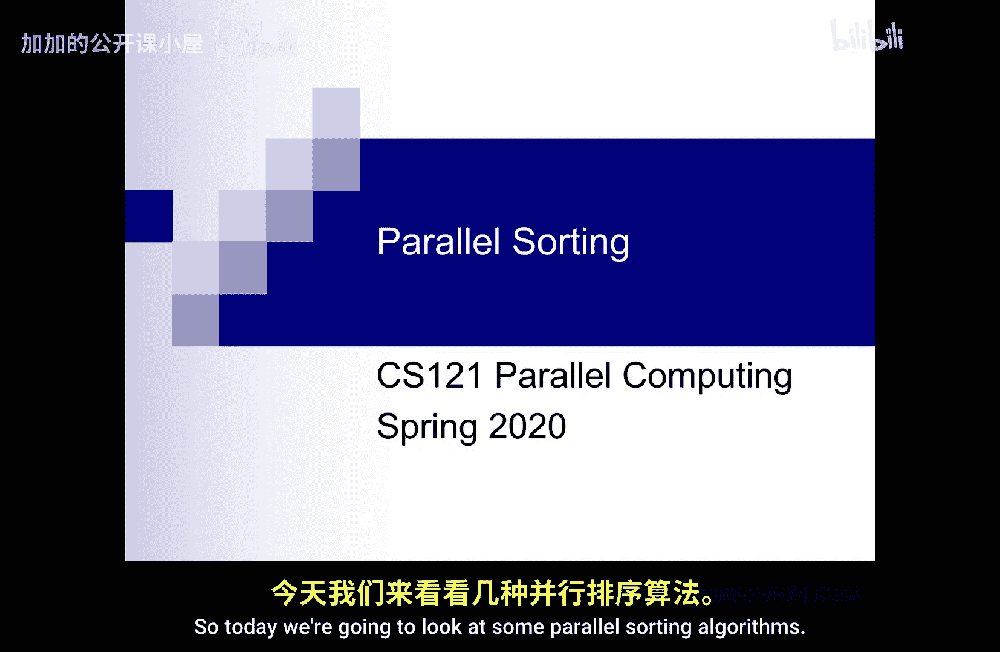
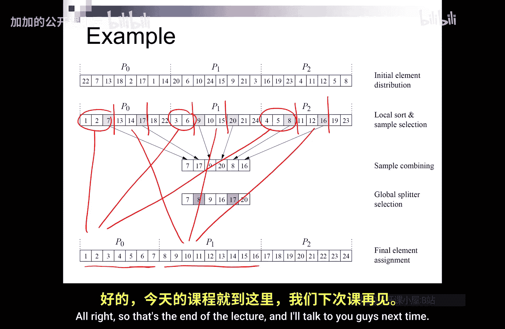

# 上海科技大学【中英⚡并行计算｜CS121 2020 Parallel computing】 p23 P23 Sorting -BV1VqypBaEaP_p23-

Welcome back。So today we're going to look at some parallel sorting algorithms。

So we're going to look at four algorithms， so the first one is going to be Radic sort。

 and then we'll look at a parallel mech sort， and then we'll look at something called bionic sort and then sample sort。

Okay， so to start out with， we're going to talk about Radic sort。

so this is actually a sequential sorting algorithm。

 but it turns out that you can run this very efficiently in a parallel setting also。Okay。

 so rad sort， so the word radix just means digit， okay。

 so Radix sort is just sorting numbers digit by digit。Okay。

 and we're going to sort from the least significant digit up to the most significant digit Okay so for example。

 over here right you've got a bunch of numbers that we're trying to sort let's say in increasing order and then so first of all。

 we're going to sort the least significant digit the once digit in increasing order。And then next。

 you're going to sort the next digit， the 10 digit in increasing order。

 and then you sort the 100s digit in increasing order。Okay， so that's ratingd sort。

 Now one important thing is that when you do these sorts， okay， they have to be stable。

So stableple means that if you're sorting on a current on some digit okay。

 let's say the 1 hundreds digit okay then I'm suppose there's a tie in this digit then in order to figure out what order you should have。

 you need to preserve the order of the two numbers that are tied。

 you need to preserve the order from the previous digits。Okay， so as an example of this。

 you know suppose we're sorting on the hundreds digit over here right so so you know when you're sorting。

 you're going to get a tie this on the threes over here。Okay。

 so in that case you need to look back at the1 digit and you need to see what order these these two numbers are in Okay。

 so on the previous digit right you have the 362 before the 397。And so here， when you have a tie。

 you need to maintain that order in order for the sort to be stable， okay。

 so you need to keep 362 before 397。So that's the stable sort。

And we have to use a stable sorting algorithm in order to implement Rad sort。Okay。

 so so I said this is a sequential sorting algorithm， but you can parallelize it。

 and basically the reason is that when you sort on each digit。

 you can actually do this very efficiently in a parallel way。

 sorting digit by digit and so this leads to the fact that Rad sort is often one of the fastest sorts in practice。

 okay especially in the shared memory setting。Okay。Allright， so okay。

 so the way we're going to implement， so now we'll talk about how to implement RadDix sort in parallel okay and it turns out that we're going to make use of the parallel prefix sum operation Okay so remember from a few lectures ago。

 we talked about a number of applications for prefix sum okay so this is yet another application for prefix sum which to do which is to do very efficient Radix sort。

Okay。All right， so what we're trying to do is so as long as we can sort one particular digit you know of a set of numbers then we can just supply the same method to all the digits and then we'll get a raix sort so we'll just focus on sorting one one of the digits of a set of numbers and we're going to assume these are binary numbers so all of the digits are zeros or ones okay and we're just going to focus on sorting the last digit in a set of binary numbers。

And we want to sort these in a stable way。Okay， so now sensorensor binary numbers and if we're going to focus on the last digit。

 then the last digit is either going to be a0 or a 1 and so we're going to call the values which end with zero。

 we're going to call them zero values and the other values which end with one well call them one values。

Okay， so then if we're sorting on this digigit， then since the only possible values for this digit are0 or1。

 all we need to do is put all of the zero values before all of the one values。

And we have to do this in a stable way。Okay， so all right。

 so so so then I'll show you an example of how this works。 Okay。

 so this is much easier to explain with this example。

 so suppose we're trying to sort these numbers over here。 Okay。

 now we're just sort trying to sort them based on their final digit right now。

 So the first thing is let's just pick out the final digits。 Okay， so like this guy ends on a0。

 So then we're gonna to pick out the zero。 Okay， this guy ends on a one and this guy ends on a0 and so forth。

Okay， all right， so next we're going to take all these digits and we're going to flip them， okay。

 so the zeros become ones and the ones become zeros。

Okay and we'll see why we do this later Okay so then that's going to produce this array of numbers okay so we're trying to sort eight numbers and then we're going to take out the eight you know the least significant digits and then flip them and so now we have this array of eight numbers and now we're going to do a exclusive prefix sum on these numbers okay the flipped bits。

Okay so for example you know the first value here right this is a zero because if you do exclusive prefix sum then the first value is always zero right and then here this is going to be one because you're just taking this value right and then here this is also going to be one so this is a sum of one and0 this is a two here because it's a sum of one0 and1 right and then you can see that the the rest of these。

Values here are just the prefix sum of this E。Okay， all right。

 so so why do we do this prefix sum Okay， what what's the use of that well the use of that is now when you're sorting these zero values and the one values。

Then the only thing you need to do since there are only two possible digits。

 the only thing you need to do is put all the zero values before all the one values okay however。

 suppose you have a zero value okay so let's say that you have a zero value at some index I okay so for example this is a zero value over here now where does this guy go after you sort him。

Okay， so so the claim is that the position that you should put him is equal to the number of zero values that come before this index。

Okay so the number of zero values before this position is well here's a zero value and here's a zero value okay right so both of these zero values。

 since we're sorting in a stable way， both of these guys should come before this zero value after the sort。

Okay， so this is why this guy belongs in position number two at the end because he's got to come after these two zero values。

Okay， and so in fact this d array here okay so I'll tell you later how we I'll tell you exactly how we compute these values。

 but right now you see that the d here is a2 and this is indicating that this guide belongs in position 2 okay because there are two zero values before him。

OkayAll right， so next how do we how do we know how many zero values are before him right so of course we could just you know scan through all of those values and count them。

 but that's very inefficient and also that's not a parallel operation okay so the way we can know that there are two zero values before him is using this f array okay so you see that F here is exactly equal to2 okay and the claim is that F exactly counts the number of zero values before this position。

And the reason for that is that the way we formed F was we did an exclusive prefix sum on E and E is going to be one whenever there is going to be a zero value before this position right so like here we have two zero values before this position and then we have two ones corresponding to those。

And this two exactly comes about because you took the sum of these two ones。Okay。

 so this shows you that these prefix sum values， they count up exactly how many zero values come before a position。

Okay， so as another example， right， oops。If you take this position。

 then the prefix sum here is three and that's because you have three zero values， okay， this guy。

 this guy and that guy that come before this position。Okay， so to just say this again。

 whenever we have a zero value， add some particular index I。Okay。

 so then we should put this zero values， so after sorting we should put this zero value at a position equal to the number of zero values before index I。

Okay， and the way you can know that number is that you can just look at the value of the FRA at this position。

 and that tells you exactly how many zero values are at this position。Okay。

 so now we know how to take care of all of the zero values， okay， we know exactly where they go。Okay。

 so so we know that so like here you have a zero value right so it goes to zero right because his prefix sum here is zero。

 this guy has a zero value， he goes to one right， he goes to2 and then the final zero value here he goes to three。

Okay so we're done with the zero values and now we have to talk about the one values okay so the one values is a similar thing okay however。

 notice that the one values have to come after all of the zero values okay so we have to know how many zero values there are because yeah because even the smallest one value has to come after all of the zero values okay so then how do you know how many zero values there are well if you look at this prefix sum okay if you look at the final values here right what is this equal to this is whenever there's a zero value there's a one here so therefore this thing is equal to the number of zero values before this final position。

Okay， and finally there could be another zero value at this final position right so in this example there's another zero value at this final position。

And so therefore to get the total number of zeros， we're going to take the final F value plus whether or not the final value was a zero value or not so we add these two together。

So here you see that it's going to be 3 plus1， so we see that the total number of zero values is going to be four here。

So that means that all of the one values go after index 4 all right。

 so this is going to be four over here。And furthermore， the if you have a one value at an index I。

 then not only does it go after all the zeros， it should also go after all of the one values that come before index I。

Okay， so this is just like you know， when you have a zero value。

 it has to go after all of the zero values that come before index I okay here this has to go after all of the one values that come before index I。

Okay， so now so when you wanted to get this value， the number of zero values。

 you just looked at the f array， okay， the f values， okay， what about this， Okay。

 how do we know how many one values come before I？Well。

 the thing is that all the values before position I they're either going to be zero values or one values okay so if you want to know how many one values there are。

 you can just take this index I and subtract how many zero values there are that tells you how many one values there are。

Okay， and we can get we can find how many zero values there are just by using this F array。Okay。

 so therefore we have this formula for the position that a one value should go to。

 it's equal to the total number of zero values plus I minus the number of zero values before position I。

Okay， so as an example of how this works， so suppose you take so this is a one value here。 Okay。

 so let me raisese some of this stuff。 Okay， so it's a one value。

 So therefore the position that it goes to is well。

We can do this calculation here okay so first of all。

 the total number of zeros is going be is going to be4 over here right and the index is so this is index number5 over here and then we need to subtract the number of zero values 3 right so that indicates that there are two one values before this position right and those one values are this guy and that guy so this is like the third one value right and then he also goes after the zero values so therefore his position is going to be you know this5 minus3 plus4 which is position 6 this guy belongs in position 6 over here。

Okay， and likewise， you can do a similar computation for all of the one values。Okay。

 so so that's basically the algorithm， Okay， so what we're going to do is。

We're going to first of all produce all of these bits okay so obviously that is a parallel operation and then next we're going flip all the bits which of course is also parallel we're going to do the parallel prefix sum okay so we saw a bunch of algorithms for parallel prefix sum so this is a efficient and parallel algorithm right and then after that now we can figure out where all of these values should be assigned in the final sorted order because anytime you have a zero value right then you simply you use the F value to determine its position。

And if you have a one value， right， then you're going to use this other formula to determine its position。

Okay。And so yeah and so that's what this thing is doing over here right it's saying that if you if the bit here is equal to one then you're going to yeah so this bit here this B is referring to this array over here okay sos saying that if you have a one in a certain position then your sort of position is going to be you based on the one value okay so this formula for the one value right and then otherwise it's going to be based on the formula for the zero value which comes from the F array。

Okay， so we can compute all of these D values in parallel right and that tells you the final position for each of these values okay so for example。

 it tells you that this you know the second input value 111 over here it needs to go into position 4 in the final sorted order。

Okay， right， this guy over here right， he needs to go into position one， right。

 so we're going to just move him to position one。So by computing these D values。

 we can determine the final position for each of the input values。

And then your final step is just to sort of scatter these input values using these addresses。Okay。

 so so all of the steps that we talked about that they're all highly parallel right know and the crucial thing was to do this prefix sum over here。

All right， so yeah， so that's the basis for an efficient Ra sortRT algorithm。

 and this works quite well on shared memory settings and GPUs。

Okay so the next algorithm we're going to talk about is a merged sort okay but parallel merged sort okay so we've all seen merged sort so merged sort is just to remind you you know you have this big array over here so it's a divide and conquer algorithm so you first chop up this array into into half and then you keep splitting this array until you're down to like subars of a sufficiently small size and then you start merging these subars in sorted order so like when you merge a 38 and the 27 get you need to put them into sorted order okay so these guys need to be sorted all right so then at each layer you have a bunch of these sorted subars and at the next layer you're going to combine you're going to merge two of these sorted subarrays into another sorted subarray。

Okay， and then yeah， and then you just keep doing that， okay。All right。

 so that's the sequential version of merged sort， so we have that if there are n numbers。

 then we're going to do log n divide stages followed by log n merging stages。Okay。

 and in a sequential setting， each stage takes order n time so altogether it's going to take order n log n time。

Now in a parallel setting， we need to still do these divide and merge stages okay the divide stages are easy to do in parallel right because in fact you don't really need to do anything you just you just take part of the array that's all you do but what is not so obvious how to do in parallel is suppose you want to merge to arrays okay so let's say you want to merge this array and this array so that you know in a sequential setting what we had we had these pointers to these different arrays and then we sort of move these pointers from left to right in order to merge these two arrays but that's a sequential process and so it doesn't seem obvious how to translate that into a parallel setting so so the main thing that we're going to do in order to implement parallel merge sort is we'll show how to do the merging stage okay do each of these merging stages in order log n time。

When you have MP parallel processors。So you have n numbers over here in total and then we want to merge all of these sublists and we'll see how to do this in log n time if you have N processors。

All right， so now each of these merging stages takes you log n time and then you have log n of these merging stages okay so that means that in total you're going to take a log squared end time to sort using M processors。

All right， now this is not quite efficient because the total amount of work that we're doing is going to be the number of processors times the time。

 okay so that's going to be n times log squared n whereas in the sequential setting our total work is n log n。

Now it turns out that there is a more complicated version of parallel merge sort。

 which does sort of pipelining， it sort ofs pipelines based merge operations and by doing that you can actually get the total work for this algorithm to be en log in yeah。

 but we're not going to talk about that。So we'll just talk about the simple version of this merge sort。

And also we're going to assume for a simplicity that all the values are unique so of course you can do this when you have nonun values。

 but it's just simpler to assume all the values are unique。Okay。

 so let's talk about how to merge two lists of sorted numbers into a big sorted list， okay。

 so suppose you have these two lists right so they're already sorted。

Now we're going to define this thing called rank， okay so this is a value in a set。

 so the rank of a value in a set is like we're going to go look in the set and see how many values are less than or equal to x。

Okay， so that is the rank of x in S。 okay， it's equal to the number of values in S less than or equal to x。

So for example， if you take this a here，8 here， then the rank of8 in a is going to be2 because there are two values less or equal to the sky if you take8 and you compute the rank in B so there are three values less than8 and so his rank is 3 and likewise the rank of 20 in a is going to be4 because there are four values less than 20。

Okay， so now we have this claim that suppose you take a number from either A or B and now suppose suppose you combine A and B into a big list or into a big set。

 let's say then the rank of this value X which comes from a A or B the rank of it in the combined list a concatenated with B this is going to be equal to the rank of x in a plus the rank of x in B。

Okay so as an example of this， suppose you want to do the rank of8 okay in the in the overall list okay so8 in the overall list。

 so once you combine a with B right then8 is going to be so there are like five values less than or equal to8 and this happens to be equal to the rank of8 in a which is2 and the rank of8 in B which is3。

Okay， you know， likewise， if you do the rank of 20 right。

 so the rank of 20 is going to be 8 because you know 20 is like the eighth value in this overall sorted list and this is equal to the rank of 20 in a。

 which is4 and the rank of 20 in B， which is also four。Okay。

 so the reason for for this claim is quite simple because if you take a number right let's say that it comes from a okay so then the rank of x in a is how many values are less than x in a including x itself likewise the rank of x in B is how many elements are less than equal to x in B and since we're assuming that you know all these values are unique then know we so x cannot be if x is in a then it's not in B all right。

 so then the total so then the rank of x in a concatenated with B。

 its just how many values are less than x in a plus how many values are less than x in B so that's just sum of these two ranks。

So yeah， so that gives you so that shows the claim。

All right now this claim is actually pretty important because this is how we're going what we're going to do to do the parallel merge sort okay now the only thing is how do you compute the rank of a value in a set now if this set is sorted and suppose it's got a size of n then you can compute this rank in order log n sequential time。

Okay so even if you only have one processor if you have a sorted array of size n。

 you can compute the x， the rank of x in s using just one processor in log n time and the method is just you do binary search for x in S so as you do binary search then you're going to sort of isolate where x can occur in S and then the final position that you end up at the index that is going to be that's going to tell you the rank so either at this index the value is equal to x in that case you the rank is going to be i plus1 or if it's not equal to x。

 the rank is going to be equal to I。And this binary search with one processor is going to take you log n time。

So therefore， we can compute the rank of any number in any set of size n in just log in time using one processor。

Right， okay， so this is like an example of this right if you search for the rank of 11。

 if you do a binary search for 11 in this list right you're going to end up at this position over here。

 so it's going to end at index3 and the rank of x is actually equal to3。Al right。

 so now we can put everything together okay into how we can implement a parallel merge sort Okay or sorry。

 rather now we're going do see how to implement a parallel merge once you have parallel merge。

 then you just get parallel merge sort right away okay so if you want to do parallel merge So what we're doing is we have two sorted arrays A A and B。

 let's say they both have n elements Okay and now we're trying to merge them into one big sorted array a concatenated B okay。

And let's say that you're allowed to have two end processors to do this and now we claim that you can merge these two guys in log n time。

Okay， and the way you do this is that what we're going to do is。🤧嗯。

So we have two n values overall and you have two n processors so you assign one processor for each value and the processor is going to take care of the I value in the in the in rate A so we have I processors here and sorry we have n processors here we have n processors here so the I processor in the in the8 list is going to take care of the I value here and he is just going to compute the rank of this value in a and in B。

Okay， so we're going to take the Ih value from a and compute its rank in A and in B。Okay， well。

 now the rank of the i value of a in a is simply its index itself。

 because the fact that it's at a position I means that it's the I's largest value because a itself is sorted。

Okay， so rank of AI， A of I in a is equal to I。And then rank of A of I and B。

 we can do that in log n time， just using the single processor using binary search as we saw。

So whatever this rank is of A of I and B， then the final rank of a in the overall list。

 then we can use the claim the previous claim to say that the final position of A of I in this overall merged list C is going to be the rank of A of I in a plus the rank of A of I and B。

Okay， so likewise， we have a bunch of processors assigned to these b values and for each of those processors it's going to compute so if it's a JV processor。

 it's going to be handling the B value， and it's going to compute the rank of B of j in B。

 which is just J， and it's going to compute the rank of b of J in a。

 which it does using binary research。Okay， and then we know that the final position that the J value should go to is equal to J plus r of j。

Okay， so as an example of this， if you compute the ranks of all of these values in a sorry in B。

 right， then these are the ranks over here。And these are the ranks of these values in a。

 and now the positions that these guys should go into is so for example。

 this guy has a rank of he's got an index in a of0 and he's got a rank of0 Okay。

 so therefore he goes into index0 right this guy has a rank of of what1 in a and then he's got a rank of3 in B right so he goes into position one plus3 which is four。

Okay， so yeah， so you just you take these formulas and then you apply it to all of these things and that tells you the final position of all these values in the mergech list。

Okay， and everything we're doing is parallelzed right because we just need to compute these ranks and all of these just need one processor and they can all run in parallel and the running time is going to be log n。

So therefore， we can merge these two lists in log N time。

Okay and so we can do parallel merge in log n time and so therefore in order to do merge sort。

 right overall， it's going to take us since we have log n stages of this。

 it's going to take us log squared n time to sort all the numbers。Okay。

 so that is parallel Mert sort。Okay， so the next algorithm we're going to look at is called a bionic sort。

Okay， so bionic sort， first of all， we're going to define this thing called a bionic sequence。 Okay。

 so bionic sequence is， it's one of two things。 Okay。

 Either it's going to be a sequence that first increases and then decreases。Okay。

 so there are like sort of two phases to this， like bitonic just means that they're sort of like two phases to the sequence。

 okay， increasing phase and then a decreasing phase or a bionic sequence is a rotation of a sequence which first increases and then decreases。

Okay， so let's see some pictures of these Okay， so first of all， this is a bionic sequence right。

 this 1，3，4，7， this thing okay because it first you know increases right and then it decreases。

OkayOr you could take a rotation of the sequence。 Okay， so for example。

 if you if you rotate everything to the left over here， right。

 so then these three values get shifted over to the end over here。

 So this is a left rotation of a increasing decreasing sequence。

 Okay then this thing is also a byonic sequence。Let's see okay。

 so actually let's look at this picture over here。Yeah， okay。

 So this picture this shows what a bionic sequence looks like。 Okay。

 so this is the first kind of bionic sequence is it first increases and then decreases。 Okay。

 or you could you could rotate this guy。 right？ So when you rotate this guy， let's see。

If you rotate this guy So then yeah， So then if you take all this stuff right and then put it over here so that it's over here。

 right， So then it becomes a an increasing followed by decreasing sequence。 Okay。

 so this thing on the bottom is a rotation of the thing on the top。Okay。

 so that's what a bitonic sequence is and now we have the first property about bionic sequences。

 which is that suppose you do this operation okay suppose you have a bitonic sequence like this with n numbers and then what you're going to do is you're going to chop these numbers in half okay。

 so you're going to take the set first half of the numbers a0 up to a of n over2 minus1。Okay。

 and then you're going to take the second half of the numbers。

 which starts at a of n over 2 and goes up to a of M minus1。 Okay。

 so this here thing over here goes from a0 up to a of n over 2。hos。

And divided by 2 minus-1 okay and the rest of it starts at a of n over 2 and goes up to a of n -1。

 And now what we're going to do is match up corresponding values like this。

 so we're going to match up the first value from the first half with the first value from the second half。

 you're going to match up the second value from the first half with the second value from the second half。

 and so on， and then you're going to match the last value from the first half with the last value from the second half。

 Okay so that's what we're doing over here。 We're matching up these values right a0 gets matched to a of aa sub n over n over 2 a1 gets matched to this link to the next element and so on。

All right， so after you do this matching， then suppose you compute the min of each of these pairs。

Okay， so you take whichever one's smaller， okay， and then you do the same thing over here and so on。

Okay， so that that's going to produce a sequence of。N number two numbers。

 and you're going to call that sequence S1。Okay， and then you're going to take the same matching。

 right， But now you're going to take the max of each pair of numbers。 Okay。

 so that's also a sequence of n over two numbers。 You're going to call that S 2。Okay。

And now the claim is that both S1 and S2 are so if the originals sequence is a bionic sequence。

 then the claim is that S1 and S2 are also are both of them are bionic sequences。And furthermore。

 all of the elements from S1 are going to be less than all of the elements from S2。Okay。

 so that's the claim。Okay， so we're going to prove this claim on the next page。

 but first let's just say that this operation here， okay。

 where you you know you split the list in half and then you do the min for one part and then the max for the other part let's call this a bionic split okay because now you get two sequences each of half the size。

Alright， so now let's prove this claim， So we're going to do a proof by picture okay so what I'm going to do is first so so we start with a bionic sequence okay and then I'm going to split this down the middle So the blue part is going to be the first half of the sequence and then the red part is the second half of the sequence and so this is a bionic sequence so it increases in the first part and then decreases okay and let's say that when you cut it down the middle this is actually in the decreasing part。

All right， so now we want to do this operation where you match up values from the first half and the second half。

And then either you take the min or the max。Okay， so the way we're going to represent this with the picture is that we're going to take the second half and just move it to the left。

Okay， sore and then so that's what's being shown on this second figure over here。 right。

 So we've taken we've taken the entire second half and moved it to the left。And when you do that。

 you're going to match up the corresponding values from the first and second halfs。 Okay。

 like so for example， here， right， you have the first value from the first half。

 and this is being matched to the first value from the second half。 Okay， and so on。

 right the second value matches with the second value Okay so so once you do this movement thing。

 then we've sort of done the matching that's required for this byonic split。Okay， and now。You know。

 these two parts， the blue part and the red part。 So let's say that they cross somewhere。

 Okay so they cross right over here。 Okay， so now remember that the way you form this byonic split is you either take the min of each pair of numbers or you take the max now when you take them min。

 what's going to happen is so for example， we match up these two numbers and if you take them min。

 then you're just taking the lower of these numbers。 Okay。

 so you're taking this number and then and then over here right again， after you match them up。

 you take them in and so that is the lower number。 so you see that given this matching。

 when you take them min， then for everything starting from this value all the way up to where the red line and the blue line intersect all the way up to that intersection point。

 when you're taking the min， you're just taking the blue part。

Because the blue part is the smaller part up until the intersection point。Okay。

 and then after the intersection point， when you take them min。

 then you need to take the red part because the red part becomes a smaller of the two values after the intersection point。

Okay。All right， and then for the other one where you want to take the max of these two values right then before the intersection point。

 you want to take these red values and then after the intersection point。

 you want to take the blue values， okay these blue values over here。Okay， so then。

So then these two sequences that you form S1 and S2， S1 is the min of the matching values。

 and that as we said is just going to be you know you take the bottom part of this you take the blue part up to the intersection point and then you take the red part and then the max of those two values is you just take the top half over here。

Okay so that pictorially is what this looks like and now you see that both of these sequences are bionic so S1 is bionic because you know it increases up to this intersection point and then it decreases and then S2 is bionic because so here the blue part right you have an increasing part and then it starts decreasing and then once you get to this value right so this red part here okay so this is actually the so this red part is the beginning of the red part over here and this is also this red part over here so basically what I'm saying is that if you look at this value so let's call this value X and let's call this value y okay so then here you got x and then here you got Y。

Allright， and we know that x is larger than y。 So this x here is going to be larger than this Y。

 And so this thing is actually equal to。ABonic sequence， but a shifted byonic sequence。

 because you can take this Y stuff over here and you can paste it after x。

 and then you'll get an increasing sequence followed by a decreasing sequence。Okay， so anyways。

 S2 over here is also a bionic sequence。All right and the last part of the claim was that everything in S1 is less than everything in S2 or less than or equal to everything in S2 and this is true because everything in S1 is going to be less than or equal to this this let's call this intersection point let's call that x so everything in S1 is less than or equal to x and everything in S2 is larger than or equal to x。

Okay， so therefore all of S1 is less than or equal to all of S2。Okay。

 so that shows this main claim about forming a bionic split out of a bionic sequence。Okay。

 so once we have this operation of bitonic split， then we can get started with our bionic sort algorithm。

Okay， so we're going to define one more thing called bionic merge okay so the bionic merge operation is going to take a byonic sequence and then it's going to convert so this is like an increasing followed by decreasing sequence or rotation of one and so it's going to take this bitonic sequence and convert it to a completely sorted one。

Okay， so ponic sequence is not quite sorted because it can increase and then decrease but the pyonic merge is going to take one of these pyonic sequences and convert it to a completely sorted sequence。

And it's going to do this using a sequence of these bionic splits。Okay， so the way it works is that。

Now， the property about the bionic split is that so the input to the bionic split is a bionic sequence。

And then after you do the split， we know that the first half of the values is all going to be less than the second half of the values。

So that's the property of the bionic split。And you can see that this is kind of a sorting of S。

 okay because now you've taken this bitanonic sequence S and you split it into two parts consisting of the smaller half and the larger half。

Okay， so each of these halves is maybe not sorted okay。

 but at least you've sort of sorted the two halves so the left half is completely less than the right half。

Okay。So once you do this right， then you can take each of the halfs of S right and then so we're guaranteed that each of the hals is also bionic that's the other property of the bionic split is that not only is the first half less than the second half。

 but both hals are also bionic。So if both hals are bitonic， right， then。

Then we can apply the split again right to both halves and then we get another sort of kind of like a sorting of both hals Okay so if you take the first half and you do another bionic split right now you get these quarters and the first quarter is going to be completely less in the second quarter。

Okay so that's kind of like a sorting of these two quarters。And the same applies for the second half。

Okay so let's right and then you just keep doing this recursively okay so each time you do a byonic split。

 it's kind of like you sort of the sequence a bit okay you split this into two parts where the first part is completely less than the second part。

So we're just going to keep doing this until eventually we get down to a sequence of size1 and when that happens。

 then we have that the entire sequence is sorted。🤧Okay， so let's do an example of this。 Okay。

 so suppose that we start with a bionic sequence like this。 Okay， so it's a bionic sequence。

 So in fact， I've marked out the the increasing part and the decreasing part。

 So the increasing part is blue and then the decreasing part is red okay。嗯。Okay， so then。

So then we're going to do a bionic split on this and the bionic split is we're going match up。

 we're going split this thing in half right the sequence in half and we're going match up the corresponding values so the three gets matched to to the 95 the five gets matched over here and so on And then for each of these we're going take either the min or the max and what that's going do is that's going to produce this sequence on the second row over here so you see that basically if you take if you take like for example。

 these two values and you take their min so the min goes in the left half and the max goes on the right half so so actually here nothing changed and then if you do the5 with the 80 then actually again。

 nothing changes so the five stays here and the 90 stays over there So for all of these pairs basically nothing changes except for the final pair where you match the 20 and the0 So then the0 gets put over here。

It's because it's smaller than the 20 goods put over here。ok。😊，All right。

 and now you can check that everything on the left here so this is going to be the first first part of the bionic split right so this is like the S1 part okay everything over here on the left is less than everything over on the right。

And furthermore， you can check that both of these parts， S1 and S2。

 they're both byonic themselves because for example， S1 here。

 it's increasing from3 up to 14 and then it's decreasing whereas here the S2 right it's a decreasing and then increasing but this is just the rotation of a simple byonic sequence。

Alright， so now we're going to do a bionic split on both halves Okay so we're going to do two byonic splits。

 So that means that we're going to match up the three and the 1 right and you're going to put the smaller one on the left and the bigger one on the right。

 you match up these two guys right match up these two and the match of these two so you see that after you do this we're going to get two sequences over here this one and that one and you can see that the left sequence everything in the left is less than everything on the right。

Furthermore， the left sequence is a bionic sequence， and the right thing is also a bionic sequence。

Okay likewise we are going to do the same thing on the right over here right so we match up these two things right so now the 35 goes on the left and the 95 goes on the right right you do it over here and you have to swap them and so on and then you also get that all of these values are less than all of these values。

Okay， and furthermore， these sequences are bitonic so I've again labeled you know how they're bionic right so it increases here and then decreases and then increases decreases and so on。

 Okay and then we're going take each of these bionic sequences。

 So now we have four of these right we're going take each of them and then do another bionic split Okay oops yeah。

 and then you just keep doing that。 Okay， so if you keep doing that。

 you're always putting the smaller values on the left and then the bigger values on the right。

 So then at the end， you see that we're going end up with this thing over here。Okay。

 and this is indeed a asorted sequence。So that's the bionic merge operation Okay。

 it starts with this original byonic sequence， right you keep doing these bionic splits on there over and over and eventually you end up with a sortded sequence。

Okay， now turns out that this Vonic merge operation， you can do this in parallel。 Okay。

 and the way you're going to do it in parallel is that。

We're going to build it out of these circuits we're going to create this thing called Em network。

So the way this works is that in order to do the bionic merge。

 we just need to do bionic splits and to do byonic splits。

 all you need to do is just take two values and then either take their max or their min。Okay。

 all right， so then。We're going build these we're going to represent that using these like little circuits over here So these circuits are going to have two inputs right and then if we want to put the min on top and the max on the bottom so they have two inputs and then two outputs so the two outputs are going to be the min of the two values and the max of the two values and then you can have them in either order you put the min on top and the max on the bottom right so let's draw this way with sort of this little plus here this plus is kind of indicating that this is being sorted an increasing order right because it's first of all the min value and then the max value。

Okay， or if you want to sort this in sort of decreasing order， Okay。

 so you put the max value first and then the min value， right。

 you can draw this with a little minus here。Okay， so we have these basic。Circuit elements。

 And now if you want to implement a bionic merge。Then we just have to have lots of stages of these bionic splits Okay。

 so each of these things in the box represents a stage of the bionic split。

So each of these boxes represents basically one of these rows in this example over here。

Okay so for example， in the first byonic split right so we have the sequence over here and you need to match the first value with the know the medium value the value in the middle and the second value with the middle value plus1 and so on so we match those values and then we want to put the min on top and the max on the bottom so that's exactly so now we're going to use these circuits to do that these little plus circuits that's what this is indicating so three and 95 get matched and you put the min value up top and the max value so the min value is going to go over here and the max value is going to go over here。

Okay， likewise， you match this5 with the 90 and then you're going to put the min value over here and then the max value over here。

Okay and then you do the matching for all of these pairs。Okay。

 so that is the first first bionic split stage。Okay now after you do that right。

 then you're going to have that this sequence over here is a bionic sequence and this sequence is a byonic sequence right And we said that you wanted to do a byonic split on the first sequence and another one on the second sequence。

OkayAnd so to do that， right， we need to take the first sequence and you're going to take the first element and match it with the middle element of the first sequence and the second element with the second element Okay yeah so then so then you do these matchings and then again you put the the minimum value up top and the maximum value on the bottom Okay。

 so you use again， you use this circuit over here。And then you do the same thing on the bottom over here。

 right you do another byonic split on the bottom。Okay， so then after you do that。

 you're going to get four bionic sequences， right， so like this one and then this one and then this one and then that one right And then for each of these sequences。

 you're going to do another bionic split。 Okay， so this is going be the bionic split on the first sequence。

 second sequence and so on。Okay， so you just keep doing this okay so you can see that at any stage。

 all you need to do is to compute this bionic split。

 and then you can do that pretty simply just by just using these basic circuit elements。Okay。

 and now if you look at each stage， okay， all of these operations can be done in parallel right like you know the operation between3 and 95 is going to be done in parallel with the one between5 and 90 right between8 and 60 and so on。

 all of these are done in parallel So therefore this first step over here。

 just take sort of unit time unit unit parallel time。Okay。

 and the second stage can also be all be done in parallel。 So this just also takes another unit time。

 Okay， so every stage can can be done in parallel Okay， and there are log n stages because， you know。

 because the size of the list keeps decreasing by a factor of two。

 And eventually when you're down to to just a single element， then the list is sorted。Okay， so。

So basically， we can do this bionic merge in order log and parallel time using a bunch of these circuit things。

Okay， so now we are almost done with a bionic sort。 So just a few more steps。

 and then we will have the bionic sort algorithm。 Okay。

 so up to now we have the bionic merge algorithm。 Okay， so so finally。

 we're going to take the bionic merge and then use this to implement bionic sort。

And the thing about the so the first thing to notice is that bionic merge。

 So currently we're sorting this into increasing order。

 but you can just as well sort this into decreasing order right that's you know you just flip the the min and the max All right。

 so then we're going to call this bionic merge into an increasing sequence。

 we're going write that like with the the sort of plus plus sign over here the Bm plus and then into a decreasing sequence。

 we're going to write that with the minus okay。All right。

 now suppose you're given an arbitrary sequence and you want to sort it okay then what we will do is first we're going to convert this arbitrary sequence into a bionic sequence right and then where each each part。

 the increasing part and the decreasing part are both going to have size n over two。Okay。

And then we're going to do a bitonic merge on these two sequences。Okay。

 so sorry on this entire bionic sequence Okay so there should there's just one sequence here so again。

 you take your arbitrary sequence， you convert it into a byonic sequence where the increasing part has size n over2 and the decreasing part has size n over 2 and now you do a byonic merge on this bionic sequence right and that is going to produce a completely sorted sequence。

Okay， so that's the Vonic merge algorithm。Now， the only thing that we don't know how to do is how do you take this arbitrary list and convert it into a bionic sequence？

Well， to do that， what we're going to do is just take this list and then divide it in half。

 and then you're going to sort the first half in increasing order。

And then you're going to sort the second hat in decreasing order。And now you have a bionic sequence。

But the problem is， how do you sort the first half in increasing order or the second half well。

 you can do this recursively。Okay， so so overall right， we're given an arbitrary sequence。

 what you're going to do is you divide this in half， right。

 you're going to sort the first half recursively sort in increasing order。

 you sort the second half recursively in decreasing order。

And then you do a bionic merge on this overall increasing decreasing sequence。Okay。

 so that is the entire algorithm for bionic split， byonic sort。Okay。

 so so let let's look at a sort of a pictorial representation of this。 Okay。

 so suppose you're trying to byonic merge sorry， bionic sort on 16 numbers over here Okay so。Yeah。

 so the first thing you do is you split the 16 numbers into eight numbers into two parts with eight numbers each okay。

 you're going to sort each of these eight numbers first in increasing order right so this is the increasing sort and then you're going to sort the other part in decreasing order Okay and then you're going to do a bionic merge on this and for the merge。

 you're going to merge them into increasing order。Okay now the question is how do you sort eight numbers into increasing order right well you're going to take the eight numbers。

 you break them into four numbers and then four numbers and then you sort the first four numbers in increasing order and the second number second four numbers in decreasing order right and then you do a bionic merge on these eight numbers。

Okay， so this is this is sort of unrolling the recursion for you。ok。All right。

 so then in total you see that there are going to be log M byonic merges。

 right because you have to keep doing this until you're down to list of size one。Okay。

 so each bionic merge we said was being done in parallel using this byonic merge network and that took log n time and they log n byonic merges in total。

 so therefore everything can be done in log squared n time， log squared n parallel time。Okay。

 so bionic sort takes log squared n parallel time。Okay， so that's the algorithm。

 The final thing I want to mention is that， well this is not an efficient a work efficient algorithm because you know to do this you need M processors and so the total work you're doing is going to be n times log square and n。

All right， whereas know， for sequential sort， you can do this in n log n time。

So it turns out that it is possible to build So So these things are called sorting networks that we built。

 Okay， so the sorting networks are， they're built out of these little。

Little wire configurations over here， So they're built out of these little mini networks。

 which either just sort into increasing order or decreasing order。

 Okay so you string a bunch of these together into a network and and use this to sort。

 So these sorting networks。 so currently the bionic sorting network it is doing n log squared end work。

 which is not efficient but it turns out that there are sorting networks。

 which are work efficient so for example， there's a thing called the Aks network。

 this is going to do just n log n total work however，'s it's a pretty complicated algorithm。

 and furthermore it's not practical because even though it does know asymptotically。

 it does n log n work， there's a huge constant in front of this network。

 Okay so it's like like a huge constant times n log n and that constant is so large that this is simply not a practical network。

Whereas byonicnic sort right this byonic sort network。

 this actually is highly practical even though it's not work efficient。

 it actually very it works very well in practice。Okay。

 so so that's a bionic sort now the final thing we're going to talk about is is a sample sort Okay so sample sort can be used in a distributed memory setting you can also use this in a shared memory setting。

 but typically we think of using sample sort in a distributed memory setting。

So for the previous algorithms， right， so for the Rad sort and the mergech sword and the bionic sword。

 those we tend to think of in the shared memory setting。Okay， so the way this works is。

Suppose you're trying to sort n numbers using P processors Okay now ideally all the processors are load balanced。

 so each of the processors is going to handle n divided by P values Okay so that would be the best case situation。

So then how can you achieve this well one thing is suppose you pick p minus1 p minus1 values we're going to call them pivots okay and let's say the pivots are so the values are going to be t1 up to t of p minus1 okay and then also we have a two more pivot values t0。

 which is equal to the minimum input value little M and then Tp which is the maximum input value okay。

Now we're going to use these pivots to form P buckets。

Where the I bucket contains all of the input between T of I 1 and T。Okay。

 so let's say that you have a bunch of numbers here， okay。Okay。

 so we're gonna to pick up a few of these pivotsop so we have a pivot which is equal to one of the smallest values right so this is a pivot right and let's say that you're going to pivot over here and let's say you're going pivot over here T2 and then you're going to pivot over here T3 so you see that so we have p plus1 of these pivots in total and you see that these values are going to cut all of these values these input values into P buckets where the I bucket these are all the values between like T1 and T2 and these are all the values between T2 and T3。

Okay we don't assume that each of these buckets is sorted。

 however we do assume that you know all of the values over here oh right and I forgot to say that all of these pivots right suppose they're sorted and so that would mean that all of the buckets in this third bucket over here all of them are larger than T2 and so therefore they're also larger than all of the values in the second bucket and the second bucket is larger than all the values in the first bucket。

Okay， so we're going to pick these P pivots， they're going to divide all of the inputs into into P buckets。

 and then we're just going to sort each of the buckets。Okay， so yeah， and then after doing that。

 you get an entirely sorted sequence。Because we already know that the buckets themselves are between the buckets like the second bucket is completely less than everything in the third bucket so between buckets or at the bucket level。

 things are already sorted so now all we need to do is sort within each bucket and then everything becomes sorted。

Okay well how much time does this take So if you let S be the maximum bucket size then sorting is going to take you s times log as S times log S time because you we have P of these buckets the biggest one of them is going to be size S and then we can sort all of these buckets in parallel using our P parallel processors and each of the sorts takes S log S time and so in total we're taking this much time parallel time。

Okay， so now this is going to work very well if all of these buckets are about the same size。 Okay。

 so in fact， in the ideal situation， everything is exactly size n divided by P Okay。

 so then it works yeah， so then all of the the processors are perfectly load balanced when they sort within each bucket and then this approach works works well however。

 the problem is that it's unlikely that the buckets are going to be the same size。

 Okay so for example， if you just pivot elements randomly。 then it's。Yeah。

 then the largest bucket size is quite likely to be not n divided by P。

 but it's going to be n divided by P times log n。 so it's larger than this ideal size by a factor of log N。

And then if you sort then if you sort this bucket right the largest bucket so this is going to take you as log as time and that's basically going to be n times log squared n divided by P time instead of if everything were the same size。

 then the total time it would take is going to be n log n log n divided by P so this is too large by a factor of log n。

Okay， so。Right。呃。Yeah， okay。Okay， I should have put some animation here。 All right， anyways。So yeah。

 so if we just naively pick P pivots then this algorithm is not going to work so well however the sample sort algorithm is going to do things slightly differently and the goal for sample sort is to make the buckets have approximately the same size。

So it's going to even out the bucket size In fact， the sample sort algorithm is going to guarantee that the buckets are all going to be on the order of n divided by P with high probability。

So so sample sort is a randomized algorithm okay so it does certain random certain random operations。

 so it's not going to guarantee absolutely that we end up with buckets of this and divided by p size。

 but it's going to guarantee that you know based on the random choices then with very high probability we're going to end up with even buckets。

So the way it works is instead of just picking P pivots。We're going to pick more than P pivots okay。

 in fact， you're going to pick lambda times P pivots for some factor lambda which is larger than one and which I'll show you later so we're going to pick more pivots and then let's see okay so we're going to sample all of these lambda P pivots and then we're going to sort them。

Okay， and then we're going to pick every lambmbda sample from the sorted sequence。Okay。

 so that will produce P pivots that'll produce P numbers because you have a lambda p values overall。

 and then you pick every lambdaeth value out of this， so that's going to produce P pivots。

And then we're going to use those pivots that we picked right every lambmbda sample。

 we're going to use those to form the buckets。And then we're going to do everything the same as before。

 Okay， so the only difference for sample sort is how we select these pivots right， we select it by。

 first of all， picking lambda P random elements。And then you sort them。

 and then you take every lambda sample as a pivot。Okay。

 now the claim is that this is going to produce much more even pivots， so more precisely。

 suppose we pick lambda to be this value。 Okay， so it's going to be 12 times log n。

Then the claim is that no bucket is going to be larger than four times this optimal size。

4 times n divided by P with probability at least1 minus1 over n squared。

So if you have a lot of elements， right， then if you pick a lambda to be basically log of the number of elements。

 then we can guarantee that within a factor of four， you get perfectly balanced buckets。

And this happens with probability very close to one， because your n is going to be large。

Okay so I'm not going to get into like sort the proof of this。

 So the proof uses something called turnoff bounds okay so this is gonna the turnoff bounds are a very useful useful technique in the analysis of randomized algorithms and it basically lets you bound the probability that when you add a bunch of random independent independent random variables together you expect that you know the sum of these is going to be equal to the expectation the expected sum is just equal to the sum of the expected values of the random variables so the turnoff bound lets you bound what is the probability that you do not get this expected value it's going to be a low probability it's unlikely that you deviate from your expectation and this turnoff bound is going to say that there's this exponentially small probability that you deviate from your expectation and using this turnoff bound you can prove this theorem over here。

Okay， so so if this is true right so we're just going to sort of believe this theorem okay but if this theorem is true。

 then since all of the buckets are balanced then when you run the sample sort。

 every processor is going to get is going to be sorting about the same number of elements and so every processor is going to run in basically this much time and this happens with this high probability that comes from the turnout bound。

Okay right， and this algorithm also has a low communication complexity because basically all we need to do is we need to broadcast the pivots and then we need to somehow collect the buckets at the end。

Okay， so so let me just sort of show you all the details of this algorithm Okay。

 so initially the values so we have n values and they're just distributed in some arbitrary order on the processors okay but each processor has n divided IP arbitrary values。

All right， and now we want to pick lambda P random elements in total。

 so therefore we have each processor pick lambda random values okay and let's say that they all send this to processor one。

Okay， and then processor one is going to receive these lambmbda P values。

 and then it's just going to sort them。Okay， and then it's going to take every lambda value from the sorted sequence。

And it's going to use those as the pivot。And so processor one needs to tell all the other processors about these pivots。

 okay so it's just going to take you know the set s of every lambmbda value。

 it's going to broadcast that set to all the other processors。Okay。

 and now all the processors have these pivots， and now they can use the pivots on the values that they currently have。

 Okay， so they each have n divided by P values。 right， so they're going to use。

These pivots to break these n divide by P values into P buckets。ok。All right， and then next。

 what we're going to do is each processor is going to be so we have P processors and each one of them forms P buckets。

 but ultimately what we want is for each processor to be responsible for one bucket。Okay。

 so for example， if we have let's say three processors。 Okay， so processor one has three oops。

 draw this a bit nicer。 So processor one has three buckets， right， processorsor 2 has three buckets。

Okay， and processor3 has three buckets。 Okay， so now ultimately we want processor one to take the first bucket from all of these guys。

 Okay， so then that's going to form one big bucket for processor  one so this is processor one。 Okay。

 processor 2 is going to take the second bucket from all these guys。 Okay。

 so that's going to be his big bucket right and then same for processor 3。

And what we know so since all of these buckets were formed by these same pivots。

 by these lambmbdaeth values， then using the previous theorem that we had。

 we have that all of these buckets that P1， P2 and P3 end up forming。

 they're all at most size4 times n divided by P with high probability。Okay。

 and now we just have each process sort its own bucket， okay locally。And then and then we're done。

Okay and then the overall sequence is what send up you know P1 has the smallest so all of these come from the first bucket。

 which is like the smallest bucket and then this has been sorted right and this is the second smallest bucket which has been sorted and so on right then if you just read the values from left to right across all these processors。

 then that is the overall sorted sequence。Okay， so yeah。

 so just to do an even more concrete example of this， Okay。

 so suppose that initially we have so three processors right。

 they each have n divided by P values and they're going to pick lambda values out of those Okay。

 so let's say they pick two values Okay， so then they pick these two values and they all send it to the two processor one and then processor one is going to take these values and he's going to sort them locally。

Okay。And then he's going to take every lambdaeth value。Okay。

 so he takes two of these values right so the8 and the 17 and then he's going to send these the8 and the 17 to all of these other processors and these other processors are now going to break things into buckets based on the 8 and the 17。

Okay， so for example the first guy he's going to form this bucket right so this is everything less than8 right and then this bucket and then the final bucket right this guy is going to form the so this is going to be his bucket 17 okay right so this guy is going to form P1 iss going to form these two buckets and then oops。

And then P2 is going to form what we have over here， we have these buckets okay right。

 and then we're going to collect the first bucket right or these fragments of the first bucket， Okay。

 so we're going to collect all this stuff where is it okay， and then send it to processor one。

And then processor one will locally sort。Okay， so when you locally sort。

 you're going to get this thing over here。Okay， likewise。

 you're going to take the second bucket from each processor right and you're going to send it to processor2。

 and then he's going to locally sort and then he's going to end up with this part over here。Okay。

 so the only communication， yeah， so that's the entire algorithm and we see that there's actually very little communication because the only thing you need to do is you need to send lambda P values right so this processor one is's going to do a gather for lambda P values and then he's going to do a broadcast for lambda values and and then in the end we need to collect these buckets but these buckets are are load balanced and so there's not too much so that's also not a high cost for that part。

Okay， so that's the last sorting algorithm， all right。

 so that's the end of the lecture and I'll talk to you guys next time。

