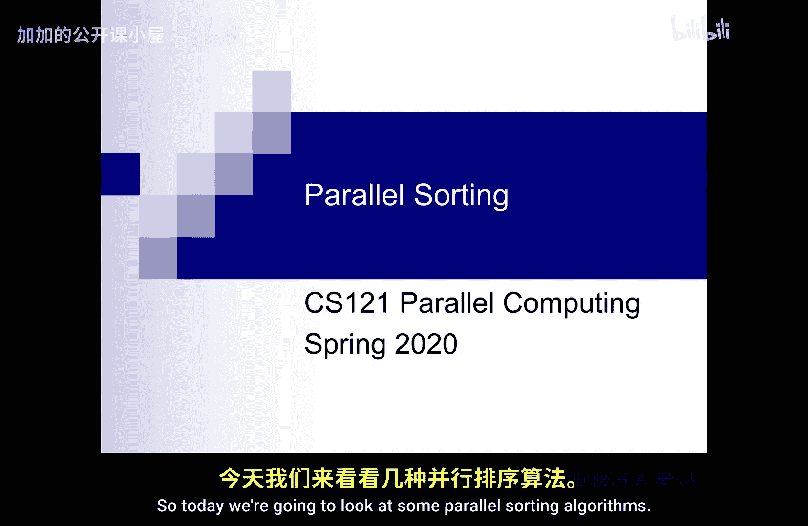
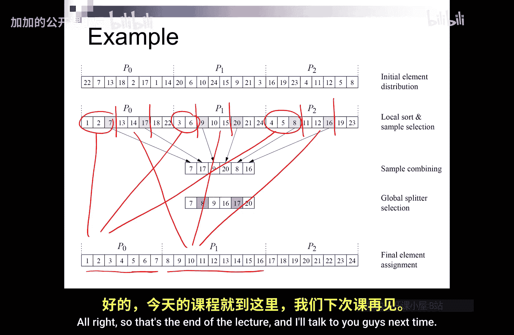

# 并行计算：P23：排序算法 🧮

在本节课中，我们将学习四种并行排序算法：基数排序、并行归并排序、双调排序和采样排序。我们将探讨它们的基本原理、并行化策略以及各自的优缺点。

---

## 基数排序：并行实现

上一节我们介绍了本课要学习的四种算法。本节中，我们来看看第一种：基数排序。基数排序本质上是一种顺序排序算法，但事实证明，它也可以在并行环境中高效运行。

基数排序按数字的每一位（从最低有效位到最高有效位）进行排序。例如，要对一组数字进行递增排序，首先按个位数排序，然后按十位数排序，最后按百位数排序。

一个重要的点是，每次按位排序都必须是**稳定**的。稳定排序意味着，如果当前排序的位值相同，则需要保持这些数字在上一次排序后的相对顺序。例如，在按百位数排序时，362和397的百位数都是3，形成“平局”。为了保持稳定，需要参考前一次（十位）排序的结果，将362保持在397之前。

基数排序之所以能高效并行化，是因为对每一位的排序操作可以并行执行。这使其在实践中，尤其是在共享内存环境中，成为最快的排序算法之一。

我们将利用**并行前缀和**操作来实现并行基数排序。前缀和有许多应用，这是其中之一。

我们专注于对一组二进制数字的某一位进行稳定排序。假设我们只关注最后一位（最低有效位），其值只能是0或1。我们将最后一位为0的值称为“零值”，为1的称为“一值”。排序这一位，本质上就是将所有的零值放在所有的一值之前，并保持稳定。

以下是实现步骤：

1.  **提取并翻转位**：并行提取所有数字的最后一位，然后将0翻转为1，1翻转为0。我们称这个翻转后的位数组为 `E`。
2.  **计算独占前缀和**：对数组 `E` 计算独占前缀和，得到数组 `F`。`F[i]` 的值恰好等于在位置 `i` 之前出现的零值的数量。
3.  **确定最终位置**：
    *   对于一个在位置 `i` 的**零值**，其排序后的位置就是 `F[i]`（即它前面零值的数量）。
    *   对于一个在位置 `i` 的**一值**，其排序后的位置是：`(零值总数) + (i - F[i])`。其中 `(i - F[i])` 是位置 `i` 之前一值的数量。
    *   零值总数可以通过 `F` 的最后一个值加上最后一个元素本身是否是零值来计算。
4.  **数据重排**：根据计算出的位置数组 `D`，将每个输入值并行地“散射”到输出数组的对应位置。

所有步骤（位操作、前缀和、位置计算、数据移动）都可以高度并行化，其中关键的并行操作是前缀和。这使得基数排序在GPU等共享内存架构上表现优异。

---

## 并行归并排序

上一节我们介绍了基于前缀和的并行基数排序。本节中，我们来看看经典的归并排序如何并行化。

顺序归并排序是分治算法：将数组不断二分，直到子数组足够小，然后开始将有序子数组合并成更大的有序数组。对于n个元素，有 log n 次分割和 log n 次合并，总时间复杂度为 O(n log n)。

在并行设置中，分割阶段很容易并行（只需划分数据）。挑战在于如何并行地**合并**两个已排序的数组。顺序合并使用两个指针从左向右移动，这是一个串行过程。

并行归并排序的核心是展示如何在有P个处理器时，用 O(log n) 时间完成一次合并操作。

我们引入**秩**的概念。值 `x` 在集合 `S` 中的秩 `rank(x, S)`，是 `S` 中小于或等于 `x` 的元素个数。

**关键性质**：对于来自数组 `A` 或 `B` 的值 `x`，其在合并后数组 `C = A ∪ B` 中的秩，等于其在 `A` 中的秩加上其在 `B` 中的秩：
`rank(x, C) = rank(x, A) + rank(x, B)`

如果数组已排序，那么计算 `rank(x, A)` 可以在 O(log n) 时间内通过二分查找完成。

基于此，并行合并两个各有n个元素的有序数组 `A` 和 `B` 的算法如下（假设有2n个处理器）：

1.  为 `A` 中的每个元素 `A[i]` 分配一个处理器。该处理器计算：
    *   `rank(A[i], A) = i` （因为A已排序）。
    *   `rank(A[i], B)`：通过对B进行二分查找，耗时 O(log n)。
    *   则 `A[i]` 在 `C` 中的最终位置为：`pos_A[i] = i + rank(A[i], B)`。
2.  同样，为 `B` 中的每个元素 `B[j]` 分配一个处理器。该处理器计算：
    *   `rank(B[j], B) = j`。
    *   `rank(B[j], A)`：通过对A进行二分查找，耗时 O(log n)。
    *   则 `B[j]` 在 `C` 中的最终位置为：`pos_B[j] = j + rank(B[j], A)`。

所有处理器的二分查找操作可以并行执行，因此整个合并过程的时间复杂度为 O(log n)。

在完整的归并排序中，有 log n 个合并阶段，每个阶段耗时 O(log n)，因此总的并行时间为 O(log² n)。需要注意的是，这个简单版本的总工作量是 O(n log² n)，高于顺序算法的 O(n log n)。存在更复杂的流水线化版本可以将工作量降至 O(n log n)，但本课不做讨论。

---

## 双调排序

上一节我们探讨了并行归并排序。本节中，我们来看一种基于比较器网络的排序算法：双调排序。

首先定义**双调序列**：一个序列先单调递增然后单调递减，或者可以通过循环移位变成这种先增后减的形式。

双调排序依赖于一个关键操作：**双调分割**。
假设有一个长度为n的双调序列S。将其分成两半：`S1 = [a0...a(n/2-1)]`, `S2 = [a(n/2)...a(n-1)]`。然后进行如下操作：
*   将 `S1` 和 `S2` 中对应位置的元素配对 `(a[i], a[i+n/2])`。
*   对于每一对，取出较小值，形成新序列 `MinSeq`。
*   对于每一对，取出较大值，形成新序列 `MaxSeq`。

**性质**：
1.  `MinSeq` 和 `MaxSeq` 都是双调序列。
2.  `MinSeq` 中的所有元素都小于或等于 `MaxSeq` 中的所有元素。

基于双调分割，可以构建**双调合并**操作：将一个双调序列转换成一个完全有序的序列。
*   对输入的双调序列进行一次双调分割，得到 `MinSeq` 和 `MaxSeq`。此时，所有较小元素已位于左侧，较大元素位于右侧。
*   递归地对 `MinSeq` 和 `MaxSeq` 分别进行双调合并。
*   当序列长度为1时，自然有序。

双调合并可以用**比较器网络**来实现。一个比较器是一个两输入、两输出的单元，输出可以是（小，大）或（大，小）。双调合并网络由 log n 级构成，每一级包含多个并行工作的比较器，对数据进行一次“分割”。因此，双调合并的并行时间为 O(log n)。

最后，**双调排序**算法如下：
1.  将任意输入序列分成两半。
2.  递归地对前半部分进行**升序**双调排序。
3.  递归地对后半部分进行**降序**双调排序。（此时，整个序列构成了一个双调序列：前半升序，后半降序）。
4.  对整个序列进行双调合并（升序）。

整个排序过程有 log n 个双调合并阶段，每个阶段耗时 O(log n)，因此总并行时间为 O(log² n)。双调排序网络的总工作量是 O(n log² n)，并非工作最优，但其常数小，在实际硬件（如FPGA）上往往非常高效。存在像AKS网络这样的工作最优（O(n log n)）排序网络，但常数极大，不实用。

---

## 采样排序

上一节我们介绍了基于网络的双调排序。本节中，我们来看最后一种算法：采样排序。它特别适用于分布式内存环境。

采样排序是一种基于桶的并行排序算法，目标是让各个处理器负载均衡。
1.  **选择枢轴**：从所有待排序元素中随机选取 `λ * P` 个样本（`P`为处理器数，`λ`为一个大于1的因子，如 `12 * log n`）。
2.  **确定桶范围**：对这 `λ * P` 个样本进行排序，然后从排序后的样本中均匀地选取 `P-1` 个枢轴（例如，每隔 `λ` 个取一个）。这些枢轴将整个值域划分为 `P` 个桶。
3.  **数据划分**：每个处理器根据这 `P-1` 个全局枢轴，将自己持有的本地数据划分到这 `P` 个桶中。
4.  **桶收集**：进行全局通信，使第 `i` 个处理器收集到所有属于第 `i` 个桶的数据。
5.  **局部排序**：每个处理器对自己拥有的桶内的数据进行局部排序（例如，使用快速排序）。
6.  **结果串联**：按处理器编号顺序输出排序后的桶，即得到全局有序序列。

算法的关键在于枢轴的选择。通过采样并选取均匀分布的样本作为枢轴，可以**以高概率**保证每个桶的大小大致均衡。理论分析（使用切尔诺夫界）表明，当 `λ = O(log n)` 时，可以保证最大桶的大小不超过 `4 * (n / P)` 的概率非常高（例如，大于 `1 - 1/n²`）。这样，每个处理器的负载大致相同，排序时间约为 `O((n/P) log (n/P))`。

采样排序的通信开销相对较低：主要是收集样本、广播枢轴、以及全局桶的重新分布。它在分布式内存并行系统上是一种常用且高效的排序算法。

---

本节课中我们一起学习了四种并行排序算法：利用前缀和实现高效位排序的**基数排序**；通过并行合并实现分治的**并行归并排序**；基于比较器网络和双调序列性质的**双调排序**；以及适用于分布式环境、通过采样保证负载均衡的**采样排序**。每种算法都有其适用的架构和场景，是并行计算中重要的基础工具。