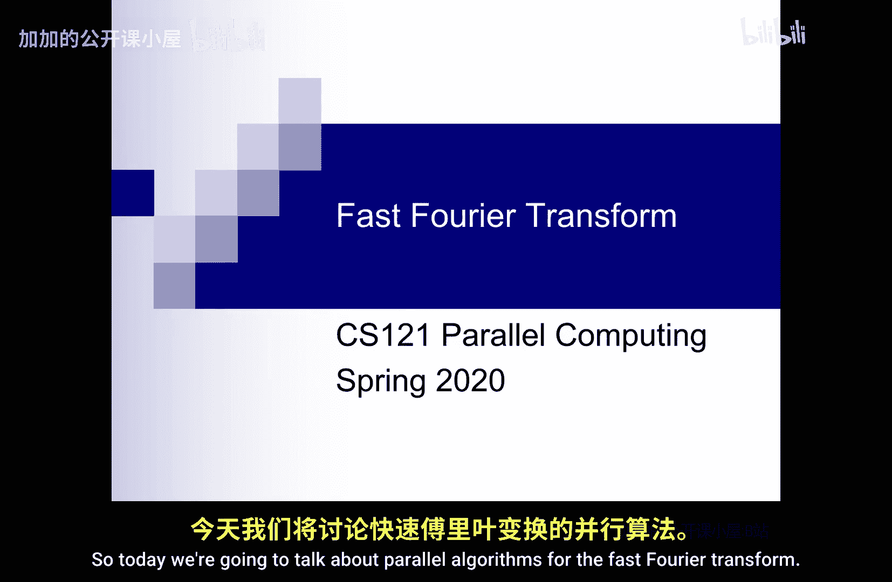
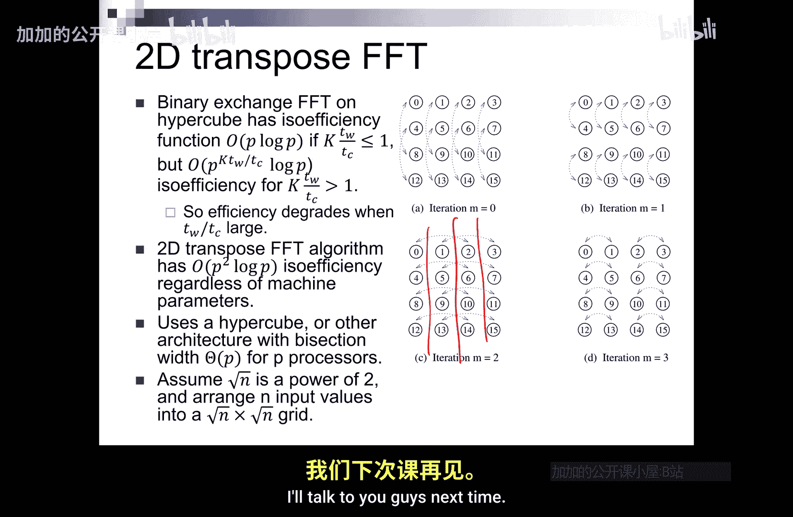

# 上海科技大学【中英⚡并行计算｜CS121 2020 Parallel computing】 p24 P24 Fast Fourier Transform -BV1VqypBaEaP_p24-

Welcome back。So today we're going to talk about parallel algorithms for the fast Fourier transform。

So the Fourier transform is one of the most important tools in mathematics。

 and it basically lets you translate a signal from the space domain to the time domain。

And we're going to be talking about the fast Fourier transform。

 which is basically an efficient way of implementing the Fourier transform。

And so because of this efficiency， the FFT has a very large number of applications， for example。

 in signal processing or in operations that we can do on polynomials and matrices in like computing convolutions and filtering。

 in mathematics， in machine learning and many， many other applications。And in fact。

 the FFT has been voted one of the top 10 most important algorithms of the 20th century。

And so I think it's fair to say that if we did not have the FFT algorithm。

 then many things that we take for granted nowadays simply would not exist right so a lot of computer science simply is not possible without the FFT。

Okay so the FFT algorithm was popularized by these two people Couly and Tki in 1965 so they discovered this algorithm。

 but they weren't the first to discover it， so in fact there have been different variations of this algorithm discovered even before Coul and Tki for example。

 there was a variant known even back to Gas back in 1805。

Okay so to describe the Fourier transform and the fast Fourier transform。

 we're going to begin with a bit of mathematics so first of all we're going to define something called a root sorry a root of unity an n root of unity so what we're trying to do is just solve this equation。

 omega to the n power equals1 so of course one of the solutions is just one itself。

 but there can be other solutions especially if we allow for complex numbers。Okay so in fact。

 the solutions to this equation are going to lie in the complex plane and they lie on the unit circle in the complex plane。

 so we just take the unit circle and you break it into n even parts。

 and then each one of those defines a complex number which solves this equation。Okay。

 so all of these solutions， they can be represented in this form， okay。

 so e to the2 pi I times k divided by nth power。And then so here we have n solutions to this equation。

 and so for any k from 0 to n minus1， we obtain one of these n roots of unity。Okay。

 so we're going to write the so these n roots of unity they differ by the same amount okay so basically if we start with this number omega n here okay。

 so let's define omega n to be e to the2 pi I divided by n power then all of the other n roots of unity are just powers of this omega n。

Okay， so we can take omega n to the zero power right， so that's going to be one right。

 and then omega n itself， omega n squared and so on up to omega n to the n minus first power。

 These are all roots of this equation。Okay， so now there are some important properties about these numbers。

 so the first one is that you know omega n to the n power is equal to 1 Okay。

 so that's pretty obvious because omega n is one of these solutions to this equation。OkayAll right。

 so the next interesting fact is that if you take any k from 0 to n minus1。

 if you take omega n to the k plus n over second power。

 that is equal to negative of omega n to the k power。Okay， so so basically。

You know one way that you can see this sort of pictorially。

 So what this is saying is that if you take any any solution。

 okay so omega n to the to the k plus n over 2 is one of these solutions one of these roots of unity So if you take any one of them or sorry let's begin with omega n to the k power so that's one of these roots of unity。

 and now if you add n plus n over 2 to the exponent So that basically moves you by n over two solutions。

 okay and that's going to move you halfway around the circle and you see that when this happens。

 you're going to get negative of the value that you started with。 So for example。

 if we're talking about omega n to the first power okay so like this value over here now omega n to the1 plus n over 2 So in this case。

 n is going to be8 over here。 So this is going to be omega8 to the fifth power and you see that。

What you need to do is basically just move four steps so n is going to be8 over here。

 so n over 2 is going to be four steps， so we move1，2。

3 and four steps and that takes us to omega 8 to the fifth power and that's indeed the opposite of omega 8 to the first power。

And this holds for every K。Okay， and the final property is that if you take omega n to the k power and then you square it。

 okay， then of course， you get omega n to the 2 k， right， However。

 this is also equal toome omega of n over 2 to the k power Okay， so omega of n over 2 right。

 So this is so this omega。Oops， it's hard to write down here。 So let me write up here。 Okay。

 so omega n over2 is one of the n over2th roots of unity。

 So basically that means that if you take this thing to the n over two power， right。

 then you're going to get one over here。Okay。Yeah， so we have this fact and as an example of this。

 so suppose you take let's say this this thing over here， Okay， so omega8 to the third power， right。

 if you square that you're going to get omega 8 to the6 power。

And this is one of the fourth roots of unity right so this omega8 to the third power is one of the eighth roots of unity。

 but what this fact3 is saying is that when you square it。

 you get one of these fourth roots of unity， in fact you get the third fourth root of unity。Okay。

 now the fourth roots of unity are just， you know， if you take the unit circle and you break it into four parts。

 So those are the fourth roots of unity。 Okay， so basically， you know， so let's see。

 so you got one over here， right， you got one over here， one over here， and then one over here。 Okay。

 so these are the fourth roots of unity， and you see that if you take the third a root of unity and you squared it。

 you get the third fourth root of unity。Okay， so that's fact three over here。

All right so all of these packs are important in the FFT as we'll see。

 but before we make use of these， let's just define the problem that we're trying to solve so the problem so first of all we're going to start with the Fourier transform and we're going to talk about the discrete Fourier transform since we're dealing with you discrete signals in computer science。

Okay， so so what we're trying to do is that suppose you're given a degree and polynomial and the polynomial you write like this。

 so it's a0 plus a1 times x plus a2 x squared and so on。'm sorryrry。

 this is a degree n minus1 polynomial， sorry about that。Okay。

 so then the discrete Fourier transform simply wants to compute the value of this polynomial for inputs omega n to the0 power。

 omega n to the first power and so on， so it wants to evaluate this polynomial at all of these n roots of unity。

So this is what we're trying to do when you。Compute this discrete four year transform。Okay。

 we simply want to compute these n values over here。

Okay now in a sequential setting then or sorry know so the most basic algorithm for doing this is that well if you try to compute this you can factor a in this way so you can take the a0 and then in the rest of this expression you can factor out the x and then that's going to leave you a1 and then you can factor out another x times like a2 plus so on so you can factor things this way。

And then in order to evaluate a of x then you see that all you need to do is you plug x into the sort of the innermost set of parentheses in this expression and then that gets you a value。

 you multiply that by x and then add it to the next A and then you multiply that by x and add it to another A and so on。

OkaySo yeah， so there basically there are n levels of parentheses over here， and so to compute AFX。

 you just need to do this for n times， and so that's going to take you order n time。Okay。

 and also you use a constant amount of memory for doing that。

Okay so that means that if you evaluate a at one position for one value of x。

 that's going to take you order n time and so here right our goal is to evaluate a at all at these n different roots of unity and so that would just take you order n square time if you use this basic algorithm。

OkayBut the problem is that in practice， you might deal with very large ends。

 so you your ends can be like millions can be in the order of millions or even larger。

 and so if you use this basic algorithm， it's going to take you a very large amount of time to compute these discrete fourier transforms okay。

So we need a faster algorithm， if we didn't have this faster algorithm。

 many things that we use today in whether it's signal processing or computer science。

 we simply could not use them because they would work way too slowly。Okay。

 so then the fast Fourier transform is going to basically compute this not in n square time。

 but in n log n time and its basically it's a divide and conquer algorithm。

So let's assume for simplicity that n is a power of two。

Okay so so the first step of the fast Fourier transform is to write a in this fashion so now a is you know a polynomial of degree n minus1 but what we're going to do is we're going to write two polynomials like this we'll call them a0 and a1 so now both of these are going to be degree n divided by two minus1 polynomials and then a0 is going to be this polynomial but it's only going to have the even coefficients from a so a is defined in terms of the coefficients a0 a1 a2 and so on but for a0 for this capital a0 we're only going to take the even coefficients from a and then we're going to write a degree n number2 minus1 polynomial from those。

And then for a1， you're going to take the odd degree coefficients from a and again。

 you're going to form a degree n over 2 minus1 degree polynomial。Okay。

 so the reason we do this is because we can actually express a in terms of a0 and a1。

Because you can say that a of x is equal to a0 of x squared plus x times a1 of x squared。Okay。

 so the reason this is true is because if you take x squared and you plug it into a0 okay so then then all of these powers over here all of these exponents are going to double right And so this is going to end up being what do we have over here So we have n minus2 okay。

Okay， all right， so now if you do the same thing， if you plug x squared into a1。

 so then these things are also going to double So then this is going to become sorry n minus-2 but then we also multiply by this X over here。

 So that's going to put another x on top of these exponents。

 So these are going to become become this stuff。 Okay， so this is going to become a 5 over here。

 right and then this is going to become n -1 so now you see that if you add together these two expressions。

 Okay， then you get back exactly all of the terms of a。Okay。

 so this is why we have this identity here for A。Okay。

 so now our goal was to compute compute a at these n roots of unity and so therefore what we can do is instead of computing a at these n roots of unity we can compute we can take all of these input values。

 these different roots of unity we can square them and then we can plug them into a0 and a1。

Okay and then yeah， and then we do this computation so this just involves computing a0 at all of these squared roots of unity and then we have to compute a1 at the square of these roots of unity and then also you have to take the a1 result and then multiply it by these original roots of unity。

Okay， but if we do that， right if we compute at these squared values。

 then we're going to get a evaluated at all of these original values。🤧Okay， well。

 why would we want to do this， Why would we want to compute these as the squared values， Okay。

 the reason is that now we can make use of these different properties about the roots of unity Okay。

 so the so the key property that we're going to use is that suppose you take。

S suppose you take two roots of unity， okay， so you're going to take omega n to the cave power over here。

Okay， and then you also take omega n to the k plus n over 2 power over here。Okay。

 so these are basically， yeah， so we're going to think of sort of taking all of these n different roots of unity and pairing them。

 Okay， so you're going to take the very first route of unity and pair it with the the middle one。

 Okay， so suppose you have like you know， eight of these， Okay，5，6，7，8 right o。Okay。

 so we're going to pair the so then we're going to split these in half and you're going to pair the first one from the first half with the first one from the second half right you're going to pair this one that one and then those so that's how you should think of this Okay so therefore we're going to take the root of unity from the first half and then pair it with the k root of unity from the second half okay。

Alright， now suppose you square these two values。 Okay。

 so what you're going to get is if you square this guy。

 then you're going to get omega n to the 2 k plus n power。 Okay， right。

 so then this is equal to omega n to the 2 k power times omega to the power omega n to the n power。

 but omega n to the n power is equal to1。And so therefore， this term over here。

 we can just take that out。So therefore this is equal to an omega n to the 2 k power。

 which in turn is equal to omega n to the k squared。Okay。

 so basically what we're saying is that when you do this matching， okay。

 between these different roots， if you square them。Now you get exactly the same value。Okay。

 so originally right this value here， of course， is not equal to this value。

 actually they are opposites of each other， but if you square them， then you get the same value。Okay。

 so so the reason this is useful is because we said over here that we just need to evaluate a0 and a1 at these n different values which are the roots of unity squared so now they're n different it seems like we have n different values here however what we can see by this property over here is that now if you take you know the first value over here and then you match it up with the middle value and then you take the second value and then match the middle plus first value and and so on so once you do this matching so we're doing this matching over here then these values become the same。

Okay， so in other words， for this value， right， this thing is equal to the middle value in this list。

Okay， and this value here is equal to the middle plus first value。

Okay so that means that instead of there being actually n different values over here。

 we actually have that they' are only n divided by two different values over here。

 because you know pairs of these values are equal to each other。

And so this is great because now instead of evaluating a0 and a1 at these n different values at these n potentially different values。

 it turns out that we just need to evaluate these two guys at n over two values。Okay。

 so now our problem becomes much smaller， right？Okay， so this is a great first step。

And then one more thing is that。Now so we have this property over here so this basically just says that we only need to compute these n roots of unity to the k power squared and then if you look at this expression。

 you get that if we use the third fact that we had from the previous page then you get this n root of unity to the cave power squared is actually one of these n over second root of roots of unity to the cave power。

Okay， so in other words， you can write。Right， so here we've already said that these values。

 instead of there being n different values there are in fact only n over two different values there are these values and now we can say that each one of these values is not just a n root of unity squared。

 it's actually equal to a n over second root of unity。Okay， so in fact。

 there are only n over two roots of n over second roots of unity。

 and so this set of numbers is exactly equal to all of the n over2 roots of unity。Okay。

 so now we can see that when you want to evaluate a0 and a1 at these numbers。

 it's actually equivalent to evaluating a0 and a1 at these n divided by two different n over second roots of unity it's the same as evaluating this a0 a1 at these n over two different numbers。

Okay， so now yeah so let's sort of summarize what we've said over here okay so our main goal is to compute this a of x right and so we split this into this expression over here and we want to compute this at these n roots of unity。

 however， as we saw we do not need to compute these expressions at these n different values。

 instead you can compute these two expressions， these two polynomials at these n divided by two different values。

Okay， and now remember that a0 and a1， right， their degree are both n over 2 minus1。Okay。

 so we're basically trying to evaluate these two n divided by 2 minus1 degree polynomials at these different n over 2 roots of unity。

Okay so so this is in fact another DftT okay so this is going to be an n divided by 2 point DftT。

So currently here we're trying to compute an endpoint DFT， we have n inputs。

 but instead we've reduced this problem down to computing two DFTs to n over2 point DftTs。

And so therefore we can do this recursively， okay， we can compute a0 and a1 recursively at these n over two points。

Okay， so that's what we're going to do。 we're going to compute these two things recursively and then after we've computed them recursively so this is like divide and conquer right so now we've divided right and we computed this now we need to conquer by combining these solutions that we get to these N over 2 point FFTs。

And the way that you can combine them is that you can say， well， what we said is that， you know。

 A of X here is equal to this stuff。 Okay， so then we simply need to。So then yeah。

 so then once we've computed a0 and a1 at these n over 2 roots of unity， right。

 we just need to multiply the A1 value by this n root of unity and then add it to the a0 result。

Okay and we do this for k from over k from 0 to n over 2 minus1。Okay。

 now what about the other half of the k from n over 2 to n over to n minus1 Okay so so those we can express in this way right so we can still take k from 0 to n over 2 minus1 except for now you add n over 2 to this。

And so we're going to plug this N over 2 in everywhere but the thing is that if take if you look at this expression。

 so because we're talking about these n over 2 roots of unity。

 then if you add an N over 2 to the exponent， it just goes away so this thing over here is the same thing as this。

And likewise， this goes away， and so these two things are the same。Okay。

 and now this thing over here， okay， so now we're going to finally make use of the the second fact that we had。

 which which said that this value over here is basically equal to a negative of this value。O。

All right， so so that that is the FFT algorithm Okay， so let's sort of clear this up a little bit。

 So the FFT algorithm is saying that， okay， so we want to evaluate this expression at these n different values Okay。

 so what we're going to do is we're going to just take the first half of these values right。

And then evaluate them and then do these on N over 2。 FftTs。

 so we're going to compute all of these values for k from 0 to n over 2 minus1 and all of these values also。

And then for the first over N over two values for a。

 we're going to add a positive know this thing positively times this a1 and then for the other n over two values。

 we're going to subtract this thing times a1。O。🤧So so that is the algorithm and now the time complexity for doing this is going to be all right。

 so we just need to compute these to n over 2 point FftTs on a0 and a1 and then after that we need to do this expression over here。

 So this is going to take a linear time because we just iterate through all of these n different values and then the two recursive calls are going to take this much time two times over t of n over 2 where t is the time for doing an n point FF so then you solve this and you know that the solution over here is going to be n log n so this shows that the FftT is going to take you n log n time。

Okay， so right， so now it's helpful to to actually sort of show more steps to sort of to expand this recursion。

 Okay， so let's actually。Show the expanded version of this recursion。

So suppose you're doing an A point FftT， so therefore your input is going to be these eight numbers。

 the coefficients for a。And we said that the way we're going to do this is we're going to form this this a0。

 the big a0 and the big A1 polynomials and the a0 polynomial is going to have all of these even coefficients and the A1 is going to have all the odd coefficients。

All right， so that's the first level recursion。And then the second level of recursion then now you know when you're computing a0 here now again you're going to break these coefficients。

 So now the input are these four coefficients so you're going to take the even ones out of here and then put you're going to break this into two two point FftTs so that's going to involve the even coefficients from this list and the odd coefficients so the even coefficients are the a0 and the a4 right and the odd coefficients are the a2 and the a6 so then you're going to put them into different you're going to compute these recursively。

And likewise over here， right， you're going to take the even coefficients a185 and then put them into one 2 point FftT and then these guys go into the other 2。

 FftT。Okay。Yeah so the algorithm is over here right we're given a list of n different a values right if it's just a single value then the answer to the FFT is know then the polynomial is simply equal to a itself so then of course you just return a and then otherwise we're trying to do an endpoint FftT so you're going to compute this n through the unity over here right and then you're going to take the even and the odd coefficients you're going to recursively solve them so this is going to get you basically n over this is a list of n over 2 numbers this is another list of n over 2 numbers。

And now you're just going to go through this these two lists， right。

 And then you're going to take the the matching values， right。

 You're going to take like the first value from here and then match it with the first value from here and then multiply it by this。

By thisBy the different powers of omega n， Okay， so initially we're going to take oops。

Initially we're going to take so this thing here is initially equal to omega n to the zero power and then eventually we want to have this B omega n to the first power。

 second power and so on right So what we're going to do is initially we're going to set this to be omega n to the zero power and then we know that for yk this is going to be like this where we add omega times this y1 value and then for the other part。

 we subtract omega times the y1 value。And then here this is going to take this omega to the next root of unity okay。

 so we're going to multiply omega by this thing over here and that's going to produce the next power of omega okay。

 so it's going to go from like here to here or from here to here。

so then we're going to iterate through these two lists and use these k numbers and then just match them up and then that will produce a list of n numbers and that list of n numbers is what we return to the calling function。

Okay， so for example， over here after you do this after you compute this 2。 Fft， you get two numbers。

 let's say y0 in y1 and this is for the the0 part so this is for the first FFT over here。

 first recursive call。 and then here you get y01 and then y11 that's for the other recursive call and now you match up this value with that value and this with that So then now you're going to get four values like y0 and now this is again going to be sort of the zero side again going to be the left the first recursion。

 and then this one is going to be the one side， which is the other recursion so that's why I'm going to write this as as y00 again these two values are not equal to each other but I'm just going to sort of reuse this notation so then this is oops this is going to be y10。

Y 20， y 30。And here you're going to get y 0，1， y 1，1， y 2，1， and then y 3，1。

Okay and then finally to combine these， you're going to match up the first value with over here and the second value over there and so on。

Okay so so the reason I'm showing this in such detail is because later on when we actually implement this in parallel and so on。

 right we're going to need to see exactly which values get matched to which which other ones so it's useful here just to sort of clearly show which values are being matched up with each other as we as you compute this step all right so that is the recursive FFT。

And now so we're going to see so now we're done with the like the sequential Oh one more thing。

 I need to talk about the order that these。That these values appear periodion okay so if you look at the order of the final level of the recursion okay so the order is like a0 a4 a2 and so on so so what is this order it's definitely not the original order a0 a1 a2 and so on so it turns out that this order is actually what's called the the bit reversed order so what happens is now if you write out the these coefficients sorry these indices in binary in binary so then here you have basically you have 0 is 000 this is1 100 this is 010 this is 110。

 this is 001 this is what is 101 and then this is011 and then this is 111。

Now what is this order now suppose you take each of these binary representations and then you reverse all the digits okay。

 so for example， if you take the 100 right you're going to change that you're going to change it to001 okay you simply swap the you just reverse all the digits。

Okay， right， so this one doesn't change， right， But then this one would become like you know。

011 and so on。 right， So if you let's just do all of these。 Okay， so this is 101。 This is 010。

 This is 0，0，0，0，0，0， this is 1，1，0， and this is 1，1，1 Okay。

 so now if you look at these a bit reversed indices。 Okay。

 now these actually are the binary numbers just listed in order。 right。

Okay so so that means that you know this ordering on the final values that you're sort of matching up。

 okay so this is just the bit reversed order from the natural set of binary from the natural sequence of binary numbers you take these binary numbers。

 you reverse all their bits， and then you get this sequence of numbers on the bottom level of the recursion。

Okay， so now we've seen this recursive formulation of FFT but that's still a sequential algorithm。

 So now we're going to get to some parallel implementations of FFT。

so the first parallel implementation is going to be based on circuits。

 so the circuits this is not like a real computer。 it's something that you could actually build in hardware。

 this circuit thing so so the way it works is that we're going to build everything based off of this very basic circuit over here。

 So what this circuit is going to do So this is called a butterfly circuit So it's just going to take two inputs actually it's going to take like well three inputs so it's going to take this y0 and y1 value and then all it's going to do is output know this value over here and this value so it'll take y0 plus this other value over here times the y1 and then it'll take y0 minus this other value times times y1。

Okay， so that's all it does。 So that's our basic circuit。

 And now we're going to combine these circuits together in a way to compute the FFT Okay And so basically what we want to do is so we saw the recursion tree for for the FFT okay so we're going to put we're going to use these circuit in order to to implement this recursion tree。

So for example， at the very bottom level here， Okay。

 so what we want to do over here is just to take a0 and a 4 and。And then we want to combine them。

 Okay， so how do we combine them。 Well，ops， right， we should combine them in this way。 Okay。

 so we have this a0 value over here， right， and then we should so we have the a 0 value。

 we should multiply by this omega。 So at the very bottom level， the omega is just gonna to be 1。

 Okay， and so we should take a 0 plus a 4。 Okay， that's this part over here。

 and then we should also compute a 0 minus a 4。 Okay。

 and so that's going to produce these two numbers over here。 Okay。

 so it's going to produce the the y 0，0。 and then the y 01。 Okay， and then likewise over here。

 you should compute。You should compute a2 plus a6 and then a2 minus a6 so so to implement that we just need to make sure that we're going to match up because the input here is going to be a0 and a4。

 so we're going to match up a0 and then a4 over here。Okay， and then we're going to have this value。

 which is equal to to one， we're going to feed these through our little butterfly circuit and that's going to add one of them and then subtract on the other side and it's going to produce these two outputs over here。

Okay， likewise， we're going to do a2 and A6， so we have A2 and A6 being fed into one of these butterflies right we have a1 A5 and then A3 A7 Okay。

 so yeah， so these for butterflies are going to implement the bottom level of the recursion。Okay。

 so so then next we need to take let's see。 so this is going to produce two values here So we said that this is 00 and then y10 right and then this is y01 and then y 11 And we said that now we're going to take these two values and match them together right and then these two values and match them together and what we mean by match them together is that so the matched values are going to go into one of these little butterflies over here Okay so then that is so then what we're going to do is you know this value over here right that is the that's the y0。

0 value this is going to go into this butterfly。And the matching value is this thing coming from a2 over here。

 right and so that's going to go into the other butterfly。And then the A4 and A6 get matched。

 so where we have that so we have the A4 over here。

 which is going to get fed into this butterfly right so this sort of circuit sort of goes underneath this part over here and it's actually the input to this one and then the a6 is the input over here。

Okay， and then likewise you have a 1， a3 being matched。

 So we have a1 going over here and then what we have a3 going over here right and A3。

 a7 I'm sorry and then a 5， a 7 right so so5 is going over here and then7 is going over here Okay。

 Yeah so then then this second stage over here right this is implementing。

this is implementing these two conquer stages， these two combining stages。

Okay and then finally we need to have to do the final conquer step right we're going to match you know these values。

 the a0 you know these two values and then these two values get matched up and so on right so you see that you know here we're going to take the a0 value and then the other input is going to be the a1 value right because we're matching the a0 with the a1 right and then the a2 with the A3 is going to go where do we have a2 so we have a2 over。

Let's see a0 a1 a2 a3 okay so then we have the a2 over here and then we have the the3 over here and so on right and so that's going to implement the second stage or sorry the final stage over here stage three so this circuit exactly reproduces this recursive formulation of the FFT。

Right and all of these stages can be run in parallel okay so each stage does multiple operations。

 but these operations are independent of each other so we can do all of these stages in parallel so in total we just need three stages right for eight values and in general if you have n values right then this recursion tree is going to have log n levels and so for your circuit it's also going to have。

It's also going to have log n stages。Okay， so this is a parallel circuit for computing FFT。

 which runs in time log N。All right， so next， we're going to see how to actually implement FFT on a real computer。

 so the circuit is not really we don't have any architectures。

 any computer architectures that exactly implement the circuit。

 but now we're going to look at how to implement FFT on on like a traditional parallel architecture。

Okay， so so again， we're going to be looking at which values we're going to match up when we compute these FFTs recursively。

 so this is still going back to this recursive formulation where you you have these values that you need to match up and then do this butterfly operation on。

Okay， so the key is to figure out which values are being matched up。Okay， so all right。

 so then here we see that in general， So what is the rule for figuring out which processes to match up。

 Okay， so the rule is that basically if you。So so for example here， right。

 we're going to match the zero value， the the zero value with the eighth value okay。

 and you see so we're matching up this value with that value。 And so you see that these two guys。

 they only differ on the first digit。On the most significant con digigit。And likewise。

 we're going to match up the one value over here with a nine value。And again。

 you see that they only differ on the most significant digit。Okay。So yeah。

 so we're now so this this is called the binary exchange Fft T algorithm。 Okay。

 so it's also going to do if you have n values， it's also going to do log n stages。 Okay。

 at each stage， we just need to match up certain values and then do this butterfly operation on them。

 Okay， so now in the first stage， the values that you match up。

You see that to find which values to match up， you simply take a value and then you flip the most significant bit and that's who you match with Okay。

 like for example， this 5 over here right if you flip this bit right then you're going to get 13 and so you see that x 5 here is going to get match to let's see to to 13 over here Wait did I do that right。

I think I drew that incorrectly so didn't follow my line carefully enough right。Okay， right。

 so it's going to match a get match to this 13 over here Okay so in the first stage for the M equals0 stage right the notes that you get matched with are the ones that differ on the most significant bit。

All right， now for the second stage right again we're going to be matching up certain processes。

 but now the rule for which guys get matched up is now you're going to look at these second most significant bit and that's who you get matched with。

So。So， for example。You know， this guy over here right if you flip the second most significant bit right so this is going to become a1 over here。

 So then x3 is is going to get matched to x 7。 Okay。

 so you see that here x3 gets matched to x 7 Okay so in general。

 that is the rule Okay in the M equals two stage right you're going to use the third most significant bit so you get matched to whoever。

Whoever it is that flips the third most significant bit okay so for example。

 you know this guy over here right so if you flip the third bit over here you're going to get a 0111 and that is what7 okay so then this guy is going to get matched with seven。

And then in the final stage， you just flip the final bit' get the least significant bit。

Okay so that is the binary exchange FFT algorithm and so now we can implement this in a parallel setting so let me just erase all this stuff because we don't need it。

 so now suppose you have P processors okay so we're doing endpoint FFT and let's say that you have P less than M processors。

And for simplicity， assume that both NMP are powers of two。Okay。

 so now let R be the log of N and then let D be the log of P。

So what we're going to do is we're just going to split these M points evenly among the P processors。

 so we're going to give n divided by P values to each processor and then each processor will also produce n divided by P output values。

Okay， so in total， this is going to run for endpoint FftT is going to run for log n time。

 so therefore there are going to be R stages of computation。And yeah。

 and so we set that in this binary exchange FFT， the communication or the operation is going to be between processors whose ID or sorry。

Right， it's going to be between indices whose ID differ in the I bit。

 Okay but this is also the same as processors whose I differ in the I bit Okay because for example。

 these two sorry， these four values are going to get mapped to the first process and then these are going to get mapped to the second process and so on。

 Okay so you see that if the value right， so for example， this value， this gets matched to 10。

01 right so if the value differ in the most significant bit then the processors so here the processor is going to be 00 here the processor is 01 here it's 10 and then here's 11 then the processors also differ in the most significant bit。

Okay， so therefore in the I stage。 So here I should say that yeah。

 So this is going to be I less or equal to to D over here。 right in the I stage the。

Are going to these processors are going to communicate。

Okay so so you see that once were so here d equals2 right and you see that once we're past the second stage。

 then we continue to have these butterflies， but this is being done within a processor now because the first processor is responsible for the first four of these values so in the first stage you need to actually communicate with processor0 needs to go talk to processor2 because that's who you do's who you do the butterfly with。

And then in stage one， right this guy needs to go talk with Pro what。

But then in stage M equals 2 over here， this when you do this butterfly。

 all of these values are already sitting on processor0。

 so you don't need to do any more communication and the same for all of these subsequent stages。

So the only communication is during the first D stages where d is equal to a log of P。Okay。

 so we have communication in the first D stages and then no communication in the last R minus D stages。

Okay， so that's the binary exchange algorithm， so now let's see how efficient this algorithm is on different types of parallel hardware architectures。

So first of all let's look at a hypercube okay so in a hypercube when you have P processors where p is equal to 2 to the D power。

 then each processor is connected to d other processors and these the other ones are the ones that differ in each of the digit of the ID of this processor so this processor is like x right then if you write this ID in binary right then if you flip each digit。

 those are exactly who this processor X is connected to。

And now if you go back to this if you look at this binary exchange algorithm。

 the only communication is between， so the way you determine who you need to communicate with is exactly that you take each of these digits of the processor ID and then you flip them。

Okay， so in the first stage you flip the first digit in the second stage you flip the second digit。

Okay， so if this were so if you had a D dimensional hypercu over here， right。

 then you would you would do D stages of computation and then you would be flipping these d different bits。

Okay， so this means that whenever you communicate with somebody in this algorithm。

 okay so this comes from flipping the bit， but then this also means that the communicating processors are just neighbors of each other。

 They're directly connected to each other right like for example，00 and 10 in the hypercube。

 they're directly they're directly connected because they only differ in one bit。O。

So in general you can see that for so we have D stages of communication in the algorithm and for each stage of communication。

 you only need to communicate with a neighbor。O。And when you communicate with that NaPR。

 you actually need to send n divided by P values， because for example。

 you see that the first processor， he's responsible for all four of these values。

 okay and he's actually going to send all four of these values over to this guy over here。Okay。

 and likewise， in the second stage， right he's got these four values and he's going to send these four values to this processor。

 to zero1。So each stage you communicate with a neighbor and then you send all of your values and you have n divided by P values。

Okay， and then we do this for D equals log of P number of stages。Okay。

 so therefore the total amount of communication is for each stage， it's just going to be。

 you know Ts plus Tw times n divided by P， because you're talking with a neighbor and you're just sending that many values。

And if you do this for log P rounds， then the total communication time for each processor。

Its going to be this expression over here。Okay， now each stage also does n divided by P amount of computation。

 right because。Let's see every time you get one of these values。 Okay。

 so like if you clean this up a bit， okay， so if you take these values and you send it over here。

 right， and then oops。Over here right and then this guy sends these values and sends it over here right So you just need to every time you get a value。

 you just do this butterfly computation right you add you add the value and then you subtract the value Okay so it's just a constant amount of computation for each value that you get。

 and so so each stage also does for each processor in each stage it does n divided by P amount of computation。

And because there are log n stages in total， then the total computation for each processor is going to be this divided by p times log n。

And this TC is the amount of time to do one computation。Okay。

 so now we want to look at how efficiently we can implement this on a hypercute okay because we have computation over here and then we have communication over here so we want to see how much how much of the total time this communication overhead is taking。

Okay， so the efficiency is just going to be the computation time divided by the total time right。

 the computation plus communication time and if you just plug in everything over here right so you just take these two TP and TC expressions and you plug them in over here。

 you get this thing。Okay， so now it turns out that for convenience。

 we're going to define this term K over here， okay。

 so K is basically it's kind of like it's related to E in this way right。

 so we're going to define K by this expression。And now if so as so as you vary P so that's going to help you go faster。

 but it's also going to increase your communication if we want to maintain the same efficiency。

 so IO efficiencyency as we modify P then we have to make sure that these two terms in this denominator do not change as P goes up okay so so then n would also have to increase in order for the two terms to stay the same。

Okay， so suppose you want the first term over here to stay the same。 Okay。

 so suppose you want this to equal one divided by k over here so this is why so this one divided by k over here is but basically supposed to capture these two terms so now if you want this this first part here to equal one divided by k so then what that would mean is so you do some algebra。

 and then you see that this is what you need to have happen。

 Okay so n log n is basically proportional to P log p times this additional factor over here。Okay。

 yeah， so this shows you that you know S increases。

 you need to have n also increase in order for these two things to stay equal。

RightNow for the second term you also don't want that to increase so you want as p increases。

 you want this term to stay the same， so let's say that you want this to be equal to1 divided by k so then you again you do some computations over here and now you get that n has to be equal to P to some power and this power is going to involve this K term and then so this is the time to send one word divided by the time to do a computation so it's basically like you your communication rate compared to your your computation rate。

Okay， so then yeah， and then so you you do some okay。

 so then W here is equal to n log n right so we have this expression for n over here and the total amount of work right so the total work is going to be n log n across all of the processors okay right because。

Because you have n stages over here or sorry you have log n stages and then each stage involves an amount of work so if you look at the computations that's being done。

 every single value needs to be involved in some computation so there there n values so there's n amount of work in each stage times log n stages so therefore w here equals n log n and then we have that so we have this expression for n。

 you plug it into W and you get this thing so as P increases the total amount of work needs to be this size in order for us to maintain the same efficiency。

Okay， so yeah， so then this so what we need is for for W to be to be at least this large right。

 and also W needs to be at least this large。 Okay， so W is going to be at least the max of these two things for is efficiencyency。

And now what this plot is showing is that if you want different degrees of efficiency then suppose you increase your number processor。

 then according to this equation， your total amount of work also needs to increase and in fact so this plot shows that for different efficiency levels。

 how quickly does your amount of work need to increase so basically like here know if you're shooting for a low efficiency so then you can plug this 0。

2 in for here and you can get a value for k。诶。Oh， I'm sorry。 I forgot to label these。 So this is for。

嗯。Yeah so this is for a certain setting for these TC TW and TS parameters so I forgot to add those in here。

 but I'll do that later but for a certain value so you see that this work here involves these parameters right so the TS the TW and the TC so for certain setting of these and for certain setting of E you're going to get a K value and then if you plug that in then you're going to get these different plots。

So the upshot for the plot is that as you want higher and higher efficiency。

 then your problem size has to grow with the processor count and it's got to grow very， very quickly。

If you just want to shoot for low efficiency， your work has to grow with a processor count。

 but not very quickly， but if you want much higher efficiency then the work is going to grow much more quickly with the processor count so in particular it's going to grow like this so it's going to be P to some power where this power is going to involve k and as you increase efficiency then k is going to get larger and so this polynomial over here is going to get larger also。

Okay， so that is the binary exchange algorithm and then this is the efficiency on a hyper cubee now oh okay I'm sorry so these are the values Okay so these are the settings for the TC and the TW and the TS parameters。

Okay， so now let let's try to implement this binary exchange， not on a hypercue now but on a mesh。

 okay so some mesh architectures are easier to build than hypercuubes and so let's see whether we can implement this binary exchange algorithm efficiently on a mesh。

Okay， so suppose you have a root P by root P mesh。 So you have P processors total and let again。

 let D be the log of P。Okay， so now remember the communication pattern that we had okay。

 so the communication pattern， if we go back this to this plot from earlier， right？

So let's try to clean this up a bit。Okay so the communication is， when you have let's say， n values。

 okay so in the first round of communication， you need to talk to the value。

 you need to do a butterfly with a value that is n divided by two distance away right so here you have 16 values and you have butterflies between values that are distance8 from each other。

 and in the next stage， you have butterflies between values which are distance four from each other。

 Okay and then two， and then one。Okay， so you see that the distance of the value that you need to communicate with or sorry that you need to do the butterfly operation with。

 this is starting at n divided by 2 and then decreasing exponentially。Okay。

 so that means that when you're talking about the mesh。

 okay now suppose initially we distribute the values this way。 Okay。

 so we have so we're trying to do， let's say a 64 point Fft over here right and we're just going to distribute the values row wise so now that means that in the very first stage the zero value needs to talk with a value that's 32 away。

In the second stage， the zero value needs to talk with a value that's 16 away and then 8 and then 4 and then  two and then 1 now let's see where these values are located on the mesh so if you distribute the values this way then you see that for the first three stages of computation right we're talking with 32。

16 and 8 and because they' are eight values per row。

 then this means that all of these values are on the same column as this zero value so zero's communication is initially with the values that are on the same column。

And then after the third stage， it's going to be communicating with four， two。

 and one and these are going to be on the same row。Okay， so。

Yeah and and this actually holds for any process Okay， so for example， you know。

 37 initially it needs to talk with somebody who is distance 32 away right so 37 plus 32 is 69 right but then you need to take that mod 64 and so that's5 so initially 37 value 37 and 5 are going to do this exchange a butterfly exchange and then you talk with somebody who's distance 16 away who is over here and then distance 8 away。

Okay so for the first three stages， the communication is just along the same column。

And then after the third stage right， you're going to talk with somebody who's distance four and then two and then one away and those are going to be on the same row。

So this just shows that for every process for the first first so if you have a d equals log P over here。

 then for the first d over two rounds， the communication is going to be with the processors in the same column and then for the next d over two rounds for the last d over two rounds。

 it's going to be with the processors in the same row。Okay， so again， if you have d equals log P。

 then again you're going to have just d rounds of communication。

Okay have so you could have n is larger than P。So in that case。

 the total number of stages that you run is going to be， let's see， so if you define R。

R equals log of n okay， so in total， you're going to run for R stages of computation。 Okay。

 but you're only going have a D equals log P stages of communication because once you're so this is going to be in general larger or equal to that right because once you're you've done the first D stages。

 then after that， all of the communication will be within a within a processor itself Okay so。Right。

 so as we saw with the。Right so you see that once you're past stage。What if it stage D over here。

 right then the communication is just within a processor。Okay， so then right。

 so then that we have this communication pattern first with the guys in your column and then with the guys in your row。

Now， when you're doing this columnwise communication。

Let's see So the distance the distance of the node that you're communicating with okay is going to be like this So for the first D over two rounds。

 we're communicating with the guy in the column and the distance is going is going to decrease right so initially it's just going to be two to the D divided by two distance Okay initially it's sort of like halfway down the column and then a quarter and then an eighth and so on。

Okay， and the same thing for the rows。Okay， so and this is happening for all of the processors in the column。

 Okay， so in the first round， right， this guy is talking with this guy right this one is talking with that one and so on okay。

So so because it's happening with everybody then if you you know we have these edges in the mesh right so then if you look at one of these edges。

 you have a lot of paths that are crossing this edge okay so for example。

 this edge over here right while this communication needs to use this edge right and then this communication is going to use the edge so all of the communications are using that edge so you have a lot of congestion on certain edges。

OkayAnd in fact， because you're communicating this distance away。

 you can see that the amount of congestion on a edge in this column is also going to be this in the n round。

Okay， so the congestion does decrease ass get larger。However， for the initial round。

 you're going to have a lot of congestion on these column edges。And then once you get to。

The communication among the rows right then again for the first few row communication rounds。

 you're going to have a lot of congestion and the congestion decreases over time because over time you communicate with nodes which are closer to you and so you have less congestion。

 but you have this type of congestion。And so once we have this。

 then now we can compute how much time it's going to take to implement this on a mesh。Okay。

 so the computation time。Its still going to be like this。 Okay， so every so you do log n stages。

 every stage you do。You do n divided by P computation Okay so you can see that here all the computation is perfectly load balance right because the total amount of computation is in log n and here each process does exactly that thing divided by P so the computation is balanced then for the communication right So this is the communication time So the communication time is basically you know the startup time。

 and this is the amount of data that you're sending right times C per data time however。

 this part here is the congestion。Okay so we said that this congestion is very large initially okay so if you add up the congestion over all the rounds。

 this is what you're going to get。OkayAnd this is going to simplify too。

 so M is going to range from 0 to d over2 Okay so and then so we have a D is equal to log P right。

 So therefore2 to the D over 2 is going to be root of P。Okay。

 and so so this whole thing is going to simplify to something like this， Okay。

 so basically n divided by root P over here。All right。

 so now in terms of efficiency so this is going to be the computation time divided by the computation plus the communication time okay。

 so if you do that if you simplify everything right， so you get yeah。

 you're going to get let's see how do we get this so this term is n divided by P lets see so the communication time。

嗯。O啊。Oh， okay， right。 Yeah。 So， So this thing here divided by that， right。

 that's gonna get you this term。 Yeah， sorry about that。 spaced out。

 And then this thing divided by that is gonna to get you。 is's gonna to get you that term。

And again we're going to write this in this form with the one over k thing here and so now if you want if you want to maintain the same efficiency as the processor count goes out。

 then you need both of these terms to stay constant。And and this is not such a problem。

 so as P goes up， then you can just take n larger and you can maintain this to be a constant but this is a problem because as P goes up so then this root P thing is increasing pretty quickly。

But then you see that here， you're going to need for example。

 if you make P4 times larger then this thing is going to double， right？But then here。

 if you want make this thing if you want to make this thing double right you're going to have to square n so basically here here this n term is going to have to increase a lot faster than this P term in order to keep this expression be constant so in fact。

 if you work it out， you're going to see that the work so the work is equal to n times log n so the work is going to be something like this so this is going to be now exponential in the P term so P is now in the exponent of the work so the work needs to increase very。

 very quickly as the number of processor processors goes up。Okay， were asked for the。

For the where is it for the hypercu algorithm， right。

 you see that here the work only needs here the P is not in the exponent here the work is polynomial MP P。

 whereas for the mesh， the work needs be exponential MP P to keep the same efficiency。

And so basically the upshot here is that the FFT algorithm is actually not scalable on the mesh and the reason it's not scalable on the mesh is because the mesh has only root P bisection with right whereas you need to do for the FFT you need to do a lot of communication so you basically you need to do。

あ。Yeah you need to do like a linear amount of communication in each stage right because here like you see that you need to take all this data and send it to another processor okay so here there's a like a linear amount of communication in each stage and the mesh cannot keep up because it only has a root P amount of bandwidth between the two halves of the mesh。

Okay， so。Okay， all right， so yeah， so now we're going to talk about one final FFT algorithm。

 So this is going to be called the the 2 d transpose algorithm。

 Okay now so the 2 d transpose is we're going to run this thing on the hyperq but we're trying to improve the efficiency compared to the the previous binary exchange algorithm。

 Okay， so remember that the binary exchange algorithm had the iso efficiency depended on this value over here。

 Okay， this K times Tw divided by TC。 So when this value is small， right。

 then all you need is you need the work to increase at this rate at P log P。However。

 if this value here becomes larger， then this thing goes into the exponent over here。

 and so if this is very large， then you need the work to increase much faster。Okay， so yeah。

 so this basically shows that if this value is large， then your efficiency is going to degrade。

And so instead， if you look at the 2D transpose algorithm。

 this is always going to have this p squared log P efficiency。

 regardless of this parameter over here。Okay， so if this parameter here is small。

 then the binary exchange algorithm is actually better because then the is efficiencyfi is just P log P opposed to P squared log P。

But if this thing is large and in practice this can be large because TW is usually much larger than TC so this can be quite large in practice。

 so in that case the 2D transpose algorithm is going to be better。Okay。

 because this doesn't care about your machine parameters。

 It's always going to have the same is efficiencyency Okay。

 so this thing is we're going to run this on a on a hypercube。

 but you can also run this on a different architecture with as long as it's got a bisection with of you know order P。

 So for example， the factory， you can also run this algorithm on。Okay。

 so we're going to assume that root n now is a power of2。

 and we're going to range all of the input values in a root n by root n grid。

And the way the algorithm is going to work is that okay， so initially， so for example。

 if you have 16 values， Okay， so we know that in the first stage。

 you need to do exchanges between values which are8 apart。 Okay。

 so 0 and8 and then 1 and 9 and so on。 so you see that if you arrange the。

If you arrange the values on this grid， right， then you're only doing communication among the columns。

Okay。Now in the second stage， you're going to communicate with node which sorry the communication is between values or the butterfly exchange is between values which are four part so then again you see that the butterfly is between values which are on the same column0 and4 or one and5 and so on。

However， once you move to。Once you move to the third iteration， right。

 then the communication then the butterflies between values which are two apart。

 then they're going to be on the same row now and in the fourth stage。

 they're also going to be on the same row。Okay now for the 2D FftT。

 our goal is going to be that well okay， so me let's do it this way Okay so we're going to arrange first of all the values in in this grid in this root end by root end grid and then let's say first of all that you have exactly root end processors then we're going to assign one processor for each column。

Okay。And so you see that in this 2D FFT first for the first two stages because you're only communicating within a column like between 0 and 8 or one and9 and so on sorry the butterflies are within the same column then there's actually no communication that we need to do because each processor has an entire column of value values。

 so this butterfly between 0 and 8， this is happening on the same processor this one and nine thing is also happening on the same processor。

So in the first stage， we actually don't have any communication。In the second stage。

 the butterfly is again within the same column。So again， we don't have any communication。

Now in the third stage， previously we had butterflies on the same row。

 and so if we assign processors to columns， then in that case we would have communication between different processors。

However， the trick to the 2D transpose algorithm is that before we start the third stage。

 we're going to transpose all of the values。Okay，So so that means that we're going to take these columns and make them into rows and then the rows are going to become the columns Okay。

 so for example， this row becomes the first column。Okay， so we're going to transpose everything。

And so that means that before the transpose， we were going to do communication within a row。

But now after the transpose， we're going to do communication within a column again。

And now the column right everything on the same column is going to be sitting in the same processor。

 okay， so then again， we don't have any communication here。And then in the final stage。

 right we again do butterflies between processors which are between values which are one apart。

 but then those again are going to be sitting on the same processor。

 so again there's no communication。Okay， so the only communication was in this transition when we had to transpose the the values to go from。

 you know， this configuration to the transpose configuration。 right。

 That was the only step where we had communication。Okay。

 so so this was where you have the same number of processors as you have columns Okay now in general。

 you could have less processors than columns and in that case you can just divide the columns evenly among your processors。

 Okay so for example， you can use the striped format so。

So here you have four processors right and you assign the the columns to the processors like 12，3，4。

1234。 but when you do this， you can see that still you only have this one time when you need to communicate to do the transpose。

 because otherwise， know all of these values are sitting on the same processor。Okay。

 so so now we can go figure out the efficiency of this algorithm。 Okay。

 so all we need to so you know， we're going to look at the computation costs and then for the for the communication。

 it's just going to be the cost to do the transpose。 Okay， so first of all， the computation。

 so now if you have。If you have P processors right。

 then each processor is going to be responsible for root n divided by P columns and each of these columns has size root n so you can see that the computation it does for for each stage is going to be the product of these two things and then there are log n stages。

 and so the total computation is going to be is going to be this it's just going to be n log n divided by P。

so again， it's completely load balanced。And then the only communication is for the transpose。

 Okay so for the transpose， if you， if you go back to one of our earlier lectures on doing collective communication。

 right， So here we need to do the all to all personalized communication。

 That's how you do the transpose。 and whether you do this on a hypercube or any other architecture。

 which has which has theta P bisection bandwidth， then you're gonna see that it's going to take this much time。

 because each time you're sending this amount each process is sending this amount of data。

 And you're doing all to all personalized， where each process has that amount of data。

 And so this is the amount of time you're gonna take。Okay， so then now if you look at the efficiency。

 it's just going to be the computation time divided by the you know and the communication time。

 So you have these two terms， you have the computation divided by this term and the computation divided by divided by that term Okay and so。

Yeah， so it's going to come out to this， right， so we want both of these terms to be constants。

And so in order for the first term to be constant you need n log n to be at least as large as n squared and then for this other thing to be constant okay whether this just decreases with n so we can sort of ignore that term and all right so we also have that root n has to be at least as large as P because you can't use more processors and columns in this algorithm you can only have as many the maximum number of processors is the number of columns that you have so therefore you have that n is going to be at least p squared has to be at least p squared and so the total amount of work W is n log n and so this needs to be at least p squared log P in order to maintain I sufficiency。

Okay， so so this basically says that。Yeah， so we have this transpose algorithm and in most scenarios it will be better than the binary exchange algorithm unless you have you know like a very fast unless you can achieve very fast communication right so if this TW here is very small。

 then the binary exchange is actually going to be more scalable than the 2D transpose。Okay。

 so that's all we have for this lecture， I'll talk to you guys next。

