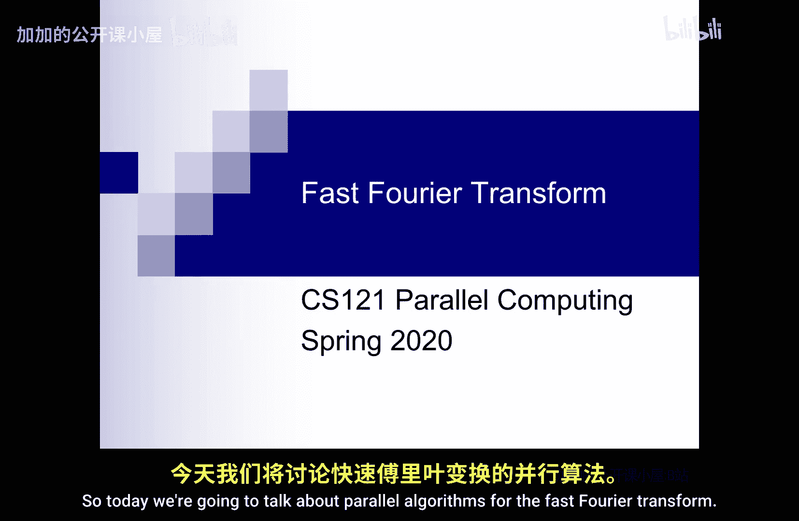
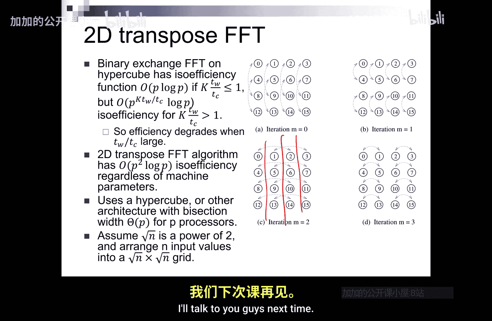

# 并行计算：P24：快速傅里叶变换 🚀

在本节课中，我们将要学习快速傅里叶变换的并行算法。傅里叶变换是数学中最重要的工具之一，它能将信号从空间域转换到时间域。我们将讨论快速傅里叶变换，这是一种高效实现傅里叶变换的方法。由于其高效性，FFT在信号处理、多项式与矩阵运算（如计算卷积和滤波）、数学、机器学习等众多领域有广泛应用。事实上，FFT被评为20世纪十大最重要算法之一。可以说，如果没有FFT算法，我们今天习以为常的许多计算机科学应用都将无法实现。

## 数学基础：单位根

为了描述傅里叶变换和快速傅里叶变换，我们需要从一些数学概念开始。首先，我们定义所谓的“单位根”，即n次单位根。我们要解方程 ω^n = 1。当然，其中一个解是1本身，但如果我们允许复数，则存在其他解。这些解位于复平面的单位圆上。我们将单位圆等分为n份，每一份对应一个满足方程的复数。

所有解都可以表示为 e^(2πi * k / n) 的形式，其中k从0到n-1。我们定义 ω_n = e^(2πi / n)，那么所有n次单位根就是 ω_n 的幂：ω_n^0, ω_n^1, ..., ω_n^(n-1)。

这些数具有一些重要性质：
1.  ω_n^n = 1。
2.  对于任意k（0 ≤ k ≤ n-1），有 ω_n^(k + n/2) = -ω_n^k。这意味着在单位圆上移动半圈会得到相反数。
3.  (ω_n^k)^2 = ω_n^(2k) = ω_(n/2)^k。这意味着平方一个n次单位根会得到一个n/2次单位根。

这些性质在FFT中至关重要。

## 问题定义：离散傅里叶变换

接下来，我们定义要解决的问题：离散傅里叶变换。假设给定一个n-1次多项式：
`A(x) = a_0 + a_1*x + a_2*x^2 + ... + a_(n-1)*x^(n-1)`
DFT的目标是计算这个多项式在所有n个单位根处的值，即计算 `A(ω_n^0), A(ω_n^1), ..., A(ω_n^(n-1))`。

在顺序计算中，最基础的算法是霍纳法则，计算一个点需要O(n)时间，计算所有n个点则需要O(n^2)时间。当n非常大（如百万级）时，这个算法会非常慢。因此，我们需要更快的算法。

## 快速傅里叶变换算法

FFT是一种分治算法，能在O(n log n)时间内完成计算。我们假设n是2的幂。

FFT的第一步是将多项式A(x)拆分为两个较小的多项式。我们定义：
*   `A_even(x^2)`：由A(x)的偶数项系数构成的多项式。
*   `A_odd(x^2)`：由A(x)的奇数项系数构成的多项式。

这样，原多项式可以表示为：
`A(x) = A_even(x^2) + x * A_odd(x^2)`

我们的目标是计算A(x)在n个单位根处的值。利用上述等式，我们可以转而计算`A_even`和`A_odd`在`x^2`处的值，然后再进行组合。

这里的关键在于利用单位根的性质。当我们计算`A_even`和`A_odd`在`(ω_n^k)^2`处的值时，我们发现：
*   `(ω_n^k)^2 = (ω_n^(k + n/2))^2`。这意味着原本n个不同的平方值，实际上只有n/2个是互异的。
*   并且，这n/2个互异的值恰好就是所有的n/2次单位根。

因此，计算一个n点DFT的问题，被规约为计算两个n/2点DFT的问题。我们可以递归地解决这两个子问题。

在递归返回后，我们需要合并结果。合并公式如下：
对于 k = 0 到 n/2 - 1：
*   `A(ω_n^k) = A_even(ω_(n/2)^k) + ω_n^k * A_odd(ω_(n/2)^k)`
*   `A(ω_n^(k + n/2)) = A_even(ω_(n/2)^k) - ω_n^k * A_odd(ω_(n/2)^k)`

这个算法的时间复杂度满足递归式 T(n) = 2T(n/2) + O(n)，其解为 O(n log n)。

## 递归展开与位反转序

如果我们展开递归过程，观察最底层的输入顺序，会发现一个有趣的现象。例如，对于n=8，最底层的输入顺序是 a0, a4, a2, a6, a1, a5, a3, a7。这个顺序是原始索引的“位反转”顺序。也就是说，将索引的二进制表示反转后，就得到了这个顺序。

## 并行实现：电路模型

上一节我们介绍了顺序的递归FFT算法。本节中，我们来看看如何并行实现FFT。首先是一种基于电路模型的实现。

电路模型的基本单元是“蝶形运算”电路。它接收两个输入y0和y1，以及一个旋转因子ω，然后输出 y0 + ω*y1 和 y0 - ω*y1。

我们可以用这些蝶形电路搭建一个计算FFT的网络。这个网络有log n级，每一级包含n/2个独立的蝶形运算，因此可以并行执行。整个电路可以在O(log n)时间内完成n点FFT的计算。

## 并行实现：二进制交换算法

现在，我们看看如何在真实的并行计算机架构上实现FFT，首先是二进制交换算法。

该算法同样进行log n个阶段的计算。在每个阶段，处理器需要与另一个处理器交换数据并进行蝶形运算。配对的规则是：在第i个阶段，处理器与ID在第i位上不同的处理器进行通信。

假设有P个处理器，每个处理器负责n/P个数据点。在算法前 log P 个阶段，处理器需要与其它处理器通信。在之后的阶段，所有需要通信的数据都已位于同一处理器内部，因此无需额外通信。

以下是该算法在超立方体网络上的效率分析：
*   **计算时间**：每个处理器进行 (n/P) * log n 次运算。
*   **通信时间**：在 log P 个阶段中，每个阶段与邻居交换 n/P 个数据。
*   **效率**：效率 = 计算时间 / (计算时间 + 通信时间)。为了保持固定效率，问题规模n需要随着处理器数量P增长而增长。其等效率函数为 W = n log n 需要至少与 P log P 成正比（当通信开销较小时），在最坏情况下可能需要与 P^(1 + K) 成正比，其中K与机器通信/计算比有关。

## 在网格架构上的性能

接下来，我们分析二进制交换算法在网格架构上的性能。假设有一个√P × √P的网格。

在网格上，算法的通信模式会导致严重的网络拥塞。特别是在初始阶段，需要进行长距离通信，这会占用网格中有限的带宽（其二分带宽仅为O(√P)）。

分析表明，在网格上实现FFT的等效率函数为 W 需要至少与 P * 2^(√P) 成正比。这意味着为了保持效率，问题规模需要随处理器数量呈指数级增长，因此FFT在网格架构上是不可扩展的。

## 并行实现：二维转置算法

最后，我们介绍一种更优的并行算法：二维转置算法。该算法旨在改善在通信开销较大的机器上的可扩展性。

算法将n个数据点排列成一个√n × √n的网格。计算过程分为两个阶段：
1.  **列变换**：对每一列独立进行√n点FFT。此时所有数据都在处理器内部，无需通信。
2.  **转置**：将数据矩阵转置。
3.  **行变换**：对转置后的每一列（即原始的行）再次进行√n点FFT。同样无需跨处理器通信。

整个算法唯一的通信开销发生在矩阵转置步骤。这是一个全体到全体个性化通信操作。

以下是该算法的效率分析：
*   **计算时间**：每个处理器进行 (n log n) / P 次运算。
*   **通信时间**：一次矩阵转置，每个处理器发送和接收约 n/P 个数据。
*   **等效率函数**：W = n log n 需要至少与 P^2 log P 成正比。

二维转置算法的等效率函数与机器参数Tw/Tc无关。当机器通信较慢（Tw/Tc较大）时，它通常比二进制交换算法更具可扩展性。

## 总结

本节课中我们一起学习了快速傅里叶变换的并行算法。我们从DFT的问题定义和单位根的数学性质出发，推导出了分治的FFT算法。然后，我们探讨了三种并行实现方式：基于电路模型的O(log n)时间算法、适用于超立方体的二进制交换算法（其可扩展性受机器通信性能影响），以及通信模式更优的二维转置算法（其等效率函数固定为P^2 log P）。理解这些算法及其在不同互连网络上的性能特征，对于在并行系统上高效处理信号和数值计算至关重要。