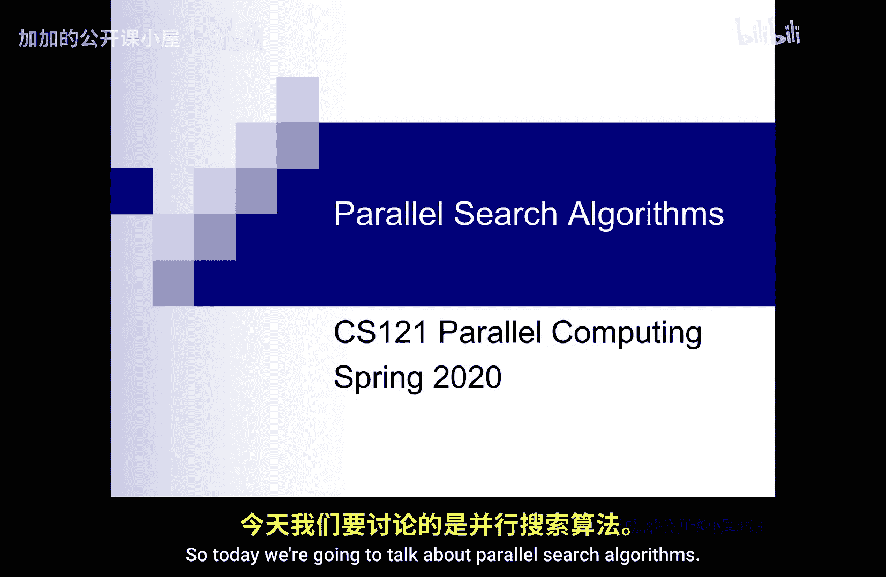
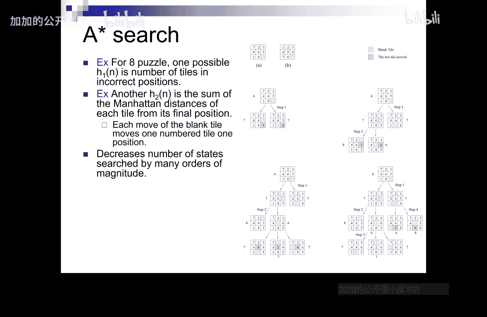
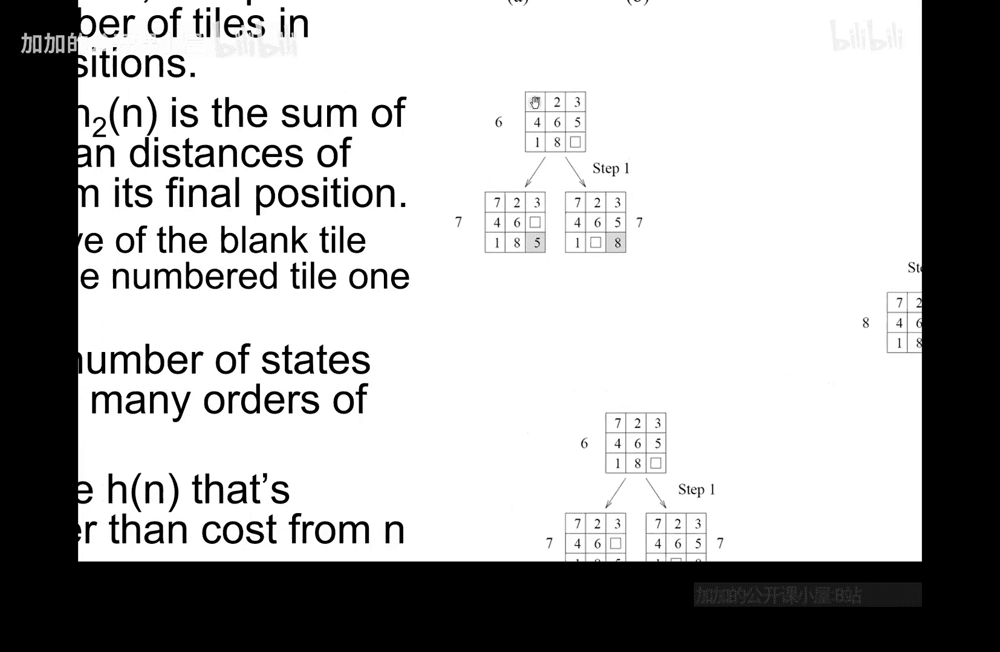
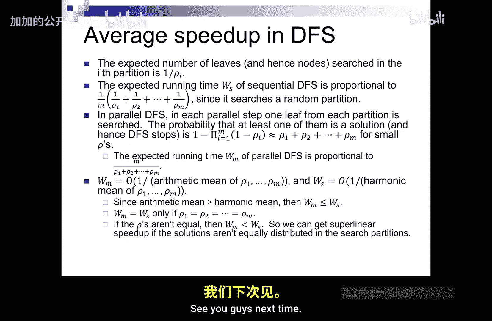

# 上海科技大学【中英⚡并行计算｜CS121 2020 Parallel computing】 p25 P25 Parallel search -BV1VqypBaEaP_p25-

Yeah。Welcome back。So today we're going to talk about parallel search algorithms。

And we'll see how to use these algorithms to solve discrete optimization problems。

So a discrete optimization problem is a problem where we try to optimize over a discrete set。

 so for example， a set of integers。And within the set， we're going to define a subset S。

 which is going to be it can be either finite or infinite。

 but it's going to be the set of feasible solutions to the problem and the feasible solutions have to satisfy certain constraints。

And then we have a cost function F defined on the set S。

And then we're trying to find the member of S， which produces the best value for F。Okay。

 so this is a very general framework for problems and it covers a very large range of problems。

 for example， in operations research， so we have many planning problems and scheduling problems。

 layout problems， logistics and control problems and different types of satisifiability problems that can all be phrased as discrete optimization problems。

So we can consider either maximizing F or minimizing it。

 so today we'll just select to focus on the minimization problem。

So again what we're trying to do is to find a element of S x star such that this f of x star is no more than f of any other element of S so we're basically trying to find the x star which minimizes F。

Okay so many of these discrete optimization problems are MP hard okay so for example。

 many planning problems or scheduling problems or satisifiability problems they're MP hard to solve so so that means that we cannot try to find optimal algorithms to solve these problems instead we're going focus on heuristics okay so these heuristics are basically they'll do some sort of search over the set of feasible solutions and the search space is usually very large and so we want to use parallel algorithms to help speed up this process。

Okay， so now when you conduct this search for a discrete optimization problem。

 you can often model this by a graph。So the graphs。

 so the nodes of the graph are going to be these solutions。

 possibly infeasible solutions for the problem， and then we're going to make edges between nodes which are sort of close enough to each other。

So we're basically searching through all possible solutions for this problem。

 but we're searching through this in a structured way which is modeled by this graph。

 and we're going to traverse this graph somehow and then that's going to take us through all of the possible solutions and we want to traverse this graph in an order in a fashion that can quickly find the solution。

And these states can have costs， so the feasible or infeasible solutions can have costs。

 and then this can be modeled using weights on the nodes or the edges。And then yeah。

 so the overall process is that we're going to traverse through these possible solutions in some order in order to find the best solution。

And sometimes if we get to a state where we cannot progress beyond that state。

 then we're going to call this a terminal state， and otherwise it's going to be a non terminal state。

Okay so as a concrete example of this， suppose we try to solve this problem okay so this is a discrete optimization problem called the8 puzzle so basically we're given this three by three square over here right and then each of these squares has a number in it and what you want to do is so initially the numbers can be some in some arbitrary order。

And what you want to do is eventually get these numbers into the proper order like one，2，3，4，5，6，7，8。

Okay and also there's one of these squares that's blank so that's being represented by this by this little white square here Okay so you can use that blank spot in order to move notes around So for example。

 if you move the blank spot upwards right then that's going to shift the five downwards Okay so then that's going to place the five over here and it's going to place the blank over here。

Okay。And by moving this blank spot around， then the hope is that eventually we can get all of these squares into the right order。

 12，3，45678。Okay， so yeah so there's not really any sort of good algorithm for solving this in the best in the most efficient way。

 so therefore we're just going to go for we're going to use a search algorithm to do this okay so now for the search algorithm we're going to model this using a graph and the node of the graph are just going to be states of this of this problem okay so so possible solutions to this problem。

So for example， the initial configuration， this is going to be one of the states of the graph。

And then we're going to make so there are many possible configurations or states to this graph and we're going to connect two nodes if therere sort of if we can get from one node to another using one move of this puzzle so for example。

 if we just move this blank spot by up one spot then we can get to this configuration。

 so therefore these two configurations are connected by an edge。And likewise。

 if you move this square to the right by one spot or I guess to the left by one spot。

 then you can get to this configuration and so these two things are also connected by an edge。

But there's no way to get from， for example， this configuration to this configuration using just one move of this blank tile。

 and so there's no edge between these two things。Okay， so yeah。

 so basically this shows a bunch of different configurations of this problem and then the connections are between the ones that you can go to using one move of the tile。

Okay， so this is one example for discrete optimization。

Another type of discrete optimization problem is what's called a mixed integer program。Okay。

 so so I'll just show you the example to make it easier to talk about so for the mixed integer program。

What we have is we have a。A linear objective function over here， Okay。

 so it's a function in a bunch of variables and it's a linear function。

And since we're talking about minimization problems。

 let's say that we're trying to minimize this function。

And then also we have a bunch of linear constraints over here Okay， so these yeah。

 so these variables have to satisfy some of these constraints。

And yeah and for this so if we don't put any restrictions on the variables。

 so if we allow the variables to be any arbitrary like real numbers positive or negative okay then this is a linear programming problem however。

 for the mixed integer program we require that some of these variables have to be integers yeah so now for linear programming this can actually be solved efficiently in polynomial time so polynomial in the number of variables that we have。

However， if you require that some of these variables have to be integers。

 then this problem now becomes MP complete。Okay so and in fact。

 you can use these mixed integer programs to model many other integer many other MP complete problems。

 so this is a very general framework for solving problems and this is why it's important because if we can somehow come up with like fast methods maybe not necessarily polynomial time。

 but some sort of fast heuristic for solving these MIPs then we can apply them to many other problems and solve those quickly。

Okay， so yeah， so then this is a discrete optimization problem。

Okay so before I show you the sort of how we model this problem。

 let's just sort of for simplicity let's require a few things okay let's make a few assumptions so first of all let's assume that all of these constraints here are are like greater than constraints so they have to be larger than some value over here right and then also let's let this let's represent these set of all these constraints right let's use a matrix to represent that okay so the matrix would so here it's going to be you know a three by four matrix okay and the the values and the matrix are just a coefficients for all of these all of these constraints。

Okay， and then let's so we're going to call that matrix A。

 and then let's call the the right hand side over here B。

 okay so this is some sort of vector and like B sub I is going to be the I value so this is like b sub1。

 b sub2 and so on。Okay， so all right， so the way we're going to model this problem is that right so the states of this problem are going to be assignments of values to the variables。

Oh， and in fact， for simplicity， let's assume that all of these variables are required to be integers。

 okay， so we don't allow any real values any real valued variables， we only have integer variables。

And furthermore， let's just say that these variables have to be either zero or1。

 so they're binary values， basically。Now， even with all of these assumptions。

 the problem is still MP complete。Yeah， okay， so then the states of this problem are going to be assignments of values to the variables。

 and also we don't require that you assign values to all the variables。 Okay。

 so sometimes you could have variables which are which are of socalled free So they don't have a setting yet right。

 they're not， you don't say whether they're 0 one yet Okay and the ones which do have a setting。

 we're going to say that they're fixed。Okay， so the way we're going to model this as a search problem is that we're going to start with the initial configuration where all of the variables are free okay。

 so we don't have settings for any of these variables。

And then we're going to go through these variables in some order and at each state。

 we're going to take one of these unsaid variables and set it to either zero or1。

Okay so that's going to produce a new state right and then since these two states only differ in the setting of one variable。

 we're going to connect them by an edge。Okay so then if you do this。

 then this is actually going to produce a very large search space in fact it's going to have since every variable can have two settings and if you have n variables。

 it's going the search base is going to be 2 to the so that's too large to actually search through。

So what we can do is we can actually try to eliminate parts of this search space， right？

And there are different ways that you can do this based on different pruning heuristics。

 so one simple heuristic we're going to use is that in order for the solution to be feasible then we have to satisfy all of these constraints over here so now in order to satisfy these constraints。

 what we're going to say is that so if you look at all of the fixed variables so they already have settings for either zero or1 so then what you're going to do is you're just going to add up the values for for these fixed variables。

Okay， and the values aren't given。From these a matrices right and then so for the I throw of the a matrix。

 if you take the corresponding variables and you add them up so then you get this value over here。

Now for the remaining variables that you haven't set yet， so those can either be zero or1。

So if there's0 right， then you're just going to get a value of 0 from that variable so for example。

 if you set x1 to0 over here， then this5 times x1 is just0。However， if you set it to one， right。

 then you're going to get the value AIJ。Okay， so for example， if this guy gets set to one。

 you get five over here， if this guy gets set to one， then you get a negative one over here。Okay。

And and now since we're trying to make sure that these values add up to larger than something， Okay。

 so then we want these these things to be as large as possible Okay， so meaning that。You know。

 if you have a negative value over here， right， then。Sorry。

 if you have a negative coefficient in the a matrix， then you would rather set this to a zero。

So that way at least you get a value of zero as opposed to something negative。

So now when you do this， when you take all of the free variables and then you can set them to either AIJ if it's a positive value or0 if it's a negative value。

 and then you add that to all of the variables which are fixed。

 then you have to make sure that you can satisfy all these constraints。Okay。

 and if you cannot satisfy the constraints when you do this， right。

 then you're at a node which cannot lead to any feasible solutions。Okay， so as an example of this。

 suppose we're at this node， okay， so in this node we've set x1 to be0 Okay so now this so when you set x1 to be0 right then you get a0 over here right and then you get a0 over here and a0 over here okay。

So now what we need is that for the remaining variables。

 right the maximum value so then we're going to put x1 equals0 over here right so x1 equals0。

And now for the other variables which we have not set yet because at this node we still haven't set x2 x x3 and x4 yet so now you can set these to be for each constraint。

 you can set them to be as large as possible either AIJ or zero。So if you do this for。

 let's say the first constraint， okay， so now set you can set all of these access to ones。

But even in that case， you see that you're getting let's see 2 plus one plus2， okay。

 so that's only five。So even if you set all of the variables to be as large as possible。

 you cannot satisfy the first constraint。Okay you can't satisfy the other constraints。

 but you can't satisfy the first constraint。And so because of that。

 then this node is an infeasible node and it doesn't have any children which are feasible either。

 because all of the children will not be able to satisfy the first constraint either。Okay。

 so therefore we can prune this node。All right， so and you can do pruning in other cases also。

 so for example， if were if you were over here okay。

 so then we've set x1 to1 right so then this here we get a five right。Let's write that a bit nicer。

 Okay， here you get a one， right， So you here you get a one。 and then here you get a3。Okay。

 but then you set x 2 and x3 to be 0 you get a 000 000 and so now this node you see that when you're at this node。

 again， you cannot satisfy the first constraint because even if you set this x4 over here to be a14 right which is going to be two you only get7 so you still cannot satisfy this constraint so we can also prune over here。

Okay， so yeah， so depending on what these values are as you form the search tree。

 you can actually prune out large chunks of it so instead of an exponential number of values。

 you can actually go through far fewer values。Okay， so now let's talk about in general。

 how do you search one of these or sorry， let's talk about the structure of the search graph first okay。

All right now sometimes your search graph is going to be a tree， so if it's a tree structure。

 then for every node there's only one way to get from starting the starting node。

 which is the root to any other node so it's got a unique path and it's also got a unique cost the cost is determined by the path from the root node to a particular state。

However， sometimes you get that your search base is not a tree and in that case。

 there can be several paths to a state。So for example， if your search graph is like this。

 then to get to Note 7， there are two paths。Okay。Now it's usually easier to deal with a search tree as opposed to a search graph okay so if you have a graph where you can have multiple paths to a node。

 then you can actually convert that to a search tree。

And the way you do that is you're just going to duplicate some of these nodes Okay so for example。

 there's a path going from the left over here to7 right and there's another path going from the right Okay so then we're going to take these two paths and then you're going to break them apart and then use those to form a search tree。

Okay so then for example， in this search tree， right， we have the left path over here。

 and then we have the right path over here。Okay， and then once you do that。

 now you can use these more sort of easier to develop tree based search algorithms。

Okay now you have to be careful when you do this because sometimes when you unfoldtograph。

 it can get much， much larger so for example， if you have something like this okay so now for each node there are multiple paths to get to that node and so for example。

 if you look at this node 10 over here okay so there are actually there are eight different paths to get to 10 and the reason is that you know to get to 10。

 we need to go through four and 7 okay well there are two ways to get to4 and then once you're at four there are two ways to get to 7。

So that means in total， there are four ways to get from 1 to 7 and once you're at 7。

 there are two ways to get to 10， so there are eight ways in total to go from1 to 10。ok。So in fact。

 if you unfold this into a search tree， then you're going to get a much larger search tree than your original search graph。

So you have to sort of be careful when you do this process。

issue with another difficulty with search graphs is that you can discover the same node multiple times through different paths。

Okay。And sometimes you don't want to have these multiple discoveries so when you run a search algorithm on this search graph。

 you can use some sort of duplicate detection algorithm to see whether you've already discovered a node so for example。

 you can store all the nodes that you discover in a hash table so that way if you if you discover for once through this path and then a second time through the second path then the second time you see that four is already in the hash table and you know that you detected a duplicate。

Okay， and since there are multiple paths there could be multiple paths to a node。

 then the cost to a node is going to be the minimum cost among all the paths。

And so as you find different paths so as you do this search process。

 you find different paths and then you're going to update the costs to a node as being the minimum path cost that you discovered up to now。

Okay so then your hash table can store not only which node you've discovered。

 but also the minimum cost to that node that you've discovered。Okay。

 so now we're going to talk about several sequential heuristics for searching through these search spaces and then later we'll talk about how to parallelize these sequential heuristics。

Okay， so the first heuristic is going to be called branch and bound Okay so yeah。

 so the idea is so this is some sort of pruning heuristic so it's going to search through the search graph in some order。

 but then at certain points in time we can eliminate certain nodes from ever being explored。Okay。

 so so now suppose you're searching through this graph。

 then at some point you have like a frontier of nodes that you've explored Okay so suppose you're exploring oops exploring this the search graph right。

 then you know you have this frontier， let's say of they a bunch of nodes that these are like the farthest nodes that you have explored。

Okay， so now for each node on the frontier， you know potentially this node has a bunch of sub nodes that we need to explore right so yeah。

 so our question is， do we need to actually explore the sub nodes from each of these frontier nodes？

Okay so to know that we're going to maintain a pair of values at each one of these frontier nodes Okay。

 so let's say that you have a value sorry you have a node P over here。

 so we're going to maintain two values M of P let's write this somewhere else so。

Let's just pick one of these nodes over here let's see race all this stuff to make it easier to write Okay。

 so let's say that we're going to focus on this node over here okay so we're going to keep two values M of P and then little M ofP and then a big M of P okay and what these are going to represent is if you look at all of the the nodes that can。

That come out of this node p okay so all of the possible descendant nodes from node p okay so M of p is going to be less than the minimum value from any of these descendants of P Okay so so here you have like a bunch of descendants Okay so D okay so M of P is going to be less than these the values of any of these descendants。

Okay， so I'm going to write that this way and then MP is going to be larger than the values of all of these descendants。

 Okay so I'm going to write it like that。So this is like a lower and upper bound on what kind of values you can possibly encounter in this D among these descendants。

Okay now how do we get these values Well you don't need precise values for little m and big M so you can just sort of approximate these or use any kind of estimate that you want so for example there's this problem called the Napsack problem so like thenapsack problem is basically you have like a bunch of items so each item has a let's say a value so the I item has a value and a weight and then you want to take a bunch of these items and what you're trying to do is you're trying to let's say maximize sum of the values so I know that we're talking about minimization problems but anyways these problems are symmetric to each other so we're trying to pick a bunch of these items which have the maximum value possible however we need to stay within the weight constraint so that so we're gonna pick the set of items s out of all out of all the items and we need to ensure that the weights of all these。

Items is going to be less or equal to some sort of constraint over here okay。

 so you're only allowed to take like big W weight of items and then for that weight you want to take as much value as possible。

Okay， so in that problem， right， what we can say is that。You know， if we want。

 let's say an upper bound so let's say that we've already picked some some set of items Okay so that corresponds to we're at some node P over here where you know P we've already selected some items so then the descendants are going to be well we're gonna to make choices among the untaken items okay so we can decide to which subset of the untaken items undecided items we're going to take right and so so there if you want an upper bound on the maximum possible value of any of these any of these descendant node。

 then you can just say that okay for all of the items I've not taken yet I'm just going to take them all so that's definitely an upper bound on the value that I can get。

among these descendants， maybe this might not be feasible because maybe these descendants。

 if I take them all， then the weight is too much， but at least the value is definitely an upper bound on all the descendants so that would be a very fast heuristic to achieve one of these upper bounds。

Okay， so now the branch and bound method is going to say that if I have two notes， P and Q， Okay。

 so now let's sort of。Okay， so let's take this out。 Okay， and let's take another node Q， right。

 So so this is a d sub P。 Okay， so these are the descendants of P， right。

 And then this guy's got a bunch of descendants。 So he's got D of  Q。 Okay。

 so now if you have a situation where a little M of P Okay is larger than a big M of Q。 Okay。

 then what does that mean， Okay， so little M of P is like the so the minimum value among all of these descendants in of P。

 Okay， so little M of P is larger than the the maximum value。Among all of these descendants of Q。

Okay and now remember we're trying to minimize the objective right so that means that if you look at any of these descendants of P right all of them are worse than any descendant of Q because even the cheapest one among these right even the smallest one among these P descendants they're going to be larger than the maximum descendant among these Q descendants。

Okay so in that case， we definitely do not need to look in P anymore because all of these because you know Q right now is a feasible solution and among his descendants there are additional feasible solutions and then all of them are going to be smaller than even the best possible feasible solution among peace descendants。

Okay so then we don't want to explore any of peace descendants。

 okay so then we can just eliminate this entire subree over here。

And now depending on how you define these these two bounds。

 right the upper and lower bounds right then this can oftentimes help you prune a lot of these notes from being explored。

 Okay so that's the branch branch and bound heuristic Okay we're going to form these branches。

 but then you're going to produce these bounds on them。

 and then that's going to control which additional branching you do。🤧Yeah。

 okay right so that's one sequential heuristic to help us navigate the search space and then do it efficiently。

 Another sequential heuristic is what's called a star search so a star search is kind of like so here we're trying to find a state with like the minimum value somehow okay。

 and then we're trying to traverse a search space to do this。

 So the process is kind of like ditras algorithm for finding for finding shortest path Okay so diytras algorithm you start at some sort of source node right and then you can find the shortest path to any other node。

So here our source node is going to be the root node of the search space and the path we're trying to find。

 so we're trying to find the shortest path from let's say the source node to some other， let's say。

 objective node。And so Dyrus algorithm will let you find the optimal path。

 but it's it could be quite slow。 So a star search is an optimized version of Dyxrus algorithm。

 which somehow like finds the most promising path to search Okay and yeah， so the way it works is。

Well again， let's go with this example over here， okay， so suppose you are at this root node。

 this little pink note over here okay and you're trying to find a path to this blue node over here。

So Dxt's algorithm is and then your search base is just this entire grid okay。

 so when you're at a node， you can search any of the neighbors of that node。

So diytras algorithm is basically， it's going to search it's going to look for this blue node by by sort of finding the the closest by sort of finding the the distance of each of these feasible nodes from the root node。

 And then it's going to search through these feasible node in the order of the distance。 Okay。

 so it's basically going to form this like sort of spiral pattern around。Around the root node。Okay。

 yeah， so yeah。 and then so yeah。 So you're going to get the spiral。

 And then eventually the spiral is going to hit the the objective node。 Okay， however。

 the spiral is going to go through like a big， big chunk of the the overall search space right。

 And the reason is a dis is sort of looking for the the closest node to the。To the starting node。

 and he keeps on sort of exploring node in the order of how close they are to the starting node。

Okay so it doesn't so for example， if you look at now you can form like a sort of like a circle of nodes like this。

 well this is not quite a circle， but anyways it's all of these nodes have the same distance you know so if you're only allowed to sort of take these rectilinear paths where you can only go up down up down left right then all of these nodes on this square they have the same distance to the starting node so diketras doesn't differentiate between any of these nodes and and so therefore it's got to search all of these nodes and then after that it's going to search sort of the next ring of nodes so it's going to search everything sort of ring by ring in this spiral structure that I was showing。

And this of course， is very slow so the way that a star a star search improves on this is that it's going to say that well some of these nodes are sort of better than others okay some of these nodes are closer to the objective than others so yeah so what does it mean to be better well this is where the heuristic part of a star comes in so you have to define some sort of what's called an admissible heuristic function over here。

 which tells you which which nodes you should be searching。Now for some problems。

 it might be very hard to find a mismo heuristic， so in that case。

 a star search will not help you at all because you don't have any sort of any way to tell which nodes are better than other nodes。

But for other problems， you actually can find like good heuristics like this。

 and if you can find a good heuristic， then this can really cut down on the number of nodes that you need to search。

Okay， so more concrete the diicures algorithm is sorry a star search rather okay is going to have these three parts to it。

 So so for each node， we're going to compute a G then， which is the cost from the root to that node。

O。And then also， we're going to have。Yeah， so for example， if you have a node over here。Okay。

 so then G of n is just going to be the cost to that node， so it's going to be the。

The length of this path。Okay嗯。Now， H of n is going to be a lower bound on the cost from N to the solution or to a solution。

so this is our heuristic so somehow we need to come up with a lower bound on the cost from n to a solution Okay so for example。

 if we're going from this node to that node right then a lower bound on the cost would be maybe like you could compute the straight line distance from that node to to the destination so of course we're not actually allowed to go through these straight lines we have to go in in this rectilinear fashion。

 but the straight line is going to be a lower bound on the cost to the solution。Okay。

So the first part over here， this is the G part。RightThat a bit nicer。 Okay， so this is the G part。

 and then this is the H part。And then we're going to define F just to be G of n plus H of n。

So then this is going to be a lower bound on the cost for solution to n because in order to get to this node。

 for example， right you have to pay a cost of G and then after that to get to the solution。

 you have to pay at least H so F is equal to G plus H and so that's going to be a lower bound on the cost。

And on the cost through this node to get to the solution。

And now a star search is going to look at all of these nodes。

 it's going to compute an F value for each node， and then it's going to look for the node with the smallest F value。

 and then it's going to expand that node。In contrast。

 Dytra's algorithm is going to expand the node with the smallest G value so ditras you're going to look at all of the nodes that you've actually reached from the root and then you look at which one is the cheapest and then you expand that node。

 you keep exploring from that node。So that's why if you have like like a ring of these nodes over here right then the problem is that all of these nodes have the same cost from the root okay they all have the same G value and so dixtra is going to expand it's going to explore from all of these nodes because it doesn't differentiate between these nodes whereas if you use a star search then for example。

 you know if you look at this node over here well it's got the same cost in terms of G but it's got a larger F cost because you know because if if you draw the straight line path over here。

 that's going to be larger than this H over here so in that case diytras will expand from this node and not from this other node even though they have the same G cost。

Okay， so yeah， so then D sorry then a star search right can let you explore far fewer nodes。 However。

 when you implement a star search it's just like implementing Dyextra。 Okay。

 it's very easy to implement So you need to keep a list of notes that you've already explored Okay so these are the notes that you have the G values for。

And then you have to keep this open list of nodes which you have not explored and now for each of these open nodes。

 you're going to compute this F value。And then you're going to look for the node with the smallest of value。

 and then you're going to explore that node。 and when you explore that node。

 that node can potentially have a new get a new cost right and then。Yeah。

 and then you have a new F value for that node， and so you're going to update all of these values。

Okay so so the A star search is guaranteed to find you the minimum cost solution as long as you use this admissible heuristic okay so this hd here has to be lower bound。

 okay cannot be larger than the cost from end to the solution。

 has to be less than or equal to the cause from end to the solution from a node to the solution。

And you know if you have a good a good H okay so what is a good H。

 a good H is if H exactly equals the cost from n to the solution then that would be perfect because that would just then F would exactly be the cost of this node because you have the first part that's the cost to get to G and then you have the second part which is like the exact distance from n to the solution then you can just pick the minimum out of all the node。

 you pick the one with the minimum f and that is exactly the node with with the minimum cost that you need to go through。

Okay。Right， however， you know it's hard to get such a good admissible heuristic right so then we're just going to settle for a tradeoff between how quickly we can compute a heuristic versus how close it is to the real cost of a solution and the better the closer it is to the real cost the faster we we can execute for。

Okay， so let's do an example of this。So let's again do this eight puzzle okay so for this eight puzzle one possible admissible heuristic is that if you so let's say that you start with this configuration over here so eventually you want to end up in this other configuration right with everything in order and one so so we need to figure out like an admissible heuristic would be how many moves does it take to go from this configuration to that configuration what's the minimum number of moves。

Well we don't actually know the minimum number of moves。

 but we do know that if some of these tiles are out of place then to get to the correct solution。

 we at least have to move those tiles。 Okay， so for example。

 the seven here right this is out of place okay so at least you have to make a move for seven you have to move at least move seven once Okay the six is out of place So you at least you have to do one move for6。

Okay，So then so then therefore， if you just add up how many tiles are out of place？

That gives you a lower bound on how many moves you need to make in order to get to this correct solution here。

Okay， so in this case we would need to make so this guy's out of place right so one， right two。

 three， and then four moves， okay， at least you have to make four moves to get to the correct solution。

Okay so that's like a simple heuristic， you can slightly improve on that so you can say that not only do I have to move。

 let's say node 7 right I have to so because7 is going to end up over here。

 then at the very least I need to move seven twice okay because otherwise I can't get7 from this position to that position。

So so therefore I can actually count the distance， so for each node in the current configuration。

 I can look at the distance of that node， the number of moves required in order to get that node to the correct position。

And then I can add that up over all of these tiles。Okay， so， for example。Yeah。

 so let's sort of zoom in over here okay。All right， so let's try to zoom in。 Okay， so all right。

 so good。

But I can't can't write once I zoom in Okay well that's not useful So yeah。

 so what I'm trying to show over here is that you know for this node as sorry for this tile7 here right you need to move it to this position so therefore you need to make two moves for this guy Okay so these guys2。

 three，4 are in the correct positions right so we don't need any moves for those the six。

You need to make one move right the five you need to move you need to make one move the one you need to make two moves right and the8 is already in the correct position Okay。

 so so therefore you can estimate that the the number of required moves from this position to the。

A lower bound on the number of required moves from this configuration to the correct configuration is6 okay so that's what's being shown over here this is an admissible heuristic this value over here。

And so the way that we would conduct A star search is that we would compute this value。

 this estimate of moves， for every node and then the F value for node is how many steps that we take to get to that node plus its admissable heuristic value。

Okay， so for example， this guy， right， his F value will be8 because it took one move to get to this node plus his H value over here is 7。

 Okay， this guy also has。F value of 8 and then the a star algorithm is going to expand node in order of their F values。

 So in this case， we have a tie over here。 So so therefore we can expand either one。

 So let's say you expand the the left one right If you expand the left one。

 then you get two node over here。 And so this guy has so this guy has an F value of 2 plus 8 right His H value is 8。

 So then he's got an F value of 10。 and then this guy's got a value F value of。Of8。

 right because I took two notes， two moves， and then he's got a heuristic value of6。 Okay。

 this guy also has a F value of 8。So then again we can choose so we have a tie on the eight so we can choose either one to expand。

 let's say that you expand this node over here right so then each of these guys would have so now their f values would be what they took three moves and then they have heuristic value of seven so they all have f values of 10。

Okay， so now since these guys all have a values of 10 and this guy has a value of 8。

 then we would expand him。Okay， and then yeah， so you just keep applying this process and then。

So this can actually dramatically decrease the number of the number of configurations that you have to search through okay so you know if you don't well I mean for this small problem right for the three by three tile problem are there are actually not that many states that you need to search through。

 but you can make larger versions of this problem so if you make like four by four right then know potentially there are like millions of configurations that you could search through but if you do this a star heuristic then this can cut it down to like maybe a few few hundred or a few thousand or something。

Okay， so sometimes you can also if you want even faster speed then you can use an H function that is slightly larger than the cost from the node to the goal so when you do that can you can further reduce the number of nodes that you search through however you're no longer guaranteed that you produce the minimal solution so this can produce a somewhat suboptimal solution So so you know if H can be much larger than the actual cost。

 then this can produce a very suboptimal solution so the degree of subopality is based on like how close H is to the actual minimum cost。

Okay and the final sequential algorithm that we'll talk about is a DFS okay and there are also variations on DFS so DFS is just is a death first search so depth first search is just that if you have a search graph right then we're going to search sort of as deeply as possible into this search graph and then for each node that we're at right we're going to explore its neighbors and then we'll try to explore those neighbors sort of as deeply as possible and so a way that we can represent this process is we can use as stack。

And then whenever you're at a node， you're going to take all the neighbors of that node and then you're going to put it onto the top of the sack。

And then're going to the next node that you explore is going to be， again， the top of the stack。

OkaySo for example， if if we're in this search process right now and suppose we've already got these nodes in our stack so these are basically the unexplored nodes so they're the leaf nodes like know the 2324 and so on so so we got all those leaf nodes in the stack right and then if we're currently at this 22 and suppose this guy has some more neighbors right so he's got a neighbor let's say 25 and then 26 then we would put 25 and then 26 into the top of the stack and then we would pick one of those nodes we would pick the top of the stack out let's say node 26 and we would further explore。

And then if no 26 doesn't have any further neighbors。

 then we backtrack from 26 so we go back from so we pop 26 and we explored him but he doesn't have any neighbors so then we pop him and then we go back to  to 22 right we backtrack to 22 and then we pick the top of the stack again。

 so in this case 25 okay we keep exploring from 25。Okay。

 so that is the traditional DFS it can be implemented using a stack。

So there are some variations on DFS， so for example there's you can add you can combine DFS with branch and bound okay so some of these so branch and bound says that you know for certain notes。

 you don't need to explore them because all of their descendants are like bad they won't help you optimize okay their values are too large。

So you can use this pruning process of branch and bound。And you can combine that with DFS。

Okay so there's also what's called iterative deepening a star okay and the idea here is that so this is basically like this is basically like DFS except for the problem with DFS is that because it's depth first。

 it can go very deep into into the tree first right so here you see that where we've gone very deep into the tree and we're not really exploring so what we've gone very deep into the tree but we're not exploring the top parts of the tree。

So it's possible that a solution， a good solution exists near the top of the tree okay this depends on the problem。

 of course， but certain in some cases you have good solutions near the top and so DFS is not going to find them and so the way so iterative deepening is a way to find these solutions up top so the way it works is that we're going to do several rounds of DFS in each round you put a limit on how deeply you explore。

And as you do more rounds， you allow yourself to explore deeper and deeper layers。

 but initially you explore the sort of the top of the tree。

So there are different ways of implementing this， one way is that you can put an upper bound B on the cost of what you're willing to explore。

Okay， so for the current round， you put a an upper bound of B。 Okay， And in this round。

 if you ever get to a node where the the F value。 So the F value comes from the the A star estimate of the。

Of the node， if the F value is larger than B， then you're going to backtrack yeah。

 so you don't keep exploring from that node， you only keep exploring as long as the F value is not too large yet。

Okay， so this limits you to like certain layers of the tree but if you don't find any solutions in those layers right then you want to search deeper and so therefore you need to increase this upper bound and you can increase this in different ways one is that you can set it to like in the previous round the node the unexplored node with the smallest F value from the previous round you can set that to be your B value for the next round。

Okay， and initially， you know your B values just like your root the VF value for your root。Okay。

 so yeah， so this is one way that you can implement iterative deepening。Okay， yeah。

 and then there are other there are other heuristics for pruning these search bases。

 okay there's like cutting plane methods and other methods but now we're going to go back so all of these things are sequential heuristics okay so now we're going to look at how to implement these in parallel and we're going to see what kind of problems can arise when you when you do this in parallel。

Okay， so。Okay， so the reason you need to parallelze is that you know these search graphs can be very large okay and when you parallelize you're going to have some sort of overhead。

 so the overhead can be several sources there might be communication overhead between your different processes you could have load imbalance between the processes and these processes sometimes need to share some data structures so there can be contention on these data structures。

Okay。Yeah， and also something which is kind of interesting when you parallelize is that if you search sequentially。

 you're going to search through the tree in a certain order。But when you search in parallel。

 you could be searching different parts of the tree that you would never even bother to search in the sequential ordering。

 or that at least you would so the sequential search order and the parallel search order can be quite different from each other。

And in certain cases， this can either make the parallel search more efficient or less efficient than the sequential search。

 so we'll see some examples of that later。Okay， so in particular。

 if you let WS be the number of nodes that you search in your sequential algorithm。

 and WP be the number of nodes for the parallel algorithm， then you can have this search overhead。

 which is WP divided by WS。And so this overhead can either be larger than one or equal to one or less than one so if it's larger than one。

 then somehow this parallel search is less sufficient than the sequential search because you do more work overall in the parallel search than the sequential search。

However there are cases when it can be less than one。

 so if it's less than one then you actually do less work in the parallel algorithm Okay so and we call this like a speed up anomaly right because usually the parallel algorithm has to do at least as much work as the sequential algorithm okay but in this case since we。

You know we have a fixed problem and yeah we have different search orders then actually the parallel algorithm can do less work than the sequential algorithm。

Okay， so we'll see some examples of that later。Right。

 so now let's get to how to parallelze particular ones of these search algorithms。

 So first of all DFS， okay， how would you parallelze DFS Okay so what you so remember the way we implement DFS sequentially is that we use a stack。

So in order to parallellyze this， we're just going to assign different parts of this DFS stack to different processes。

Okay now a problem with doing this is that or the first problem that with doing this is that if you just use a basic assignment okay then you could have very poor poor load balancing so for example。

 you know suppose at some point in the stack you just have you know you have let's say these nodes and then these nodes so then at that point if you want to subdivide between two threads or two processes you would just give each let's say three nodes but it's possible that in this you know in this left branch over here this is a very small branch so even though you've assigned three nodes。

 as you keep exploring there are no additional nodes in this branch。

Whereas for the other branch for the one on the right this can be a very deep branch and there can be many。

 many nodes in the descendants among the descendants so in that case you get a very poor load balance and when you first made this assignment between these two processes you don't really know which one is going to have a large sub or which one is going to have a small one。

Yeah， so in general， if you just assign statically， if you do this assignment once。

 you could end up with a very bad load imbalance。Okay。

 so so instead we're going to do dynamic load balancing okay so dynamic load balancing says that even if you made a bad load balance decision in the beginning right so once you now start to expand this B part right and you see that there are many。

 many nodes over here， then you're going to readjust your load balancing okay you're going to give some of these nodes back to the first process。

Okay， so how do you do this load dynamic load balancing， Well。

 remember that we talked about this algorithm called work stealing， Okay， so work stealing。

The way yeah so right so the way that work dealinging worked was that each thread maintained a cue of work that it did right that it still has to do a queue of tasks that it still has to perform so in this case your queue would just be all of the items in your stack。

All right， so that's the amount of work that you still have to perform and if a node if a process ever runs out of stuff to do okay so it's Q becomes empty。

 it just goes to another process's Q and then takes some stuff out of it。

And because it doesn't know which other process has stuff in its queue。

 it'll just go to a random other process and then take some stuff out okay or some arbitrary process right so we have some way of selecting who to go steal from。

Okay， now when you do this work stealing， one thing you have to control is how much you're going to steal。

Because each time you do the work stealing， you're going to have to communicate with a remote process。

 you have to take the tasks from that remote process and then also you might need to do some synchronization on the work queuee of that remote process。

So if each time you only steal a small amount of work right and then you do that small amount of work quickly and then you have to go steal again so then you have to steal many times okay so that's a lot of overhead right so if you steal too little you have too much overhead from the stealing。

But if you steal too much， right， then you could have poor load balancing， okay because。Yeah。

 because if the other guy only has a certain amount of work and you steal like almost all of it。

 then it's no longer load balanced。Okay so you to control you have to find like a trade off between these two things。

And also you have to decide who you're going to steal from。 Okay。

 so one way is that you can just steal from a random other process。

 right but there's an but there's some other ways that you can select this。 So， for example。

 there's one method called asynchronous round robin。 So here。Now， the note that you steal from。

 let's call this guy the victim， right the process that you steal from， it's the victim。

So here in the asynous round Robin。Each processor is going to choose its victim independently。

Okay and then it's going round Robin through all of the processes through all the potential victim processes okay so for example。

 if I choose to I choose an initial victim， let's say process three if that guy doesn't have any work or if he doesn't have enough work then I just round Robin through the other nodes okay so I go four。

 five，6 and then maybe I wraparound to one or something okay and then another process can choose its victims independently so maybe he starts with with process 5 okay and he tries the processes like five。

6，1， two，3，4。Okay， so that's asynchronous roundund Robbin。

 so there are the advantages that the processors don't need to do any synchronization with each other because they choose their victims independently。

Another method would be a global round Robin。 So here all the processors are going to maintain like a common victim okay in a global variable and then each time any processor takes from that victim。

 he's going to increment that variable so so in this case we're all going to decide to like steal from process two first。

 let's say so if I steal from process2， then now I'm going to change the victim from the next time to be process 3 because I don't want to keep stealing from the same process over and over because once I steal from him then he's now got then he doesn't have that much work left anymore so next time I don't want to steal from a guy that doesn't have much work。

 I'm going to steal from somebody else so after I steal them from two。

 I'm going to change this global variable to three and so next time if you steal you're going to steal from3 and then change it to4 and so on。

Okay， so then we're just going to round rubbin through all of the processes。

 but each time all the processes need to synchronize in terms of who to steal from。Okay。

 and then finally this is this randomized work steal is the one that I talked about earlier， okay。

 where you just every note just randomly picks a victim okay so he doesn he doesn't round Robin through all the victims。

 he just sort of picks victims randomly each time。Okay so something else about work stealing is that now we said that you don't want to steal too small amounts of work because that you pay an overhead for doing that。

 but then you don't get much you don't actually get much work from the victim so therefore we can set a cutoff in terms of how much work you're going to steal so for example。

 in the search tree， we can set a cutoff depth so if a node doesn't know if his remaining work is his remaining amount of work is below a certain depth。

 then we don't steal from that node so we only steal large chunks of work from other nodes。Okay。

 so so let let's look more deeply this at the overhead of that you pay when you do this work stealing okay so work stealing is actually a very popular method that people use in practice。

 so let's try to figure out how much overhead there's going to be。

Now we can't do this in a very precise way because you know the workload is being generated dynamically so we don't really know yeah we don't have precise information so we're going to make some simplifying assumptions okay so the first assumption is that if you steal from a processor and he's got let's say W amount of work then after stealing both the original processor and the stealing processor will have at least alpha times W amount of work for some constant alpha okay so for example if alphas let's say one half okay so that means that each time I steal from you I'm going to take half your work。

It doesn't have to be exactly one half， it can be like let's say a quarter， so then after that。

 I have a quarter of your work and you're left with three quarters。

But you don't want alpha too small right I don't want to just take like1% of your work because I paid this overhead so I want to get more work from you。

Okay， so there's some constant alpha where both of us have at least alpha amount of work after the work's dealing。

Okay， so then all right， so then this also says that so because the other processor。

 the victim only started with W amount of work right， then this means that after work steal。

 both of us have less than one minus alpha times W amount of work right？Okay。

 so the other assumption is that we don't want to steal tiny amounts of work， so if a processor has。

 let's say， less anpson epsilon amount of work for some small epsilon。

 then nobody will steal from that process， it doesn't do load balancing。Okay。

 so now we can figure out how many times nodes are going to steal from each other。

So the way to do this is suppose we have P processors and let's let v of P be the total number of steals among all of the processors。

 so all P processors are potentially stealing from other processors。

So VFP is going to be the total number of steals before every process receives one steel attempt。

Okay， so so all processors are doing steals right and then you know so they're going to steal from some processes。

 but maybe not other processes yet， but as you do more and more steals right then eventually every processor will be stolen from will become a victim at least once。

Okay， so VF P is how many steel scsor have to be in total before every process becomes a victim？

And this depends on which work stealing algorithm we're using， okay。

 so we're going to use this V of P parameter to sort of compare these different work stealing algorithms to see which ones are more efficient。

Okay， so then now one thing is that so suppose to that at the current time point。

 the maximum amount of work at any processor is W。Okay， then if we do V of P steals。

 then that means that every process will become a victim at least once。

And whenever it becomes a victim， then that process will end up with less than1 minus alpha times W amount of work。

So even the processor with like the biggest amount of work after V ofP steals。

 he's going to become a victim at least once。And then after that。

 he's going to be left with at most one minus alpha times W amount of work。Okay。So yeah。

 so then after this number of steals， the maximum amount of work at any processor is going to be at most this value。

And so that means that if you do another v of P steals。

 then the maximum amount of work is going to be one minus alpha times this value here。

 so1 minus alpha squared times w。And in general， if you do k times v of P steals。

 then you know the maximum amount of work is going to decrease k times and each time it's by a factor of1 minus alpha。

 so we're going to have it's at most1 minus alpha to the k power times W。

OkayAnd remember that we're going to keep doing work stealing until all the processors have just a tiny amount of work。

 and then after that we're going to stop work stealing because if you just have epsilon work。

 then there's no point doing the work stealing。Okay。🤧So the question is。

How many times do we have to do work stealing before the maximum amount of work at any processor is less than epsilon？

Because once we reach that point， then the work steal algorithm will stop。

 then nobody will do any more work steal。Okay。Yeah， so the question is， all right。

 So then since if we do k times VP steals， okay， then the maximum amount of work is going to be this in the system。

 Okay， so then we just need to make so the bigger K is right。

 the smaller this maximum amount of work。 Okay， so we just need to choose K large enough so that this thing becomes less than epsilon。

Okay， and so you can see that if you make k be this value right so here we basically take the log of w divided by epsilon。

 then we're going to end up that the maximum amount of work is going to be less than epsilon。

And so the total number of steals that we do right is's going to be k times v of P steals for those K。

Okay， and so therefore， the total overhead that you paid right was yeah。 So， So this thing。

 we're just going to ignore these constant factors over here。 right， So。

 and let's say that each for each deal， you pay like some sort of constant communication cost。 Okay。

 you fix， you pay a fixed amount of communication cost。 So in that case the。

The total overhead from the work dealing is going to be like this， okay？

And the total efficiency of the algorithm okay so now we want to figure out you know which which of these work stealing algorithms is more efficient so the efficiency is going to be well this work stealing stuff。

 this amount of work right this is involving communication so we're going multiply this by the communication time and then this is the overhead that you pay for the work stealing and then we divide that by the actual work that you did。

Okay， and then， you know， we want this ratio to be small here， right we want the efficiency to be。

sorry， you want the overhead to be small and so in fact， if you want constant efficiency。

 then you have to make sure that whenever this top term increases that you also increase W so that this entire fraction over here is constant。

Okay， so now we're going to look at different working types of work stealing algorithms and we're going to see how large each of these or how efficient each of these is okay。

 so first if you look at the asynchronous round robin okay so now how many steals do you have to do before every process becomes a victim？

Well so you have to do at least P steals because you want every one of the P processes to be a victim so you have to do at least P steals。

 but you might need to do up to p squared number of steals in order for every process to become a victim because for example。

 if so let's say that you have these processes right so you have process P now for the asynchronous round robin every process is going to pick the victims independently okay so it could be that initially like all of us pick this guy as our victim and then sorry and then next we're going round robin through all the processes。

 so then we're all going to pick this guy as a victim and then so on and so it's actually going to take like P steps before each of us before all of us pick this guy as the victim。

Right and so you know for each of these steps， you know we have these sorry we have these p different steel attempts right so we have a bunch of steel attempts for each of these nodes until eventually we all try to steal from this final node。

Okay， so it's。P steals per step times P steps， so that's going to be p squared steel attempts in total。

Okay。All right， so then so this is a number of steals and in order for us to have constant efficiency。

 we need the amount of work to be proportional to the amount of overhead so you need this W here to to be omega of this thing and then since you have V of P is at most p squared。

 you have that w is going to be omega of p squared log of p so you need a pretty large amount of work in order for for this algorithm to be efficient。

Okay， for a global round robin right so since we now for a global round robin。

 we have a common victim variable right and we keep increasing that every time somebody steals from one node right So therefore you know if somebody steals from one right then the next time somebody else is steal from2 and then3 and then so on。

 and so in P steps okay， we're gonna make sure that that every node becomes a victim Okay so V of P equals P。

OkayRight， and then so in total since the overhead that we pay is going to be VFp times log w right so in total this victim variable right we're going to need to access this victim variable p times log w times because you have to access the victim variable every time you get a victim right and then every time you do a steal okay and in total we're going to be doing that number steal that number of steals。

Now the problem is that this victim variable， this is being shared between all of the processes so therefore the total time to access this variable since you access it this number of times。

 if since it's a shared variable， then the total access time is going to be just the number of times that you access it。

Okay， so now for efficiency， you want each process's execution time to be at least the overhead that you pay to access this shared variable。

Okay， so so for each process， its execution time is going to be assuming the processes are perfectly load balanced。

 then the total work is going to be W， so each process is going to do w divided by P amount of work。

Okay， and you want this stuff done by each process to be at least the time for accessing the variable。

Okay， so yeah， so if you do this， then you have that you're going to end up with， again。

 w is going to be omega of p squared block p。Okay， and lastly for the randomized work stealing okay。

 so here you can actually you can prove that if you set if you make this number of steal attempts。

 okay so basically P log P steal attempts， then every node will become a victim once with high probability。

Okay all right， so yeah， so for randomized work stealing V of P is going to be this and in that case the total work is going to be just V of P times log w and in this case we have that w is going to be omega of p times log squared of P。

Okay， so you see that for randomized work dealing here。

 this is more efficient than the asynchronous or global roundro in methods because these both involve something like p squared and this is just like P times log squared to P。

Okay so yeah， so they did some experiments on this。 so for example。

 they compared these three methods and they got that if you use this let's see which one is switch over here okay so if you use asynchronous round Robin so as you increase the number of processors you're measuring the speed up okay so so the higher this line is the better it is okay so so the global let's see so this is the asynchronous round Robin okay so this you know it's scalable up to you know maybe 500 processors okay but beyond that。

 the cost to accessing the cost for the work stealing is going to be too large and so the speed up here it's going to plateau。

And then for the global round Robin。In fact， as you increase the number of processors。

 eventually the speed decreases because you have this common victim variable。

 which is being accessed by all the nodes， all the processors， and this is too much overhead。

And then the best performing one is the randomized one， okay， so this one just keeps scaling。

Because yeah， because you pick random notes and so that's you know there's no contention and there's not too many work steals either。

Okay， so next okay we can talk about parallellyzing a depth first branch and bound or the iterative deepening method okay so in order to to do the depth first branch and bound。

 then you have to store the so for branch and bound you need to have these bounds on the on the values of different nodes so we're going to store the globally best solution and then if a processor finds a better solution。

 it's going to update everyone by doing a broadcast。

And probably the best solution is not going to change that much， is not going to change very often。

 so even though we're doing a broadcast each time we find a better solution。

 we're probably not going to pay too much overhead just because the solution doesn't change that much。

Okay and then for the iterative deepening when you do the broadcast。

 so remember for iterative deepening for each round we need to have this bound we're only going to search up to the cost being a certain bound and then we're going to start the next round of this IDA so yeah so then we need to just do the broadcast for the bound for each round and then once we have that bound。

 then we're just doing a DFS in that bound and then we can just use the parallel DFS algorithm that we had previously where you you sort of dynamically divide up the stack。

Okay， so for a star okay so a star we can also parallelize this。

 but for the a star we have this up we have this Q of F values this priority Q of F values so remember that we have to search through the F values in order of increasing F values so we put all these F values in a priority queue and the processes all have to access that priority Q Okay so we need to parallelize the accesses to that Q。

Okay， so when you do this with multiple with P processors。

 then were in order to parallelze this so there's actually just one minimum value in that Q right so we if all the nodes just try to get that minimum value they would all be contending on that one minimum value。

So instead， since we have P processes， we're going to expand the P smallest values in that cube。Okay。

 yeah， so this is going to be different than the so it's going to expand a different set of nodes than the sequential algorithm okay because the sequential algorithm always expands the smallest node and then add some more nodes potentially into the queue and then it keeps picking the smallest node so here we pick the we at any time point we just pick the piece smallest nodes。

 and this could actually be different from what happens in the sequential algorithm So this can end up doing like more work than the sequential algorithm。

Okay， the other problem is that since we all have to take out these P nodes。

 we have a contention when the parallel processes access this queue concurrently。Right。

 so a way that we can deal with that is we can give each processor its own copy of the queue。

Okay and now so we try to keep these different copies more or less synchronized so that means that if a process finds a good node with a small F value right。

 then it should tell the other nodes about this good node okay because if it doesn't tell the other nodes。

 then the other nodes are still they're still going to work on nodes with bigger F values okay so they're going expand these you know nodes with big F values that they don't really need to expand。

Right， so so we do need to do some sort of communication to communicate these small F values， but。

You know， we don't want to do too much of this okay so yeah。

 so we're going to somehow do find a tradeoff between how often we update the other notes about these improved F values versus how much communication that's going to cost。

And another problem is that you know if the search graph is not a tree。

 then we saw that you could sometimes visit the same node several times okay so in this case we need to detect when we visit a node several times and so we said that we could use a hash table for that but if you parallelize。

 then you can also distribute this hash table among the processors。Yeah， so okay。

 so this is going to have some communication。 but but if we do。

If you have a problem where you can actually do a lot of computation per node that you search。

 then the communication cost is not going to dominate the overall computation。Okay。

 so for the final part of this， we're going to talk about these speed up anomalies that you can have okay so this is where when you search in parallel versus when you search sequentially。

 you can sometimes do more work， but sometimes you can do less work。Okay。

 so and this comes about because the search because basically we're using different algorithms when you search in parallel versus sequentially right so to give an example of this。

 suppose you have this situation on the left okay and suppose you do a sequential search right now let's say that this is the order of the notes that you search in right so you start here and then you search  one。

 two，3 just in this order。And let's say that the goal you're trying to end up at is going to be this final 13th note over here。

 Okay， so the sequential algorithm is going to take 13 steps。Now， if you search in parallel right。

 then you're going to assign these nodes let's say that you have two two parallel processes Okay。

 then you're going to assign some of these nodes to each process Okay so so in the beginning you just have one node okay。

 so let's say that you have one process doing this。

 and then after that you're going to split into two nodes。

So now you're going to have both processes executing okay， so for example。

 the first process right let's say it explores a node in this order right two three， four。

5 okay the other node is going to explore like in this order， okay1， two，3，4。😊。

And so suppose the two processes are running at the same speed then what happens is by the time the first process gets to this node right so it's explored four nodes。

 the other process also explored four nodes and it already already reached the goal node。So in total。

 it took five time steps before you found the goal。Okay。

 right because this is one time step and then in parallel you run four more time steps and so you found the goal after five time steps。

Whereas for the sequential algorithm， this took 13 time steps。So in this case。

 the speedup is actually going to be 13 divided by 5 okay so that's more than two。

 so even though you're only using two processes， you get more than a factor two speed up because you're not searching in the same order in the sequential versus the parallel setting。

Okay， so yeah， so sometimes people call this an acceleration anomaly。Okay。

 so you can get the opposite situation。 So now Im suppose the goal is over here。

 Okay then the sequential algorithm would just search seven nodes to get to the goal。 however。

 if you search in parallel right then the number of steps you need is let's say So this is one step and then after that you can search in parallel。

 but but you see that this left thread over here， right。

 he's going to have to take six more time steps okay， before he finds this this node so therefore。

Yeah， so the sequential search algorithm only explores seven nodes in total。

 whereas the parallel algorithm explores 12 nodes， Okay。

 so the parallel algorithm actually did more work than the sequential algorithm。

And you can call this a deceleration anomaly。Okay so so then lastly。

 let's look at when it's more efficient to search in sequentially versus in parallel okay。

 so we're going to have sort of we're going to create a model for searching using DFS okay。

 we're going to try to derive the average speed up in that model。Okay。

 so the way so what we're going to assume is that suppose you have a search tree and it's got M leaves。

 Okay， and suppose all all the solutions that you're looking for are at the leaves。

 Okay so and there's at least one solution。 Okay， so some of the leaves are solutions and others are not。

Okay， and let's say the tree is such that the number of nodes that you search through is proportional to the number of nodes。

 number of leaves that you explore so you might need to explore some internal nodes。

 but let's assume that the number of internal nodes is proportional to the number number of leaves that you explored。

Okay， so then we're going to compare a parallel DFS algorithm with a sequential DFS so the parallel DFS algorithm is going to take the tree and then divide it into M equal parts and then it's going to assign so let's say you have M processors and then it's going to assign one processor to each part and assume the processors run at the same speed。

Whereas the sequential DFS algorithm， it's just going to okay。

 so it's going to still have these partitions， but it's going to order them randomly so it's going to take a random order on these n partitions and then it's going to completely search one partition before it starts searching in the next partition。

Okay。Right so now assume that in the I partition， each leaf has has some probability of being a solution。

 Okay， and assume these probabilities are independent。 So let's say that in the I partition， right。

 every leaf has a。Probability of row I of being a solution。All right。

 and and both the sequential and the parallel DFS algorithms are just trying to find one solution。

 So as soon as it finds one solution， they you know it can stop。Okay。

 so now let's look at which one is going to be faster。

 searching in parallel or which one is more efficient。

 searching in parallel or searching sequentially。Okay。

 so so if you search in the I partition right then since each node has an independent probability row of I of being a solution。

 then the number of leaves you need to search in that partition before the expected number of leaves you search before you find a solution it's just going to be one divided by this row of I right like if each node has a1-10th probability of being a solution。

 then in expectation you're going to search 10 nodes。Or 10 leaves rather， okay？

And so therefore the expected running time of the sequential DFS algorithm is going to be this expression over here。

 okay it's one over M right， so that's a number of different partitions times you know one over row 1 plus one over row 2 and so on。

So the reason this is true is because the sequential algorithm is going to take a random partition and if it picks the I partition。

 then the expected number of leaves it needs to search through is one divided by row I so therefore the expected time for the sequential algorithm is just the average of all of these of all of these values because it's going to pick a random one of these partitions and each partition has this sort of search time。

Now for the parallel DFS algorithm right， so in that case。

 since we have M processes running in parallel， then in each time step。

 they're going to be searching through M different leaves at the same time in parallel and as long as one of those leaves is a solution then the parallel algorithm can stop。

So the only case in which it does not stop is if all M leaves that the processes are searching。

 all of them are not solutions。Okay， so what is the probability that all of these things are not solutions？

Well， it's going to be this expression over here okay because you know we're assuming all these leavess are independent。

 so the probability that you know in the I partition that the leaf is not a solution is going to be one minus row I and so the probability that all of these leaves are not solutions is going to be the product of all of these one minus row eyes。

And the probability that at least one of them is a solution is just one minus this probability。Okay。

 so assuming the rows are small， then this quantity over here is approximately equal to the sum of all of these rows。

Okay， so so therefore the expected running time of the parallel algorithm。

 is going to be this because you know for each time step for each time step that the parallel algorithm runs for。

There is this probability that one of the leaves is a solution。So therefore。

 the expected number of time steps you need to take before you find a solution is going to be one divided by this quantity。

OkayHowever in every so that's where you get the denominator from。

 however in every time step you have M processes running okay。

 so they're actually doing M parallel steps and so that's why you need to multiply this by n。Okay。

 so that's the total work， sorry that's the expected amount of work that the parallel processes are doing。

Okay， so now we can compare the sequential and the parallel parallel search algorithms for the sequential so let's see so for the parallel one so this is just this quantity over here is just equal to one divided by the arithmetic mean of these values so the arithmetic mean is just you add up these values and you take their average so the parallel running time or sorry the parallel work is just one divided by that。

For the sequential algorithm， right， So there's something called the harmonic mean of these things right。

 So the harmonic mean is basically。So you have M values over here。

 so you do M divided by the sum of all of these inversets things。

 but here we have one divided by the harmonic mean， so this is one divided by the harmonic mean。Okay。

 so there's this inequality between the arithmetic and the harmonic mean。

 which is that the arithmetic mean is at least as large as a harmonic mean。

And so that would mean that this WM here is going to be no larger than the WS。Okay。

 so the work for the parallel algorithm is going to be no more than the work for the sequential algorithm。

And in fact， the only case where they're equal is if all of these partitions have the same probability of having solutions。

 so if all the rowI are equal， then the sequential and the parallel algorithms have the same total work。

O。But if the row I are not equal right， then we're going to have that the parallel algorithm is actually going to do less work than the sequential algorithm and so in that case we're going to get a super linear speed up so if the solutions are not sort of equally distributed among the search partitions。

 then you actually can do less work when you search in parallel versus when you search sequentially。

Okay， so that's what we have for this lecture， I'll see you guys next time。

