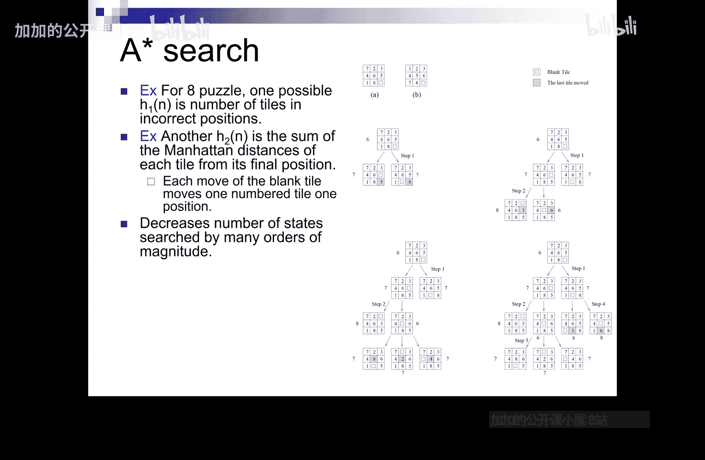
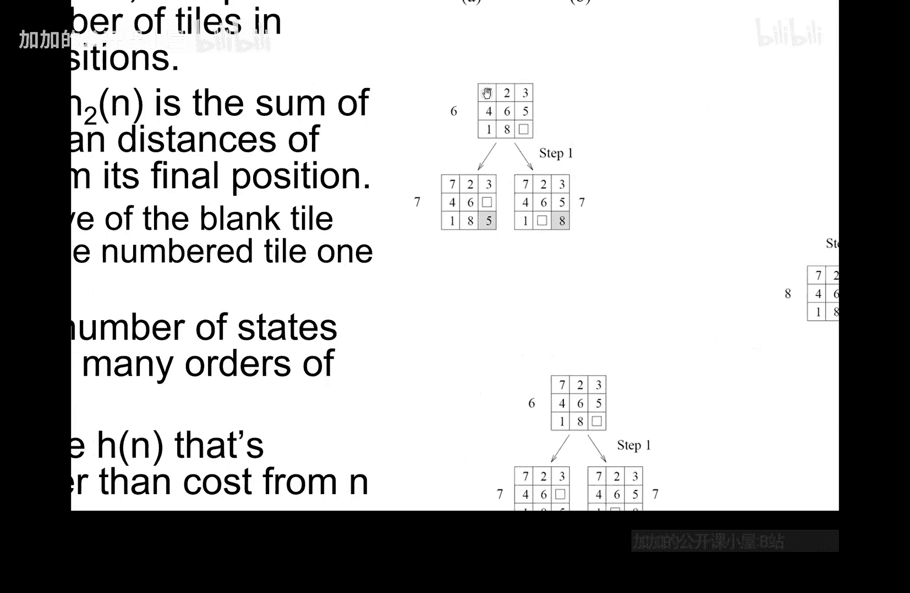
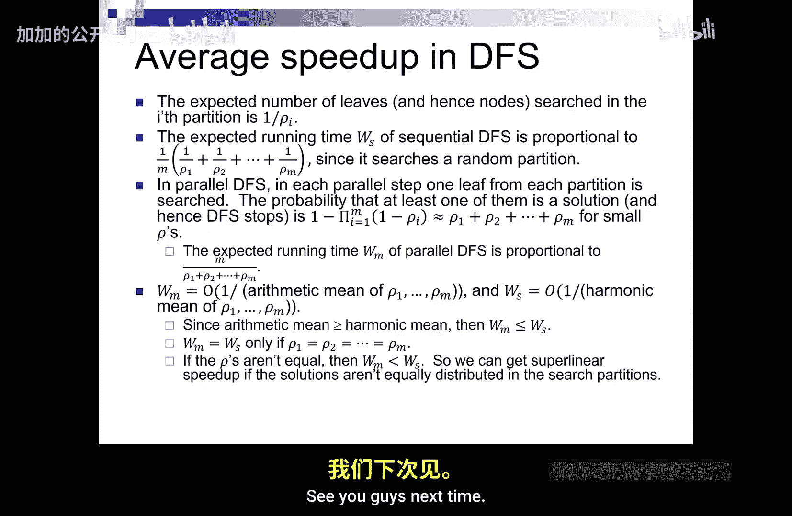

# 并行计算：第25讲：并行搜索 🧭

在本节课中，我们将要学习并行搜索算法，并了解如何利用这些算法解决离散优化问题。

## 离散优化问题概述

离散优化问题是指在一个离散集合（例如整数集）上进行优化的问题。我们定义一个子集 **S**，它可以是有限或无限的，代表问题的可行解集合，这些解必须满足特定的约束条件。我们还有一个定义在集合 **S** 上的成本函数 **F**。我们的目标是找到 **S** 中的一个元素 **x***，使得 **F(x*)** 的值最优（最小或最大）。本节课我们将重点讨论最小化问题。

许多离散优化问题（如规划、调度、布局、物流、控制和各类可满足性问题）都是 NP 难问题。这意味着我们无法找到最优算法，因此需要依赖启发式方法。这些启发式方法会在庞大的解空间中进行搜索，而并行算法可以显著加速这一过程。

## 搜索问题的图模型

在进行离散优化问题的搜索时，我们通常可以用图来建模。图中的节点代表问题的可能解（包括不可行解），而边则连接那些“相近”的解。我们以某种结构化方式遍历这个图，从而探索所有可能的解，并希望以能快速找到最优解的顺序进行遍历。节点或边可以带有权重，代表解的成本。在搜索过程中，如果到达一个无法继续前进的状态，我们称之为终止状态，否则为非终止状态。

### 示例：八数码问题

八数码问题是一个经典的离散优化问题。我们有一个 3x3 的方格，其中 8 个格子有数字，1 个是空白。目标是通过移动空白格，将数字排列成正确的顺序（1 到 8）。

对于搜索算法，我们将每个可能的棋盘配置定义为一个状态（节点）。如果两个状态之间可以通过一次移动空白格相互转换，则用边连接它们。这样，我们就构建了一个搜索图，目标是找到从初始状态到目标状态（数字顺序正确）的路径。

### 示例：混合整数规划

另一种离散优化问题是混合整数规划。其形式化描述如下：
*   目标：最小化线性目标函数 **c^T x**。
*   约束：满足线性约束 **A x ≥ b**。
*   变量要求：部分或全部变量 **x** 必须为整数。

如果所有变量可以是任意实数，这就是一个可以在多项式时间内高效求解的线性规划问题。然而，一旦要求部分变量为整数，问题就变成了 NP 完全问题。混合整数规划是一个通用框架，可以建模许多其他 NP 完全问题。

为了简化模型，我们假设所有变量都是二进制整数（0 或 1），问题仍然是 NP 完全的。搜索状态定义为对变量的赋值（部分变量可能尚未赋值，称为“自由变量”）。我们从所有变量均为自由变量的初始状态开始，然后按某种顺序依次将自由变量设为 0 或 1，从而生成新的状态，并通过边连接仅在一个变量赋值上不同的状态。这样形成的搜索空间大小为 **2^n**，非常庞大。

我们可以使用剪枝启发式方法来减少搜索空间。一个简单的启发式方法是：检查当前已赋值变量，并假设所有自由变量都取其可能对约束最有利的值（正系数取 1，负系数取 0），计算每个约束的“最乐观”值。如果即使在这种最乐观的假设下，某个约束仍然无法满足，那么当前节点及其所有后代节点都不可能产生可行解，因此可以将其“剪枝”掉，无需继续探索。

## 搜索图的结构

搜索图有时是树形结构（从根节点到任意节点有唯一路径），有时则是普通图（存在多条路径到达同一节点）。处理搜索树通常比处理搜索图更容易。我们可以通过复制节点，将一个带有环或多路径的搜索图“展开”成一棵搜索树，但需要注意这可能导致搜索树规模急剧膨胀。

在搜索图中，另一个难点是可能通过不同路径多次发现同一个节点。为了避免重复探索，可以使用重复检测算法，例如将已发现的节点存储在哈希表中。由于存在多条路径，到达一个节点的成本是所有路径中的最小值。在搜索过程中，哈希表可以存储节点及其当前已知的最小到达成本。

## 顺序搜索启发式算法

在讨论并行化之前，我们先介绍几种顺序搜索启发式算法。

### 分支定界法

分支定界法是一种结合了剪枝的搜索方法。它按某种顺序遍历搜索图，但在某些时候可以消除部分节点，避免探索。

其核心思想是：在搜索前沿的每个节点 **P** 上，维护两个值 **m(P)** 和 **M(P)**，分别代表从节点 **P** 出发的所有后代节点成本的下界和上界。这些值可以是估计值。

**分支定界规则**：如果存在两个节点 **P** 和 **Q**，满足 **m(P) > M(Q)**，这意味着即使 **P** 的后代中最好的解，其成本也高于 **Q** 的后代中最差的解。由于我们寻求最小化解，因此完全没有必要探索 **P** 的后代，可以将整个 **P** 的子树剪枝掉。

### A* 搜索算法

A* 搜索是一种用于寻找最小成本路径的启发式搜索算法，类似于 Dijkstra 算法，但通过启发函数引导搜索方向，效率更高。

对于每个节点 **n**，我们定义：
*   **g(n)**：从起始节点到节点 **n** 的实际成本。
*   **h(n)**：从节点 **n** 到目标节点的**估计**成本，这是一个**可采纳启发函数**，意味着 **h(n) ≤** 从 **n** 到目标的实际最小成本。
*   **f(n) = g(n) + h(n)**：通过节点 **n** 到达目标的总成本的估计下界。

A* 算法维护一个开放列表，存放待探索节点。它总是选择 **f(n)** 值最小的节点进行扩展。相比之下，Dijkstra 算法只根据 **g(n)**（实际已发生成本）进行扩展。一个好的 **h(n)** 越接近真实成本，A* 的效率就越高。如果 **h(n) ≡ 0**，A* 退化为 Dijkstra 算法；如果 **h(n)** 恰好等于真实成本，A* 将直接找到最优路径。

**八数码问题的启发函数示例**：
1.  **错位数启发函数**：计算不在目标位置的数字个数。这是一个可采纳的下界。
2.  **曼哈顿距离启发函数**：计算每个数字当前位置到其目标位置的水平和垂直移动距离之和。这个下界比错位数更紧致（值更大），但仍然是可采纳的。

### 深度优先搜索及其变种

深度优先搜索是一种沿着分支深入探索到底，再回溯的搜索策略，通常使用栈来实现。

**迭代加深 A* **：结合了 DFS 和 A* 的思想。它进行多轮受限的深度优先搜索。在每一轮中，设置一个成本上限 **B**，只探索那些 **f(n) ≤ B** 的节点。如果未找到解，则在下一轮增加 **B** 的值（例如，设置为上一轮中未探索节点的最小 **f** 值），进行更深层次的搜索。这种方法结合了 DFS 的空间效率和 A* 的启发式引导。

## 并行搜索算法

并行搜索的主要动机是处理庞大的搜索图。然而，并行化会带来开销，包括进程间通信、负载不均衡以及对共享数据结构的争用。此外，并行搜索的顺序可能与顺序搜索不同，这可能导致效率更高或更低。我们定义搜索开销为并行算法探索的节点数 **W_P** 与顺序算法探索的节点数 **W_S** 之比。这个比值可能大于、等于或小于 1。

### 并行化深度优先搜索

顺序 DFS 使用栈。并行化的一个朴素想法是将栈的不同部分分配给不同进程，但这可能导致严重的负载不均衡。

**动态负载均衡与工作窃取**：更好的方法是采用动态负载均衡。每个进程维护一个待探索节点的本地队列（双端队列）。当一个进程的队列为空时，它成为“窃取者”，随机选择另一个进程（“受害者”），并从其队列的**尾部**窃取一部分任务。这种方法有助于平衡负载。

**工作窃取策略与开销分析**：
*   **异步轮询**：每个窃取者独立地轮询其他进程作为受害者。需要约 **O(P^2)** 次窃取尝试才能确保每个进程都被访问过。
*   **全局轮询**：所有进程共享一个全局的受害者指针，窃取后原子地递增该指针。需要 **O(P)** 次窃取尝试，但访问共享变量可能成为瓶颈。
*   **随机窃取**：窃取者随机选择受害者。理论上证明，只需 **O(P log P)** 次窃取尝试就能以高概率覆盖所有进程，且没有共享变量争用，通常效率最高。

为了减少窃取频率（即通信开销），可以设置一个截止深度，只窃取足够“大”（深度超过阈值）的工作块。

### 并行化其他搜索算法

*   **并行化分支定界/迭代加深**：需要维护一个全局的当前最优解。当某个进程找到更好的解时，通过广播更新所有进程。由于最优解不会频繁更新，广播开销通常不大。对于迭代加深的每一轮，广播当前的成本上限 **B**，然后在该轮内使用并行 DFS 进行搜索。
*   **并行化 A* 搜索**：主要挑战在于管理全局的优先队列（按 **f(n)** 排序）。如果所有进程都竞争队列头部的最小值，将导致严重争用。
    *   一种策略是每次扩展 **P** 个最小节点（而不仅仅是 1 个），但这可能改变搜索顺序，增加总工作量。
    *   另一种策略是让每个进程拥有自己的优先队列副本，并定期通信以同步发现的具有更小 **f** 值的新节点。需要在通信开销和搜索效率之间取得平衡。
*   **并行化重复检测**：在非树形搜索图中，需要检测重复节点。可以分布式地维护哈希表，但这会引入通信开销。如果每个节点的计算量很大，通信开销相对就不那么显著。

## 搜索的加速与减速异常

由于并行和顺序搜索的探索顺序不同，可能会出现异常情况：
*   **加速异常**：并行搜索探索的总节点数 **W_P** 少于顺序搜索的 **W_S**，从而获得超线性加速比。例如，目标节点恰好被一个进程快速找到，而顺序搜索需要探索许多其他节点后才轮到该分支。
*   **减速异常**：并行搜索探索的总节点数 **W_P** 多于顺序搜索的 **W_S**，导致实际效率下降。例如，目标节点在顺序搜索中很快被找到，但并行搜索中负责该分支的进程启动较晚或负载较重。

### 并行与顺序搜索效率模型分析

我们可以建立一个简化的概率模型来比较并行和顺序 DFS 的效率：
*   假设搜索树有 **M** 个叶子节点，解只存在于叶子节点。
*   将树划分为 **M** 个大小相等的分区。
*   第 **i** 个分区中，每个叶子节点是解的概率为 **ρ_i**，且相互独立。
*   **顺序 DFS**：随机选择一个分区并完全搜索它，若未找到解则换下一个分区。其期望搜索的叶子数正比于 **ρ_i** 的**调和平均数**的倒数。
*   **并行 DFS**：使用 **M** 个进程，每个进程同时搜索一个不同的分区。在每一步，所有进程并行探索 **M** 个叶子。其期望停止时间（步骤数）反比于 **ρ_i** 的**算术平均数**。总工作量（进程数 × 步骤数）正比于算术平均数倒数的 **M** 倍。

根据数学不等式，**算术平均数 ≥ 调和平均数**。因此，在这个模型下，**并行 DFS 的总工作量永远不会超过顺序 DFS 的总工作量**。当所有分区的解概率 **ρ_i** 都相等时，两者工作量相等；当解概率分布不均匀时，并行算法的工作量更少，可能实现超线性加速。这是因为并行算法能够同时“采样”所有分区，而顺序算法可能不幸地从解概率低的分区开始搜索。

## 总结

本节课我们一起学习了并行搜索的核心内容。我们首先了解了离散优化问题及其图模型，并通过八数码和混合整数规划问题加深了理解。接着，我们探讨了几种重要的顺序搜索启发式算法：使用上下界剪枝的**分支定界法**、利用可采纳启发函数引导的 **A* 搜索算法**，以及**深度优先搜索**及其变种**迭代加深 A* **。

然后，我们重点讨论了如何将这些算法并行化。对于 **DFS**，**动态负载均衡**和**工作窃取**是关键技术，其中**随机工作窃取**策略在实践中表现优异。对于 **A* 搜索**，管理共享的优先队列是主要挑战，需要权衡通信开销与搜索效率。我们还分析了并行搜索中可能出现的**加速与减速异常**，并通过一个概率模型说明，当解在搜索空间中分布不均时，并行搜索可能天然具有效率优势。

并行搜索是解决大规模组合优化问题的有力工具，其设计需要在算法效率、负载均衡和通信开销之间进行精细的权衡。