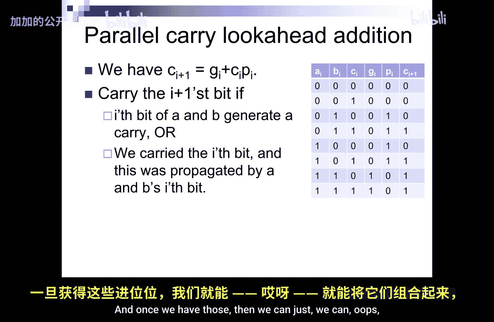
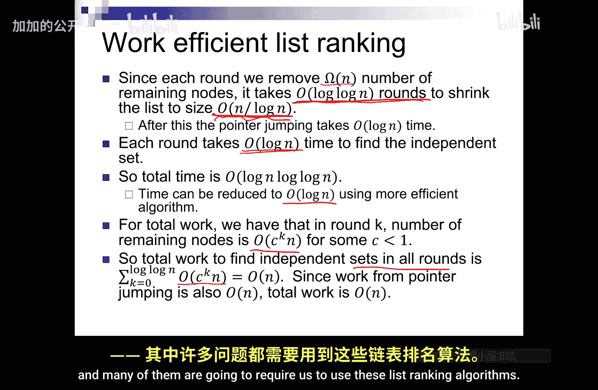

# 上海科技大学【中英⚡并行计算｜CS121 2020 Parallel computing】 p26 P26 PRAM 1 Building blocks -BV1VqypBaEaP_p26-

Welcome back。So today we're going to start a new part of the course。

And we'll talk about a new model of computation called PRRAM。

So we're going to spend the next few lectures on PRRAM。

 and today we're first of all going to introduce the PRRAM model and then talk about some basic algorithms。

All right， now PRAM stands for Para R access machine。

And this P brand model is basically meant to generalize the normal model for sequential computing。

And that is the von Neman model。 Okay， so if you remember。

 the von Neman model is actually very simple。 So we have a CPU and then we have a memory， right。

 and the CPU can talk with the memory。So then in the von Neyman model， in every time step。

 the CPU is going to read some data from the memory。

 and then it's going to do some computation on that data。

 and then it's going to write that data back。Okay， so that's one cycle of what the CPU does。

 and then the CPU just repeats these cycles over and over。RightNow in the PM model。

We're simply going to generalize this into the parallel setting。

And the way we do that is just that we're going to have multiple CPUs。 Okay。

 so we have now a parallel computer with multiple CPUs。And in every time step。

 these multiple CPUs can altogether， they can in parallel， talk to the memory， okay。

 so each CPU can access a different part of memory， can read from a different part of memory。Okay。

 and then the CPUs can each do a computation and they do that all in parallel。

And then they're going to write something back to memory， Okay， so every CPU is going to in parallel。

 write something possibly different back to memory。

And so that is now going to be a cycle of the P Ram computation and these CPUUs that we have are just going to repeat these cycles over and over。

O。So now the question one question is， how many CPUs are we going to use and the number of CPUs we use can actually depend on the size of the problem we're solving。

So for example， if we're solving n sorry sorry if we' let's say we're trying to sort n numbers then we're allowed to use F of n processors for some function F that we select Okay so maybe we want to use you know square root of M processors or maybe we want to use n log n number processors Okay so we get to select how many processors we want to use。

And F of n can actually be very large compared to n， so for example， if you're sorting。

 let's say a million numbers in the Pbra model， you're allowed to use a million processors you're even allowed to use more than a million processors。

看。🤧。All right， yeah， so then this here just says what so it describes a model I was mentioning right so these processors are all synchronized。

 by the way， so every time step all of the processors are going to read from the memory in synchrony they can read from different locations but all of them are going to read and then all of them are going to compute in synchrony and then all of them are going to write back。

Yeah， so this is a little bit like the SIMD model that we talked about right。

 the single instruction multiple data except for here。

 the different CPUs can do different instructions， so it's not single instruction。

 they can each do different instructions。Okay。Now I mentioned SD because in the MIMD model。

 we usually think of MIMD as having the processors not being synchronized with each other okay so maybe like one processor can be faster than the other processors so it can take two steps every time the other processor takes one step。

But in the PMM model， everything is synchronized， although the processors take the same number of steps。

All right， now there's a few things a few other things we need to talk about for this PRM model and the first one is memory conflicts okay so the problem here is that you know we allow these processors to read from any location to read and write to any memory location but what if in a time step we have several processors that want to read or write from the same memory location？

Maybe there could be some problems that arise because your memory， let's say。

 does not support having multiple concurrent aes。Now the way the PRM model deals with that is that actually there are several sub modelss for the main PRM model。

 okay， there are four different submods。So the first submodto is called the EREW model。

 which stands for exclusive read， exclusive write， and in this model。

 we simply do not allow the processors to read or write to the same memory location in the same time step。

They can of course， read to the same memory location in different time steps。

 but if they try to do this in the same time step， then the program is going to crash。

OkaySo so therefore， if you're writing a program for the ERREW model。

 you have to make sure you as a programmer， have to make sure that your algorithm is not going to read or write from the same location in the same time step。

🤧。Now that is the most restrictive model of these four different models for PM so the next model which is less restrictive is going to be called the CRREW model and this stands for concurrent read exclusive write。

And so here， what we allow is that in each time step。

 we allow several processors to read the same memory location。Okay， so unlike EREW， right。

 we do allow multiple processors to read from the same memory location in a time step。However。

 we do not allow them to write to the same memory location in the same time step。And again。

 if they do write to the same memory location in the same time step。

 then the program is going to crash。Okay， we can also talk about the ERRCW model。 Okay。

 so this is where you do not allow processes to read the same memory location in one time step。

 but you do allow them to write to the same memory location in a time step。

But this is rather unusual， so usually we don't consider this ERRCW model。And then， the final。

🤧Final model。 So this is the most general model。 Okay， so this is called CRRCW。

Which stands for concurrent read， concurrent Writerite。

And so here we do allow multiple processors to read from the same location in one time step。

And you allow multiple processors to write to the same location in the time step。🤧Okay， however。

 if you do have multiple processors writing to the same location in a time step。

 then only one of those values can be written because it's a single memory location。

 so if you have multiple processes writing to it， you can't store all of those values。

 you can only store a single value。Okay， so then we have to somehow decide which value is going to get stored at this location if you have concurrent rates。

And so here。There are a number of different possible choices。Okay， so in fact， the CRRCW model。

 there are additional submodels of the CRRCW model okay。

 so these submodels are different ways of deciding what happens when you have concurrent rights to the same location。

Okay， so one possibility is that you know you simply let an arbitrary right succeed Okay。

 so if you have two processes of writing， then one of those values gets written okay and it's an arbitrary one。

Another possibility is that we have some sort of priority rule to determine which one is going to succeed Okay。

 so for example， the processes might have some priority among themselves okay so that means that if several processes write to the same location。

 then the highest priority processor that value gets written。🤧Okay。

 or maybe the priority is on not on the processors， but on the values that they're writing。Okay。

 so perhaps we have a way of implementing a priority where the let's say the largest value being written gets written to a location。

So that memory location itself can somehow do like a max operation when there are multiple concurrent rights。

Okay， and we're going to so we'll be using different ones of the CRCW models in some of our algorithms okay and then when we use the CRCW model。

 we have to specify which you know which type of arbitration we're going to use okay。

 whether we're letting arbitrary rights succeed or based on some priority or something。Okay。

 so this is how we deal with memory conflicts， so next what do we hope to have when we design one of these PM algorithms。

 so the metrics that we're trying to optimize for PRM， so there are two of them。

 one is called work and the other is called depth。Okay， so。

So now the depth of a PM algorithm is just the number of steps this algorithm takes until it terminates and it's a number of parallel steps。

 so remember that in each parallel step， all of the CPUs can do some work。Okay。

 so we're looking at how many parallel steps this algorithmcro takes before it terminates。

And oftentimes because in the PRM model you're allowed to use many processors then oftentimes we want to make sure that the depth of the program is very small。

 because if you're using many processors， you don't want all of those processors taking many。

 many steps。Okay， so oftentimes a goal that we have is to make the depth be polyloarithmic。

So what that means is that if you have an input of size n。

 then we want the algorithm to terminate in log of n steps or maybe log of n to some power steps。

 okay to some fixed power， so maybe log n squared number of steps or log n cube number of steps。Okay。

Okay， and and you also want want the algorithm to but but you know at the same time that you want it to terminate quickly。

 you also don't want to use too many processors Okay。

 so we also want to use a polynomial number of processors Okay so maybe you want the algorithm to terminate in log number of steps using M processors。

 for example， or maybe log squared number of steps using n squared processors Okay。

 those are sort of typical parameters that we try to achieve for pm algorithms。Okay。

 so that's the depth， and now the work of the PM algorithm is simply the number of processors that you use times the depth。

OkaySo that's kind of like the maximum amount of computation that all of these processors can do in this amount of time that your algorithm runs for。

Okay， and yeah。 And if you compare this to the work for a sequential program， right。

 sequential program， the number of processors is one。 Okay。

 and the depth is just the time complexity of the algorithm。 Okay， so therefore。

 the work of a sequential algorithm is equal to its time complexity。Okay。

And so if you remember from one of our very early lectures。

 so we talked about this thing called the work law。

 so the work law is simply saying that the amount of work done by a parallel algorithm has to be at least as large as the amount of work done by the best sequential algorithm for the same problem。

RightSo for example， if we're sorting， then if the best sequential algorithm does n log n amount of work。

 then the amount of work that a parallel algorithm does has to be at least n log n。

So the number of processors that we use times the depth has to be at least and log in。

And if these two quantities are equal， if the parallel algorithm uses the same amount of does the same amount of work as the best sequential algorithm。

 then we say that the parallel algorithm is work efficient。Okay。

 so sometimes what you can do is you can trade off the work efficiency of an algorithm with the amount with its depth okay。

 so for example， you can sometimes make an algorithm which has very low depth。

 so it terminates very very quickly but the amount of work it does is maybe very large or you can go the other direction where you can make the work be very small be as close as possible to the sequential algorithm。

However， the depth might be quite large in that case Okay。

 so there's oftentimes there's this trade off between the work and the dev but。In practice。

 we typically try to favor the work as opposed to the dev。

 okay so in practice when you design a PRM algorithm。

 you want to make sure that it's work efficient okay even if that means the depth is a bit larger。

And the reason you want to make this work efficient is that eventually the reason that we're developing these PM algorithms is so that eventually we can try to run them on real hardware。

Now maybe you can't run the exact same PM algorithm on real hardware and we'll talk about why that is on the next slide。

 but you want to run some version of this PM algorithm on real hardware and so when that happens right on real hardware you actually do not have a very large number of processors right。

So if you're going to sort a million numbers， you're not going to use a million processors to do that you have a limited number of processors and so in that case the running time of the algorithm in practice is usually determined by the amount of work that it does。

 not by the depth。Okay， and so that's why we want to minimize the work so that when you run this in practice。

 it actually performs well。Okay， now let's talk about how useful this PM algorithm is Okay。

 so first of all， it's a theoretical model right， because it assumes that you have lots and lots of。

 you know you're allowed to have lots and lots of processors Okay， like we said you know。

 if you're trying to sort a million numbers， then the PM model allows you to use a million processors。

 but of course， in practice， you would never do that right you might use like be 100 processors or probably if you're sorting a million numbers。

 you would just use like you know one processor， maybe yeah， okay。

 so but the PM model allows you to use a lot of processors， which is not realistic。

And the other very unrealistic part about the PRM model is that it allows all the processors to access memory in every time step。

 so there's basically no cost to accessing memory in the PRM model。

Most of the cost is in the computation， because the amount of time that we count for the PRAM algorithm。

 the depth of the algorithm is equal to the number of computation steps that each processor does。

🤧Okay。Now this is very unrealistic to discount the time for communication because we saw that most in almost all real models of computing。

 the main cost for computation is the communication cost。

 you can compute much faster than you can access data。

 so the main cost is actually in the communication， whether it's the latency cost or the bandwidth。

Okay， and so therefore the fact that the PBI model ignore ignores this communication makes it quite unrealistic。

Okay。Yeah so those are the downsides to the PRRAM model is that it's not very realistic， however。

 it does have some advantages and this is why we're studying the PRM model because because it's a very simple and clean model right it's simply you have a lot of processors and and they can read any memory they want and so what we focus on in the PRMM model is just the computation and in the PRM model you can try to design algorithms with as much parallelism as possible because you're allowed to use as many processors as you want。

So the PM algorithm really shows you how much parallelism there is in this problem that you're trying to solve。

And so when you make the PM algorithm， the first thing you do is you try to maximize the parallelism。

And then after you design this algorithm with like very large parallelism。

 which is sort of unrealistic because it ignores these other factors。

Then the next step is to somehow convert this unrealistic PRAM algorithm into something that can run efficiently on realistic hardware。

Okay then the next step is you have to think about how to map your algorithm onto like a limited number of processors。

 and you have to consider the amount of communication cost between these processors。Okay。

 and it is possible to do this in practice。 Okay， it is possible to make a theoretical P RamM algorithm and then somehow translate this so that it can run efficiently on actual hardware So。

 for example， many GPU algorithms， including some of the ones that we talked about okay。

 they are adaptations of P RamM algorithms。That take into account communication and other issues。

 but they started life as a PRM algorithm。Okay， so this is why we're studying the PRM algorithm and so today we're going to look at some basic problems that you can solve in this model so the first problem we're going to look at is this problem of parallel carry Look ahead addition。

🤧Okay， so the problem that we're trying to solve is that。We're simply trying to add two numbers。Okay。

 so for example， here we're trying to add these these numbers A and B。

And the numbers are also expressed in binary。Okay， so it's a very simple problem。And okay， so。

Yeah and and suppose what you're allowed to do is that you have a bunch of CPUs and what these CPUs can do is they can only add single bits at a time Okay so you've got a CPU and if you're just given you know two bits from A and B then it can add those together okay and it can also computer carry from that operation so for example。

 if you add the one and one right you got a zero and then you produce a carry to the next digit。Okay。

 and in practice， if you have these circuits called full adders， then this is what they can do。 Okay。

 they can take two bits and then add them together and then produce a carry。Okay。

 so now if you want to add together these two numbers， then if you do this sequentially， of course。

 it's going to take if each number has M bits， then this is going to take order n time。However。

 if you have like a computer processor， then we're usually dealing with like 32 bit or 64 bit numbers。

 and so if it takes you 64 time units to add together two of these numbers， then this is too slow。

Okay， so we want to somehow do this in parallel。All right， now when you do this in parallel。

 part of this problem is easy okay because if you just take a bit a digit from A and B right。

 so you can have if you're adding together n digits。

 you can have n of these full adders and each one of them can just take one of these digits of A and B and add those together and you can do all that in parallel。

Okay。But the difficulty is that after you add A and B for one digit for some digit。

 you could produce a carry。And then this carry needs to be included in the computation for the next digit。

And then by including that， you could generate another carry which needs to be included in the computation for the next digit。

Okay， so for example， if you add together this one and one right。

 well then this generates a carry over here， which is also going to generate a carry on the second bit。

 and so that is going to affect the result in the third bit。Okay。

 so the computation in the first bit affects the result in the third bit。 and in general。

Any digit can have an effect on any other digit， which comes later。Okay。

 so this makes it more difficult to do this problem in parallel。

 okay because now you can't just compute all of these individual digits like independently。

 because the answer for each digit might depend on the answers for previous digits。Okay， so then。

Right， okay， so then what are we gonna do So first of all， on the right over here。 Okay。

 so I just wrote a truth table for for， you know what we're supposed to compute。 Okay。

 so given the I digit of a and the I digit of B and then suppose we also have a carry bit that is included in the I bit Okay so for example。

 this bit over here would be the carry bit for for the second for the second digit then you know。

 we're supposed to output this sum bit so for example， over here this would be a1 sorry， a2 right。

Right this nicer。 Okay， this is a 2。 This is B2， right， This is gonna be C2 over here。 right。

 This is S2 the the sum for the second digit， right， And then we're also going to produce a carry。

 Okay， so this carry is this thing over here。 And so we're going to produce this carry for the third bit。

Okay， so this is a computation that we need to implement。All right。

 so how can we do this in parallel Well it turns out that there's a way to compute all of the carrier so if you do this in the normal sequential method right so where you go digit by digit then it's going to take you order end time to compute all of the all of the carry bits。

But it turns out that there's a faster way to do this。

 and you can actually compute all of the carry bits in parallel in only log and time。Okay。

 so n is a number of digits and to do this， we're also going to use n processors。

 where each processor can each processor is a full adder。

Right now assuming that we can compute all of these carry bits in login time。

 then after that we can compute the answer also in an additional constant amount of time because each answer is simply equal to the sum of the two digits in that the sum of those digits from A and B plus the carry bit。

ok。Yeah， so the key part is to compute these carry bits。RightNow to do this。

 in order to simplify our notation， I'm going to so all of these computations are based on the and and or operations with Boolean variables。

 but to simplify the notation， I'm going to denote and by this little multiplication sign and then the or I'm going to denote by the addition sign。

Okay， so using this notation， we're going to define a few other variables。

 So the first variable is that for the I bit， okay。

 we're going to define something we're going to define this G sub I。

So this is going to be called the Ithe carry generate bit。Okay。

 and the reason it's called the I carry generate is so this G of I is equal to A of I times b of I。

Okay， and that means that if both AI and BI are one， then GI is going to be one。

And the reason it's called the carry generate bit is if AI and BI are both one， then the next digit。

 there's going to be a carry on C+ 1， no matter what the current carry is。🎼Okay， so for example。

 if the current carry is zero right then you know because we have AI and B both equal to1。

 they're going to generate a carry on the next bit and if the current carry bit is one right then when you combine that with AI and BI。

 we're still we're also going to generate a carry on the next bit。Okay so if AI and BI are both true。

 then we're going to generate a carry and if one of them is false。

 then we don't necessarily generate a carry， we still could generate a carry。Okay。

 so next we're going to define another variable。This piece of I so the piece of I is going to be the exclusive or of AI and B。

Okay， so and we're going to call a piece of IV carry propagate bit。Okay， so basically。

 if P equals one， then we're going to have that the next carry bit is equal to the current carry bit。

Okay， and the way that you can see this is you know if PI equals1， then either we have you know10。

 so then if you look at AI and B， okay， either they're 10 or there's 01。Okay。

 so that's that's the only way that you can make the PI be1 okay and so in the first case。

 if it's AI you know， it's like 10 then the next carry bit is equal to the current carry bit because if the current carry bit is 0 right。

 then we have you have100 and so there's no carry on the next bit So this is going to be 0 and if on the other hand the current bit we have a carry then we're gonna to have 101 you add those together and you are going to produce a carry on the next bit。

Okay， and likewise， if this is zero and this is one， it's going to be the same thing。Okay。All right。

 so then we define these two things， the PIs and the Gs。🤧。

And now we claim that the next carry bit for digits i+1。Is going to be equal to GI or C I NP P。Okay。

 so remember the plus means or and the multiplication means and。Okay。

 and the way to understand of this。This equation over here is that so we're trying to figure out whether we have a carry bit on the next whether we have a carry on the next bit and we're going to have a carry if either you know the current bit AI and B either if they generate a carry okay so if G is one。

 then that means that AI and B generate a carry okay so they're going to force us to have a carry on the next bit。

Or if we or if AI and B are going to propagate the carry from the current digit。

 okay so that means that if you know AI and B are going to cause this P to be one okay。

 so that they do propagate the bit okay and furthermore， if the current C is also equal to one。Okay。

 then we're going to get a carry on the next bit。OkayAnd if we do not propagate the bit。

 we do not propagate a carry， right， then regardless of what this carry is， you know。

 this is not necessarily going to cause a carry on the next bit。Okay。

 so we have this equation over here and if you're not satisfied with the explanation I gave。

 then you can just explicitly compute all of these variables and then you can see that indeed the next carry bit is related to the previous bits in this way。

Okay， so in any case we have this relationship over here。And once you have this relationship。

 then now we can try to compute all of these carries in parallel so here what we're going to do is we're going to express the next carry bit in terms of this little matrix multiplication here。

Okay， and what this says is that。If you want to compute the next carry bit。

 okay so we're going to treat this as a vector so the first coordinate is the next carry bit and then the second one is going to be true over here and the claim is that this is equal to the current carry bit and then true times this little matrix over here。

Okay， so the f and the T denote false and true。Okay and the way you check this is that， well。

 if you multiply the first row by this vector here。

 then you get P times C right plus G okay G times T is equal to G right G and true is going to be equal to G。

Okay， so the top part here is going to be C I and P or G and the bottom part is going to be false times C。

 so that's going to be false okay plus true times true so it's basically false or true。

 and that's going to be true。Okay， so then we have this relationship。

And then we know that by the previous page， we know that C times pi plus G is equal to the next carry that。

So this is saying， so therefore， what this says is that if you take the current carry bit and then true。

 and then you multiply by this little。Matrix over here， you're going to get the next carry bit。And。

And now you can actually do this multiple times okay so we know that you know this we have this relationship but C true is also equal to if you take the I minus first carry bit right and then you multiply by these P and G values from the I minus first bit then you're going to get the I carry。

Okay， and so and then this value over here， okay the C minus1 true。

 you can again expand that okay into something in terms of C minus2 and then true and then times another matrix over here。

So then you can just do this entire expansion and then in the end。

 you're going to see that the I plus first carry bit is going to be equal to the product of all of these little matrices。

 times the initial carry bit。Okay， so now why is this useful。

 with the reason this is useful is because each of these values， Okay， all of these P and GI values。

 Okay， they can be computed in parallel。Because if you go back to how we define these P and GI values so P is just the and of the eighth bit of I and B so we can compute all of these GI values in parallel we can take all these ends in parallel。

And the PI is going to be the exclusive or of AI and B， and so again。

 we can compute all of the PIs also in parallel。Okay， so that means that once we have this equation。

 we can actually compute all of these values in parallel。And then then we can store them somewhere。

 so we can form all of these matrices in parallel。Okay。

 and so then what we need to do is we just need to multiply all these matrices together。Okay。

 but this is actually a prefix product operation。Okay。

 because what we're doing is that we are given so we start out by computing all of these P and G values in parallel。

 Okay， so we have you know， P1 G1 all the way up to P and G N。

So now think of these as inputs to our algorithm。And now what we want to do is we just want to multiply together all of these matrices okay so for the in order to generate the I plus first output。

 you want to take the first I matrices and multiply them together。

Now this is simply a prefix product operation okay so prefix product means that to generate the i plus first output。

 you take the first I input and multiply them。And that's exactly what we're doing over here。

So now we have parallel algorithms to do these prefix products in parallel and in fact。

 we can do that in log N time we can produce the prefix products for n input values in log n time if we use M processors。

Okay， so we talked about those algorithms earlier。And so that is what we're going to do over here。

 right we're going to have M processors and we're going to compute all of these prefix values in parallel in log n time。

Okay， and so this shows that。We can compute all of these carry bit in log n time。

 and and once we have those， then we can just we can。

We can combine the carry bits and then we can produce all of these sum bits in log n time and this is what we want to do right we just want to compute these sum values。

Okay， so yeah， so that's the algorithm for parallel carry look ahead and this algorithm is actually used in practice okay this is either this algorithm or some variation of this algorithm is what is implemented in real CPUs。

Okay， so next we're going to look at another problem and this is about finding the max a set of numbers。

 a set of inputs now we're going to look at two algorithms so the first algorithm is going to be super fast it's going to be in fact。

 it's going to find the max of n numbers in constant time。But it's not going to be work efficient。

And then later， we're going to look at another algorithm。Which is going to find the max of n numbers。

 and it's going to do this in log， log n time。Okay， so in particular， now we we。

 we know of a simple way to find the max of n numbers in parallel， right。

 And we can do this in a log and time using order and amount of work simply by using a balanced binary tree。

 right， So if you just make a tree， right。And then you associate processors to the nodes in this tree。

 Then each of these processors is just going to take the max of its two inputs。 Okay。

 And then if you do， if you do this， then eventually the top node in the tree is going to produce the overall max of all in an inputs。

But this is going to take us log N time， and it does order end work。So instead。

 it turns out that there's a much faster algorithm which works in log log end time， okay。

 so exponentially faster than this tree algorithm。And it also does order and work okay， however。

 in order to run this algorithm， we need to use the CRCW model， Okay。

 so we need to have both concurrent reads and concurrent rights。And furthermore。

 we need the concurrent rights to have this min priority method of resolving conflicts。

Which means that when you have multiple values being written to the same location。

 then the minimum value wins。Okay， so we're trying to find the max。

 but we need this min priority CRCW model。Okay， so now let's first talk about this constant time algorithm to find the math。

So the way this works is that suppose you're trying to find the max of P numbers， okay x1 up to Xp。

Then what we're going to do is we're actually going to use a p squared number of processors。Okay。

 and we also need to use this the CRCW model， okay， so with MM priority。Okay。

 so so then what we're going to do is for each， so we have P numbers and then P squared processors。

So then for every pair of numbers， okay， so let's say for X I and Xj。

 we're going to assign one processor to that pair of numbers。

 so then we have p squared pairs of numbers and so that's why we have p squared processors。

And then for each of these processors， what it's going to do is it'll compute this value b of Ij。

 which is equal to1， if X is at least equal to Xj and otherwise it's going to be0 so this processor simply compares X and Xj if X is at least as big as Xj。

 then it' going have set a bit to be it's going to have this value 1。And then next。

 what we're going to do so we can do all of these computations in parallel， of course。

And then next on what we're going to do is we're going to compute this value M sub I here and M sub I is equal to all of these are B values。

 okay B1， B2 and so on all the way up to BIP， it's equal to the and of all of these B values。

And so that means that， yeah， okay it's equal to the end of all of these B values。Let's see。

So I have one。Yeah， okay， so now notice that M sub I， okay。

 it's only going to be one if all of these b values are equal to1。

But if all of these b values are equal to one， right， then each of these values indicates。

 so for example， this value， okay this is going to be one when X I is bigger than is at least equal to x1。

Okay so so the fact that B1 is1 indicates that X is bigger than x1 and if you want this to be also one。

 then this means that X has to be bigger than x2 and so on。And if we want MI to be one。

 then we need all of these bits to be one。And that would mean that X I is bigger than all of the other values。

 Okay it's bigger than all other Xj。And that means that Xi is some max value。Okay。

 so therefore we have that MMM is equal to one， if and only if X is actually the maximum value。Okay。

 now in order to compute this MI， okay， here's where we actually use this CRCW property with M priority。

Because what we want is that so here we could have some of these bits being equal to zero if Xi is not the maximum value。

 then some of these bits are going to be equal to zero。And what we need is that。

 so we're going to have P processors writing to the same memory location， the same MI。

And what we need is that when you have different values being written。

 when some values are1 and some values are0， then you need that the zero actually actually gets written。

Okay， so what we want is if any of these bs is0， then we're going to set MI to be0 here。

And to do that， we need first of all， we need to allow concurrent rights to this MI okay because all of these P processors are writing to this MI and furthermore。

 we need that if a bunch of if many different values are being written。

 then the minimum value is the one that gets written。Okay， so in our case， the minimum value be 0。

All right， so yeah， so then we have this algorithm for finding the maximum of P numbers in constant time okay because it just does two steps right if first of all computes these B values and then it writes to this M location so it works in constant time however it does p squared amount of work right because we have p squared processors and they each take two time steps so that's p squared amount order p squared amount of work。

Okay， now we're going to take this constant time algorithm and we're going to convert it to another algorithm。

 and so this algorithm is going to be much faster than the balance tree method and it's going to be work efficient。

Okay，So the way we do that is we're not going to use a binary tree anymore。 Okay。

 we're going to use a what's called a doubly logarithmic tree。

So the way this works is that we're first of all going to create a tree with all of these input values。

 these input x values as the leaves。Okay， and then for each internal node in the tree。

For each internal node U， then if you look at how many leaves are in the subree rooted at U。Okay。

 then we're going to make the degree of U be equal to this quantity here。 Okay。

 the ceiling of the square root of the number of leaves in the subree rooted at U。So for example。

 if you take this node， if this is you over here， then there are 16 nodes in the subree rooted at U。

So therefore， we're going to make the degree of U be equal to the square root of 16， which is 4。Okay。

 now over here if you look at this u， then the number of nodes in its subt is4。

 and so we're going to make the degree of that be the square root of 4， which is 2。All right。

 so now this is the main property about the tree， so this is called a doubly logarithmic tree because basically its height is going to be log log n Okay。

 if you have n leaves， the height is going to be log log n。Okay， and the way that you can。Right。

 yeah， so then because it's it's height as log log n， then for convenience。

 we're going to assume that n is actually going be2 to the two to the K。 Okay， so this way。

 if you take log log of n， you get and even you get a number。 Okay， you get an integer number。Okay。

 so now let's look at the degrees of different nodes。

 so we said that the degree of a node is equal to the square root of the number of leaves in its subre。

So therefore， the degree of this top node over here， right？Because it has n nodes in its subre。

 because everybody is in the in the subt。 Then the degree of the top node is going to be square root of n。

All right， and then。And then next so the degree here is square root of n， and in fact。

 all of these subtes after the root， they all have the same size。

 they all have size square root of n。Okay， because we have square root n of these different subtes we have like you know four of these subtes。

 and so each each one of them is going to have size square root of n。Okay。

 so square root of n equals2 to the 2 to the k minus1。Okay。

 so therefore the degree of each of these nodes， because it's got 2 to the 2 to the k minus1 nodes in its subt。

 then the degree is going to be the square root of this and the square root of this is actually just equal to here make you can make it k minus2。

Okay。Yeah， so each of these children has degree 2 to the 2 to the K minus 2。🤧Okay。

And it's the same idea as you keep going down the tree Okay so each time you go down the tree。

 then the number of nodes sorry， the number of children of that node is going is going to be square root of the well the size of the entire subree okay and the degree is also going to get the degree of one of its children is also going to get square rooted。

So therefore， at the if level of the subre， then each node is going to have this degree。Okay。

 so and then and then using this， we can also figure out the。

The total number of nodes at each level okay so for example。

 you know this level has four nodes okay and this level has eight nodes okay and so the way that you figure out the total number of nodes at each at each layer is that well in the first layer you have so in the first layer。

 we branch you know2 to the two to the k minus1 ways we have degree2 to the two to the k minus1 and then in the next layer we have each node has degree2 to the two to the k minus2。

And so on， so then when you get to the I layer， the number of nodes at that I layer is going to be2 to the 2 to the k minus1 times2 to the 2 to the K minus2 because as you go from the first layer to the second layer。

 then you generate this number of nodes times when you go to the third layer。

 you have  two to the two to the K minus3， and then so on。Okay， until you get to this layer。

 which has a degree 2 to the 2 to the K minus I。Okay， so this is the number of nodes at the I layer。

And then if you want to evaluate this product over here。

 well then the product of all of these is you can just take all of these exponents and you can add them together okay so then this is equal to2 to the 2 to the K minus1 plus2 to the K minus 2 plus and so on plus2 to the K minus I。

Okay， and so this here is a geometric series， and if you add that up。

 then this is what you're going to get。Okay， so that's how you count the total number of nodes at that layer。

All right， so oops， so this is how we define this doubly logarithmic tree。

And now we're going to use this tree to compute the max in log log anti。Okay。

 so the way we do this is that suppose each node computes the max of all of its children。O嗯。Yeah。

 and then if you do that， then as you propagate these values from the leaves to the root。

 then eventually the root is going to end up with the max of all of the values。Okay， so。Right。

 and now when you compute the max of your children， okay， if you have P children。

 then we saw this algorithm where you can compute the max of these P children nodes in constant time。

 but in p squared amount of work。Okay。And right， and so now the total time for this algorithm is just you know because each of these computations at each layer takes constant time and we just have to go all the way up the tree and the tree has height log log n so therefore the time to run this algorithm is going to be ordered log log n。

And the amount of work that we do at each level okay is going to be well。

 we have so we have the degree of each node is going to be2 to the two to the K minus I minus1 Okay。

 so this is what we said this is what we said previously right the degree is going to be this right and the number of nodes is going to be this。

Okay， so therefore， the amount of work that each node at that at the eye layer does。 Okay， is well。

It has this degree。 Okay， so it has this number of children。 So P equals this value over here。 Okay。

 P equals this value。 right， and so the amount of work that it does to find the max of those children is going to be p squared。

 So it's going to be this value squared。 Okay， so basically。

 that means that this one is going to get removed。And then we multiply this by how many nodes there are in that level and we said that there are that many nodes in that level in the ifF level。

Okay so therefore， if you multiply these two together， then this part is just going to cancel out。

 and so we simply get that the amount of work at this level is equal to2 to the2 to the K。Okay。

 and this is equal to order M。So therefore， the amount of work at each level is order N。

And then the total work for the entire algorithm is going to be just n work per level times the number of levels。

Okay。RightSo this is not quite a work efficient algorithm yet because to be work efficient then the work that you need to do to find the max of n numbers is simply n and then here we're doing n times log。

 log n amount of work。So we're not work efficient yet。Okay。

 so then in order to make this work efficient。What we can do is。嗯。Yeah。

 so then we're going to use a technique called accelerated cascading。And basically。

 this technique is to start with the。Start with start with a work efficient algorithm Okay。

 and then keep using that until the problem is sufficiently small。

And then you're going to switch to once the problem size gets to be very small。

 then you're going to switch to a very fast algorithm， but which is not necessarily work efficient。

So you start with a somewhat slower algorithm， but which is work efficient。

 you keep applying this algorithm and it's going to subdivide the problem until the problem size gets to be small。

 and then you're going to finish up with this very fast algorithm， but which is not work efficient。

Okay， so。Yeah， right， so the way we do this actually is that we're going to take these n values okay。

 and you're going to divide them into a bunch of blocks。

 You're going to divide them into n divided by log， log n blocks。

And then each block is going to have a log， log and values in it。Okay。

And now we're also going to use n divided by log， log n number of processors Okay。

 so we have the same number of blocks as processors。And so each processor gets assigned one block。

 right， and it's just going to find the max value in the block gets assigned。

So it's assigned a block of log， log n numbers， and if it wants to find the max。

 it'll just go through all these numbers sequentially and then find the max。Okay。

 and so each of these processors is going to take log， log n time to go through all its numbers。

And the total amount of work that this does is that what we have n divided by log log M processors and each one of them takes log log n time。

 so the product of these is the amount of work okay so the product is going to be order end work。

All right， yeah， so the first step is to break these into that many blocks and then get this number of maxes because each block is going to end up with one maximum value of that block。

Right， and then once we get this number of values， then now we're going to apply a very fast this doubly logarithmic tree algorithm to find the max of all of these values of all of these values。

🤧Okay， so let's say that M prime here is equal to。M prime here is equal to this n divided by log log n so we're going to use a doubly log rhythmithic tree on the M prime values that are obtained from the blocks。

And the running time for this algorithm is just going to be log log of M prime And so this is going to come out to basically order of log log n because and M prime and n are very close to each other Okay。

 so this is going to come out to order log log n。And the amount of work that this does。

 is going to be equal to M prime times log log m prime。

 because we saw from the previous page that if you just use this doubly logarithmic tree。

 then the amount of work that you do is equal to the number of nodes in the tree times log log of that number。

Okay， and in our case we have just m prime values that we're applying this tree on then yeah。

 so then the total amount of work is going to be m prime times double log m prime and double log m prime is basically going to be this thing here is basically going to be oops。

I's going to be equal to order of log log M。Okay。And then this M prime here is equal to n divided by log log n。

 so therefore， if you multiply by this double log n over here。

 then we get that the total amount of work that the second phase does is order n。Okay， so again。

 we have this two phase algorithm， okay， the first phase is you break the values into blocks and then you add them sequentially。

So that's going to take double log time and linear work。Okay。

 and the next phase is that we're going to apply this doubly logarithmic tree on all of the values from the first phase。

And that's also going to take a double log time， and it's now going to do only linear work。Okay。

 so then altogether we do linear work and double log time。Okay， so we have a very fast。

And work efficient algorithm to find the max of many numbers。Okay。

 but we needed the CRCW model with the MI priority to do this。Okay， so right。

 so we're going to talk about another problem now。 So this problem is called list ranking。

So this is a very useful problem and it' many other it's used as a subroutine in many other algorithms that we need to look at。

So the basic problem is that suppose you're given a link list like this over here okay then so the linked list is going to have let's say a bunch of these nodes in it Okay。

 so each of these values is going to be different so here we have six nodes and six different values。

And what you want is for each node to find the distance from the head of the list。Okay。

 so for example， the head of the list is this two node， two value over here Okay。

 so this has a distance of0 from the head and then the next node is going to be0 over here。

 so it's got a distance of one。Okay， and this guy has a distance of two， three， four， five。Okay。

So so our input is simply going to be this link list right and the output is for each node to compute its distance from the head of the link list。

Okay， so house this link is represented Okay well the way it's represented is just that you know for each node。

 each node knows the next node in the list。So for example， this two here， okay。

 it doesn't have a next node， So therefore for node2 over here。

 we're going to mark the the next node from two to be this bottom。 Okay。

 this indicates that two is at the head of the list。Okay， and then after two。

 we have this node 0 over here。 Okay， so so 0 is going to say that the next node after 0 is 2。Okay。

 and then before the zero， we have a three， so the three is going to say that the next node after three is going to be of a0。

Okay， and so on。So this is our input that we're given。 Okay， this is how the input is represented。

And then again， the output is for each node to compute its distance from the header of the link list。

Okay， so the way we're going to do this is well initially can we can find the head of the list very easily because the head of the list is going to have the next pointer be bottom okay so every node can just check whether it's next pointer is bottom and if if it is right then you found the head of the list and the head of the list has a distance of zero。

OkayAnd then the other nodes in the list， what they can do is that well they can find their distance from the next node because you know。

 for example， this three node here， it knows that the distance to the next node is simply a one over here。

Okay， likewise， this node zero over here， right， it knows that the distance to the next node is a  one。

Okay。So yeah， so all of these nodes initially know that their distance to the next node is going to be one。

Okay。Now the next thing that we can do is that because3 knows it's distance1 from 0 and then0 knows it's distance1 from 2。

 then if we add these together， then three can know its distance it's going to be a distance2 from the node2。

Okay， and in fact， this is the correct distance of three from the head of the list。Okay。

 and then after that， so once three knows that it's distance 2 from the head of the list right then because five knows it's distance1 from3。

 then five knows that it's distance3 from the head of the list。Okay。Yeah， so in this way。

 we can actually sequentially compute the。The distance of all of these node in order n time。Okay。

 but then the question is， how do you do this in parallel？

And the way we do it is we're going to apply this technique called pointer jumping。

 and we're going to repeatedly apply this technique。So the way so pointer jumping。

 what it does is that so you know these nodes you know in this algorithm。

 they have pointers to some other nodes okay， so for example。

 initially every node just points to its next node。

 but we could also have nodes point to other nodes， so for example you could have a five。

 you could have the five node point to the zero。Okay。

And what pointer jumping does is if node I is pointing to J。And if j is pointing to K。

 then we're going to just combine these two pointers and we're going to have I point to K。Okay。

 so this is pointer jumping。And once you have this pointer jumping。

 then we can just repeatedly apply this pointer jumping in order to compute the the distances Okay。

 so yeah， so the algorithm for doing this is going to be over here okay。Yeah。

 so every node is going to keep executing until its next pointer is equal to null， okay。

 or this bottom symbol。嗯。Yeah， and then what they do is in each time step。

 we're going to have all of the processes operate in parallel。

OkayAnd the process is going to say that if its next pointer is not equal to this bottom， okay。

 not equal to null， then its distance is going to be equal to its distance to the next node right sorry。

 its current distance plus the distance of its next node。Okay。

 and also the next node right and here's where you apply pointer jumping。

 the next pointer is going to be equal to the next pointer of the next node。

Now to make this a bit more clear， let's just do an example here。

So initially we're going to have these nodes in the link list and there's only a single note。

 so this note at the end， right its next pointer is going to be bottom here so it knows that it can terminate。

Okay。And then in each of these time stepss， what we're going to do is in parallel every node so these values over here。

 okay， the initially all these values are one okay。

 these are the dvalue so the dvalue are estimates of the distance of a node from the start of the list and initially all of these estimates are one。

And what we're going to do is we're going to set the Dvalue be equal to the current Dvalue plus the dvalue of the next node。

Okay， we're going to do all of those in parallel。So for example， this node over here， right。

 it's going to set its Dvalue to be equal to its current Dvalue。

 which is one plus the Dvalue of its next node。 Okay so that so it's going to keep it as one。

And then this node， right it's going to set its' Dvalue to be one plus the Dvalue of the next node。

 which is also one， so it's going to set that to be two。Okay。And the basic idea here is that。

You know， if this node actually has an accurate distance to the front of the list。

 okay and if furthermore， if this distance between this node and the next node。

 if that distance is also accurate， then if you simply add together these two distances。

 then you get the correct distance of this node to the end of the list。Okay。

 so that's the basic idea。And we do all of this in parallel。 So therefore， in the first time step。

 we're going to get these values for the。For the distances。Okay。

And then we do this again and you're going to see that so for example。

 this node right this node next pointer is going to become zero it is going to become null after it does pointer jumping once okay because it's going to do this line so it's going to set its next pointer to be the next pointer off the next node Well the next node is guy whose next pointer is null so therefore for this guy's next pointer is also going to be null。

Okay， on the other hand， this guy's next pointer right he's going to point at the next node from his next node。

 so therefore he's going to point over here right he's going to point the to the final node and this node over here rights his next pointer is going to point to the next node after the next node。

 So therefore he's going to point over here。Okay， so then we have all of these new next pointers and these new distances。

Now you're going to apply this parallel step again。And what that's going to do is what this guy。

 his next pointer is now null， So he's not going do anything。 Okay。

 because he's only going to do something if his next pointer is not null These other guys So for example。

 this guy Okay he's going to set his new sorry， he's going to set his distance to be equal to this distance plus his current distance so that's going to become 2 and his next pointer is going to become the next pointer of his next node。

 which is going to be this null here。 Okay， so he's going to set his thing to be null。

Now this node right or sorry， this node okay he's going to set his distance to be equal to his distance plus the next node's distance。

 so that's going to be three over here right and then his pointer is also going to be the next pointer from the next node which is going to be this null here。

 so he's also going to set this to null。And then let's do one more node。

 so if you pick this node over here， this distance is going to be 2 plus 2。

 which is4 and his next pointer is going be is going to follow the next pointer from the next node and that's going to point to this zero node over here okay so he's going to point to the zero node。

Okay， and this guy is going to point to the one node。Okay。

 and then if you do this for one more phase， then what you're going to end up with is that the distances are going to be like this。

 and then everybody's next pointer is going to be null。And at that point。

 the algorithm is going to stop。Okay， so yeah。 so that's the algorithm。

 And basically to see that the algorithm works correctly。 So the property that we have is that。

What you can see is that if you run this for I steps， then for each node for each node K。

 its distance value is going to be the minimum of M， which is the total number of nodes。

Or two to the eye。Oh sorry， M is not the total number of nodes M is the distance of node K from the end of the list Okay。

 so M is actually the value that k is trying to compute。Okay， so yeah。

 so the distance is going to be the minimum of the correct distance and2 to the I。Okay。

 so basically when I is small right then the minimum is going to just going to be this 2 to the I value here。

 but eventually when I gets to be at least log of M right then this M value here is going to be the smaller one。

 and then that says that this node K is going to have the correct value after log M steps。Okay。

 so that's one property and the next property that we need is that so these are invariants that the algorithm maintains。

 Okay， so the first invariant is that after I steps right the distance of each node is going to be the minimum of the correct distance and 2 to the I。

And the other invariant is that the next pointer of this node is going to point at a node which is the minimum of M or2 to the I distance away。

Okay， so so looking at this example here， right， So after you run for one step， Okay then。Basically。

 every node's distance is going to be the minimum of its correct distance and two to the one okay。

 or two Okay， so you see that for example， this node has the correct distance because his M is going to be equal to zero。

 so he actually has a correct distance after one step this guy has a correct distance after one step right and then this guy has a correct distance after one step。

OkayBut this guy， he does not have the correct distance okay。

 his distance is currently equal to2 to the2 to the first power so all of these other guys so only the first two to the i nodes half the correct distances all of the other remaining nodes do not have the correct distance yet。

And also all of the nodes are going to point to a node which is the minimum of M and 2 to the I distance away。

Okay， so。So for example， this node is going to point to a node which is distance2 away。

 this node is also going to point to a node that's distance2 away。And then on the next phase。

 right these nodes are now going to point to nodes which are distance4 away well the minimum of M and4。

 okay， they're going to point to a node that's distance that value away。

Okay and also their dvalue are going to be equal to the so once you look at this third phase over here。

 the dvalue are going to be equal to the minimum of the correct value and two squared， which is4。

Okay， so that means that the first four nodes， right。

 they have the correct values and anybody beyond the first four nodes。

 their Dvalue is still equal to to4。And then if you run this another iteration， right。

 then you're going to have that the first eight nodes are going to have the correct Dvalue and their pointers are going to point at this distance away。

Okay， so then you can show that so you can see that we're going to maintain these invaris。

And since the final distances less than are all going to be at most n right， n as a number of nodes。

 then this algorithm is going to terminate after log n number of steps。Okay。

 and the total amount of work that we do is while we have M processors for each of these nodes。

 we're going to assign a processor， and so since you run for log n number of steps。

 the total work is going to be n log n。Okay。And this is not work efficient because if you do sequential list ranking。

 sequential list ranking， you just everybody just follows its next pointer until it gets to the end。

 that would take order end work。Okay， so we're doing n log n work right now。

Okay so we're going to see a way to make this work efficient a bit later but first of all。

 I want to mention that this list ranking algorithm okay even though it might look a bit artificial it's actually very useful so just like know the prefix sum operation was very useful this list ranking algorithm is also you know in the PM setting where you have these pointer so you have many problems which are based on pointers for example。

 graph problems you have these edges and the edges are represented by pointers so in these types of problems list ranking is very useful so we're going to see several applications of list ranking for example。

 there's this thing called the Euler tour technique and that technique is going to be based on list ranking。

And then we also are going to use list ranking for things like connect components and then evaluating expression trees and many other problems。

Okay and then this oil tour technique， this also forms a subroutine for many other problems Okay so this ranking is a subroutine for oiler tours。

 which in turn is a subroutine for many algorithms which are run on trees。

 many parallel Pran algorithms on trees。Okay， so we're going to see those algorithms in later lectures。

Okay， but the first thing to do but before we do that。

 let's first look at a variation of the list ranking problem。

 so now let's try to compute a prefix sum on a linked list。

Okay so previously we saw how to do prefix sum on an array。

 okay so if your input is given as an array， then we had a fast parallel algorithm for computing the prefix sum。

But now suppose your input is given as a linked list。Okay， so just like you know。

 for the list ranking problem， suppose you。You know， this was your input。 Okay。

 and now let's say that you have a bunch of values。 Okay， so suppose you know。

 these values here are no longer the Is， but they're the actual input values。

Then if you want to compute a prefix sum on this then this guy should be outputting 2 this guy should be outputting0 plus 2。

 which is again two this guy outputs3 plus  two， which is it's 5 and this guy outputs 10。

 14 and then 15。Okay， so this is what we want to do。

 this is how we can do or this is the problem that we're trying to solve。

 which is prefix some on a linked list。Okay， so initially we're going to assume that each node I has an input value x of I。

And then the output value is going to be stored in this variable D of I here。Okay， and so to do this。

 it's basically going to use the same algorithm as for list ranking。Okay。

 the only difference is that in list ranking， remember that we updated the D of I values， Okay。

 so D of I was set equal to D of I plus D of the next value。whereas for prefix sum。

 we're actually going to update the D of the next value。Okay， instead of D of I。

Okay and basically the reason for that is that you know if this is our initial link list。

 then what we want is we want these later nodes to have higher values because these later nodes。

 their output value needs to be the sum of all of these nodes preceding them。Okay。

 so then what this does is it sets the next node's value to be this node's value plus the next node's current value。

 Okay， so it sort of propagates the earlier values forward Okay towards the end of the list。

And that's what you want for prefix sum。Okay。And then otherwise。

 this algorithm is doing the same thing as the list ranking algorithm。Okay。

 so let's just go through this example just to see what's happening here okay now in this example these values and brackets。

 what this represents is the sum from the first value up to some other value。Okay so sorry。

 not the first value， but if you have a value I J here。

 it represents the sum from the I value to the J value。

So initially each node is only going to start with its own initial input okay。

 so initially this node only has a sum from the first value to the first value。

 so that's simply the first value and then this guy has a sum from the second value to the second value。

 so that's just the second value。Okay， so each of these nodes initially starts with just its own input value。

And then next， if you apply one round of this。Of this value propagation and the pointer jumping then what's going to happen is on each first of all。

 each of these pointers is going to double in distance okay so previously they were pointing at a node which is distance1 away and now they're going to point at a node which is distance2 away。

And furthermore， so in the first iteration for let's say I equals 1 okay then you have2 to the i power equals 2。

 and so what's going to happen is that the first two nodes are going to have the correct prefix sum values。

Okay， and the remaining nodes are going to have the sum of the previous two values of the previous 2 to the I。

 which in this case is equal to 2 of the previous two values。Okay so so for example。

 you know this node over here okay when you do when you do the top line over when you do this line over here sorry yeah when you do this line。

 okay， this is saying that this processor over here is going to take his value right or sorry。

 this processor is going to operate on the next node okay so he's going to set this guy's value to be equal to this guy's current value plus his own value。

So then that's going to make this guy end up with the sum of the first value and the second value。

Okay， so that's what this one， two indicates， right he's got the sum from the first value to the second value。

Okay， likewise， the processor over here is going to set the value over here， right。

 So he's going to set this value to be equal to these the current value over here。

 which is just the third value plus。Plus its own value， which is the second value。Okay。

 so then this guy is going to end up with the sum of the first two values sorry。

 I've valued2 and value3。Okay，And likewise， this guy is going to end up with a sum of third and fourth value and so on。

And so you see that here you have the first two values， sorry。

 the first two nodes have the correct prefix sum values already。RightAnd then the other nodes。

 the remaining nodes have the have only part of the prefix sum Okay so they only have two values from the prefix sum right this guy's got two two two out of three values from the prefix sum。

 this guy's got two out of four values from the prefix sum and so on。Okay。

 now if you run another iteration， then that' it's going to double the number of nodes which have the correct values。

Okay， it's also going to double the length of all of these pointers。

 the distance of all of these pointers。OkayAnd and then finally。

 for the node which do not have the correct value yet， what they have。

 they're going to have part of the prefix sum and they're going to have the sum of the previous four values in the value that they're supposed to output。

Okay， so in other words for example， for let's say for this guy okay now he so we have a processor assigned to this node and this processor is going to update this value over here and he's going to set it to this current value over here plus his own value well his own value is the sum of the first two values and then this current value is the sum of the third and fourth values So when you add them together。

 you're going to get the sum of the first four values。Okay。

 so then this guy is going to end up with the correct prefix on。Okay，On the other hand。

 this guy over here right， his value is going to become the sum of this second and third value plus the fourth and fifth。

 so he's going to end up with the sum of the second to the fifth value。

So this is not the correct value yet， but it's four out of the five values that he's trying to add up。

Okay， and likewise this guy is going to have the previous four values， okay。

 he's going to have sum of the previous four values。

 but he's still missing know the first two values from here。Okay。

 so then you run this once more and now if you run this for another iteration。

 then this guy he's only missing the first value okay。

 so then he's going to get the first value and he's going to end up with the correct prefix sum over here。

And this guy， he's missing the first two values， but he's going to get those two values。

 and so he's also going to end up with the correct value。Okay so yeah。

 so that is the algorithm over here and the invariant is that you know it's what we have over here that after I steps。

 the first two to the I nodes half the correct prefix sum values and the other nodes half the sum of the preceding2 to the i values。

Okay， so this means that you once this value over here gets to be larger than n gets to be at least n。

 then the algorithm has computed the correct output and so therefore this only takes log n time before this value here is at least n。

And then the amount of work that this does is again， we have M processors in each round。

 and so the total amount of work is going to be n times log n。Okay。

 so this is not a work efficient algorithm yet because the sequential running time for prefix sum is order N。

Okay， so next， let's see how we can make the list ranking algorithm work efficient。

And then once we know this， we can also use the same idea and make the prefix sum be more efficient。

Okay so to it to make list ranking work efficient， what we're going to do is we're going to shrink this list until only n divided by log n nodes are left Okay so initially we start with end nodes and then I'm going to tell you how we're going to shrink this list and you're going to shrink it until only n log n node n divided by log n nodes are left。

And then at that point， you're going to do pointer jumping。Okay。

And then and then after you do the pointer jumping， then you know here you know we shrunk the list。

 so we took out a bunch of nodes well we still't need to have the correct output for the node that we took out so therefore we're going to restore the nodes that we took out。

And after you restore them， you're going to figure out their ranks。All right。

 so before I show you how we actually do this， let's just look at the work complexity if we manage to do all of these steps。

Okay， so so the total amount of work is going to be that now suppose you can actually shrink the list and you can restore the notes that you took out。

 S you can do both of these in order and time。Okay。Or sorry。

 order n amount of work sorry order N work。Then if you look at the second step， okay。

 so this is where you would apply pointer jumping on this number of nodes。

Well the amount of work that does is going to be however many nodes you have okay， if you have。

 let's say m prime nodes， then the amount of work is going to be m prime times log of m prime。

So in our case， M prime here is going to be equal to n divided by log n。Okay。

 so therefore the amount of work for the second step is going to be this m prime times log of m prime。

And this is going to come out to order N。Okay， so that means that the second step is going to take order end work。

And so if we can also implement the first and third steps in order n work。

 then altogether we're going to take order we're going to do order n work okay。

 and then we would have a work efficient algorithm。Okay。

 so then we have to figure out how to do the shrinking step and the restoration steps okay so to do the shrinking step。

 okay， so we're trying to take end nodes and we're trying to remove some of them okay to make the list smaller and to do this we're going to keep removing an independent set of nodes。

So what is an independent set of nodes， so what this means is so a set of nodes I is going to be independent if basically we don't have consecutive nodes。

 both being in this independent set。Okay so this means that if a node sorry a node little I is in this independent set。

 then the previous node cannot also be in the set and also the next node from I cannot be in the set。

So this way， all of these independent nodes are not pointing at each other。 Okay， there are sort of。

Y， they're not。They're not touching each other。Okay， so。Okay。

 so now suppose we have a set of end notes。In the next lecture we're going to see how we can find a constant fraction of these nodes。

 we can find an independent set which contains a constant fraction of these nodes。Okay。

 so if we have end nodes， we can find at least omega n number of independent nodes among these end nodes。

Okay， so maybe like you start with 100 nodes， you can find， let's say， 33 nodes。

 which are independent。Okay， so that's going to be a constant fraction of the current set of nodes。

 Okay， so we can find this set of independent， so we can find this independent set。

 The size is going to be at least a constant fraction of n。

And the amount of time is going to be log n。And the amount of work is going to be linear。Okay。

 so we'll see how to do that next time。And then once you have this independent set。

 then you're going to take out this independent set of nodes。And when you take out these nodes。

 you're also going to set the so for each node that we're taking out， okay。

 we're going to set the distance value， so remember that we're trying to compute these distance values for each node right the distance to the end of the list。

We're going to set the distance value of the previous node to be equal to its current distance value plus the distance value of this i node from the independent set。

O。So as an example of this， so suppose you start with you know this list over here okay now we're going to look at these values in the square brackets okay let's ignore these values in the parentheses so so these values in the parentheses are actually used to compute the independent set and we're going to see how to do that next lecture but we're going to focus on the values in the square brackets right these one values initially and so these values are the initial estimates of the nodes of their distance from the end so for example。

 this final node right it knows that it's at the end。

 so it's estimate is0 this node has an estimate of one and all of these other nodes start with estimate of one。

Okay， so now we're going to take out an independent set of nodes okay so we're going to take out these nodes marked by the X and these are independent because you see that none of them are pointing at each other right like for example。

 this node is not directly pointing to this node now you know if we add this node to the independent set。

 then you cannot add this node also to the independent set because we're pointing at each other。But。

We're going to take this set of independent nodes and for each one of them。

 whenever you take an independent node， independent yet node， you're going to set the previous node。

 you're going to set that guy's distance to be equal to his current distance plus your own distance。

Okay， so for example， when this guy， when we took out this guy as an independent node。

 his previous node was the seven over here。Okay so then he set this guy's distance to be equal to the current distance。

 which is one plus his own distance。 so this becomes a two。Okay， likewise， you know。

 this this became a two， okay， because this node 3 over here， right。

 he said this distance be one plus one。 and so that's going to be two。Okay。

 so we did this once so you took out so then you managed to take out a constant fraction of the nodes。

 but remember that you want to keep doing this until we remove and until we're down to like n divided by log n number of nodes。

So therefore we have to do this again， okay， we're going to remove another independent set of nodes。

So starting from this， we're going to remove another independent set。

🤧And so let's say that you remove this eight node over here and this one node over here so those two nodes are independent and when you remove them。

 then for example， when you remove this node， it's going to take its previous node。

 which is six and it's going to take the current distance and add it to its own distance and it's going to set that to be a four now。

Okay， and when you take out this node， right， it's going to say take its previous node。

 which has a distance of two and add its current distance， which is3。Okay。

Right and then and then we're going to do this let's say you do this one more time if you do this one more time or well actually we don't need to do this again okay so now that we've done this word。

 let's say two iterations now suppose we're left with n login and divided by login nodes then we can just directly apply the pointer jumping technique at this point and when you apply the pointer jumping then you're going compute that this node he's going to get a distance of know his own distance plus the next nodes distance which is7。

Okay， so then this node is going to end up with a value of 7 over here。U。Okay。

 so so now we've reduced these set of nodes down to a small set of size n divided by log n okay we've done the pointer jumping so that we computed all of the ranks on the node that we're left with and now notice that for all of the node that we're left with they actually have the correct distances okay so for example this node actually is distance3 away from the the from the end okay and this node is distance 7 away from the end。

And the reason they have the correct distance is that you know each time we took out one of these independent nodes。

 we took its distance and added it to the previous nodes distance。

 so that way sort we preserve the distance to the end。Right in other words。

 if you follow all of the point， so at any point in this process。

 after you've removed a set of independent node， if you follow all these pointers and then you add up all of these distances along the way。

 then you get the correct distance to the end。Okay。

 so for example this guy right he is so his correct distance is1， two， three，4。

5 right and if you add up these distances along all of the pointers till you get to the end。

 right then you also get five。Okay， so as you remove notes。

 we maintain this property that if you follow all of the pointers which are still remaining。

 then you can compute the correct distance。And so this is why after we took out all the independent sets and we did the list ranking on the remaining nodes that we have the correct distances for these remaining nodes。

Okay， so now we need to put back the notes that we removed。

And the way that you put back the nodes that you removed is that if you put back the node I。Well。

 then what should his distance be？While his distance should be equal to this disk I right before you remove this node。

 okay， this is a distance from I to its next node。And then this distance， after you put eye back。

 then the next node has already computed the correct distance from himself to the very end。Okay。

 so therefore this is the distance of the next node to the end of the list。

 and this is distance from this node I to the next node， so therefore if you add these two together。

 then you get the correct distance of node I to the end of the list。

Okay so as an example of that right so you know here we took out this fifth node over here okay when you and when you took him out。

 he had a distance of two okay meaning that he was two hops away from the next node okay and so when you put this node back right then what you're going to do is。

So when you put them back， then this next node has already computed the correct distance to the end。

 okay， the correct distance is3， and when you put this node back。

 you're going to add the distance to the next node to that node's final correct output。

 which is three。Okay， so you're adding two and three， so you get a five over here。Okay。

 and M5 is indeed the distance of this node from the end。

OkayAnd if you do this another step right so if you put in all of these other nodes that we took out right。

 then when you took them out， they had a distance of one to the next node okay so for each of these nodes that we put back we would take this value one and then add it to the distance of the next node so then here you would produce a6 and you would produce a one plus three is four here and then two here。

Yeah， and then so you see that you know， as you unroll this sorry as you。

So to go back through this recursion， then by setting distances this way。

 then we get all of these correct distances。Okay， so the final thing is to analyze the complexity of this Okay so this this shows how the algorithm works and argues why it it's correct Okay。

 so the final thing is to show that the complexity of the node removal step and the node。

And putting back the notes， right， those two steps do not have high complexity， okay。

 have order end work in total。Okay， so the first thing is that。As you take out the nodes。

 okay so we saw that each time you could find an independent set of size omega n okay so you can take out a constant fraction of the nodes and then we wanted to end up with this number of nodes with n divided by log n number of nodes okay so you want to remove a log n fraction of the nodes。

And each time you can remove a constant fraction， so therefore the number of rounds that you need to run for before you can remove this log n fraction is going to be the log of log n。

 so it's going to be double log n round to until you're down to a set of the size。Okay。

And then once this happens， then， as I said， after you can apply pointer jumping on this set。

 and that's going to take you log in time。Okay， so then each round。

 okay in order to find these these independent sets， okay， this is going to take log n time。Okay。

 so therefore the total amount of time this is taking is that we need to run this for log log n round。

 each round to find the independent set takes a log n time。

 so the total time is going to be log n times double log n。

And it turns out that if you use a so there are more efficient techniques where you can actually reduce this value here down to simply log M。

Okay， so therefore， removing all of these independent nodes in total that can be done in log N time。

Okay， and so restoring all of these nodes can also be done in log n time okay。

 so therefore we can do this in log n time and the final thing to do is to look at how much work we're doing。

Okay， so for the amount of work what we have is that you know， as you run this algorithm。

 you have less than less nodes， okay and so since you're taking out a constant fraction of the nodes each time。

 then the number of remaining nodes in the K round is going to be C to the case power times n for some C less than less than 1。

So for example， if you take out a third of the nodes each time。

 then C here is going to be two/ third and you're going to have like two thirds of the K times n number of nodes in the K round。

Okay， so then the amount of work that's being done in the K round is simply that know each of these remaining nodes is going to do like a constant amount of work so therefore the total amount of work being done in the K round sorry total yeah。

 the total amount of work done in the K round is equal to c to the K times n。

And so the total work done in all the rounds right so here we ran for log log n rounds the total work done in all these rounds is going to be。

Just the sum of this stuff for k from0 to log log n and so this is a geometric series and this is going to add up to just linear to order n。

And the pointer jumping part also has linear work。So therefore the sum of the work for all of these steps is linear。

Okay。Yeah so therefore we have a work efficient algorithm， a linear work algorithm for list ranking。

 which can be made to run in time log log n。Okay。All right， so then in the later lectures。

 we're going to look at how to solve other problems and many of them are going to require us to use these list ranking algorithms。

