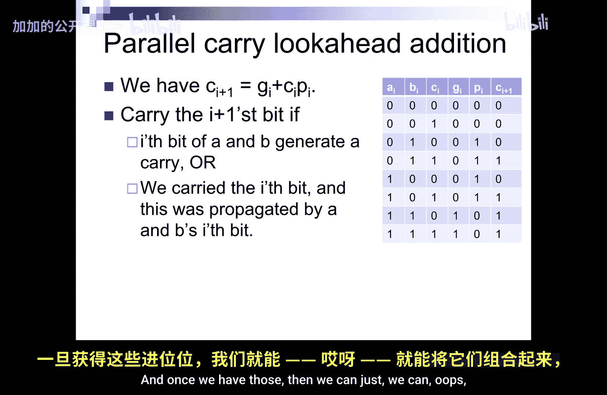
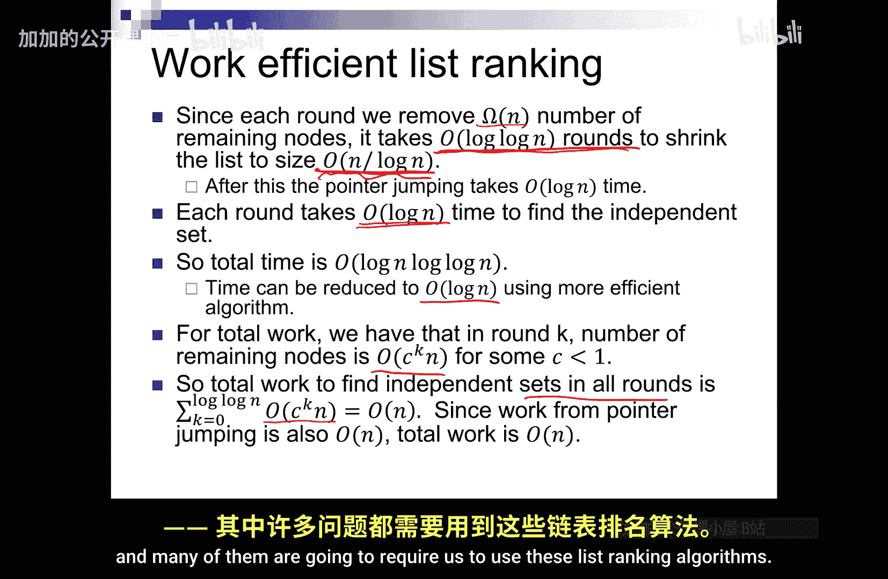

# 并行计算：P26：PRAM模型基础与算法

在本节课中，我们将学习一种新的并行计算模型——PRAM模型，并探讨其基本概念和几个基础算法。我们将从模型的定义开始，逐步深入到具体的并行算法设计，包括并行进位加法、最大值查找和链表排名。

## PRAM模型介绍

上一节我们回顾了冯·诺依曼模型。本节中，我们来看看它的并行扩展——PRAM模型。

PRAM代表“并行随机存取机器”。这个模型旨在将顺序计算的冯·诺依曼模型推广到并行设置。在冯·诺依曼模型中，我们有一个CPU和一个内存，CPU在每个时间步从内存读取数据，进行计算，然后将结果写回内存。在PRAM模型中，我们拥有多个CPU。在每个时间步，这些CPU可以并行地与内存通信：每个CPU可以读取内存的不同部分，并行进行计算，然后并行地将结果写回内存。这就是PRAM计算的一个周期，CPU会不断重复这些周期。

关于CPU数量，我们可以根据问题规模n来选择使用f(n)个处理器，其中f是我们选择的函数。例如，我们可以使用√n或n log n个处理器。在PRAM模型中，我们甚至可以使用比输入规模更多的处理器，例如，排序一百万个数字时，可以使用一百万个甚至更多的处理器。

这些处理器是同步的。在每个时间步，所有处理器同步地从内存读取，同步地计算，然后同步地写回。这类似于我们之前讨论过的SIMD（单指令多数据）模型，但区别在于，PRAM中的不同CPU可以执行不同的指令，因此它属于MIMD（多指令多数据）模型，但处理器是同步的。

## 内存冲突与PRAM子模型

在PRAM模型中，多个处理器可能同时读写同一内存位置，这会导致冲突。PRAM模型通过定义几个子模型来处理这个问题。

以下是四种主要的PRAM子模型：

*   **EREW（互斥读互斥写）**：这是限制最严格的模型。它不允许处理器在同一时间步读写同一内存位置。如果发生，程序将崩溃。
*   **CREW（并发读互斥写）**：这个模型限制较少。它允许多个处理器在同一时间步读取同一内存位置，但不允许它们写入同一位置。
*   **ERCW（互斥读并发写）**：这个模型不常见，通常不考虑。它允许并发写入，但不允许并发读取。
*   **CRCW（并发读并发写）**：这是最通用的模型。它允许并发读取和并发写入。然而，当多个处理器写入同一位置时，由于是单一内存单元，只能存储一个值。因此，需要仲裁机制来决定哪个值被写入。

CRCW模型本身还有子模型，用于定义并发写入时的仲裁规则：

*   **任意写入**：任意一个写入的值成功。
*   **优先级写入**：根据处理器或写入值的优先级（例如，最大值或最小值）决定哪个值成功。

## PRAM算法的度量指标

在设计PRAM算法时，我们主要优化两个指标：**工作量**和**深度**。

*   **深度**：指算法终止前所需的并行步数。由于PRAM允许使用大量处理器，我们通常希望深度非常小，例如**O(log n)**或**O(log^k n)**。
*   **工作量**：定义为使用的处理器数量乘以深度，即所有处理器在算法运行期间所能完成的最大计算量。对于一个顺序程序，处理器数为1，深度等于时间复杂度，因此工作量等于其时间复杂度。

我们早期课程中提到的**工作量定律**指出，并行算法的工作量至少要与解决同一问题的最佳顺序算法的工作量一样大。如果一个并行算法的工作量与最佳顺序算法相同，我们称其为**工作量高效**的。

在实践中，我们通常更倾向于工作量高效，即使这意味着深度稍大。因为最终我们希望算法能在真实硬件上运行，而真实硬件的处理器数量有限，此时算法的实际运行时间通常由工作量决定，而非深度。

## PRAM模型的优缺点

PRAM模型是一个理论模型，它有一些不现实的假设：

1.  **大量处理器**：允许使用与问题规模相当甚至更多的处理器，这在现实中不常见。
2.  **忽略通信成本**：假设处理器访问内存没有成本，所有成本都在计算中。然而，在几乎所有真实计算模型中，通信（延迟或带宽）是主要成本。

尽管不现实，PRAM模型有其优势：它非常简单和清晰，专注于计算本身。它允许我们使用任意多的处理器，从而最大化挖掘问题中的并行性。PRAM算法展示了问题本身固有的并行度。设计出具有高度并行性的PRAM算法后，下一步是将其映射到有限数量的真实处理器上，并考虑通信成本。许多GPU算法最初就是PRAM算法的改编版本。因此，研究PRAM模型有助于我们理解并行计算的核心思想。

## 并行进位前瞻加法

现在，我们来看一个可以在PRAM模型上解决的具体问题：**并行进位前瞻加法**。我们的目标是并行地相加两个二进制数。

假设每个CPU（或全加器）一次只能处理两个比特的加法，并产生一个进位。顺序相加n位数字需要O(n)时间。并行化的难点在于，低位的进位会影响高位的计算，使得各位无法独立计算。

为了并行计算所有进位，我们引入两个变量：
*   **进位生成位**：`G_i = A_i ∧ B_i`。如果`A_i`和`B_i`都是1，则无论当前进位如何，下一位必然产生进位。
*   **进位传播位**：`P_i = A_i ⊕ B_i`。如果`P_i`为1，则下一位的进位等于当前位的进位。

那么，下一位的进位`C_{i+1}`可以表示为：
`C_{i+1} = G_i ∨ (C_i ∧ P_i)`

这个关系可以用矩阵乘法表示。如果我们把`(C_i, True)`看作一个向量，那么：
`(C_{i+1}, True) = (C_i, True) * [[P_i, G_i], [False, True]]`

通过递推，第`i+1`位的进位可以表示为初始进位`C_0`与前面所有位对应矩阵的乘积：
`(C_{i+1}, True) = (C_0, True) * (M_1 * M_2 * ... * M_i)`
其中`M_j = [[P_j, G_j], [False, True]]`。

**关键点**：所有`P_i`和`G_i`可以并行计算（因为只依赖于`A_i`和`B_i`）。计算所有进位`C_i`的问题，就转化为了计算这些2x2矩阵的**前缀积**问题。我们已经知道，使用n个处理器，可以在**O(log n)**时间内计算n个元素的前缀积。

因此，我们可以在O(log n)时间内计算出所有进位位。一旦有了所有进位，每个位的最终和`S_i = A_i ⊕ B_i ⊕ C_i`就可以在常数时间内并行计算。所以，整个加法算法可以在**O(log n)**时间内完成。这个算法或其变体在实际的CPU设计中有所应用。

## 寻找最大值（快速但不高效的算法）

接下来，我们探讨在PRAM模型上寻找n个数字中的最大值。首先看一个**常数时间**但**工作量不高效**的算法。

假设我们有p个数字`x_1, ..., x_p`。我们使用`p^2`个处理器，并需要**CRCW模型（最小值优先级仲裁）**。算法步骤如下：

1.  为每一对数字`(x_i, x_j)`分配一个处理器。该处理器计算一个比特`b_{ij}`：
    `b_{ij} = 1` 如果 `x_i ≥ x_j`，否则为 `0`。
2.  对于每个`i`，我们想计算`M_i = b_{i1} ∧ b_{i2} ∧ ... ∧ b_{ip}`。如果`M_i = 1`，意味着`x_i`大于或等于所有其他数字，即`x_i`是最大值。
    为了并行计算`M_i`，我们让所有与`i`相关的处理器（即计算`b_{i1}, ..., b_{ip}`的处理器）都尝试向内存位置`M_i`写入它们的`b_{ij}`值。在**最小值优先级CRCW**模型下，如果任何一个`b_{ij}`为0（最小值），那么`M_i`最终就会被写入0。只有当所有`b_{ij}`都为1时，`M_i`才会保持为1（因为1不是最小值，0才是；实际上需要确保写入1的处理器在所有`b_{ij}=1`时才写入，这里逻辑上使用“与”操作，通过最小值仲裁实现：任何0都会覆盖1）。

这个算法只需要常数时间（两步），但工作量是**O(p^2)**，对于p=n的情况，工作量是**O(n^2)**，远大于顺序算法的O(n)，因此不是工作量高效的。

## 寻找最大值（高效的双对数树算法）

现在，我们介绍一个更快的、**工作量高效**的算法，它可以在**O(log log n)**时间内找到最大值，工作量仅为**O(n)**。这个算法需要**CRCW模型（最小值优先级）**。

该算法基于一种**双对数树**结构。树的叶子节点是输入的n个数字。对于每个内部节点u，其**度数**（子节点数）设为`ceil(√(以u为根的子树中的叶子数))`。

*   根节点有n个叶子，所以度数为`√n`。
*   根节点的每个子节点对应的子树有`√n`个叶子，所以这些子节点的度数为`√(√n) = n^{1/4}`。
*   以此类推。

可以证明，这样构造的树的高度是**O(log log n)**。

算法过程如下：
从叶子节点开始，每个内部节点并行地计算其所有子节点的最大值。对于一个有p个子节点的内部节点，我们可以使用上面提到的常数时间算法（CRCW，最小值优先级）来计算这p个子节点的最大值，但这需要`O(p^2)`的工作量。

**工作量分析**：
设树第i层的节点度数为`d_i`，该层节点数为`n_i`。根据树的结构性质，可以证明**每一层的总工作量`n_i * d_i^2`是O(n)**。由于树有O(log log n)层，所以总工作量是**O(n log log n)**。

这仍然不是严格工作量高效的（顺序算法是O(n)）。为了达到严格的工作量高效，我们使用**加速级联**技术。

## 加速级联与高效最大值算法

**加速级联**结合了一个**工作量高效但较慢**的算法和一个**工作量不高效但极快**的算法。

具体到最大值问题：
1.  **第一阶段（分块）**：将n个输入分成 `n / log log n` 个块，每个块包含 `log log n` 个数字。使用 `n / log log n` 个处理器，每个处理器**顺序地**找出其分配块内的最大值。这一步的时间是O(log log n)，工作量是 `(n / log log n) * log log n = O(n)`。
2.  **第二阶段（双对数树）**：现在我们有 `m' = n / log log n` 个值（每个块的最大值）。对这些值应用**双对数树算法**来找出全局最大值。根据之前的分析，这一步的时间是**O(log log m') = O(log log n)**，工作量是 `m' * log log m' = O(n)`。

两个阶段的总时间是O(log log n)，总工作量是O(n)。这样我们就得到了一个**工作量高效**且**非常快速**的并行最大值算法。

## 链表排名问题

链表排名是一个基础且有用的问题，是许多其他并行算法的子程序。问题定义如下：
给定一个链表，每个节点知道它的下一个节点。对于每个节点，计算它到链表头节点的距离（即排名）。

顺序算法很简单，从头开始遍历即可，需要O(n)时间。并行算法采用**指针跳跃**技术。

每个节点维护两个变量：`dist`（当前到链表末尾的距离估计）和`next`（指向下一个节点）。初始化时，尾节点的`dist=0`，`next=null`；其他节点的`dist=1`，`next`指向其原后继。

算法重复以下步骤，直到所有节点的`next`为`null`：
对于每个节点i（并行执行），如果其`next`不为`null`，则：
1.  `dist[i] = dist[i] + dist[next[i]]`
2.  `next[i] = next[next[i]]` （指针跳跃）

**算法正确性**：可以证明，经过k轮迭代后，对于距离链表末尾实际距离为m的节点，其`dist`值等于`min(m, 2^k)`，其`next`指针指向后方`min(m, 2^k)`距离处的节点。因此，经过**O(log n)**轮迭代后，所有节点都能计算出正确的距离。

**工作量**：使用n个处理器，运行O(log n)轮，总工作量为**O(n log n)**。这比顺序算法的O(n)大，因此不是工作量高效的。

## 高效链表排名算法

为了使链表排名工作量高效（O(n)），我们采用“压缩-求解-扩展”的策略：
1.  **压缩**：反复从链表中移除一个**独立集**（即不相邻的节点集合），直到剩余节点数降至 `n / log n`。每次可以找到并移除一个常数比例的节点。移除节点i时，将其距离值加到其前驱节点的距离值上，从而保持剩余节点距离信息的正确性。这个过程需要O(log n)时间（通过后续将介绍的独立集查找算法）。
2.  **求解**：对剩余的大约 `n / log n` 个节点，使用上述指针跳跃算法进行排名。这一步的工作量是 `(n / log n) * log(n / log n) = O(n)`。
3.  **扩展**：按照与压缩相反的顺序，将移除的节点插回链表。当插回节点i时，其正确距离等于它被移除时记录的距离（到原后继的距离）加上原后继节点（现已计算出正确排名）的距离。这一步也可以在O(log n)时间内完成。

**总工作量分析**：压缩阶段每轮处理的节点数按常数比例减少，总工作量是一个收敛的几何级数，为O(n)。求解阶段工作量为O(n)。扩展阶段类似。因此，总工作量为**O(n)**，且总时间为**O(log n)**。这样就得到了一个工作量高效的并行链表排名算法。

链表排名算法非常有用，可以用于前缀和、欧拉回路技术、连通分量计算和表达式树求值等许多其他并行算法中。

## 链表上的前缀和

链表排名算法可以稍作修改，用于计算链表上的前缀和。问题定义：每个节点有一个输入值`x_i`，需要为每个节点计算从头节点到该节点所有值的和。

算法与链表排名类似，但更新规则不同：
在指针跳跃的每一步，对于每个节点i（并行执行），如果其`next`不为`null`，则：
`dist[next[i]] = dist[i] + dist[next[i]]` （将当前值向前传播）
`next[i] = next[next[i]]`

其不变性是：经过k轮后，前`2^k`个节点拥有正确的前缀和，其余节点拥有其前面`2^k`个值的部分和。经过O(log n)轮后，所有节点计算出正确的前缀和。初始工作量也是O(n log n)，同样可以采用类似压缩的方法使其达到工作量高效O(n)。

## 总结

本节课中我们一起学习了PRAM并行计算模型的基础知识。我们首先介绍了PRAM模型的概念、其四种处理内存冲突的子模型（EREW、CREW、ERCW、CRCW）以及衡量算法性能的工作量和深度指标。接着，我们探讨了PRAM模型的优缺点，它虽然理论化，但能揭示问题的内在并行性。然后，我们深入分析了三个基础并行算法：
1.  **并行进位前瞻加法**：通过计算进位生成/传播位和矩阵前缀积，在O(log n)时间内完成加法。
2.  **寻找最大值**：我们看到了一个快速的常数时间算法（但工作量不高效），以及一个结合了分块和双对数树、达到O(log log n)时间和O(n)工作量的高效算法。
3.  **链表排名与前缀和**：我们学习了基于指针跳跃的算法，并了解了如何通过“压缩-求解-扩展”策略将其优化为工作量高效的O(n)算法。这些算法是许多更复杂并行图算法和树算法的基础构件。

通过本节课，我们掌握了在理想化并行模型下设计基础算法的方法论，为后续学习更复杂的并行算法打下了基础。