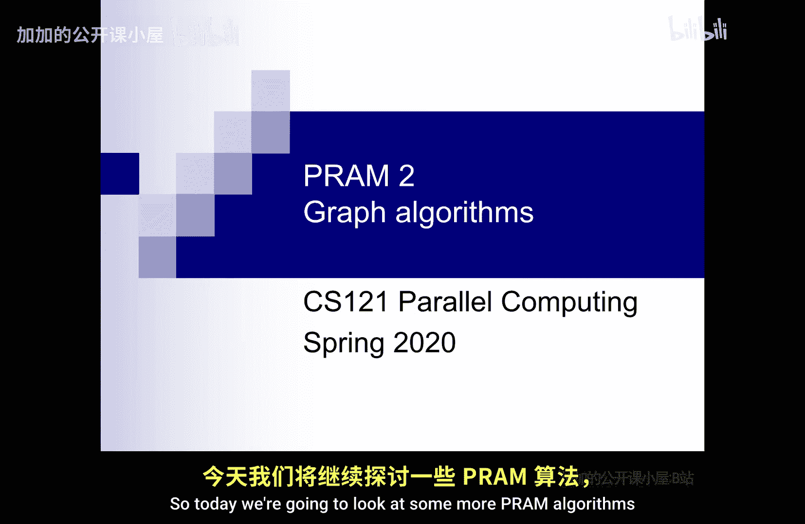
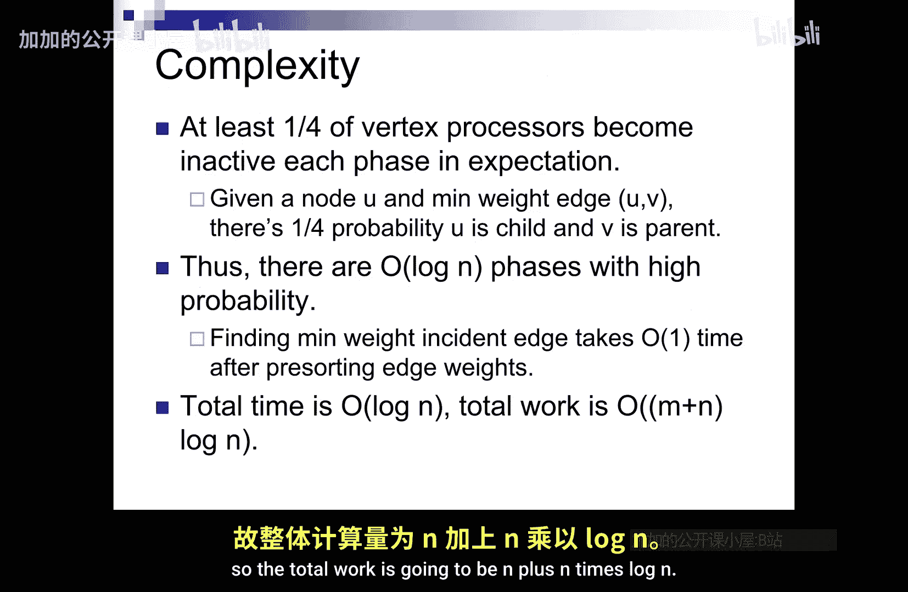

# 上海科技大学【中英⚡并行计算｜CS121 2020 Parallel computing】 p27 P27 PRAM 2 Graphs -BV1VqypBaEaP_p27-

Welcome back。So today we're going to look at some more prme algorithms and we're going to look at algorithms on graphs。

So the first problem we're going to look at is about coloring a cycle。Okay。

 so for the coloring problem， we're given a graph G。And then if we want to K color the graph。

 then that means that we want to assign every node a number， okay between 0 to k minus1。 Okay。

 so one of k possible numbers。And we want to make sure that the number for any edge in the graph IJ。

 we want to make sure that we assign different numbers to I and J。Okay。

 so today we're going to look at how to color a cycle。

Okay so this algorithm is only going to work on a psychograph。

 but we're going to see that this algorithm is very， very fast。And furthermore。

 even though a psycho is a very special type of graph， it turns out that by coloring the psycho。

 we can actually use this algorithm as a subroutine in some other important algorithms。Okay， yeah。

 so we're going to look at a super fast algorithm for three coloring a cycle okay now usually we're trying to minimize the number of colors that we use and we can see that in the case of a cycle if we have an even number of nodes。

 then it's possible to color the cycle using just two colors okay we just alternate between the colors。

However， if a the cycle has an odd number of nodes then we have to use at least three colors。

 so we're going to give an optimal algorithm in terms of a number of colors and this is also going to work very fast。

Okay， now color the psycho is a form of symmetry breaking in the sense that you know if you're given a psycho。

 then initially all of the nodes think that they're the same as any other node because there's nothing basically to differentiate these nodes initially。

Okay，Except that we're going to assume that these node have different have Is to start out with。

 Okay， and all of the node have different Is。 So initially。

 the only difference between these node is their ID okay， and then。

We're going to somehow make use of these IDs so that eventually the nodes end up with these values。

 with these colors from basically from zero to2 okay so every node gets one of three different colors。

Okay， now for each node V， we're going to let S of V be the node that comes after V， okay。

 so the successor of V。Allright， so now the way this algorithm works is that initially。

 since we're assuming that these nodes have IDs， then every node is going to get the color of each node is simply going to be its ID。

And then since all of the nodes have different IDs， then initially for any edge in the cycle。

 the endpoint have different colors， because they have different IDs。Okay。

 so now this algorithm is going to work in phases or rounds， and in each round。

 what we do is that what we assume that we start with a valid coloring， okay。

 meaning that for each edge， the endpoints have different colors。And then in this round。

 what we're going to do is to reduce the number of colors that we use Okay， so for example。

 if you start the round using like 100 colors， then after the end of the round。

 we want to use something like like 10 colors Okay so that's the basic idea。

 We keep reducing the number of colors we use until we're down to like three colors and then the algorithm terminates。

Okay， and so the way we do this in each round is that we're going to look at the color of each node V okay and we're going to look at the so let's denote that by c of V right so that's the color of V at the beginning of the round。

And we're going to look at the binary representation of C of V。Okay。

And then're going compare we're also going to look at the color of the successor of V okay。

 and its binary representation。And now we're going to compare these two binary representations and because V and C of V sorry V and its successor have different colors。

Then their binary representations has to differ in some bit。Okay， otherwise。

 they would have the same color。OkaySo there is at least some bit where they differ。

 and we're going to pick K to be the least significant bit in which these' color and its successor color differ。

Okay， so this is how we define this K over here。All right， and then given this k。

 we're now going to give a new color to V okay， so currently its color is let's say C of V。

 and now we're going to give it a new color， C prime of V。

And the C prime of V is going to be defined as2 times k so again。

 K is the least significant digit where V and its successor colors differ in the K bit。

so C prime of v is going to be two times k plus the K bit of v's current color。O。All right。

 so as an example of this， suppose that we have this situation right here okay so currently all of these nodes have colors right and you know this is a valid coloring because for all pairs of nodes。

 sorry for each edge， the two endpoints have different colors。All right。

 so then the first thing we're going to do is we're going to write down so here we're listing out the color of each node okay and then now we're going to convert that to its binary representation okay so we're listing the nodes in the order that they appear in the cycle okay and then we write out the binary representation of each nodes color。

And then for each pair of nodes， so for example， for let's say that V is this node with color7 right now okay。

 we're going to look at。This node and its successor node。

 and we're going to look for the least significant digit where their colors differ。Okay。

 so this is going to be or in the first digit。Okay。

 so sorry the zero digit okay so let's call this the zero digit and then so this is going to be the zero digit like the one。

2 and3 Okay Yeah so they differ in the zero digit so therefore k for this node 7 here right is going to be zero。

And then so the new color for this note7 over here is going to be two times k plus it's digit in the zero digit sorry。

 it's value in the zero digit。Okay， or it's rather it's simply it's zero digit， okay。

 so which is this one over here， Okay， so therefore seven is going to get a new color， which is one。

Okay so so we can look at another example so for example， if you look at node 14 over here。

 okay note 14， we're going to look at its successor， which is this node with color2 over here。

 okay we're going to look for the least significant digit where their colors differ。

And so this is going to be this two digigit over here。

 so k is going to be equal to 2 for this node with 14 over here。Okay。

 and then its new color is going to be two times k plus its value in the second digit， which is one。

Okay， so therefore its new color is going to be five。All。

And so we're just going to do this for every single node。You take the node， you take a successor。

 you look at their colors and you find the digit where they differ。

 there's some digit between zero to3 in this case and you just take that number multiply by two and then you add the case digit to that。

Okay， so now going we have this following claim， so first of all， if C is a valid coloring。

 so if we start the round with a valid coloring， then the claim is that this new coloring C prime is also valid。

Okay， so the reason this is true is because， because C is a valid coloring。

 then this node V and its successor have different colors。Okay。

 and so therefore there must be some digit where their colors actually differ， okay。

 so therefore this k value actually does exist。And now in order to show that the C prime is a valid coloring。

 let's suppose for contradiction that it's not a valid coloring。

 so suppose that we have this node V and its successor U such that with the new coloring C prime。

 U and V have the same color。Okay， we want to show that this is impossible。Okay。

 and the reason this is impossible is because so V is going to get a color which is equal to 2k plus its current color in the K digit。

 okay for some k right so k is basically you the digit that V and U such a V and U' color differ。

Okay so that's going to be these new color by definition。

 and then use new color is going to be2 times L plus its alpha bit。Okay。

 where L is basically we're going to look at U and its successor。

 and then we're going to look at where they differ in the L bit。All right。

 so those are the new colors for U and V and we want to make sure that they cannot be the same because if they are the same right。

 if you and these new colors are the same then。Then because you know these two bits here。

 okay these two parts are the C sub L and the C sub L， okay。

 so these are just single bits right so they're either zero or1。so therefore。

 if we have that c prime of V and c prime of u are equal to each other。

 then we have to have that L and K are equal to each other。Okay。

Because if El and K are not equal to each other， then。Since we're going to multiply L and K by2。

 then in this part， we're going to have the color of U and V are going to differ by at least two。

Okay， and in this part， you know， the difference is at most one。

So if there is a difference over here， okay if they're not equal to each other over here。

 then there's no way to make up for that difference CV and using these bits over here。Okay。

 so it must be that L and K are equal to each other， because otherwise U and V sorry。

 C prime of U and C prime of V cannot be equal to each other。All right。

 so then k and L are equal to each other， but then that means that because these two things are equal and then because L equals K。

 right， then need we also must have that you these two bits are equal to each other。Okay。

 and now since we know that L equals k， then this C sub L is simply equal to C sub k。

All so what this means is that the K bit of u equals the k bit of V。

again that's because c prime of v equals c prime of u， and so 2 L must equal to k。

 and so these two things have to be equal and also L equals k。

 and so therefore we get that U and V are actually the same in their K bit。

But this is a contradiction because we define k as a bit where U and V's color actually differ。

 where the current color of u and the current color of V， they actually differ in the K bit。Okay。

 and now if we assume this， then we must have that U andV have the same bit in the case digit。Okay。

 so therefore we have that you know， C prime of U and C prime of V are not equal to each other。

 and so therefore this is going to be a valid coloring。Okay。

 so then we're just going to take this little subroutine。

 which starts with a valid coloring and then produces a new valid coloring and we're going to run this over and over。

Okay， so now question the question is how many times do we need to run this for okay。

 so the number of times that we run this is equal to the time complexity of the algorithm。

Because each time we run this， we can do this in parallel for all of the nodes at the same time。

So yeah， so in order to figure out the parallel running time for this algorithm。

what we're going to do is now suppose that we're in a certain round。

 and let's say that the maximum number of bits used to represent any color is T。Okay， so for example。

 if t equals 4， okay， then all of the colors are between like zero to 16。I was sorry。

 zero to I guess， 15， okay？Yeah， okay， so in that case。

 then the maximum so we're currently using T bits to represent the colors in the current round okay now let's look at how many bits we need to represent the colors in the next round。

Okay， well in the next round， the maximum color is going to be at most 2t plus one。

Because remember the way that we form the colors for the next round is that we're going to look for a digit where these two neighbors differ。

 okay where their colors differ okay， so that digit is going to be a number between zero to t。

 because we have at most t digits here， so they differ in one of these digits between zero to t。

And then after we find that digit， we're going to multiply that by two。

 and then we're going to add the cave digit in okay and so that cave digit is at most one。

And so therefore， the color that we can have for the next round is going to be at most two times t plus1。

And in order to so the maximum number that we need to represent for the next round， okay。

 so the number is the color of a node and the maximum number we need to represent is just 2 t plus1。

And so the number of bits you need to represent a number 2 t plus1 is just going to be the ceiling of log T plus1。

O。Okay， so yeah， so now notice that the number of bits that we're using to represent a color is going to decrease from T to log t plus1。

Okay， so for example， if in the current round， let's say that we're using 16 bits to represent the colors okay。

 so if we're using 16 bits， then we can represent any number up to like2 to the 16th minus1 okay so that's something like 65。

000。Okay， so in the current round， we're using something like 65，000 colors。

Okay but then in the next round， how many bits do we need to represent a color well all we need is log of t plus1 okay so yeah so log of t so t is currently equal to 16 so two times log of t plus1 okay so that's going to be nine bits okay so we're going from 16 bits all the way down to nine bits okay so then for nine bits the maximum color is going to be two to the nine minus1。

Okay， so that's going to be something like 511 colors。Okay。

 so we've managed to decrease the number of colors from something like 65，000 to about 500 colors。

Okay， and then in the next round， we're going to decrease that again。

You knowIf we're currently using9 bits to represent a color， oh， sorry， we're not using。

Sorry the maximum color is going to be2 t plus1， but the number of bits is going to be log t plus1 so that's just5 okay sorry about that yeah。

 so it's going to be log of t plus1 so that's5 okay so the number of colors we're going to use is at most two to the fifth minus1 okay so we're only down to like 31 colors for the next round。

So we went from 65，000 colors down to 31 colors。So now you can see that the number of colors that we're using is decreasing very quickly。

And eventually， once we get down to three colors， then we can stop the algorithm。

And so since we can decrease the number of colors very quickly。

 then this means that we don't have to run this algorithm many rounds before we can stop。Okay， yeah。

 so now to do that analysis more rigorously， so let's define this new function。

 which is called this iterated log function。Okay， so this means that so log to the log iterated i times on x。

 okay， simply means that you take x and then you take its log and then you do that i times。Okay。

 so you take the log of the log of the log of the log and so on of x。All right。

 so then given this iterated log function， let's define log star of x as we start with x。

 and then we look at how many times we have to take logs until the value becomes less or equal to1。O。

And now this log x value， this log star value is actually very， very small。

 okay so it's an increasing function in x so as x gets larger we have to take log more times。

But it increases very， very slowly。Okay， so for example， even if x is something like2 to the 65，000。

 okay， so x is a very， very massive number。log star of x is less than or equal to6。Okay。

 so if you take a number。Up to this big， and then if you take six logs， okay。

 then you're going to be down to like less or equal to one。Okay。

 so this is a it's an increasing function but it's a very， very slowly increasing function。Okay。

 and so。And so now the claim is that this log star function。

 this actually gives the time complexity for the algorithm。Okay。

 so what we're saying is that if we have a cycle with end nodes， then in log star n number of rounds。

We can find a three coloring for all the nodes。Okay， so even if we start with like you know。

 two to the 65，000 number of nodes， okay， this massive， massive number of nodes。Then in six rounds。

 right because log star is six， okay， in order of six rounds。

 we can find a three coloring for all the nodes。Okay。Yeah。

 so so this is what we're going to try to show okay， and the reason is because。Yeah。

 and the reason is because what we saw was that in each round。

 start with a number that if you start with a coloring that requires T bits to represent。

Then in the next round， your coloring only requires order log T bits to represent。

this is what we said right so we're going so currently in this round we need T bits to represent a column and then in the next round we only need about log t plus1 bits to represent a column。

Okay so the number of bits we're using to represent these colors is decreasing by taking these logs。

Okay， and we know that initially in the first round， if we have M processes。

 then each process the initial color is just its ID。

 so therefore the number of bits to represent the ID is just log of n。

And so therefore initially we start with log M bits to represent the colors。

 and then if you keep taking logs because each round you reduce the number of colors that you need by this log。

Then in log star n number of rounds， we're going to be down to we're going to be able to represent any color using a constant number of bits。

Okay， and so this is why this algorithm is going to terminate after log start and number of rounds。

Okay。Now there's this one detail that we need to look at。

 which is that if you keep applying the previous subroutine， then once you get down to six colors。

 you actually cannot reduce the number of colors you use anymore。Okay。

Because suppose that you get into a round where you're using six colors， okay。

 then you need three bits to represent a color right because you need to represent a value between zero to five。

Okay， so then in the next round。Since you need to use three bits in the current round。

 then in the next round， the colors are going to be between zero to five。Okay。

 because the bit on which so in the current round， the bit on which two neighbors can differ in their color。

 that's going to be a number between zero to2。And so in the next round。

The maximum color that you can have is going to be two times2 plus1 okay。

 so five right so therefore in the next round you're again going to have to use six colors。

So once we're down to six colors， then the subroutine sort of doesn't work anymore， okay。

 can't reduce the number of colors anymore。But we actually know that on a cycle。

 we need to use atmostOS three colors。So now we can actually go down from six colors to three colors and the way we do this is we're going to do like a different little subroutine。

 so after we get down to six colors we're going to run for three more rounds and in these rounds so in the I round okay we're going to take any node that's colored using color I plus2 and then we're going to color it using the minimum possible color in01 or two。

Okay， so for example， in round one， we're going to take any node that's colored using so when we're starting this round。

 everybody is colored using colors zero to five。And then in round one。

 we're going to take any node that's colored using three， right。

 and then we're going to try to color it using the minimum possible color in 012。Okay。

 now we know that we can pick one of these colors because you know。

 if you pick one of these notes as color three， right， then if it's only got two neighbors okay。

 so it two neighbors are only using two out of these three different colors。Okay。

 so therefore we can just give this guy with color three。

 we can give them the unused color in the set。All right， and then in round two。

 we're going to take any node that colored using4 using color4。

 and again you're going to look at his two neighbors and you're going to pick one of the unused colors。

And then you do it for the node colored five。So then after you do these three rounds。

 then everybody is going to be using a color between zero to two。Okay， so then we have a three color。

Okay， so sum this up to sum up everything， what we did was we managed to three color all of the nodes and the number of rounds we run for is so we run for a log star end number of rounds and then we can get down to six colors and then you run for three more rounds and then you can get it down to three colors。

And the total amount of work that we did was n times logstar n because every round。

 all of the n nodes are working in parallel。Now this is actually not a work efficient algorithm because if you do this if you try to three color the ring sequentially。

 you can just do it in end time， so the work that you need is only n in that case。

 but it turns out that we can actually modify the previous algorithm so that we can produce a three coloring。

 but now we're going to take order log end time， but we're going to do linear work。

And this log end time is actually enough when we try to use this coloring algorithm in a subroutine as a subroutine in some other algorithm。

 because that other algorithm， so basically the other algorithm is going to work in log end time also。

 so therefore we don't really need for the coloring algorithm to work super fast。

We don't need this log start end running time， it's okay that it just has a log end running time but we do want to change the work so that it becomes only linear work。

Because the other algorithm where this coloring thing is used as a subroutine。

 that other algorithm has linear work so we you want to make sure the subroutine itself does not have more work than the parent algorithm。

Okay so now specifically what we're going to use this coloring algorithm for is to produce an independent set。

Okay， so now if you remember from the previous lecture。

 when we wanted to do a list ranking in a work efficient way， right we actually。

We needed to find these independent sets because we kept on removing nodes from this independent set and then until we got down to like a small number of nodes。

And so we needed to find these independent sets quickly and also using linear work。Okay。

 so it turns out that。嗯。Yeah so it turns out that by using coloring。

 then we can actually find large independent sets very quickly okay so specifically if we're given a K coloring of a line graph okay so the previous algorithm worked for cycles。

 but it also works for line graphs okay so the only difference is that you take out one edge from the cycle and you get a line graph。

So suppose you're given a k coloring of the line graph which has n nodes。

 then on that line graph you can compute an independent set of size at least n divided by k of size omega of n divided by k in constant time。

Okay， so if your k here is like a constant， if it's like3， okay。

 then this is saying that basically you can find an independent set of size at least n over3 in constant pi。

Okay， so the reason this is true is because。Okay， so you know given a K coloring then every node has a color between1 to k so now now in order to find this independent set。

 what we're going to do is to take notes whose colors are local minima okay and then we're going to take these nodes as the independent set。

So as an example， suppose you have you know this situation over here okay now the colors of the node are given by these values in the parentheses okay so for example this node6 here has color1 right note4 has color  zero and so on。

And now we're going to take the values， we're going to take colors which are local minima， okay。

 meaning that this color is going to be less than both neighboring colors。Okay， so for example。

 well this one here is not a local minima right because it's bigger than its neighbor。

 but the zero is less than both its neighbors okay so this is a local minima。

 so we're going to include this node in the independent set。this two is not a local minima。

 but this guy is a local minima， this guy is a local minima and this guy is a local minima。Okay。

 so therefore we found four nodes who are local minima。And notice that these four node。

 they actually do form an independent set。Because none of them can be neighbors of each other by the definition of an independent set is that we pick notes who are not neighbors of each other。

And the reason they're not neighbors of each other is because each of these nodes is a local minima。

 so it's got to be less than both of its neighbors。Okay。

 so its color is less than both of its neighbors， so therefore you can't have two neighbors who are both local minima if they can't both be less than each other。

Okay， so therefore， these nodes that we picked out are local minima and we can compute all of these local minima in constant time because every node just looks at its two neighbors and decides whether it is a local minima。

Okay， all right， so now next we need to show that this set of independent nodes is quite large， okay。

 that we managed to pick out at least n divided by K number of these nodes。Okay。

 our order and divided by K number of these nodes。And now the reason this is true is because because you know if you take any two nodes that you selected。

 okay like for example this node and that node right now because they're local mini。

 okay then if if you look at the colors of their neighbors。

 okay so suppose that you selected this node okay and it's got some color like this now if you look at the colors of its neighbors。

 they're first of all going to increase and then possibly decrease。Okay， so sorry sorry。

 what I mean by this is suppose you take two of these notes UMV that you included in the。

In this independent set okay and now so here what I'm drawing is like the color okay so the higher up you go the higher the color okay and now because you use a a local minima right then its color is actually less than both its neighbors colors。

Okay， and now if you look at the neighbor's colors right so now if you look at two consecutive local minima。

 then what has to happen with the colors is that they first increase and then they decrease。Okay。

 so this is between two consecutive independent notes that we pick。ok啊。Right。

 and so so if the first increase and then decrease。

 then at most there are going to be 2 k minus3 nodes between U and V Okay because you know these two guys because all of these colors are different and so you know this guyss using a color and so here there can be at most k minus1 other colors Okay and then here there can be at most k minus2 other colors in the decreasing part so therefore altogether there can be at most 2 k minus3 colors sorry2 k minus3 nodes between U and V。

Because all of these nodes between UMV， they first have to increase in color。

 so there is at most k minus one of these nodes， and then they have to decrease in color。

 so there's at most k minus2 of those nodes。Okay， so that means that there are not too many nodes between U and B。

and because there are not too many nodes between U and V。

 must then there actually must be lots of these nodes in S okay in particular。

Since our at most 2 k minus3 nodes between any two consecutive nodes in S。

 then the number of nodes in S has to be at least and divided by 2 k minus3。Okay。

 so then this shows that we can indeed get an independent size of size at least n divided by 2 k minus3。

 and you can do that in constant time。O嗯。Yeah and so altogether in order to compute an independent size of so this k here is a constant because we show that we can actually three coloror the line graph so we can simply treat this as a so two times 3 minus3 so that's three right so can so therefore this shows that we can get an independent size of at least independent set of size at least n divided by3 and we can do that by first coloring and if we use a work efficient coloring algorithm that's going to take us log n time and order n work and then we can do this this independent size computation。

So altogether， we get this independent set of this size in log n time and linear work。

And so this is what we needed in order to run the list ranking algorithm in a work efficient fashion。

Okay， yeah， so we show that。So we show that by using the separate team。

 then we can actually get work efficient and logarithmic time list ranking。All right。

 so the next problem we're going to look at is connected components Okay so in this graph。

So this is a very basic algorithm in sequential graph algorithms。

 and so just to remind you what this problem is， so we're given an undirected graph and then we want to partition this graph into sets of maximally into maximal sets of connected nodes。

Okay， so for example， in this graph， right， this is going to be one connected component because all of these nodes are connected to each other right and then this oops。

And then this thing in the middle， right so this is going to be another connected component and then the thing on the bottom is also a connected component。

Okay， so given a graph， we want to find all that's connected components。Now in a sequential setting。

 we would normally just solve this by like breadth first search or depth first search。

 and then this would take a linear time basically or basically M plus n okay where M is the number of edges and n is a number of vertices。

However， in the PRAM setting， we can't use the BFS or DFS algorithms to find connected components。

 and this is because we don't have efficient algorithms。

 efficient PM algorithms for to do either BFS or DFS。Okay。Yeah。

 so the algorithms we have for BFS and DFS are either going to have a very large depth。

 okay so they could have something like linear depth， okay linear in the number of notes。

 linear depth， okay or the work is going to be very high so we don't have PM algorithms which both have linear work and also like a logarithmic depth。

So therefore we're not going to use BFS or DFS to solve connected components in the PRAM setting instead we're going to use a technique called graph contractions。

Okay so this is actually a very widely used technique， MPR algorithms。

 and in general in graph algorithms。And so yeah so I'm going to give an example of this of how we actually do graph contractions on the next page。

 but basically， so the contractions are going to take a set of notes and then merge them together。

Okay， so for example we're going to let's just delete this。

 we're going to take this set of nodes and then we're going to contract this entire graph and we're going to form one big node out of it。

 okay so we're going to merge all four nodes into like one big node。そね。嗯。Okay。

 so let me say this a bit differently okay so actually what we're going to do is we're going to take like let let's say a small set of nodes okay so let's say that you take this set of nodes okay and then you merge these into one big node and then maybe you take this set of nodes right and then you merge these into one big node so you're just going to take these small set of nodes and then you're going merge them into what we're going to call a super node okay so that's like a big node that includes all of these smaller nodes that you contracted from。

Okay， and so after you do this contraction on a graph， okay。

 we're going to end up with a bunch of these super nodes。

And if we have a connector component in the original graph。

 then the super nodes are also going to be connected to each other。

So if you look at the graph on the super nodes， so not on the original nodes。

 but now you look at the graph on super nodes， then this graph preserves the connectivity of the original graph。

 so whatever nodes were originally connected then after you form these super nodes right then you have the same set of connected components。

Okay， and now you can apply this technique iteratively。

 okay you can take these super nodes and then once again you can merge some of these super nodes together okay。

 so you get like super super nodes。And then you just keep doing this process recursively。

 and the key point is that whenever you do this， you preserve a set of connected components。

Okay so originally if we had three connected components， then if you do this for one round。

 you have a bunch of super nodes， but these super nodes also form three connected components。

Okay you do this again and you get like super super nodes and these super super nodes also have three connected components。

so if you keep doing this， then eventually you're going to merge all of the nodes in each connector component。

 all of those nodes are going to get merged into a single like super node。Okay。

 so at the end of this， then we're for this graph， which is going to end up with three super nodees。

 which comes from merging each of these three connected components。Yeah， so。Yeah。

 so this is a basic idea for this algorithm， but there are actually many different ways that we can implement this algorithm because。

It depends on how we implement this contraction operation and we have different ways of implementing contraction。

So today I'm going to talk about two different algorithms for ConnectA component。

 they both of them do this follow this contraction idea， okay。

 but they actually implement the contraction step differently。Okay。

 so the first algorithm is going to be a randomized algorithm， okay。

 so this algorithm is allowed to make some random decisions。Yeah。

 and we're going to see that you by using randomization， we actually get a very simple algorithm。

Okay， so what we're going to do is so the randomized algorithm。

 basically it's going to take your initial graph and then break the graph into a bunch of little star graphs。

 and then it's going to contract each star graph。And so what we mean by a star graph is just something that looks like this okay so it's got like a center node and then a bunch of other nodes around it yeah。

 so we're somehow going to take the graph and then break it into these star graphs and then contract each star graph into the center node okay so like all six of these nodes become contracted into like a single node。

All right， now to do this， what we're going to do is we're going to run a number of phases and in each phase we're going to do these following steps in parallel。

Okay， so the first thing is that every node is going to get a random number。

 okay so it's just going to flip a coin right and the coin is going to produce a random result and based on the coin flip。

 the node is going to choose to either be a parent node or a child node。Okay， so yeah。

 so you if we start with this graph over here， then the first thing is that all of these nodes。

 they're going to flip a coin， so this is where we use the randomization and then based on the coin flip right so you know if it's like a head。

 then they're going to be a parent node and if it's tails， they're going to be a child node。Okay。

 so then we have， let's say， this situation over here。Okay。

 so then now every child node is going to point to a parent node that it's connected to。Okay。

 so for example， you know this child node okay it's going to point you know it's got two neighboring parent nodes。

 okay so it's going to choose one of them， it can choose it arbitrarily okay but it's going to choose one of these parent nodes and it's going to point to that parent node so for example it's going to choose the three as a parent node and then point to three。

O嗯。Likewise， let's say this node over here， okay well it's got a neighbor which is a parent node。

 so it's going to point to that parent node and this node5 over here。

 it's also got two choices and it's going to choose arbitrarily to point to7。Okay。

 so then once you do this， you see that now you have a bunch of stars okay you've taken the graph and you've decomposeded oh sorry one more thing one more thing is that sometimes you have child notes and none of the neighbors are parents okay。

 so for example， zero over here okay it doesn't have any parents okay parent neighbors。In that case。

 it's just going to stay as a single node by itself。

 okay that's not a problem okay it doesn't have to point to somebody but if it has a parent sorry if it has a neighbor who is a parent。

 then it has to choose one of neighbor one of those parent neighbors to appoint to。Okay。

 so then after you do this， you see that the graph is going to become a set of stars okay so basically the parents are going to be the centers of the stars and the notes neighboring child notes are going to point to the parent。

Yeah， and then if you have one of these child notes with no neighbor who's a parent， right。

 then it's just going to form its own star。Okay， so next we're going to do the contraction step。

 okay， so the contraction is going to take each of these stars and then it's going to contract it to the center of the star。

 to the parent node。Okay so if you do that， then you know all three of these node are going to get contracted to this parent node over here。

 okay this four node over here， okay， these two node get contracted down to the three right and then these two node get contracted to the seven。

And then this node just stays as a node by itself。And now。

If you look at the edges right so you have an edge from the zero node to this sort of contracted3 node over here so we have this edge which goes from the zero node to this cluster of threes over here okay so we're just going to denote that by this edge over here we also have an edge between zero to this four cluster over here so we have this edge and then we have an edge between three and4 and then we have an edge between4 and7。

We're going to remove all of these internal edges， so the contraction basically is going to merge all of these nodes together and it's also going to remove all of these edges within the star。

Okay， so now we've gone from you know this initial graph， right。

 we've contracted it to the smaller graph。And you see that， well。

 the initial graph has one connectedor component and the smaller graph also has one connected component。

Because when you do this contraction process， you're not going to create or lose any connected components。

 you're going to exactly preserve the set of connected components。And so therefore。

 we can now take this contracted graph and you can run this contraction process again。Okay， so again。

 each of these notes is going to randomly choose to be a parent or child， right。

 and then the children are going to point to neighboring parents。

And then we're going to get a bunch of stars and then we're going to contract them and then the graph gets smaller okay。

 so the graph keeps getting smaller。You know， round by round。

 and eventually because everything over here comes from one connected component。

 then eventually all of this is going to get contracted down to one single node。Okay。

 so so once it gets contracted down to that single node。

 then what that indicates is that everything from so that single node was formed by contracting everything in the connect component down to that single node and now we want to make sure that all of the nodes in this connect component get they're just going to get the label of the final node。

Okay， so everybody in this connector component gets the same label。And in this way。

 they know that all of these nodes know that they come from the same connected component。

Okay so therefore， we want to make sure that we can label all of the nodes in this connected component by the label of the final node that they all contract to。

Okay， and so the way we do this is that each time we do a contraction right we're going to label all of the notes that all the children get contracted into their parent and we're going to label the children by their parent okay。

 so for example， these two nodes right become they both become labeled for。Okay。

 so we actually have three notes now that become labeled four right both these guys get labeled three and these guys get labeled labeled seven。

呃。Yeah right and then so so we do this recursive process of you know merging nodes right and then eventually the recursion is going to bottom out and then as we you know as we escape from the recursion then each of these children nodes is going to take the node of its parent these the parent nodes label might have changed okay so then the children node need to take the parent' new label so for example if all of these nodes okay so currently they have different labels right so if。

Yeah， if eventually everything gets merged down to this four node right。

 then what we need as the recursion returns is for this for this label of four to get propagated to all of these other nodes so in the end。

 all of the nodes in this entire component are going to be labeled for。

Okay so now in terms of how to actually implement this。

 okay so I'm going to go into a bit of details about how to implement this。

 so what we're going to do is we're going to use M plus M processors where Ns a number of nodes and then MSC number of edges okay。

And then yeah， so sorry they should be switched these should be V and E okay so in fact we're going to have one processor for each vertex and also one processor for each edge okay so we're going to call these the V processors and the E processors。

Right， and the V processors are maintaining this label right。

 because eventually we want to contract everything down to one node and we want that single nodes label to get propagated to all of the other vertices。

So the V processes need to keep track of the label so each V process is attached to one of these nodes and that the V process needs to keep track of the label for the node。

 because that label can change over time。And then each E process is going to be assigned to one of these edges。

 okay so yeah。Right now these V and E processes， they can become inactive over time so for example。

 once we contract these children nodes down to its parent then we only need to keep the parent so here we have three different V processes but once we contract these three nodes down to the single four node。

 then we only need the V process for this four node to remain active okay we don't need these other two children nodes to remain active。

Okay， and likewise， if you contract an edge， then you don't need that edge process to remain active。

Okay， so yeah， so the first step is for all of these notes to decide whether they're going to be a parent or child note。

 okay so the first thing is they're going to flip a coin to decide whether they're a parent or child。

And then。Right， okay， and then we want to propagate the label of the parent to the children。

Right and the way we do this is that what we have an E process assigned to each edge okay so we're just going to have that E process read you know it's two endpoints so the E process is associated with these two processors so it's going to read the labels of these two processors and it's going to check whether one processor is a parent and the other is a child and if that's the case。

 it's going to set the child's ID or the child's label to be the parent's label okay so it's going to set this to be a four and likewise this guy is going to set this E is going to set the six to be the new label for。

Okay， so now we could have， so you know， if we look at another example here。

 you have like two E processes， okay assigned to these two edges。

So now this e process over here is trying to set twos label to a three and then this E process over here is trying to set twos label to a4 because two can either point to three or to four。

Okay， and in this case。We're going to have so these two processes are basically writing to a field that's associated with this process okay so they're both writing to the same field and this guy's writing three and this guy's writing four okay so we have this concurrent right situation。

And in this situation， we're just going to let one of these concurrent rights win。

 an arbitrary one of them， so either three or four can get written to this two label over here。

And in this case， it so happens at3，1， okay so the label 3 got written over here。

 so that means that two is now going to point to three。But it doesn't matter which one wins， okay。

 we can let an arbitrary one win。Okay， so next we're going to deactivate some of these processes because we don't need them anymore。

Yeah， okay， so first of all， each parent process is going to stay active， okay， so these black。

These black yeah these black node processes， they're going to stay active and second of all。

 if node if a child processes label did not change okay then it's also going to stay active okay so for example this guy's label doesn't change because it didn't point to a parent okay so then this guy's going to stay active but this child notes process sorry this child notess label did change so it's going to become inactive。

Okay， and also for these edge processes， okay， they're going to stay active when their two endpoints have different labels。

Okay， so for example， you know this edge process， okay the endpoints have different labels。

 you know they're going to be 0 and4 okay， so this guy is going to stay active。

 but this edge process， okay his endpoints have the same label。

 they're both four so that in that case there they're going to become inactive。嗯。Yeah。Okay， so。Right。

Yeah， and then the active vertex and the edge processes are going to continue running the algorithm recursively。

And then in the end， after the recursion returns， then some of these inactive edge processes。

 they actually need to become active again and they need to write they need to help propagate the labels okay so for example。

 if all of these processes eventually got merged down to this four process， then this node3。

 his label would have eventually changed to a four。Okay， so when this edge process became inactive。

 this vertex here was still labeled as a3。Because yeah。

 but then eventually when the recursion finishes， this three's label might have changed to a four。

Okay， so in that case， this edge process here needs to help propagate that four label to this vertex。

 so he needs to change the three label to a four。so after the recursion returns。

 then some of the inactive edge processes need to become active again。Okay， so yeah。

 and at the end of this， all of the vertex processes in the same connected component are going to have the same label。

Okay， so now let's look at the running time of this algorithm。Yeah。

 so so the key factor is that the number of active vertex processes is going to decrease by at least a quarter in expectation in each phase。

And the reason this is true is because a V process is going to become inactive if it's a child process and then one of its neighbors is a parent process okay in that case。

 it's going to point to one of its parents okay it could have multiple parents being sorry multiple neighbors being parents。

 but it's going but as long as any of its neighbors are parents。

 then it's going to go point to one of them， and then it's going to become inactive。Okay， so yeah。

 so the probability that it is a child process， okay， is one half。

And the probability that one of its neighbors is parent is going to be at least one/ half because each parent sorry each neighbor is going to be a parent with probability1 half。

 so if you have like multiple neighbors right， then the probability that any that one of them。

 at least one of them is apparent is going to be at least one half。Okay。

 and if both of these conditions happen， then this node process is going to become inactive。

So therefore， the node process becomes inactive with probability at least one quarter。

Okay so that means that every round in expectation， we deactivate like a quarter of these processes。

And eventually when you're down to like one process， one vertex process， okay。

 that's when your recursion ends。OkayAnd so this is going to happen in log n phases。

 because every phase you lose a quarter of your processes， so after log n phases。

 you're going to be down to a single process。Okay， and now and also each phase takes just constant time because all you need to do is just flip a coin and choose one of your and then the edge processes are going to choose which way each node process is going to point。

Okay， so each phase takes a constant time and it does linear work。

 okay or the number of edges plus the number of vertices， that amount of work。

And so therefore the total amount of time is just going to be the number phases times the time per phase。

 so that's going to be log n and the total work is going to be the work per phase times log n。Okay。

 so this is not a work efficient algorithm yet because you know in a sequential setting you can compute connected components and just order M plus n work and so here we're off by a factor of log N。

But there are actually other work efficient， randomized connected component algorithms。Okay。

 so we can modify this basic idea so that we actually end up only doing linear work and also running in log time。

Okay， so next we're going to look at another algorithm to compute connected components。

 and this algorithm is going to be deterministic So for example。

 if for some reason you don't like randomized algorithms。

 then this is a deterministic algorithm to compute connected components。

And it's based on basically the same idea， okay， so it's also based on some sort of graph contractions。

 but as youll see， it's going to implement these contractions in a different way。

So but because it's a contraction based algorithm， it's again going to be working in phases， okay。

 so each time you contract the graph in some way and you make it smaller。

 but you preserve the set of connectedor components。Okay。

 and you keep doing this until you're down to like one node。And then sorry。

 you keep doing this until you're down to like k nodes where k is equal to the number of connected components。

Okay， so now what we're going to do in a phase is we're going to have nodes point to neighbors with lower IDs so again the nodes are all going to start with IDs and each node is going to point to a neighbor with a lower ID So for example。

 if you have the graph if you start with the graph on the left then you know each neighbor is going to choose sorry each node is going to choose some neighbor with lower ID so for example you know this node two here is going to point to the zero right the three is going to point to the two right the four node here has has several choices can point to two or can point to one。

And it's just going to choose one of those arbitrarily。Okay。So if you do this。

 if you have each node point to a neighbor with a smaller ID。

 then this is going to break your graph into a set of directed forests。Okay。

 so the forests are going to be rooted at these nodes， which are like。Which are local minima。

 which do not point to anybody else。Okay。Yeah， so here we're going to end up with like two of these directive forests。

 okay， the zero here is a local minima and the one here is a local minima。

And now we're going to contract each of these directed forests down to the root of that forest okay。

 so on the left over here we're going to contract all of these nodes down to the zero node and then over here we're going to contract all these nodes down to the one node。

Okay， and the way we're going to do that contraction is by pointer jumping。

Okay so if you remember pointer jumping， so if you just look at these set of edges here。

 okay so there's going to be a path from any node to the root of its tree that it's in so there's for example。

 a path from the five node to the zero node and so we're just going to apply pointer jumping on this path in order to make five point to the zero node。

Okay， so remember that pointer jumping means that five is going to well5 is currently pointing to three。

 so5 is going to look at who three is pointing to right so that's going to be two and then five is going to directly point there。

Okay， and then in the next round， so now five is pointing to two and。

Five is going to again look at who2 is pointing to， which is not going to be zero， right。

 and so five is going to end up pointing at0。🤧Okay。

Yeah so if you and then you do this for all of the nodes this in this little tree over here， okay。

 so for example four， if it does point your jumping， then it's also going to point as zero。

So therefore by doing this pointer jumping， we're going to have all of the nodes in each of these little trees。

 they're going to point to the root of that tree。Okay。

 and that contracts all of these nodes down to the root of the tree。

And now we're going to recursively run the algorithm on this contracted graph。Okay。

 so in terms of how to implement this， we're again going to use M plus M processors。 Okay。

 where n we have M processors for the M vertices and we have M processors for the M edges。Now here。

 we're going to have a small difference， which is that the vertex processors are always going to stay active。

In the previous randomized algorithm， we had that these vertex processors could sometimes become inactive。

 but here the vertices are always active， but theed processors can also sometimes become inactive just like before。

Okay now the edge processes are responsible for generating these pointers so the first step is for each node to point to one of its lower neighbors so the edge processes are responsible for setting these pointers so for example。

 you have let's say you have an edge process over here and then you have an edge process over here and so this guy on the bottom he's trying to make four point to the one and this guy well first of all this edge over here he's going to check his two end point and he's going to try to make set the direction to point to the smaller direction to the smaller node and then this edge processes trying to make four point to the to the two so both of these processes are writing to some sort of field that's in this that's stored by this four node over here and so they're doing a concurrent right and it doesn't matter which one of these wins so in this case the process writing a two he won。

All， but anyways， so these edge processes are first of all， going to check this edge UV。

 and then set it's going to try to point this edge in the direction of the smaller node。Okay。

 and then after we form these pointers， right， then we can do the pointer jumping。Okay。

And the V processes are responsible for the pointer jumping。Okay。

 so they're going to do the pointer jumping and yeah so。Yeah， so for example this five， okay。

 when it does a pointer jumping， it's going to set its label。

 so initially it was it had a label of five。🤧Okay and it's going to take the label of whoever it points to okay so this five here is going to change its because it's initially pointing to three。

 it's going to change its label to three but then after does pointer jumping once。

 it's going to point to2， so then it's going to set its label to2 and then eventually it's going to  point。

 to0， so then it's going to set its label to0。Okay so whoever it points to it's going to set its label to that guy and the zero node right he doesn't point to anyone。

 so he never changes his label okay so everybody else eventually gets change a third everybody else in this tree after doing the pointer jumping eventually is going to accept their label to zero。

Okay， and now we're going to deactivate some of these edge processes。

 okay because basically the edges which are in each tree we don't need those anymore。

 but we do need the edges which go between two of these trees okay so we need for example。

 this edge process and this one， this one and that one， we need those to stay active。🤧Okay， right。

 and so what's going to happen after you run one round of this is all of these nodes are going to have now zero labels right and then this this node is going to have a one label because he's in the one component。

And so now you have。Yeah， so now you have a bunch of these edges and each of them is pointing from the zero to the one right and so all of them are going to be setting these directions。

 so they're basically going to set the direction sorry they're going to set the edges direction to point to the smaller label so they're set in these directions。

And then after that， all of these nodes in here right so we have two nodes in here。

 they're going to do the pointer jumping and then when they do the pointer jumping。

 they're going to find that they point to the zero and so they're going to change their labels to zeros。

Okay， so eventually all of these nodes are going to change their pointers， their labels to zeros。

Right okay， so that's the algorithm now there's one problem with this algorithm because so currently we're always having the nodes point from like large values to small values。

And it turns out that if you run this algorithm， then there's actually these pathological cases where the algorithm is very slow。

 where it takes a linear time to complete。so our goal is for this algorithm to terminate in something like logarithmic time。

 but in some situations it actually takes linear time and so an example of this would be this graph right so here these are the initial labels of the notess okay so we have one node with the maximum label8 right。

And so what's going to happen is that he is going to set his label to point to one of his neighbors。

 and he can choose one of the neighbors arbitrarily。But none of these neighboring nodes。

 none of them are going to point to the center because they're all less than the center。

Okay so the center is going to point to one of the outline nodes， and so suppose it points to seven。

Then its label is going to become seven。Okay but now again。

 this node in the middle is the largest right so none of these outside nodes are going to point to it and this middle node is going to point to one of its neighbors Okay so let's say that it points to six so then its label is going to become a6 and then on the next round it might point to the five right and then the four and so on。

Okay， so in this graph， it can take up to like order end time before。Before this terminates。

Okay however， the observation here is that you know。

 this only happened because we're making these big nodes point to the small nodes if we reverse the directions so that we made these small nodes point to the big nodes then this graph would actually terminate in just constant time right because if we make the small nodes point to the big nodes。

 then everybody would point to the center and then everybody would just get contracted to the center and they would get an ID of eight right away one step。

So so we're going to make use of this observation and what we'll do is that in each phase we're going to run two rounds okay。

 in the first round， we're going to have nodes point to lower neighbors Okay。

 so so just like you know over here we have you know8 point to one of its lower neighbors。

But maybe that doesn't work well because in this situation it takes a long time for this to finish so also so therefore in this phase。

 in the second round of the phase， we're going to have nodes point to their higher neighbors。

And it turns out that in one of these two rounds， we're going to have at least an two nodes can be contracted。

Okay， so yeah， so when you point to the lower neighbors right then we look at how many nodes can get contracted。

 so in this case there's only one node that can get contracted right there's only the seven node that can get contracted and then we try the other case where you point to higher neighbors and then you see that you're going to get eight nodes which can be contracted。

Okay， and so for this phase， we're just going to pick whichever round lets us contract more nodes。

Okay， so in this case， we're going to pick the 0。2 bigger neighborors round。

And the claim is that in one of these rounds， at least half of your nodes are going to get contracted。

Okay， and the reason is that。You know， suppose you have a node V okay and suppose it doesn't point to any neighbor in the high to low round okay where you know high nodes point to low neighbors okay。

 so if it doesn't point to any neighbor okay then it must be smaller than all of its neighbors。

Because if it's bigger than any of its neighbors， then it would point to at least one of the neighbors it's bigger than。

Okay so the fact that it doesn't point to any neighbor right means that it's got to be smaller than all its neighbors okay so for example this one here right it doesn't point to anyone because it's smaller than its neighbors。

But if it's smaller than all its neighbors， then in the low to high round。

 then know because it's smaller than its neighbors。

 then it's going to point to some neighbor in the low to high round。ok。All right。

 so either in the high to low round， it's going to point to someone or in the low to high round。

 the node is going to point to someone。And as long as it points to someone。

 then it's going to get contracted。系。Yeah， and so so therefore in one of these two rounds。

 so every node is going to point to someone in one of these two rounds。

 and so in one of these two rounds， we can contract at least half of a nodes。Okay。

 and so because we can contract half the nodes each time。

 then this algorithm is going to terminate with one node in logarithmic number of rounds。Okay。

 and so to look at the amount of work， well each round is going to do pointer jumping， okay。

 so the pointer jumping is going to take log n time。And also， it's going to do end log n work。Okay。

 so therefore， for this algorithm， currently the time complexity is going to be log squared。Yeah。

 so the time complexity is log squared and the work is going to be a log n phases times this much work per phase。

 so it's going to be this is the total work。Okay， so。Right。Okay。

 so then the final algorithm we're going to look at is for minimum spanning tree。Okay， so yeah。

 remember that you know for a minimum spanning tree。

 we're given an undirected graph with edge weights and we're trying to find a tree which goes through all of the nodes and which has the smallest possible smallest total weight。

Okay， so for example， in this one。In this graph over here。

 the MST is going to be all of these thick edges。So among all possible trees that go through all of the node。

 this tree has the smallest total weight。Okay， so if we're in the sequential setting。

 then we can actually solve this in M plus n log N time。

 using like a Prince algorithm or CRresco algorithm。Okay。

 so now we're going to try to do this in the PM setting。

And we're going to rely on one key property of minimum spanning trees。

 which is that if you take any set of node， V sorry sorry， W okay then。

Then if you look at all of the edges which come out of W and which go to nodes which are not in W。

 then the minimum cost edge， minimum cost edge among that set has to be in the MST。Okay。

 so for example， if you take if you take W to be this set， Okay。

 then the edges which come out of W and go to other node， right， are you know， this edge， this edge。

 this edge， and then this edge， okay。And what this property says is that if you look at these four edges。

 then the minimum cost among the minimum cost edge within the set has to be in the MST okay so the minimum cost edge would be this one right and this is indeed in the MST。

Okay， and you know， likewise， you can take some other， you know， you can cut this some other way。

 So now you can say this is W right， So then the edges which come out of this are are these three edges right And you see that you know。

 the minimum cost edge， which are these two cost two edges。 Well in this case。

 all three edges are are in this one。 Okay， so maybe let's take a different example。Okay， so。冇。

If you take。嗯。Yeah， so all of these cut go through too many edges。 yeah， okay， so if we take this。

 Okay， so this is our W over here， right， then the the edges which are cut by this by this W are this edge of this edge。

 this one， this one and then that one okay and so the minimum cost edges are these two。

 four edges right， and then one of these at least has to be in the MST。Okay， so this is the。嗯。Yeah。

 and so if you apply this to a single vertex V， okay。

 then what this is saying is that for the single vertex。

 the minimum the minimum cost edge coming out of V has to be in the MST。Okay， so for example。

 if if you take I don't know like this node， right， then it's got two outgoing edges。

 and so the smaller one has to be in the MST。Okay， or if you take you know， if you take this node。

 okay it's got three outgoing edges right so the smallest so the cheapest edge has to be in the NST right this one。

Okay， so then we're going to use this idea and then we're going to create a parallel MST algorithm。

 and it's going to work similarly to the previous randomized parallel algorithm for connected component。

Okay so what we're going to do is so we start with this way to graph over here， okay。

 and just like the ConnectA component randomized algorithm。

 we're first of all going to have each node randomly choose to be a parent or child node。Okay。

 so yeah， so these white notes here are the child notes and the parent notes are the black notes。

Okay。And now for each child node， it's going to look at its minimum weight outgoing edge okay so this child node has a bunch of neighbors and it's got like edges to all these neighbors and it's going to look for the cheapest edge to any of its neighbors。

Okay， and then let's call that UVv。Okay， so UV is the cheapest edge going out of you。

And then U is going to look to see whether V is apparent。Okay， if v is apparent。

 then u is going to point to V。Okay， if V is not apparent。

 then U is just going to it doesn't do anything。Okay， so for example， here， you know。

 we have a bunch of these so these child these white notess are the children right and so for each。

Each of these children notes it's going to look at its outgoing edges right so for example。

 the zero guy is going to look at you know these two edges right and the cheapest one is going to be this nine edge and it's going to check whether this the other node on the nine edge is apparent okay so it is apparent so in this case it's going to point to that parent。

Okay， let's see。 so this。Let's see。 So this node。 Yeah。 So if you take this three node， Okay， Oh。

 right， So this is a parent。Let's see。 So all of these are。嗯。Yeah， okay， so yeah， in this case。

 all of them， all of these children notes are going to point to someone， okay？

But but it is possible that you know， if you look at your cheapest outgoing edge， right。

 then the other endpoint is not apparent okay， so you know， in that case U is not going to 。 to v。

Okay， but anyways， so then we form these pointers and these pointers again are going to create a set of stars and the parent nodes are going to be the centers of the stars。

And so once again， we're going to contract each star to the parent。Okay。

 and so that's going to form this situation over here， right， where we have these three parents。

 and then we contract these。We contract each of these stars down to the parent okay and then when you do that。

 you're gonna you have edges between these different parents Okay。

 and you could have multiple edges between the parents and we're going to keep all of these multiple edges Okay so for example。

 you know these things are going to get contracted down to this four node over here right。

 but we have two edges between these you know this three component here and and the three star and the four star and we're going to keep both of these edges。

Okay， and then over here we have three of these edges。 Okay， we're going to keep all three of them。

And then we're going to do the same thing， so we're going to again have node choose to be parents or children right and then the children are going to take the cheapest outgoing edge so it's going to take the 15 right and then this so this child is going to take the 15 edge and this child is going to take the 14 edge and then they're going to see whether the endpoint is parent and in this case it is parent and then so they're going to contract down to the parent。

Okay， so then each time we selected some of these edges to contract a law， right。

 so each time we selected these edges。Okay， and then we later on we selected the 15 and the 14 edges。

 so we selected this edge and the 14 edges where okay it's over here right okay。

 so all of these edges that we selected right at any level of the recursion。

So if we take all of those edges together， that is going to be an MST。

 Okay so that is the minimum spanning tree。 Okay， so ultimately， we have this SR MST。Now。

 one thing is that it's a little bit tricky to find which。What is the minimum weight outgoing edge。

 Okay Because you know， you could have a node with many outgoing edges。 So for example， this node。

 Okay， he's got four outgoing edges。 so so we don't want to have like a single process check all of these outgoing edges and then and then find the minimum among that because that's going to take you know。

 if you have K neighbors here that's going to take you know order K time Okay。

 we want to do this in constant time。And so the way you can do this in constant time is that we're going to assign one process per edge okay so we're going to have so just like before these edges are going to be assigned processors so we have like four processors for these four edges and these four processors are going to write the weight of this edge to this node2 over here and we're going to assume that we have this minimum priority CRCW model where if。

诶。Yeah， where if you know， multiple values right to the multiple processes right to the same location。

 then we're going assume that the minimum value wins。 Okay， so in this case， the the guy writing8。

 he's going to win okay， so he's going to make two point in this direction。🤧。Okay。

 so the last thing is we're going to analyze the complexity of this algorithm。

 so this is basically the same as the connected component algorithm because again you can show that with at least again you can show that in each phase at least one quarter of the vertex processes become inactive or you're going to contract out at least one quarter of the nodes each time and the reason is that if you take any node u then you know it's got some minimum weight outgoing edge and U is just going to check whether along this edge。

 whether V is apparent or not。Okay，And so there's a one probability sorry sorry。

 there's a one quarter probability that you himself is a child and along this edge that V is a parent。

Okay， and if that happens， then you will be contracted out。So that means that in each round。

 about you have one quarter of your notes in expectation are going to get contracted out。

And so that means that after log n phases， we're going to be just left with a single node and then we can get our MST just by sort of bottoming out from that recursion and then looking at all of the edges that we used during the recursive process。

Okay， and then as I mentioned， you know when you in each round。

 you need for each node to find its minimum outgoing edge by minimum cost outgoing edge。

 its cheapest edge and by having all of these processors by having this min priority CRCW model。

 then we can actually find the cheapest edge in constant time。Okay。

 so therefore the total running time for this algorithm is going to be log n and the amount of work is whether there's linear work in each round。

 so the total work is going to be n plus n times log n。

