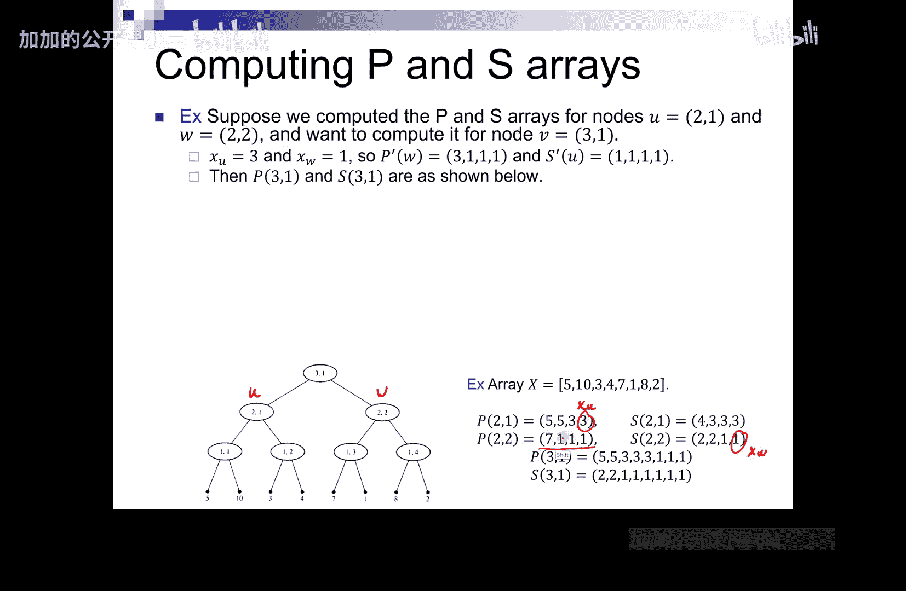
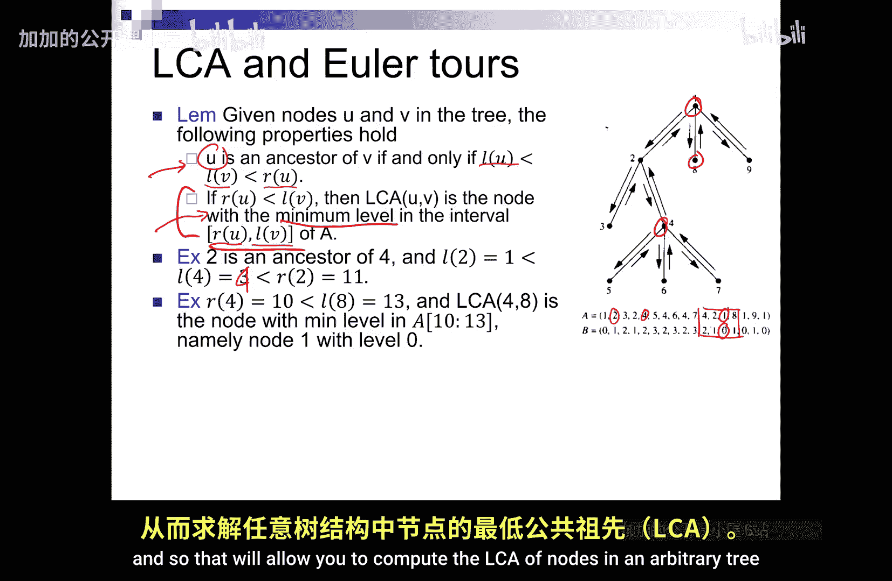

# 上海科技大学【中英⚡并行计算｜CS121 2020 Parallel computing】 p28 P28 PRAM 3 Trees -BV1VqypBaEaP_p28-

Welcome back。So today we're going to look at a number of PM algorithms which work on trees。Okay。

 so before we get started， many of these three algorithms depend on a technique called the Euler tour technique。

So we're first of all， going to introduce what Euler tours are and then see how to construct an oiluler tour in parallel。

Okay， so given a graph， an Euler tour of the graph is a cycle on the graph that goes through every edge of the graph exactly once。

Okay， and it can go through a vertex multiple times， but for each edge。

 it should go through that edge exactly once。So as an example over here。

 so suppose you have the graph on the right， right？And now imagine that for each of these edges。

 this is actually two directed edges okay， so for example， for this edge。

 imagine that we actually have two directed edges like this okay and let's say that we have this for all of these edges。

Okay， so in that case， an oer tour of this graph would be something like this， okay？

So then you can see that you know， as we walk around this graph。

 we are going through every directed edge exactly once。

And we sometimes go through a vertex multiple times， but that's fine。Now。

 there's a famous theorem that says that if we're given a connected directed graph。

 then this graph has an oer tour， if and only if the in degree and out degree of every vertex is equal。

Okay。And so in this case， right， remember that we're going to make an outgoing edge and an incoming edge for each node for each edge Okay。

 so therefore， for each node， the in degree and the out degree are equal right And so by this theorem。

The theorem guarantees that we do have an Euler tour， which is what we found over here。And in fact。

 in general， if you have an undirected graph， then for any edge in that graph。

 you can actually make two directed edges。One in each direction。So if you do this。

 then you guarantee that for every vertex， the in degree and the out degree are equal。

 and so that graph is going to have an euler tour。Okay， now since we're working with trees today。

 we're first of all going to see how we can compute an order tour on a tree。Okay。

 so for example here， you know in this graph， so this is a tree and we computed this Euler tour。

And we're going to see in general how to do this in parallel in constant time， okay。

 so we can actually produce this tour in constant time。

So the way we're going to do this is that every node is going to， first of all。

 so every node is going to look at all its neighbors and it's just going to order the neighbors in some arbitrary order。

Okay， so for example， this node 9 over here， maybe it orders this neighbor one as the first neighbor and then second and then third。

Okay， write that a bit better。Okay， and then this five over here， right， it can order you know。

 maybe this node as the first one and then this one and then this one。Okay。

 so we just start with some arbitrary ordering。Right and next in order to compute this tour。

 so now the tour is actually， it's just a cycle， so it's like a link list except for the link list wraps around on itself。

Okay。So we just need a way to define this linked list。And so in other words。

 we need that for every node， we need to know which other node this node points to。Okay。

 if we know for every node which node it points to， then we've defined a link list。Okay。

 and so we're going to use us， we're trying to simply produce a linked list representation of the Euler tour。

🤧So in order to do that， what we're going to say is that suppose you have a node V and now suppose that on your tour you're coming into V through its I neighbor so remember that V is going to order all of its neighbors okay so let's say that V has a total of d neighbors。

 and if we're coming into V through the I neighbor。

Then the next edge on the tour okay is that we're simply going to leave V through the I plus first neighbor through the next neighbor。

Okay。🤧However， if we're coming into V through the last neighbor， the D minus the D neighbor。

 then we're going to leave through the first neighbor。So in general。

 if we're coming in through the Ith neighbor， we're going to leave through the I plus first modo D neighbor。

So for example， if we let's draw this， okay so if we go into one。

 so one is also going to label all its neighbors okay now one only has a single neighbor okay so this means that if we come into one through the first neighbor。

 we're also going to leave one through the first neighbor okay。Now。

 once we leave one through the first neighbor， then we're coming into nine from its first neighbor。

And so by this rule that we have， right， maybe I should actually draw them in the reverse direction。

 so let's draw them this way。So we're going to go in over here， right。

 then we're going to come into nine through the first neighbor。And by this rule。

 we're going to leave9 through the second neighbor， okay， so we're going to go over here。

Okay and now we're coming into three from the third neighbor。

 so therefore we're going to leave through the next neighbor， which is the first neighbor okay。

And now we're coming into eight through the first neighboror， and so by the rule。

 we're going to leave eight through the second neighboror。Sorry， through its first neighbor。

And so that means that we're going to come into five through the first neighbor and so we're going to leave through the second neighbor。

Okay and now you know for here he could have he might have ordered these notes in some fashion。

 so let's say he did this as well let's say that this is the second neighbor well third neighbor over here let's write this a bit nicer3 okay and then this is the first neighbor and let's say that this is the fourth neighbor and let's say this is the second neighbor okay so in this case you know since we're coming into fourth through the third neighbor we're going to leave through the fourth neighbor okay and then we're going to come back over here right and then we're going to go over here we're going go over here and then we're going to go over here here and so on。

Okay。Yeah， so in this way， we're going to end up forming。

We're implicitly going to create this Eer tour because for every node。

 we know what the next node is on the tour okay， so we form this link list。

 which when you put this link list together gives us an Euler tour。All right。

 and so since you in order to compute this order tour。

 all we need is that we just need to say if you're coming in through the I neighbor。

 you're going out through the next neighbor， right so that's just a constant time operation。

So that means that we can actually compute this oiler tour in constant time。On a tree。Okay。

 so now once we have this technique， we're going to use this technique plus the prefix sum technique。

 and we'll see that we can solve many problems on trees。Okay， now remember that the prefix sum。

 so we actually gave a way to implement the prefix sum when your input is a linked list。

So we did this pointer jumping technique where if you're simply given a link list as an input。

 we can actually compute the prefix sum on that linked list。

And now remember that this Euler tour that we just generated through this technique over here。

 this implicitly gives us a linked list。Okay， so then we can apply the prefix sum technique on the P prefix sum technique on this linked list。

Okay， so now the first problem we're going to solve is that we're going to see how to root a tree。

Okay， so by that， we mean that we're going to pick an arbitrary node as the root for the tree。

And then once you pick that node， then this is going to determine a bunch of parent child relationships。

 right， So for example， if this is of root， right， then this node is going to be the parent of this node。

 right， So we we want two to know that its parent is equal to one。 Okay， Likewise。

 we want three to know that its parent is equal to one right。

 and we want five to know that its parent is2 and so on。Okay。

 so this is what we want to do We're given a tree， right， we can pick an arbitrary root。

But once you pick that route， then this determines all of these parent childil relationships。

 and so we want these nodes to be able to compute who for each node we want it to be able to compute who is its parent。

嗯。Okay， so to do this what we are going to do is assign a weight of one to every edge in this in this graph okay and then we're going to compute an orderer tour so remember that in this tree we're going to imagine that every edge there's actually two directed edges okay one in each direction and so we're actually going to assign a value of one on each of these directed edges okay so it's going to look like like this right。

🤧。and then we're going to compute a prefix sum on this Euler tour。

Okay so we have this order tour given implicitly as a linked list。

 we're going to apply our linked list prefix sum technique and you're going to compute this prefix sum okay and so let me just show you you know what we get when you do that so let's switch to a different color here let's say that we go for blue okay so then if you do the prefix sum this is going to become a one right so this is a two here。

 three，4 right and then five。This is 6，7，8，9， 10， 11， 12， and so on。Okay。

 and now we're going to use these values from the prefix sum in order to determine the parent child relationship。

Okay so what we're going to say is that for each edge UV。

 okay we're going to say that U is the parent of V。

 whatever the prefix sum from UVV is less than the prefix sum from VU。Okay， so as an example of this。

 so let's well， let's go for green now， Okay， so let's switch to yet a different color。

 So let's go for green。 So for example。You know we have let's say this edge okay so here we're going to say that you know this edge is edge12 and we're going to say that edge1 is going to be the the parent of V is going to be the parent of2 because the prefix sum in this direction。

 okay from UV okay is1 whereas the prefix sum value from V U is 12。Okay， and because of this。

 we're going to say that know two's parent is one。Okay，As another example， you know。

 suppose that you have this node okay so then here we have the node going from2 to5 and we're going to say that two is apparent of five because the prefix sum going from2 to five which is equal to three is less than the prefix sum from five to2。

Okay， so yeah， so you can just check that by doing this。

 then every node is going to then for every edge we can determine which direction the parent childil relationship is for that edge。

🤧Okay， so so the entire time that we need to run this algorithm for， so since we can do。

We can do prefix sum in log n time right so this entire path has order n edges in it so we can do prefix sum in log n time and also order end work。

So therefore we can route this tree in order log n time and order and work。Okay。

 so next we're going to look at the problem of for so once we've rooted this tree。

 then that determines the depth of every node。 Okay， so for example， if let's go back to。To red。Okay。

 so if this is the root over here right then these nodes 2，3，4 are at depth 1， right the5，6。

7 are at depth 2 right and then these guys are at depth 3。Okay。

 so now the problem we're given is that for each node， we want to compute its depth in a rooted tree。

Okay， so then what we're going to do is we're first of all。

 going to use the previous routing algorithm to compute in order to root this tree。

 so that every node knows its parent。Okay， so for each node V， let's let P of V be the parent of V。

Okay， and next we're going to set we're again going to put some weights on these edges okay。

 so we're going to set the weight of an edge going from the parent to the child to be one。

And then we're also going to set。The weight of the edge from the child to the parent to be negative one。

🤧Okay， so we're going to do this for every edge。One， negative  one， one， negative  one。

 one negative  one， one negative  one， okay。And then again。

 we're going to compute a prefix sum on this Euler tour。Okay， so then when you do that。

So let's do that， right？What you see is so the value here is this is going to be one right。

 this is going to be two， this is going to be one， two， this is one again right。

 this is going to be two， this is going to be three right then this is going to be2，3，2。

 what this is1 right， and then0， and then1，0，1，0。Okay， so these blue values are the prefix sum。

And now you can see that the depth of a node is simply the prefix sum value on the edge from the parent to the child。

Okay so for example， the depth of this node of node5 is simply the value from the parent of 5。

 which is 2 going to5 and that value is 2 over here。Right， likewise for like， you know， node。

 let's say8 over here， Okay， so it's。Its depth is equal to the prefix sum value going from 7 to 8。

 okay， which is 3。Okay。And the reason this works is simply because you know since we know what the parentchild relationship is then the way that we place these initial values。

 these red values right so every time we go down a level okay so the depth increases。

 we're going to add a one okay so that means that when you compute the prefix sum。

 this is going to increase the value coming to into this node。Okay。

 and then each time you go back up right we are going to we put a negative one。

 and so that means that when you compute the prefix sum。

 you're going to basically undo this step this downward step that you took okay， so when you go down。

 you add a depth of one and when you go back up， you're going to decrease the depth by one。

Okay so therefore when you do the prefix sum， the prefix sum value exactly tells you how many times you've gone down minus how many times you've gone back up。

 and that is equal to the depth。Okay， so then we can do this operation so this basically involves rooting the tree and then computing this second prefix sum here。

 right so both of these operations are going to take log in time and we're going to use order end work in total。

Okay， so the next problem is about computing a post order numbering。Okay。

 so remember that the post order numbering is basically for each node。

 we're going to visit all of its children before we visit that node。Okay， so you know。

 if we so in order to do this， we need to start at a root。 Okay。

 so let's say that well let's switch back to red over here。

So let's say that the root of this tree is going to be one right so then the order that we're going to process these nodes is that we're going to go through all for each node。

 we're going to process its children before we process the node itself。

Okay so therefore if we start at one， we're going to go down to five and then five is going to be the first node that we process Okay so then this guy should get a post order of one and then we go up to back back up to two over here but we're not going process node two。

 we're going to go to its children and so then six is going to be the next node we process and and then we're going to process8 So this guy's going to get a post order number of three and then we do9 so he's4 and then we do seven so he's five。

And so on。 Okay， so then so then here I just listed out what are the post order。

Pos order number is for each of these nodes， Okay， so on top we have the nodes and on the bottom we have its post order number。

Okay， so all right。 And so in order to compute this post order number， again。

 we're going to take this technique of setting。Setting weights on these edges okay and so this time the way we're going to set these weight is that for each node V。

 we're going to set the weight from V to its parent to be1。Okay， so we're going to set， for example。

 these upgoing。Edgets to be once。And then the down edges， right from the parent to the node。

 we're going to set these to be zeros。呃，O。Yeah， and then you're going to compute a prefix sum， okay。

 and when you do this。Yeah， and then we're gonna compute a prefix sum on this。 So all right。

 so let's do this。's switch back to blue over here。 we keep switching back and forth。 So anyways。

 so this is going to be a 0，0。 This is 1，1， This is going to be a two over here，2，2。

 this is going to be a 3，3，4 hoops。4，5。Six and then seven，'s six， and then seven， and then eight。

 okay。Yeah， so that's the entire prefix sum and what we're going to do is we're going to set the post order numbering of each node V to be the pre prefix sum value from V to its parent。

Okay， so for example， for this node over here for five， Okay。

 so the edge from from five to its parent right that's got to prefix sum value of one Okay。

 so then this guy's going to get up a。APo order numbering of one okay and then this guy six right the edge from him to his parent right that's going to be two and so he's going to get a post order of two。

Okay then and then so on， and so you can actually check that， you know。

 this is going to give us the correct post order， okay for all of these node。Okay。

 and the basic reason why this works is because you when you do this Euler tour。

 this in itself sort of follows the post order， the only thing you need to make sure is that when you need to make sure that you're only going to number a node when you've visited all of its children。

Okay， so coming down right as we come down to a node。

 we don't want to number that node yet right it's each time we go up sorry yeah each time we go up go back up to a node through one of its children。

 right we want to increase the post order of this node by one。

Or actually by the number of children that we visited through this path。

 okay we want to increase the post order of this node by that number and so by putting once on all of these up arrows。

 right then this is what we accomplish。Okay， so again。

 the complexity for this is going to be order log n time and order and work。Okay。

 so let's do one more of these so let's compute the number of descendants of a node okay so number of descendants is of a rooted tree so for example。

 you know if we right， so this node one for example， all of these other nodes， two，3。

4 all the way through8 all of these are descendants so then this one node。

 he should output a value of eight because he's got eight descendants。Okay， this node two over here。

 right， he's got one， two， three， four， five descendants， so he should output five。Okay。

 so in order to do this， we're going to compute a prefix sum just like in the post order numbering okay so you know in this post order numbering for these downwards edges。

 we put a weight of zero and then for the up edges， we put a weight of one。

And then the number of descendants of a node is equal to the prefix sum from the node to its parent minus a prefix sum from the parent to the node。

Okay， so for example， if we go over here right so here we actually computed all these prefix sums。

 So if we take yeah， so if we're trying to compute， let's say well。

 let's switch to a green over here okay so。Yeah， so if you want to compute the number of descendants of this node two over here。

 right， then we're going to take the。The value of v to its parent。

 let's see we're going to take the value of v to its parent minus the parent to V okay。

 so v to its parent that's going to be the six value over here right and then parent to V that's going to be0 so then the number of descendants is going to be6。

Okay， so I guess we we need to include the node itself， Okay， so that that。Wai to that。Yeah。Right。

 okay， so if we look at the number of descendants， Yeah， okay， so if we do another example。

 if you take this node3 over here， Okay， so then here you want to take the so it has only one descendant。

 which is itself Okay， and this is equal to the prefix sum value from itself to its parent right minus the prefix sum from the parent to itself Okay。

 so7 minus6 right that gives us that this guy only has one descendant。Okay， so yeah。

 so this is in general how we're going to compute the number of descendants。And again。

 this is going to have the same login time and order end work。🤧All right。

 so we see that by applying this order tour technique and the prefix sum。

 we can actually compute many of these useful properties about the tree。Okay。

 so next we're going to look at another problem， and this is going to be how to evaluate an expression tree。

So an expression tree is basically it's a way to represent a computation so for example here on the right we have this expression tree and this is representing a computation and what is happening over here is that so let's ignore all of these numbers in the parentheses we're just going to focus on the numbers in the big circles and then these operations in the big circles。

So then what this expression tree is saying is that we should add4 and 5， so when you do that。

 then we're going to get a value of 9 over here。And then next we should multiply this9 by 2 Okay so you see that each of these operators right。

 it's got two opera Okay so the two opera are its children and then we just perform that operation on the children and then we get the value for the node so then this node is going to be value 18 and and then this over here is saying that we should add to a negative 5 so then this is going to be a a negative 3 over here this is saying that we should add 18 and negative 3。

 So we get a 15 over here this is saying that we should multiply the 15 by the2 So we're going to get a 30 over here。

 and this is saying that we should add the 30 and the 20 so then we're going to get a 50 over here。

So therefore this entire expression tree represents the value 50 if you evaluate the expression tree。

 you're going to compute the value 50。🤧。Now， we just gave a sequential way of computing this of evaluating this expression tree by going from the leaves upwards。

And so this is if you have end nodes in this tree， then this is going to take you order end time。

So now we're going to look at a way to evaluate the entire expression tree in parallel。

And the main operation we're going to use is this thing called a rake operation。Okay。

 so a rate operation is basically it's a way to take a tree and then make it smaller， okay。

 so we're going to remove some of the nodes from the tree。

And the way this is going to work is that when you rake， you have to pick a node to rake from okay。

 so in this case， for example， we're going to rake from this node1。

And what that involves is that basically we're going to take this node and it's parent and we're just going to remove them。

 okay， so we're going to take these out。And we're going to take the sibling and all of its descendants。

 and we're going to move it to where the parent used to be。Okay。

 so you see that if we're going to rank one。Then we're going to get rid of basically we're going to get rid of one and then get rid of three。

 and then we're going to move two up here okay， so then two is going to point to the four。

So then after you rake， this is the situation that you have。🤧Okay。

 so the way we're going to use this is that。Sorry。We're going to start with the expression tree。

 which has many nodes in it， and then we're going to ra this tree in parallel and each time you rake it。

 the tree is going to get smaller and we're going to keep doing this until we're down to three nodes。

And then also during this ra process， we're somehow going to keep track of the values on these nodes so remember that all of these nodes you know they're going to get values if you evaluate them so we're going to keep track of the values on these nodes as we do the ra process and then eventually when we've contracted everything down to three nodes then we still kept track of all of these values and then you can simply evaluate that three node expression tree and the value you get back is going to be the same as the original value。

🤧Okay， so now first of all， let's talk about how we're going to rate this tree in parallel so if we have many nodes。

 then if we want to rate these node in parallel， we need to make sure that we don't make concurrent changes to the same node。

So for example here when we were ra one we actually had to make some changes to what4 was point to who pointed to4。

 we had to make those changes and so we don't want to make like concurrent changes。

 we don't want to have multiple nodes point to four at the same time in the same parallel step。

So the way we're going to do this is that we're going to rake the tree starting from the bottom and work upwards。

 okay so we're going to focus on the leaves of the tree。

And we' going so we're going to look at all of the leaves in the tree except for the first and last leaf。

Okay， and we're going to call all of those other leaves。 we're going to call that set A。

And now we're just going to label these nodes in a one by one， okay。

 so we're going to give consecutive labels to all of these nodes in A。And by the way。

 all of this can be done in parallel， okay， so we can produce all of these labels in parallel。

And then once we have the labels， let's look at both the notess with the odd labels in A and also the notess with the even labels in A。

And so what we're going to do is we're going to repeat， we're going to perform a number of rounds。

 in fact， log n plus1 rounds， okay， where n is going to be the size of a。And in each of these rounds。

 we're first of all， going to take all of the leaves in a odd， okay， all of these odd leaves。

Such that there are also left children。Okay， so we're not going to take all the odd leaves。

 we're only going to take the odd leaves who are left children。Okay。

 and then we're going to concurrently rake all of them。

Okay and it turns out that you can rake all of these guys who are left children。

 even if you do that concurrently， we're not going to make concurrent changes to the same node。

 okay so we can actually perform all of these rakes concurrently。And then next。

 we're going to take the other leaves in aOD， the odd number leaves。

 but those who are right children， okay， and then we're going to concurrently leave rank all of them。

Okay， and then after that， what we have left are the even nodes。

And then we're now going to set the set A to be these even leaves that we didn't break yet。Okay。

 and then we're going to repeat the process okay so we're going to take now these even leaves。

 we're going to renumber them and then we're going to take the odd ones out of this renumbing。

 which are left children， we're going to rake them。

 and then we're going to rake the odd children who are the odd leaves who are right children and then so on。

Okay。So let's see an example of this process。So here we're going to start with this initial tree。

 and then we're going to label all of the children， sorry all of the leaves。

 except for the first and last leaf。Okay， so therefore we're going to give these labels to these other leaves。

 okay， one， one through seven over here。And now we're going to take all of the leavess with odd labels。

Okay， so that would be the one， the3， the5 and the7。And then we first want to leave。

We first want to rake these。These odd leaves who are left children。Okay。

 so that means that we're only going to rank this node3 over here。And when you ra him。

 then that just means that we're going to take out the node 3 right plus it's parent。

And then we're going to take the sibling of note3 and we're going to put it where its parents used to be okay。

 so we're going to take this part over here and just move it up like that。Okay， and when you do this。

 you're going to get the situation in B。Okay， so next we're going to rake the other odd leaves。

 okay so now these are going to be right children， so we're going to be raking one， five， and seven。

Okay， and so for example， when you break five a 1， okay， then we're going to take out one and nine。

 and you're just going to move eight， replace it by eight。And when you rank  five。

 you're going to take out the five and the 10 and you're going to move4 up。

 and then when you rake  seven， you're going to take out the seven and 11 and move6 up。

And so after doing this， you're going to end up with the situation in C。Okay。

Now once you have the situation， then now the only lease we have left are you know these even number ones。

 so now we're going to renumber them from one to one to three。

And're then we're going to run another round now， and we're going to， first of all。

 take the odd numbered leaves who are left children。But in this case。

 we don't have any odd numbered leaves who are left children。

So the next we're going to take the odd number leaves who are right children。

 so that's going to be one and three over here right and these guys used to be called two and6 okay so we're going to ra them if you ra them you get rid of this and then you get rid of that and then you have the situation in D over here。

And then you're going to the and then you're going to redo this and then now you're just going to rank the note 4 so you're going to get rid of this and then you're going to be left with this situation over here。

Okay so that's the entire raking process and what you can see is that as we do this。

 then nodes which get concurrently raped， they never have the same parent okay because initially we took these odd numberumbed leaves。

 but only the ones who are left children。Okay so if you have two odd numbered leaves where are both left children。

 then they can't have the same parent。Okay， so therefore you can rateke these two guys concurrently。

🤧Okay and each round that we do this raking process。

 we actually remove all of the odd numbered leaves because know if you do this。

 then you're going to get rid of all of these odd numbered leaves and you're only going to be left with the number of even numbered leaves。

So therefore， each raking round is going to remove half of the nodes。Okay， and so therefore。

 if you do this for a you know log n plus one number of rounds。

 then there are only going to be two leaves left。Okay。

 so then we're going to end up with basically this situation over here。Okay。

 so this is how we can concurrently reduce the size of the tree。But as you do this process。

 as you ra all these notes， we need to make sure that we preserve the original value of the expression tree。

And the way we're going to do that is that when you rake a node。

 we're somehow going to take the nodes that we're removing。

 and then we're going to incorporate their values into the nodes that we keep。Okay， so yeah。

 so basically we're going to combine a note that we're going to rake away with its siblings value because we keep it sibling。

Okay， now one problem is that when you so we're going to rape many notes in parallel。

 okay and sometimes when you do this， you could have notes which do not have values yet。Okay。

 so for example， suppose you have a chain graph， Okay。

 so let's say that you have a chain graph looking like this。Okay。

 and now you have a bunch of children， right。Let's say you have a bunch of children like this。

 and then you're going to rake some of these children。 Okay， so maybe like， you know。

 you're going to ra this guy and then this guy and then this guy concurrently。 Okay。

 But the problem is that。You know， as you ra these children。Let's see， well， yeah。

 so some of them might have not have values yet， okay。

 because they're sort of like internal notes that don't have values yet。Okay so then yeah。

 so then we're going to say so in that case， what we're going to do is we're going to assign kind of an abstract label to a node and this abstract label is going to help us keep track of the actual value of the node。

So the label that we're going to assign to a node is just two numbers， okay， so for each node V。

 we're going to assign a label A of V and then B of V。うん。

And then what this A of V and B of V this label represents is that now suppose this node V actually has a numerical value Okay so you know eventually it's going to get some sort of numerical value okay even if we don't know what the value is right now。

 so you know we assume it's just some sort of number X okay。

 but then what this label represents is that。The value。That's a numerical label X。 Okay， yeah。

 so if it's got a numerical label of x， then the actual value of V is going to be A V times x plus B V。

O嗯。Right。Yeah so we're going to assign these labels to nodes and we're going to assign these numerical sorry we're going assign these pair pairwise you know these pairs of labels to nodes and also numerical labels to nodes and what these two things together mean is that the actual numerical value of a node is going to be this Av times x plus BV expression over here。

Okay， so now when you rate a node， okay， when you remove some nodes。

 we need to update these labels in order to preserve the values of the nodes that we took out。

And so in this example over here， suppose that you're raking node a node W OK。

 so we're actually going to ra this node V over here okay。

 so that means that we're going to get rid of all of these nodes over here。Okay， so。

Yeah we're going to get rid of these nodes over here and now suppose that for this node W okay we actually don't know its numerical value yet okay so therefore which' is going to represent represent its value using some sort of X over here。

Okay， so its actual value is going to be equal to AW times x plus bw okay。

 but the problem is that we don't know what x is。and then over here we have another node V that we're going to try to rake and it's got a numerical label of CV and then it's got this pair label of AV BV。

So then what that means is that the actual value of this node is actually going to be equal to Av times CVv plus Bv。

Okay。And now we have another node U over here， and let's say that its label is going to be something like AU and then BU。

🤧Okay so now when you rate node V， what we're going to do is now this thing over here right so this is a multiply。

 so this says that we should be taking whatever value is over here and whatever value is over here and we should multiply them okay and then that is going to give us the value for this node。

And then the actual value thats going give us a numerical label for this node。

 and then the actual value for the node is going to be the label times this AU plus the BU。Okay。

 so in other words， now on the left here， the actual value is going to be A v times v plus Bv okay so it's going to be this thing over here and then we're going to multiply that by the value on the right。

 which is going to be AW times x plus BW Okay so that's the thing on the right。

So that's going to give us this。A numerical label over here。

 but then you need to multiply this by AU and then add BU。O。All right。

 so then we can take this big expression and we're going to simplify it and we're going to pull out all the x all of the terms that involve x okay so we're going to get this term right this involves x and the rest of it is just is just a number over here。

Okay， so x is the only thing that we don't know。so therefore we're going to have this coefficient for x。

 we're going to have this this is going to be now the coefficient for x and then this is going to be the other part that we add in so then now we're going to produce a new node whose numerical label is going to be X and then it so for the pairwise label the a prime part going be is going to be this thing over here。

Okay， and the B prime part is going to be this thing over here。So if we do this， then。

Then we can ensure that the actual numerical value for W is the same after raking as before raking。

Okay， so that way we keep the actual values of all the nodes until eventually we're down to like three nodes and then we can just compute the final value of the expression tree directly。

Okay， so yeah， so then eventually we're going to reduce the tree down to three nodes and this is going to take a log time and then at that point at that point we can directly get the value of the node of this entire tree。

So therefore we can evaluate the tree's value in log n time， right because in log n time。

 you can rake down to three nodes。And then each time you do the raking。

 we need to just compute these new values， but this can be computed in constant time。All right。

 so let's do an example of this。So in this example。

 we're going to be raking some of these notes in parallel。

 okay so the notes that we're raking are going to be denoted by the stars。🤧Okay。

 so when you when you rate this node right， so you're going to take this out and you're going to move the negative5 up Okay so so currently the value is going to be equal to you know。

2 plus negative5， which is negative 3 Now when you rate the node。

 you're going to apply the previous operation and you're going to convert this this five node who currently has a label of 10。

 you're going to convert that to a label of12。And what that means is that the value for this node is equal to1 times negative 5 plus2。

 which is negative 3， so we preserve the value of this node。

Right so next we're going to keep breaking and it turns out that you can rate two these node in parallel okay so you can do this one right so you can get rid of this and then you can do this one also。

Okay， so when you do this。🤧Then here we're supposed to be adding the values of4 and5 right right。

 Okay， and so so this is going to come out to9 right So when you rate this。

 you're actually going convert this to a you're going to change these two labels to this one and5 here Okay so this indicates that this node value is going to be 4 plus1 sorry4 times1 plus 5。

 which is also9。🤧OkayAnd then and then over here， we have a multiply operation。So the yeah。

 so we're going to change the labels。 sorry， we're going to take this out。

 and then we're going to change the label to。Where did this come from Oh， right。

 so we're going to move this guy up Okay， so then the label over here， right。

 which used to be 10 right， but it's but we're supposed to multiply by this value 2 over here。 Okay。

 so we're just going to change this to a2。Okay， so previously we were multiplying you know whatever is on the left with this two here right So now we're just going to change the label of this to a2 Okay。

 so this two indicates that we should multiply whatever value is you know is beneath here。

 We should multiply that by two。Okay， so again， we keep the same value for the overall treat。Okay。

 so the next we're going going to。Rake this node so then here we're multiplying this again。

 we're multiplying the left hand side by this two over here and to do that we're just going to change this thing to a two over here。

Okay， so then we're going to get this situation。And then finally we're going to rake this node over here right and then here we're adding two of these nodes so the and then after you add them。

 you need to multiply this by2 okay so then what we're adding here。

 So this node the value that's being indicated is four times2 plus 10 Okay so this is going to be 18 over here and then this is negative five times1 plus 2 so that's going to be three over here right and so。

What we want to do is。And then we're going to multiply this by。2 yeah。

 so we're going to convert so since we're multiplying this by2 right。

 we're going to convert this to a 4 and 20 okay， so previously we were doing like you know two times 4 plus 10。

 but if you multiply that by two， that means you're going to do four times 4 plus 20。Okay。

 and then you're also going to multiply this so here you have a value of three and you're also going to multiply this by two。

 so then you're going to get a value of six over here。Okay， so altogether we are doing a sorry。

 negative6。Right， yeah， so this is going to be yeah negative negative6 okay yeah。

 so altogether we're doing something like four times 4 plus 20 right minus6 okay。

 so that's equal to four times4 plus plus 14。Okay， so therefore， when you rate this node， right。

 you're going to convert this label over here to this know this4 right and this 14。🤧Okay。

 and then we're left with。Just three nodes over here when and so now we can evaluate this guy directly Okay so when you do this you're going to get you know so this here is going to be  four times 4 plus 14 and then this is going to be 20 times 1 right so which is just 20 right and then if you add these together you get like know 16 plus 14 plus 20 and so this equals 50。

Okay， and this was indeed the original value of this expression tree， right。

 because we saw that you know， this whole thing is equal to 50。Okay。

 so that is the parallel expression tree evaluation algorithm。Okay。

 so we're going to look at one last algorithm， which is lowest common end ancestors。Okay。

 so now the way this is defined is that if you have。If you have two notes in a tree， okay， then。

So for example， I guess we're going to consider arbitrary， yeah。

 so if you take this node and this node， okay， then you know the ancestors of the three are all of these nodes right and the ancestors of the six are all of these nodes。

And the LC or the lowest common ancestor is we're going to look at all of the nodes which are ancestors of both three and6。

 and then you want to find the lowest one of those Okay。

 so we have that four and eight are both ancestors of three and6。

And you want to find the lowest among these two nodes，4 and eight。

 so that's going to be node4 over here。Okay， so it's basically， you know。

 you take two node and then you draw their path up to the root。

And the first place that were these two paths meet。That's going to be the LCCA。Okay。

 and these LCs actually have a lot of applications， so if we can compute these things quickly。

 then we can use them for a bunch of other applications。Okay， so now yeah。

 so today we're going to look at how to compute these things quickly。Yeah。In parallel okay。

 so you know， some other examples are if you take one and five， right。

 their LC is going to be four over here if you take3 and 10 right。

 their LC is just going to be the root node over here， it's going to be eight。Okay， so in fact。

 our goal for this algorithm is that if we're given a tree then we're allowed to preprocess this tree。

 but after the preprocessing， then we're going to be presented with a bunch of queries for LCs okay so we're going to be given pairs of nodes。

 and then you want to find the LCA。And you want to find the LCA very quickly， okay。

 you want to find it in constant time after you've done this preproces。

And so this is the algorithm that we're going to give， okay。

 we're going to show how to preprocess it and then how to answer the LCCA queries after the preprocessing in constant time。

Okay， so we're first of all going to start with some simple cases so the simplest case is that if you have a path graph okay so you know a graph which is just like this then if you want to take the LC of two nodes so if you want to take the LCA of this node and that node right well the LC is just going to be whichever node is higher so for example this node is going to be the LC of these two nodes。

Okay。And so you know we saw some algorithms for labeling the height of a node in。

So we can preprocess this graph so that we label all of the nodes with their heights。

And then after you do that， if you want to get the LCCA， you just return the lower height。

 and so that can be done in constant time。🤧So that's a simple case where we you can do the LC in constant time。

 Another case where you can do the LC in constant time is if you have a complete binary tree Okay and then suppose all of the notes are labeled by their in order numbering Okay。

 so in order means that you。If you have a complete binary。

 you're going to visit the left children first okay and then you visit the node itself and then you visit the right children so that's going to produce the in order numbering Okay so for example。

 in this complete binary tree right or first of all going to visit this leftmost child and then you're going to visit this node itself and then you visit the right node okay and then you go back up to this node you visit it right and then this is going to be 5。

6，7 and so on。🤧Okay， so。We can actually compute this on in order numbering efficiently in the preprocesing step。

 just like we could compute the post order numbering， you can also do the in order numbering。

And okay， so then once we have this， then in order to compute LCs， right。

 So suppose you want to compute the LC of U and V。🤧So first of all。

 we're going to write their labels in binary okay so let's say that u is going to be written like this in binary and then V is going to be written in the same way。

And now U and V are going to differ in some bit。Okay。

 so let's let I be the most significant bit in which they differ。Okay。

And then what we're going to do is， so then the LCA of U andV is going to be all of the bits before the I bit。

Okay， and then we're going to make the I bit one。And then we're going to make the other bits0。Okay。

 so this is some sort of binary number。And the claim is that this is going to be the LCCA of U andV。

So let's do an example of this okay， so suppose we're trying to find the LC of 9 and 13 okay。

 so that's going to be this 12 node over here。Right so we're first of all going to write 9 and 13 in binary and then we're going to look for the most significant bit in which they differ so that's going to be this bit over here。

Right。🤧And then we're going to set all of the bits before that we're going to set all the higher order bits to ones。

 Okay， so we're going to set this bit to a one。 We're going to set the I bit itself to a one。

And then we're going to set the other bits to be zeros。

and the claim is that this is going to be the LC of 9 and 13 and this value is equal to 12。

 so that is indeed the LC。Okay so basically the reason this works is that you know this digit I over here on which U and V differ right so you you know follow some path to go from the root。

 you follow some path to go from the root to U right and then you follow some path to go from from the root to V right And so the first time that this path actually splits right that you know in order to get to U。

 you need to go， let's say left and then to get to V you need to go right right So the first time that this path splits that's exactly at the I bit。

🤧Okay。And then for these lower order bits， so they're not involved in the LCA okay so we just need to get the higher order bits before that path split right and then we need to put a one at the location at the know the bit number I where the path splits and that's going to produce the LCA。

Okay， so therefore all of this can be done in constant time。

 okay because we can write we're going to assume that we can write this binary representation in constant time and then you can find this I bit in constant time and so all of this just takes constant time to do。

🤧Okay， so next we're going to consider the general case where you have an arbitrary tree and we're going to compute the LCA。

 we're going to see how to preprocess this tree so that we can compute the LC in a general tree in constant time。

Okay， so suppose we have suppose the tree has end node okay。

 so first of all were going to we're going to compute an order tour of the tree okay and。Yeah。

 and then so after you have this Euler tour， youre going to compute the we're going to label the nodes by the order of their appearance in the tour。

Okay， so what that means is。So if we take this tree over here and if you compute the order tour。

 which is given by these arrows， then you want to produce a list。

 so this is going to be this list A over here and that's going to list out all of these nodes in the order that they appear。

So for example， one is going to appear first and then we're going to go to two and then three and then we're going to go back to two and then to4。

5 and then back to4 and so on so this list a here is simply writing out this prefix sum I'm sorry this order tour and then you can produce the list a using a prefix on or using pointer jumping so yeah there are different ways that we can produce as a efficiently in log time。

So so we compute this array A over here and then also we're going to compute the array B。

 and so the B is just going to be the depth of all of these nodes okay so for example。

 you know a has a depth of zero okay and then two here it's got a depth of1 so for each time that two appears。

 we're going to just label it with one okay for its depth。

And we saw how we could compute all the depths of all the nodes in log time。

 so we can also produce this array B in log time。🤧O嗯。Right。

 and the sizes of these two arrays is going to be2 n minus1， where n is a number of nodes。🤧Okay。

 so now given a level given a node V。 Okay， we're gonna denote the level of V to be。Yeah。

 so to be the level of V。Yeah， okay， so so the level of V is simply you know。

 like which which depth it is， Okay， And now we're also going to define this value L of V and R of V。

 So this L of V is going to be the index for the first occurrence of V in a。

And RV is going to be the index for the last occurrence。Okay so for example。

 if you look look at node 4 okay so the first time that node 4 appears right the index for this Okay so this is index 0。

1，2，3， so the first time it appears is at index 4 and then the last time that it appears。

 it's over here so then this is like 5，6，7，8，9，10 so so L of4 is going to be the index of the first appearance which is4 and R of4 is going to be the index for the final appearance。

 which is 10。うん。Okay， so how can you compute these L and R values Well。

 we have this lemma that says that the L of v is going to be equal to I if and only if you look in this a array at index I minus1 and the level of that node has to be one less than the level of V itself。

And then R of V is going to be equal to I if and only if if you look at the next node the next index in a。

 if the level of that node is going to be also one less than the level of V。🤧Okay。

 so so let's do some examples for this， so we want to say so we know that El of 4 is equal to 4 okay then what we need is that so then by this lemma。

 if we look at the level of a3。Okay， so A3 here is going to be this node2 over here right。

 so this node2 should have a level which is a one less than the level of4 itself。Okay， and indeed。

 the level of2 right， So this node2 here is at depth 1， okay， whereas node 4 is at depth 2。Okay。

 so the level of two is indeed one less than the level of four。

Okay so the reason this first part is true over here is because you if it's a first appearance of four so if it's the first time that we're coming to4。

 then where are we coming to4 from， we have to be coming from its parent so we have to be coming to4 through the node2。

so therefore， the level or the depth of for's parent is going to be exactly one less than four's depth。

Okay， so that's why we have this part over here。Okay。And likewise。

 you have that R of 4 is going to be equal to 10。 right。 And so by this Lamma。

 this says that if we look at index 11， then this guy should also have a level。

 which is one less than forces level。 Okay， so that means that， you know， if you look at。

This index 10 over here， then if you go look at index 11。

 the level of this so this is going to be no2 over here。

 and that guy's level is indeed one less than force level。Okay。

 and the reason this is true is because if it's the last appearance of four， okay。

 then that means that we're going back from four to its parent。Okay。

 so the next node after four is going to be the parent right if it's a last appearance of four。

Then the next node is going to be fors parent， and so fors parent is going the level of fors parent is going to be one less than a fours level。

Okay， so then using this Lemma， we can actually compute all of these L and V values in parallel in constant time。

Okay， because all you need to do is。🤧We're going to assign one processor for every value in a okay and that processor is just responsible for checking so we assume that we have A and B already computed and we can do that in log time during the preprocessing and once you have this then you can just you can assign one processor for each value in A and that processor can just check this condition right so this condition just involves reading from a and then reading from B so you can get the level values from B and then you read from a and whenever you have this condition then you know that you've computed either L of V or R of V。

Okay， so all this can be done in parallel in constant time。Okay。

 so now once we have these L and R values， then now we can use them to compute the LCCA。Okay。

 so we have this lemma， so the first lemma is so this lemma says that if we have two it's got multiple parts。

 so the first part is saying that if you have two node U and V in the tree。

 then if you is an ancestor of V， then you is an ancestor of V， if and only if。

If you look at the L value of V， this is going to be between the L value of u and the R value of u。

Okay。So all right， so that's one part and the second part of the lema is saying that if you don't have this condition。

 okay， so for example， if R of U is less than L of V。Okay。

 then the LCA of UMV is going to be the node。With the minimum level in this interval， R U to Lv of a。

So remember that RU is an index of a and LV is also an index of a so if RU is less than Lv right。

 then we're going to look at basically a range of a from one index to a higher index。

 and then if you look at the levels of all of these nodes in that interval if you take the minimum level。

 then whichever node has that minimum level， then that is going to be the LCA of U and V。Okay。

 so let's first give some examples to understand this dilemma， so for example。

 you we have that a node2 here is an ancestor of note4。

And you see that the L of 2 so2 first appears in index 1 so L of 2 is equal to1 and then4 first appears at index I guess4 over here so this should be 4 and this four here is less than the final appearance of2 okay so the final appearance of two is over here。

 and this is at index 11。Okay， so now this part of thelemma makes sense because you know。

 if two is an ancestor of four right， then we're first of all going to visit two first before we can visit four so that means that the first visit to two is going to come before the first visit to four。

Okay， and also the final visit to two okay， so when we leave for for the yeah， when you leave for。

 you're going to go back up to2 Okay， so therefore the final visit to two is going to be its going to come after the first visit to4。

Okay， so that's why you have the first part of the dilemma over here。

Now as an example of the second part， we have that if you look at two nodes where r of U is less than L of V okay。

 so for example， R of 4 is going to be equal to 10 okay so if we're looking at nodes 4 and 8 okay so let's see raceless。

 so4 and 8 okay so their LC is actually equal to this node one over here right？

🤧And we have that R of4 is equal to 10， and then the first occurrence of 8 is at index 13 over here。

Okay， so in that case， we have that the LC of 4 and8 is going to be the node with the minimum level in this range from 10 to 13 Okay so the range from 10 to 13 is basically going to be this oops。

It's basically going to be this range over here。Right and then we're looking for the node with the minimum level in this range。

 Okay， so that's going to be this node over here， and this is node number one。Okay。

 so this is saying that the LC of 4 and 8 is going to be node1。

 which has level 0 and indeed node 1 is the LC of 4 and8。🤧うくん。Okay， so。Yeah。

 so now we can use this lemma to find LCAs in constant time， okay。

 because we can first check whether this condition holds， okay， the first part of the lemma。

 we can check whether that condition holds。If the condition holds。

 then the LC of U and V is simply going to be U itself if U is an ancestor of V。

 then U is the LCA of U and V。Okay， and otherwise， if the condition does not hold。

 then we're going to use this part。Okay， now the only difficulty with this part is that what this says is that we need to so we can compute these values on R U and LV。

 right， so we have those values。 Okay， however， now what we need to do is we need to look through this。

This array B within this interval over here， okay between R view and L of V。

 and we need to find what is the minimum level in that interval and then you need to take the corresponding node for that minimum level。

So therefore， you need some way to compute the minimum level in this interval over here。Okay。

 if you can compute that minimum level in constant time。

 then we can compute the LCA in constant time。Okay。

 so the trick is to be able to compute this minimum level。Okay。

 and so now we're going to take this problem and we're going to treat it more abstractly。 Okay。

 so we're just going to phrase this as a problem where we're given some sort of array X。 Okay。

 so in our case the array would be B Okay， but in general。

 you could have an array X and you're provided some interval sorry， you're given some interval IJ。

And now you want to find the minimum value of x within this interval in constant time。Okay。

 and you're allowed to pre processcess x， but after the preprocessing， then for any IJ。

 you have to be able to find the minimum level， the minimum value in constant time。Okay。

 so so now this problem is going to be called the range minima problem okay because we're given a range within x and then you want to find the mini within that the minimum value in that range so again。

 the problem is that we're given an array x of size n and then you're allowed to preprocess x and then after doing this。

 then for any two indices you know within the size of x。

 we need to be able to find the minimum value in that range in constant time。

🤧And this preproces is going to take。Log n parallel time， and it's going to do end log n work。Okay。

 so how do we do this Well， for simplicity， let's assume that n is going to be a power of  two。

So now what we're going to do is to form a complete binary tree with the values of x as the leaves。

 okay， so if this is our x over here， we're going to form so we're assuming that x is a power of 2。

 so we're going to form a complete binary tree on these value x。Values in x。

Okay and then so this is going to have a bunch of internal nodes and we're going so it's going to be convenient to label these internal nodes in this by these HJ values Okay so H is going to be the height of the internal node So for example these nodes over here right they're all at height1 right and then the next layer they're at height2 and then at height 3。

Okay， and then for each layer。We're just going to label so the second coordinate of this J thing over here is just we're going to label these nodes consecutively。

 okay， so this means that we're at layer1 and the first first node okay。

 layer1 second node and so on。Alright， so then we're going to label these nodes。

 And now for each node， we're going to create two arrays。 Okay， the P array and the S array。 Okay。

 so this guy's going to have two arrays。 This guy's going to have two arrays， right。

 So all of these nodes。 Each of these nodes has two arrays。

 Okay and all of these arrays are different。O。嗯。Yeah， let the values of the leaf node。Okay， yeah。

 Now suppose that we're talking about one of these these internal nodes。 Okay。

 now if you look at the subtree from that node， right。

 then let's say that the values in the subte is going to be a subrange of x。 Okay。

 so let's say that the values in that subt are going to start at index P in x and then go up to Q。

Okay， so for example， for this guy， right， we're starting at the first value and going to the fourth value Okay。

 for this guy， we're starting at the third value and going to the fourth value。Okay。

 now what are these P and H sorry P and S arrays， so P stands for prefix Minma。

So what we're going to do is for each of these nodes。

 we're going to look at all of the x values in the subte and p is going to be the prefix minima。

 meaning that so P here is going to be an array so suppose that there are there are going to be  Q minus P nodes oops。

Plus Q Q minus p plus one node。 Okay， so let's call this， I don't know。

 let's call this what do we call this。I've used a bunch of letters。

 so I just want to find a letter I'm not using。 so let's call this let's call this M Okay right。

 so then this P array， this P array and the S array are both going to have size M and what this is going to be is that the k value in this P array for this particular node HJ this is going to be the minimum of the first K values in this X P up to X Q。

Okay， and then so I'll give you an example of this， but let me first define this。

And then for this S array， this， so here we're looking at so when you define this P。

 you're starting at the first value sorry the P value。

 okay and then you're looking towards the right right so you're increasing these things。

 you're increasing the index towards the right， Okay。

 you start at index P and then you look at the first K values starting at index P。

Now S is going to be defined differently， okay， S， we're going to start at index Q。

 and then we're going to look left words。Okay， we're going to look at the previous K values。

And then you want to take the minimum value among those k values， and that's going to be s of HJ。

 the K value of this array SHJ。Okay， so so now let's do some examples just to make this clear Okay。

 so for example， let's look at the P array for node 21 okay， so for node 21。

 we're considering this portion of x because this is the set of x which which is in the subre starting from node 21。

And now in order to form the P array， what we're saying is that the first value in the P array， okay。

 this five， okay， this just comes from， we take this value over here， the five。Okay。

 so the next value is going to be the minimum of these two values of this five and this 10。Okay。

 so that's going to be a five。Okay， so the next value is going to be the minimum of the first three values in in this portion of x。

 okay so it's going to be the minimum of5， 10 and 3， and so that's going to be a three。

And the final value over here is going to be the minimum of the first four values， Okay。

 so that's again going to be a three。🤧O。So that's how we define the P value for I'm sorry the P array for this node 21 now what about the S array okay so for the P array we were looking we were starting at you know the first value over here and we were looking towards the right now for the S array。

 we're going to start at the final value over here and we're going to look towards the left。

And again， we're going to take mins so therefore for the S array。

 the first value is just going to be the minimum of this value， so that's just four。The next value。

 this three over here， is going to be the minimum of the first two values。Okay。

 so that's going to be a three。Okay， the third value over here is going to be the minimum of the first three values right。

 so that's again going to be a  three， and then the final value is going to be the minimum of all four values。

 so that's again going to be a three。Okay。Right so let's just do one more example to make sure this is clear if we want to compute the P and the S arrays for this node22 over here in this case we're going to look at least set of values from x so to compute the P value the P array we're going to start at the7 and we're going to look right words and you keep taking the min so the first time you take the min it's just with the value 7 next time you have the7 and the 1 so the min is going to be the1 and then you have the7。

1 and8 so the min is also going to be the1 and then finally you have 7182 and the min is still1。Okay。

 so so P of 22 is going to be this array and then s of 22 so here we're going to go from the right to the left right so for the first value that's just going to be the two over here and then for the next value it's going to be the min of 2 and 8 so that's again2 for the third value it's going to be the min of 2。

8 and 1 so that's going to be the1 and then it's going to be a1。うん。🤧O， so。

So this is how we define these PNS arrays。And。Okay， so now the claimer said。

 suppose we can compute these P and S arrays。 Okay。

 then we can actually compute the the range minima in constant time。

 So we're going to do some preprocessing in order to compute these P and S arrays for all of these nodes。

 Okay， so here I've listed like the P and S arrays for all of the nodes。Well。

 except for the bottom nodes， but I've listed the PN S arrays for the 31，2，1 and 22 nodes。

 and assuming that we have the PN S arrays for all of the nodes。

 the claim is that we can actually compute the range minima in constant time。

Okay and the reason is that suppose you have an interval IJ and suppose you want to compute the minimum value within that range。

Now， first of all， we're going to compute the LCA of INJ。

Okay but we can do that easily because remember that this tree is a complete binary tree。Okay。

 so we have this algorithm for computing the LC in a complete binary tree and that can be done in constant time okay that was basically just to find the split point between the two nodes right so we have their binary representations and then you look for the first bit where they differ。

Okay， so therefore in this。For I and J， we can compute their LCA okay， and let's call that node V。

Okay， now node V is going to have two children let's call these children U and W for the left and right child of V。

Okay。Okay， so。All right， now x of I is going to be the P node。O。

🤧X of I is going to be the P node counting from the right in the subree rooted at U。 Okay。

 and then x of J。 Oh， okay， right， So then you know we're looking for the for the minimum value within this within this interval from the I value of x to the j value of x now。

Suppose that x of I is actually so we look at this left child of V okay and then if you look at the left child of V and then you take a subree below that left child below you and then let's say that you start counting from the right until you get to X I and let's say that you have to count for P nodes。

Okay so therefore x of I is going to be the P node counting from the right in the subre rooted at U。

Okay， and on the other hand for the XJ we're going to look for that in the W child okay so that's the right child of V right and then for this right child we're going to count from the left and we're going to count for Q nodes until we get to XJ。

Okay， then the claim is at the minimum value in this interval from I to j。

Is going to be the minimum between these two values。 Okay。

 we're going to take the S array from U okay， and you're going to look at the P entry of that S array。

And then you're also going to take the P array from W， and you're going to look at the Qth entry。

And whichever one is smaller， that is going to be the range minimum between I and J。

Okay so that's probably rather confusing so let's just do an example over here。

 so suppose we're trying to find the minimum value between index 2 and5 so index 2 is going to be this value here and then index 5 so 2。

3，4，5 so it's going to be this value over here。This range of values， Okay， so in particular。

 the minimum is actually going to be one。Okay， now so this is the。Yeah。

 so the first thing we're going to do is to find the LC of this node right so this is X I over here and this is Xj okay so we're going to find the LC of these two nodes。

 and that's going to be this node over here。Okay and all right。

 and then now we're going to take the left and right child children of this node。

 okay so the left child is going to be the21 node and so this is going to be the U over here right and then this is going to be the W over here。

Okay。And now we're going to take the。So， you are。🤧Yeah， so， so you。

So U covers this range of values okay， so we're going to take the final value in the range of values in u subte okay。

 so in other words， this four value okay and we're going to keep counting until we get to three。Okay。

 so， so in that case， we need to count for two values。 Okay， so therefore this P here。

 this is going to be。This is going to be 2， okay， so we're going to have a p equals 2 okay because you start counting at  four until you get to the three。

 so that's two values。Okay。And then also we're going to look at node W and we're going to look at the values in its subte。

 which are these values， and then for W going count we're going to count from the left until we get to xj。

Okay， so that so we also are going to count for two values and so we're also going to have that Q here is equal to 2。

Okay and now we're going to look at the S array from node U okay so the S array for node U is going to be this 4333 thing over here and we're going to look at the P array for node W okay so the P array for node W is going to be the 711 here。

And then we're going to look at the。The second entry in so since p equals 2。

 we're going to look at the second entry in this S array。And since Q is equal to also equal to 2。

 we're going to look at the second entry in this P array， so we have the values1 and3。

 and then you take the minimum of that and that is actually the minimum among within this interval from running from three to1 so that is indeed equal to1。

🤧Okay， so so basically the reason this works is because， you know， so we have a node I over here。

 right and。You know， if you have the the S array， Okay。

 so what does the S array tell tell you what the S array tells you that if you start from this node。

 Okay， it tells you like what is the minimum， So as you go start from this node and then you go leftward。

 Okay， what is the minimum value。Okay， so now in our case。

 we found that you had to go for two values before you got to this three。

Okay so that means that the minimum value within this interval over here is going to be three right so you see that the minimum value keeps decreasing as you go leftward right so you know you have 4。

3，33 the values can only decrease。🤧Okay， so the smallest value， basically。

So what we're doing is we're splitting this entire interval from three to one。

 we're splitting that in two halves okay we're asking what is the minimum value in the left half and then what is the minimum value in the right half and then you take the minimum among those two to mini okay and in order to get the minimum within the left half you just have to start at this final node over here and you keep going left and you see what is the minimum value that I can possibly encounter as I go left over here。

Okay， and that's just going to be equal to this SU of2。Okay， and then on the right side over here。

 you're going to the right and then you're asking what is the minimum value I can encounter on the right right so that is going to be Pw of2。

And the minimum of these two is going to be the minimum in this entire interval from three to one。

Okay yeah so thats why this algorithm so that's how we do it and why this is correct and you see that all of this can be done in constant time because given INJ you can compute the LC in constant time and then you just go look in these arrays yeah and you can also figure out these P and Q values in constant time because you know which range of values U and W cover so therefore you can know where the index of P with respect to this set of values。

The index of sorry， the index of I with respect to these values and the index of j with respect to these values okay。

 so then you can get the P and the Q values and then you just go in the array and look it up。Okay。

 so we're almost done here。 So the final thing is that， you know。

 this this algorithm over here assumes that you have the P and the S arrays。 Okay。

 so the final thing is that。How are you going to compute the PD S arrays？

So these we're going to compute from the bottom up，Yeah。

 so from the bottom up we're going to start at the leaves right。

 So the leaf is just a single value of x。 Okay so let's say x of I Okay， so in that case。

 the P and the S arrays are just they're just both x or sorry， X of I。

And now we're going to go from so suppose that you've computed the PNS arrays for two children。

 okay for U and W and let's say that U and W are the left and right child of node V over here。Okay。

 so sorry， this should be W over here。 Okay， so now we're going to compute the。Sorry。

 so now we're going to compute the。呃。We're going to compute the P and V S arrays for node V。

So to do this， let's let x of u be the last value in P of u。

 and then x of w be the last value in S of W。Okay， and then now we're going to form this new。

We're going to form this new array。 Okay， this is called the the P prime array。 Okay。

 so this is for for this no W over here。 So we have U on the left。

 So we have a V and then we have U and then W okay， so。So then so we have this P of U over here。

And then x of u is the last value in here and then we have the S of W array over here。

 and then x of w is the last value in here。So now we're going to form a new array， P prime of W。Okay。

 and the way we're going to do this is we're going to take so we already have P of w。Okay。

 so we're going to take p of w， and we're just going to take every element of P and w and then compare that to x of u。

Okay and we're going to take the element wise minimum of P and sorry， P of w and x of u。Okay。

And then also we're going to compute we're going to create this array S prime of U over here and this is going to be the element wise minimum of S of u right so we have S of u and then we have this P of w over here so we're going take we're going to take these two values and then take their element wise minimum or sorry。

 not this we're going to take these two values。 Okay we're going take their element wise minimum okay and this is going to produce for us this S prime of U over here。

Okay， and then this for this p prime of w， right， we were going to take the element wise minimum of these two values and that's going to lead to this p prime of w over here。

Okay， and then finally we so then we want the P of v value sorry P of V array and the S of V array so the P of V array is just going to be the P of U array so it's going to be this array and concatenated by this array。

Okay， so we're going to take the P of U and the p prime of w and concatenate them。

 okay so just P of U for the first part and then P prime of W is the following part。Okay。

 so that's going to be P of V over here。And then S sub V is going to be the S of W array。

 so it's going to be this array followed by this S prime of U array。🤧Okay， yeah。

So that's the construction so let's give an example of this okay so suppose we've already computed the PN arrays for these two nodes for the 21 node and the22 node and now you want to compute the P PN arrays for this node 31 over here so we're first of all going to take the final value from P of 21 so that's going to be the3 and we're also going to take the final value from S of w which is going to be the one。

Okay， and now we're going to take this right， we're going to take this value， the three。

 and we're going to do the element wise minimum of the three with the W。

 So this is going to be the U over here， and this is the W。 Okay。

 So now we're going to take the element wise So this is x。嗯。X u over here， right， this says X U。

🎼Okay， and then this is X W。 Okay， so we're going to take the element wise minimum of X U with Pw。

 Okay， so that's going to give us So the minimum of 3 and 7 is going to be3 right and then3 and1 is going to be the one so。

Okay， so I'm gonna。Oh，cus。O， right。So the element wise minimum of3 and 7 is going to be the three right and then for the rest of it is going to be the one。

 so therefore the P prime of w is going to be 3111。Okay。

 and then we're also going to take the element wise minimum of this one over here with this S of u。

 okay， so that's going to give us 1，1，11。Okay， so then yeah。 So then that means that the。

The the P array for so the P array over here is going to be this part concatenated by this part okay so it's going to be 55。

3，3 concatenated by 31，11。And then the S array for for the S array for node 31 is going to be this part。

 okay， concatenated by this part， so it's going to be this thing over here。🤧O嗯。

Right and the basic reason why this works is because you know in order to compute the P array for this 31 node。

 what you want is well for so this 31 node covers all of these nodes well now the P array for this 31 node for this part of the values well that's simply equal to P of 21。

However， once you get into the right hand side， right。

 then what is the minimum what the minimum is going to be whatever so this final value， sorry。

 this final value over here， the three， okay， that is the minimum value in the entire left half over here。

So therefore， if you want the minimum value in the right half in both the left and the right half。

 you're going to have to take the minimum value from the left half and you have to compare it against all of these elements from the right half。

Okay， so for example， when you're up to the seven part， okay。

 the minimum value from the five to the7 is still going to be the three。Okay，However。

 once you get to the one part right， then the minimum value from5 to the one is now going to be the minimum from the left part。

 which is three and one okay so that's going to be equal to one。Okay， so that sort of explains why。

Why you have this P of three， how you form the P of 31 and the idea for the S of 31 is the same thing。

Okay so the final thing to do is we're going to look at the time complexity for all this。

 so if you have a tree with n leaves okay then the claim is that all of these PN S arrays for this entire tree can be computed in log and parallel time and n log n parallel work。

 okay total work。And the reason is that。🤧Right， so so we're going to go from the bottom up， right。

 So then given。Yeah， given so if we're at a node， then if we know the P and the S arrays for its children。

 then we can compute the PN S arrays at that node itself in constant time。Okay。

 and if these two children have a total size of k， then the amount of work is going to be order K。

Right， so it's constant time because oops。啊。Yeah， because if you look at all of these computations all of these things can be computed in constant time and then here where you form the elementwise minimum well we assume that we have one processor per value of P of w okay so therefore you can compute all of these elementwise minimum in constant time and you can compute this as prime also in constant time and this concatenation since you have one processor per element of UNW。

 you can also do this in constant time so everything is doable in constant time but the amount of work is simply equal to the length of these arrays。

Okay， so that's going to be order K work。So that means that if you look at each layer， okay。

 the total amount of work for that layer is going to be order N。Because for each node in that layer。

 the amount of work for that node is going to be order K where k is equal to the number of nodes in its sub。

 number of values of x in its subre。so if you add together all of the nodes in a layer。

 then there are n values in the subtes that they all cover。

 and so the amount of work is going to be n order n。Okay。

 so each layer can be computed in order one time in order and work， and you have log n layers。

 and so therefore we get this theorem。Okay， so yeah。

 and it turns out that the amount of work can actually be reduced to linear okay。

 if you use a cascading。Okay， but basically so what we've done is we've shown how to compute our range minima。

 Okay， And once you have range minima， then we can apply this to compute LC。 Okay， so if we go back。

So we dont have to go back quite far but。啊， oops。Yeah， but anyways， if you can compute the。

Okay so the eraser doesn't work anymore， but if you can compute the range minima， okay。

 then you can apply the second part of this， and so that will allow you to compute the LCA of node in an arbitrary tree。

