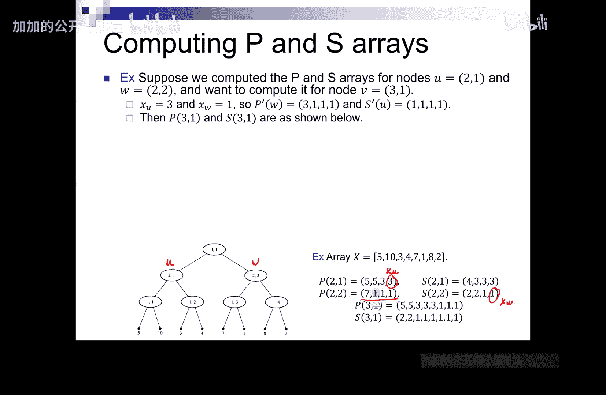
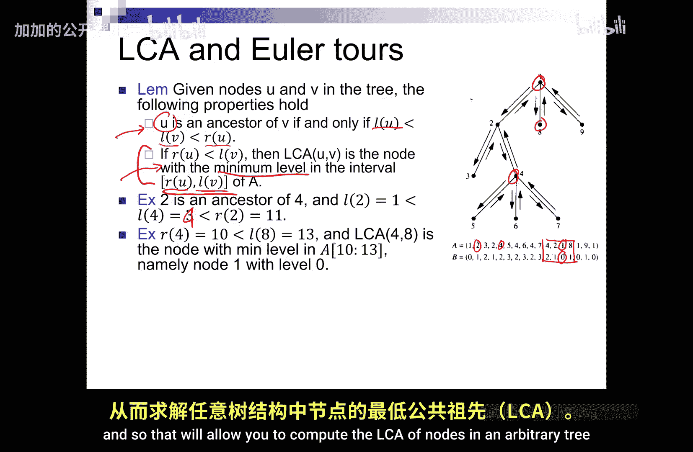

# 并行计算：P28：树上的PRAM算法

## 概述
在本节课中，我们将学习一系列在树结构上运行的并行随机存取机器（PRAM）算法。这些算法主要依赖于两种关键技术：欧拉回路技术和前缀和计算。我们将首先介绍欧拉回路的概念及其并行构造方法，然后利用这些技术解决树上的多个基本问题，包括树的定根、节点深度计算、后序遍历编号、子树大小计算、表达式树求值以及最近公共祖先（LCA）查询。这些算法旨在实现高效的时间复杂度（通常为O(log n)）和线性工作量。

## 欧拉回路技术

上一节我们介绍了本课程将涵盖的算法主题，本节中我们来看看第一个核心技术：欧拉回路。

给定一个图，该图的一个欧拉回路是指一个经过图中每条边恰好一次的环。一个顶点可以被访问多次，但每条边只能经过一次。

例如，对于右侧的图，假设每条无向边实际上由两条方向相反的有向边组成。那么，该图的一个欧拉回路可以如图所示。在遍历这个回路时，我们恰好经过每条有向边一次。

一个著名的定理指出：对于一个连通有向图，当且仅当每个顶点的入度等于出度时，该图存在欧拉回路。在我们处理的无向树中，我们将每条边替换为两条有向边，这保证了每个顶点的入度等于出度，因此树必然存在欧拉回路。

现在，我们关注如何在树上并行地构造欧拉回路。目标是实现常数时间复杂度。

构造方法如下：
1.  每个节点将其所有邻居按任意顺序排序。
2.  欧拉回路本质上是一个循环链表。我们需要为每个节点确定其在回路中的下一个节点。
3.  规则是：假设节点V有d个邻居。如果我们通过第i个邻居进入节点V，那么我们将通过第(i+1) mod d个邻居离开节点V。

例如，考虑节点9。假设它按顺序将邻居排序为[1, 3, 5]。如果我们通过第一个邻居（节点1）进入节点9，那么我们将通过第二个邻居（节点3）离开节点9。如果我们通过最后一个邻居（节点5）进入节点9，那么我们将通过第一个邻居（节点1）离开节点9。

通过为每个节点应用此规则，我们可以隐式地定义一个链表。这个链表连接起来就形成了树的欧拉回路。由于每个节点只需根据其邻居顺序执行一次常数时间操作，因此可以在常数时间内并行构造欧拉回路。

一旦我们有了这个隐式的链表表示，就可以对其应用链表上的前缀和算法（例如指针跳跃技术）。结合欧拉回路和前缀和，我们可以解决许多树上的问题。

## 树的定根

上一节我们介绍了如何构造欧拉回路，本节中我们来看看如何利用它来为树指定一个根节点。

给定一棵树，我们想要任意选择一个节点作为根。一旦根被确定，就会定义出一系列的父子关系。例如，如果节点1是根，那么节点2和节点3的父节点就是节点1。我们的目标是让每个节点计算出自己的父节点。

算法步骤如下：
1.  为图中的每条有向边分配权重1。也就是说，每条无向边对应的两条有向边权重均为1。
2.  在构造出的欧拉回路上计算前缀和。
3.  对于每条边(U, V)，如果从U到V方向的前缀和值小于从V到U方向的前缀和值，则判定U是V的父节点。

以下是一个具体的例子：
*   考虑边(1,2)。从1到2的前缀和值为1，从2到1的前缀和值为12。因为1 < 12，所以我们判定节点1是节点2的父节点。
*   考虑边(2,5)。从2到5的前缀和值为3，从5到2的前缀和值为10。因为3 < 10，所以我们判定节点2是节点5的父节点。

通过检查每条边，我们可以为所有节点确定父子关系。

由于欧拉回路的构造是常数时间，而前缀和计算可以在O(log n)时间内完成（其中n是边数），且总工作量为O(n)，因此整个定根算法可以在O(log n)时间和O(n)工作量内完成。

## 计算节点深度

在将树定根之后，每个节点就有了确定的深度。例如，根节点深度为0，其子节点深度为1，以此类推。现在，我们希望每个节点能计算出自己的深度。

算法步骤如下：
1.  首先使用之前的算法为树定根，使每个节点知道其父节点P(V)。
2.  为边分配新的权重：
    *   从父节点指向子节点的边，权重设为+1。
    *   从子节点指向父节点的边，权重设为-1。
3.  在得到的欧拉回路上计算前缀和。
4.  对于节点V，其深度等于从父节点P(V)到V这条边上的前缀和值。

原理如下：在欧拉回路中，每次沿着向下的边（权重+1）移动，深度增加1；每次沿着向上的边（权重-1）移动，深度减少1。因此，从根节点开始累积的前缀和，在到达节点V时，恰好等于从根到V的路径上向下移动的次数减去向上移动的次数，即节点V的深度。

该算法同样需要O(log n)时间和O(n)工作量。

## 计算后序遍历编号

后序遍历的顺序是：对于一个节点，先访问其所有子节点，然后再访问该节点本身。我们希望为每个节点计算其后序遍历编号。

算法步骤如下：
1.  为边分配权重：
    *   从子节点指向父节点的边（向上边），权重设为+1。
    *   从父节点指向子节点的边（向下边），权重设为0。
2.  在欧拉回路上计算前缀和。
3.  节点V的后序遍历编号等于从V到其父节点P(V)这条边上的前缀和值。

这个方法的原理是：在欧拉回路中，每次从一个子节点返回到其父节点时（经过一条权重为1的向上边），意味着我们完成了对该子节点及其后代的访问。因此，累积的权重（前缀和）恰好反映了在访问当前节点之前，已经访问过的节点数量（即其后序遍历编号）。

该算法的时间和工作量复杂度与前两个算法相同。

## 计算子树大小

对于一棵有根树，节点V的子树大小是指以V为根的子树中包含的节点总数（包括V自身）。例如，根节点的子树大小就是整棵树的节点数。

算法步骤如下：
1.  使用与计算后序遍历编号完全相同的权重分配和前缀和计算。
2.  节点V的子树大小等于 `[从V到其父节点的前缀和值] - [从其父节点到V的前缀和值]`。

以下通过例子验证：
*   要计算节点2的子树大小。从2到其父节点1的前缀和值为6，从1到2的前缀和值为0。因此子树大小为6 - 0 = 6。
*   要计算节点3的子树大小。从3到其父节点1的前缀和值为7，从1到3的前缀和值为6。因此子树大小为7 - 6 = 1。

该算法同样在O(log n)时间和O(n)工作量内完成。

## 表达式树求值

表达式树是一种表示算术表达式的二叉树结构。其中，叶子节点是操作数，内部节点是运算符（如+、-、*）。我们需要并行地求值整个表达式树。

### 基本思路与Rake操作
顺序求值是从叶子节点向上计算，需要O(n)时间。并行算法使用一种称为“Rake”（梳理）的操作来逐步收缩树。

Rake操作针对一个节点进行：
1.  移除该节点及其父节点。
2.  将该节点的兄弟节点及其整个子树移动到原父节点的位置。

通过并行地对多个叶子节点执行Rake操作，可以快速减小树的规模。但必须确保并发的Rake操作不会修改同一个节点。策略是从树的底部开始，分批处理叶子节点。

### 并行Rake过程
1.  标记所有叶子节点（除了第一个和最后一个），记为集合A。
2.  为A中的叶子节点连续编号（1, 2, 3, ...）。
3.  进行多轮处理，每轮：
    a. 找出A中编号为奇数的叶子节点。
    b. 先并行地Rake那些是“左孩子”的奇数编号叶子节点。
    c. 再并行地Rake那些是“右孩子”的奇数编号叶子节点。
    d. 经过一轮后，所有奇数编号的叶子被移除。剩余的是偶数编号叶子，重新为它们编号（1, 2, ...），并更新集合A。
4.  重复上述步骤，直到树被收缩到只剩3个节点。

由于每轮移除约一半的叶子，所以总共需要O(log n)轮。

### 保持表达式值
在Rake过程中，我们需要保证收缩后的树与原始树的表达式值等价。为此，我们为每个节点V维护一个标签 `(A_V, B_V)` 和一个数值 `X_V`。节点的实际值计算为 `A_V * X_V + B_V`。

当Rake一个节点时（例如，移除节点V及其父节点，提升其兄弟节点U），我们需要根据被移除节点的运算符和值，更新保留节点U的标签`(A_U, B_U)`，使得新树中对应位置的值与旧树相等。这个更新涉及常数时间的算术运算。

### 算法复杂度
通过O(log n)轮的并行Rake，并将树收缩至3个节点，最后直接计算这3个节点的值即可得到原表达式树的值。每轮Rake和标签更新都是常数时间，因此总时间复杂度为O(log n)，总工作量为O(n)。

## 最近公共祖先（LCA）

最近公共祖先问题是指：给定树中的两个节点U和V，找出深度最大的、同时是U和V祖先的节点。LCA有许多应用。

我们的目标是：允许对树进行预处理，预处理后，对于任意查询(U, V)，能够在常数时间内回答它们的LCA。

### 简单情况
1.  **路径图**：如果树是一条链，那么两个节点的LCA就是深度较小的那个节点。我们可以预处理所有节点的深度（O(log n)时间），查询时比较深度即可（常数时间）。
2.  **完全二叉树**：如果树是完全二叉树，并且节点按中序遍历编号。设U和V的二进制编号从最高位开始第一个不同的位是第i位。那么它们的LCA的编号是：保留U和V在第i位之前的高位，第i位置1，后面的位置0。这也可以在常数时间内计算。

### 一般树的LCA算法
对于任意树，我们使用欧拉回路技术进行预处理。

1.  **预处理**：
    a. 构造树的欧拉回路，得到一个节点访问序列数组`A`（长度为`2n-1`）。
    b. 计算一个深度数组`B`，其中`B[i]`是`A[i]`节点的深度。
    c. 对于每个节点V，计算其第一次和最后一次出现在`A`中的索引`L[V]`和`R[V]`。这可以利用一个引理在常数时间内并行完成：`L[V]=i` 当且仅当 `B[i-1] = B[i] - 1`；`R[V]=i` 当且仅当 `B[i+1] = B[i] - 1`。

2.  **查询**：
    有一个关键引理：
    *   如果U是V的祖先，当且仅当 `L[U] ≤ L[V] ≤ R[U]`。此时LCA(U, V) = U。
    *   否则（假设`R[U] < L[V]`），那么LCA(U, V)是数组`B`在区间`[R[U], L[V]]`内具有最小深度值的节点所对应的`A`中的节点。

    因此，查询的关键转化为：**在数组`B`的任意区间`[i, j]`内，快速找到最小值的索引**。这是一个区间最小值查询（Range Minimum Query, RMQ）问题。

### 区间最小值查询（RMQ）
我们希望在预处理数组`X`（此处即深度数组`B`）后，能在常数时间内回答任何区间`[i, j]`的最小值。

**预处理（O(log n)时间，O(n log n)工作量）**：
1.  假设`n`是2的幂。构建一棵以`X`为叶子节点的完全二叉树。
2.  对于树中的每个内部节点`(H,J)`，它代表`X`的一个子区间`[p, q]`。我们为该节点计算两个数组：
    *   `P[H,J]`（前缀最小值数组）：`P[H,J][k] = min{X[p], X[p+1], ..., X[p+k-1]}`
    *   `S[H,J]`（后缀最小值数组）：`S[H,J][k] = min{X[q], X[q-1], ..., X[q-k+1]}`
3.  这些数组可以从叶子节点开始自底向上合并计算。合并两个子节点的数组只需要常数时间（通过元素取最小值操作）。总共有O(log n)层，每层总工作量为O(n)，因此总预处理时间为O(log n)，总工作量为O(n log n)（可优化至O(n)）。

**查询（常数时间）**：
对于查询区间`[i, j]`：
1.  在完全二叉树中找到代表叶子`i`和`j`的节点的LCA节点`V`。设`V`的左孩子为`U`，右孩子为`W`。
2.  确定`i`在`U`所代表区间内的相对位置（从右往左数第`p`个），以及`j`在`W`所代表区间内的相对位置（从左往右数第`q`个）。
3.  区间`[i, j]`的最小值就是 `min{ S[U][p], P[W][q] }`。
由于完全二叉树的LCA、相对位置计算以及数组查找都是常数时间操作，因此RMQ查询是常数时间。

### LCA算法复杂度总结
*   **预处理**：构造欧拉回路和深度数组需要O(log n)时间。计算`L`和`R`数组需要常数时间。RMQ预处理需要O(log n)时间。总预处理时间为O(log n)。
*   **查询**：根据引理，一次查询需要常数次比较和一次RMQ查询，因此是常数时间。

## 总结
本节课中我们一起学习了多种在树结构上高效的PRAM算法。我们从**欧拉回路技术**及其常数时间构造方法出发，结合**前缀和计算**，解决了**树的定根**、**节点深度计算**、**后序遍历编号**和**子树大小计算**等问题，这些算法均能在O(log n)时间和O(n)工作量内完成。

接着，我们探讨了更复杂的**表达式树求值**问题，引入了**Rake操作**来并行收缩树，并通过维护节点标签来保持表达式值，最终在O(log n)时间内完成求值。

最后，我们研究了**最近公共祖先（LCA）**问题。通过将LCA查询转化为欧拉回路序列上的**区间最小值查询（RMQ）**，并利用完全二叉树结构在常数时间内回答RMQ，我们实现了在O(log n)预处理时间后，常数时间内回答任意LCA查询的算法。

这些算法展示了并行计算中如何利用简单的基础操作（如指针跳跃、前缀和）和巧妙的数据结构转换来解决复杂的图论问题。