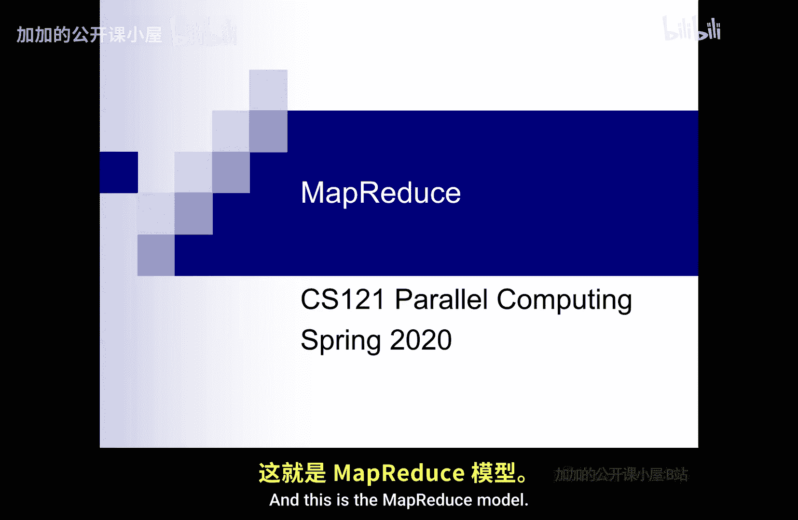
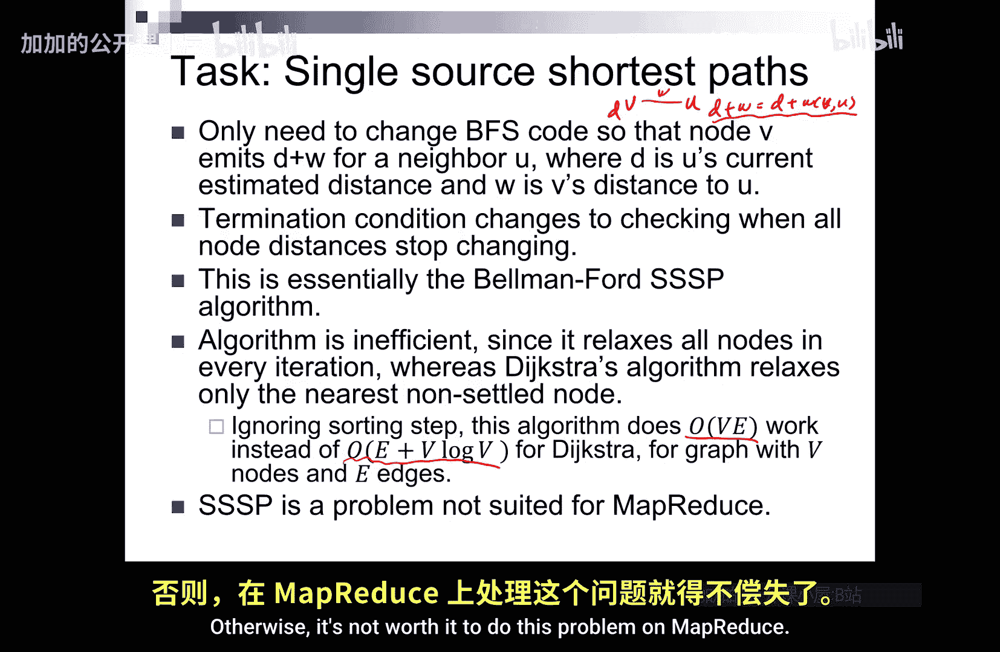
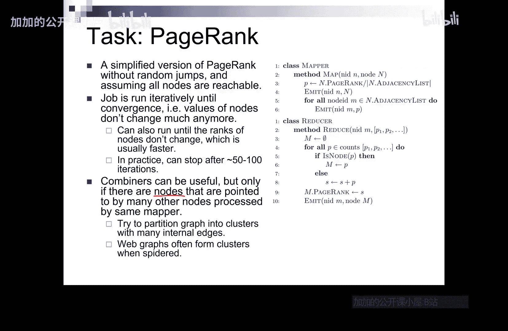

# 上海科技大学【中英⚡并行计算｜CS121 2020 Parallel computing】 p29 P29 Mapreduce -BV1VqypBaEaP_p29-

Welcome back。So today we're going to talk about a new model for parallel computing。

 which has become quite popular in recent years， and this is the map produceuce model。

So to start out， let me give some background about the motivation for map produce。

So you can think of Mareduce as a parallel programming model that focused more on data than computation。

And also， it's very focused on achieving low cost and high scalability。So basically。

 Mareduce was motivated by the explosion of the internet about 20 years ago。

And so the types of data that map produceduce is intended to process a lot of that comes from the internet and also from the data that users of the internet generate okay so this includes things like web pages themselves it also includes information about users of these web pages it includes image data。

 video data that are produced but in addition to this you can also use mapproduce for other types of data processing so for example。

 for traditional scientific computations of let's say physical data or biological data。

OkayAnd so the idea for processing all this data is this sort of new method for doing science that's been proposed in recent years。

 which is a so-called fourth paradigm of science where supposedly if you want to solve a scientific problem or even some sort of financial or social problem if you're talking about the internet or things like that you're going to so the traditional traditional way of solving these problems was to collect。

 let's say a small bit of data and then using that data。

 you're going to generate a bunch of hypotheses and then you're going to construct sophisticated models of how your system operates based on these hypotheses and the limited data that you have and then after that you're going to go validate your model by collecting some more data so it's driven primarily by by the model construction step Of course you need the data to。

y model construction but the heart of the traditional way of doing science was to construct these models and this is a manual process which is done by scientists and which is done by thinking very hard about your problem and trying to get some insights。

OkayWell the new way of doing science， the so-cal data science method of doing science is to just sort of basically ignore the model construction step and to just collect as much data as possible and then throw all that data into some sort of algorithm and you want just the algorithm to look for any patterns that it can and then so the algorithm spits out a bunch of patterns that it detected and then somebody else is going to go through these patterns and then maybe throw away the unreasonable ones and so for the patterns that they keep hopefully one of them is actually the correct answer for your problem hopefully that gives you a way to model your problem and to solve your problem。

Okay so it's almost like you know if Newton wanted to discover his know loss of gravity and loss of motion so instead of like sort of thinking about this problem and making some observations and trying to validate his theories with the observations instead suppose that Newton just took like you know a million things and then put like you know motion sensors on these things okay and then he just collected like you know huge huge amounts of data and then from that data he throws out that data into like a machine learning algorithm and then out comes a bunch of possible theories for how objects move right and then he somehow you know goes through all of these theories and then filters out the completely nonrealistic ones and then what's left is hopefully his actual theories of motion。

Okay， so that would be how this so called data science paradigm would try to solve scientific problems。

Okay， so， you know， you can argue whether this is a good approach or not。

 but this is this seems to be the main approach that people are taking。

 especially towards processing these sort of you know sort of not really scientific types of data like sort of web data and you know user data We don't really have any good scientific theories for you know how people behave and so basically all you can do in that circumstance is perhaps construct these sort of statistical and these。

You know， these data driven type of models for user behavior。Okay， so anyways。

 so that is sort of the basic setting from which map produce this framework of map produce arose。

Okay， now the other aspect to map produceduce is that you know。

 they're very focused on cost and scale okay， so in fact， map produceduce。

 when you build a map produceduce system， you want to make it very cheap。

 but you want to have lots of computing power within that system。

And so the way to do that is to scale the system out instead of scaling it up so what that means is when you scale out。

 you're just going to buy a lot of computers and they can be like pretty cheap computers so they're not very powerful computers and then you're going connect them through some sort of communication network but that network itself can also be quite you know not very powerful just some sort of cheap simple network but just the fact that you have thousands or tens of thousands of these computers。

 know gives you a lot of computing power of course you can't do too much communication between these computers because your network is rather weak but if you have a problem which is not very communication intensive。

 then you can actually solve that reasonably efficiently on this computer。

And all of this is very cheap because you can just buy cheap computers and cheap networking then and all of this is sort of commodity you can just go to a store and buy this stuff as opposed to designing so the other way of building a very powerful computer would be to scale up the computer so scale up the computer means that you design very high quality components right so for example。

 you have very fast processors， you have the fast interconnect between the processors so that would be like a supercomputer right whereas the scale out approach would be like a data center。

Okay， so MacRduce was designed for data centers as opposed to supercomputers。Okay， so yeah。

 so mapreuce ties very well ties in very well with cloud computing， right， which， of course。

 is being done on data centers。 Okay， and then yeah， so， so you know。

 these clouds are basically you know， thousands and thousands of these commodity processors which are tied together by。

 you know， some sort of simple networking Okay， and then the mapreuce can。It will create many。

 many jobs and it will manage how it will schedule these jobs on all of these different computers。

Okay so mapreuce originally was developed by Google and they were trying to solve pretty simple problems back then。

 So in fact， it was intended just to solve some sort of text processing problems some very simple text processing problems and so they just sort of coded up a system to solve this problem and somehow the system sort of grew in popularity I guess because people found that many of the problems that you need to deal with in the internet setting so if you're running some sort of internet company many of the problems that you're trying to solve are not very complicated but they require large scale because you have huge amounts of this data so for example you could have user logs so you want to make sure that your users keep coming to your website so in that case all you need to do is just go through the logs and check that for each user let's say they log into your website every day or something like that。

Okay， they start they don't come to your website anymore then you need to change something about your website to get them to come back Okay。

 so the processing that you're doing on these user logs is very simple Okay。

 you just check that you know every single day you have you know all your users coming back。However。

 you need to do this at massive scale， okay because you could have like millions and millions of users right and then over many days your logs can be terabytes in size。

Okay， so you want to do some simple computation， but you want to do it on huge amounts of data Okay so Google wanted to do this at some point and it turned out that many other internet companies also wanted to do this type of data processing。

 and so this is how map produceuce sort of grew in popularity。

And eventually this so Maproduce is proprietary to Google so they don't really share how they implement that system。

 but because other people wanted to have the functionality of Maproduce。

 then later there was an open source version of Maproduce called Hadoop which was developed so Hadoop basically does the same thing as Maproduce and it does it in basically the same way。

 but its open source。Okay and as I said， mapRduce is actually very popular in industry。

 and just because many types of industrial applications fit well within this map produceuce model of simple computation on large amounts of data。

And nowadays， there are also in academia， people are also sort of applying this data science paradigm and so map producer is also used in academic settings for data processing。

Okay， so before we talk about how the mapRuce system is actually designed。

 let's talk about some of the factors that influences design so yeah so it's designed was based on certain assumptions about where you're going to run these map producedduce jobs and what types of jobs you have。

Okay， so the first assumption is that the hardware environment that you're going to be dealing with within this hardware environment。

 you're frequently going to have failures of components of your system。

And this is because MaRduce was designed for these data centers which have tens of thousands of servers。

 and then these servers can actually so if you have tens of thousands of servers。

 then even if the individual servers are quite reliable。

 it's still quite likely that at any point in time， you have some servers which have failed。Okay。

 so yeah， so therefore map produceuce was designed so that you can actually deal with having faulty components。

Okay another part of mappros design is that since we're mostly focused on processing data right so the computation is rather simple and it's mostly the data that we care about and in fact sometimes you could have very large amounts of data but all you need to do with this data is to just sort of go through this data once so you can stream the data once and then that might be enough for you to do your computation so in that case what makes sense is to just so originally the data is sitting on these different computers so suppose that the data has been partition among the computers so they're sitting let's say within the hard disks of the different computers。

So now since all we want to do is just to scan through this data once。

 because many macroview jobs simply need to just scan through this data a single time or a few times。

In that case， it doesn't make sense to move this data around okay it's much better just to keep the data where it is okay so if the data is sitting in the hard disk of some computer。

 then we're not going to ask that computer to transmit the data to somewhere else okay instead if we need to do a computation on that data。

 we're just going to send the computation to that computer。

So that computation is just a small piece of code。 So we're just going to send that small piece of code to that computer。

And then that computer can run the code on its data。

 and it never needs to move that data to another computer， so it doesn't need to incur the code。🤧う。う。

Oh I'm sorry about that yeah， so that computer doesn't need to move its data。

 so it doesn't need to incur the cost of communication。Okay。All right。

 another part of MacRuce's design is that we oftentimes we only require sequential access to the data。

 okay， we don't need random data aes。So for example， as you're scanning through the data。

 computation， the computation that you're doing， the only data it needs is the data from。

 let's say a single computer， okay， so it needs to access like a chunk of data from that single computer。

This is in contrast to if you need to have random data access。

 then perhaps in order to do your computation， you need data from multiple computers okay in that case。

 you do need to have communication between these different computers。However。

 because mappros oftentimes focus on these types of computations where you only need sequential data access。

 then you don't need communication between these different computers。

And this is good because MaRduce is usually running on these systems where the communication network is not very powerful okay so if you needed lots of communication。

 then mapreduce would be very inefficient。Yeah， but by focusing on the right types of jobs。

 the map produce can still be quite efficient。Okay， and lastly， Mad focuses on scalability。

 so basically in Mared， you want to achieve something like linear scaling。

So if you double your number of processors， you want to go twice as fast or process twice as much data in the same amount of time。

And this is oftentimes possible because for mapre jobs， you usually don't have much overhead。

 so the main overhead would be communication， but as we said in Mare jobs。

 mapre jobs typically don't have lots of communication。

And if you have a job which does have a lot of communication。

 then probably you should not run that in Ma reviewsview。Okay。

 so the upshot is that there are certain algorithms which run very well in Mareduce and we'll see some of them today。

 but there are definitely lots of other algorithms which do not run well in Mareduce okay these algorithms would be any algorithm which requires doing many。

 many computation steps okay that's not going to run well in Mareduce because Mareduce is basically designed for these jobs where you can finish the entire computation in like a small let's say constant number of timets。

Okay， so。Yeah， and also jobs that have lots of communication are not going to run well in Mareuce。

Okay， so that's the basic philosophy behind mapproduce's design。

 so now let's actually talk about what this map produceuce model is。

So map produce is based on a data structure， a simple data structure， which is key value pairs。

So everything in Mare basically boils down to somehow processing these key value pairs okay。

 so a key value pair is simply well it's a pair okay and the first component of that pair is a key and then the second component is a value associated with the key。

OkayAnd so here the keys can be like for example， numbers like integers or floats or strings or anything which so the key is used to refer to the value okay so for example。

 the key can be like a person's name okay and then the value can be some information about that person so we're using the person's name to refer to information about him。

 the key can also be like an integer， so for example。

 this can be the person's some sort of ID for the person。

 okay so you can refer to the person through his ID instead of his name also。

And then the values can be arbitrary， okay， so they're just some sort of information that we're trying to keep track of so they can be sort of like you know tuples so if we're talking about a person's information we can have you know his age。

 his address， his other types of information so those can all be values associated with that key。

Yeah， and so we can have arbitrary data structures as the as the values。

And all of the computation of mapreduce is based on these key value pairs， as we'll see， okay。

 so somehow we even if we start with some sort of data which is not necessarily expressed in terms of key value pairs。

 we're going to convert those that data into these key value pairs so that we can process it。

 if we want to use mapreduce。Al right， so as an example of this suppose we're trying to process a set of web pages okay so we need to somehow represent these web pages as key value pairs and one way to do that is the keys can be the URLs of the web pages right so that's like an identifier for the web page。

And then the value can simply be the content for the webage。🤧Okay， another example is。

If we want to process a graph， okay， so graphs are usually expressed in terms of adjacency lists or adjacency matrices or something like that。

But if we want to process them in map produceduce， we have to somehow convert a graph into a key value type representation。

And one way we can do that is that we can make the keys be the IDs of the nodes in the graph。

And then the value associated with each key right so then that would be the information associated with each node。

 well that information can just be like the adjacency list for that node。Okay。

 and then a map produced computation has two parts so just like this entire model is called map produceuce。

 right there are just two parts to a map produce computation which are the map step and the reduce step。

And so what these two steps do is that so first of all。

 the map step is going to take a key value pair， okay， so here K is a key and V is a value。

And then from that key value pair， it's going to produce a list of key value pairs。Okay。

 so it starts with one key value pair and then produces possibly a big list of key value pairs it could also sometimes just produce a single other key value pair。

 but it could also produce multiple key value pairs。And then the reduced step， okay。

 so in a map produced computation， you first do the map step。

And then you do the reduced step after that， and the reduced step。

 what it does is that it's going to take a key and then a list of values associated with that key。

Okay so maybe for the same key， we have multiple values associated with that key right so for example。

 if key is a person's name right we could have know multiple values。

 so for example you know the person's address， the person's telephone number and stuff like that so it's going to take this key and then a set of values or list of values。

 and then it's going to produce another list of key value pairs。Okay。

 so you see that everything in Mareduce reduces down to somehow processing these key value pairs。

Okay， and the map produce program is where you get to define how you transform a key value pair into you know how you do this mapping transformation from one key value pair to like a bunch of key value pairs Okay and also the programmer is going to define how this reduce operation works right how you go from this to like。

A bunch of key value pairs。Okay now some things about how mapRduce is actually implemented。

 initially so the input to a mapprod job is a set of key value pairs because the first step to a map producedd computation is to start with some key value pairs and so these initial key value pairs are going to come from the inputs and the inputs are initially usually stored as files in some sort of distributed file system。

And then the first thing is that。Yeah， these files， when you start to run the Ma produced job。

 then these files are pulled off of the file system and then they're distributed to multiple servers。

And then each of these servers is actually performing the map or reduce tasks。Okay， so then yeah。

 so then we have we have servers so we have servers both for the map tasks and for the reduced tasks and for the for the map servers right。

 So they're going to execute this map function Okay。

 so the map function is the one that transforms you know， this key value pair to this list of pairs。

So they're going to execute that function， and then they're going to execute it on all pairs of key value pairs in the file that it gets。

Because initially yeah， we take these files and we distribute it to the map servers and each file can have many。

 many key value pairs Okay so the map server is just going to apply this map function on every single key value pair that it receives。

And then this is going to lead to an output of a bunch of key value pairs。

And then we're going to call this output of key value pairs。

 so this is not our final answer yet Okay， so therefore we're going to call these intermediate key value pairs。

Okay， now using these intermediate key value pairs。

 the next step that the map produce system is going to do is that it does a so called shuffle and sort stage。

So this is provided automatically by the Mareuce system the programmer doesn't have to write the stage this is just built into the Mareduce system itself and what this shuffle and sort does is that it's going to take all of the so here so previously for the mapping stage we output a bunch of key value pairs and now the shuffle and sort。

 it's going to take all of the values associated with the same key so for one key。

 you could have multiple values which were output and so it's going to take all of the values associated with the same key and group them together。

Okay， so now you have a bunch of yeah， so this is why you have， for example， in this reduced stage。

 you have a single key and a bunch of values， okay because we're going to take all of these intermediate values which were generated and then for all the values which have the same key。

 we're going to put them together in the shuffle and sort stage。

And then we're going to provide those pairs， the grouped pairs， well first of all。

 we're going to take these grouped pairs and we're going to partition them and then we're going to take each of these partitions and then send it to a reduced server。

So if we have like， 100 reduced servers， we would generate 100 partitions。

Okay so so therefore for each reduced server， so the reduce server is going to get a bunch of these key value pairs and for each。

 yeah， and if you look at all the pairs that the reduced server gets。

 well these are going to be sorted by the key。On the other hand。

 if you look at two different reduced servers， then their pairs do not have to be sorted。Okay。

 and then the last step to the mapre computation is that the reduced server is going to execute its reduced function on all the key value pairs it receives。

And then it's going to produce a bunch of key value pairs。

 and then these key value pairs are going to be written back to the file system。

Okay so remember that initially at the beginning of the computation， all of the data。

 they were sitting as files in some sort of file system。And then when you start the computation。

 you first pull these files off the file system and then give it to the map servers。

So the map servers are going to produce these intermediate key value pairs。

And then the map map produce runtime is going to shuffle and sort these。

 so it's going to group together all the。Pairs with the same key。

 and then it's going to distribute these grouped data， key value pairs to the reduced servers。

The reduced servers do some more processing on these key value pairs。

And then it writes it back to the file。Okay， so this is sort of like one cycle of the map produced computation。

And in a real map produced job， you could actually do multiple ones of these cycles okay so you get data from the file system。

 do some processing， and then write the data back and then you do some more and then you can do this again okay then you pull your data off the file server again。

 do some more processing and then write it back， and then you can keep doing this okay so you can iterate multiple times。

But usually many mapreuce jobs do not iterate that many times， okay。

 so they might do this know a few times or at most a few dozen times， but for most mapreduce jobs。

 we're not supposed to do this process like thousands and thousands of times。

Whereas in a normal parallel computation， so basically each one of these cycles corresponds to if you think back to the PR model。

 so each of these cycles corresponds to sort of one step in the PRR model or maybe two steps in the PRR model。

And remember that for the PRAM model， we often ran these algorithms for many steps， for example。

 for logarithmic number of steps。Okay， well in Mad， you're usually not going to do that。

 you might run this algorithm for a constant number of steps。

Okay and the reason is because on each of these steps is actually quite expensive right because you know to do a step you need to pull data off of the file system right so that's a lot of work because you need to read from the file system and then you need to communicate that data right and then you need to do some processing and then you need to do this shuffle and sort stage and this is also expensive because in this shuffle and sort stage we actually need to sort everything by the key and if we could have like you know billions and billions of keys so the runtime need to actually sort like billions or billions of values so this is this shuffle sort is expensive right and then after the shuff and sort you need to partition the data and then send it to these different reduce servers and that's also expensive。

And then finally， after the reduce servers are finished。

 they need to write all their data back to the file system and that again is very expensive so each cycle for the map produce is actually quite expensive。

Okay yeah， so this is why we want to only run jobs which can be completed in a few cycles。Okay。

 so all that is about you know the basic design of mapreuce。

 so now let's finally look at how do we actually you know write a program in map produce。

 let's look at some example programs in Ma produceuce and by the way。

 all these examples are coming from this book called you know data intensive text processing with Map produceuce by linen dyeer okay。

All right， so the first example we're going to look at is a simple Ma use job which is going to count the number of occurrences of different words in several documents okay so imagine that you have a bunch of web pages okay so each web page has a bunch of words and you just want to count how many times each word occurs in these web pages like how many times does this say cat。

 how many times does this say dog or something like that？All right， so then。

The way this is going to work is so here is our program for for doing this computation Okay what we're going to do is we're going to go through so we have multiple ones of these documents Okay so we're going to go through each document okay the document is going to be called D over here。

And then we're just going to parse this document and extract all these individual words， Okay。

 so each T here is one word from the document。And then from this。And then based on this term。

 we're just going to output a key value pair。 Okay。

 so the key is going to be the word and the value is just one。

And this one simply indicates that well this word occurred once。系。

And you know if the word occurs multiple times， then we represent that by emitting multiple ones of these key value pairs right so like cat occurs three times。

 then we would actually output cat one， we would emit that three times。Okay。

 so then the mapper is going to do that on all of the documents that it receives from the file system。

 Okay， so it's going to output a bunch of these key value pairs。And then yeah。

 so let's look at the diagram over here。 Okay， so imagine that these are files and then these files are distributed to the mappers Okay。

 and so then the mapper is going to。Go through all of these files and it's going to say that okay a occurred once so there's one tuple a comma 1 and then maybe B occurred twice。

 so there would be two topples B comma 1。Okay and then for a different mapper， right。

 maybe he saw that you know C occurred well okay， so he would have nine occurrences of C okay。

 so he would have like you know C comma1 that would occur nine times。Okay， so anyway。

 so all of these maps are after they run their mapping function。

 they're going to produce these topples， these key value pairs。

And then we're going to do the shuffling sort stage。

So the shuffle and sort stage is going to take all of the values associated with the same key and then group them together。

So for example， here， a is associated with this value 1， and then over here on the third mapper。

 there were five A's。Okay， so therefore， the shuffling sort stage is going to group this one and five together。

 and that's going to be associated with key A over here。

Okay so likewise B right that was associated with you know this value 2 so there were two be's over here and then seven b's over here and the shuffled sort is going to group all of these together with you know with this B okay and likewise for the C it's going to group together all of the occurrences of this C okay so there were nine occurrences here there were two over here and there were8 over here so it puts all that together。

Okay。And then now the reducer， okay， so now we get to the reducing stage。 Okay。

 so the reducer is going to get for each word， Okay， so for example， for a here， okay。

 it's going to get a bunch of these counts。 So a know occurred six times。

 so it would actually get know a comma 1， it would get six occurrences of these。

And then so it's just going and then the reducer is just going to yeah for each term。

 it's just going to go through all of the counts associated with that term and just add the mop Okay。

 so in the end it would get that the sum for a is equal to 6。

And then it would just emit a comma6 over here。Okay but by the way。

 this picture is not exactly corresponding to this computation over here okay but I'm just using this picture just to show what the main steps are right so the main step is to read the data to the mappers to output these pairs。

 to shuffle them and sort them and then the reducer does some stuff。Okay， but in the end。

 you see that， you know， here for each word， we have all the。You know。

 all these counts which were ever detected for that word。 Okay。

 so any you anytime you saw the word you know， cat cat， right， you output a cat1。 Okay。

 so then this over here， the producer would get counts for all the occurrences of cat。

 would add them up， and then that's the total number of times that cat occurred。Right， yeah， okay。

Okay， now。A few more details about this。 So the。Yeah， so so when you start a map produced job。

 you could actually create many， many map and reduce tasks okay so you can create like thousands or even more of these map produced tasks。

 but when it comes time to run them， you might not have that many servers Okay so therefore you need to take your thousands of tasks and maybe schedule them onto like a few dozen servers。

And the way this is done is that each server has like a queue， has a work queue。

 and then you can in queue multiple tasks into the queue at the server。Okay。

 another important detail is that the so the map stage comes before the reduced stage and in fact。

 the reduced tasks， okay so we could have many reduced tasks and many map tasks。

 but these reduced tasks can only start after all of the map tasks have finished。

So that means that even if you have one map task， which is somehow taking a long time。

 this is going to prevent all of the reduced tasks from starting。

So you could have like 100 computers dedicated to reduced tasks。

 but all of these computers are going to sit idle until all of the map tasks have finished。

And so this means that your performance is very sensitive to stragglers。

 which are you know tasks that take much longer than other tasks。

 so if you have one map task which is for example very poorly loadbal okay so it's got much more work to do than the other map tasks then that's going to prevent any of the reducing tasks from starting and that's going to give you very bad performance。

or you could have maybe faulty hardware， so you assign some jobs to a computer and that computer crashed okay in that case you assign some map tasks to the crash computer in that case you're never going to finish your map tasks and then your reduced tasks are never going to start。

Okay so so to deal with this， you need some sort of failure detection mechanism right so you need some maybe like heartbeat mechanism where you require each computer to periodically you know send you a message to tell you that they're still working。

Okay， so the reduced stuff can only start after the map tasks are finished， but the shuffling step。

 okay， so this can actually happen while the map tasks are still executing okay so there can be some overlap between these two steps。

Okay the other thing is that we said that usually Maproduce is going to move code to data okay so it tries not to send data around because the data can be quite large however。

 if you get a computer which which already has too much work to do it's been assigned many。

 many tasks， then then it can't process all that data then it can't process all the data it's been assigned so in that case MaRduce could move some of the data from that overloaded computer to a less loaded computer。

Okay， so something else about MaRuce is that there are some things which are some parts of it which are designed to optimize its performance。

 so for example there are these programs called partitioners and combineers and so these are like functions that the programmer can create in order to improve performance。

And basically so yeah， so if you look at a diagram。

 then what's going to happen is so these combiners and partitions are optional okay they're only there if you want to improve performance。

 but if you write the combiners and the partitions， then first of all。

 the map tasks are going to run。And then the outputs are going to get fed through this combiner function。

 and then they're also going to get fed through this partitioner function。

 and then they're going to get shuffled and sorted， and then they go through the reducer。Okay。

 so now what this partitioner does is so the partitioner is a function。

 so it's going to specify which reducer each of these intermediate key value pairs gets sent to。Okay。

 so remember that the mapper is going to produce a bunch of these intermediate key value pairs。 Okay。

 and that's going to go through the combine。 And so that combiner basically reduces the number of these key value pairs。

 Okay， but the combiner also outputs a smaller number of intermediate key value pairs and then these go through the partitioner and the partitioner can decide where。

You knowW whichch reducer processes each key value pair？Okay so for example。

 the partitioner can try to load balance between the different reducers and one way it can do that is that it can take a key and then map it to like map it to a random reducer so basically it can take this key and then let's say it'll apply a hash function and then take this modular R where r is a number of reducers so then this get you a number between 0 to r minus1 corresponding to a reducer。

And then the partitioner would just take this key value pair and then send it to that reducer。

And so the hope is that by doing this， we can actually load balance between the number of key value pairs that each producerr receives。

Okay so this usually this works pretty well if you know for each key。

 it has about the same number of values however， if you're in a situation where maybe there's one key that's like very popular so that one key has like a million values associated with it and all of the other keys have just like a small number of values so in that case。

 you're still going to have to map that key to some reducer so whichever reducer gets that super popular key that reducer is still going to be overloaded so basically this hashing technique doesn't always work but it works well when the keys are pretty balanced。

Okay， so that's for the partitioners and now for the combiners。

 so the combiners are basically they do some sort of a local key aggregation after the mapping stage and then before the。

Yeah before the shuffle stage okay so you can kind of think of them as like many reducers Okay so for example。

 yeah， so you know here if you have a mapper that output so this is going back to our text counting example the previous example so if the mapper said that okay he saw like three copies of C and then later on he saw nine copies of C then you can actually just combine those and say that you saw sorry he saw three copies and then six copies okay so he saw a total of nine copies then the combiner function can actually just combine those two key value pairs into a single key value pair it just says that it saw nine copies of C。

And so later on， that would mean that when you do the shuffleling sort stage。

 you have less data to sort， okay you have one key value pair here instead of two key value pairs。

 and also you have less data to transmit to the reducers okay because you just transmit the single key value pair as opposed to two of them。

Okay， so this is how the combiners improve performance by sort of preemptively combining as many keys as possible so that you have less stuff to sort and then less stuff to communicate to the reducers。

Yeah， right， so in the word word count example， right， it can take， you know。

 if the mapper itself saw many occurrences of a word。

 then it can just combine all of those into a single count。Okay。

 now there's no guarantee that at runtime， the mapproduce system will actually run your combiners and partitions。

Yeah， so you can write them， but I guess the system is not guaranteed to actually run your programs for you。

Okay， so now let's look at some other tasks that we can do with map produce。

So the first problem that we try to solve is filtering。Okay。

 so here we initially have a big set of data， and then we want to keep a subset of that data which satisfies some condition。

Okay， so let's say you have a bunch of numbers and you just want to keep all the numbers which are above a certain value。

Okay。Yeah and so this can be this has a bunch of applications， so for example。

 you know you can use this to filter out and just keep the interesting data okay you can also use this to clean your data okay so you can have some criteria for whether this data is valid or not so you can filter out all the invalid data or you can sample the data so your condition can be like you know if some random number。

 it meets a certain value， then you're going to keep that data okay so this would be a way of sampling through all of your data。

Okay so it's actually very easy to do filtering in map produceuce， in fact。

 we don't even need the reduces okay all we need are the mappers because each mapper is simply going to go through so we assume that the data is stored in this key value format and we're trying to keep you know keep the pairs where the value or the key satisfy some constraint so I guess the value so the condition is going to be on the values in the key value pairs right and so the mappers each mapper is going to get a subset of these key value pairs and it's just going to look through each key value pair and then keep the ones that satisfy that condition。

Okay， so yeah， so that's all we need to do and we don't even need any reducers。

 Okay so after the map is finished， it's going to output all the key value pairs which satisfy that condition。

Okay， so that accomplishes the filtering task。Okay， so the next next task is。

 so suppose that we want to keep let's say the you know the top 10。

 we want to make a top 10 list from our data okay so you know we have so the data is storing some information and then we have a way of ranking that information okay we want to keep like the best information like the best 10 pieces of information。

So then yeah， so we're going to assume that we have some sort of ranking function。

For each input pair and the ranking function says like how good that pair is。

 okay and we only want to keep the top 10 best pairs。Okay so yeah。

 this can be used to find things like find things like outliers okay so we want to take the top 10 most irregular pieces of data and then maybe you want to throw those away or you can take the top 10 pieces of data and keep them okay so you can take like the most interesting top 10 pieces of data and keep them。

Okay， so to do this， we're going to use multiple mapping tasks， but only one reduced task。

OkayAnd so so the mapping tasks， each one of them is going to get a subset of the data， okay。

 a subset of the key value pairs， and it's just going to go through that subset and then take the top 10 ranked key value pairs from its subset。

Okay， so if it gets like a thousand pairs， right， it's going to take the top 10 of those。

And then for each of the top 10 values that it decides to keep， it's going to output a， let's say。

 a null value pair， okay， so there's not going to be it's just a null key。

And then the value that army wants to keep。Okay， so then yeah。

 so then all of the values are associated with this null key。 Okay。

 so then when you when you sort them and。They're all going to get sent to the same reducer。Okay。

 so this null is going to be associated with the top 10 values from each mapper。

 So if you have like you know 20 mappers， they each produce 10 values。

 so then you get 200 values and they all get sent to the reducer and the reducer is going to look through these like 200 values and then just take the top 10。

Okay， so then that would be the top 10 overall values。

And and this is scalable because you know usually you're not going each mapper is only going to output。

 let's say10 values here， okay so even if you have like lots of mappers， like thousands of mappers。

 right this reducer is only going to get like you know 10。

000 values and so it could easily just go through all these values and take the top 10。Okay。

 so the next task is so let's say that we want to find distinct values in the input Okay。

 so for example， we want to do deduplication Okay so we have a bunch of key value pairs。

 but some of these values might be repeated and so we want to take all of those out。

And so the way we do that is that yeah， so each mapper is going to take for each key value pair that it receives。

 it's just going to output the value Okay so the value now so the value now becomes a key。

 it's going to produce a key value pair where the value is now the key right and there's actually no value associated with this key。

Okay， so it outputs one of these things for each of its key value pairs and now。

And now in the shuffle stage， all of these things， all of these things with the same value are going to get grouped together。

Okay and then they're going to get sent to the same reducer。

Because all of the during the shuffle stage， everything is grouped by the key but here the value is the key。

 so therefore all the things with the same value get grouped together and then they get sent to the same reducer。

Okay， and now this reducer is just going to iterate through its the paras that it receives， okay。

 so maybe it receives like you know if this value here is like let's say five。

 maybe it received three copies of five but then acid iterates through them。

 right it's just going to output a single copy of five。Okay， even though it received three copies。

And so that is a way for us to produce only the distinct keys。

 so we only output one copy of each value。Okay so here we can actually use the combiner to do some sort of precombining okay because for example。

 if we have you know multiple copies of a value then the at the combiner stage so the combiner is running on a single mapper and that combiner can actually take all the copies of the value that this mapper saw and it can just keep just a single copy of those。

So if its all three copies of five， it'll just keep a single five。

And then it'll output that single five into the shuffle stage。

 and then so then only a single five will get sent to the reducers。

 from this mapper from other mappers， you might get additional copies of five。Okay。

 so you still need the reducer。But at least we're not going to send multiple copies of five。

Okay yeah and this is quite a scalable approach， in fact you can just know increase your number of mappers and reducers until eventually you know the communication starts to dominate so the communication is just that you know we're going to be producing many of these value null pairs okay so if you produce too many of them then you know you're going to have a large shuffling cost and communication cost。

And so this is why the combiner is useful， because the combiner can reduce the number of these pairs。

Okay， so the the next task is， let's say that we want to。好。Okay。

 so let's say that we want to implement a join function so a join function is something which is used。

 for example， in databases， and it's used to combine data from two different tables。

And there are multiple types of joints， so there's like inner joints and then you know left joints right joints and so on。

 and so today we're just going to consider inner joins。Okay。

 so the way inner joinins work is that we're going to so the input to this operation is going to be two tables and furthermore。

 we're going to have a predicate。And what we're going to do is we're first of all going to form the Cartesian product of these two tables okay so I'll show you what that means later and then for this Cartesian product。

 so this is going to produce a bunch of rows which are form from these two tables and then we're going to run the predicate over all of these rows and then only keep the rows which satisfy that predicate。

Okay so let's do an example of this， so for example。

 suppose we have two tables here like we have let's say this table A right and then this table B so we want to join A and B and then the predicate we're going to use is that we only want to keep the rows where the user ID from A equals the user ID from B。

Okay， yeah， so in fact， we're going to call this user I the foreign key。 Okay But anyways。

 so what what it means to join A And B using this predicate is that what we'll do is we'll go through each we're going to。

 first of all， form the Cartesian product of A and B Okay， and to do that。

 we're going to go through each row of a and we're going to sort of。

Combine it with all possible rows of B。Okay， so for example。

 this first row of a right with this you user3 over here。

 okay we're going to try to combine that with this first row of B， right the second row of B。

 and then third row and all of the rows。Okay。However， notice that with this predicate over here。

 we only want to keep the rows where A's user ID equals B's user ID。Okay。

 so A's user ID is going to be three over here， right， So when you you know when you。Yeah。

 when you combine a with this first row， right we're going to keep that because here the user IDs match when you combine a with the second row。

 right the user IDs also match， so we're going to keep it。

But then when you combine a with like third row and all of the other rows， then the IDs don't match。

 and so we're not going to keep those。Okay， so therefore we're going to keep you。

 this one and then these two things。And in fact， you see that this is going to be part of our output。

 okay， so this is the output from the join operation using this predicate。Okay all right。

 so then we're going to keep going with the rest of a。

 so then we're going to take the second row of a and we're going to try to combine this with all of the other rows of B and we only want to keep the ones where the user ID from A and B are the same but you know you see that in B there are no users with ID4 so therefore we're not going to combine this row of A with anything from B。

Okay， and the nextre we're going to go through the next row of a， which has used ID 5。

 right We're going to try to match it to all of these other。Rows of B。

 and it's going to match with these two rows。And so these two rows are going to be part of our output also。

And then finally， we go through this row of a and we see that this user ID from a doesn't match anything from B。

 and so therefore we're not going to produce any output from this row of a。Okay， so in the end。

 this is the output that we want to produce from the inner join。Okay。

 so in order to do this computation。嗯。Yeah， so what we're going to do is the mappers are going to。

Right， so the mapper is going to go through each of the table Okay so each mapper gets part of the part of the first table and part of the second table so he's going to go through every record。

 every row in these two tables okay and then he's going to extract the foreign key。

 the user ID okay and also the rest of the key okay so yeah so this is the user ID is a foreign key and this is the rest of the information for that key。

Okay。😊，And likewise， he's going to in B， he's also going to extract the foreign key and then the other information okay。

Yeah， and then that mapper is going to output a pair okay so the pair is going to be the user ID and then the rest of the information in that row and then one more value X here Okay so x is is just indicating whether it came from the first table A or the second table B okay so X can be like you know just a single bit here indicating which table it came from。

Okay， now the shuffle the the shuffle stage is going to take all of the。

These pairs with the same user ID and it's going to send them to the same reducer。Okay。

 so that reducer is going to get， let's say， some sort of user ID over here and then a bunch of records associated with that user ID。

And then this information can come from either the first table or the second table。

 and the way you can tell is that you can just look at this bit over here。Okay。

 so the so the user sorry， the reducer is going to get a key and then a bunch of these records plus these bits right and then each time that he sees he sees like a record from you know from two different。

Yeah， from from two different tables。 Okay， then he's going make。Yeah， he's gonna well， okay。

 so he's going to do this。 Okay， he's going to go through all of these key value key value pairs。

 He's going take all the ones from the first table。 Okay， where x is let's say 0。 Okay。

 He's going to put them into a list L1。And then he's going to take all these pairs where they come from the second table and then put them into a list L2。

Okay， and then he's going to do a nested loop over L1 and L2。 Okay， so for each record of L1。

 he's going to combine this with all of the records of L2。Okay， so in total。

 this is going to form like L1 times L2 number of records。

So the next problem we're going to look at is a word cocurrence okay so the setup for this problem is that suppose we have a set of words and then we want to count the number of times that a pair of words occur together in some context okay so for example in a sentence or in a paragraph or in an entire document。

So the basic idea is that you know if these pairs of words occur together in a sentence， for example。

 then they might be related to each other okay whereas if they don't occur in a sentence。

 then they're less related to each other， so we basically want to find out how related are certain pairs of words。

And this has a bunch of applications in things like text mining or like mutual information and things like that。

Okay， so the way we're going to do this is that what we need to define what a context is。

 okay so we're trying to find either you know cocurrence in a sentence or paragraph or some other sort of unit of coocrence we have to specify how large you the area is that we consider things to be cooccurring in。

So yeah， so then we're going to use a function called neighbors to define this Okay so neighbors of W is going to be all of the words that cooc with the word W in some context。

 So for example， you know for using sentences as our context right the neighbors of W would take a word from a sentence and then it would produce all of the other words in that sentence。

Okay， so we're going to assume we have。This sort of function that gives us the context and all of the words that cooc and now we're going to look at two different ways of implementing this of counting word co occurrencerence okay。

 so the first method is going to be called the Paris method。

So basically here what we're going to do is for each document that we're processing and then for every word in that document。

 we're going to use this neighbor's function and we're going to find all of the other words U which cooc with this wordW over here。

And then just for each pair of these， each pair of W and a co occurring word。

 we're going to output count of one。Okay and then the reduce function is just going to take a pair of words okay and then it's going to get a bunch of counts for these words right so each of these counts is basically going to be one or you know some other number that says how many times it's been observed that W and U cooc okay and then it's just going to add up all of these counts。

And then in the end， it's going to produce that work pair plus the total number of times that they coocd。

Okay， so there's another approach for doing this， which is called the striptries approach。

So the stripes approach is going to take each word。

 so the pairs approach is going to say you know for each word and each cooccurring each neighboring word in the same context。

 it's going to output a pair okay， so you could have many different pairs for each word W over here。

Now the stripes approach is going to only emit one pair per w and so in order to keep track of the words that co occur with W。

 it's going to use this associative array， so for example， something like a Java map。Okay。

 so then in the map function， right， we're going to again go through all of the words which occur in this document and then for each word。

 we're going to create a separate associative array for that word。

And now for all of the neighbors of that word， okay。

 we're just going to store these neighbors in this array。And then in the end。

 we're just going to output the word plus its array Okay。

 so this array is going to contain all of the words that coocred with W。

And then for the reducer part right so then what's going to happen is that yeah。

 so for each mapper and for each word， that mapper is going to produce one pair of this form for that word okay and so the reducer what it's going to get is for each word it's going to get a bunch of these associative rays right one from each mapper。

And then we're going to assume that we have this function So let's see yeah。

 so let's assume that we have some way of merging these arrays Okay， so for example。

 if we're using this Java map right， then that library has this merge function that can take several arrays and combine them。

Okay， and then after we combine them， we can get account of times how many total occurrences are there with this word and different other words in the pair。

Okay， yeah， so those are the two approaches。 And so we can actually do a comparison between these two approaches。

 Oh right， so before we do that， we can first say that we can use combiners to improve the performance of both both approaches so the combiners would basically you know。

 especially for the pairs approach， if we if we just do the basic pairs approach， then for each word。

 we can actually output we have many pairs starting with that word right and then some other word in the context。

 Okay， so for each W， we have many different use so we we would be outputting many of these key value pairs to the reducers and so that's inefficient。

 So then what we can do is。Oh， I'm sorry so I said that kind of wrong Okay so what we're trying to do in the Maper is that for each pair。

 okay， we're trying to combine as many of these pairs as possible Okay。

 so for each of these W pairs right we're trying to combine as many of them as possible。Right。

 and that's just to reduce the amount of work that the reducer and the shuffle stage have to do。Okay。

 so we can use a combiner to sort of pre combinebine these word pairs， these WU word pairs。Yeah。

 so in the Paris approach， yeah， maybe this actually does not work that well because you know it might not be very likely to get multiple occurrences of the same word pair I mean you're going to have many occurrences if you just fix W right you're going to have many different occurrences or many other use co-occurring with W but if you fix both W and U then because the mapper is only processing you know a small subset of the entire data。

 then he might not actually observe too many co occurrencecurres of W and and U。

And if you don't have too many cocurencies of W& U at that Maper。

 then the combiner for that mapper might not be very effective。Okay。All right。

 so that's one thing that we can do now something else is that you know these stripes are the stripes approach is going to hold the associative arrays in memory because that's how we can keep adding things to it or yeah and if we have very large files then it's hard to hold the entire associative array in memory especially because in the stripes approach we're not just processing one word at a time we have one of these arrays for every single word in the document and so we basically have to keep the entire document in memory。

So initially the document is sitting on disk at this Maper processor and then we're reading parts of this stuff from the disk into the memory。

 but if we're using this associative array approach then we have to keep all of this in memory and this might not actually work if the file is too large。

Now， for the pairs approach， you actually do not need to keep things in memory， okay。

 because every time you generate one of these pairs， right， you can just write it out to disk。So。

 so the Paris approach be it's not going to be limited by the memory。

Okay so then they actually did some comparisons between these two approaches， so they they took 2。

3 million documents okay which have a total of 5。7 gig gigabytes in size and then there they used a cocurrens just it's a sliding window of size2 so it's just counting whether you know words were consecutive with each other yeah and then they used they used 19 nodes with two single core processors each and then they compared the pairs and the stripes approach and they found that the ParisRS approach produced 2。

6 billion intermediate pairs and then if you do the combining you can reduce that about a factor of two。

And then this came out to so the total files， the size of all those pairs was like 31 gigabytes。

and it output a total of 140 million key value pairs。The reducers。OkayAnd on the other hand。

 if you use the stripes approach then this produced far less intermediate pairs because in the stripes approach。

 each intermediate pair is going to be a word and then an array listing all of the cocurreances with that word so it's going to be a lot less than the pairs approach and then in fact the combiner was very successful So here if you do the combining。

 you go from 650 million down to like 30 million now the total size is a bit larger because in the end the pairs approach and the stripes approach they have to produce the same answer so so the stripes approach contains all the data that the pairs approach contains and furthermore because it's using a data structure the subciative array to keep track of things it actually used a bit more memory or storage rather and then in the end the number of key value pairs are produced it's also far less than the。

only 1。7 million because again， each key is tied with an entire array as opposed to individual words。

And then so now which one performs better well because the stripes approach is going to have especially after combining it's going to have far fewer。

 it's going to produce far fewer key value pairs than the Paris approach we see that the running time for the so here we have the stripes running time and then here we have the Paris running time and you see that the stripes method is going to be a lot faster it's something like oh what is is about seven times faster okay。

And also， but both of these approaches are very scalable Okay， because you know。

 because we take the entire document and we just chop it up into parts and so there's you know。

 not much communication between these different different nodes since we only have 19 nodes here Okay so yeah。

 so they measure the scalability and。Right， and then you know more as you add more notes。

 we're getting basically linear scaling over here okay for the stripes approach。Yeah。

 the pairs approach might not scale so well because it has more communication right because we produce more intermediate pairs。

 so there's more work for the shuffle stage。Okay， so up to now we've been talking about problems involving numbers or strings right so now we're going to talk about some graph problems and how we can solve these in map produceuce。

Okay， so the first problem we're going to look at is breathth first search okay so yeah。

 so breath first search we're given some sort of root node and then you just want to find number of the shortest number of hops of every other node from this root node。

Okay， so BFS is different from the previous tasks。In that BFS is an iterative algorithm。

 okay so you can't just solve BFS in one pass okay in one parallel step。

 we need to take multiple parallel steps to solve BFS。Whereas for all of the previous problems。

 we basically took like one step or maybe a few steps and we solve them okay BFS。

 you're going to have to take a variable number of steps In fact。

 for the algorithm we're going to talk about the number of steps you're going to take is going to be the diameter of the graph or not the diameter but let's call it the radius of the graph so it's the number of hops from your source node to the farthest node we're going to call that the radius and we're going to have to run map produceuce that number of times so remember that each time you call map produceduce。

 you do the map the shuffle and then the reduce functions so that's like one cycle of map produceuce and for BfS we're going have to go multiple cycles equal to number the radius of the graph。

Okay， so yeah， so what we're going do so in each cycle that we're going run map produceuce for。

 we're going to compute one additional distance， okay the node add one more hop away right so the first iteration of map produceuce。

 we compute all the direct neighbors of the source node okay and then the second iteration of map produceuce。

 you compute the two hop neighbors okay next iteration three hop neighbors and so on。Okay， so the。

Yeah， so the way the algorithm works is that suppose we're in the depth iteration。 Okay。

 so therefore we've computed all of the nodes up to D hops away from the from the source node and now we want now in the D plus first iteration of map produceuce。

 we want to find all the node which are at which are D plus1 hops away from the source node and so what we're going to do is。

啊。Right， so we're just going to go through all of our nodes。All these nodes over here。

 And then for each node， you're going to look at this node's current distance。

 Okay so if the node is within well let's call the khos。

 so let's say that we're in the k iteration So we've already successfully found all of the nodes within khos so yeah so this distance is going to be if you're within khos。

 you're going have a we would have found the distance to this node。

 and otherwise the distance is going to be let's say infinite and then for each of these nodes we're just going to consider all of the neighbors of that node。

 and then we're gonna to set their distance to d plus1 now this is not quite correct because if you have a source node over here and let's say that you have a node over here then so so let's say that there's a path of length D like this So then what this line does is that for each neighbor M of this node n over here。

 Okay so lets say there's a neighbor。M1 over here and there's a neighbor M2 over here okay so it's gonna to set the distance of。

 let's say M2 from the source node to d plus1 Okay so d here is a distance this node n Now this is correct because here what I'm drawing is that this node M2 over here is indeed one more hop away from S than n so it is actually d plus one hops away from s on the other hand know since we're considering all of the neighbors of n。

s there could also be another neighbor of n， which is actually closer to s than than n and now this line would actually set that guy's distance also to d plus1 which is incorrect because his distance is actually d minus1 now we're going to find that this is okay because later on in the reduced part we're gonna basically look at all distances that other node claim for this。

Notode M1 here。 Okay， so some nodes are going to claim that this node is， you know。

 D plus1 hops away， right， N is going to say that， oh， M1 is d plus1 hops away。 Okay。

 but then other nodes are going to say that M M1 is only D hops away。

And so we're going to take the minimum claimed distance for M1 and we're going to use that as the actual distance for M1 okay so basically we're going to fix up this D and we're going to end up still using sorry we're going to fix up the D plus1 and still end up using D as the distance for M1。

Okay， so anyways， so we emit all of these tuples over here in the map stage and then in the reduced stage。

 basically what's going to happen is that for each node， so what is the node called so yeah。

 so for each node we're going to have a bunch of these estimated distances for the node。Okay。

 and then we just want to take the minimum estimated distance for that node as the true distance for that node Okay。

 so the node， I guess is going to be called M or sorry little M Okay so sorry。

 so the node is called capital M and the ID of the node is little M but the distance that we're going to end up using for this M node is going to be the minimum claimed distance for M。

Okay， so here we have a bunch of claimed distances for M Okay。

 we're going to go through all of these， and then here we're going to take the minimum such claimed distance and use that as the distance for M。

Okay， and so this is the correct thing to do。 Okay。

 so this will fix this problem that we have up here where somebody was claiming that M1 is distance D plus1。

 even though it's actually distant D。 Okay， somebody else will definitely claim that M1 is only distance D away。

 So we're just going to end up ignoring the D plus one claim。

Okay now this algorithm for BFS is not work efficient because in each iteration。

 we're gonna go through all of the nodes of the graph so this is basically yeah。

 so this is like the Belman Ford algorithm well， yeah I mean even though it's BfS。 but anyways。

 it's not a work efficient algorithm， however， if we're in a setting where the diameter or the radius of the graph is not too large then this is going to work okay So for example。

 you know if the radius of your graph is something like6 so maybe you guys have heard about this6 degrees of some actor some Kevin baconcon use some actor。

 but anyways， so what they're saying is that in many graphs that we encounter in practice。

 the diameter of those graphs is very small， it might be a constant number a small constant number like something like6 or 10 or something So in that case。

 this BFS algorithm is。run for， let's say，10 iterations。 in each iteration。

 it's going to go through all of the nodes and all of the edges。

 So the total amount of work it's going to do is something like know 10 times M compared to a sequential BFS。

 which is only going do order M amount of work M plus n amount of work。

 so it's going to do 10 times as much work as the sequential algorithm。

 but because we're parallellyzing across so many machines。

 then the performance of this is still going to be okay however。

 if we deal with other types of graphs。 So we talked about these graphs that have very large diameters So for example。

 the map graphs so those the diameter could be like several hundred or several thousand。

 So in that case， this algorithm is going to be very wasteful and it could actually perform slower than the sequential algorithm。

Okay and then also when is this algorithm going to terminate okay well this algorithm terminates when the nodes do not change value their distances anymore or when we've discovered all of the nodes so those are two different termination conditions and so what we're going to do is we're going to add like a new like driver program which is going to check whether we still need to keep running keep running more iterations of this mapre use program so if we've discovered all of the nodes then at that iteration we can stop so the driver program is responsible for detecting that condition。

Yeah， okay。Allright， and now we're going to look at a similar problem to BFS。

 which is a single source shortest paths Okay so the only difference with BFS is that in BFS。

 each edge has a weight of one okay whereas in this shortest path problem。

 each edge has some sort of positive weight which is just sort of any any number okay。

 any positive number。And so so in this case we're just going to take the BFS code and the only change we need to make is that instead of setting so when we're processing a node instead of setting all of its neighbors distances to be d plus1。

 we're going to set it to d plus W we're W here， so if we're processing a node v over here then if u here is a neighbor of a V then we're going to set use distance to be equal to D plus w which where w is equal to the distance or sorry the weight of the edge。

From from V to U。 Okay， so basically W is this weight over here。 Okay。

 and then D is the distance to V。Okay。Yeah， and then yeah and the termination condition is to check when all of the no distances have stopped changing okay。

 so again， we need like a driver program to check for this condition。Allright。

 and then for every iteration， we're going to go through all of the nodes in the graph， Okay。

 and for each one of them， we're going to do this step， Okay， this relaxation step。

So this is basically the bellman Ford algorithm for single source shortest paths and this algorithm is also inefficient because we need to go through all of the nodes in every iteration。

 there's a more efficient algorithm， dixtrous algorithm， but that algorithm is harder to parallelize。

Okay， so yeah， so in terms of you quantifying the inefficiency。

 well this Belman4 type algorithm is going to take order v times e amount of work。

 okay where v is a number of vertices and E is a number of edges。

 and then Dytra' algorithm on the other hand is going to take something like E plus v log v amount of work。

Okay， so if you V is not too large， then basically， yeah。

 so this is doing sort of like V times more work than dirous algorithm。Okay。

 so this sort of shows you this is the single source shortest path is an example of a problem that you probably do not want to do on map produceduce unless your graph has very short diameter。

 then otherwise this inefficiency right this order v times E amount of work that you need for map produce is going to overwhelm the it is going to be excessive because if you do the sequentially you're just doing this amount of work。

So unless your diameter is quite small， otherwise that's not worth it to do this problem on map produce。

So the final problem we're going to look at is page rank。

So payD is basically a way to rank the quality of websites and it's based on this simple idea where suppose I have a website and many other website point to my website。

Well， that's an indication that I have a good website。

 that I have a high quality website because otherwise。

 why would so many other web pages point to my website？OkayAnd furthermore。

 if the web pages pointing to my website themselves have are high quality， okay。

 then that makes my website even higher quality， right。

 because the fact that you know many high quality websites are pointing to my website indicates that my website is very。

 very good。Okay， so that's the basic idea of how Patrenk is going to rank different websites。

And yeah， and PayTnk was made famous by Google and Google actually used a version of PageTnk in their early search engine。

 okay of course， in addition to Payrank， they also use many other heuristics to rank the quality of websites okay but PayTnk was one of them。

Okay， so we're going to look at how to so Pagerank basically assigns a number to each website。

 and the higher the number， the better your website。

And so the way that we're going to compute the pay rank number of a website is that well suppose we have a website N okay？

Then what we're going to do is we're going to look at all of the neighbors of N okay so these are websites that are pointing So we're going to take all the website and represent them by a graph Okay。

 so for example， if we look at this figure on the right right then each one of these nodes is a is a website Okay。

 and the website point to each other And so therefore we can represent this whole thing by a graph。

And so in this graph， we're going to pick a node n。And then in order to compute N's page rank。

 we're going to look at all of the neighbors of n， so L of n is denoting all of the neighbors of N。

And then for each each of the neighbors， so let's just yeah， so for each of the neighbors。

 we're going to look at the pay rank of that neighbor Okay。

 so P of M is the pay rank of the neighbor M。And then we're going to divide this by the degree of that neighbor and then we're going to multiply this by this factor of 1 minus alpha。

 So alpha here is like a number between 0 and1 and then we're going to add this to this other part Al times 1 divided by g so yeah。

 so what's happening with this equation over here is that so the Pat kind of corresponds to the the probability that a random that a person that's visiting the web in a random fashion that this user will actually end up at your website。

Okay， so if there's a very high probability that somebody ends up at your website。

 then this is an indicator that you have a very high quality website。Okay。

 so then what is the probability that somebody ends up at your website Well so so this we're going to break this into two parts Okay so for the first part。

 we're going to assume that alpha fraction of the time。

A user is just going to visit a completely random website。Okay。

 so therefore the probability that this when he's visiting a completely random website。

 the probability he ends up at your web page。Is going to be so alpha is like how likely he is to be visiting randomly right And then G here is the total number of nodes in this entire web graph。

 Okay， so so alpha divided by G is the probability that if you go to a random node right then this is going to be your node right condition you know times the probability that you are actually visiting a random node。

And the second part of this equation is that one minus alpha fraction of the time。

 the user is not just visiting a random node， instead he's going to arrive at your website end through one of the neighboring websites。

Okay，So so what is the probability that he's visiting one of the neighboring websites right well for each of these neighbors M。

 he's got a P divided by M probability of visiting that website because P P of M is defined as the probability that when you go to a website at random that you're going to be at website M。

Okay， so P so so the user has a P ofM probability of being at M and then when he's at M well M has a bunch of M has a bunch of outgoing links okay so for example。

 if this is if this is our N over here okay and if this is M right so if I'm at this website then I can go to any one of my neighbors for the next website okay I can either go to N right or I can go over here or I can go over here。

And the assumption is that this user who's currently at M。

 he's going to go to one of a random neighbor Okay， so out of these three neighbors。

 he's going to pick one randomly。And so this is why we're going to take the probability that the user is at this website M and then divide it by the degree of M。

 okay， because he's going to go to one of his neighbors randomly。Okay。

 so that is so this term right here is's a probability that a user who's currently at M is going to come to N。

Okay， but you know， we have other neighbors of N also okay。

 so let's say that this guy is M1 over here。 Well， we have other neighbors So for example。

 M2 okay so if somebody is at M2， then so his probability of being at M2 is P of M2 and if he's at M2。

 then he's got well， he's got four neighbors that he can go to for his next website okay and so his probability of coming to n is going to be P of M2 divided by4 divided by the degree of M2。

Okay so that's what the second term represents， it's that when I'm not just visiting a random website okay then I'm going to be at a website M with this probability and then from M I'm going to come to N with the probability with this P of M divided by C of M probability。

Okay， so。Yeah， okay so this is how we're gonna so what we want to do is to find these values P of n over here now if you look at this。

 then you can see that these are so if you think of these p of ns as variable as like unknown values then what we're trying to do is solve for all of these unknown values and in fact。

 here we actually have a linear equation so because each of these p values is an unknown variable So if you write this out。

 then this becomes a set of linear equations that we're trying to solve we have one variable。

 we have one unknown for each website and we're trying to determine the probability of being at that website。

Okay， so the way we can do that is well， first of all。

 this system of linear equations is very large okay because we have like you know billions of websites okay so we're not going to apply any sort of direct method to try to solve this linear system。

 so for example， we're not going to do Gaussian elimination on this okay because that would be way。

 way too slow。So instead we're going to use these iterative methods that we talked about and one iterative method for solving these equations is just to start with some arbitrary values for these for the probability of being at different websites okay so for example you can start with a uniform distribution that I have the same probability of being at any website。

And then you can just sort of follow this equation and then compute and then iteratively refine these probability values。

And then if you do this refinement process enough times。

 then eventually this is going to converge onto the actual pay rank values。Okay。

 so to give you so to show you how this is being done， so suppose that in the initial iteration。

 we have so we have five nodes over here and initially the users add one of these nodes randomly。

 so he's at each node with 20% probability okay with 0。2 probability。Now for each of these nodes。

 we're going to look at what is the probability I go to one of the neighbors of this node and this is going to be equal to the probability I'm at this node divided by my number of neighbors so basically this term over here。

So for example this guy right， well he's got a 0。2 probability of being at N1 and then on the next iteration right he's got two neighbors。

 so there's a 0。1 probability he's going to go to N2 and then also 0。

1 probability is going to go to N4。Okay， for this guy over here right he's got a 。

2 probability of being at M5 and for the next step well he's got three neighbors right he's got n2。

 N1 and N3 so he's going to go to one of them randomly so the probability goes to any one of his neighbors is going to be 0。

2 divided by 3 which is 0。066。Okay。😊，Yeah， so then this way we can form all of these probabilities that these various nodes are going to go to their neighbors。

And then on the second iteration， the probability that you're going to be at a particular node is going to be the sum of all of these incoming probabilities Okay。

 for example， over here right， well I've got a 。1 probability that someone at N1 is going to go to N2 and there's also a 0。

066 probability that somebody from N5 is going to come to N to N2。So therefore。

 the total probability that somebody is going to be at N2 is going to be 0。166。Okay yeah。

 so so basically you take the current probability you divide it equally among all your outgoing edges and then that way you have all of these weights being put onto these edges and then each node is going to take all the incoming weights and then add them up and that's going to be the probability for being at a node for the second iteration。

And then for the second iteration you're going to do the same thing。

 you're going to take your probabilities and divide it evenly among your neighbors and then that's going to get you the probability for the third iteration and then you just keep doing this so you compute probabilities at each iteration and eventually you hope that this is going to converge and actually you can show that this does converge and it actually converges pretty quickly。

Okay， so to implement this in mappreduce， what we're going to do is。Okay。

 so for each node n okay we're just going to look at right So for each node capital n over here。

 we're going to look at how many neighbors it has Okay。

 so that's the size of n's adjacency list right and then you're going to take n's current page rank and then divide by its number of neighbors Okay so that's the amount of probability that n is going to send to each of its neighbors。

Okay and so next for each of n's neighbors， we're actually going to emit one of these pairs where the key is going to be the neighbor's name and then the value is going to be the probability that n is sending to this neighbor M。

Okay， so then we emit a bunch of these key value pairs and then for the reduced stage。

 what a node is going to do is to look at all of these incoming probabilities。Okay。

 and then at the mo。 Okay， so for each of their neighbors。

 each of its neighbors is sending this node some amount of probability。 Okay。

 and this node is just going to take all those and then at the mo。Okay。

 so for so the probabilities that the neighbors are sending to this node M over here， okay。

 is going to be given by this list。So this node M is just going to add up all of the values in this list。

And then that is going to be the new page rank for this node。

And so that's one iteration of this pay rank algorithm using that produce。And yeah。

 and it turns out that we have to do this for multiple iterations okay so in practice。

 so you can keep doing this until these probabilities don't change anymore okay or you can just wait for the changes to become very small and at that point your algorithm has converged。

Okay，Also， you can just wait until the ranks between the nodes don't change。 Okay the ranks are like。

 you know， who's got the highest probabilities。 Okay， so for example， over here， right。

 the the node with the highest probability， he's got the highest rank， right。

 And then this guy has second highest rank， third。 And then when we have fourth and then fifth。

 Okay So you can also just keep running this algorithm until the ranks themselves don't change。

 even though the probabilities might still be changing。Okay。

 and it can be faster just to wait till the ranks don't change。So in practice。

 you don't have to run this for too many iterations， you might run this for let's say。

 50 to 100 iterations。Yeah， and then you can also use combiners with this。

 but this is only useful if you know， if you have a mapper which。Yeah。

 if you have a mapper where there's a node that know this mapper is processing a bunch of nodes and many of these nodes point to the same node okay in that case。

 if you use a combiner， you can combine all of the probabilities going to this node from the other nodes on this mapper。

 you can combine all of those probabilities before you send them to the reducers。Okay， and then yeah。

 and then you can also try to partition the graph so that you get so that this behavior happens more often And in fact。

 if you take a web graph right So these often form clusters because for example。

 if you look at all of Shanghai tech websites they're going to point to each other with much higher probability。

 then then they're going to point to other other universities websites so there's this cluster of Shanghai tech websites and you know there's this cluster of like Tinghua websites and so on So when you have these cluster behaviors。

 then these combiners are going to be more useful。Yeah。

 so this pay rank we can run this in map produceuce and it's reasonably efficient and since you don't have to run for that many iterations。

Okay， so that's all we have for map produceduce， okay， so then talk to you guys later。

