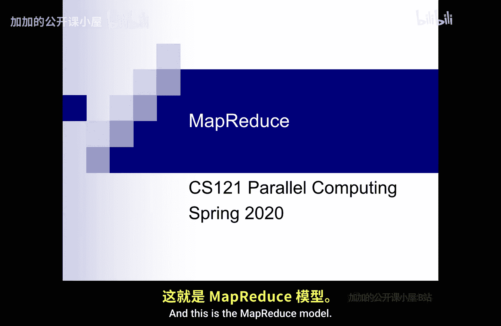
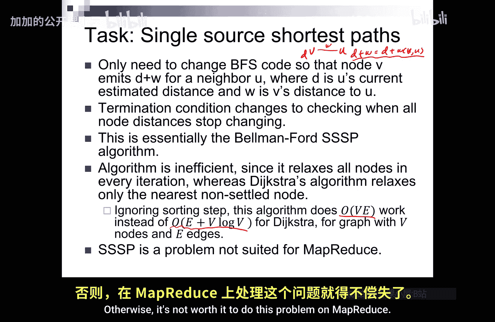
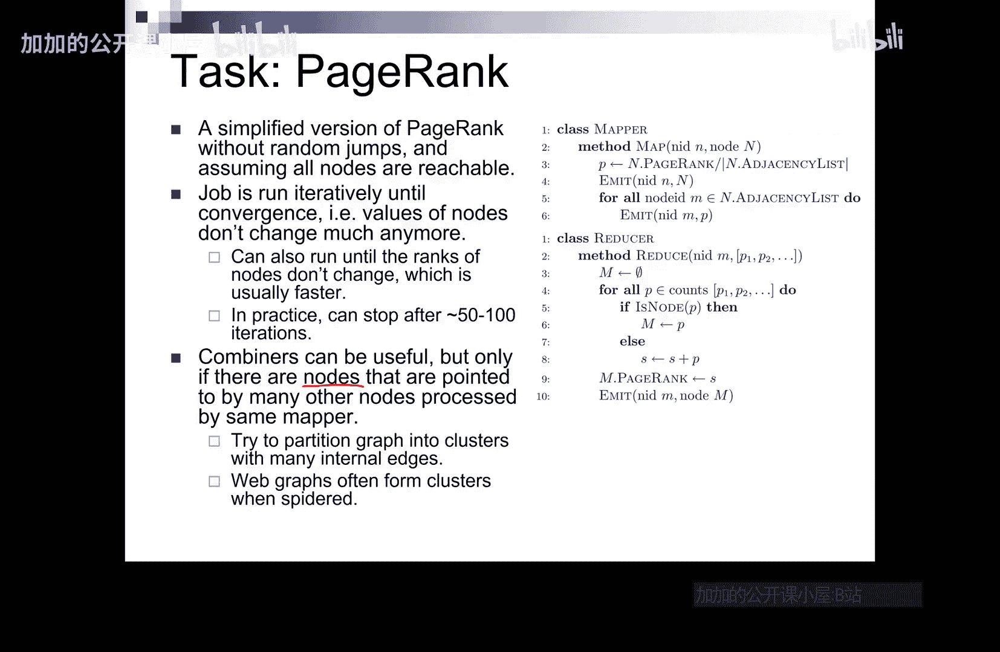

# 并行计算：P29：MapReduce 🗺️➡️📊



在本节课中，我们将要学习一种近年来非常流行的并行计算模型——MapReduce。我们将探讨其设计动机、核心概念、工作原理，并通过具体实例来理解如何用它解决实际问题。

## 概述

MapReduce是一种专注于数据而非计算的并行编程模型，其核心目标是实现低成本和高可扩展性。它诞生于大约20年前互联网数据爆炸的背景下，旨在处理来自互联网和用户生成的海量数据，例如网页、用户信息、图像和视频等。除了互联网数据，MapReduce也可用于处理传统的科学计算数据，如物理或生物数据。

这种模型与所谓的“数据科学第四范式”紧密相关。传统科学方法依赖于收集有限数据、构建假设和复杂模型，然后通过更多数据验证模型。而数据科学方法则倾向于忽略模型构建步骤，直接收集尽可能多的数据，通过算法寻找模式，再由人工筛选出合理的模式来解决问题。MapReduce正是为支持这种大规模、简单计算的数据处理范式而设计的。

MapReduce非常注重成本和规模。它采用“横向扩展”而非“纵向扩展”的策略。这意味着系统通过连接大量廉价、性能一般的商用计算机和简单网络来构建，而非使用昂贵的高性能处理器和高速互连（如超级计算机）。因此，MapReduce非常适合在数据中心和云计算环境中运行。

最初由Google开发用于解决简单的文本处理问题，MapReduce因其能高效处理大规模数据上的简单计算而广受欢迎。由于其专有性，后来出现了开源的实现版本——Hadoop，它在工业界和学术界都得到了广泛应用。

## MapReduce的设计哲学

在深入探讨MapReduce的具体设计之前，我们先了解影响其设计的几个关键假设。

**硬件环境与容错性**：MapReduce设计用于拥有数万台服务器的数据中心。即使单个服务器相当可靠，在如此庞大的规模下，组件故障也时常发生。因此，MapReduce被设计为能够处理组件故障。

**计算向数据移动**：MapReduce主要关注数据处理，计算通常很简单，有时甚至只需对数据流式扫描一次。因此，与其将海量数据在网络中移动，不如将计算代码（通常很小）发送到存储数据的服务器上执行。这避免了高昂的通信成本。

**顺序数据访问**：MapReduce作业通常只需要对数据进行顺序访问（例如，扫描一个数据块），而不需要跨多台计算机的随机数据访问。这减少了对通信网络的需求，而MapReduce通常运行在通信能力不强的网络上。

**可扩展性**：MapReduce旨在实现近似线性的扩展。如果处理器数量翻倍，处理速度或单位时间内处理的数据量也应大致翻倍。这通常是可以实现的，因为典型的MapReduce作业通信开销很小。那些需要大量通信或多步计算的算法并不适合在MapReduce上运行。

## MapReduce模型详解

MapReduce模型基于一个简单的数据结构：**键值对**。模型中的所有计算都归结为处理这些键值对。

一个键值对 `(K, V)` 包含一个键 `K` 和一个与之关联的值 `V`。键可以是数字、字符串等任何用于标识值的类型，值可以是任意数据结构。例如，处理网页时，键可以是URL，值可以是网页内容；处理图时，键可以是节点ID，值可以是该节点的邻接表。

一个MapReduce计算包含两个主要步骤：**Map（映射）** 和 **Reduce（归约）**。

*   **Map步骤**：输入是一个键值对 `(K, V)`。Map函数将其转换并输出一个**中间键值对**的列表 `[(K1, V1), (K2, V2), ...]`。它可以从一个输入对产生多个输出对。
*   **Reduce步骤**：在Map步骤之后执行。输入是一个键 `K` 和与该键关联的所有值的列表 `[V1, V2, ...]`。Reduce函数处理这个列表，并输出另一个键值对列表 `[(K’, V’1), (K’, V’2), ...]`。

程序员需要定义Map和Reduce函数的具体逻辑。

## MapReduce系统执行流程

一个MapReduce作业的执行流程如下：

1.  **输入**：作业的输入是一组存储在分布式文件系统中的文件，这些文件被解释为初始的键值对。
2.  **Map阶段**：系统将输入文件分发给多个**Map服务器**。每个Map服务器对其接收到的每一个键值对执行用户定义的Map函数，生成一批中间键值对。
3.  **Shuffle与排序阶段**：这是由MapReduce运行时系统自动执行的。它收集所有Map服务器产生的中间键值对，**将所有具有相同键 `K` 的值分组到一起**，形成 `(K, [V1, V2, ...])` 的结构。然后，系统对这些分组后的数据按键进行排序，并将其**分区**，发送给不同的**Reduce服务器**。每个Reduce服务器接收到的数据在其内部是按键排序的。
4.  **Reduce阶段**：每个Reduce服务器对其接收到的每一组 `(K, [V1, V2, ...])` 执行用户定义的Reduce函数，生成最终的键值对。
5.  **输出**：Reduce阶段产生的最终键值对被写回到分布式文件系统中。

这个过程可以视为MapReduce的一个“周期”。在实际作业中，可以串联多个这样的周期，将上一周期的输出作为下一周期的输入。然而，由于每个周期（涉及文件I/O、网络通信、排序等）开销很大，典型的MapReduce作业只运行少数几个周期。

## 编程示例与模式

让我们通过几个具体例子来理解如何编写MapReduce程序。

### 示例1：词频统计 📊

**问题**：统计一系列文档中每个单词出现的次数。

*   **Map函数**：对于文档中的每个单词 `t`，输出一个中间键值对 `(t, 1)`。如果单词“cat”出现了3次，则输出三次 `(“cat”, 1)`。
    ```python
    # 伪代码
    def map(doc):
        for word in doc.split():
            emit(word, 1)
    ```
*   **Shuffle/Sort**：系统将所有相同单词的计数值 `1` 分组到一起，例如 `(“cat”, [1, 1, 1, ...])`。
*   **Reduce函数**：对于每个单词 `t` 及其计数值列表 `counts`，将所有计数值相加，得到总次数 `sum`，然后输出最终结果 `(t, sum)`。
    ```python
    # 伪代码
    def reduce(word, counts):
        total = sum(counts)
        emit(word, total)
    ```

### 性能优化：Combiner与Partitioner

为了提升性能，MapReduce提供了可选的Combiner和Partitioner。

*   **Partitioner**：决定一个中间键值对应该被发送到哪个Reduce服务器。通常使用哈希函数（如 `hash(key) mod R`，`R`是Reduce任务数）来实现负载均衡，前提是键的分布相对均匀。
*   **Combiner**：在Map任务本地执行的一种“迷你Reduce”操作。它可以在数据发送到网络之前，对Map任务输出的中间结果进行局部聚合。例如，在词频统计中，如果一个Map任务多次看到单词“cat”，它的Combiner可以先将这些 `(“cat”, 1)` 本地相加为 `(“cat”, 5)`，再发送出去，从而减少网络传输和排序的数据量。

### 其他常见模式

1.  **过滤** 🎯：仅保留满足某个条件的数据。只需使用Map阶段，检查每个输入对，满足条件则直接输出，无需Reduce阶段。
2.  **Top-K查询** 🏆：找出排名前K的记录。每个Map任务处理部分数据，找出本地的Top-K，并以一个公共键（如`null`）输出。单个Reduce任务收集所有Map任务的本地Top-K，再从中选出全局的Top-K。
3.  **去重** 🔍：找出所有不同的值。Map阶段将每个值作为键输出（值设为`null`）。Shuffle阶段将相同键分组，Reduce阶段对每个键只输出一次。Combiner可以在Map端预先去重。
4.  **关系型连接** ⛓️：合并两个表的数据（以内连接为例）。Map阶段读取两个表的记录，以外键为键，记录内容和来源表标识为值输出。Shuffle阶段按外键分组。Reduce阶段收到同一个外键对应的所有记录列表，将其按来源表分开，然后执行嵌套循环合并，输出连接结果。

## 图算法示例

MapReduce也可用于迭代式图算法，但通常需要运行多个MapReduce周期。

### 示例：广度优先搜索 🕸️

**问题**：从源节点出发，计算图中所有节点的最短跳数。

*   **算法**：这是一个类Bellman-Ford的算法。假设当前迭代已计算出距离源节点 `d` 跳以内的所有节点。
*   **Map函数**：对于每个节点 `n` 及其当前已知距离 `dist`（如果未知则为无穷大），遍历其所有邻居 `m`，为每个邻居发出 `(m, dist + 1)`。
    ```python
    # 伪代码
    def map(node_id, current_distance):
        for neighbor in get_neighbors(node_id):
            emit(neighbor, current_distance + 1)
        # 同时传递节点自身信息，确保不被遗忘
        emit(node_id, current_distance)
    ```
*   **Reduce函数**：对于每个节点 `m`，收到一系列声称的距离值，取其中的最小值作为 `m` 的新距离。
    ```python
    # 伪代码
    def reduce(node_id, claimed_distances):
        new_distance = min(claimed_distances)
        emit(node_id, new_distance)
    ```
*   **执行**：重复执行MapReduce周期，直到所有节点的距离不再变化。周期数等于图的半径（从源到最远节点的跳数）。对于直径小的图（如社交网络），此方法有效；对于直径大的图，则效率低下。



单源最短路径问题可类似解决，只需将Map函数中的 `dist + 1` 改为 `dist + edge_weight`。

### 示例：PageRank算法 🌐

**问题**：基于网页链接结构计算网页的重要性排名。

*   **算法思想**：一个网页的排名取决于链接到它的网页的数量和质量。通过迭代方式求解一个大型线性系统。
*   **Map函数**：对于每个网页 `n` 及其当前排名值 `rank` 和出链列表 `L`，计算它分配给每个邻居的排名份额 `rank / len(L)`，并对每个邻居 `m` 发出 `(m, rank / len(L))`。
    ```python
    # 伪代码
    def map(page_id, current_rank, outlinks):
        share = current_rank / len(outlinks)
        for outlink in outlinks:
            emit(outlink, share)
        # 可选：也传递页面ID本身以维持图结构
        emit(page_id, outlinks) # 用于下一轮迭代
    ```
*   **Reduce函数**：对于每个网页 `m`，收集所有传入的排名份额，求和，并考虑随机跳转因子 `alpha`（用户随机访问一个网页的概率），计算新的排名：`new_rank = alpha / N + (1 - alpha) * sum(incoming_shares)`，其中 `N` 是网页总数。
    ```python
    # 伪代码
    def reduce(page_id, list_of_shares_or_structure):
        if is_structure(list[0]):
            # 处理图结构信息
            outlinks = list[0]
            emit(page_id, (outlinks, 0.0)) # 初始排名
        else:
            # 处理排名份额
            sum_of_shares = sum(list_of_shares)
            new_rank = ALPHA / TOTAL_PAGES + (1 - ALPHA) * sum_of_shares
            emit(page_id, (get_outlinks_from_previous_state(page_id), new_rank))
    ```
*   **执行**：初始化所有网页排名为 `1/N`。重复执行MapReduce周期（通常几十到上百次），直到排名收敛或排名顺序稳定。Combiner可用于在Map端聚合发往同一网页的排名份额。

## 总结

本节课我们一起学习了MapReduce并行计算模型。我们了解了其面向大规模数据、简单计算、高容错和低成本的设计哲学。核心模型基于**键值对**，通过**Map**和**Reduce**两个阶段，并借助系统自动完成的**Shuffle/Sort**阶段来组织计算。

我们探讨了典型的编程模式，如词频统计、过滤、Top-K、去重和连接，并学习了使用**Combiner**和**Partitioner**进行性能优化。最后，我们看到了MapReduce如何应用于迭代式图算法，如广度优先搜索和PageRank，同时也认识到其对通信密集或需要大量迭代步数的算法效率较低。



MapReduce为处理互联网时代的海量数据提供了一种强大而简洁的编程范式，深刻影响了大数据生态系统的发展。