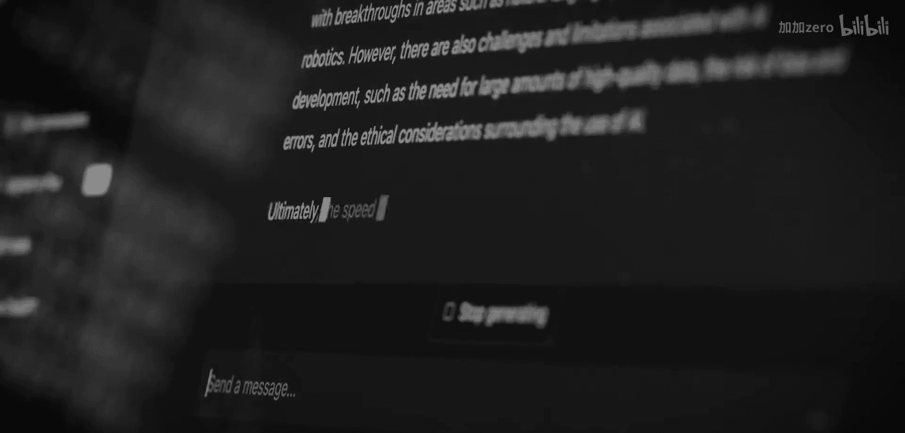

# 【人工智能访谈会 2023】斯坦福大学—中英字幕 p01 p0 Ask About AI：  Professor Chris Manning Answers AI-Generated Questions -BV14XB8YYEb1_p1-

🎼Hi， I'm Chris Manning here to answer your questions on artificial intelligence。😊。

🎼Here are a couple of AI generated questions。😊，🎼Considering the rapid progress in NLP what key factors and actions should the community prioritize for responsible and ethical AI language model deployment and development Well it's really good to know that the AI systems are also thinking about what's important for responsible and ethical AI language model deployment so there are lots of things to think about there we certainly want systems that don't exhibit conventional gender biases or ethnic stereotypes the fact of the matter is that all of the current large language models do exhibit those problems in part it's because these models are just trained on a lot of historical data from the world you know one of the things that human beings are better at is having in their head how they think the world should be rather than just knowing how the world has been and having statistics based on that but theyre also details of the machine learning。

😊，🎼Models where they tend to emphasize majority cases and forget about the minority cases so we should be working out how to build models that do a better job of that but we should also be trying to get data from different sources so it represents different groups and we should have the preferences of different groups involved in the evaluation of models finding their weak spots teaching them how to behave so a couple of people at Stanford that have been involved in this idea of jury learning Professor Michael Bernstein and his students and the idea there is that there isn't sort of one right answer to how you should behave and many contexts that different subgroups of people have different impressions and so you actually want to represent a jury of your peers and how different people feel about things and so lots of things to explore in those areas。

😊。

🎼AI System asks， what are some of the most promising and exciting real world applications of NLP that you foresee emerging in the next few years？

🎼Ts so I think we're going to see a lot more NLP systems being deployed very successfully everywhere so a lot of websites already have little AI assistant in the bottom corner I think we're going to see a new generation of ones powered by large language models which really work much more fluently I think we're going to see much more use of conversational assistance so you're thinking about how to word and email to your boss or you're not quite sure what you should say to your boyfriend it turns out that you can get advice drafting help suggestions of what to say from a large language model that are actually useful these days You know I think there's just a whole world of ways that we can use these models because our world is so languagebased and that we are all just sort of exploring what some of the possible。

😊。

bilities are。

