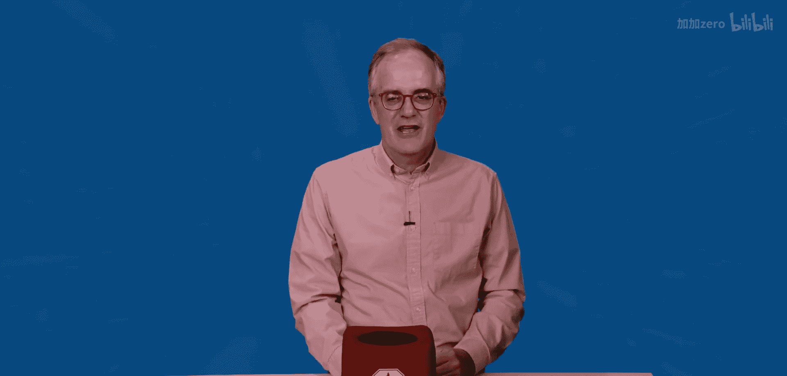
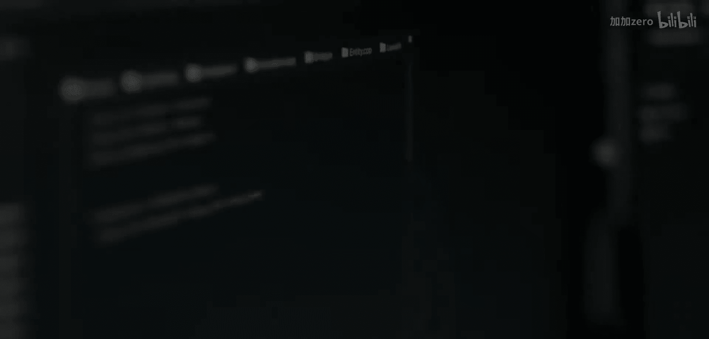

# 【人工智能访谈会 2023】斯坦福大学—中英字幕 p02 p1 Ask About AI： Professor Chris Manning Answers Your AI Career Questions -BV14XB8YYEb1_p2-

はい。🎼How do I increase my understanding of AI beyond off the shelf packages I've got the answer to that one。

 you have to build things I mean many of the most capable AI practitioners just put effort into building things for themselves reimplementing things you know one great example of that that's a Stanford PhD grad is Andre Cappathy So Andre has had a career first working at Tesla and now he's back at Open AI but you know he's also just a weekend hacker who likes to build things And the reality is that just by building things for yourself from scratch even if they replicate something that someone has done or a big framework from a tech company。

 you just learn so much and that's always a great exercise to work through。😊，Okay。

🎼What are some promising new career paths within AI？

🎼So there are a lot right we're still at a stage in which there's just a huge shortage of machine learning engineers and a huge shortage of people with a good understanding of neural networks。

 natural language processing and robotics and related technologies so if you get good skills in these areas there are all sorts of things that you can do every kind of industry。

 whether you're thinking the car industry， people in banking and finance， people in construction。

 people whod like to automate mining or agriculture。

 anywhere you look there are ways that you could use artificial intelligence to reinvent different industries。

😊，🎼Okay I've completed the basics of machine learning and deep learning what should I learn next I don't think that's a question that has a one size fits all answer one answer is find a project that's something that you're really interested in it could be something at work or it could just be something that's completely an interest of yours as a hobbyist thing so spending more time actually building AI application from beginning to end is still a huge further learning exercise after doing one or two of our classes but there are lots of other great classes you could do and I think at that point it depends more on what you're interested in。

😊。

