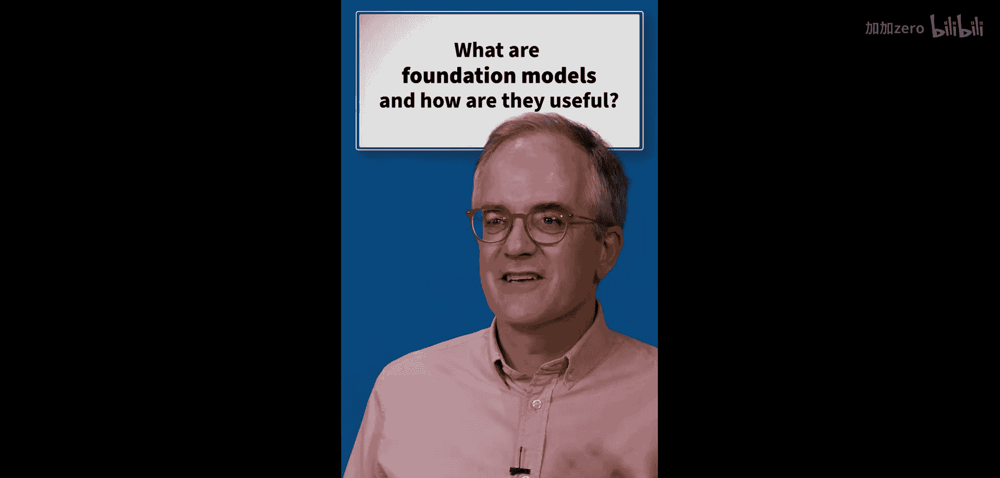
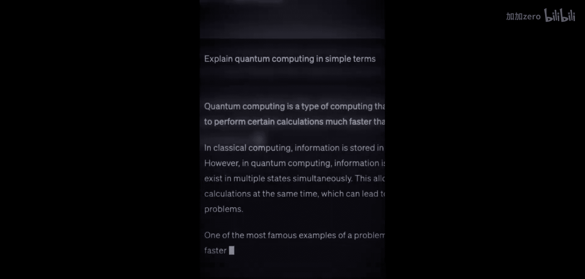

# 【人工智能访谈会 2023】斯坦福大学—中英字幕 p04 p3 Ask About AI： Professor Chris Manning on Foundation Models -BV14XB8YYEb1_p4-

Let's see what I've got。

🎼What are foundation models and how are they useful。

 Foundation models is a term we coined at Stanford to characterize the class of huge new。

🎼Artificial intelligence， neural network models that have been released recently and is so influential。

 but the idea was that the same idea of having models that were just trained by seeing a ton of data from the world could be applied not only to language but also to vision。

 genomic sequences， robotics， other signals like radar and that by having large。

 large neural networks see an enormous amount of data。

 they can get to understand a lot about the world and a lot about human languages if it's human language data。

 these foundation models now give us computer models with much more understanding which are being widely deployed and reinventing what we can do with artificial intelligence。

😊。

