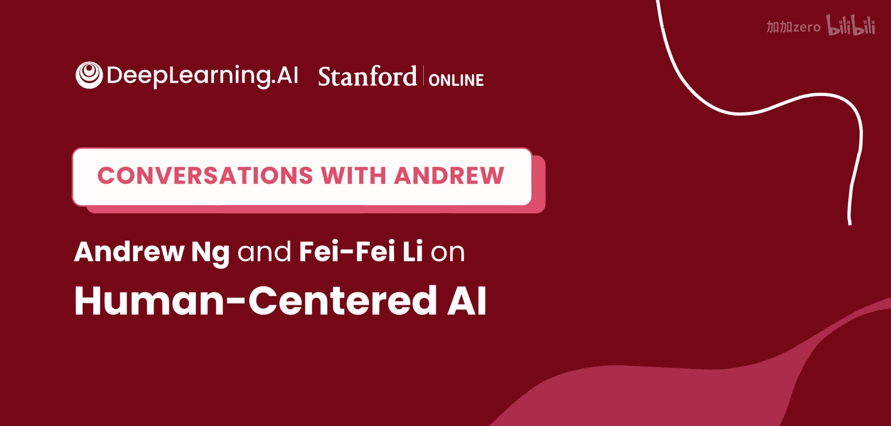
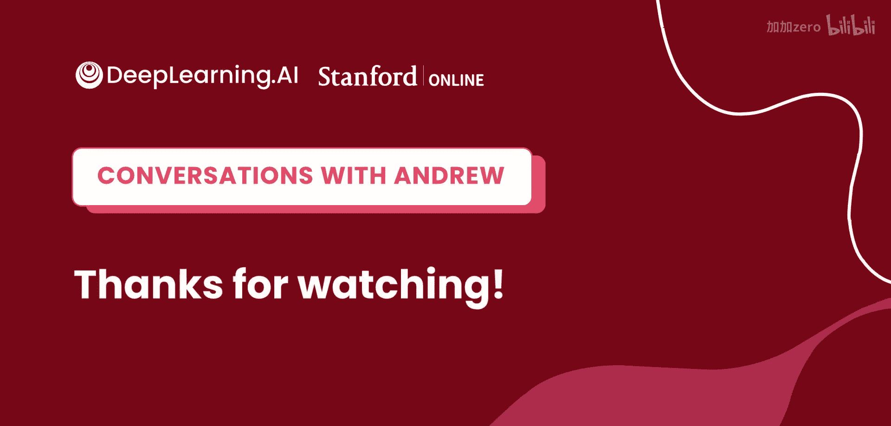

# 【人工智能访谈会 2023】斯坦福大学—中英字幕 p07 p6 Andrew Ng and Fei-Fei Li Discuss Human-Centered Artificial Intelligence - Sta -BV14XB8YYEb1_p7-

Hi， I'm delighted to have with us here today my old friend， Professor Feifei Lee。

Feifei is a professor of computer science at Stanford University and also codirect of H AI。

 the Human Centered AI Institute。 and previously she also was responsible for AI at Google Cloud as a chief scientist for the division。

 It's great have here， Feiei。 Thank you， Andrew， very happy to be here。

 So I guess actually how long have we known each other I've lost track。😊。

Definitely more than a decade。 I mean， I've done your work， right before we even met。

 And I came to Stanford。2009， but we started talking 2007， so。

15 years and I actually still have very clear memories of how stressful it was when collectively。

 you know， bunch of us， me， Chris Manning， a bunch of us were trying to figure out how to recruit you to come to San。

 It wasn't hard。 I just needed to sort out my students in life， but it's hard to resist Stanford。😊。

This is really great having as a friend and colleague here me too。

 it's speak a long time and we're very lucky to be the generation。Seeing AI's great progress。

 so there was something about your background that always found inspiring， which is， you know， today。

 people are entering AI from all walks of life。 and sometimes people still wonder， oh。

 I majored in something rather is AI a right path for me So I thought one of the most interesting positive background was that you actually started out not studying computer science or AI。

 but you started out studying physics and then had this path to becoming you know one of the most globally recognizable AI scientists。

 But so how did that how did you make that switch from physics to AI right， Well。

 that's a great question， Andrew， especially both of us passionate about young people's future and they coming to the world of AI。

 the truth is， if I could enter AI back then more than 20 years ago today。

 anybody could enter AI because AI has become such prevalent and。Globally impactful technology。

 but myself， maybe I was an accident。 So I have always been a physics kid or ST kids。

 I'm sure you were， too。 But physics was my passion all the way through， you know， middle school。

 high school college。 I went to Princeton and majored in physics。

 And one thing physics has taught me till today， is really the passion for asking big questions。

 the passion for seeking Northstar。 And I was really having fun as a physics student at Princeton。

 And one thing I did was reading up stories and just writings of great physicists of the 20th century。

 I just hear about what they think about， you know， the world。

 especially people like Albert Einstein， Roger Penrose， you know， air Schrodinger。 And it was。

Really funny to notice that many of the writings towards the later half of the career of these great physicists were not about just the atomic world or the the physical world。

 but ponderings about equally audacious questions like life， like intelligence， like human Con。

 You know， Schchroinger wrote this book， What is life。 And Roger Penrose wrote this book。

 Emperor's new new mindd， right。And that really got me very curious about the topic of intelligence。

 So one thing led to another during college time， I did intern at a couple of neuroscience labs and and especially vision related and I was like wow。

 this is just as audacious a question to ask as the beginning of the universe or what is matter made of。

 and that got me to switch from undergraduate degree physics to graduate degree in AI。

 even though I don't know about you during our time AI was a dirty word。 It was AI winter。

 So it was more machine learning and computer vision and computational neuroscience。

 Yeah I know honestly I think when when I was under I was too busy writing code。

 I just you managed to blithely ignored AI winter and just kept on cod Yeah I was too busy。

Solving PDE equations。Hey， and so actually， do you have an audacious question now？Yes。

 my audacious question is still intelligence。 I think since Alan Turing humanity has not fully understand what is the fundamental computing principles behind intelligence。

 you know， we we we today， we use the words AI， we use the word AGI。 But at the end of the day。

 I still dream of a set of simple equations or simple principles that can define the the process of intelligence。

 whether it's animal intelligence or machine intelligence。 And this is similar to physics。

 for example， many people have joined the analogy of flying， right， Are we。

Replicating birds flying or rebuild airplane。 And a lot of people ask the question of the relationship between AI and brain。

 And to me， whether we're building。A bird or replicating a bird or building an airplane at the end of the day。

 Aerodynamics and physics that govern the process of flying。

 And I do believe one day would discover that。 Yeah I sometimes think about this。

 one learning our hypothesis could a lot of intelligence， maybe all。

 but a lot of it be explained by one or very simple machine learning principles。

 And it feels like we' still so fuck from cracking that nut。

 but in the weekends when have spare time when think about learning algorithms and where they could go。

 this is one of the things I saw， you know， I'm excited about just thinking about。 I totally agree。

 I still feel like we are prenewtonian。 if we're doing physics analogy before Newton。

 there has been great physics， great physicists， a lot of phenomenology。

 a lot of studies of how the astro bodies move and all that。

 But it was Newton who start to write very simple。and I think we are still going through that very exciting coming of age of AI as a basic science and we're pre new my it's really nice to hear you talk about how despite machine learning and AI having come so far it still feels like there are a lot more unanswered questions a lot more work to be done by maybe some of the people joining the field today than work there's already been absolutely I mean's let's calculate it's only what 60 years about it's a very nascent field。

 modern his physics and chemistry and biology are all hundreds of years right so I think it is very it is very exciting to be entering the field of science of intelligence and and studying AI today。

 Yeah actually does go。 I think I remember chatting with the late Professor John McCarthy who had coined the term artificial intelligence。

And boy， the field has changed since when， you know。

 he conceived of it at the workshop and came out the term AI， but maybe another 10 years from now。

 you know， maybe someone watching this will come with a new set of ideas and then。Will'll be saying。

 boy， AI show is different than what， you know， you and I thought it would be that that's an exciting future to build to on。

 Yeah， I'm sure Newton would have not dreamed of Einstein。 So， you know， our。

 our evolution of science， sometimes takes strides， sometimes takes a while。

 And I think we're absolutely in， in the exciting phase of AI right now。😊，You know。

 it's interesting hearing you paint this grand vision for AI。Going back a little bit。

 that was one of piece of your background that I found， you know。Inspiring。

 which is when you're just getting started， I've heard you speak about how。You know。

 you're a physics student， but not only that。 you also。

 you're also running a laromat to pay for school。 And so just tell tell me about tell us more about that。

yeah， so I， I came to this country to America to New Jersey， actually， when I was 15。

 and one thing great about being in New Jersey is， it was close to Princeton。 So I。

 I often just take a weekend trip with my parents and to admire the the place where Einstein spent most of his career in the latter half of his life。

 But you know， with typical immigrant life。 and it was tough。 And by the time I entered Princeton。

 my parents didn't speak English。 and。😊，One thing led to another。

 It turns out running a dry cleaner might be the best option for my family。

 especially for me to lead that business because it's a weakened business。

 if it's a weekday business， it would be hard for me to be a student and it's actually believe or not running a dry cleaning shop is very a machine having。

 which is good for a stem student like me。 So we decided to open a dry cleaner shop in a small town in New Jersey called Percipen in New Jersey。

 It turned out we were physically not too far from Bell labbs and where lots of early convolution on neural network research was happening。

 but I had no idea actually a summer inter at HT Bell lab with Rob with Michael Ks was my mentor and Rob Sha invented boosting great algorithms。

You're coding AI。 I was trying to clingle No later only much later when did I start interning。

 Yeah and then it was seven years I I did that for the entire undergrad and most of my grad school and I hire my parents。

Yeah no that's really inspiring， I think you know I know you've been br into doing exciting work all your life and I think the story of you know running a laundromat to globally prominent computer scientists。

 I hope that that inspires some people watching this that no matter where you are。

 there's plenty of room on everyone。Don't even know this， my high school job was an office admin。

And so to this day， I remember doing a lot of photocopying and the exciting part was using the shredder。

 That was the glamorous part。😊，I was doing so much fellow coffee in high school， I thought， boy。

 only I could build a robot to do this fellow coffee and maybe I could do something else Did you succeed？

're still working on it' see。Yeah。And then you know。

 when people think about you and the work you've done。

 one of the huge successes everyone thinks about this image net where hub established early benchmark for computer vision。

 it was really completely instrumental to the modern rise of deep learning and computer vision one thing I bet not many people know about is how you actually got started on Inet So it tell us the origin story of Inet Yeah。

 well Andrew that's a good question because a lot of people see imagenet as just labeling a ton of images。

 but where we began was really going after North Star brings back my physics background So when I enter Gd school。

 When did you enter Gd school which year 97。 okay， I was three years later that 2000。

 and that was a very exciting period because I was in the computer vision and computer on your。

Science lab of Pitro Perona and Christo Caltech。 and leading up to that， there has been。

 first of all， two things was very exciting。 One is that。

The world of AI at this point at that point wasn't called AI Com vision or natural language Pro has found its lingua differentialco。

 It's machine learning， statistical modeling as a new tool has emerged right I mean。

 it's been around and I remember when the idea of applying machine learning to computer vision。

 that was like a controversial thing right and I was the first generation of graduate students who were embracing all the basic that all the inference algorithms and all that and that was one exciting happening。

 secondly exciting happening that most people don't know and don't appreciate is that couple of decades。

 probably more of them to two or three decades of incredible cognitive science and cognitive neuroscience work in the field of vision in the world of vision。

 human vision that has really established a couple of really critical norm。

St problems just understanding human visual processing and human intelligence。

 and one of them is the recognition of understanding of natural objects and natural things because a lot of the psychology and cognitive science work is pointing to us that is an innately optimized。

 whatever that word is functionality and ability of human intelligence iss more robust faster and more nuanced than we had thought and we even find neuralcorrelates brain areas devoted to faces or places or。

Body parts， you know， so， so these two things LED to my PhD study of using machine learning methods to work on real world object recognition。

But it became very painful very quickly that we are coming， banging against one of the most。

Continue to be the most important challenge in AI and machine learning is the lack of generaliz generalizability。

 you know， you can design a beautiful model or you want if you're overfitting that model。

 I remember when it used be possible to publish a computer vision paper， you know。

 showing your works on one image。Yeah it's just the overfitting the models are not very expressive and we lack the data and we also as a field was betting on making the variables very rich by hand engineer features。

 remember you every variable carrying a ton of semantic meaning， but with hand engineer features。😊。

And then towards the end of my PhD， my advisor Pitro and I start to look at each other and say。

 well boy， we need more data， if we believe in this North Star problem of object recognition and we look back at the tools we have。

 you know mathematically speaking， we're overfitting every model we're encountering。

 we need to take a fresh look at this， so one thing led to another he and I decided we'll just do at that point we think it was a largescale data project called Caltech 101。

I remember the dataset。 I wrote papers using your Caltech101。

 You did you and your early graduate student benefit a lot of researchers。

 Caltech101 Yeah that was me and my mom labeling images and a couple of undergrads。

 but that was it was the early days of internet。 So suddenly the availability of data was a new thing。

 You suddenly I remember Pitro still have this super expensive digital camera。

 I think it was Canon or something like $6000 walking around Caltech taking pictures but we are the Internet generation。

 I go to Google image search， I start to see these thousands and tens of thousands of images。

 and I tell Pitro， let's just download Of course it's not that easy to download。

 So one thing led to another。 we built this Caltech one of one dataset set of 1 hundred01 object categories and about I would say。

30000I think it's really interesting that you know， even though everyone's heard of Inet today。

Even you kind of took a couple iterations where you did Caltech 101。 and that was a success。

 Lots of you used it but even the early learnings from building Caltech 101 that gave you the basis to build what turned out to be even and even bigger of success right。

 except that by the time we start， I became assistant system professor We started to look at the problem。

 I realized it's way bigger than we think just mathematically speaking。

 Caltech 101 was not sufficient to power the algorithms。

 We decided to image to do image that and that was the time people start to think we're doing too much。

 right's it's just too crazy。 The idea of downloading the entire Internet of images and mapping out all the English nuuns was a little bit。

I start to get a lot of pushback， I remember at one of the CVPR conference when I presented the early idea of image that a couple of researchers publicly questioned and say said if you cannot recognize one category of object。

 let's say the chair， you're sitting in how do you imagine or what's the use of a data set of 22。

000 classes of 15 million images but in the end， that giant data a lot。

 a lot of value of countless number of researchers around the world well I think it was the combination of betting on the right North star problem？

And the data that drives it。 So it was a fun process。 Yeah， and you， to me， one of the。

When I think about that story， it seems like one of those examples where。You know。

 sometimes people feel like they should only work on projects。

 that's the huge thing at the first L set。I feel like for people working in machine learning if your first project is a bit smaller。

 it's totally fine， have a good win， use the learnings to build up to even bigger things and then sometimes you get a you know imagenet size win all of it。

But in the meantime， I think。It's also important to be driven by an audacious goal though。

 you know you can size your problem or size your project as local milestones and so on along this journey。

 but I also look at some of our current students， they're so peer pressured by this current。

A climate of publishing nonstop。 It becomes more incremental papers to just get into a publication for the sake of it。

 And I personally always push my students to ask the question。

 what is the North Star that's driving you Yeah， true。And right， you， for myself。

 when I do research over the years， I've always。Pretty much done what。

I'm excited about where I want to， you know， try to push the few forward。

 doesnn't it don't listen to people， have to listen to people， let them shape your opinion。

 But in the end， I think the best researchers let the world shape their opinion。 But in the end。

 drag things forward using their own opinion。 totally agree。 Yeah it's your own inner fire， right。

So as your research program developed， you've wound up taking your let's say foundations in computer vision and neuroscience and applying it to all sorts of topics。

 including your very visibly healthcare look neuroscience applications would love to hear a bit more about that Yeah happy to I think the evolution of my research in computer vision also kind of follows the evolution of visual intelligence in animals and there are two topics that truly excites me one is what is a truly impactful application area that would help human lives and that's why healthcare work the other one is what is vision at the end of the day about and that brings me to the trying to close the loop between perception and robotic learning so on the healthcare side。

You know， one thing， Andrew， there was a number that shocked me about 10 years ago when I met my long term collaborator。

 Doctor Arnie Milsstein at Stanford Medical School。

 and that number is about a quarter of a million Americans die of medical errors every year。

I had never imagined a number being that high due to medical errors。 There are many， many reasons。

 but we can rest assured most of the reasons are not intentional。

 These are errors of unintended you know， mistakes and so on。 for example。

 it doesn' a mind boggling number It is maybe about 40000 deaths a year from automotive accidents。

 which is completely tragic。 And this is even vastly。 I was gonna to say that。

 I'm glad you brought it up。 Just one example， one number within that mind boggling number is the number of hospital acquired infection resulted fatality。

 is。More than 95，000， that is more than that's 2。5 times than the death of car accidents。

And in this particular case， hospital acquired infection is a result of many things but。

By in large lack of good hand hygiene practice。 So if you look at WHO。

 there has been a lot of protocols about clinicians's hand hygiene practice。

 but in real healthcare delivery when things get busy and when the process is tedious。

 And when there is a lack of feedback system， you still make a lot of mistakes。

 Another medical tragic medical fact is that more than $70 billion every year are spent in in full resulted injuries and fatalities。

 and most of this happened to elderlys at home， but also in the hospital rooms。

 and these are huge issues。 And when Arnie and I got together backing 2012。

 it was the height of self-diving car。Let's say no hype。

 but what's the word the right word excitement in Silicon Valley。

 and then we look at the technology of smart sensing cameras， Lis， radars， whatever smart sensors。

 machine learning algorithm and holistic understanding of a complex environment with high stakes for human lives。

I was looking at all that her self driving car， and realized。In healthcare delivery。

We have the same situation。 Much of the process， the human behavior process of healthcare。

 is in the dark。And if we could have smart sensors。

 be it in patient rooms or senior homes to help our clinicians and patients to stay safer。

 that would be amazing。 So Arnie and I embarked on this what we call MBA intelligence research agenda but one thing I learned which probably would lead to our other topics is as soon as you're applying AI to real human conditions there's a lot of human issues in addition to machine learning issues for example。

 privacy and I remember reading some of your papers with Ar and found it really interesting how you could build into systems。

 there were you know relatively privacy preserving Yeah well thank you the first。

Iteration of that technology is we use cameras that do not capture RGB information。

 and you've used a lot of that in self-driving car， the depth cameras， for example。

 and there you you you preserve a lot of privacy privacy information just by not seeing the faces in the identity of the people。

 But what's really interesting over the past decade is the changes of technology is actually giving us a bigger tool set for privacy preserved a computing in this condition。

 for example， on device inference。 you know， as the chips getting more and more powerful if you don't have to transmit any data through the network and to the central server。

 you help people better。 Feerated learning， We know it's still early stage。

 But that's another potential tool for privacy preserve computing and then differential privacy and also in。

Eion technologies， so we're starting to see that human demand。

 you privacy and other issues is driving actually a new wave of machine learning technology in MBA intelligence in healthcare。

 Yeahs， I've been encouraged to see the real practical applications of differential privacy that are actually real federated learning。

 as you said， Pra the PRs low the ahead of the reality。

 but I think we'll get there but it's interesting how consumers in the last several years have fortunately gotten much more knowledgeable about privacy and are increasingly so important。

 I think the public is also making us to be better scientists。And I think ultimately。

 people understand AI holds everyone， including us。

 but holds everyone accountable for really doing the right thing。And， you know， and on that。Notes。

 one of the really interesting pieces of work you've been doing has been leading several efforts to help educate legislators or hope governments。

 especially US government work toward better laws and better regulation。

 especially as you relates AI， that sounds a very important and I suspect some days the week I would get somewhat frustrating work。

 but we'd love to hear more about that。Yeah， so I think first of all I have to credit many。

 many people so about four years ago and I was actually finishing my sabbatical from Google time。

 I was very privileged to work with so many businesses， you know enterprise developers。

 just just a large number and variety of vertical industries and realizing AI's human impact and that was when many faculty leaders at Stanford and also just our president provost。

 former president and former provost all get together， I realized there is a role。

 historical role that Stanford needs to play in the advances of AI we were part of the part of the birthplace of AI。

 you know a lot of work our previous generation have done and a lot of work you've done and some of our work I've done。

To AI， today's AI， what is our historical opportunity and responsibility with that we believe that the next generation of AI education and research and policy needs to be human centered。

And。Having established the Human Center AI Institute， what we call H AI。

 one of the work that really took me outside of my comfort zone or aiding expertise is really a。

Deeper engagement with policy。Thinkers and makers， because， you know。

 we're here in Silicon Valley and there is a culture in Silicon Valley which just keep making things and the law will catch up by itself。

 but AI is impacting human lives and some sometimes negatively so rapidly that it is not good for any of us if we the experts are not at the table with the policy thinkers and makers to really try to make this technology better for the people。

 I mean， we're talking about fairness。 We're talking about privacy。

 We also are talking about the brain draining of AI to industry and the concentration of data and compute in a small number of technology companies。

 All this are really part of the changes of our time。

 Some are really exciting changes some have profound impact that we don't we cannot。

Necessarily predict yet。 So one of the policy work that Stanford H AI has very proudly engaged in is we were the one of the leading universities that lobbied a bill called the National AI Research Cloud Task Force Bill。

 It changed the name from research cloud research resource。

 So now the bill's acronym is Nair National AI research resource。

 And this bill is calling for a task force， to put together a roadmap for America's public sector。

 especially higher education and research sector to。

Increase their access to resource for AI compute and AI data。

 And it really is aimed to rejuvenate America's ecosystem in in AI innovation and research。

 And I'm on the 12% task force for under Biden and administration for this bill。

 And we hope that's a piece of policy that。It's not a regulatory policy。

 It's more an incentive policy to build and rejuvennate ecosystems。

 I'm glad that you're doing this hope shapeve US policy and this type of making sure enough resources allocated to you ensure healthy development AI feels like this is something that every country needs at this point。

 Yeah So you know， just from the things that you are doing by yourself。

 not to speak of the things that the global AI committee is doing。

 there's just so much going on in AI right now， so opportunity so much excitement。

I found that for someone getting started in machine learning for the first time。

 Sometimes there's so much going on。 They can almost be a little bit overwhelming。

 To What advice do you have for someone getting started in machine learning。Good question， Andrew。

 I'm sure you have great advice。 You're one of the world known advocate for AI machine learning education。

 so I do get this question a lot as well， and one thing you're totally right is AI really today feels different from our time。

😊，During just for the record。 now was still our time。 That's true。

 when we were starting I love that exactly we' the part of this。

 when we get started the entrance to AI and machine learning was relatively narrow。

 You almost have to start from computer science and go right， you know， as a physics major。

 I still had to wedge myself into the computer science track or electrical engineering track to get to AI。

 but today I actually think that there is main aspect of AI that creates entry points for people from all walks of life。

 on the technical side I think it's obvious that there's just a incredible plethora of resources out there on the internet from Courra to you know YouTube to Tiktk to。

Get off to the there's just so much that students worldwide can learn about AI and machine learning compared to the time we began learning machine learning and also any campuses we're not talking about just college campuses。

 We're talking about high school campuses even sometimes earlier we're starting to see more available classes and resources。

 So I think there is， I do encourage those of the young people with a technical interest and resource and opportunity to embrace these resources because it's a lot of fun。

 but having said that， for those of you who are not coming from a technical angle who still are passionate about AI。

 whether it's the downstream application， or the the creativity。

 it engenders or the policy and social。angle or important social problems。

 whether it's digital economics or the governance， governance or， you know， history， ethics。

 political sciences， there， I do invite you to， to join us because there is a lot of work to be done。

 There is a lot of a lot of unknown questions。 For example。

 my colleague at HI are questioning are are trying to find answers on how do you define our。

Economy in the digital age。What does it mean when robots software are participating in the workflow more and more。

 How do you measure our economy， that's not an AI coding question。

 That is an AI impact question We're looking at the incredible advances of generative AI and there will be more。

 What does that mean for creative creativity。And to the creators from music to art to writing。

 I think， you know， there is a lot of concerns， and I think it's rightfully so。 but in the meantime。

 it takes people together to figure this out and also to use this new tool。 so I think。In short。

 I just think it's a very exciting time。 And anybody with any walks of life。

 as long as you are passionate about this， there is a role to play。

Yeah I think that's really exciting when you talk about economics， think about， you know。

 my conversations with Professor Eric Bnelson， that impact of AI on the economy。

 but from what you're saying and I agree， it seems like no matter what your current interests are。

AI is such a general purpose technology that the combination of your current interests and AI is often promising。

And I find that even for learners that may not yet have a specific interest， you know。

 if you find your way into AI， start learning things， often the interests will evolve。

 and then you can start to craft your own path and given where AI is today。

 there's still so much room and so much need for a lot more people to craft their own paths to do this exciting work that I think the world still needs a lot more。

Totally agree。 Yeah， so one piece of work that you did。

 I thought was very cool was starting a program， initially called Saors in a later AI for all。

 which was really reaching out to， you know， high school and even younger students to try to give them more opportunities in AI。

 including people of all walks of life。 You love to hear more about that。 Yeah， well。

 this is in the spirit of this conversation is that was back in 2015。

 there was there was starting to be a lot of excitement of AI。

 But there was also starting to be this talk about。😊，Killer robot coming next door。

 Terinators coming and I was at that time， Andrew， I was the director of Sevariia La and I was thinking。

You know we know how far we are from Terinators coming and that seemed to be a really a little bit of farfeched concern but I was living my work life with a real concern I felt no one was talking about which was the lack of representation in AI at that time I guess after Daphne has left I was the only woman faculty at Stanford AI lab and and were having very small around 15% of women graduate students and we really don't see anybody from the underrepresented minority groups in Stanford AI program and this is a national even worldwide issue so it wasn't just Stanford frankly it still needs a lot of work today exactly so how do we do this well I got together with my former student Olgar Ruskowsky and also a long-ter educator of topics。

Rick Summer from Stanford Precollegiate study program and thought about inviting high schoolers at that time。

 women， high school young women to participate in a summer program to inspire them to， to learn AI。

 and and that was how it started in 2015 and 2017。 we got。

A lot of encouragement and support from people like Jensen and Lori Huang and Melinda Gates。

 and we formed the national nonprofit AI for all， which is really committed to training or helping tomorrow's leaders shaping tomorrow's leaders for AI from students of all walks of life。

 especially the traditionally underserved and underrepresented communities and you know till today we've had many。

 many summer camps and summer programs across the country more than more than 15 universities are involved and we have online curriculum to encourage students as well as college pathway programs to continue support these students career by matching them with internships and mentors。

 so it's a continued effort。Of encouraging students of all walks of life。 I remember back then。

 I think your group was printing these really cool thirs and asked the question。

 AI will change the world， Who would change AI。 And I thought the answer of making sure everyone can come in and participate。

 That was a great answer。 Still an important question today。

So that's a great thought and I think that takes us to at the end of the interview any final thoughts for the people watching this still that this is a very nascent field。

 as you said， Andrew， we are still in the middle of this I still feel there's just so many questions that you know I wake up excited to work on with my students in the lab and I think there's a lot more opportunities for the young people out there who want to learn and contribute and shape tomorrow's AI well that's very inspiring。

Really great to chat with you and thank you thank you。 It's fun to have these conversations。😊。

