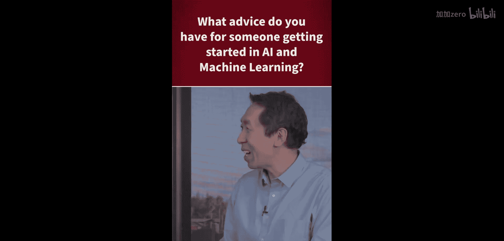
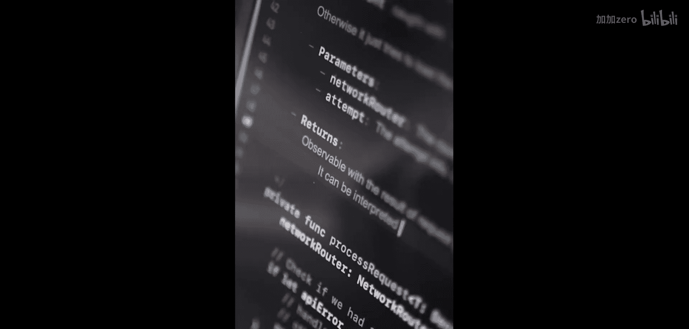
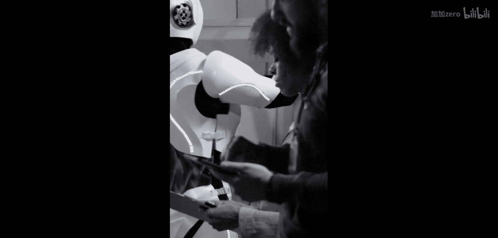

# 【人工智能访谈会 2023】斯坦福大学—中英字幕 p08 p7 What advice do you have for getting started in AI & Machine Learning？ - Fei-F -BV14XB8YYEb1_p8-

🎼What advice do you have for someone getting started in machine learning When we get started。

 the entrance to AI and machine learning was relatively narrow。

 you almost have to start from computer science but today I actually see many years to comment more and more that there is many aspect of AI that creates entry points for people from all walks of life。

 For example， my colleague at HI are trying to find answers on what does it mean when robots software are participating in the workflow more and more How do you measure our economy。

 That's not an AI coding question， That is an AI impact question It takes people together to figure this out and also to use this new tool as long as you're passionate about this There is a role to play。

