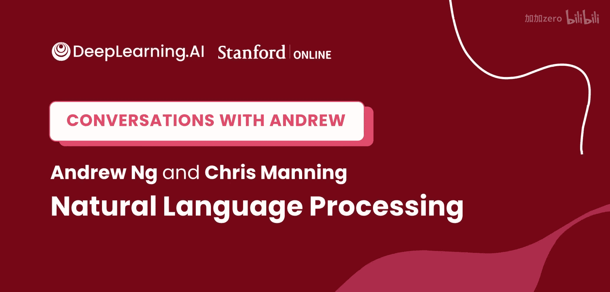
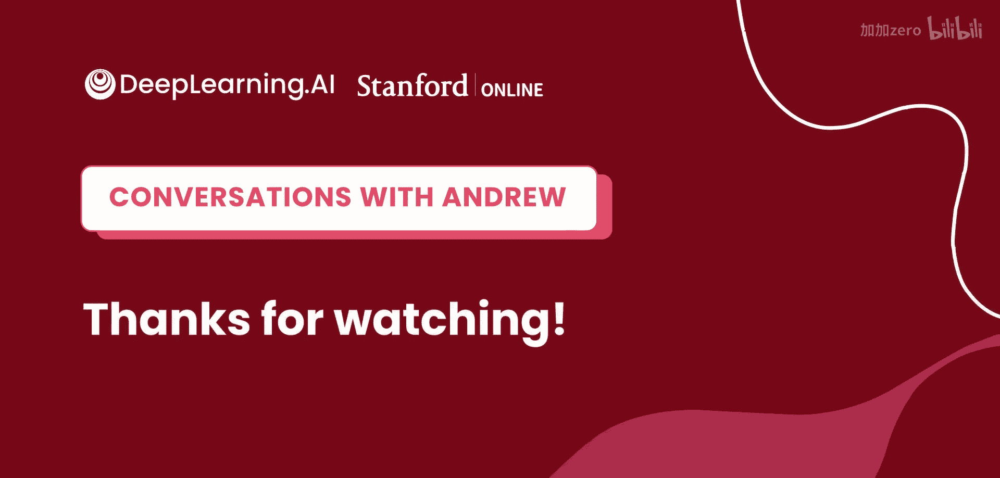

# 【人工智能访谈会 2023】斯坦福大学—中英字幕 p09 p8 Andrew Ng and Chris Manning Discuss Natural Language Processing -BV14XB8YYEb1_p9-

Hi， I'm delighted to be here with my old friend and collaborator Professor Chris Manning Chris has a very long and impressive bio。

 but just briefly he is professor of computer science at Stanford University and also the director of the Stanford AI Lab and he also has a distinction of being the most highly cited researcher in NLP or natural language Pro so really good to be here with you Chris Oh good to get a chance chat Andrew。

So you with known each other collaborator for many years。

 and one interesting part of your background， I always thought was that even though today you're distinguished researcher in machine learning and NLP。

 you actually started off in a very different area your PhD if I wrote correctly was in linguistics and you were studying the syntax of language。

 So how did you go from studying syntax to being an NLP researcher So I can certainly tell you about that。

 but I sure also point out that you know I'm still actually a professor of linguistics as well。

 I have a joint appointment at Stanford and you know once in a blue moon， not very often。

 I do actually still teach some real linguistics as well as computer involved natural language processing so。

😊，You know， so starting out， I was very interested in human languages and how they work。

 how people understand them， how they are in， are acquired。 So I had this sort of。😊，Appeal。

 I saw this appeal in human languages。 but that。Equally led me to think about ideas that we now very much think about as machine learning or computational ideas。

 So two of the central ideas in human language， How do little children acquire human language and for adults。

 Well we're just talking to each other now and we pretty much understand each other And you know。

 that's actually an amazing thing how we managed to do that。 So what kind of processing allows that。

 And so that early on got me interested in looking at machine learning， In fact。

 even before I'd made it to grad school， Id started， you know。

 baby steps and learning machine learning coming off of those interests。

 fact all human languages learned， we had learned at some point in the life So speak English。

 and we've grown up in a different place。 we learned a totally different language。

 So it's amazing to think how humans do that And now maybe machines learn language too。

 so so should tell us more about your。😊，journey所以 had a。PHD in linguistics。

 and then and then how did you So there's some stuff before that as well。 So I mean， you know。

 when I was an undergrad， well， officially I actually did three majors。 this was in one in math。

 one in computer science and one in linguistics。 Now people get a slightly exaggerated sense of what that means if you're in an American context because you know。

 itd be I think impossible to complete three majors in undergrad at Stanford。

 but you know actually where I was as an undergrad doing I didnt arts degree So I could do whatever I wanted like linguistics。

 you had to complete two majors to complete the arts degree。 So you know。

 it was sort of more like double majoring maybe in US terms。

 you probably don't know about me but Mel I was a triple major。

 math year was once in statistics and economics。 but that's great both fellow triple majors。

 Yeah So anyway， I did have background in interest in doing thing。😊。

With computer science and so my interests were kind of mixed。 And I mean actually， you know。

 when I applied to grad schools， I mean， one of the places I applied to is Kengie Mellon because they were strong in computational linguistics you know and if I'd gone there I would have been enrolled as a C student but I ended up at Stanford as a linguistic student because at that time there wasn't any natural language processing in the CS department but you know I was still interest in pursuing ideas。

 natural language processing， but at that point in the early 90s things were just starting to change。

 but the bulk of natural language processing was。😊，Rulebased logical declarative systems。

 but it was also in those years of the beginning of the 90s when there first started to be lots of human language material。

 text and speech available digitally so this was really actually just before the World Web exploded。

 but there already started to be things like legal material and newspaper articles and parliamentary handss where you could at last get your hands on millions of words of human language and it just seemed really clear that there had to be exciting things that you could do by working empirically from lots of human language and that's what really sort of got me involved in a new kind of natural language processing that then led into my subsequent career It not like your career was initially more linguistics and of the rise of data and machine learning and empirical methods it shifted to what NLP and machine learning and NLP。

😊，I mean， it absolutely certainly shifted and I've certainly sort of shifted much more to doing both natural language processing and machine learning models。

 but you know to some extent the balances varied but I've sort of been with that as a while you know actually as an undergrad for my undergrad ons thesis it was sort of learning the forms of words so how which became a famous problem of sort of learning past tenses of English verbs in the early connectionist literature and I was trying to sort of learn paradigms of forms of verbs and I was learning rules for the different forms using the C4。

5 decision tree learning algorithm if you remember that。😊，Right。

 good times yeah and it's surprisingly non intuitive right how going from present tense to past tense from I don't know。

 run to ran and all the others where special cases can be。

So we' talked a bunch about NLP natural language processing So for some of the you know learners pick up machine learning for the first time can you say what is NP Sure absolutely yeah so NLP stands for natural language processing In another word this term that sometimes use for that is computational linguistics it's the same thing I mean natural language processing is actually a weird term right So it means that we're doing things with human languages So you have to have the conception that you're enough of a computer scientists that when you say language you think in your brain programming language and therefore you need to say natural language to mean that you're talking about the languages that human beings use So overall natural language processing is doing anything intelligent with human languages So in one sense that breaks down into understanding human languages producing human languages acquiring human languages people。

So often think about it in terms of different applications and so then you might think about things like machine translation or doing question answering or generating advertising copy or summarization。

 there are so many different tasks that people work on with particular goals in mind where you do things with human language and there's a lot of natural language processing because you know so much of what the world works on our human world is dealt with and transmitted in terms of human language material。

😊，So you know because of all of these applications or even web search most of us use NLP many。

 many times you're right in some sense， the biggest application of natural language is web search that's really the big one I mean traditionally it was a kind of a simple one right that in the good old days it was you know there were various weighting factors and so on。

 but it was mainly sort of matching keywords than your search terms and then some factors about the quality of the page it didn't really feel like language understanding but that's really been changing over the years so these days you'll often if you ask a question to a search engine it'll give you you know an answer box where it has extracted a piece of text and puts what it thinks is the answer and bold or color or something like that which is then this task of question answering and then it's really a natural language understanding task and you like。

😊，In addition to web search is maybe the big one， even when we're going to a online shopping website or a movie website and typing in what we want and doing a website search on a much smaller website than the big search engines。

 that also increasingly users have NLP algorithms and it's also creating quite a lot of value maybe to you is not the real NLP。

 but it still seems very valuable I agree it's very valuable and there are lots of interesting problems in any ecommerce-commerce website with search very difficult problems actually when people describe the kind of goods they want and you need to be trying to match it to products that are available that isn't an easy problem at all it turns out。

Yeah。So over the last I don't know， couple decades。

 NlP has gone through a major shift from all of the rubays techniques that he alluded to just now to using really machine learning much more pervasively。

 And so you were one of the people at， you know。Leading parts of that charge and seeing every step of the way of creating some of the steps as it happen。

 Can you， can you say a bit about that process and what you saw。 Sure， absolutely。 yeah。

 So when I started off as an undergrad grad student， really。

 most of natural language processing was done by hand built。

Systems which variously used rules and inference procedures to sort of try and build up paths and an understanding of a piece of text。

 What's an example of a rule or inference system。So you know a rule could be part of the structure of human language like English sentence normally consists of a subject noun phrase followed by verb and an object noun phrase and that gives you some idea as to how to understand the meaning of the sentence but it might also be saying something about how to interpret a word so that a lot of words in English very ambiguous but if you have something like the word star and it's in the context of a movie then it's probably referring to a human being on this astronomical object and in those days people tried to deal with things like that using rules of that sort that doesn't seem very likely to work to us these days but you know once upon a time that was pretty standard and so it was only when lots of。

😊，igital text and speech started to become available。

 that it really seemed like there was this different way that instead。

 we could start calculating statistics over human language material and building machine learning models。

 And so that was the first thing that I got into。In the sort of mid to late 1990s and so you know the first area where I started doing lots of research and publishing papers and getting wellknow is building what in the early days we often called statistical natural language processing but it later merged into in general probabilistic approaches to artificial intelligence and machine learning and that sort of took us through to approximately 2010 let's say。

 and that's roughly when the new interest in deep learning using large artificial neural network started to take off for my interest in that I really have you to thank Andrew because at this stage Andrew is still full time at Stanford and he was in the office next daughter me and he was really excited about the new things that were happening in the area of deep learning。

 I guess anyone who walked into his office。😊，I tells them that it's so exciting what's happening now and neural network should had to start looking at that And so you know that was really the impetus that got me pretty early on involved in looking at things in neural networks I had actually seen a bit of it before So while I was a grad student here actually Dave Ruelhart was at Stanford and psych and I'd taken his neural networks class and so you know I'd seen some of that。

 but it hadn't actually really been what I'd gotten into for my own research around I didn't know that Thank you and we wound up supervising some students together Yeah absolutely I'd love to hear the rise of also deep learning and NL were your season or Yeah so starting about 2010 yeah。

 me students started to do the first papers in deep learning。😊，At NLP conferences， you know。

 it's always hard when you're trying to do something new。

 we had exactly the same experiences that people 15 or so years earlier had had when they started trying to do statistical NLP when there's an established way of doing things it's really hard to push out new ideas So really some of our first papers were rejected from conferences and instead appeared at machine learning conferences or deep learning workshops。

 but very quickly that started to change and people got super interested in neural network ideas but I sort of feel like the neural network period。

 which started effectively about 2010 it selfdivs in two because for the first period let's say basically say it's till 2018 we showed a lot of success building neural networks for all sorts of tasks we built them for syntactic passing and sentiment analysis。

😊，And。What else dude question answering， but it was sort of like we were doing the same thing that we used to do with other kinds of machine learning models except we now had a better machine learning model and we were sort of instead of training up a logistic regression or support vector machine we were still doing the same kind of sentiment analysis task。

 but now we were doing it with a neural network So I think in looking back now in some sense。

 the bigger change came around 2018 because that was when the idea of well we could just start with a large amount of human language material and build large self-supervised models So that was models then like Bert and GT and successor models for that and they could just sort of acquire from word prediction over huge amount of text。

 this amazing knowledge。😊，of human languages and I think really probably the that's going to be viewed in retrospect as the bigger kind of cut point where the way things were done really changed Yeah doesn' I think there is that trend for the large language models learned from massive and A data I think even a lead up to that there was one of your research papers that really you know slightly blew my mind which is a glove paper so because。

😊，With word embeddings where you learn a vector numbers， to represent a word using a neural network。

 that was quite that was quite mindbing for me。 and then the glove work that you did really cleaned up the math made it so much simpler。

 And then I remember as oh that's all there is today and then you can learn these really surprisingly detailed representations of the computer learns nuances of what words mean Abute yeah。

 so I should give a little bit of credit to others。 Other people also worked on some similar ideas。

 including Ron color and Jace Western and Thomasmikoov and colleagues at Google。

 But the glove word vectors as one of the very prominent systems of word vectors。

 So these word vectors already did。 yeah you' right illustrate this idea of using self-supervised learning that we just took massive amounts of text and then we could build these models that knew an enormous。

mount about the meaning of words， I mean， it's still something I sort of show people every year in the first first lecture of my NLP class because you know it's something simple but it actually just you works so surprisingly well。

 you can do this sort of simple modeling of trying to predict a word given the words in the context and simply by sort of running the math of learning to do those predictions well you learn all these things about word meaning and you can do this really nice patterns of you know similar word meaning or analogies of something like you know pencil as to drawing as paintbrush is too and it'll say painting right that it's sort of already showing just a lot of successful learning So that was the precursor to what then got developed to the next stage with things like Burton。

😊，PT where it wasn't just meanings of individual words。

 but meanings of whole pieces of text and context。Yeah， so I found it amazing that you can， you know。

 take a small neural network or some model and then give it lots of English sentences or some other language and hide the word。

 ask it to predict， what is the word that I just hit and that allows it to learn these analogies。

 these analogies and these very。Deep what you would think are really deep things behind the meaning of a word and then you know。

 2018， maybe this other infection point what happened after that。Yeah， so I mean。

 in 2018 that was the point in which well sort of really two things happened。

 one thing is that people or really in 2017 it developed this new neural architecture which was much more scalable onto modern parallel GPUs and so that was the transformer architecture the second part of it though。

 was you know maybe people rediscovered because I was using the same trick as the glove model that if you have the task of just predicting a word given a context。

 either context on both sides of it or the preceding words that that just turns out to be an amazing learning task and that surprises a lot of people and a lot of the time you see discussions where people say disparaging things of you know this is nothing interesting is happening all that's doing is statistics to predict。

😊，Which word is most likely to come after the preceding words and。😊。

I think the really interesting thing is that that's true， but it's not true， I mean because yes。

 what the task is is you're predicting the next word given preceding words。

 but the really interesting thing is if you want to do that task really as well as possible。

 then it actually helps to understand the whole of the rest of the sentence and know who's doing what the who in what's in the sentence。

 but more than that it also helps to understand the world。

 because if your text is going something along the lines of， you know。😊。

The currency used in Fiji is there。 Well， you need to have some world knowledge to know what the right answer to that is。

 And so good models at doing this learn both to。😊，Follow the structure of sentences and their meaning and to know facts about the world also that they can predict。

 And therefore this turns into what sometimes referred to as an AI complete task right that you really need there's nothing that can't actually be useful in answering what word comes next sense。

 right you know， you can be in the World Cup semifinals。

 the teams and you need to know something about soccer to be giving the right answer。

 AI complete this funny concept is this idea of that you can solve this one problem。

 you can solve you know， everything in AI or kind of make an analogy to empty you complete problems from the theory of computing。

 What do you think Do you think predicting the next word is AI complete I have very mixed feelings about that myself。

😊，I shall come and say， I don't think it's true， it's not curious what you think。

I think that's not quite true because I think there are other kinds of things that human beings manage to work out。

 you know there are human beings that have clever insights in mathematics or there are human beings who are looking at something that's much more。

 you know three dimensionmenal real world puzzle of sort of figuring out how to do something mechanical or something like that and that's just not a language problem。

😊，But。On the other hand， I mean， I think language gets closer to universality than some people think as well because。

 you know。😊，We live in this 3D world and operate in it with our bodies and our feelings and other creatures and artifacts around it。

 and you could think well not much of that is in language at all。

 but actually just about all of this stuff we think about we talk about we write about it in language。

 we can describe the positions of things relative to each other in language so a surprising amount of other parts of the world are scene and reflection and language and therefore you're learning about all of them too when you learn about language use。

😊，You learn about you know one aspect of a lot of things。

 even if things like how do you ride a bicycle can't really you don't really learn how to ride a bicycle。

 but you learn some aspects of what it involves that you need to balance and you have to have your feet on the pedals and push them and all of that kind of things。

 yeah。And so with this trend in NOP， the large language models has been very exciting for the last several years。

What are your thoughts on where all this will go？Well， I mean， yeah。

 so it's just been amazingly successful and exciting， right that so。😊。

Haven't really explained all the details right， So there's a first stage of learning these large language models where the task is just to predict the next word and you do that billions of times over a very large。

😊，Piece of text And behold， you get this large neural network。

 which is just a really useful artifact for all sorts of natural language processing tasks。

 but then you still actually have to do something with it if you want to do a particular task。

 whether that's question answering or summarization or detecting toxic content in social media or something like that。

 and at that point there's a choice of things that you could do with it the traditional answer was then you。

😊，Had a particular task like to detecting toxic comments and social media and you'd take some supervised data for that and then you'd finetune the language model to answer that classification task but you were enormously helped by having this base of this large self-supervised model because it meant that the model had enormous knowledge of language and it could generalize very quickly so unlike the sort of the standard old days of supervised learning where it was kind of well。

 if you give me 10，000 labeled examples I might be able to produce a half decent model for you but if you give me 50。

000 labeled examples it'll be a lot better it' sort of turned it into this world of well。

 if you give me 100 labeled examples and I'm fine-ting a large language model I'll be able to do great better than I would be able to do with the 50。

000 examples in the old world。😊，Some of the more recent exciting works now even going beyond that。

 It's now， well， maybe you don't actually have to fine tune the model at all。

 So people have done a lot of work using methods， sometimes referred to as prompting or instruction。

 where you can simply in。😊，Natural language， perhaps with examples。

 perhaps with explicit instructions， just tell the model what you want it to do and it does it。

 which， you know， even as someone has's been working in natural language processing for 30 years。

 I mean， it actually just blows my mind how well this works。 you know。

 I guess I wasn't a decade ago thinking that in。😊，H。Now we'd be able to just， you know。

 tell the model。 I want you to summarize this piece of text here and they will then summarize it I think that's incredible。

 Yeah， so we're in this very exciting time where a lot of new natural language capabilities are unfolding。

 I think there's just no doubt at all for the next couple of years。

 The future of that is extremely bright as people work out different things and different ways to do things and people start to apply in different application areas。

 the kind of capabilities that have been unlocked with recent technological developments。 You know。

 there's always a question in technology is to sort of whether the curve keeps on heading steeply upwards or whether there's then some new things we have to discover how to do。

 it's been。😊，It's been going up for quite a while， so hopefully you extrapolation is always dangerous。

 but we'll see。I'm be curious， you mentioned writing prompts， tell the NLP system。

 the large language model what you want， and it seems to magically do it。I'm curious。

 do you think prompt engineering is？The path of the future where when I write these prompt I sometimes find it works miraculously and sometimes it's frustrating you know the process of reworthing my instructions to tweak the wording to get it just right to generate the result I want so do you think problem engineering is the way of the future or do you think is an intermediate hack until someone invents a better way to control these control the outputs of these systems。

I think that's both I think。😊，I think it will be the way of the future。

 but I also think at the moment people are doing yeah。

 a lot of hacking around and rewording to try and get things to work better and with any luck with a few more years of development that'll start to go away。

 I mean one way of to to think about the difference sort of in comparison to the kind of voice assistance or virtual assistants that are available on phones and speaker devices like Amazon Alexa these days right I mean I think all of us have had the experience at present those devices aren't always great。

 but if you know the right way to word things that will do something but if you use the wrong wording it won't you know and the difference with human beings is by and large。

 you don't have to think about that you can say what you want doesn't。

What words you choose the other human being you know assuming it someone who knows the same language etc。

 will understand you and do what you want。 and I think and would hope that we'll start to see the same kind of progression with these models that at the moment you know fiddling around of the particular wording you use can make a very big difference to how well it works but hopefully in a few years time that just won't be true。

 you'll be able to use different wordings and it'll still work。

 but the basic idea that we're moving into this age where actually human language will be able to be used as an instruction language to tell your computer what to do So instead of having to use menus and you know radio buttons and things like that or writing Python code instead of either of those things that you'll be able to say what you want in the computer or do it。

😊，I think that age is opening up in front of us that will continue to build and that will be hugely transformative feels like come along ways but。

😊，Only a much more to come and much more to go Yeah absolutely in the development of NOP technology。

 there's one thing I want to ask you and I suspect you and I may have different perspectives on this but。

In the last couple decades， the trend has been to rely less on rule based engineering and more on machine learning on data。

 sometimes loss of data。 Look into the future， where do you think that mix of。

Hand coded constraints or other constraints， explicit constraints versus， you know。

 let's get a neural network and throw lots the data at it。 Where do you think that balance will fall。

 I think that there's no doubt that。Using learning from data is the way forward and what we're going to continue to do。

 But I think there's still a space for models that have more structure。

 more inductive bias that have some kind of basis of exploiting the nature of language。

 So in recent years， the model that's been enormously successful is the transform in your network。

 and the transforming your networks essentially this huge association machine。

 So it'll just suck associations from anywhere。 and the two words have figured out which werent release to which other words for all words Yes。

 so you use everything to predict anything and do it over and over again and you'll get anything you want。

 And you know， that's been incredibly incredibly successful。

 but it's been incredibly successful in the domain where you have humongous， humongous amount。😊。

Of data so that these transformer models for these large language models are now being trained on tens of billions of words of text。

 You know， when I started off statistical natural language processing and some of the traditional linguists used to complain about the fact that I was。

 you know， collecting statistics from 30 million words of newswi and building a predictive model and thought。

 you know， that was just not what linguistics was about， you know。

 I felt I had a perfectly good answer， which is that， you know， a human。

Kid is their learning language。 they're exposed to actually well more than 30 million words of data。

 But， you know， that kind of amount of data。 So， you know。

 the kind of amount of data we were using were perfectly reasonable amounts of data to be using to be you know。

 not exactly trying to model human language acquisition。

 but to be thinking about how we can learn about language from lots of data。 But you know。

 these modern transformers now， you know， using already at least two orders of magnitude。

 more data And， you know most most people think the the way to get things to the next level is to use more still and make a three orders magnitude。

 And you know， in one sense， that scaling up strategy has been hugely effective。 So， you know。

 I don't blame anybody for saying let's make another order of magnitude bigger and see what amazing things we can do。

 but it also shows。😊，That human learning is just way。

 way better in being able to extract a lot more information out of a quite limited amount of data。

 And at that point， you can have various hypotheses。

 but I think it's reasonable to assume that human learning is somewhat structured towards。😊。

The structure of the world and things that sees in the world。

 And that allows it to learn more quickly from less data。 Yeah right， I'll with you on that。

 I think better learning our rooms。 our current machine learning our rooms are much less efficient or makes。

 much less efficient use of data。 And so there needs way more data than any， you know， child。

And then I think whether the improved learning algorithms will be from linguistic。

 like rules or whether it just be engineers engineering much more efficient versions of the transformer of whatever comes after and that that that I think will be interesting。

 I thatll be traditional。I don't。 I don't think it'll be by people explicitly putting traditional linguistic rules into the system。

 I don't think that's the way forward。 On the other hand， I mean。You know。

 I think what we're starting to see is models like these transformer models are actually discovering the structure of language themselves。

 right， So， you know， the broad facts of。You know， human language that， you know。

 English has the subject before the verb and the object afterwards， whereas， you know。

 in Japanese that the verbs at the end of the sentence and the subjects and object are normally in that order before it。

 but could be in the other order， you know， actually transformer models are learning these facts。

 you can interrogate them and see that even though they were never explicitly told about subjects and objects that they know these notions。

 So I think they， you know， they're discovering a lot else as well about language use and context and the meanings and senses of words and what isn and isn't you know。

 unpleasant language， but part of what they're learning is the same kind of structure that linguists have laid out as the sort of structure of different human languages。

 So as if over many decades， linguists discover certain things。 and by training on billion of words。

 transformers are discovering the same things that linguists discover in human languages that's。

So all this is really exciting progress in NLP driven by machine learning and by other things。

To someone entering the field， entering machine learning or AI or NLP， there's just a lot going on。

 what advice would you have for someone wanting to break into machine learning？Yeah。

 well it's a great time to break in， I think there's just no doubt at all that we're still in the early stages of seeing the impact of this new approach where。

😊，Effectively。Software， computer science is being reinvented in on the basis of much more use of machine learning and the various other things that come away from that。

 and then more generally across industries， there are just lots of opportunities for more automation。

 making more use of， you know， interpretation of human language material for me or in other areas like vision and robotics。

 the same kinds of things so。😊，There lots of possibilities。😊。

So you know at that point there's lots to do obviously you want to get some kind of good foundation right so knowing some of the core technical methods of machine learning。

 understanding ideas of how to build models from data， look at losses， do training， diagnose errors。

 all of these core things， I mean that's definitely useful for natural language processing in particular。

 some of those skills are completely relevant， but then there are particular kinds of models that are commonly used including the transformer that we've talked about a lot today。

 you definitely should know about transformers and indeed they're increasingly being used in every other part of machine learning as well for vision。

 bioinformatics， even robotics is now using transformers but beyond that I think it's also useful to learn something about human language and the nature of the problems that involves because I mean。

😊，Even though people aren't directly going to be encoding rules of human language into their computing system。

 sensitivities are sort of what kind of things happen in language and what to look out for and what you might want to model。

 that's still a useful skill to have。😊，And then in terms of learning the foundations。

 learning about these concepts。You had entered AI from a linguistic background and we now see people from。

 you know all walks of life wanting to to start doing work in AI what your thoughts on the preparation one should have or any any thoughts on how to start from something other than computer science or AI so there are lots of。

Places you can come from and vector across in different ways and we're seeing tons of people doing that that there are people who started off in different areas where you know was chemistry physics or even much further in field people history。

 whatever started to look at machine learning， I mean I think there are sort of two levels of answer there。

 I mean， one level of answer is you know one of the amazing transformations is that there's now these very good software packages for doing things with neural network models。

 I mean these software is really easy to use， you don't actually need to understand a lot of highly technical stuff。

 you've got need to have some kind of high levell conception about what is the idea of machine learning and how do I go about training a model and what should I look at in the numbers that are being printed out to see if it's。

😊，Working right， but you know you don't actually have to have a higher degree to be able to build these models。

 I mean， and indeed what we're seeing is you know， lots of high school students are getting into doing this because it's actually something that if you have some basic computer skills and a bit of programming you can pick up and do it's just way more accessible than lots of stuff that precedeed whether in AI or outside of AI and other areas。

 you know like operating systems or security， but you know if you want to get to a deeper level than that and actually want to understand more of what's going on。

 I think you can't really get there， if you don't have a certain mathematics foundation like at the end of the day that deep learning is based on calculus and you need to be optimizing functions and if you sort of don't have any background in that。

😊，I think that sort of ends up as a wall at some point。 So you know。

 math the machine't even data science。 it does come in handy for some of the work we Yeah。

 so so I think at some level if you're at the major in history or you know non- mathematicalthematic parts of psychology。

 I actually have a good friend who yeah you know， learn calculus in grad school because he was a psychologist and he never done it before and decided he wanted to start learning about these new kinds of models and decided it wasn't too too late to be able to go and take a c course And so he did right so you know。

 you do need to know some of that stuff。 But lots of people if they've seen some of that before。

 even if you're kind of rusty I think you can kind of get back in the zone and it doesn't really matter that you haven't you know done AI as an under。

😊，grarad or machine learnings and things like that that you can really start to learn how to build these models and do things and you know really that's my own story right that despite the fact that they let me sit in the School of Engineering at Stanford these days。

 you know my background isn't as an engineer you know my PhDs and linguistics that you know I've sort of largely vectored across from having some knowledge of mathematics and linguistics and knowing some programming into sort of getting much more into building AI models。

😊，Re choose about something， do you think the improved libraries and abstractions that are now available。

 like coding frameworks， like intensivesflow or hightorrch？

Do you think that reduces the need to understand calculus because boy。

's it's been a while since I had to actually take a derivative in order to even implement or create a new neural network architecture because of automatic differentiation So yeah。

 I mean， absolutely I mean so in the early days when we were doing things sort of 2010 to 2015 for every model we build we were working out the derivatives by hand and then you know writing some code and whatever it was you know sometimes it was Python but sometimes it might have been Java or C to calculate these derivatives and checking that we got them right and so on where you know these days you actually don't need to know any of that to build deep learning models I mean this is actually something I think about been thinking about even with respect to my own natural language processing with deep learning class that I teach。

😊，You know at the beginning we do still go through doing you know matrix calculus and making sure people know about Jacobbians and things like that so that they understand what's being done in back propagation deep learning but you know there's sort of this sense in which that means that we just give them hell for two weeks you know it's sort of like boot campamp or something to make them suffer and then we say。

 oh but you do the rest of the class with Pytorch and they sort of never have to know any of that again you know there's always a question of how deep you want to go in technical foundations you can keep on going right like does a computer scientist in the 2020s need to understand you know electronics and transistors or what happens in you know CPU Well。

 you know it's complicated I mean in various ways it is helpful。To know some of that stuff。 I mean。

 you know， I know Andrew， you were one of the pioneers and getting machine learning onto GPUs。

 And well， you know， that sort of means you had to have some sense that there's this new hardware out there and it has some attributes of parallelism that means there's likely to be able to do something exciting。

 So you know， it is useful to have some broader knowledge and understanding。 And you know。

 sometimes something breaks。 And if you have some deeper knowledge。

 you can understand why it broke but there's another sense in which you know most people have to take some things on trust and you can do most of what you want to do in neural network modeling these days without knowing calculus at all。

😊，Yeah， I think that' a great point。 I you like sometimes the reliability of the abstraction determines how often you need to go in to fix something that was broken。

 So I actually my understanding of quantum physics is very weak， I barely understand it。

 So you could argue I don't understand how computers work because transistors I built in quantum physics。

 but fortunately， you know if something went wrong with a transistor I've never had to go up。

Theyre a bit hard to fix， I think。😊，And so I think I think another example， you know。

 the sort function， their libraries are sort things。 and sometimes they actually don't work， right。

 swapping the memory or whatever。 And that's when if you really understand how the sort function works。

 you can go in and fix it。 But then sometimes if we have abstractions libraries APIs are reliable enough then that is nice that those abstracts then diminishes the need to understand some of the things that happen underneath。

 So its an exciting world feels like， we have giants building on the shoulders of giants and all of these things are becoming more complex and more exciting every month absolutely so thanks that really。

😊，Interesting and inspiring and I hope that to everyone watching this hearing Chris's own journey to become a computer scientist and to become a leading。

 maybe the leading NP computer scientists， as was all of this exciting work having an NP right now。

 I hope that inspires you too to jump into the field and take a go at it。

 there's just a lot more work to be done collectively by our community than still So I think the more of us are working on this。

 the better off the world we be。 So thanks Lo， it is really great having you。😊，🎼Thanks a lot。

 Andrewa it's been thumb chatting。

