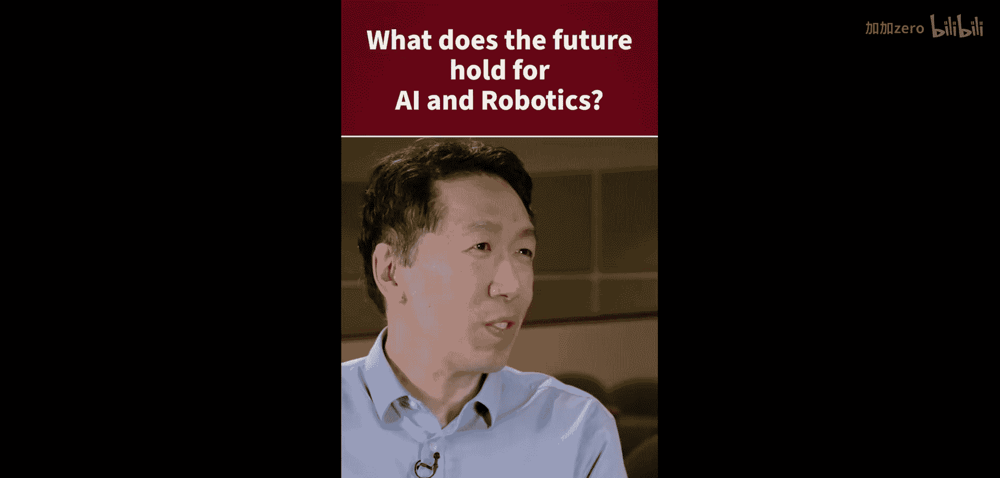
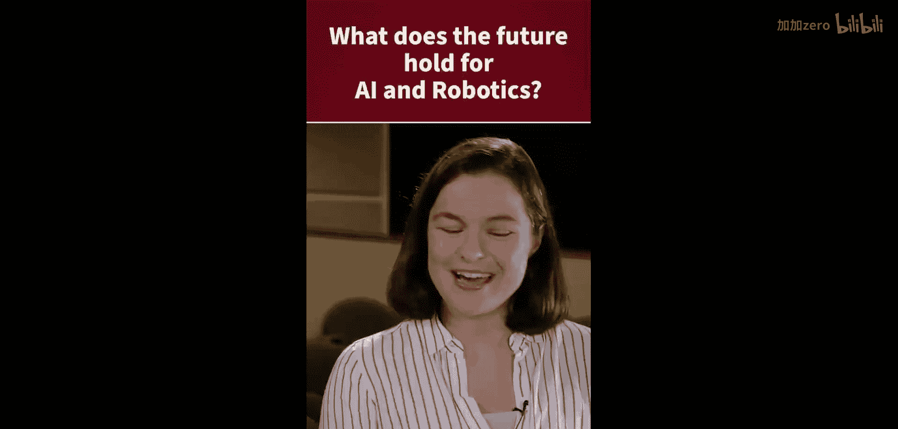
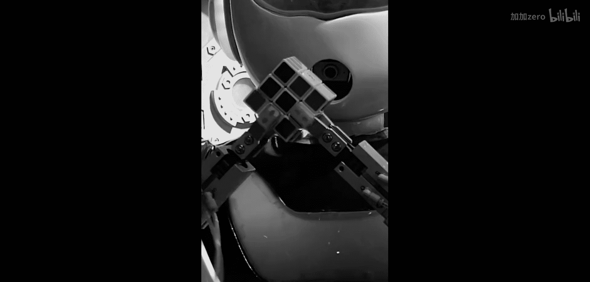
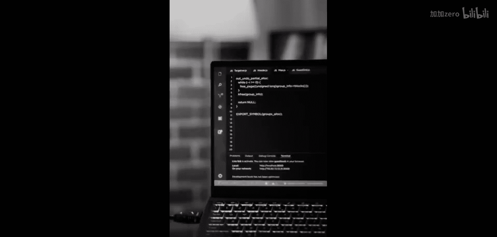
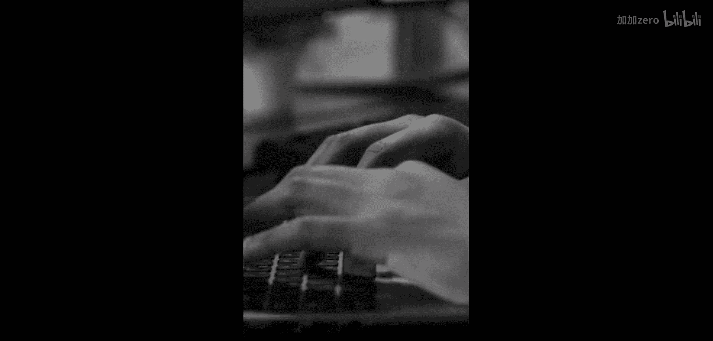
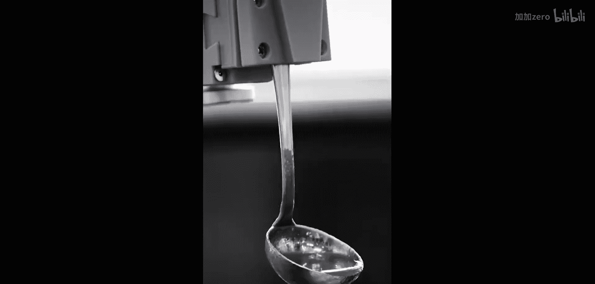
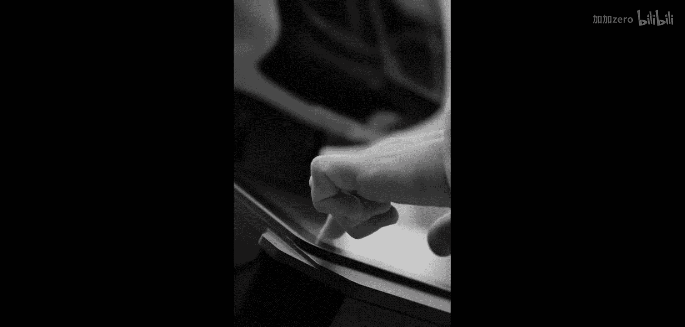
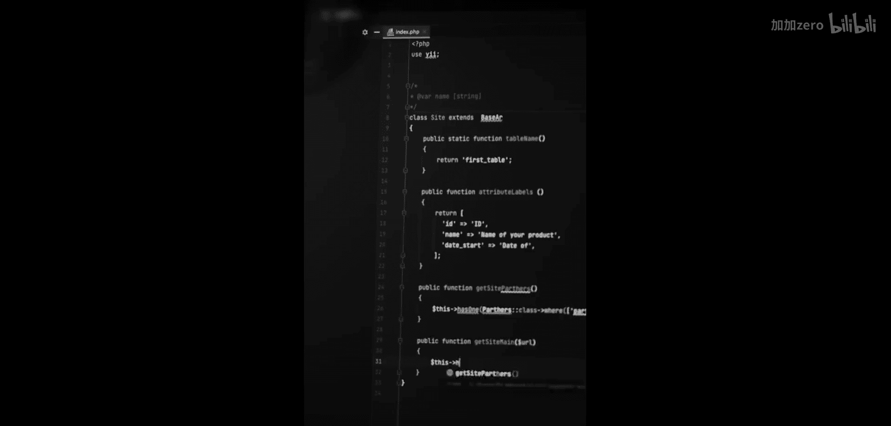
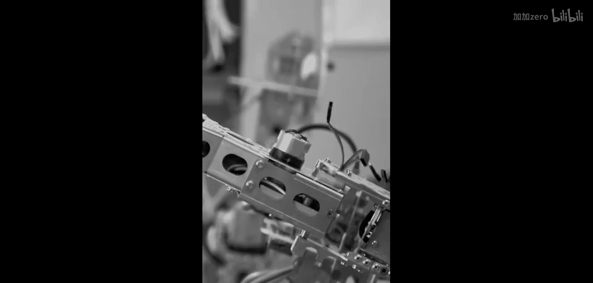
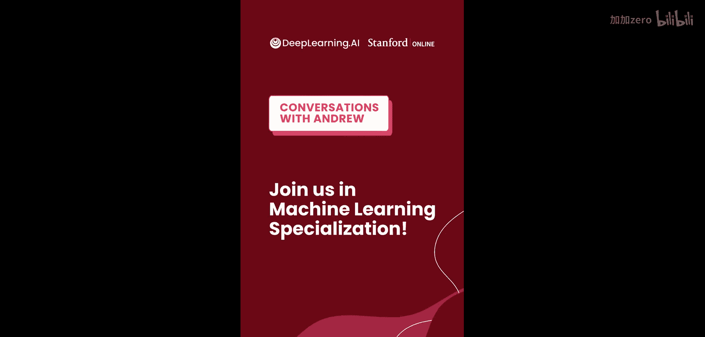

# 【人工智能访谈会 2023】斯坦福大学—中英字幕 p10 p9 What does the future hold for AI and Robotics？ - Chelsea Finn & Andrew Ng -BV14XB8YYEb1_p10-

What's your prediction for where this will go I certainly think that it will continue to grow quite a bit I hope that will convince more people that this sort of paradigm is really promising for robotics as well。

 especially in terms of handling the vast degree of variety in objects and environments in the world in terms of looking forward one thing that I'm really excited about is trying to train robots on broader data sets a lot of the field of robot learning is still collecting a data for a project in a lab and then training on that small data it's small because it has to be because youve collected it for that project and so my prediction at least for the coming years is to move towards a paradigm where we' sharing datas across institutions across robot platforms and scaling up the data that these systems are trained on such that they can generalize more broadly。

