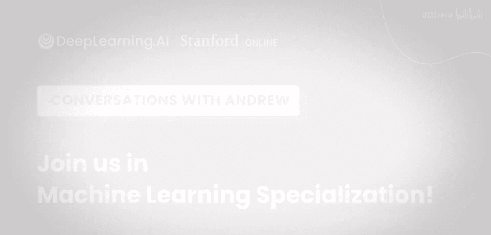

# 【人工智能访谈会 2023】斯坦福大学—中英字幕 p11 p10 Is a Career in AI and Machine Learning Right for Me？ - Fei-Fei Li & Andrew N -BV14XB8YYEb1_p11-

嗯。

🎼Today people are entering AI from all walks of life and sometimes people still wonder is AI a right path for me The truth is if I could enter AI back then more than 20 years ago today anybody could enter AI because AI has become such a prevalent and globally impactful technology you actually started out not studying computer science or AI but you started out studying physics and so how did you make that switch from physics to AI physics was my passion all the way through you know middle school high school college and one thing physics has taught me till today is really the passion for asking big questions the passion for seeking North stars and one thing I did was reading up stories and just writings of great physicists of the 20th century。

 it was really interesting to notice that many of the writings。

Towards the later half of the career of these great physicists were not about just the physical world。

 but ponderings about equally audacious questions like life like intelligence like human conditions that really got me very curious about the topic of intelligence one thing led to another during college time I did the intern at a couple of labs and especially vision related and I was like wow。

 this is just as audacious a question to ask as the beginning of the universe or what is matter made of and that got me to switch from undergraduate degree physics to graduate degree in AI so I think it is very exciting to be entering the science of intelligence and studying AI today。

