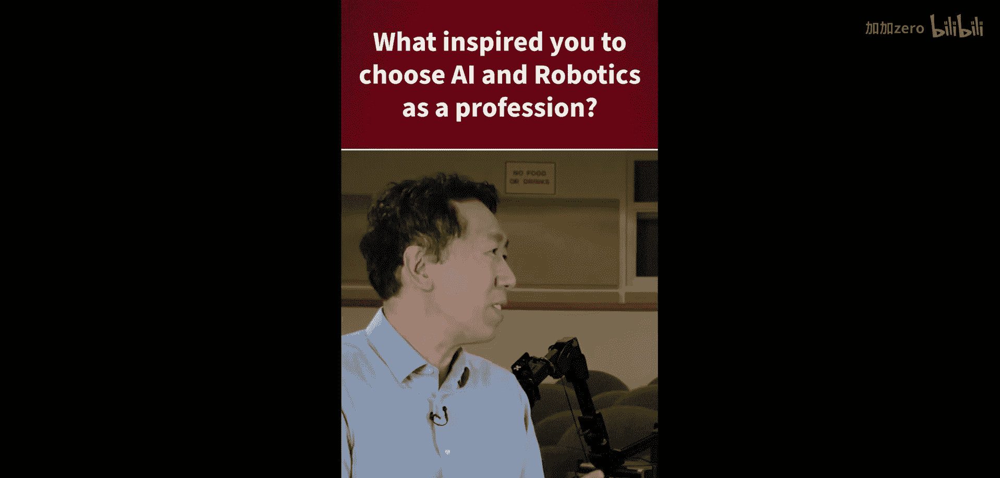
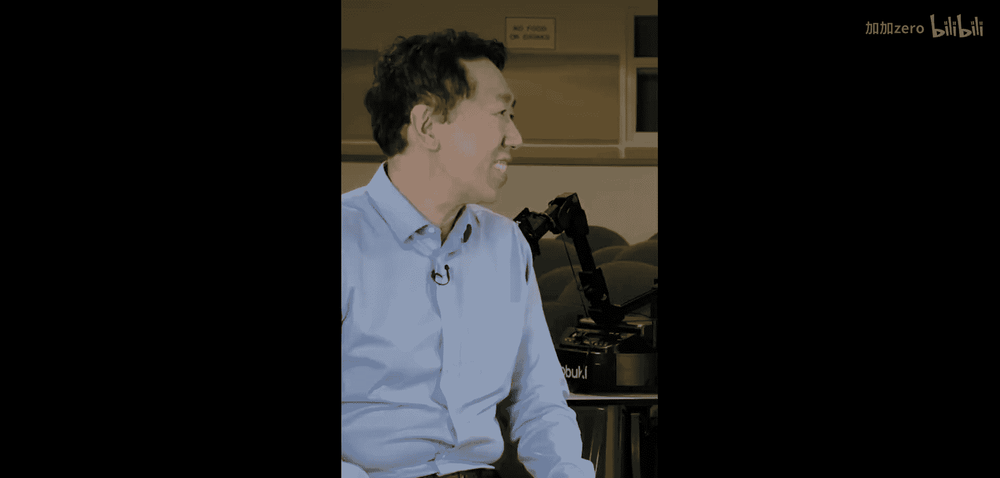
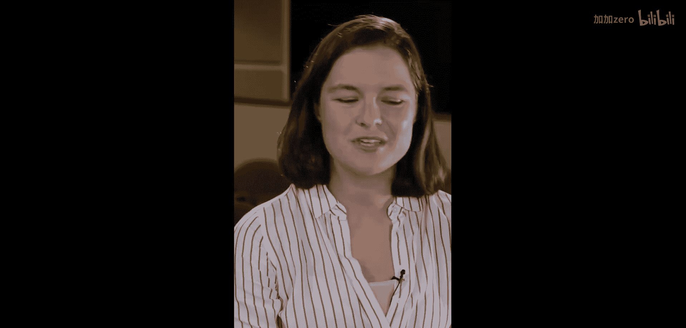
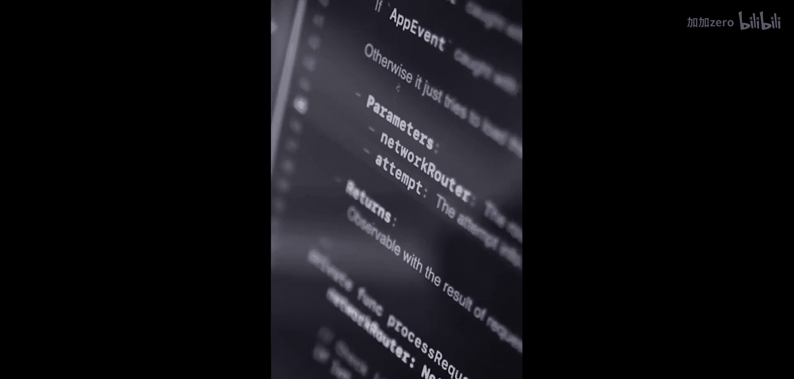
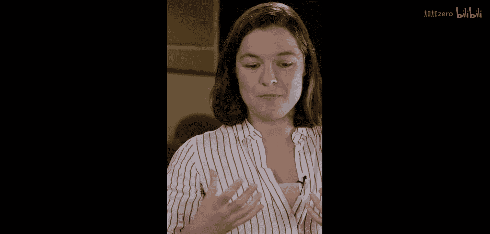
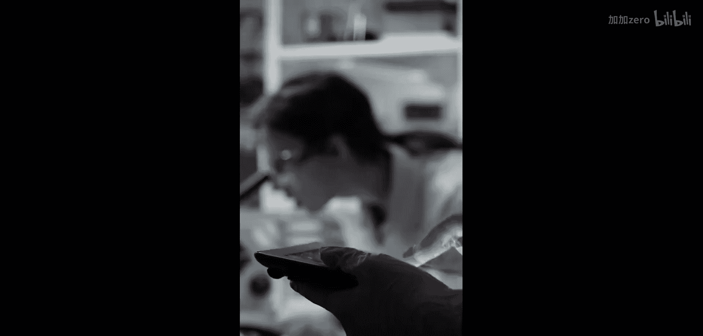
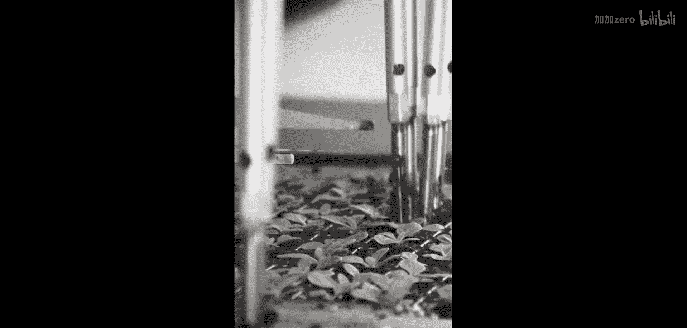
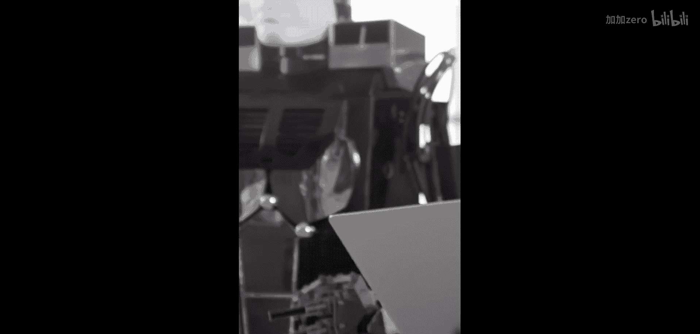
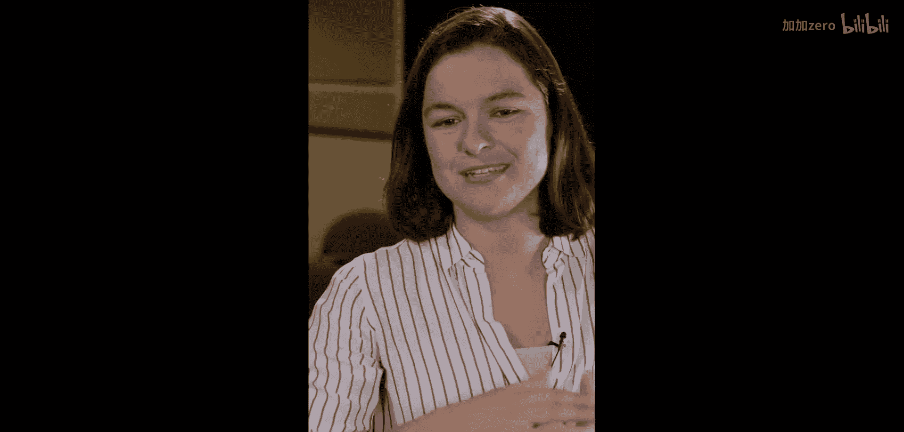
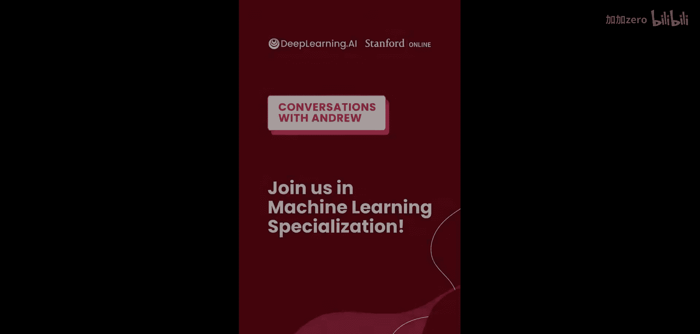

# 【人工智能访谈会 2023】斯坦福大学—中英字幕 p12 p11 What inspired you to choose AI and Robotics as a profession？ - Chelsea Finn -BV14XB8YYEb1_p12-

You actually considered a lot of career options ranging from biology to aerospace to you know computer science and industrial engineering so what made you make this choice I was always drawn to engineering because I really like solving puzzles and solving problems when I was considering different engineering majors and what really drew me first to computer science was that it gives you a lot of flexibility essentially computer science empowers you to build lots of different things with software with code with that I could eventually go into biology if I wanted to I could go into robotics there's all sorts of really exciting things you can do with computer science and I was also really drawn to this challenge of how can we build a computer that can see like humans do that can perceive things in images and can take actions in the world。

