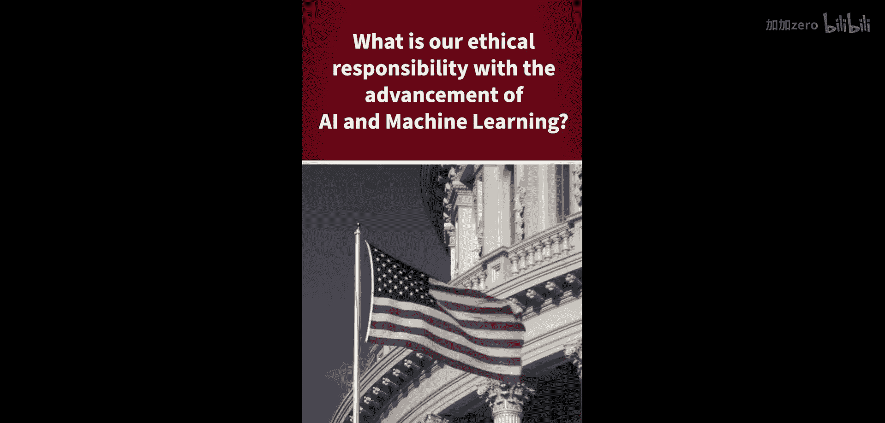
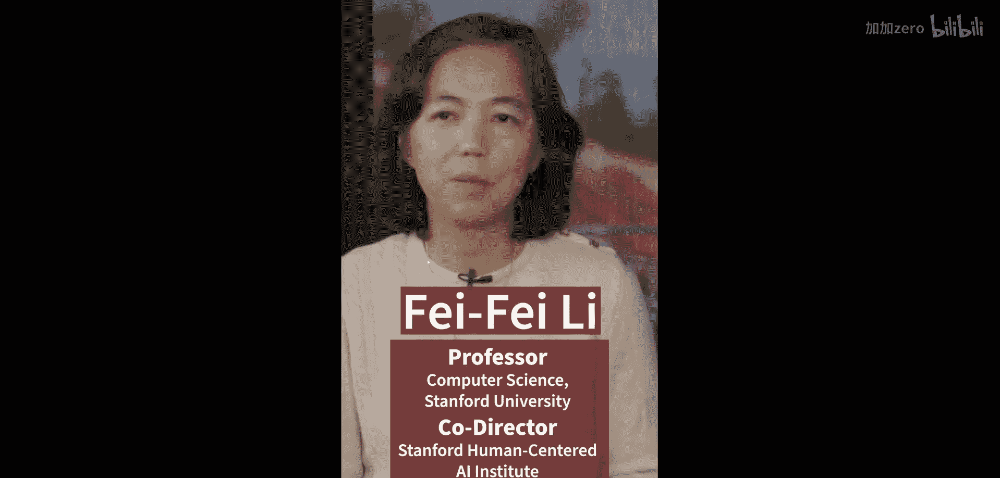
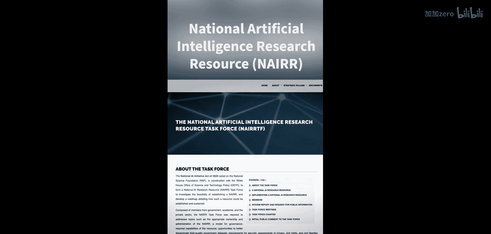

# 【人工智能访谈会 2023】斯坦福大学—中英字幕 p13 p12 What is our ethical responsibility with AI & Machine Learning？ - Fei-Fei Li -BV14XB8YYEb1_p13-

One of the really interesting pieces of work you've been doing has been leading several efforts to help educate governments work toward better laws in better regulation as to relates AI We'd love to hear more about that There is a culture in Silicon Valley is we just keep making things the law will catch up by itself but AI is impacting human lives and sometimes negatively we're talking about fairness we're talking about privacy way one of the leading universities that lobbied a bill called the National AI research resource and this bill is calling for a task force to put together a roadmap for America's public sectors to increase their access to resource for AI Comp and AI data It's not a regulatory policy it's an incentive policy to build and rejuvennate ecosystems。

