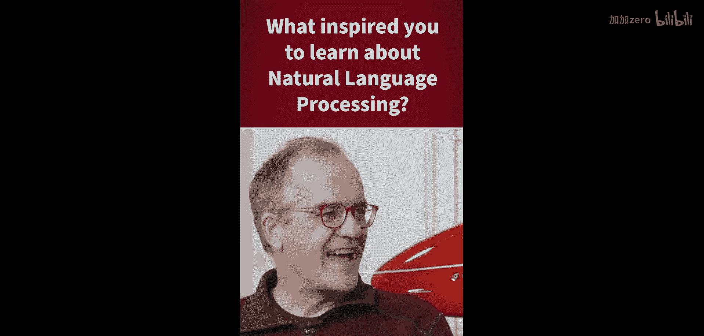
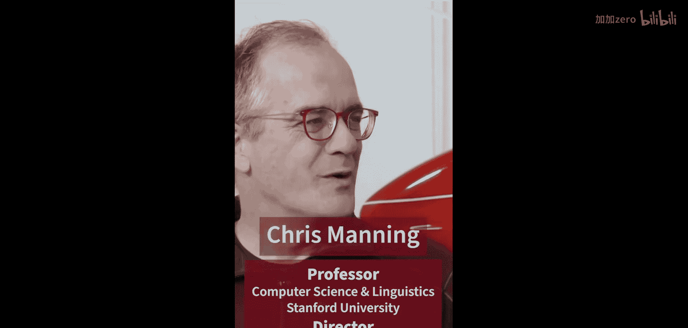
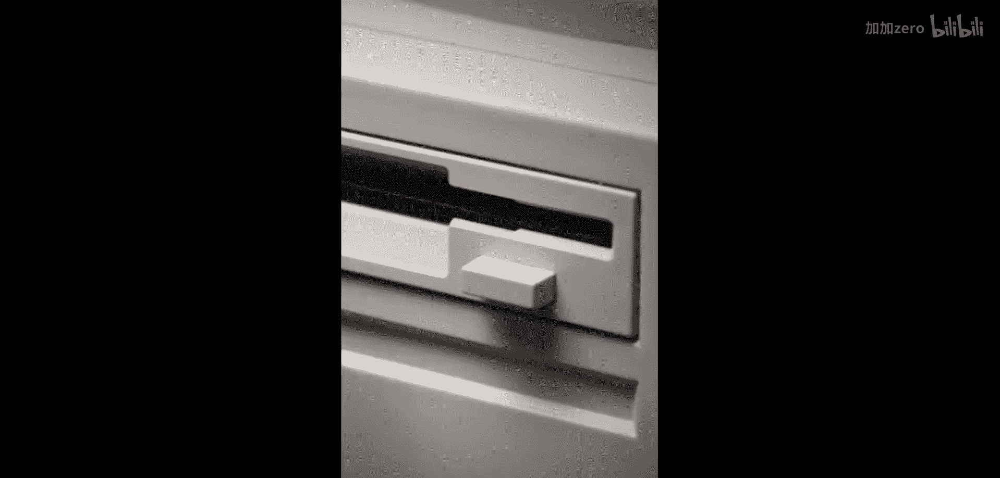
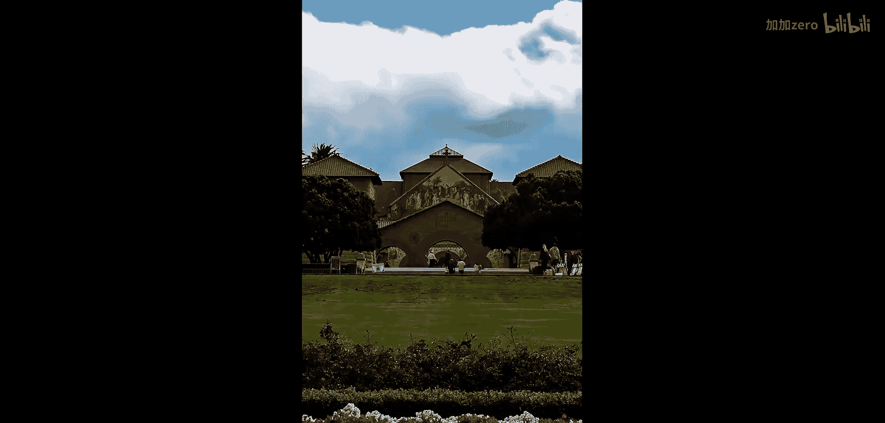
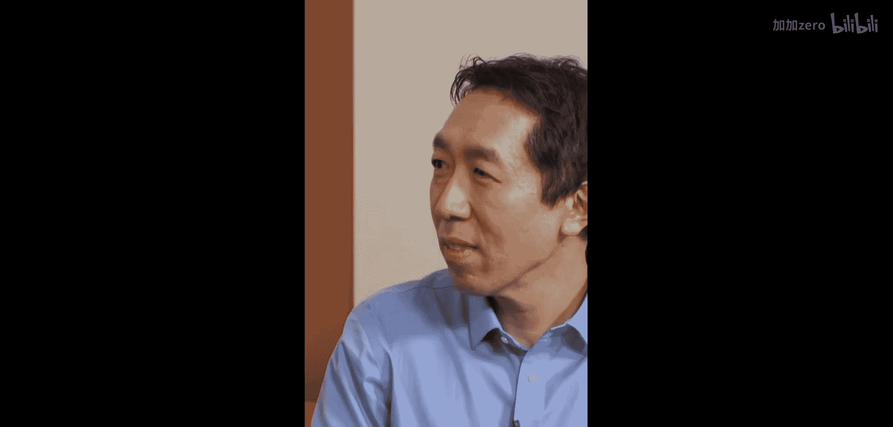
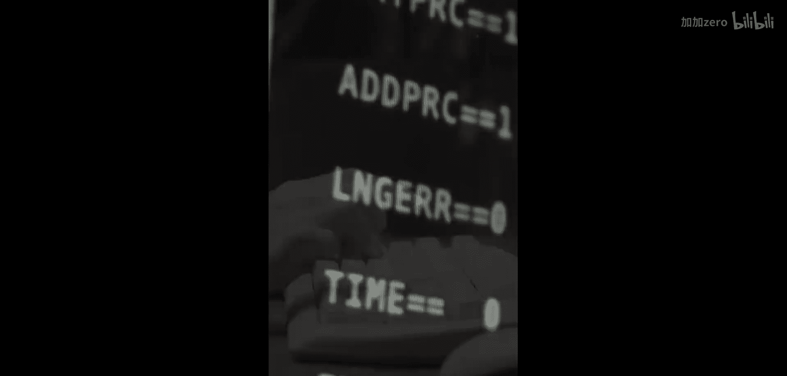
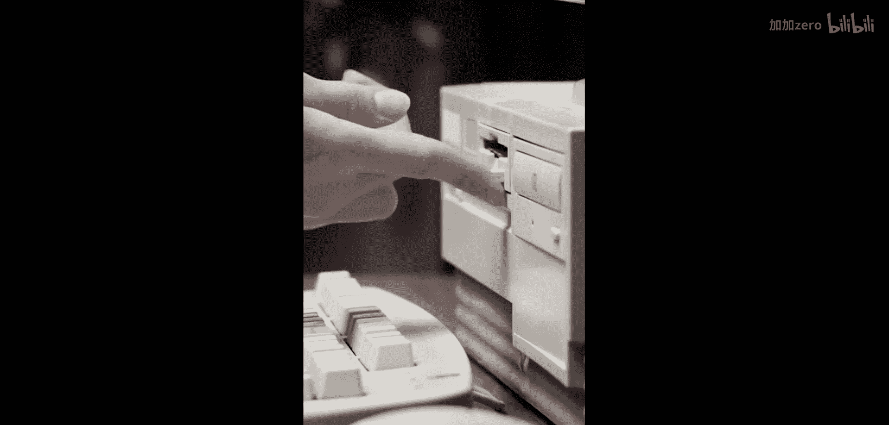
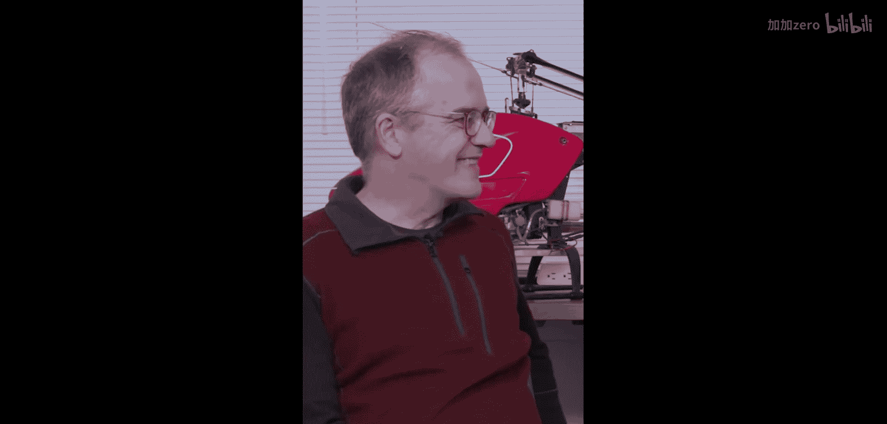

# 【人工智能访谈会 2023】斯坦福大学—中英字幕 p14 p13 What inspired you to study Natural Language Processing？ - Chris Manning & An -BV14XB8YYEb1_p14-

🎼，🎼So how did you go from studying syntax to being an NLP researcher So starting out I was very interested in human languages and how they work。

 how people understand them I did have interests in computer science and so my interests were kind of mixed but I ended up at Stanford as a linguistic student at that point in the early 90s things were just starting to change when they first started to be lots of human language material text and speech available digitally so this was just before the World web exploded and it just seemed really clear that there had to be exciting things that you could do by working empirically from lots of human language and that's what really sort of got me involved in a new kind of natural language processing that then led into my subsequent career。

😊。

