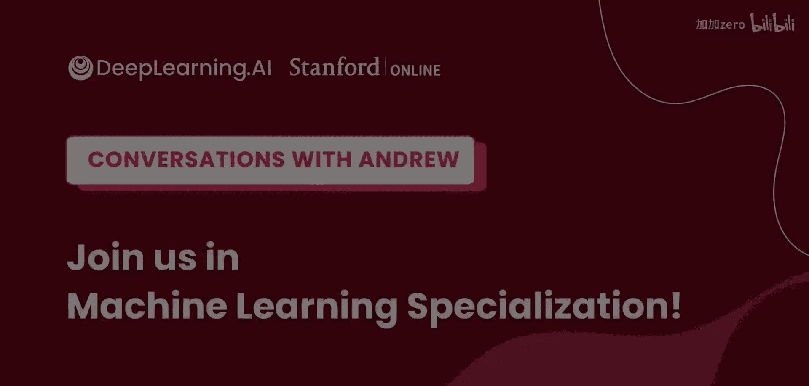

# 【人工智能访谈会 2023】斯坦福大学—中英字幕 p16 p15 What advice do you have for someone breaking in to AI？  - Chris Manning & An -BV14XB8YYEb1_p16-

う。

🎼，🎼，🎼What advice would you have for someone wanting to break into machine learning It's a great time to break in I think there's just no doubt at all that we're still in the early stages of seeing the impact of this new approach where effectively software。

 computer science is being reinvented there are just lots of opportunities for more automation making more use of interpretation of human language material for me or in other areas like vision and robotics so you want to get some kind of good foundation right so knowing some of the core technical methods of machine learning understanding ideas of how to build models from data diagnose errors all of these core things beyond that I think it's also useful to learn something about human language and the nature of the problems that involves I mean even though people aren't directly going to be encoding rules of human language into their。

😊，🎼Computing system a sensitivities are sort of what kind of things happen in language and what to look out for and what you might want to model that's still a useful skill to have。

😊，🎼う。

