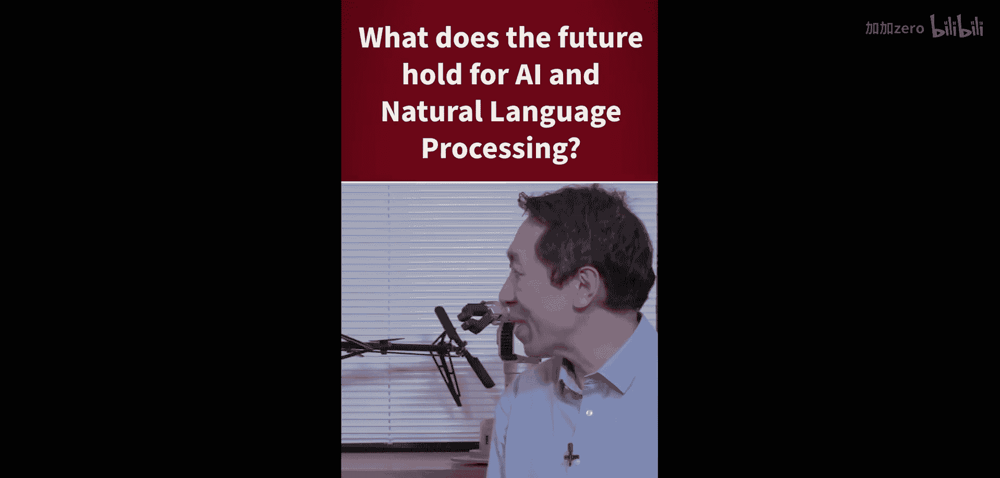
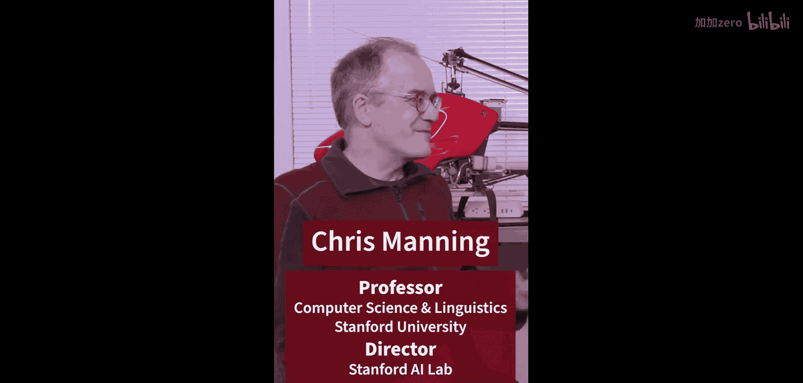
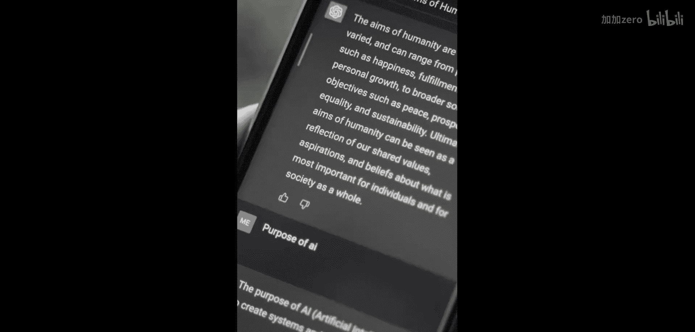
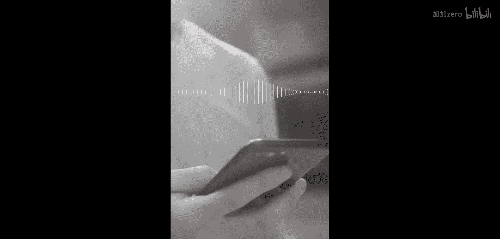

# 【人工智能访谈会 2023】斯坦福大学—中英字幕 p17 p16 What does the future hold for Natural Language Processing？ - Andrew Ng & Chr -BV14XB8YYEb1_p17-

🎼What are your thoughts on where all this will go I think this's just no doubt at all the future is extremely bright We're moving into this age where human language will be able to be used as an instruction language to tell your computer what to do one way to think about the difference in comparison to the kind of voice assistance or virtual assistants that are available I think all of us have had the experience that those suffices aren't always great if you know the right way to word things that will do something but if you use the wrong wording won't the difference with human beings is by and large you don't have to think about that I think that we'll start to see the same kind of progression with these models that age is opening up in front of us and that will be hugely transformative。

😊。

🎼。