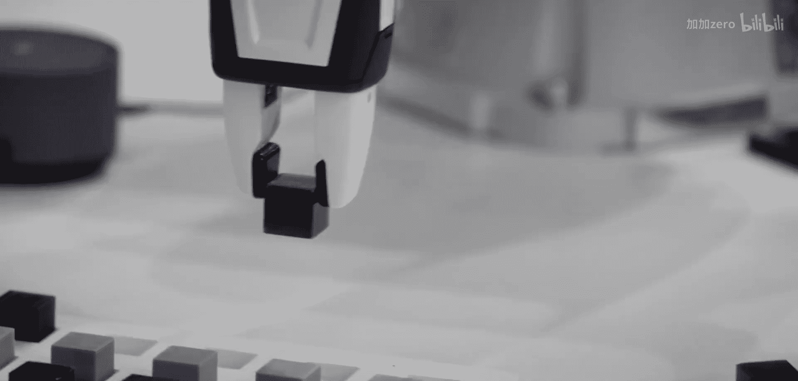

# 【人工智能访谈会 2023】斯坦福大学—中英字幕 p18 p17 What is it like working in an AI lab？ - Chelsea Finn & Andrew Ng -BV14XB8YYEb1_p18-

One part of your work is you run a robotics lab if a student were to join your lab was a like to show at work in the morning In the lab。

 it's not all that different from running machine learning experiments where you run code you try to train a model and then evaluate that model there's also interfacing with the real robot Oftentimes a lot of projects might start with a simulation and that might involve actually kind of designing aspects of the simulation to test the hypotheses you want to test and on the real robot there is setting up the control stack such that you can actually command the robot setting up the cameras reflectinging data and you may want to actually look at the images that the robot is seeing。

 maybe visualize some of the features that your model has learned it's a pretty fun process at least for me I think it's very rewarding to actually see the robot do something rather than just see some numbers or some accuracy of your model but it' also requires persistence because robots can break down it used to stonnoous teleopta。

So every time a helicopter trash， we have to just go build a new one Yeah fortunately arms do not crash too much maybe I should have've chosen working on that。

