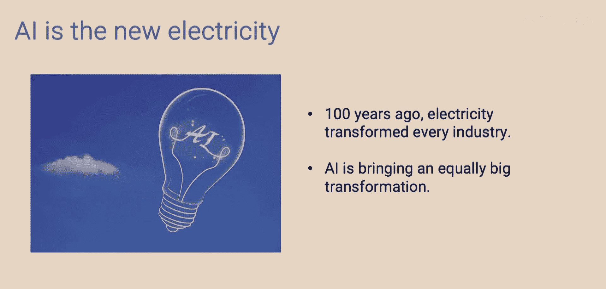
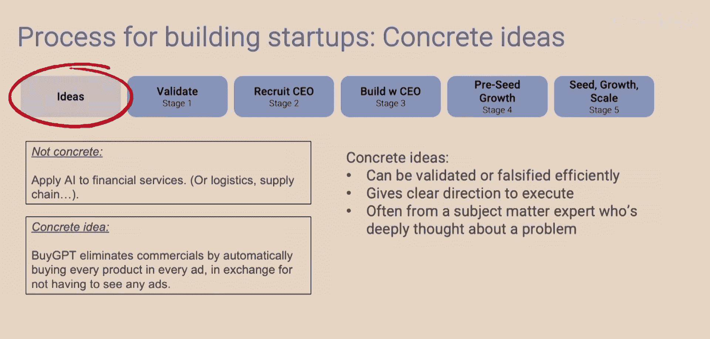
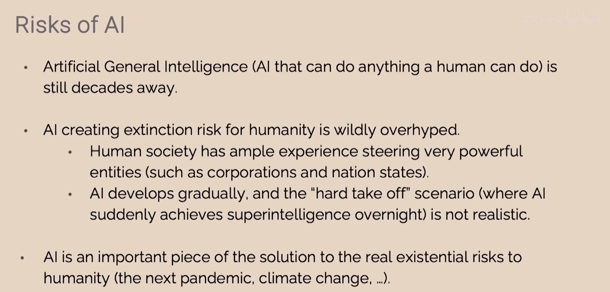

# 【人工智能访谈会 2023】斯坦福大学—中英字幕 p19 p18 Andrew Ng： Opportunities in AI - 2023 -BV14XB8YYEb1_p19-

🎼It is my pleasure to welcome Dr。 Andrew Wu。Tonight。

Andrew is the managing general partner of AI Fund。Founder of deep learning， AI。

And learn and lending AI， chairman and cofounder of Cosera。

And an unjunct professor of computer science here at Stanford。Previous。

 he had started and LED the Google Brain team， which had helped Google adopt modern AI。

 And he was also director of the Stanford AI Lab。About 8 million people。

 one in 1000 persons on the planet。Have taken an AI class from him。

 And through both his education and his AI work。He has changed numerous lives。

 Please welcome dte and。Thank you Lisa， and it's good to see everyone。

 So what I want to do today is chat you about some opportunities in AI。😊。

So I've been saying AI is a new electricity。 One of the difficult things to understand about AI is that it is a general purpose technology。

 meaning that it's not useful only for one thing， but it's useful for lots of different applications kind of like electricity if I would ask you what is electricity good for you know is not any one things a lot of things So what like to do is start off sharing with you high view the technology landscape and this will lead into the set of opportunities。

 So lot of lots of excitement about AI。 and I think a good way to think about AI is as a collection of tools。

 So this includes a technique called supervisized learning。

 which is very good at recognizing things or labeling things and geneative AI。

 which is relatively new exciting development。 if you're familiar with AI you may have heard of other tools but I'm going to talk less about these additional tools and ourll focus today what I think are currently the two most important tools which are supervis learning and generative AI。

So supervised learning is very good at labeling things or very good at computing input to outputs or A to B mappings。

 given an input A， give me an output B。For example。

 given an email we can use supervised learning to label it as STM or not STM The most lucrative application of this that I've ever worked on is probably online advertising where given an ad。

 we can label a user is likely to click on it and therefore show more relevant ads for self drivingr cars。

 given the sensor of meetings of a car we can label it with where the other cause。

 one project that my team AI client worked on was ship route optimization where given a route to the ship is taking or considering taking。

 we can label that with how much fuel we think also consume and use this ships more fuel efficient。

Did a lot of work in automated visual inspection in factories so you can take a picture of a smartphone that was just manufacturerd and label。

 is there a stretch or any other defect in it？😊，Or if you want to build a restaurant review reputation monitoring system。

 you can have little piece of software that looks at online restaurant reviews and labels that as positive or negative sentiment。

So one nice thing， one cool thing about supervised learning is that it's not useful for one thing。

 it's useful for all of these different applications and many more besides。

Let me just walk through concretely the workflow of one example of a civilized learning labeling things kind of project。

 If you want to build a system to label restaurant reviews。

 you then collect a few data points or collective data where say the bestsrami sandwich is great to say that this positive several is slow that's negative my favorite shipping curry that's positive and here I've shown three data points but you're building this you may get thousands of data points like this or thousands of training examples we call it and the workflow of a machine learning project an AI project is you get label data。

 maybe thousands of data points then you have a AI engineering team train an AI model to learn from this data and then finally you would find maybe a cloud service to run the trained AI model and then you can feed it you know best voltage you've ever had and that's positive sense。

And so I think the last decade was maybe the decade of large scale supervised learning。

What we found starting about 10，15 years ago was if you were to train a small AI model。

 so train a small neural network or small deep learning algorithm basically a small AI model maybe not on a very powerful computer。

 then as you fed more data as performance would get better for a little bit。

 but then it would flatten out， it would plateau and it would start being able to use the data to get better and better。

But if you were to train a very large AI model， lots of compute on maybe powerful GPUs。

 then as we scaled up the amount of data we gave the machine learning model。

 its performance would kind of keep on getting better and better。

So this is why when I started and led the Google Bra team。

 the primary mission that I directed the team to solve at that time was let's just build really。

 really large neural networks that we then fed a lot of data to and that recipe fortunately worked and I think the idea of driving large compute and large scale data。

 that recipes really helped us driven a lot of AI progress over the last decade。

So if that was the last decade of AI， I think this decade is turning out to be also doing everything we had in studentvisized learning。

 but adding to it， the exciting too of geneative AI。So many of you。

 maybe all of you were have played with ChaGT and B and so on。

 but just you know given a piece of text， which you call a prompt， like I love eating。

 if you run this multiple times， maybe you get biggerel screen peas or my mother's melo or out to friends and the AI system can generate output like that given the amounts of buzz and excitement about genes of AI。

 I thought I'd take just half a slide to say a little bit about how this works。

So it turns out that gen of AI。At least this type of a text generation。

 the core ofId is using supervised learning that inputs output mappings to repeatedly predict the next word and so if your assistant reads on the internet to sentence like my favorite food is a bagel with cream trees and locks。

 then this is translated into a few data points where if it sees my favorite food is a in this case。

 try to guess that the right next word was bagel or my favorite food is a bagel。

 try to guess next word is with and similarly if it sees that， in this case。

 the right guess for the next word where they been cream。

So by taking text so you find on the internet or other sources and by using this input output superized learning to try to repeatedly predict the next word。

 if you train a very large AI system，On hundreds of billions of words or in the case of the largest models。

 now more than a trillion words， then you get a large language model like ChGB and you there are additional other important technical details I talked about predicting the nextI word。

 technically these systems predict the NI subwe， the part of work called the token and then there are other techniques like ROHF for further tuning the AI output to be more helpful honest and harmless。

 but at the heart of it is this using supervised learning to repeatedly predict the NI word that really was enabling the exciting really fantastic progress on large language models。

So。While many people have seen large language models as a fantastic consumer too。

 you can go to a website like Tra GPS's website or Bs or other large language models and users。

 I think it's fantastic too。😊，There's one of the trend I think is still underappreciated。

 which is the power of large language models， not as not just as consumer tool。

 but as a developer too， so it turns out that there are applications that used to take me months to build that a lot of people can now build much faster by using a large language model so specifically the workflow for supervised learning。

 building the restaurant review systems would be that you need to get a bunch of label data。

 and know maybe that takes a month to get a few thousand data points。

And then have an AI team train and tune and really get optimized performance on your AI model。

 maybe that'll take three months。Then find a cloud service to run it。

 make sure it's running robustly， make sure it's rugized， maybe that'll take another three months。

So a pretty realistic timeline for building a commercial great machine learning system is like six to 12 months and so teams I've led will often took roughly six to 12 months to build and deploy these systems and some of them turns out be really valuable。

 but this is a realistic timeline for building and deploying a commercial great AI system。

In contrast， with prompt based AI， where you write a prompt， this is what the workflow looks like。

You can specify a prompt。That takes maybe minutes or hours。And then you can deploy it to the cloud。

 and that takes maybe hours or days。 So there now certain AI applications that used to take me。

 you know， literally six months， maybe a year to build that many teams around the world can now build in maybe a week。

 And I think this is already starting， but the best is still yet to come。

 This is starting to open up a flood of a lot more AI applications that can be built by a lot of people。

 So I think many people still underestimate the magnitude of the flood of custom AI applications that I think is going to come down the pipe。

Now。I know you probably were not expecting me to write code in this presentation。

 but that's what I'm going to do。So it turns out this is all the code I need in order to write a sentiment classifier。

So I'm going know， some of you will know Python， I guess import San toolss from Open the eye and then have this prompt that says classifiedify detect text below delimited by three dashes as having either a positive or negative sentiment。

 I don't know。仔 had a fantastic time。Stanford， GSB。Learned a lot， and also made。Great new friends。

 so that's my prompt， and now'm just I run it and I've never run it before。

 so I really hope oh thank goodness， we got the right answer。Ha。

And this is literally all the code it takes to build a sentiment classifier and so today。

 you developers around the world can take literally maybe like 10 minutes to build a system like this。

And。That's a very exciting development。So。One of the things I've been working on was trying to teach online classes about how they use prompting。

 not just as a consumer tool， but as a developer too。So start out the technology landscape。

 let me now share my thoughts on what are some of the AI opportunities I see。

This shows what I think is the value of different AI technologies today and I'll talk about three years from now。

 but the vast majority of financial value from AI today is。

 I think supervised earning where for a single company like Google can be worth more than $100 billion dollars a year and also。

There are millions of developers building supervised learning applications。

 so it's already massively valuable and also with tremendous momentum behind it just because of the sheer effort in finding applications and building applications。

And ingenative AI is the really exciting new entrancerant， which is much smaller right now。

And then there are the other two I'm including for completeness。 we can， you know。

If the sizes that these circles represent the value today。

 this is one I think it might grow to in three years。So supervised learning already really massive。

 may double， say， in the next three years， from truly massive to even more massive。And gen of AI。

 which is much smaller today， I think will much more than double in the next three years because of the number of amount of developer interests。

 the amount of venture capital investments， the number of large corporate exploring applications and I also just to point out three years is a very short time horizon if it continues to compound anything near this rate than in six years。

 know it will be even vastly larger。But just light shaded region in green or orange。

 that light shaded region is where there are opportunities for either new startups or for large companies incumbents to create and to enjoy value capture。

But one thing I hope you take away from this slide is that all of these technologies are general purpose technologies。

 So in the case of supervised learning， a lot of the work that had to be done over the last decade。

 but is continuing for the next decade is identify and to execute on the concrete use cases and that process is also kicking off for gene AI。

So for this part of the presentation， I hope you take away from it that general purposese technologies are useful for many different tasks。

 lot of value remains be created using supervised learning and even though we're nowhere near finishing figuring out the exciting use cases of supervised learning。

 where this other fantastic two of Gene AI， which further expands the set of things we can now do using AI。

But one caveat which is that there will be short term fads along the way so I don't know if some of you might remember the app called Leza。

 this is the app that would let you upload pictures of yourself and theyll render a cool picture of you as an astronaut or scientist or something and it was a good idea and people liked it and his revenue just took off like crazy like that through last December。

And then it did that。And that's because Lenser was it was a good idea， people liked it。

 but it was a relatively thin software layer on top of someone else's really powerful APIs。

 and so even though it was a useful product， it was in a defensive old business and when I think about apps like Lenser。

 I'm actually reminded that when Steve Jobs gave us the iPhone。Shortly after。

 someone wrote an app that I paid 1994 to do this， to turn on the LED。

 to turn the phone into a flashlight。And that was also a good idea to write an app to turn on the LED light。

 but it also wasn't a defensible long term， it also didn't create very long term value because it was easily replicated and underpried and eventually incorporated into iOS。

But with the rise of iOS， with the rise of iPhone， someone also figured out how to build things like Uber and Airbnb and Tinder。

 the very longterm， very defensible businesses that created sustaining value。

 and I think with the rise of Gen AI or the rise of new AI tools。

 I think really what excites me is the opportunity to create those really deep really hard applications that hopefully can create very longterm value。

So the first trend I want to share is AI a general purpose technology。

 and a lot of the work that lies ahead of us is to find the very diverse use cases and to build them。

There's the second trend I want to share with you， which relates to why AI isn't more widely adopted yet。

It feels like a bunch of us have been talking about AI for like 15 years or something。

 but if you look at where the value of AI is today。

 a lot of it is still very concentrated in consumer software internet right once you go outside you tech or consumer software internet。

 there's some AI adoption but law feels very early。So why is that？

It turns out if you were to take all current and potential AI projects and sort them in decreasing order their value。

 then to the left of this curve， the head of this curve are the multibillion dollar projects like advertising or web search or e-commerce。

 or product recommendations or company Amazon。And it turns out that about 10， 15 years ago。

 various of my friends and I， we figured out a recipe for how to hire。

 say100 engineers to write one piece of software to serve more relevant ads and apply that one piece of software to billion end users and generate massive financial value。

 so that works。But once you go outside consumer software Internet。

 hardly anyone has 100 million or a billion users They can write and apply one piece of software to。

So once you go to other industries， as we go from the head of this curve on the left over to the long tail。

 these are some of the projects I see and amm excited about。

I was working with a pizza maker that was taking pictures of the pizza they were making because they needed to do things like make sure that the cheese is spread evenly。

 so this is about a $5 million project， but that recipe of hiring 100 engineers or dozens of engineers to work on a 5 million project that doesn't make sense。

Or ass another very example， working with an agriculture company that with them we figured out that if we use cameras to find out how tall is the wheat and wheat has often bent over because of wind or rain or something and we can chop off the wheat at the right height。

 then that results in more food for the pharma to sell and is also better for the environment。

 but this is another you know 5 million dollar project that that old recipe of having a large group of high skilled engineers to work on this one project that doesn't make sense and similarly materials grading。

 cloth grading， sheet metal grading mini project like this。

So whereas to the left in the head of this curve， there's a small number of let's say。

 multibillion dollar projects and we know how to execute those delivering value in other industries。

 I'm seeing a very long tail of tens of thousands of let's call them 5 million dollar projects that until now have been very difficult to execute on because of the high cost of customization。

The trend that I think is exciting is that the AI community has been building better tools that lets us aggregate these use cases and make it easy for the end user to do the customization。

 so specifically Im seeing a lot of exciting lowcode and nocode tools that enable the user to customize the AI system。

 what this means is instead of me needing to worry that much about pictures of Psa。

 we have tools because we' starting to see tools that can enable the IT departments of the Psa making factory to train an AI system on their own pictures of Pa to realize this $5 million worth of value。

And by the way， the pictures of Pser， they don't exist on the internet。

 so Google and Bing don't have access to these pictures。

 we need tools that can be used by really the P factory themselves to build and deploy and maintain their own custom AI system that works on their own pictures of Ps。

And broadly。The technology for enabling this somewhere is prompting text prompting， visual prompting。

 but really large language models and similar tools like that。

 or a technology called data centric AI， whereby instead of asking the P factory to write a lot of code。

 which is challenging， we can ask them to provide data， which turns out to be more feasible。

And I think the second trend is important because I think this is a key part of the recipe for taking the value of AI。

 which so far still feels very concentrated in the tech world and the consumer software internet world and pushing this out to all industries。

 really to the rest of the economy， which sometimes is's easy to forget。

 the rest of the economy is much bigger than the tech world。So。For two trends I shared。

 AI is a general purpose technology， lots of concrete use cases to be realized， as well as localco。

 noco easily use tools， enabling AI to be deployed in more industries。How。

 how do we go after these opportunities。So about five years ago， there was a puzzle I want to solve。

 which is I felt that many valuable AI projects are now possible I was thinking how do we get them done and having led AI teams in you know Google and Baidu in big tech companies。

 I had a hard time figuring out how I could operate a team in a big tech company to go after a very diverse set of opportunities and everything from maritime shipping to education to financial services and healthcare and on and on it's just very diverse use cases。

 very diverse go to markets and very diverse really customer bases and applications and I felt that the most efficient way to do this would be we can start a lot of different companies to pursue these very diverse opportunities so that's why I ended up starting AI fund。

 which is Advous studio that build startups to pursue a diverse set of AI opportunities。

And of course， in addition to lots of startups， incumbing companies also have a lot of opportunities to integrate AI into existing businesses。

 in fact， one pattern I'm seeing for incumbent businesses is distribution is often one of the cyclical advantages of incumbent companies that they play their cars rate can allow them to integrate AI into their products quite efficiently。

But just to be concrete， where are the opportunities。

So I think of this this is what I think of as an AI stack。

At the bottom level is the hardware semiconductor layer， fantastic opportunities there。

 but very capital intensive， very concentrated。 So these a lot of resources relatively few winners。

 so some people can should play there， I personally don't like to play there myself。😊。

There's also the infrastructure layer， also fantastic opportunities， but very capital intensive。

 very concentrated， so I tend not to play that myself either。And then there's a developer tool layer。

 What I showed you just now was I was actually using Open AI's API as a developer tool。

 and then I think the developer tool sector is a hypercomp。

 look at all the startups chasing open AI right now， but there will be some mega winners。

 and so I sometimes play here， but primarily when I think have a meaningful technology advantage because I think that earns you the right or earns you a better shot at being one of the mega winners。

And then lastly， even though a lot of the media attention and the buzz is in the infrastructure and developer tooling layer。

 it turns out that that layer can be successful only if the application layer is even more successful。

And we saw this to the rise of SAS as well a lot of the buzz excitement is on the technology。

 the tooling layer， which is fine， nothing wrong with that。

 but the only way for that to be successful is that the application layer is even more successful so that frankly they can generate enough revenue to pay the infrastructure and the tooling layer。

So actually let me mention one example， AmO Ri was actually just texting a CEO yesterday。

 but AmO R is a company that we built that uses AI for romantic relationship coaching right and you just to point out I'm an AI guy and I feel like I know nothing really about romance。

嗯。And if you don't believe me， you can ask my wife。

 she will confirm that I know nothing about romance。But when we want to build this。

 we wanted getting together with the former CEO of Tinder or Renata Niborg and with my team's expertise in AI and her expertise in relationships。

 which she ran Tider， she knows more about relationships I think anyone I know we're able to build something pretty unique using AI for kind of romantic relationship mentoring and the interesting thing about applications like these is when we look around you know how many teams in the world are simultaneously expert in AI and in relationships and so at the application layer。

 I'm seeing a lot of exciting opportunities that seem to have the very large market but where the competition set is very light relative to the magnitude of the opportunities not that they no competitors but it's just much less intense compared to the developer tool or the infrastructure layer。

And so。Because I've spent a lot of time iterating on a process of building startups。

 what I'm going to do is just know very transparently tell you the recipe we've developed for building startups and so after many years of iteration and improvement。

 this is how we now build startups。My teams always had access a lot of different ideas， you know。

 internally generated ideas from partners， and I want to walk through this with one example of something we did。

 which is a company bearing AI， which uses AI to make ships more fuel efficient。

So this idea came to me when a few years ago， a large Japanese conglomerate called Mitsi that is a major shareholder and operates a major shipping lines。

 they came to me and he said，" hey Andrew， you should build a business to use AI to make ships more fuel efficient and the specific idea was you think of it as a Google Mas for ships。

 we can suggest a ship or tell a ship how to steer so that you still get to your destination on time but using it turns out about 10% less fuel。

And so what we now do is we spend about a month validating the idea。 So double check。

 is this idea even technically feasible and then talk to prospective customers to make sure there is market need。

 So we spend up to about a month doing that。And if it passes this stage。

 then we will go and recruit a CO to work with us on the project When I was starting out。

 I used to spend a long time working on the project myself before bringing on a CO but after iterating we realized that bringing on the leader at the very beginning to work with us it reduces a lot of the burden of having a transfer knowledge or having a CO come in and having to revalidate whether we discover it。

 so the process is we've learned much more efficient which is bringing the leader at the very start and so in the case of bearing AI。

 we found a fantastic CEO didn Kyle whos a repeat entrepreneur one successful exhibit before。

 and then we spent three months six， two weeks sprints to work with them to build a prototype as well as do deep customer validation。

If it survives the stage and we have about a twothhirs， 66% survival rate， we the first check in。

 which then gives the company reasonable is to hire an executive team， know build a key team。

 get the MVP working， minimum viable product working and get some real customers and then after that hopefully then successfully raises additional external rounds of funding。

 it and can keep on growing scaling。So I'm really proud of the work that my team was able to do to support Mitui's idea and Dylan Ka as CO。

 and today there are hundreds of ships on the high seas right now that are steering themselves differently because of bearing AI and 10% fuel savings translates to rough all they man to maybe $450。

000 in savings in fuel per ship per year and of course is' also frankly quite a bit better for the environment and I think this startup。

I think would not have existed， if not for Dylan's fantastic work。

 and then also Mitszi bring this idea to me。And。I like this example because this is another one is like you know this is a startup idea that just to point out I would never have come up with myself because you know I've been on a boat but what do I know about maritime shipping but it the deep subject matter expertise of Mitu that had this insight together with Dylan and then my team's expertise in AI that made this possible and so as I operate in AI one thing I've learned is my swim lane is AI and that's it because I done a time was very difficult for me to be expert and maritime shipping and romantic relationships and healthcare and financial services and on and on and on and so I've learned that if I can just help get accurate technical validation and then use AI resources to make sure the AI tech is built quickly and well and I think we've always managed to help the company build as strong technical team then partnering with subject matter expertss often results in exciting new opportunities。

And I want to share with you other weird aspect of one other weird lesson I've learned about building startups。

 which is I like to engage only when there's a concrete idea。

And this runs counter to a lot of the advice you hear from the design thinking methodology。

 which often says don't rush to solutioning， explore a lot of alternatives for you solution。Honestly。

 we tried that， it was very slow， but what we've learned is that at the ideation stage is someone comes to me and says。

 hey， Andrew， you should apply AI to financial services。

Because I'm not a subject matter expert in financial services its very slow for me to go and learn enough about financial services to go figure out what to do。

 I mean eventually you could get to a good outcome， but it's a very labor intensive， very slow。

 very expensive process for me to try to learn industry after industry。In contrast。

 one of my partners wrote this idea as a tongue cheap， not really seriously， but you。

 let's say a concrete idea is buy GT， let's eliminate commercials by automatically buying every product advertise and exchange from not having't seen yet。

 it' not a good idea， but it is a concrete idea。And it turns out concrete ideas can be validated or falsified efficiently。

They also give a team a clear direction to execute and I've learned that in today's world。

 especially with you know the excitement and buzz and exposure to the AI of a lot of people。

 it turns out that there are a lot of subject matter experts in today's world that have deeply thought about the problem for months。

 sometimes even one or two years but they've not yet had to build partner and when we get together with them and here and they share the idea with us it allows us to work with them to very quickly go into validation and building and I find that this works because there are a lot of people that have already done the you know design thinking thing of exploring a lot of ideas and winning down to really good ideas and I find that there's so many good ideas sitting out there that no one is working on that finding those good ideas that someone has already had and to share us and wants to build partner for that' turns out tore much more efficient。

Mion。So before I wrap up， we'll go to a question a second。

 just have a few slides to talk about risks and social impact。

So it's a very powerful technology to state something you probably guess， my teams and I。

 we only work on projects I move humanity forward and we have multiple times kill projects that we assess to be financially sound based on ethical grounds。

 it turns out I've been surprising sometimes dismay at the creativity of people to come up with good ideas sorry to come up with really bad ideas that seem profitable but really should not be built。

 with kill a few projects on those grounds。And then I think has we acknowledge that AI today does have problems with bias fairness accuracy。

 but also you know the technology is improving quickly。

 so I see that AI systems today are less biased than six months ago and more fair than six months ago。

 which is not to dismiss the importance of these problems。

 they are problems and we should continue to work on them。

 but I'm also gratified at the number of AITers working hard on these issues to make them much better。

When I think of the biggest risks of AI， I think that the biggest risks。

 one of the biggest risks is the disruption to jobs。

 this is a diagram from a paper by a friend at a University of Pennsylvania and some folks at open AI analyzing the exposure of different jobs to AI automation。

And it turns out that whereas the previous wave of automation。

 mainly the most exposed jobs were often the lower wage jobs， such as when。

 you we put robots into factories。With this current wave of automation is actually the higher wage shops for the right of disaster that seems to have more of their tasks exposed to AI automation。

So even as you create tremendous value using AI， I feel like。

As citizens and and our corporations and the governments and really our society。

 I feel a strong obligation to make sure that people。

 especially people whose livelihoods are disrupted， are still well taken care of。

 are still treated well。And then， lastly。There's also been it feels like every time there's a big wave of progress in AI。

 know， there there's a big wave of hype about artificial gender intelligence as well。

 When deep learning started to work really well 10 years ago， there was a lot of hype about AGI。

 now that gender AI is working really well。 There's another wave of hype about AGI。

 but I think that artificial gender intelligence AI didn't do anything a human can do iss still decades away。

 know maybe 30 to 50 years， maybe even longer。 I hope we'll see in the lifetimes。

 but I don't think there anytime soon。 one of the challenges is that。

The biological path to intelligence like humans and the digital path to intelligence， AI。

 they've taken very different paths and the funny thing about the definition of AGI is benchmarking there' very different digital path to intelligence with really the biological path to intelligence so I think you know large anguish models are smarter than any of us in certain key dimensions。

 but much dumber than any of us in other dimensions and so forcing it to do everything a human can do is like a funny comparison but I hope we'll get there maybe hopefully within a lot of times。

And then there's also a lot of， I think overblat hype about AI creating extinction risk for humanity。

 Candidly， I don't see it。 I just don't see how AI creates any meaningful extinction risk for humanity I think that people worry we can't control AI but we have lots of AI will be more powerful than any person but with lots of experience steering very powerful entities such as corporations or nation states that are far more powerful than any single person and making sure they。

 for the most part benefit humanity and also technology develops gradually the so-called hard takeoff scenario where it's not really working today and then suddenly one day overnight。

 it works brilliantly and we achieve super intelligence takes over world that's just not realistic and I think AI technology will develop slowly like all that and then it gives us plenty of time to make sure that we provide oversight and can manage it to be saved。

And lastly， if you look at the real extinction risk to humanity。

 such as fingers crossed the next pandemic or climate change leading to a massive depopulation of some parts of planets。

 or much lower odds but maybe someday and assteroid doing to us what it had done to the dinosaurs。

 I think if we look the actual real extinction risk to humanity， AI having more intelligence。

 even artificial intelligence in the world， would be a key part of the solution。

 so I feel like if you want humanity to survive and thrive for the next thousand years。

 rather than slowing AI down， which some people propose I would rather I would rather make AI go as fast as possible。

So with that just to summarize this my last slide， I think that AI as a general purpose technology creates a lot of new opportunities for everyone and a lot of the exciting and important work that lies ahead of us all is to go and build those concrete use cases and hopefully in the future hopefully I'll have opportunities to maybe engage with more view on those opportunities well so that let me just say thank you all very much。

