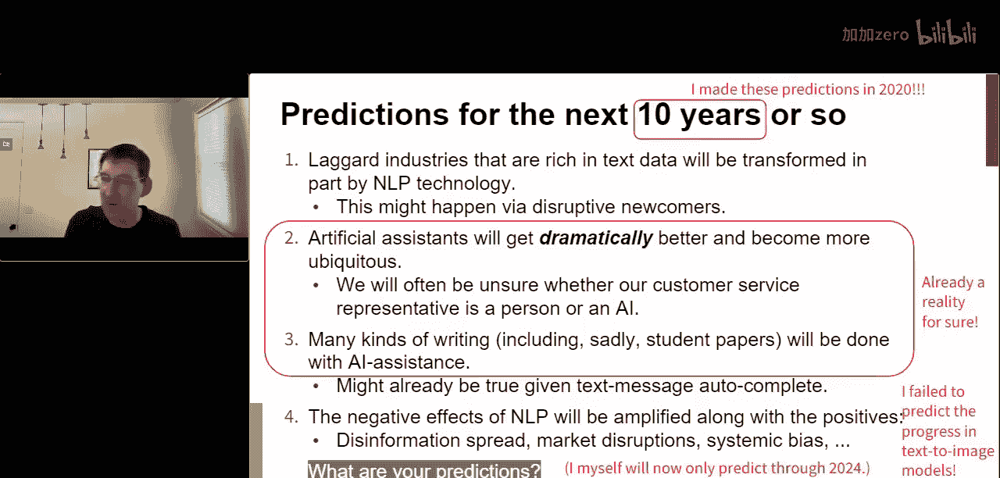
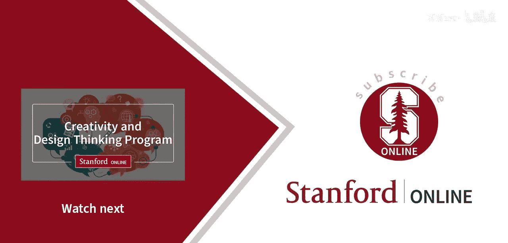

# 【人工智能访谈会 2023】斯坦福大学—中英字幕 p20 p19 Stanford Webinar - GPT-3 & Beyond -BV14XB8YYEb1_p20-

So Chris Pos is a professor and actually also the chair of the Department of Linguistics and by courtesy also at the Department of computer Science and he's a great expert in the area of natural language understandingstand so he's you know there would not be a better person to hear about a topic than him and we are so grateful that he could make the time and he's actually also teaching the graduate course CS22 for you natural language understanding that we actually transformed into a professional course that is starting next week on the same topic so you know if you are interested in learning more we have some links included you know down below on your platform you can check it out and you know there's so many other things that can be said about Chris like he has a super interesting podcast he's running like so many interesting research papers like projects he worked on so you know go ahead and learn more about him like you should also have a little link I think without further adie I think we can kick it off Chris。

 thank you so much once again。Oh thank you so much Petra for the kind words and welcome to everyone。

 It's wonderful to be here with you all。 I do think that we live in a golden age for natural language understanding maybe also a disconcerting age。

 a weird age but certainly a time of a lot of innovation and a lot of change It's sort of an interesting moment for reflection for me because I started teaching my NLU course at Stanford in 2012 about a decade ago。

 that feels very recent in my lived experience but it feels like a completely different age when it comes to NLU and indeed all of artificial intelligence I never would have guessed in 2012 that we would have such an amazing array of technologies and scientific innovations and that we would have these models that were just so performant and also so widely deployed in the world this is also a story of again for better。

or worse increasing societal impact and so that does come together for me into a golden age and just to reflect on this a little bit it's really just amazing to think about how many of these models you can get handson with if you want to right away right you can download or use via APIs models like Dolly2 that do incredible text to image generation stable diffusion midjourney they're all in that class we also have Gitthub copilot based in the codex model for doing codegeneration tons of people derive a lot of value from that system you。

com is at the leading edge I would say of search technologies that are changing the search experience and also leading us to new and better results when we search on the web。

Whisper AI is an incredible model from Open AI， this does speech to text， and this model。

Is a generic model that is better than the best user customized models that we had 10 years ago。

 just astounding， not something I would have predicted， I think And then， of course。

 the star of our show for today is going be these big language models。

 G3 is the famous one you can use it via an API We have all these open source ones as well that have come out O Bom G neo。

 These are models that you can download and work with to your heart's content provided that you have all the computing resources necessary。

 So just incredible and I'm sure you're familiar with this。

 but let's just you know get this into our common ground here。

 It's incredible what these models can do。 Here's a quick demo of G3。 I asked the Da Vinci2 engine。

 in which year was Stanford University founded When did it enroll its first students Who is its current president and what is its mascot And Da Vinci2 gave a fluent and complete。

Complete answer that is correct on all counts， just incredible。That was with Da Vinci2。

 we got a big update to that model in late 2022 that's Da Vinci3 and here I'm showing you that it reproduces that results exactly。

 and I do think that Da Vinci3 is a big step forward over the previous engine。

Here's actually an example of that， you know I have liked to play adversarial games with this model and so I asked Da Vinci too。

 would it be possible to hire a team of tamarinds to help me paint my house。

 assuming Im willing to pay them in sufficient quantities of fruit to meet minimum wage requirements in California？

This is adversarial because I know that these models don't have a really rich understanding of the world we live in。

 They're often distracted by details like this。 And sure enough， Da Vinci2 got confused。 Yes。

 it would be possible to hire a team of tamarins to paint your house。

 You would need to make sure that you're providing them with enough route to meet minimum wage requirements and so forth。

 So easily distracted。 But I tried this again with Da Vinci 3， and with the same question。

 it gave a very sensible answer。 no， it would not be possible to hire a team of tamarins to help you paint your house。

 Da Vinci2 was not distracted by my adversarial game。

 This is not to say that you can't trick Da Vinci2。

 just go on to Twitter and you'll find examples of that。 But again。

 I do think we're seeing a pretty remarkable rate of progress toward these models being robust and relatively trustworthy。

This is also a story of scientific innovation。 That was a brief anecdote。

 But we're seeing this same level of progress in the tools that we use to measure system performance in the field。

 I've put this under the heading of benchmark saturate faster than ever。

 This is from a paper from 2021 that I was involved with Kila et all。

 Here's the framework along the X axis。 I have time going back to the 1990s。 And along the Y axis。

 I have a normalized measure of our estimate of human performance。 That's the red line set at 0。

So MNIS， digit recognition， a grand old data set in the field that was launched in the 1990s。

 and it took about 20 years for us to surpass this estimate of human performance。

Switchboard is a similar story launched in the 90s。

 this is the speech to text problem it took about 20 years for us to get up past this red line here。

ImageNet is newer， this was launched in 2009， it took about 10 years for us to reach this saturation point。

And from here， the pace is really going to pick up。 So Squa 1。1 is question answering。

 That was solved in about three years。The response was squadqua 2。

0 that was solved in less than two years。And then the glue benchmark， if you were in the field。

 you might recall back the glue benchmark is this big set of tasks that was meant to stress test our best models。

 when it was announced， a lot of us worried that it was just too hard for present day models。

 but glue was saturated in less than a year。 The response was super gluelu meant to be much harder。

 It was also saturated in less than a year。 Re story of progress undoubtedly。

 even if you're cynical about this measure of human performance。

 We are still seeing a rapid increase in the rate of change here。And， you know。

2021 was ages ago in the story of AI Now， I think this same thing carries over into the current era with our largest language models。

 This is from a really nice post from Jason Way， he is assessing emergent abilities in large language models。

 you see eight of them given here along the X axis for these plots you have model size and on the Y axis you have accuracy。

 And what Jason is showing is that at a certain point。

 these really big models just attain these abilities to do these really hard tasks。

 and Jason estimates that for 137 tasks， models are showing this kind of emergent ability and that includes tasks that were explicitly set up to help us stress test our largest language model。

 They're just following away one by one， really incredible。

Now we're going to talk a little bit later about the factors that are driving this enormous progress for large language models。

 but I want to be upfront that one of the major factors here is just the raw size of these models you can see that in Jason's plots that's where the emergent ability kicks in and let me put that in context for you so this is from a famous platform of a paper that's actually about making models smaller and what they did is track the rise of increases in model size along the X axis we have time depth it only goes back to 2018 it's not very long ago and in 2018 the largest of our models had around 100 million parameters seems small by current comparisons。

In late 19 late 2019， early 2020， we start to see a rapid increase in the size of these models so that by the end of 2020。

 we have this megatron model at 8。3 billion parameters。 I remember when that came out。

 It seemed like it must be some kind of typo。 I could not fathom that we had a model that was that large。

 But now， of course， this is kind of on the small side。 Soon after that。

 we got an 11 billion parameter variant of that model。 and then G3 came out。

 That says 1075 billion parameters。 And that one too now looks small in comparison to these truly gargantuan megatron models and the Paul model from Google。

 which surpassed 500 billion parameters。I want to emphasize that this has made a complete mockery of the Y axis of this plot to capture the scale correctly。

 we would need 5000 of these slides stacked on top of each other。 Again。

 it still feels weird to say that， but that is the truth。

 The scale of this is absolutely enormous and not something I think that I would have anticipated way back when we were dealing with those00 million parameter babies by comparison。

 they seemed largely at that point。So this brings us to our central question， it's a golden age。

 this is all undoubtedly exciting， and the things that I've just described to you are going to have an impact on your lives。

 positive and negative， but certainly an impact。But I take it that we are here today because we are researchers and we would like to participate in this research and that could leave you with a kind of worried feeling how can you contribute to NLU in this era of these gargantuan models。

 I've set this up as a kind of flowchar first question。

 do you have $50 million and a love of deep learning infrastructure。

If the answer is yes to this question， then I would encourage you to go off and build your own large language model you could change the world in this way。

I would also request that you get in touch with me。

 maybe you could join my research group and maybe fund my research group， that would be wonderful。

But I'm assuming that most of you cannot truthfully answer yes to this question。 I'm in the no camp。

 right， and on both counts， I am both dramatically short of the funds。

 and I also don't have a love of deep learning infrastructure。

 So for those of us who have to answer no to this question， how can you contribute。

 even if the answer is no， there are tons of things that you can be doing。 All right。

 so just topics that are front of mind to me include retrieval augmented in context learning。

 This could be small models that are performant。You could always contribute to creating better benchmarks。

 this is a perennial challenge for the field and maybe the most significant thing that you can do is just create devices that allow us to accurately measure the performance of our systems。

You can also help us solve what I've called the last mile problem for productive applications these central developments in AI take us 95% of the way toward utility。

 but that last 5% actually having a positive impact on people's lives often requires twice as much development twice as much innovation across domain experts。

 people who are good at human computer interaction and AI experts and so there's just a huge amount that has to be done to realize the potential of these technologies。

And then finally， you could think about achieving faithful human interpretable explanations of how these models behave if we're going to trust them。

 we need to understand how they work at a human level that is supremely challenging and therefore this is incredibly important work you could be doing。

Now I would love to talk with you about all four of those things and really elaborate on them。

 but our time is short and so what I've done is select one topic。

 retrieval augmented in contextex learning to focus on because it's intimately connected to this notion of in contextex learning and it's a place where all of us can participate in lots of innovative ways。

So that's kind of the central plan for the day， before I do that though。

 I just want to help us get more common ground around what I take to be the really central change that's happening as a result of these large language models and I've put that under the heading of the rise of in contextext learning。

And again， this is something we're all getting used to， it really marks a genuine paradigm shift。

 I would say。In context learning really traces to the GT3 paper。

 there are precedents earlier in the literature， but it was the GT3 paper that really gave it a thorough initial investigation and showed that it had promised with the earliest G models。

 Here's how this works。 We have our big language model， and we prompt it with a bunch of text。

 So for example， this is from that GT3 paper we might prompt the model with a context passage in a title。

We might follow that with one or more demonstrations here the demonstration is a question and an answer。

 and the goal of the demonstration is to help the model learn in context that is from the prompt we've given it what behavior we're trying to elicit from it。

 So here you might say we're trying to coax the model to do extractive question answering to find the answer as a substring of the passage we gave it。

You might have a few of those。 And then finally， we have the actual question we want the model to answer。

 We prompt the model with this prompt here that puts it in some state。

 and then its generation is taken to be the prediction or response。

 And that's how we assess its success。And the whole idea is that the model can learn in context that is from this prompt what we want it to do。

So that gives you a sense for how this works， you've probably all prompted language models like this yourself already。

 I want to dwell on this for a second though this is a really different thing from what we used to do throughout artificial intelligence let me contrast in context learning with the standard paradigm of standard supervision。

Back in the old days of 2017 or whatever， we would typically set things up like this。

 We would have say we wanted to solve a problem like classifying texts。

 according to whether they express nervous anticipation a complex human emotion。

 The first step would be that we would need to create a data set of positive and negative examples of that phenomenon。

 And then we would train a custom built model to make the binary distinction reflected in the labels here。

It can be surprisingly powerful， but you can start to see already how this isn't going to scale to the complexity of the human experience。

 we're going to need separate data sets and maybe separate models for optimism and sadness and every other emotion you can think of。

 and that's just a subset of all the problems we might want our models to solve for each one we're going to need data and maybe a custom built model。

The promise of in context learning is that a single big。

 frozen language model canserve all those goals。 And in this mode。

 we do that prompting thing that I just described。 We're going to give the model examples。

 just expressed in flat text of positive and negative instances and hope that that's enough for it to learn in context about the distinction we're trying to establish。

 This is really， really different。 Consider that over here。

 the phrase nervous anticipation has no special status。 The model doesn't really process it。

 It entirely structured to make a binary distinction。

And the label nervous anticipation is kind of for us。 On the right。

 the model needs to learn essentially the meanings of all of these terms and our intentions and figure out how to make these distinctions on new examples all from a prompt。

It's just weird and wild that this works at all。 I think I used to be discouraging about this as an avenue。

 And now we're seeing it bear so much fruit。What are the mechanisms behind this。

 I'm going to identify a few of them for you。 The first one is certainly the transformer architecture。

 This is the basic building block of essentially all the language models that I've mentioned so far。

 We have great coverage of the transformer in our course， natural language understanding。

 So I'm going to do this quickly。 The transformer starts with word embeddings and positional encodings。

 on top of those。 we have a bunch of attention mechanisms。

 These give the name to the famous paper attention is all you need， which announce the transformer。

 Evidently， attention is not all you need because we have these positional encoings at the bottom。

 and then we have a bunch of feed forward layers and regularization steps at the top。

 but attention really is the beating heart of this model。

 and it really was a dramatic departure from the fancy mechanisms。

 LSTms and so forth that were characteristic of the pre transformformer era。

So that's essentially though on the diagram here， the full model in the course。

 we have a bunch of materials that help you get hands on with transformer representations and also dive deep into the mathematics。

 so I'm just going to skip past this I will say that if you dive deep you're likely to go through the same journey we all go through where your first question is how on earth does this work。

 this diagram looks very complicated。But then you come to terms with it and you realize， oh。

 this is actually a bunch of very simple mechanisms。

But then you arrive at a question that is a burning question for all of us。

 Why does this work so well， This remains an open question。

 A lot of people are working on explaining why this is so effective。

 and that is certainly an area in which all of us could participate analytic work。

 understanding why this is so successful。The second big innovation here is a realization that what I've called self-supvision is an incredibly powerful mechanism for acquiring rich representations of form and meaning。

 This is also very strange in self-supervision the model's only objective is to learn from cooccurrence patterns in the sequences it's traineded on。

 this is purely distributional learning。 Another way to put this is the model is just learning to assign high probability to a tested sequences。

That is the fundamental mechanism we think about these models as generators。

 but generation is just sampling from the model， that's a kind of secondary or derivative process。

 the main thing is learning from these cooccurrence patterns。

An enlightening thing about the current era is that it's fruitful for these sequences to contain lots of symbols。

 not just language， but computer code， sensor readings， even images， and so forth。

 those are all just symbol streams and the model learns associations among them。

The core thing about self- supervision， though， that really contrasts it with the standard supervised paradigm I mentioned before is that the objective doesn't mention any specific symbols or relations between them。

 it is entirely about learning these co-occurrence patterns， and from this simple mechanism。

 we get such rich results。And that is incredibly empowering because you need hardly any human effort to train a model with self supervision。

 you just need vast quantities of these symbol streams。

 and so that has facilitated the rise of another important mechanism here， large scale pretraining。

And there are actually two innovations that are happening here right so we see the rise of large pre-scale pretrain in the earliest work on static word representations like word to V and G。

And what those teams realize is not only that it's powerful to train on vast quantities of data using just self-supervision。

 but also that it's empowering to the community to release those parameters， not just data。

 not just code， but the actual learned representations for other people to build on that has been incredible in terms of building effective systems。

After those we get ElLmo， which was the first model to do this for contextual word representations。

 truly large language models， then we get Bt， of course， and GPT， and then finally of course。

 GPT3 at a scale that was really previously unimagined and maybe kind of unimaginable for me。

A final piece that we should not overlook。Is the role of human feedback in all of this。

 And I'm thinking in particular， of the open AI models。

 I have given a lot of coverage so far of this mechanism of self supervision。

 but we have to acknowledge that our best models are what open AI calls the instruct models。

 and those are trained with way more than just self supervision。

This is a diagram from the chat GP blog post。 It has a lot of details。

 I'm confident that there are really two pieces that are important。 First。

 the language model is fine tuned on human level supervision。

 just making binary distinctions about good generations and bad ones that's already beyond self supervision。

And then in a second phase， the model generates outputs and humans rank all of the outputs the model has produced。

 and that feedback goes into a lightweight reinforcement learning mechanism。In both of those phases。

 we have important human contributions that take us beyond that self supervision step and kind of reduce the magical feeling of how these models are achieving so much。

I'm emphasizing this because I think what we're seeing is a return to a familiar and kind of cynical sounding story about AI。

 which is that many of the transformative step forwards。

Are actually on the back of a lot of human effort behind the scenes expressed at the level of training data。

But on the positive side here， it is incredible that this human feedback is having such an important impact。

 Instruct models are best in class in the field， and we have a lot of evidence that that must be because of these human feedback steps happening at a scale that I assume is astounding。

 they must have at open AI， large teams of people providing very fine grain feedback across lots of different domains with lots of different tasks in mind。

Final piece， by way of background， Proing itself。 This has been a real journey for all of us。

 I have described this as step by step and chain of thought reasoning。

To give you a feel for how this is happening， let's just imagine that we've posed a question like can our model's reason about negation。

 that is， if we didn't eat any food， does the model know that we didn't eat any pizza？

In the old days of 2021， we were so naive， we would prompt models with just that direct question like is it true that if we didn't need any food then we didn't eat any pizza and we would see what the model said in return。

Now， in 2023， we know so much， and we have learned that it can really help to design a prompt that helps the model reason in the intended ways。

 This is often called step by step reasoning。 Here's an example of a prompt that was given to be by Omar Kaabab。

 You start by telling it it's a logic and common sense reasoning exam。 For some reason。

 that's helpful。Then you give it some specific instructions。

 and then you use some special markup to give it an example of the kind of reasoning that you would like it to follow。

After that example comes the actual prompt， and in this context。

 what we essentially ask the model to do is express its own reasoning and then conditional on what it has produced。

 create an answer。And the eyeopening thing about the current era is that this can be transformatively better。

 I think if you wanted to put this poetically， you'd say that these large language models are kind of like alien creatures。

 and it's taking us some time to figure out how to communicate with them。

 and together with all that instruct fine tuning with human supervision or converging on prompts like this as the powerful device。

 And this is exciting to me because what's really emerging is that this is a kind of very light way of programming an AI system using only prompts as opposed to all the deep learning code that we used to have to write。

 and that's going to be incredibly empowering in terms of system development and experimentation。

All right， so we have our background in place， I'd like to move to my main topic here。

 which is retrieval augmented in context learning， what you're going to see here is a combination of language models with retriever models which are themselves under the hood。

 large language models as well。But let me start with a bit of the backstory here。

 I think we're all probably vaguely aware at this point that large language models have been revolutionizing search again。

 the star of this is the transformer or maybe more specifically its famous spokes model Bert right after Bert was announced around 2018。

 Google announced that it was incorporatedcorporating aspects of Bt into its core search technology and Microsoft made a similar announcement at about the same time。

 and I think those are just two public facing stories of you know many instances of large search technologies having Bt elements incorporated into them in that era。

 and then of course in the current era we have startups like you。

com which have made large language models pretty central to the entire search experience in the form of you delivering results but also interactive search with conversational agents。

So that's all exciting。I am an NLP at heart， and so for me， in a way。

 the more exciting direction here is the fact that finally search is revolutionizing NLP than helping us bridge the gap into much more relevant knowledge intensive tasks。

To give you a feel for how that's happening， let's just use question answering as an example。

Prior to this work in NLP， we would pose question answering or QA in the following way。

You saw this already with the GPT3 example， we would have as given at test time。

 a title and a context passage， and then a question。

And the task of the model is to find the answer to that question as a literal substr of the context passage。

 which was guaranteed by the nature of the dataset set。As you can imagine。

 models are really good at this task， superhuman， certainly at this task。

 but it's also a very rarefiified task。 this is not a natural form of question answering in the world。

 and it's certainly unlike the scenario of， for example doing web search。

So the promise of the open formulations of this task are that we're going to connect more directly with the real world in this formulation at test time。

 we are just given a question。And the standard strategy is to rely on some kind of retrieval mechanism to find relevant evidence in a large corpus or maybe even the web。

 And then we proceed as before。This is a much harder problem because we're not going to get the subtrain guarantee anymore。

 because we're dependent on the retriever to find relevant evidence。

 but of course it's a much more important task because this is much more like our experience of searching on the web。

Now， I've kind of biased already in describing things this way where I assume we're retrieving a passage。

 but there is another narrative out there。 let me skip to this。

 then you could call this link the LLMs for everything approach。

 and this would be where there's no explicit retriever。

 you just have a question come in you have a big opaque model process that question and out comes an answervoila。

 you hope that the user' information need is met directly。

 no separate retrieval mechanism just the language model doing everything。

 I think this is an incredibly inspiring vision。 but we should be aware that there are lots of kind of danger zones here。

 So the first is just efficiency。 One of the major factors driving that explosion in model size that I track before is that in this LLMs for everything approach we are asking this model to play the role of both knowledge store and language capability。

 If we could separate those out， we might get away with smaller models。

We have a related problem of updateability。 Suppose a fact in the world changes that document on the Web changes。

 for example。 Well， you're going to have to update the parameters of this big opaque model somehow to conform to the change in reality。

There are people hard at work on that problem that's a very exciting problem。

 but I think we're a long way from being able to offer guarantees that a change in the world is reflected in the model behavior。

 and that plays into all sorts of issues of trustworthiness and explainability of behavior and so forth。

Also， we have an issue of provennce。 Look at the answer at the bottom there。

 Is that the correct answer。 Should you trust this model。

 right in the standard web search experience， we typically are given some web pages that we can click on to verify at least at the next level of detail。

 whether the information is correct。 But here we're just given this response。

 And if the model also generated a provenance string。 If it told us where it found the information。

 we'd be left with the concern that that provideance string was also untrustworthy， right。

 And this is like a really breaking a fundamental contract that users expect to have with search technologies。

 I believe。So those are some things to worry about， there are positives though。

 of course these models are incredibly effective at meeting your information need directly。

 and they're also outstanding at synthesizing information if your question can only be answered by 10 different web pages。

 it's very likely that the language model will still be able to do it without you having to hunt through all those pages。

So exciting， but lots of concerns here， here is the alternative of retrieval augmented approaches right Oh。

 I can't resist this actually。Just to give you an example of how important this trustworthy thing can be。

 So I used to be impressed by da Vinci 3， because it would give a correct answer to the question。

 our professional baseball players allowed to glue small wings onto their caps。

 This is a question that I got from a wonderful article by Hector Levec。

 where he encourages us to stress teststar models by asking them questions that would seem to run up against any simple distributional or statistical learning model and really get at whether they have a model of the world。

😊，And for Da Vinci， too， it gave what it looked like a really good levex style answer。

 There is no rule against it， but it is not common。 That seems true。So I was disappointed， I guess。

 or I'm actually not sure how to feel about this when I asked Da Vinci 3 the same question。

 and it said， no， professional baseball players are not allowed to glue small wings onto their caps。

 Major League Baseball has strict rules about the appearance of players uniforms and caps and any modifications of the caps are not allowed。

That also sounds reasonable to me。 Is it true， It would help enormously if the model could offer me at least a web page with writ with evidence that's relevant to these claims。

 Otherwise， I'm simply left wondering。 And I think that shows you that we've kind of broken this implicit contract with the user that we expect from search。

So that'll bring me to my alternative， if your retrieval based or retrieval augmented NLP。

To give you a sense for this at the top here， I have a standard search box and I've put in a very complicated question indeed。

The first step in this approach is familiar from the LLMs for everything one we're going to encode that query into a dense numerical representation capturing aspects of its form and meaning。

 we'll use a language model for that。The next step is new though。

 we are also going to use a language model， maybe the same one we use for the query to process all of the documents in our document collection。

So each one has some kind of numerical deep learning representation now。

On the basis of these representations， we can now score documents with respect to queries just like we would in the standard good old days of information retrieval。

 so we can reproduce every aspect of that familiar experience if we want to。

 We're just doing it now in this very rich semantic space。

So we get some results back and we could offer those to the user as ranked results。

 but we can also go further， we can have another language model， call it a reader or a generator。

 slurp up those retrieved passages， and synthesize them into a single answer。

 maybe meeting the user's information need directly。

Right so let's check in on how we're doing with respect to our goals here， first efficiency。

 I won't have time to substantiate this today， but these systems in terms of parameter counts can be much smaller than the integrated approach I mentioned before。

We also have an easy path to updateability， we have this index here。

 so as pages change in our document store， we simply use our frozen language model to reprocess and rerepresent them。

 and we can have a pretty good guarantee at this point that information changes will be reflected in the retrieved results down here。

We're also naturally tracking Prodence because we have all these documents and they're used to deliver the results and we can have that carry through into the generation so we've kept that contract with the user。

These models are incredibly effective across lots of literature。

 we're seeing that retrieval augmented approaches are just superior to the fully integrated LLMs for everything one。

And we've retained the benefit of LLMs for everything because we have this model down here。

 the reader generator that can synthesize information into answers that meet the information need directly。

So that's my fundamental pitch Now again， things are changing fast and even the approach to designing these systems is also changing really fast。

 so in the previous era of 2020，We would have these pretrain components like we have our index and our retriever。

 Maybe we have a language model like reader generator， and you might have other pretrain components。

 image processing and so forth。 So you have all these assets。 And the question is。

 how are you going to bring them together into an integrated solution。

The standard deep learning answer to that question is to define a bunch of task specific parameters that are meant to tie together all those components。

 and then you learn those parameters with respect to some task。

 and you hope that that has kind of created an effective integrated system。

That's the modular vision of deep learning， the truth in practice is that even for very experienced researchers and system designers。

 this can often go really wrong and debugging these systems and figuring out how to improve them can be very difficult because they are so opaque and the scale is so large。

But maybe we're moving out of an era in which we have to do this at all。

 so this will bring us back to in contextext learning。

 the fundamental insight here is that many of these models can in principle communicate in natural language right so a retriever is abstractly just a device for pulling in text and producing text with scores。

And a language model is also a device for pulling in text and producing text with scores。

And we have already seen in my basic picture of retrieval augmented approaches that we could have the retriever communicate with the language model via retrieve results。

Well， what if we just allow that to go in both directions now we've got a system that is essentially constructed by prompts that help these models do message passing between them in potentially very complicated ways。

 an entirely new approach to system design that I think is going to have an incredible democratizing effect on who designs these systems and what they're for。

Let me give you a deep sense for just how wide open the design space is here， again。

 to give you a sense for how much of this research is still left to be done even in this golden era。

Let's imagine a search context， the question is what course to take？

What we're going to do in this new mode is begin a prompt that contains that question just as before。

And now what we can do next is retrieve a context passage that'll be like the retrieval augmented approach that I showed you at the start of this section right we could just use our retriever for that。

But there's more that could be done， What about demonstrations。

 Let's imagine that we have a little train set of QA pairs that kind of demonstrate for our system what the intended behavior is。

 Well we can add those into the prompt。 and now we're giving the system a lot of few shot guidance about how to learn in context。

 right。But that's also just the beginning， I might have sampled these training examples randomly from my train set。

 but I have a retriever， remember， and so what I could do instead is find the demonstrations that are the most similar to the user's question and put those in my prompt with the expectation that that will help it understand kind of topical coherence and lead to better results。

But I could go further， right， I could use my retriever again to find relevant context passages for each one of those demonstrations to further help it figure out how to reason in terms of evidence。

And that also opens up a huge design space， we could do what we call hindsight retrieval where for each one of these we're using both the question and the answer to find relevant context passages to really give you integrated informational packets that the model can benefit from。

And there's lots more that we could do with these demonstrations。 You're probably starting to see it。

 right， We could do some rewriting and so forth， really make sophisticated use of the retriever and the language model interwoven。

We could also think about how we selected this background passage。

 I was assuming that we would just retrieve the most relevant passage according to our question。

But we could also think about rewriting the user's query in terms of the demonstrations that we constructed to get a new query that will help the model that's especially powerful if you have a kind of interactional mode where the demonstrations are actually part of like a dialogue history or something like that。

And then finally， we could turn our attention to how we're actually generating the answer。

 I was assuming we would take the top generation from the language model， but we could do much more。

 We could filter its generations to adjust those that match a substr of the passage。

 reproducing some of the old mode of question answering。 but now in this completely open formulation。

 that can be incredibly powerful if you know your model can retrieve good background passages here。

Those are two simple steps you could also go all the way to the other extreme and use the full retrieval augmented generation or ragG model。

 which essentially creates a full probability model that allows us to marginalize out the contribution of passages that can be incredibly powerful in terms of making maximal use of the capacity of this model to generate text conditional on all the work that we did up here。

I hope that's given you a sense for just how much can happen here。 What we're starting to see。

 I think， is that there is a new programming mode emerging。

 It's a programming mode that involves using these large pretrain components to design in code。

Prompts that are essentially full AI systems that are entirely about message passing between these frozen components。

 We have a new paper out and it's called demonstrate search predict or DSP。

 This is a lightweight programming framework for doing exactly what I was just describing for you。

And one thing I want to call out is that our results are fantastic。Now， you know。

 we can pat ourselves on the back。 We have a very talented team。 and so it's no surprise。

 The results are so good， but I actually want to be upfront with you。

 I think the real insight here is that it is such early days in terms of us figuring out how to construct these prompts。

 how to program these systems， that we've only just begun to understand what's optimal。

 We have explored only a tiny part of this space and everything we're doing is suboptimal。

 and that's just the kind of conditions where you get these huge leap forwards。

 leaps forward in performance on these tasks。 So I suspect that the bold row that we have here will not be longlived。

 given how much innovation is happening in this space。

And I want to make a pitch for our course here right so we have in this course a bunch of assignment slash bakeoffs and the way that works essentially is that you have an assignment that helps you build some baseline and then work toward an original system。

 which you enter into a bakeoff， which is a kind of informal competition around data and modeling。

Our newest of these is called Fu shot open QA with Colbert Retrieval。

 It's a version of the problems that I've just been describing for you。

 This is a problem that could not even have been meaningfully posed five years ago。

 and now we are seeing students doing incredible cutting edge things in this mode。

 It's exactly what I was just describing for you。 And we're in the sort of moment where a student project could lead to a paper that you know really leads to state and the art performance in surprising ways again。

 because there is just so much research that has to be done here。I'm running out of time。

 What I think I'll do is just briefly call out again those important other areas that I've given short drift to today。

 but I think are just so important， starting with data sets。

 I've been talking about system design and task performance。

 but it is now and will always be the case that contributing you new benchmark dataset sets is basically the most important thing you can do。

 I like this analogy。 Jacques Cousteau said water and air。

 the two essential fluids on which all life depends。

 I would extend that to NLP are data sets are the resource on which all progress depends。

Now Kusto extended this with have become global garbage cans。

 I am not that cynical about our data sets， I think we've learned a lot about how to create effective data sets we're getting better at this。

 but we need to watch out for this metaphorical pollution and we need always to be pushing our systems with harder tasks that come closer to the human capabilities that we're actually trying to get them to achieve and without contributions of datas we could be tricking ourselves when we think we're making a lot of progress。

The second thing that I wanted to call out relates to model explainability。

 now we're in an era of incredible impact， and that has rightly turned researchers to questions of system reliability。

 safety， trust， approved use and pernicious social biases。

 we have to get serious about all these issues if we're going to responsibly have all of the impact that we're achieving at this point。

All of these things are incredibly difficult because the systems we're talking about are these enormous。

 opaque， impossible to understand analytically devices like this that are just clouding our understanding of them。

 And so to me， that shines a light on the importance of achieving analytic guarantees about our model behaviors。

 That seems to me to be a prerequisite for getting serious about any one of these topics。

 And the goal there in our terms is to achieve faithful human interpretable explanations of model behavior。

 We have great coverage of these methods in the course， hands on materials。

 Sccasts and other things that will help you participate in this research and also as a side effect。

 write absolutely outstanding discussion and analysis sections for your papers。😊。

And the final thing I wanted to call out is just that last mile problem。

Fundamental advances in AI take us 95% of the way there。

 but that last 5% is every bit as difficult as the first 95 in my group。

 we've been looking a lot at image accessibility。This is an incredibly important societal problem because images are so central to modern life across being on the web and in social media。

 also in the news and in our scientific discourse， and it's a sad fact about the current state of the world that almost none of these images are made non-visually accessible so blind and low vision users are basically unable to understand all this context and receive all of this information something has to change that。

Imagebased text generation has become incredibly good over the last 10 years。

 that's another story of astounding progress， but it has yet to take us to the point where we can actually write useful descriptions of these images that would help a BLV user and that last bit is going to require HCI research。

 linguistic research and fundamental advances in AI， and by the way， lots of astounding new datas。

 and this is just one example of in the innumerable number of applied problems that fall into this mode and that can be very exciting for people who have domain expertise that can help us close that final mile。

So let me wrap up here， I don't want to have a standard conclusion。

 I think it's fun to close with some predictions about the future。

And I have put this under the heading of predictions for the next 10 years or so。

 although I'm about to retract that for reasons I will get to， but here are the predictions。First。

 laggard industries that are rich in text data will be transformed in part by NLP technology。

 and that's likely to happen from some disruptive newcomers coming out of leftfield。

Second prediction， artificial assistance will get dramatically better and become more ubiquitous with the side effect that you'll often be unsure in life whether this customer service representative is a person or an AI or some team combining the two。

Many kinds of writing， including student papers at universities。

 will be done with AI writing assistance， and this might be transparently true given how sophisticated。

 autocomplete and other tools have gotten at this point。And then finally。

 the negative effects of NLP and of AI will be amplified along with the positives。

 I'm thinking of things like disinformation spread， market disruption， systemic bias。

It's almost sure to be the case if it hasn't already happened already that there will be some calamitous world event that traces to the intentional or unintentional misuse of some AI technology that's in our future。

So I think these are reasonable predictions and I'm curious for yours。

 but I have to tell you that I made these predictions in 2020， two years ago。

With the expectation that they would be good for 10 years。

But more than half of them probably have already come true。

2 and3 are definitely true about the world we live in。 And on the flip side。

 I just failed to predict so many important things。

 like the most prominent example is that I just failed to predict the progress we would see in text image models like Dolly 2 and and stable diffusion。

 In fact， I'll be honest with you。 I might have bet against them。

 I thought that was an area that was going to languish for a long time。 and yet， none the less。

 seemingly out of nowhere， we had this incredible set of advances。

 And there are probably lots of other areas where I would make similarly bad predictionds。

 So I said 10 years。 But I think my new rule is going to be that I'm going to predict only through 2024 at the very outside。

 because。In 10 years， the only thing I can say with confidence is that we will be in a radically different place from where we are now。

 but what that place will be like is anyone's guess， I'm interested in your predictions about it。

 but I think I will stop here。Thank you very much。Thank you so much， Chris。

 for the engaging and extremely interesting topic and presentation you have given I'm always so amazed by all the new things you're mentioning every single time we talk。

 I feel it's something new， something exciting you know。

 Do you not me especially not me like expected you'll be talking about it so soon。😊。

Many questions came in I must already say evil unfortunately not be able to get to all of them because the time is limited and the audience is so active and so many people showed up so let me pick a few Chris so the cost of the training model so it seems that really scales with the size and we are paying a lot of attention and like putting a lot of effort into the training so what does it mean for the energy requirements and I guess we are talking about predictions but like how does it look like now and like what do you recommend people to pay attention to。

Oh， it's a wonderful set of questions to be answering and critically important。 I mean， I ask myself。

 you know， you know， if you think about industries in the world。

 some of them are improving in terms of their environmental impact， Some are getting much worse。

 Where is artificial intelligence in that， Is it getting better or is it getting worse。

 I don't know the answer， because on the one hand。The expenditure for training and now serving。

 for example， G3 to everyone who wants to use it is absolutely enormous and has real costs like measured in emissions and things like that。

 on the other hand。This is a centralization of all of that， and that can often bring real benefits。

 and I want to not forget of the previous era where every single person trained every single model from scratch。

And so now a lot of our research is actually just using these frozen components， they were expensive。

 but the expenditure of our lab is probably going way down because we are not training these big models。

 It kind of reminds me of that last mile problem again in the previous era it was like we were all driving to pick up our groceries everywhere。

 huge expenditure with all those individual trips now it's much more like they're all brought to the end of the street and we walk to get them。

But of course that's done in big trucks and those have real consequences as well， I don't know。

 but I hope that a lot of smart people work continue to work on this problem and that'll lead to benefits in terms of us doing all these things more efficiently as well。

Thank you so much。😊，The next question， and you touched on that a few times。

 but it might be good to summarize that a little bit because we got a lot of the questions about kind of the trustworthiness and if the model actually knows that it's wrong or correct and like how how do we trust the model or like how do we achieve the trustworthiness of the model because right now it's a lot of the generation happening。

 generative models are happening so like how do we pass that。It's an incredibly good question。

 and it is the thing I have in mind when we're doing all our work on explaining models。

Because I feel like offering faithful human interpretable explanations is the step we can take toward trustworthiness。

 It's a very difficult problem。 I just want to add that。

It might be even harder than we've anticipated because people are also pretty untrustworthy。

It's just that individual people often don't have like a systemic effect right so if you're really doing a poor job at something。

 you probably impact just a handful of people and other people say your company do a much better job。

 but these AIs are now it's like they're everyone。And so any kind of small problem that they have is amplified across the entire population they interact with。

 and that's going to probably mean that our standards for trustworthiness for them need to be higher than they are for humans and that's another sense in which they're going to have to be superhuman to achieve the jobs we're asking of them。

And。The field cannot offer guarantees right now。So come help us。

Fascinating thank you so much and like I saw also some questions or comments about the bias in data and like you mentioned it also right like like we are improving like there is a big improvement happening。

😊，Last question for you like a little bit of a thought experiment but like do you think that the large language models might be able to come up with answers to as yet unanswered important scientific questions or like something we are not even short that it even exists like in our minds right now Oh it's a wonderful question yeah and people are asking this across multiple domains like they're producing incredible artwork。

 but are we now trapped inside a feedback loop that's going to lead to less truly innovative art and if we ask them to generate text or they going to do either weird irrelevant stuff or just more of the boring average case stuff。

I don't know the answer， I will say， though， that these models have an incredible capacity to synthesize information across sources。

And I feel like that is a source of innovation for humans as well， simply making those connections。

And it might be true that there is nothing new under the sun， but there are lots of new connections。

 perspectives， and so forth to be had。And I actually do have faith that models are going to be able to at least simulate some of that。

 and it might look to us like innovation。But this is not to say that this is not a concern for us。

 it should be something we think about， especially because we might be heading into an era when whether we want them to or not mostly these models are trained on their own output。

 which is being put on the web and then consumed when people create train sets and so forth and so on。

Yeah。Great， thank you so much and we are nearing the end so like last point do you have any like last remarks。

 any anything， anything interesting you would suggest others to look at， follow， read。

 learn about to kind of get more coin with the subject， like learn more about NOU， GPT3。

 other large language models any recommendations。😊。

The thing that comes to mind based on all the interactions I have with the professional development students who have taken our course before is that a lot of you。

 I'm guessing， have incredibly valuable domain expertise。

 You work in an industry in a position that he has taught you tons of things and giving you lots of skills。

 and my last mile problem shows you that that is relevant to AI， and therefore。

 you could bring it to bear on AI， and we might all benefit where you would be taking all these innovations you can learn about in our course and other courses。

 combining that with your domain expertise， and maybe be actually。

Making progress in a meaningful way on a problem。As opposed to nearly having demos and things that our scientific community often produces。

 real impact so often requires real domain expertise of the sort you all have。Great。

 thank you so much and yeah， yeah at the end， thank you so much Chris for taking the time to do this。

 I know beginning of the Qdir Hectic Stanford Live。

 really appreciate you taking the time to do this to run this webinar。

 Thank you also everybody who had a chance to join us live or like who is watching this recording。

 If you could please let us know what kind of other topics you might be interested in in this sort of a prewebinar structure。

 we have a little survey down on the console and yeah hope you all have a great day wonderful start of or like end of the winter start of the spring and yeah thank you everybody for joining us。

 Yeah Petra， this is wonderful。 we got an astounding number of really great questions。

 It's too bad we're out of time。 there's a lot to think about here。

 and so that's just another thank you to the audience for all this food for thought。 Thank you。😊。

