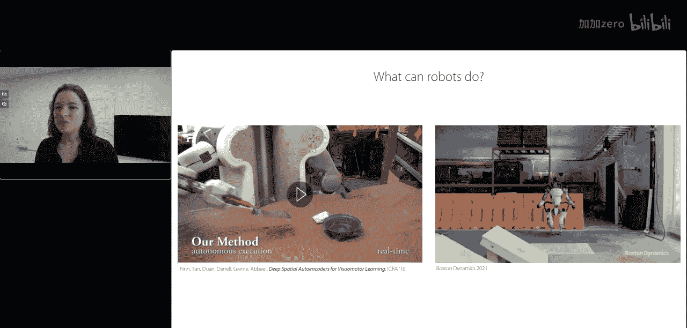
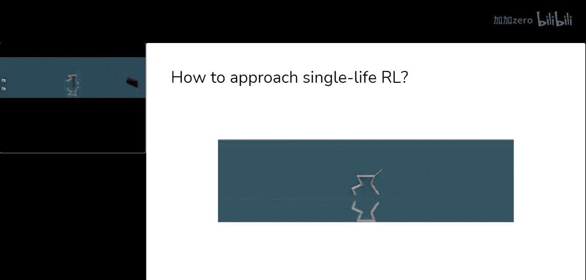
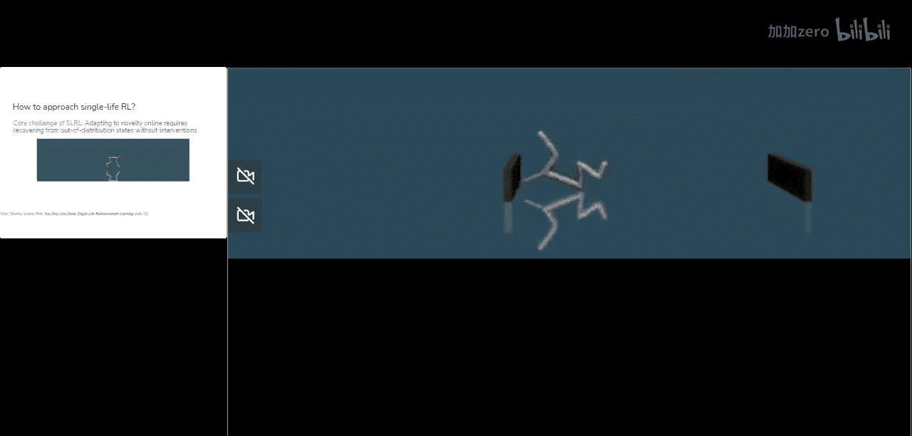
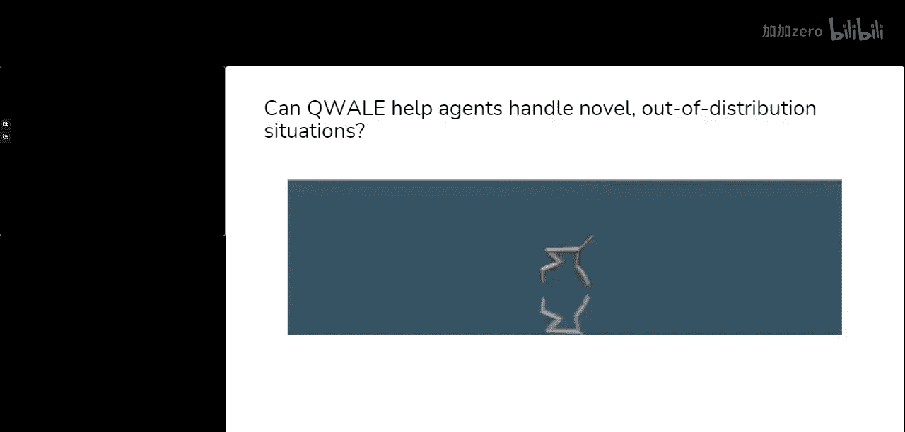
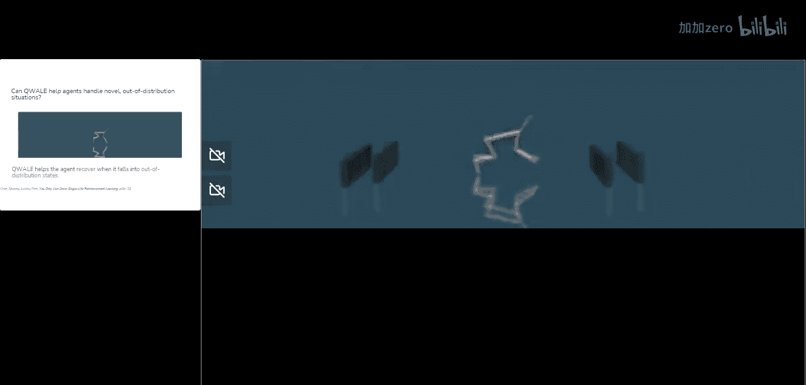
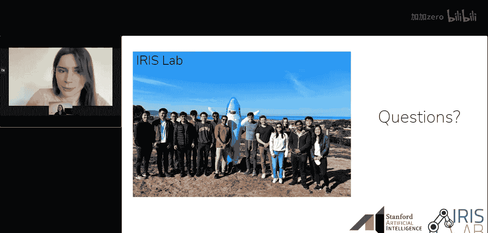

# 【人工智能访谈会 2023】斯坦福大学—中英字幕 p21 p20 Stanford Webinar - The Frontier of Deep Learning for Robotics, Chelsea Finn -BV14XB8YYEb1_p21-

Just to give you a brief introduction you know who Chelsea is if you don't know her but you know there's so much more it can be said and I will tell you in this like one short paragraph she's the assistant director of computer science and electrical engineering at Stanford University and her lab is called Iris so you will see a little bit of logo of an Iris and she studies intelligence through robotic interaction at scale and it's very actually fascinating field of research she will be telling you more about today so thank you again for joining she also spends time at Google as part of the Google brain team and yeah it's my big pleasure that she's able to join us she's also going to teach two classes actually just in couple of weeks and you can find more information on the platform one of them is graduate class CS224 R deep learning deep enforcement learning which starts on April 2 and the other one is a professional class exists33 deep multitask and metal learning and it starts only I think next month。

So it's very very soon so yeah she's a wonderful instructor。

 wonderful person to have like here so thank you so much once again for joining really happy to be here and excited about to share some of our research on deep learning for robotics and specifically talk about where the frontier is I'm also seeing some questions in the Q&A about there being a recording and yes this will be recorded and the recording will be posted online。

😊，Great， so to get started， I think a great place to start is to think about what can robots do today and we've seen examples of robots being able to complete fairly complex manipulation tasks like being able to use a spatula to lift an object into a bowl or really impressive videos from Boston dynamics that allow robots to do really impressive maneuvers such as kind of parkco like maneuvers in environments like this。

And the catch with these kinds of impressive behaviors is that first。

 in terms of the Boston dynamicsynas behavior， it's really undoubtedly impressive。

 but the behavior was manually tuned for this one particular environment。

And the manipulation task of using the spatula to lift an object was trained using 15 minutes of data in that environment。

And as a result， these behaviors are specialized to the environments that they were trained in and the environments that the behavior was tuned for。

And this means that they're learning very narrow behaviors that robots are able to perform complex maneuvers in narrow and controlled environments。

 and if you moved one of these different platforms a little bit。

 or if you gave the robot a different spatula， the behavior would ultimately fail。

And so what I'm really interested in is how we might allow robots to actually go out into the real world in real environments like homes。

 offices， and so forth， and actually allow them to generalize to perform intelligent behavior in those settings。

Now the tricky part is that we often train robots on a fairly narrow distribution。

 such as in a lab environment。And our goal is to be able to actually deploy these robots into the real world。

And from the standpoint of machine learning， this means that actually generalizing to this wider distribution is pretty challenging because it was trained on a fairly narrow distribution。

 with a small number of objects and a small number of environments。And so。

I think that there's two possible solutions and I think that both of these solutions are really important the first is to train on a larger and broader data。

 try to think if we can scale the data that we're training robots on so that they can generalize fairly broadly and arguably this training neural networks on larger dataset sets is one of the only recipes that's convincingly enabled in the wild generalization in other domains like speech recognition。

 machine translation and image classification。And I think that this sort of thing will be really important and necessary to get robots to generalize。

But I think that actually doing this won't quite be sufficient because I think that robots will inevitably encounter scenarios that are a little bit different than the scenarios that theyre trained on。

 simply because the world is vast and has lots of different scenarios and lots of different environments and objects and so forth。

And so the second ingredient that I think is really important is to think about how robots might also be able to generalize beyond the data that they were trained on。

And I don't think we can hope to anticipate every possible scenario。

 so what we're going to look at is thinking about whether we can allow the robots to adapt at test time also。

 and if they're able to take in a tiny amount of experience at test time and adapt and learn from that experience。

 then they might be able to actually handle novel situations。So these two things。

 training on broader data sets and generalizing beyond the train distribution are the two main things that I'll talk about in this webinar。

And and of course， it will only really be scratching the surface of this broader topic of deep learning for robotics。

 which should give you a pretty good sense for where the field is at today。Great。

 so first let's think about whether we can train robots across many different tasks。

And the specific goal that we're going to focus on is to allow a robot to generalize to a new task that it wasn't specifically trained to do。

And we're hoping to be able to do this by actually broadening the training data distribution。

It's worth mentioning that there are some previous kind of research efforts that have tried to aim to allow robots to generalize to new tasks by。

 for example， enabling robots to generalize to new objects。

 but this was all trained and tested within the single skill of placing。

Or being able to generalize to new instructions like new language instructions。

 but the new instructions will describe behaviors seen in the data。

What we'd like to do is we'd like to take this a little bit further and be looking at allowing robots to generalize two different combinations of objects across a wide range of skills。

So in terms of evaluating whether a robot can do a new task。We'll consider an example。

 so say the robot is in this scene。And we want to be able to tell the robot to place the grapes in the ceramic bowl。

The robot in this case， the data it will have seen will be showing it how to place other objects into the ceramic bowl and how to do other things with the grapes。

 but it won't have ever seen a behavior that picks up grapes and puts into the ceramic bowl all in one trajectory。

And to make things a little bit harder than that， we're actually only going to show it data from two different object sets and they won't have ever seen any data of the grapes and this ceramic bowl in the same seat。

Great， so then we're going to train on 100 total sets of tasks where a task corresponds to kind of a specific behavior or a trajectory and these tasks are going to cover nine different underlying skills。

 including things like grasping， placing， pushing， wiping， and so forth。

And an example of these kinds of behaviors is shown in this video where you can see examples such as placing the banana in the tray。

 dragging the ceramic bowl in a circle and so forth。Great。

 so this is an example of the behavior that we're showing the robot and this data was collected by using a VR controller to move the gripper of the robot in a particular way。

 and this is an example of 12 different tasks but we're going to show a data of around 100 different tasks。

And then once we collect this data showing 100 different tasks。

 we're then going to train a neural network policy that will take us input in RGB image。

And output a desired target position and orientation of the gripper。

And so this policy will output in seven numbers， three numbers for the position。

 three for the orientation， as well as one number that corresponds to the opening and closing of the griper。

 and this policy will operate at 10 Hertz such that it takes in a new image 10 times every second and predicts a new action。

We chose this representation because it's maximally general。

 this sort of policy in principle could do lots of different tasks depending on the data that you trade on。

And importantly， this policy is also going to be conditioned on a description of the task。

And we're specifically going to use language descriptions and we'll use a fixed pretrained language model to get embeddings of these instructions and then pass those embeddings into the policy。

Great， so once we've trained this policy on our diverse data set。

In order for the robot to generalize to a new task。

The robot needs to be able to first correctly interpret the language command。Second。

 visually identify relevant objects and distractors。And lastly。

 translate its interpretation of the instruction and what it sees into the robot's action space。

And doing this all for a novel task is quite challenging。As we'll see。

 we are actually able to get some degree of generalization。So for example。

 if we go back to the scenario that we looked at before。

 where the goal was to place the grape in the ceramic bowl。

 we gave it exactly that language instruction， and this is again a task。

 a trajectory that it never saw in the data and the robot is able to successfully complete the task。

Similarly， and the thing that's really great is that the the robot isn't able to just。

Just kind of perform。One task， but is actually able to perform a number of different tasks that it didn't see in the training set。

 such as placing the banana on the white sponge， placing a bottle in the tray and pushing a purple bowl across the table。

Great， so now let's look at some of the， the actually quantitative experiments that actually evaluate the success of the policy。

And in particular， we preselect a set of 28 tasks that are held out from all of the training data。

And then we evaluated performance， and I emphasized pre selected in the sense that we didn't kind of just pick the task that the robot worked on。

 we preselected a number of tasks that are all held out。

All these tasks are shown in this big table right here。And we see that first。

 the robot has a non zero success rate for 20 out of 28 of the held out tasks。

The average success rate is around 32% over all of the 28 tasks and so overall this suggests first that there is really substantial signs of the robot being able to do tasks that it never saw any training data for。

 which is really exciting but second there's also considerable room for improvement and actually boosting this number。

From 32% upward。AndThen you can ask， where is the room for improvement in terms of the robot's ability to do these tasks？

And so to understand where the room for improvement is we evaluated the robot's performance with on the training tasks with either a just like a one hot ID for the task。

 as well as a language instruction for the task， and then we also evaluated of course。

 this kind of 32% number which is held out tasks with language conditioning。

And first we see that if we actually evaluate the robot on training tasks。

 on tasks that it was trained to do， the performance is actually only 40%。

 there's only an 8% gap in being able to actually generalize to a new task。

And the really larger gap is actually bringing up this 42% number up to 100%。

 and this means that really the bottleneck is just the robot's ability to complete the tasks in the first place。

We can actually look at kind of example failure cases of。

Example failure cases of what the kind of robot does for tasks that it has a zero% success rate for。

And I'm not sure if these videos are playing， but kind of what these videos show is that even though this policy has a0% success rate。

 the robot is actually really close to completing the task。

 so for the place banana in the ceramic cup， it actually knows to pick up the banana and move it towards the cup but doesn't quite complete the last stage of the task。

And for the second task of wiping the tray with a sponge。

 it also figures out that it should pick up the sponge and tries to kind of move towards the tray。

 but it isn't enabled to complete the very last stage of the task。

And so this suggests that first the 0% success metric is quite strict。

 and it also suggests that we just that kind of just the ability to kind of control the robot arm is the major bottleneck in terms of completing these tasks。

Great。That was kind of a proof of concept that we can actually allow robots to generalize to new tasks。

 which is to start to generalize to new tasks， which is pretty exciting。

Now there's a question of what if we scale up even more。

 so we are previously looking at around 100 tasks。The next step is we tried actually scaling this to more than 700 tasks using 130。

000 trajectories or demonstrations of those tasks。We found that if we took the model from kind of the previous work that I mentioned and just tried to make it larger that didn't actually necessarily improve performance。

 it seems like larger this kind of model architecture isn't able to actually absorb all of the information in this larger data。

And so what we did is we， once we scaled up this data set。

 we tried to actually see if we could design an architecture that is better at capturing better at capturing all of the kind of detailed information in this larger data。

And so specifically， we designed what we're referring to as a robotics transformer， similar to four。

 this it could be taking input images and an instruction and outputting an action。

But there's a number of important components that allow this architecture to be better at absorbing lots of data。

The first is that we're going to tokenize the inputs and the outputs。Into discrete tokens。

We're going to use a transformer to as part of this architecture and transformers have been widely used in natural language processing and we find that they're actually a very effective architecture here as well for being able to leverage large amounts of data and because our actions are now discretized with tokens。

 we'll use a kind of a cross entropy style objective。

And then for reading as input the images we'll use a kind of a convolutional neural network called an efficient net as well as a film architecture to condition on the instruction。

 this backbone of the network will be pretrained and then the output of these these image embeddings will be tokenized with。

A token learner， I don't want to get into too much of the details here。

But the biggest part here is that we're able to actually train this on a really large data set on 130。

000 episodes， this data was collected across 13 robots over 17 months， covering more than 700 tasks。

And what we found is when we actually evaluated this model on both scene tasks as well as tasks that were unseen。

Distractors that were new and different background scenes。

 this model architecture shown in blue was able to kind of substantially outperform previous model architectures。

 including the architecture that we used in the previous work。

 as well as the gato style architecture， which is an architecture developed by DeepMd。Great。

 so kind of the takeaway here is that if we scale up robotics data and train these big policies on these broad data sets。

 that allows robots to start to generalize in lots of different ways， including to new tasks。

 new distractor objects in the scene and new backgrounds in the scene。

We've also released the data from the first work and there's a link available right here。Great。

 and then the other thing that I'd like to briefly touch on on this kind of data set front is。

Is kind of this bigger level picture， which is that typically in robot learning research。

 the way that most research progresses is that first we will collect a data set for a project。

Then kind of complete that project with that data set and then kind of don't use that data again for the next project。

 for the next project， we'll kind of collect a new data set for that project。

And as you might imagine， this is really inefficient and if you contrast this to what typical machine learning research does outside of robotics。

Typically， one dataset is collected once， like ImageNet or WiikiText， and it's reused many。

 many times by many different research projects。Or even better， instead of reusing the data。

 we might reuse a model that was pre traineded on that data and fine tune that model or use embeddings from that model。

😡，And so I think it's really important for the kind of robot learning research as a whole to kind of move towards the second paradigm and try to move towards a scenario where we're sharing data and pre- trade models across institutions and of course。

 across projects as well。If so， I think if we were able to share data and pretrain models in robotics。

 then I think we could probably make a lot more progress on the really challenging research problems that come up here and for example。

 if if you imagined like what machine learning research if machine learning research did what robot learning research does and they kind of recollected image it for every single project。

 that would probably be quite expensive and probably computer vision wouldn't be where it is today。😡。

Great， so then I'll also briefly comment on like what's actually stopping us from sharing data across institutions right now。

I think we have a little bit of a challenge in that kind of I'll make an analogy。

 which is that I think that right now what the robot data landscape looks like is。

All these different islands in this giant ocean where。

We have these different robot data sets that have been collected。

 and each of them is kind of an island that covers the whole space of possible kind of robot configurations。

 environments， objects and so forth。And because these data sets are not super diverse。

And because the whole possible space of robotics， hardware and environments and so forth is so broad。

This means that when another research project is kind of going to kind of try out a task and try out studying a particular problem。

That research project usually ends up somewhere over here or over here。And this means that。

The data sets that have been collected before aren't useful for actually advancing that new robotics experiment or that new kind of task or problem or environment。

And so one of the efforts that we're trying to do right now is to try to see first。

 if we can collect data from many， many distinct environments。Not just from one building。

And also trying to see if we can have a kind of more centralized community- drivenrin data collection effort that may allow us to unify some of the design choices so that first we can have a larger island。

 and second we can kind of bring more people towards a single island by actually having everyone agree upon certain design choices。

And so our goal is to collect data from lots of different real household environments。

 our initial goal was around 50 different households。

 but we actually think that we might be able to significantly expand that with the kind of interest that we've seen so far and we've been kind of developing a kind of integrating people from lots of different universities to try to contribute to this effort and of course if you're interested in contributing。

 feel free to reach out。Cool， so the first part of this talk I talked about trying to train robots on broader data sets and we saw that we can get signs of zeroshot generalization to new tasks and environments。

 but we should also probably try to share data across institutions and reuse data more frequently such that we can allow robots to actually generalize further and generalize to the extent that we see things outside of。

Robotics generalizing well。Great， so now I'd like to also briefly talk about how robots might generalize beyond the training distribution。

And we'll first look at this in the context of a simple grasping problem。

Where the training environment and。The grasping policy was initially kind of trained in this sort of environment。

 It's kind of a bin。 His goal is to pick objects from this bin。

And we're going to then try to test the policy in a number of different environments and we're actually specifically end up going to pick environments that we found that the policy worked poorly in。

This includes with harsh lighting conditions， with transparent objects that it didn't see during training with the checkerboard background。

 as well as a physical change where we actually move the gripper of the robot by 10 centimeters。

And the policy in the training environment was fairly successful。

 it had an 86% success rate and when we actually tried to put it under these new conditions。

 the success rate dropped significantly to 32%， 49%， 50% and 43%。

And one of the things I mentioned before is that it's really impossible to anticipate and prepare for any possible scenario that the robot might find itself in。

 and so what we're going to do is we're going to try to see if the robot can adapt to a small amount of data that was collected in this new environment。

And so。Specifically what this will look like is we have our original data collected in the original environment。

 we're going to use a reinforcement learning algorithm called QTO to train a Q function and a policy for grasping in this environment。

😊，This policy again， gets 86% success rate。And then we're going to allow the robot to collect a very small amount of data。

 only 800 attempts， which can be collected in around a single afternoon。In this new environment。

In this case， this is the displaced gripper。And then we're going to take our Q function and simply fine tune it on this target data。

 using a mixture of the base data and the new data。

And then with this very simplified tuning procedure。

 which is kind of very common in the rest of machine learning。

 we see that the policy can get around a 98% success rate。

 even though this kind of environment is completely different from what it saw during training。

And we kind of did a pretty fairly thorough quantitative evaluation there looking at a variety of kind of physical changes and visual changes。

 I don't want to get into all the numbers here， but a few highlights is that first we can see a fairly strong improvement in success rate。

 even after there are only 25 new attempts in the new environment。And。

And here's actually a kind of a video of the policy。

OfThe policy in one of these new environments and so。In this case。

 with kind of an afternoon afternoon's worth of data。

 it's able to adapt to this new scenario and and successfully handle this。

The kind of the physical change that we imposed on the robot。Cool。

 so this was all specifically in the context of grasping。

 and we saw that the robot can autonomously collect some data to adapt to a new setting。Now。

 what about kind of in general， can we do this for any sort of robotics task？Ideally。

 what we could do is we could allow the robot to kind of autonomously collect data and adapt with that collected data。

 but there's a little bit of a challenge here。And the challenge is that if we collect a trajectory with reinforcement learning the robot attempts the task。

 we collect one trajectory， and then we collect another trajectory and so on and so forth。

Typically in reinforcement learning with this sort of trial and error process。

 we assume that the robot can attempt the task multiple times。

But one kind of subtle point is that it's actually unclear if we want the robot to autonomously adapt on its own。

How it will actually get to the last state of a trajectory back to the first date of its next attempt to retry the task。

And in a lot of simulation environments， you can just kind of reset the environment and allow it to attempt it again。

But in the real world， if we want robots to adapt on the fly in their new kind of deployed setting。

 this sort of reset isn't possible， it might require a human to do something and it prevents the robot from kind of autonomously adapting with a small amount of data。

And so oftentimes what this looks like is for example。

 if a robot is trying to hit a puck into a goal， this robot actually isn't physically capable of moving the puck back and oftentimes a human will reset the puck between each trial。

 or if the robot's trying to learn how to open a door。

 a person will kind of then close the door before every trial。

And what ideally we'd like to be able to do is to allow robots to adapt without these kinds of resets。

Now you might ask， well， maybe we can just run reinforcement learning algorithms。Without resets。

 just kind of run the same exact algorithms that we use when they do get these kinds of resets and maybe those just still work。

And so we tried doing that， so we took a very simple environment where the goal is kind of in simulation to have this fish move to a certain goal。

And it turns out that if you give it a reset every thousand steps。

 it learns a performance policy at the task。But if you give it a reset only every 2000 steps。

 it isn't able to get as high of performance over the course of learning。

And if you give it a reset even less frequently， the robot。

Hardly is able to learn a policy for the task at all。And so perhaps surprisingly。

 algorithms for reinforcement learning aren't well designed for this scenario where the robot is operating completely autonomously on its own。

 and this means that if we want to use these algorithms to allow robots to adapt during deployment at test time in the real world。

They aren't going to be well suited for that。And so this motivated us to introduce this problem of single life reinforcement learning and in contrast to episodic reinforcement learning where you can try things again and again or reset free reinforcement learning where you can kind of try to both learn how to do the task and undo the task。

What we're going to look at is a scenario where we have some previous experience。

 and so the robot has possibly used these previous experiences to learn a good policy。

Then the agent is faced with a new environment at test time。

 and its goal is to basically complete the task fully autonomously within a single episode without any human resets。

In that new environment， at test time。And so kind of more succinctly。

 given previous data in a training environment， the robot or the agent has one life to autonomously complete the task in a novel scenario。

Am。We'll be starting to look at this in a very simple simulated environment。

 I'll show some examples in this half cheeA environment where， for example。

 during training it just needs to run forward and at test time it sees a scenario that's completely different from anything at saw during training。

 specifically there'll be an obstacle that makes it harder to make forward progress。Great。

And so then our goal will actually be to allow the robot to actually figure out how to adapt at test time within a single episode。

Cool， so how do we go about approaching this problem？ So first。

 what we did is we actually tried to run， run the robot in this environment and its goal is to get to the green box。

😊。

And it was trained in an environment without any obstacles at all。

And what we're doing here is we're running the robot in a simulated environment。

 and we're fine tuning it with reinforcement learning to try to have it update its policy and ultimately get to the green block。

And ideally， kind of what we see here is it actually gets a little stuck。

 it gets knocked upside down and it struggles to make forward progress and kind of get back up。

 figure first figure out how to get back up and then figure out how to get over the obstacle to get to the goal。

And so really the core challenge of this sort of single life reinforcement learning problem is to handle this sort of novelty and recover from these out distribution states。

 such as being knocked upside down without any sort of human intervention。

And standard kind of reinforcement learning algorithms that run fine tuning in this environment kind of won't encourage the agent to recover from out of distribution states。

Now， what we're going to do is we're going to。First。

 encourage the agent to move towards the distribution of prior data because this should help it figure out that when it's knocked back over。

 it should try to get back up because that's a state that it saw in its previous data。

But we don't want to exactly do that these kinds of previous methods usually assume expert demonstrations and they aim to match the entire distribution of prior data。

And instead what we're going to do is we're going to have it try to match the prior data。

 but do so in a way that's weighted by the estimated value of those states。

And the Q function or the Q value function will estimate the desirability of the state。

 we can pretrain a Q value our Q function on the previous data and then。😊。

Kind of try to match the prior data weighted by the expiated cu value of those experiences。

And this will drive it towards kind of states that had good outcomes in the previous data。

 and we actually tried to run this on the same example that I mentioned before。

And the what we see here is that the robot is again trying to get over the hurdles and ideally what it would do is it would kind of figure out how to get to the goal on its own and we see exactly that so it does actually flip over on its back at one point but most importantly it actually is able to figure out how to get back up on its feet and also figure out how to get over the hurdles and ultimately reach the goal。

We also quantitatively evaluated this on not just the scenario that I showed you。

 but also a few other scenarios， and we found that in comparison to fine tuning with reinforcement learning。

 this approach shown in yellow was more successful at completing the task at test time and was able to do so in a smaller number of steps compared to fine tuning with reinforcement learning。

There's also a lot of room for improvement， so I think that the sort of problem setting that we're introducing for the first time actually can be studied much further and actually allow hopefully in the long run robots to be able to adapt to new environments and handle novel states。

Great， so to summarize the second part， I think it's important to allow robots to generalize two new scenarios that they weren't didn see during training by actually having them try to problem solve and learn at test time。

 and we saw some initial evidence that we might be able to do that by encouraging the robot to move towards previous data that it saw in the past。

but of course， there's also lots of， I think important research to be done before actually actually this being like a viable solution in the long term and we're actively working on trying to deploy this onto real robots so that。

So that robots can try to adapt at test time rather than deploying a static policy。Cool， so yeah。

 overall I talked about how we might allow robots to generalize broadly by training on a broader data set and also allowing robots to adapt beyond the training distribution。

The last thing I'd like to touch on beyond generalization。

Is that I also think it's important to allow robots to perform very complex and dexterous tasks。

So we really focused a lot on generalization in this talk。But。Ideally。

 robots wouldn't just be doing very simple tasks like the very simple locomotion problem that I showed you grasping and and kind of pick in place tasks。

 Ideally， we could also allow robots to do more complex tasks like folding laundry or。

Or tests that require like fairly delicate maneuvers， like peeling a hard boiled egg， for example。

And I think to do this to do this well， we need actually a data collection setup that allows robots to do kind of fairly complex tasks and ideally set up this low cost and has an easy to use teleoperation system。

And so this is something that we've actually been developing。

 It's still still in somewhat of the early stages， but we developed a low cost system that allows the robot to。

Complete fairly fine grade manipulation tasks like unwrapping a piece of candy。

 like putting a cable tie around a cable， like zipping up a hoodie and so forth。

And the really cool thing about this setup is that it the total cost of all four arms in this setup and other parts is less than 20K。

 this is less than the cost of a single industrial arm。

sWe're also planning to open source both the hardware setup as well as some software that we've developed for this system and it's also a lot of fun to play with and I think it will help us actually move beyond simple pick and place tasks to some of the tasks that you can see here tasks that require dexterity that require very quick motions。

And and so forth。 and we also have some initial results that have found that for some of these tasks。

 we could actually train the robot to complete it autonomously。Cool， I guess oh yeah。

 and the other thing that I'll mention here is these robots are quite low cost。

 I actually wasn't sure that these lowcot robots would be capable of some of these things and actually the manufacturer of these robots。

 tros and robotics also didn't know that their own robots were capable of these kinds of tasks like putting RA into a motherboard。

 for example。Great， with that， I'd like to acknowledge all the members of our research lab and we have plenty of time for for questions。

 Thanks everyone。😊，Great thank you so much Chelsea extremely interesting presentation and I saw a bunch of questions coming in we will try to get to as many as we can but if we have some additional questions don't hesitate to still use the Q&A box and ask your questions Chelsea I saw a number of people very interested in kind of the data sets you're using and what actually the data set is like how does it look like Yeah definitely so in the first part of the talk the data corresponded to teleoperated demonstrations and what that means is that we control the robot with a VR controller to try to match we basically have the we program it to match the end defector of the robot to the position of。

😊，basically take action to kind of mimicking the position of the VR controller and during that process we record images from the robots cameras。

 we record the kind of position of the arm， which is measured by the joint angles of the angles of all the joints as well as you can compute the 3D position and orientation of the gripper and then we also record the action that was commanded to move the robot and so。

Generally， you can think of this as videos， plus a sequence of low dimensional sensor measurements on the robot arm。

I guess and then in the second part of the talk and some of the other stuff it's all very similar。

 so we typically use RGB images as the kind of observation space of the robot and some of the work where I was showing that very simple kind of simulated running task that was all low dimensional it was just looking at the positions of all of the joints and so forth but in everything else we're using image observations it's also possible to use depth to use tactile sensors and so forth。

 there are various kind of upsides and downsides of different sensors。

But we've foundG sensors to be RGB cameras like webcams to be a really simple and scalable solution。

There was actually a follow up question about the image processing or like you know during the training and experimentation。

 and you mentioned that all of these have advantages， disadvantages。

 so like what is the advantage and disadvantage of the image processing and how can we improve it？

Yeah， so're in all of this work， we're basically training neural networks end to end。

 so we're training a single neural network to take as input the image and output actions。

And so this means that there isn't any kind of computer vision pipeline that is trying to find objects in the image。

 for example， we're actually just actually kind of supervising the visual backbone of the model for the task that the robot is trying to complete。

And one advantage of this is that it means that the like the robot's perception is optimized for the task。

And the reason why this is actually quite nice is that if you imagine kind of a task of for example。

 manipulating a water bottle， if you tried to develop a vision pipeline for that。

 you might try to like exactly represent the 3D pose of the bottle and exactly represent the shape of the bottle and inevitably a vision system will have some failures it won't be able to precisely estimate all of that and you don't actually need all of that information in order to do very simple tasks like picking up the bottle。

 you don't need precisely know the 3D positions and by optimizing the perception pipeline for the task。

 it can basically learn heuristics and learn shortcuts and only represent the perceptual information that it needs for the task。

You mentioned a little bit about kind of sharing data and data being available。

 there was a follow- up question on that about envisioning like reusing data across projects and also institutions。

 what's kind of your intake on that and like could you kind of dive a little bit deeper on what you have said in presentation？

😊，Yeah definitely so I think that it's really critical to start kind of actually having us share data and pretrained models ideally as well。

 my dream is to actually basically at least in the short term。

 be able to develop models like analogous to Bt or analogous to GPT style models that people can use off the shelf on a robot。

 of course， not for text generation but actually for representing actions and representing images and so forth in a robotics pipeline and getting value from those kinds of models。

So I think it's really important for the community to do that there's also challenges one challenge is that the like different people use different control stacks and different robots our initial efforts is we are at least with the kind of the community-dn effort that I mentioned we're trying to at least start with a single robot platform and setup but then diversify in terms of environments。

 objects， tasks and so forth and that can at least give us a little bit of a certainty in terms of trying to and a little bit is a little bit less risky and that we can kind of focus on a platform that a lot of people in the community use and then in the long term I think it's really important to also start to develop pre-train models that。

Are a little bit more agnostic to the particular hardware so that maybe you can't kind of zero shot handle a new robot。

 but you might be able to kind of spin up a new robot platform more quickly than if you were to do everything from scratch。

Yeah， so I think that those those are some of the considerations。

Perfect thank you so much when you showed the last video like with you know the egg and like ripping like you know the kind of the candy and all these kind of things there was a lot of excitement actually in the audience about that and the follow up question or one of the follow up questions is about like how far are we in like getting this like further or like making this actually the standard standard thing happening in the world or like making it even applicable and like using it in practice。

😊，Yeah， so we're really excited about that project too and it's something that we're actively working on we're actually going to be releasing a paper around that work probably one week from today certainly definitely within the next two weeks and our initial kind of progress on that is actually we've been able to train neural networks to do some kinds of tasks like that。

 specifically a task like slotting a battery into a remote control like being able to kind of tear off a piece of tape and put it on a box and things like that put a shoe on a person。

But there's also lots of challenges， so。TheI guess well， first we are like I mentioned。

 we're open soourcing the hardware setup and so we're hoping that other people will be as excited about the platform as we are and actually kind of develop it and or kind of buy it themselves and collect data on it and so forth。

There are other challenges associated with getting like policies to do those kinds of tasks as well one challenge that we've run into is that we've been able to do some tasks like kind of tearing off a piece of tape and so forth。

 but for other tasks you need to be able to react really quickly to what's happening so for example the candy unwrapping you need to we actually were able to get a policy to do the initial step of like picking up the two sides of it and then pulling but then the next step involves like finding where the flap is on the candy and then kind of opening opening the candy and with a small amount of data around 50 demonstrations。

 we found that the robot wasn't able to complete that next step of kind of finding the flap and then opening we think that with more data we should be able to handle that sort of that sort of challenge but。

There's also a question of how much data you might need。

 and so we're also trying to kind of do some research along lines of pushing kind of the robot's ability to react to these certain scenarios efficiently。

And so forth， so yeah， also happy to answer more questions on on the topic of that project。

What are some of the most promising approaches like you find very promising for building actually robot with like through artificial intelligence。

 like would you be able to answer that？Yeah， I think that the。

I think I mean the approaches that I talked about today。

 I think are some of the most promising because those are the things that I'm working on and I wouldn't work on them if I didn't think that they were the most promising。

 so scaling up data I think is really important， allowing robots to and just generally systems for adapting is really important。

 I think that embodiment I like studying robots because they're actually embodied in the real world in the world that we live in and unlike things like language models。

 they have to contend with。A lot of things that come up in the real world that are really challenging。

TheAnother thing that I'll mention is that I've been talking a lot about scaling data and I think that we also a lot of the data that I've talked about before was collected by a person controlling the robot and I think that in the long term we really need robots that can collect data autonomously on their own and kind of operate with autonomy in the real world and that sort of autonomy is surprisingly hard where we find that agents and robots will get stuck all the time and kind of be not sure what to do。

 it's possible that we need kind of parents to help the robot just like analogous to how kids have parents that are helpful。

U。But yeah， there's yeah， lots of lots of open problems。 And yeah。

 generally the things I'm I find most promising are along the lines of what I presented today。

And if I follow up on that maybe it's the same answer。

 like which ones are you the most excited about， or like you know what you actually hope to see maybe in the next。

 let's say， 10， 15 years， something you're ever excited about hoping to see。Yeah。

So I think that everything that like all the ideas that I presented are I think are necessary。

 like like I think that we need broad data sets， we need to adapt at test time to get robots that can operate in the real world the。

U。So I think that there isn't like any one thing necessarily that I'm most excited about because I guess I think that robotics is a really hard problem and I'm a little bit more somewhat pessimistic I think in terms of like actually kind of timeline for getting robots out into the real world that said in the next kind of five to10 years。

 I' love to see kind of results that show that we can start to push robots out of the lab into unstructured environments and and so forth with these kinds of learning-based approaches and also start to see kind of pre-trained models start to pop up that are useful and can be used off the shelf by lots of people。

Thank you so much。 And ap to put you on the spot。 We also had some people who are a little bit newer to the field of robotics。

 like what would you advise them like where to get started， where to learn more。😊，Yeah， definitely。

 I think that my biggest piece of advice is try to is just like starting by getting your feet wet。

 I think that the my first experience working。😊，Well。

 so I did a little bit of like Lego robotics in in middle school。

 I guess and that was fun and definitely kind of introduce all the challenges that come up with building a system with different components。

 with sensors， with auators。And that was fairly accessible and then I also in college took a course on robotics and it was a lab course where we kind of built a robot from scratch。

 built some sensors for it and actually also。Yeah， also。

How the robot do various tasks and so forth in our research we mostly buy robots off the shelf and really focus on the brand of the robot。

 which I think is really the bottleneck， I don't think we're that limited by the hardware and fortunately there are some robot platforms that are fairly they're getting more and more inexpensive so there are various like mobile robot platforms that have a few wheels like I think Amazon has a platform that called the deep Racer that's a few hundred dollars and there's some other other platforms as well and yeah I think that trying to if that's something that's kind of within reach then I think that yeah trying to trying to actually just try stuff out on the robot is a great place to get started of course another place to get started is to learn more about reinforcement learning and as Pero mentioned I'm teaching a course on deep reinforcement learning in。

In the spring， and there's also lots of resources online to yeah to explore these kinds of things。

Maybe the last question because I see that you know questions still keep coming。

 but at the same time， like we need to actually make this stop at some point。

 like what would you recommend as those resources， Chelsea， like you know where to look for。

 where to find out what's happening and robotics in the field， like how to learn more。

 like any favorite blogs you read， like any favorite kind of websites you follow。

 what would you recommend。Yeah， so let's see so。In terms of like tools like one physics simulator that we use a lot is the Mojoko Ph simulator and it's fully open source and if you want to get started playing around with robots in simulation。

 that could be kind of a good place to start， I think there's some starter examples and you could try to get the robot in simulation to do different things in terms of resources for。

For just kind of learning about high level ideas in the field， Peterbile。

 who actually was my one of my PhD advisors， he has a podcast called the Rob Brains Pocast。

 and that's a great place to learn about various experts in the field。

 including both academics as well as people in industry。嗯。And then， I mean。

 if you really want to dive deep， you can look at kind of robot conferences like robotic science and systems is a conference that I we submit to a lot and then also the conference on robot learning are both great and oftentimes they have actually videos of the talks at these conferences in addition to the paper proceedings available online。

And then yeah， I mean there's various course content that I think is great and course content is probably actually in some ways like more educational and more useful than like conference videos。

 for example， because they're really aimed at teaching rather than being aimed at kind of sharing latest research results so it kind of depends on what you're looking for。

😊，Okay， perfect。 Thank you so much， Chelsea。 We will wrap it here。

 Thank you so much all for all the questions。 We will try to kind of stay on and follow up on the ones that are open if we can answer them。

 but do appreciate your time。 Chelsea， Thank you so much for making the time to do this。

 And we will be making this recording available to you。 So if you miss some part。

 we would like to rewatch you can do that。 So thank you， everybody。 have a nice day and stay safe。😊。

