# 【并行计算 CS149 2023】斯坦福大学—中英字幕 p04 p3 Lecture 4 - Parallel Programming Basics -BV1du17YfE5G_p4-

Okay， what how are I doing。

People are still here， That's good。How's assignment1 going？Pretty good。 There's been a lot。

 of conceptual questions in office hours， which I actually think is correct。

I would think about it this way。I've given you kind of four concepts。Like this idea， multi core， Cdy。

 multi threading， and a little bit of superscalear。Because of yeah， for。

And so step  one is for you to understand them kind of all in isolation。Completely in isolation。

And your written assignment that is out。 You could start taking a look at， definitely。

You should be able to answer those questions， right， Like that's like concept from the slide。

 apply it。 I bet you can answer those questions。When we go to the programming assignment。

 you're now running on real hardware。And real hardware is。😊，A little messier。

And that real hardware is basically composing all four of those concepts together at once。

And so it's okay if you're like， well， based on first principles， what we said in lecture。

 I should observe this。But I'm actually observing this。

 And so I'm a little bit doubting my understanding of the core principles。 Just come to office hours。

 We'll talk about it。 often I can say， no， your understanding is completely correct。

 It's just some effects are mixing。 You know， the two things you understand are now mixing and interacting。

 And that's and you can explain what you're seeing。 You just have to think about a little bit harder。

 So the mixing of it， I think is where it gets a little bit complex。

 And you're just gonna see it over and over again。 And and you're gonna become much more acquainted with it as time goes on。

 So I would not worry， worry too much。 I'll put it this way。 one year in this class a long time ago。

 we had final projects where people could like do anything that you want。😊。

And probably the most creative project that I've ever seen is like a student came up to me and says。

 everybody works so hard in this class， but when you kind of think about it。

 like everything you teach us is stuff that people do already。😊，You know， you get busy。

 You go do something else。 or， you know， you have 10 tasks to do and three people to do it。

 You kind of just go， you do that。 You do that。 You do that。

 So their final project was to actually ask a bunch of exam questions or midterm questions to people on the street like in a TV show。

 except they answered the questions， they ask the questions in terms of like real life metaphors and actually wanted to compute like what the average person in the world would get on a 1。

49 exam if if they just didn't have computer science concepts in it。

 And they actually scored pretty good。 So that was a pretty good final project。 So， you know。

 the stuff is actually conceptually。😊，Challenging because of the composition。

 but it's actually quite easy in first principles。 so you'll get it。I wanted to。

 but one thing I wanted to do is， is I want to go over a lot from last time again。

 given what everybody's asking me。 And let's talk about a lot of this as a class。Because last time。

Was the first time I was kind of forcing you to think about， what does the program。

 the parallel program mean。In terms of what should it compute。

And then there's a whole bunch of questions about how does it actually run on a computer。

And to keep those very separate in your mind is a very， very helpful skill。

 both as a programmer or if you're ever designing any system。So。Here is just this。

 the same example from last time。 I'll page it back in for you。 if you forgot。 this is the。

 the same example， even from last week， which is we're computing。 We have an array of numbers。

And we're computing for every element in that array， we're computing the site。

And this is just normal C code。 And at some point， I call this IS PCC function。

And an ISBC function differs from a normal C function。In what way？

Like when I call a normal C function， it's like， go look up you know， if I go to the code。You know。

 I go to this code。 If this is the normal C function。

My control just transfers to the top of this function。 And I run run those instructions。

 I do what the program says， sequentially。And then I end up going back to。To the caller， right？

So how does an IS PCC function differ from that？ Yes Sir instances the thing variables exactly。

 So this function call here is not saying。And just move over to that sequence of logic and run it and then come back。

 It's saying。I want you to move over to this sequence of logic and run it gang sizeized times。

And let's just say our gang size is 8 because that's what's true in my illustrations。

 We're going to run this code eight different times。

And each time one little detail will be different。 What is that detail。The value of program index。

 which just says， basically， which time is this， Which of these8 copies of the program I'm gonna run。

 Which one is this。notice that so far， I've said nothing about parallelism or implementation。

But everything I've said is true。 And if you want those eight different copies of this program to。

 together do all the work we need to do， notice that every program is sequential。

 This is just a set of instructions that run back to back to back。

And every program does something a little bit different because its logic is dependent on the value of program index。

Does that make sense？Okay， so this is the point where sort of 8 copies of the function get created。

And the return value is the point when those copies have completed。Again。

 no talk of implementation at this time。So are there any questions about that。

 It is a good time to ask a question。 Yes， Sir。How is the gangang size determined？

Determin it is determined。 You just set it like at compile time in your， in your flags。 actually。

 it's like at compile time， gang size will be 8 or gang size will be 4 or 16， yes。

And size it's the same。How light the A V X spectrum instructions。I wouldn't call it a coincidence。

 but I would say that， first of all。Is everything fine， Like。

 could you imagine a valid implementation if I set the gang size to 100。是。I mean。

 I guess my program may not handle multiples of of that。 But let's say if I set the gang size to 64。

 this program is still valid。Right just 64 copies of the program are going to get created。

Get executed。 and they're all gonna do their piece， as defined by my code。Yes。Sa系。

You're asking about implementation details。I'm just telling you what needs to happen。

I'm telling you if the gang size is 64， 64 copies of this function need to get run。

And program index will have a different value in each of those。

And so if I ran them back to back to back serially， I'd get the right answer here。Now。

 I'm gonna put an asterisk by that in that there's a few tiny little things。 If you read。

 like page 42 of the manual that actually prevent ISPC from running them serially。 but。

 but that's not， not here today。Okay， so everybody's good on that。Okay。Okay。

 so it would be perfectly fine for all practical purposes。 if the implementation of this call。

Was to take this function and literally throw a four loop around it。

Which was for I equals 0 to program count。 set the value of program sorry， program， Yeah。

 program count。 set the value of program index， and then just run this I SBC Sineex function call over and over and over again。

Perfectly valid， correct implementation。Now， IS PCC is not going to do that。

 It's implementation is not going do that because you wouldn't use IS PCC if that's the implementation you。

 you were gonna get。Okay， allright， so， and then we talked a little bit about like what you should think about this program is doing is you should ask the question。

 what。Program instance does what work。 And so the code that I showed you program instance 0。

 just because of that for loop。 If you go look at that for loop for I equals 0 to program count。

 computeute an index， which is I 0 plus my program index。

 and an increment I by program count every time。 you're gonna end up with a program that has divvied up work like this。

😊，Now， we're going to get to implementation。The implementation is not going to be run the Sine X function program count times back to back to back。

 The implementation， what the IS PCC compiler is doing for you under the hood without you thinking about it is doing exactly the program transformation that you implemented in part two of your assignment。

Right， you got a straight line set of C code。And it said。

 rewrite that C code in in instructions and vector instructions so that vector sized things werere all doing a piece of that loop at the same time。

So the underlying implementation of this program of that cineex program is going to be as a set of vector instructions。

 Now， the reason why you're gonna set that gang size to the thes width of the machine is that if I'm gonna to do 8 copies of this program。

 I might as well run all eight at the same time in different lanes of a vector。

So the result of compiling an IS PCC program where your gang size is your Sdy with is just a sequence of S instructions that carry out that logic for all eight instances of the program altogether。

😊，So they are run simultaneously， and they're run simultaneously all within a thread。

 which is issuing vector instructions。 So if you actually traced your program execution。

 you would see a thread running with scalar instructions。😊，You'd see a normal function call。

 And then you'd just see that same thread running with vector instructions。

 And when it returned from Sine X， IS PCC Sineex， it just goes back to running at scalar instructions again。

😊，Right， so once this IS PCC code is compiled， it's just like normal call return of a single thread。

 just your ISPC code is now vectorized。Now， I talked a little bit last time on I could change the program。

 This is me as the user。 This has nothing to do with like IS PCC compiler。 I said。

 I want a different program now。 And I want， I just decided instead to have a different mapping of program instances to who does what。

It's a different program。 It does the same thing。 it computes the same answer。

But the assignment is different。 But that was my choice as a programmer。

 And the way I want you to think about how IS PCC works is a table like this。

 So this is iterations of the I loop。 Remember， this is I equals 0 to program count by by program。

 So 0 to n by program count。😊，And let's say we have a gang size of 8。Now。

 if you go back to that code here。Every program instance in every iteration of this loop over。

 you know， for I equals 0 will compute some index。😊，And so drawing out this table can be very。

 very helpful。 Let's go right here。During the I equals 0 iteration of the loop。

 every program instance is a column。 And these are the indices that are those are the values of the variable index in each of those program instances。

And in the next iteration of the loop， these are the values and so on and so on。Okay。

Because of that code in the bottom， the code I have in the bottom right。

 So that was my first program。 This is my second program。 And it's just a different program。

 So in every iteration in time， the program instances are accessing different indices of the array。😊。

By the way， do you have a sense of which one is more efficient。Yeah。Over one。

Ely said that one we're taking something into the cash。And what do you mean by goes one by one。

 Because in my second program that I'm showing you here。

 every program instant goes one by one in time。In my first program， at any one time。

 at any one moment。The different program instances were accessing one by one data。

Any idea which one's preferred。You， you like this one because you're saying at one moment in time。

 I'm gonna ask memory for all these consecutive indices， which happens to fall right on a cache line。

 and that will be much more efficient。 Ab， absolutely。

 this second program creates a situation where this program creates a situation where one instruction。

 you know， like we're having a vector load instruction and every address in every lane is separated by a whole bunch。

😊，Could actually， you know， if this program count program count was large enough。

 every single lane would need a different cash line。

So that vector load might actually need8 different cache lines。 And by the way。

 if they're spaced out by even more， some of them could even be paged out。

 So it actually could call could cause 8 different T L B misses，8 different page faults。

 It could be quite expensive， yeah。😊，Your program count as a sc full of the vector width。

With the implementation line you would a compute that all earlier would actually spa on multiple friends。

ISS PCC will never spawn any threads for any of the code that I've had。 So what's your question。

 and I think it's important。 So here's the blocked version。 If you。

Let me go back to the interlea version for you。 That's quite clear。 Yeah， okay。

 said is to execute the first portion and then the second good question。 So if my。

 if my width of everything was 16 here here and I only have 8 wide vector instructions。

 you now you're asking， how does the compiler implement that large gang size。

It's gonna issue two instructions。 Yeah， it's gonna back to that。

 And there's a reason why on your computers， if you modify the gang size on the compiler to 16 from 8。

 you will get better performance。 And the reason why you will get better performance is that think about like the vector operation here。

 followed by the next vector operation to do 16 wide。 Those are two independent instructions。

So you just created an instruction stream that has a lot more ILP in it。

 And so it's gonna schedule much better on the pipeline。 absolutely， okay。😊，Now。

 there's been a lot of questions about what does this for each mean。And this for each thing。

 I admit is weird and ugly。 and you're not gonna see it in anything else you we have in the class。

But the for each thing is the following。 It's a construct that you should think of as。A per。

 a per gang concept for each says。I know this program is being run by a gang of program instances。

 So what for each says is。Altogether， all of the program instances need to run n iterations。

We have to run n iteration of the loop。 And in each iteration of the loop。

 like I is going to take on a different value。So it's kind of like saying， look。

 there's any iterations we got to run。 IS PCC compiler。 you figure out how to map。

Those iterations onto the eight programme instances that we have。

 I'm not gonna tell you as a programmer。 I'm not gonna think about interleaved or blocked。

 I'm just gonna tell you， here's the work。 Please do it。Okay。

 so you don't know which program instance is being run。Of running each iteration。

 So other way to say that is if I was the ISPC compiler and I saw this。

I could easily transform the program。😊，Into any of these four implementations。And it would be valid。

So I could transform it into an implementation where out of the eight program instances。

 the first program instance said， okay， I'll do all the iterations。

 And none of the other program instances did anything。😊。

I could easily transform it into my first program， or I inter leaveve those iterations over the program instances。

 or I could transform it into a block， the blocked version。

 I could even transform it into a version of the program instances where like。

 I'll just take the next one。 The next iteration that nobody else has gotten。

 All of those are potentially valid implementations。😊，Now， in practice。

 it's going to do something like this for the reasons that were stated earlier that it's going get really good memory。

 memory utilization。 Okay that is something I need you to understand。

Is that when you see a program construct which says， here's some independent work。

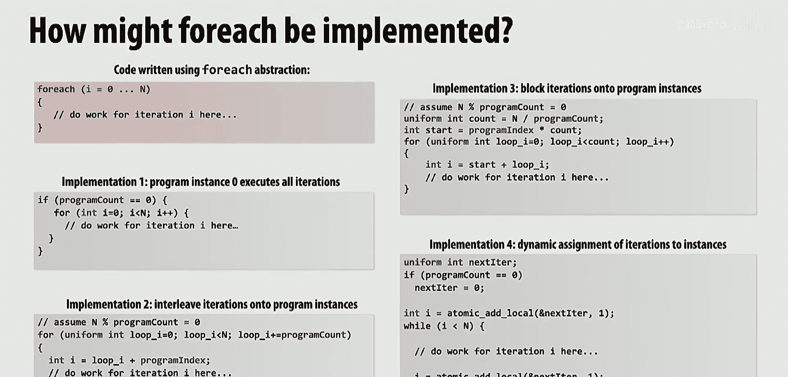

System， you map it to workers， however you want。You don't know what worker is doing what piece of work。

 And you actually don't even care。 You say， system， just assign all the work。

 So I get good parallelism。 I'll leave it to you to make a good decision。Because in my first program。

 I chose to do it this way， myself。Maybe that's a bad idea on some future system。

 And if we would have written it with high level 4 each。

 some future IS PCC compiler might do a better job。Yeah。Cost to making like this system how。Yes。

 there is， I mean the system is going to have some policy for doing it。

And maybe it's not as good as me。Right，Like， maybe I know my program really well。 And I'm like。

 I want it to run this way。 And so notice what IS PCC has done。

 This is actually usually a clever design of a programming system。

 They give you low level mechanisms to specify exactly what you want。

 And they give you a higher level mechanism that has an obvious translation into the lower level thing。

 So you're saying， look， use the higher level 1 whenever you can。😊。

Because it's probably gonna do a good job most of the time。 And if you're ever unsatisfied。

 you have the ability to dig deeper and do it yourself。And those layers of the onion are very。

 very important， I think， in good programming system design。

 especially in good system programming design， so。Let's， let's double down here。 Now， this is。

So here's， a basic for each loop loop。 I took all the complexity out of it。 It's just for each for。

 for n iterations， do something。Okay， if I just abstract it。

 because I don't want to think about a s X。 Okay， so in most cases， if you see something like this。

 you actually stop thinking about program instances at all。You actually just go。

 I have N things I need to do。 N loop iterations。 I S PCC， like。

 please make sure it's implemented in good Cindy。That's basically how you should start thinking anymore。

 Like you're not thinking about program instances or gangs or anything。 You're just saying。

 you're actually saying， oh， this four reach that's gonna be like， that's potentially parallel work。

 IS PCC， spread them out， Size it， do whatever you want。 I trust you， you're gonna do the right job。

You do way better than me implementing intrinsics myself。Okay。

But it's important to understand how it runs。 Like， what does this program do。

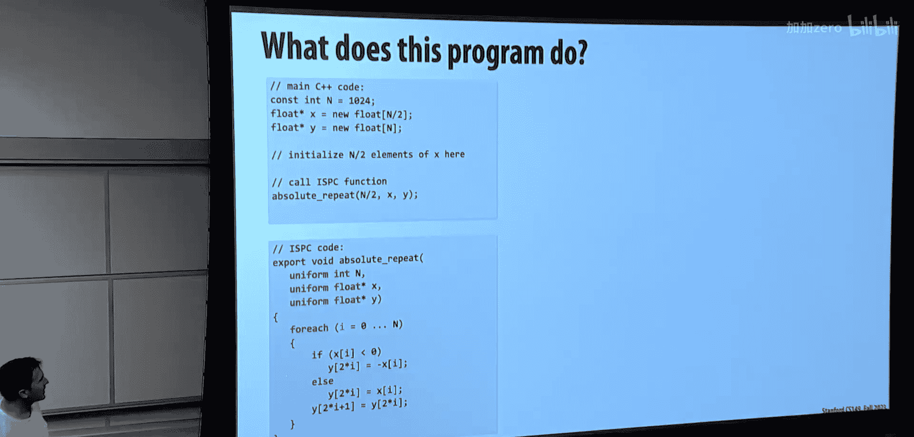

Here's another IS PCC program for every input element of the array X。 What happens。ItBig hint in the。

 and the functioning。It's valid。What was a do？Takes every element。P's the absolute value。

And stores it twice in the output。It's a valid program。 The input arrays of size n。

 the output array better be of size 2 n。Right？Okay， so， so that's all it does。 Make sense。 And。

 and again， like， if you saw this code， you would just。

 you wouldn't think about it as what does every program instance do。

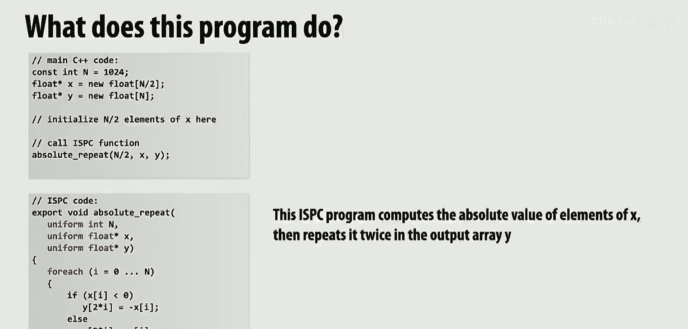

You would think about it as I need to process n elements。 And for every element。

 I'm gonna take the absolute value。 And I'm gonna shove it in these two spots。

 And this can be done in any order that IS PCC wants。 We already know how it's gonna do it。

 It's gonna interleave things amongst the program instances。 But I don't really think about。

Systems programming when I'm using for each anymore。

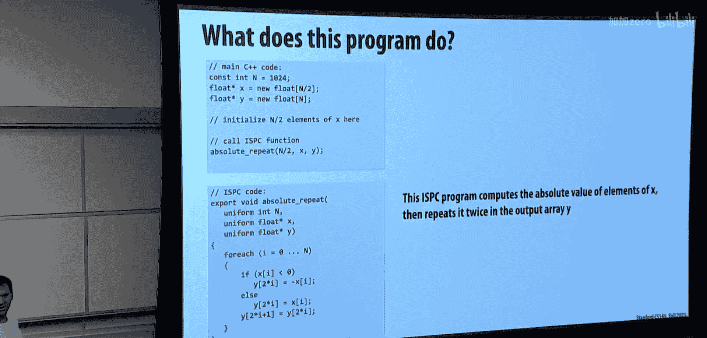

But here's an interesting question。 What does this program do。This is a little bit more interesting。

So as long as you're not the first element of the array， if you're less than zero， what happens？

I slide it back。Is this a valid program？People are shaking their head and know， this is important。

 Why is this not a valid program。Yeah。

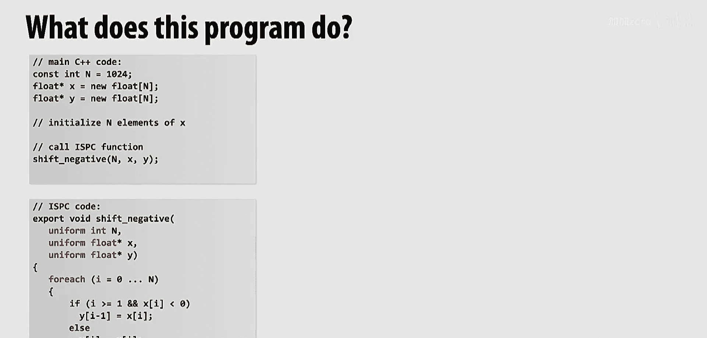

So what we've told the system， like， I know what this program would do if it was if it was run serially。

If it was run serially， I'd put something in I I might put something in I -1。 The next iteration。

 I might override it， or I might not， but is' very well defined what the answer is。

If these iterations are run in some order that you don't know。

Cause you've left this up to the IS PCC compiler。 You've said that these are independent iterations。

 execute them across the program instances in whatever order you wish。

You have no idea what the output of this program is。

 because the output of this program will depend on the order that IS PCC will run these things in。

So this is， this is a program with undefined output。

 The next rev of the IS PCC compiler might come out， and your program might be a different answer。

 and they're well within their their rights to do that， because the contract for for each was。

 I'm saying that these iterations can be scheduled onto the program instances in whatever order the system wants。

Something like this's well the， the current IS PCC compiler will make no effort to try and catch something like this。

 and it can't catch something like this， because what if I changed x sub I into x sub a sub I for some arbitrary data dependent A in the index。

 yeah。

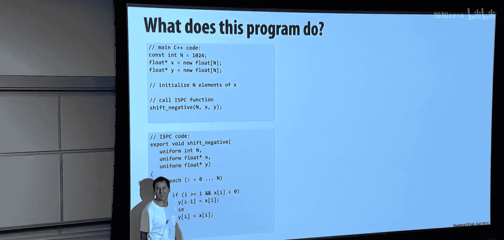

So， sure， maybe some compiler out there if they cared could catch this one。

 but I could continue to write any program。 That doesn't。s That's a， that's a race condition。

 Absolutely unclear what the， the output of this program is。 Okay。

 so here's one more that should really get you to understand things。😊。

This is a broken program for how to compute the sum of all elements in the array。

Can you see why it is broken。For every element in the array， independently。

Please add into the variable sum。😡，Which is a per program instance variable。And then return some。

 So  first of all， this is actually not gonna compile。 Can you tell me why it will not compile。Yeah。

 if I'm running 8 program instances and they all return some。

 that doesn't make any sense becauseuse the caller is expecting one return value。

So the only way to return something， actually an IS PCC is if it's a uniform value。

 which means there's one copy for the entire program。 So this actually won't type check。

But here's another version of it。Where， well， also， what's。

 there's actually another conceptual problem here。

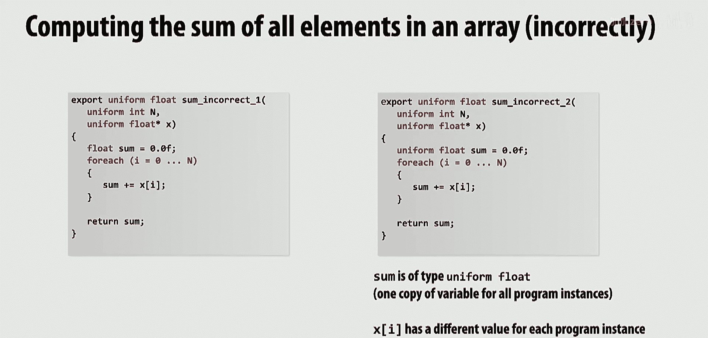

I have eight copies of some。 What will they be at the end of every program instance's completion。

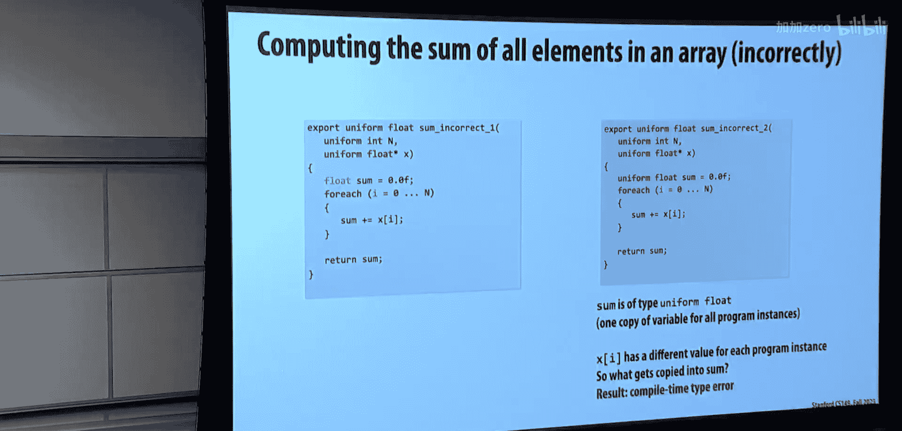

Yeah。インデクト？

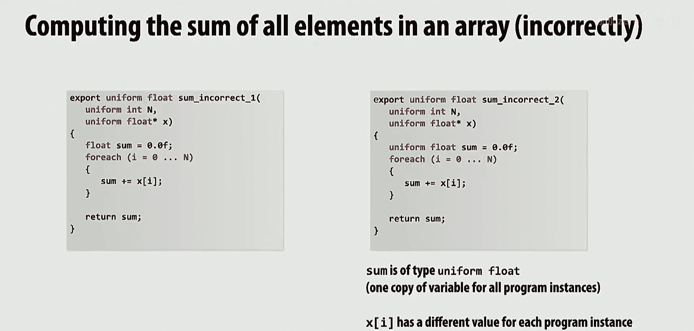

Yeah， there'll be the sum of all of the it， the values from all the iterations that whatever got assigned to the different program instances。

Now， here's a version where I changed the program， and I made some uniform。

 So I could return some if I wanted to， but there's a problem with this program。😊，Yeah。Now。

 we got another race condition， which is I have a single sum。

And I'm trying to have a bunch of program instances plus equals into that sum。And so now I have。

 you know， something even， you know， have another race condition。 and I'll talk a。

 So here's actually how to write this thing。 Oops， sorry。

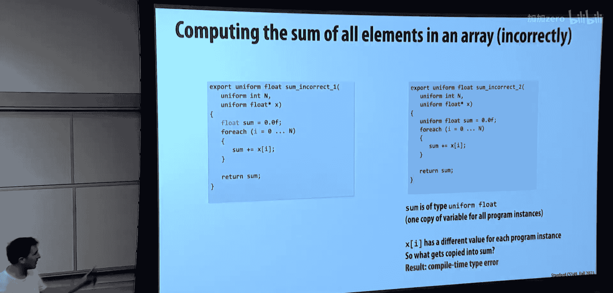

Did I get this correctly？嗯。This is actually how you write this thing。

So notice that I have a variable partial that's per program instance。I say。

 for all iterations of the， the loop。I don't care who you， you allocate the iterations to。

 but everybody is going to accumulate their local partial。And then at the end。

 I'm using a special cross instance library function that ISPC provides to perform a safe summation of this value。

 which is unique per program instance。😊，To put the results in a uniform value。

 which can then be returned。Yeah， does ISBC the。他 other。No， not right No， It doesn't。 It doesn't。

 But it would be conceptually easy to do。 Yeah， like you could， you can see， trust me。

 this is a cross lane operator。 Yes， but so another way to check your understanding is that IS PCC will compile this code。

 Like now we're talking about implementation of the current IS PCC compiler。😊，2。

 kind of a program 2 solution that looks like this。

Notice what's going on here for i equals 0 to n by 8。Just do a vector load and a vector addd。

At at at at at at at at the end of this loop， I have a single sdi vector。

 and every lane is a partial sum of all of the elements in the array。😊。

You you see how that's going on。And then at the end。

 I need to do something to add up all the elements in the array。

So I iterate sequentially over all the elements of the array summing over that final vector。

So this is。A naive implementation of reduce a。Yeah。You need to declare Lord at the beginning。

 you can also beautiful some at the beginning or that No， the variable can be declared anywhere yet。

I was just adopting good programming to。O。So， you know ISQC has all of these interesting。

Cross program instance operators that you can use if you want to think about programming in terms of a bunch of program instances。

And what are they doing at the same time？Okay。嗯。And so， so that's what I wanted to get across here。

 Like， first， you always start by saying， what does the programming language mean and do。

 And then you start talking about。How is it implemented and nothing I have said here today？

Willll ever run on more than one core of a one thread of one core。

 We have not talked about how to create more threads or anything like that。

 Okay so that's the programming model of IS PCC。Now， everything that we've said。

You can now just replicate out。 And that's the idea of tasks。 So when you create a task。

 that's like saying， here is some work to do。And I want one gang of program instances to do it。

So I can create 100000 tasks if I want in the same way that for each said。

 here's a gazillion loop iterations。 ISPC。 you figure out how to assign it to program instances。

 Tasks are like saying， here's a gazillion gangs of work to do。

 you figure out how to assign it to the threads in the machine and do it however you want。

 So if I create a million tasks。 And I'm running on a myth machine with8 hyperthreads。😊。

IS S PCC under the hood is just gonna create8 hyper threads and then go， okay， you do the next task。

 You do the next task。 You do the next task and so on and so on。

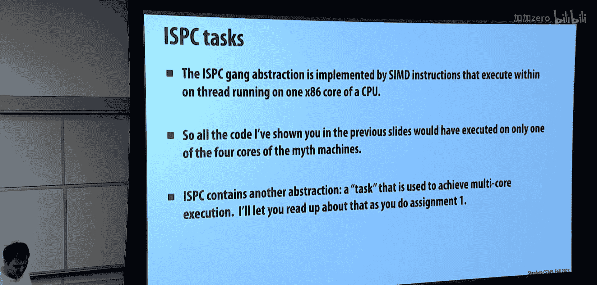

Now， one thing that you， I'd like you to， to mollle over a little bit is if we're not using any of these cross lane operators or anything like that。

 if we don't have to have these program instances communicate at all。

 which most of the time we don't。And if you're using for each。I don't really tell。

 I don't even ever think about program instances。 I don't think about program count at all。

 I just say， here are my loop iterations。 I S PCC， you go do it in parallel。 however you want。Okay。

But ISPC has all these concepts in it so we can do like really advanced shifting and other stuff。

 Like， here's an example of an ISPC program that actually computes the dot product， I think， of。😊，No。

 computes the， the the product of all the elements in an array。So given all elements of array。

 compute their product。So one output。喂。So if ISVC wasn't trying to be so low level。

 it would just probably give you a four each and say you're not allowed to have program count at all。

Or program instance。You would just write code。 You'd almost never think about parallelism。

 And you'd be like， wow， my program runs eight times faster than it did before。 Its awesome。😊，Right。

 so if I take out all the low level stuff from IS PCC， it turns out to be a very， very simple thing。

Now， there's gonna be an alternative that that some of you might be， you know。

 if you're a functional programming person or a N programming person。

 you might be more accustomed to not thinking about array indices， but thinking about。

Operations on vectors， like adding to tensors。Or giving a lambda and mapping a lambda onto a collection。

So you can kind of think about this IS PCC program as。

The collection is the set of values that are referenced by X of I。

So a higher level programming language just wouldn't allow you to do any indexing at all。

 It would just say。You know what。The data access of ad is well defined。

 X plus Y is just every element matches up with everything else。

So higher level programming languages would exist and would be able to generate really fast code as well。

And we're gonna talk about them as well。 But now you can think about if you had that in。

 in pytorch or nu， how would you actually implement it well on a C machine。

And you have some of the tools to think about how you'd actually implement Pytch。Okay。All right。

 any questions on that。Before we actually get to the basics。对啊。

Can you go the fast thing and they better you exactly the file this is going to be a thought。

That's in the program I would like everybody to kind of， as it says in the handout。

 go read the manual or my office hours are。1 o'clock today， so I'll take that。そ are not same head。No。

An ISPC task is just a task。A thread would be in implementation detail。

But it's very true that if you create eight tasks。A smart thing for ISPC to do be under the hood spawn 8 threads and run them all on different threads。

But if you create 100000 tasks， it'd probably be pretty dumb for IS PCC to create 100000 threads。

 And I'll show you why in a second。あしす。じ分さす。有効な。哎。And how does it turn？So the question was。

 let's say I'm back in Sealand and I create 10 C+ plus threats。Right。

 if I go to my activity monitor right now。In my computer。It's a lot of threads。

And I have eight execution contexts。So your question is， in general。

 how does a computer that needs to run， you know， apparently， 700 kernel threads right now。

 How does it run 700 kernel threads on my computer。Yeah。It's got a context switch。

 So from the operating system from time to time is saying， here are those8 threads that need to run。

 I'm gonna put them on the processor and let the processor run。And periodically， you know。

 some timer expires， and the operating system says， well， we have 700 threads。

 We need to have another eight run。 So we're gonna rip those threads off the processor。

And put those on。 And you can imagine that could be pretty slow。So， in fact， let me go ahead and。

 and， and， you know， since you asked。我没呀。One second。I have a demo of that。嗯。Okay。

So here's a program that I wrote。嗯。Yeah， one second。Okay， so here's a C program。

And it has three tests in it。It has。 so there's this function called do work。

 which literally does nothing。 So the cost of doing work is just calling the function。

 And I put some stuff up here， which says， hey， don't do anything fancy。

 I know there's nothing in it。 Don't inline it。 Don't try and optimize or anything like that。

 So I've got a function。 Imagine that this is my task。ItDoes nothing。

 so it's like the cheapest task in the world。And then here's a test which says run test 0。

 So test 0 sequentially calls that function。Good。Test1。Well， actually， let me go to test 2 first。

 test 2。Says right here。I'm going to create numb worker threads。

 So I'm gonna I've hard coded that to 8 on my computer。 So I'm going to create 8 worker threads。

 They're all going run worker 。😊，Where worker two is given the total number of tasks。嗯。

Take the next available task。😡，Call， do work， run it。

And then keep account of how many tasks I this thread has performed。

 And if we ever get to a total task count that equals n， we， we quit。 So I create8 workers。

 and they just go next， next， next， next， next， next， next。And then， task 1。Sorry， strategy 1。

 test 1 is just for every task， create a thread， run the task and then reap the thread。

 joinin the thread。 Okay， so which one do you think is going to be the fastest。Votes， yeah。べ自。

t completely。 Okay， so so， let's say 0 was do everything sequentially。

1 was spawn up an actual thread， A C plus plus thread for every task。 and two was spawn 8 threads。

And， and just have those 8 threads cooperate， right， so。So you like to。 Okay， any other votes。0。

Any other votes？All with eight threads， the same same little here。 So let's actually run this thing。

What is my program called Oh， thread B？Okay， here we go。So0 finished in 1。6 milliseconds。

I think I'm running like。A billion iterations or something like that。This is the spawning threads。😡。

And then it just flashed test，2。So basically， the sequential one。

 because there's just no work involved。 It was just a lot easier just to。

 to call the function and take the， you know， the three。

 the eight operations to push something out of the stack and pop it up。 So the test 0。

 was 23 times faster than test 2， which is my thread pool。

 and my thread pool was 300 times faster than spawning a thread per task。😊。

So this is an extreme case， right， where the task is so tiny that any overhead that you see it。

 But that's a 300 x difference between creating a thread per task。

And letting the operating system sort it all out。And me just creating exactly the number of threads that my machine can use and me handling the work dispatch with an efficient Gi next task kind of thing。

So what do you think IS PCC is doing under the hoodd when you create tasks。

It's creating a pool of the right size and saying， oh， I'm gonna do you。有。

The function was long still If this function was very， very long。

 I would expect to see my thread parallel thread pull definitely outperform sequentialca I'm doing all the work in parallel。

😊，A freeze better。Well， at some point， if the function got so long。

 doesn't matter anymore because the overhead of creating that thread is， is insignificant。 So we。

 what we could do is we could put a for loop inside my little task and make it do more and more work。

 And you could go figure out what the cutoff point would be。Yep， exactly。

 There's also a cutoff point where if it's so small， you might as well not even do it in parallel。

As we saw there when the is switching context。そはピ総。Yeah。

 so don't confuse context switching that you'd hear about in an OS class。

 which is what we are now talking about with hardware multithreading that we've talked about in this course in this class。

 we will almost never think about operating system context switching because we think about like we're the only application on the computer most of the time and it makes no sense。

For an application to create more threads than execution contexts。

Because all you're for to happen is the operating system start swapping them on and off。

Your job is to create one thread per you know， as much work as you can do。

And then it's your responsibility to take work and assign them to your working threats。Absolutely。

 an operating system context switch is hundreds of thousands of cycles。A hardware， hard。

 a hardware execution context switch is one cycle。Right， very different。

 If you use operating system context switching to high the latency of a memory access。

 memory would be done in a couple hundred cycles， and you'd still be spending 1 hundred thousand cycles to be swap swapping the thread out。

 It makes no sense。 So therere same idea， but a very different orders of magnitude。😊，Okay。

 so the rest of the time， I actually want to go through a case study or two with you the first time we're actually gonna really start kind of optimizing programs。

 I mean， you have to， I guess， optimize programs a little bit in assignment1。 But。

 but it's not super crazy。 And， you know， our goal is gonna just be get the maximum speed up。😊。

For now， our goal is to like reduce the the timer by some factor。 And hopefully， you know。

 if I can do things。If my time is p times less， then I have this PDD speedo。And。I think it it。

 it's somewhat helpful。 You know， I， I every year I decide whether or not I should share this slide。

 I think it's useful just to talk in general abstract terms for a second about kind of the process of。

 of paralyzing the program。And。The process you can think of is like， you know， what is step 1。

 Step 1 is almost always figure out what is independent。Divide work， you know。

 figure out what are the things I could do in parallel if I want to。And I， and， you know。

 terminology is kind of weird， but decomposition is kind of something that I think I use to。

 to say that's like， I got a problem。 I need to decompose it into things to do。

 Sometimes people might say tasks or something like that。And then there's the。

 the problem of assigning those tasks， assigning that work。 really， what I should say。

 two things that can execute the work。And so you'll often hear me say assignment to mean that。

 So decomposition is going， oh， we can work and， we can do， we can work in parallel。

 And assignment is like， okay， I'll do this and you do that。And then， of course， at some point。

 there's often， you know， some orchestration or some synchronization because we have to sync up。

 know， we might have to compute this a total sum or it might need to be like when you're done。

 I'll go。You'll see me call that orchestration。 And last， like there's often a notion of mapping。

Like what， how does like some worker actually？Get to the hardware。 So I'll give you some。

 some examples of that in a second。So in this class。

 you are almost always going be the the entity responsible for decomposing a problem in the smaller pieces that can be done in parallel。

The magic compiler that does it， does it for you largely does not exist unless you're using very specialized computing languages。

 Okay， and it's a little bit shocking to see how your speed up is limited。

If only a pretty small fraction of your program is not paralyzed。

So let's say we had a program that had some run time。

 And imagine that the fraction S of that program。😊，Was serial。

 So let's say you have a program and have half the program just as inherently serial。

 or maybe you just don't get around of paralyzing it。 S is one half here。

If 10% of the program is serial， S is 0。1。So then the maximum speed up you could ever hope to achieve if you perfectly parallellyzed the other part with an infinite number of processors。

 is sort of one over S。😊，Because you， your time， your run time is at mo， at least S。And so， you know。

 if you're total time over， you're limited by one over S of your speed up。

 And this can actually be pretty dramatic。 Let's like look at this。 So here's a simple example from。

 you know， programs that I kind of write all the time， which is， imagine I had an image of me。

 And the goal was to multiply all pixels by two to increase the brightness。😊。

And then maybe I want to compute the average of all pixels。

 It's actually a pretty common operation that your camera does all the time。Both steps， hopefully。

 you can see take n squared time。 There are n squared pixels。 It's an n by n image。

And if I plotted things out， like， this is execution time。

And this is the amount of parallelism when running。 So if this is a sequential program right now。

 the implementation has parallelism 1， and it has time 2 n squared， right。2 n squared。

So what would be the first step， What， What do you identify couldn't be done in parallel。

I can definitely compute the brightness of every pixel independently and potentially in parallel。

 and let's say that we run this on a machine with P processor。Now。

 I'm gonna use the term P processors because I don't。 I mean。

 you can think about it as as a processor with P cores。

 or we can think about it as just like distributed computing with P processors。 I I don't。

 The details of that don't matter。 Let's just say we had P things that could run in parallel。 Well。

 if I take your strategy， Then what happens is the front part of this program now goes to time n squared over P。

 And I haven't touched the back half of the program。 What's my speed up。Perfectly paralyzed。嗯。

The first part of the program didn't touch the back half。 but my speed up is what。In the limit。

 let's say is n is huge。So， it's twice， right？ So like， what is my overall performance， Well。

 it used to be2 n squared。And now it's n squared over P plus n squared。 And in the limit。

 that's gonna go to bounded by two。 So half my program remains sequential。 There's nothing I can do。

 I can't be any fancier here。 If I went to a million processors， I would still be bounded by  two。

Now what else could we do？Yeah。The the average choose the partial self。Yeah。

 so I can take all my processors， every processor could take like one piece of the image。

 compute a sum， and then I got to do a lot at the end。Well， yeah。

 you're speaking about it in terms of like， if we had to write an IS PCC， but conceptually， we just。

 every processor does one piece of the sum。

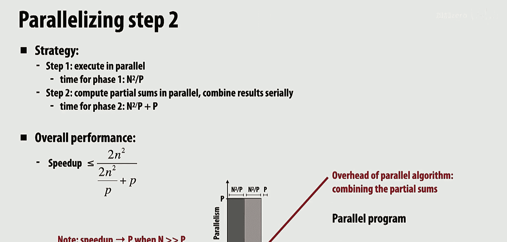

And then if we just naively add P things up to get the final answer。

 that would be plus P here at the end， right， So I have n squared N over P。😊，Yeah。

 so I have two n over p squared plus P if I added the partials up sequentially。Did I see that。

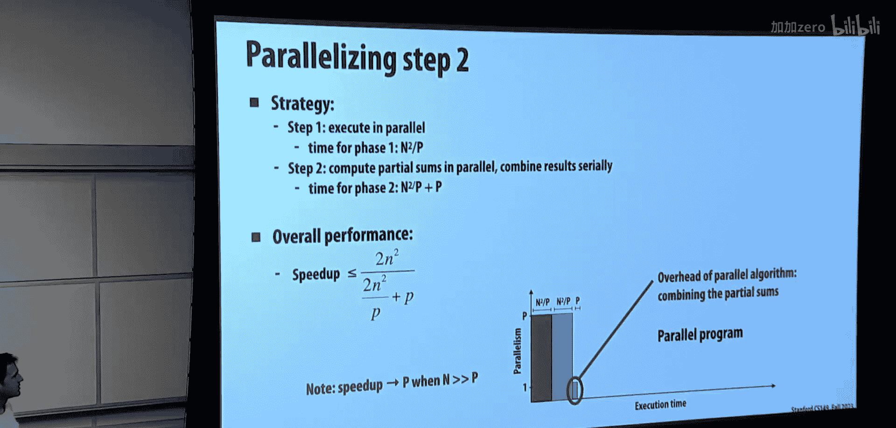

So the real question here is， like。

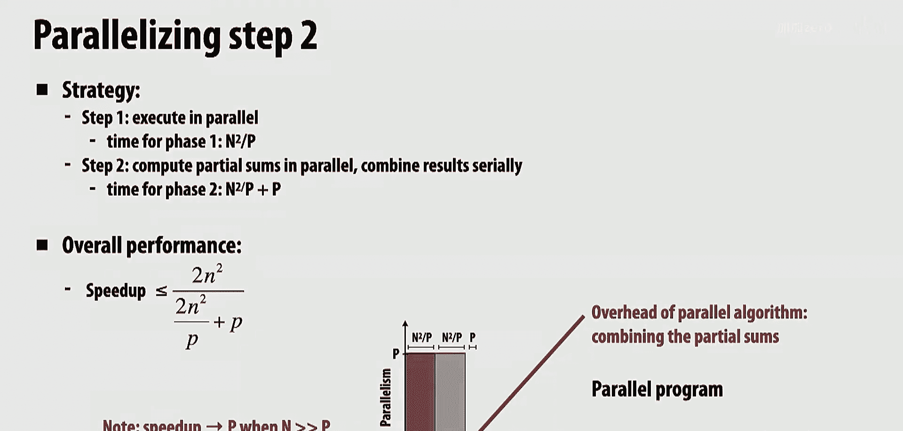

If P is very， very small compared to N， I'm gonna be doing great。

If P is actually kind of substantial compared to N， then I。

 I fundamentally have still have some some problems， right。And so this factor。

 S is actually pretty important。 So here is a plot where this is the total number of cores。

 number processors，64 processors。 And this is a theoretical optimum speed up for programs that have different Ss。

😊，Right， so let's say that only 1% of your program was sequential。 And you run that thing。

 the other 99% is perfectly parazable on a 64 core box。 You are limited to 40 x feet up。😊。

That 1% of sequential really starts to bite you。And so I'm already like。

 not perfect scaling on a machine with 64 cores。If 10% of my program can't be paralyzed， you know。

 my best case scenario on a 64 core box is， is about 8x。It's pretty dramatic。 Now。

 imagine that you're not running on a 64 core machine。

 but you're running on a big supercomputer that has， you know， approximately。

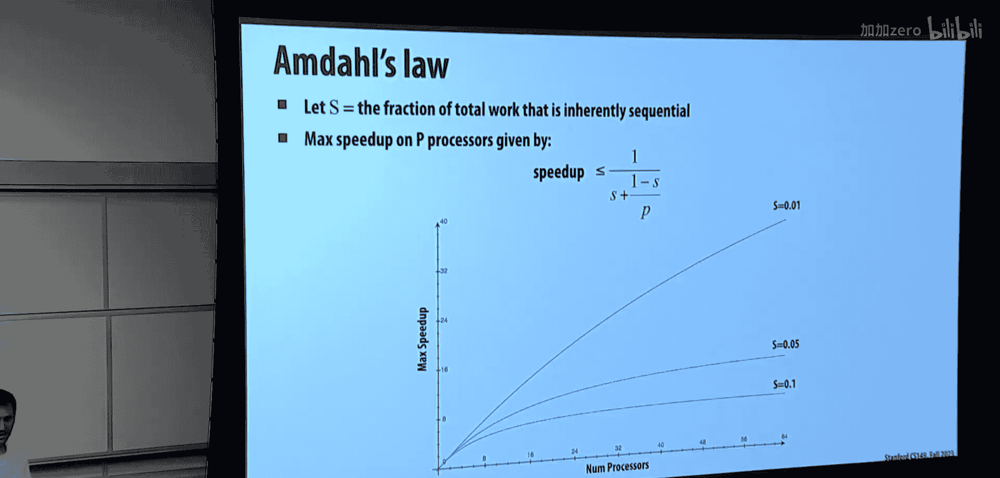

1 hundred50 million parallel units。You better get that sequential portion of your code down to like  point0。

000000，1% of the problem。 Otherwise， you might as well not be using this thing。Luckily。

 most of the code we run is going to be pretty paralyzable。So， you know， like I said， in this class。

Understanding how to decompose something is going be almost just like what we did here is it's going be up to you to give the。

 the write a program that decomposes things well。 Don't， don't hope for magic there。😊。

But what we often。Might rely on systems for programming languages or compilers is to assign that work to workers for us。

Okay， so， you know， assignment might be something like。Well。

 the name of the game in his assignment is to keep all of my workers busy。

So you might be responsible for assignment。 For example， earlier in this lecture。

 I wrote two different ISPC programs。Where。In this program。

 I assigned loop iterations to program instances。

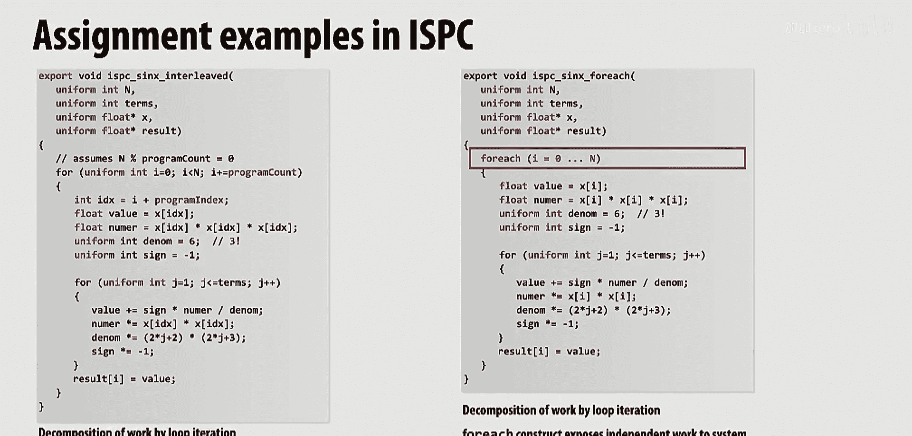

I wrote this code， so I decided that this program instance was going do this iteration。

 I assigned it。I gave you a different version of the code where I said， IS PCC。

 I'll let you do the assignment。I trust you to do as well， or better than me。

So that's an assignment task right there。On the first day of class。

 I think I showed you this piece of code where I had a seed program that spawned an additional thread。

 And in this code， I assigned one half of the array to one of those threads。😊。

By the nature of the code that I wrote， and I assign the other half the array to another thread。

 so I decide who does what。

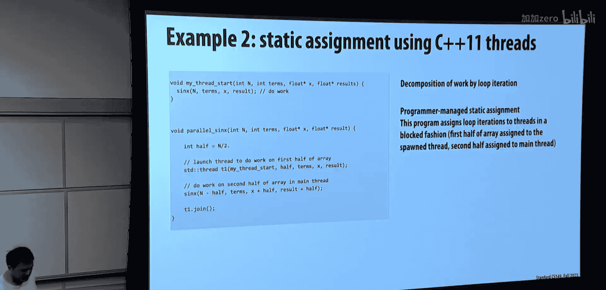

In ISPC tasks。You are decomposing this problem into tasks， But you're telling IS PCC。

 I will let you assign these tasks to the running threads that you have to do the work。

So under the hood， there might be a pool of threads， like one that you implemented in 1，11。

 And I PCC is going to there an idle thread。 If so， Hey。

 could you please work on task 0 or are you idle， Could you please work on task 1。 Oh。

 you just got done with the task。 Well， the next available one is task 42。 Could you go do that。😊。

That's what's going on under the hood。 And most of the time， we would rather have the computer。

 the system do the assignment for us because we're gonna assume that they're gonna to do a better job than than maybe we would。

 or maybe there are different assignment strategies that are the right assignment strategy for different computers。

 And I don't want to have to write my program with a specific computer in mind unless I really。

 really care about performance。We won't talk too much today about orchestration。

 but you saw one example of it like that reduced ad or those cross lane calls。 But at some point。

 even if you are diving stuff up into to different pieces。

 Those workers are gonna have to communicate and synchronize。 You know。

 one example of synchronization would be these workers have to synchronize so that every task only goes to one worker。

 And every worker goes to the， you know， gets the next task。

 So there's gonna be a little bit of synchronization。

 And you saw the effect of that synchronization in my my demo that I just showed you in that my thread pool was still slower。

 then the sequential version of the algorithm because my threads were synchronizing to take the next task。

😊，So that was an example of synchronization。And then last， like， at some point。

 someone has to actually take this idea of a thread or a program instance and map it to an actual piece of hardware。

That's the the last step of this。 So， oh， sorry， yeah， we。

 we talked about orchestration and mapping it to hardware。 So， for example， you know。

 imagine you create a thread who maps your C plus plus thread to a hardware execution context。

 We just talked about it。😊，Offering system in IS PCC， who maps a program instance to a vector lane。

That's， that's like kind of like built in in the implementation of the compiler， exactly。

 And there's a bunch of interesting mapping decisions。

 like imagine you're the operating system and imagine your program creates two threads。😊。

And you're running on a myth machine。 If your program creates two threads and on the operating system。

 do I put them both on execution context on the same core。Or I put them on different cars。

It's just it's a policy decision that one could make。 and there are different pros and cons。O。

So let's dig in with a a little bit stronger case study here。 How many people do we have any S N S S。

 not SPD like any numerical computing folks。Any scientific computing folks in there。

Promost always are。 Okay， no。 how many people implemented A， a solver。

 an iterative solver in a numerical methods class。 We got some folks。 Co。

 What solver did you implement。😊，Yeah， oh， you would do a new method solver。 Okay， so here， here's。

 you know， actually， no， I no， not， not similar idea。 but， but here's like a。

 a grid of imagine we had like a， this is actually from a fluid solver where we have a grid of values And at every value。

 there's like a pressure or some quantity。 And the goal is to。😊。

To bring this system to convergence and the details of that are not that important。

 But computationally， what it basically is is blurting out the grid。

The new value at a location yellow is going be the average of the surrounding values。

So we're trying to basically， we're gonna iterate on this and just kind of bring this to conversions so that like if I change。

 if I change the blue value here， that should cause some update in the yellow value。 Now。

 look carefully at my code here。 This is the starting code we have。😊，While not converged。

For every element in the array array。 Now， by the way， this is just pseudocode。 See like pseudocode。

 for every element in the grid。Saave off the previous value。

And the new value is the combination of my neighbors。

And then I'm accumulating the total amount of change of all values。

And if the total amount of change over the whole grid has changed enough。

 we'll stop or we'll keep going。 If nothing is changing anymore， we've converged and we've stopped。

So step  one of anything， whenever I slam code of here is I'm going to ask you。

What can be done in parallel。So take a look at this。And if we respect the code as is。

What is the challenge？That makes us go， oh oh。对。

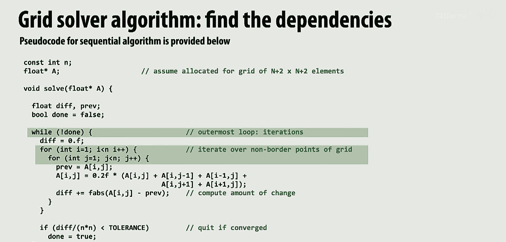

个。I all。AIJ depends on my neighbors， but my neighbors just got updated in the previous iteration of the Jlu。

So I cannot do the next iteration of the innermost loop until。I。

 I complete the previous iteration of the innermost loop。

 So your dependencies might look a little bit like this。

 The red arrows say that the black dot is dependent on another dot。

 If there's a red arrow from an external thing to me。哎。So。

If I asked you to paralyze this code and this was the code。Is there anything you could do。

Different chunks。这。Well， okay， but， so let's say I did the top left chunk。Completely sequentially。

What could I do in parallel with it？But I can't do the top right chunk because none of these values are known until all that information propagates。

 so。Yes， so I can't quite do that。 I mightt get the wrong answer。い出しくれる。是rry。But if I。

 if I make a separate result array every loop， I'm going to compute a different answer。

Because my value at this iteration depends on previous computations in the same loop。

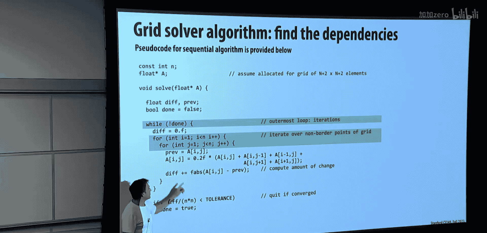

So if I write the new result to like I A2， something else。I am not computing the same thing。

Any other thoughts？You could sleep that。So there is a little bit of parallelism here。

There's a little bit of perism here。 So you could be really clever。 And you could say， well。

 at certain parts of the program， there's at least like sort of like a little bit more than O event perism。

😊，But I'm kind of like， I don't even know if I wantan to write that code。 I don't want。

 I don't w know if I wantan to write that code for two reasons。

 One is I don't have a lot of perils in in large parts of the program。 So Amd's law is gonna get me。

And second of all， if I'm actually moving in this direction。嗯。I'm all over the memory address space。

 And so it's not clear that it's necessarily gonna be a benefit to me anyways， if I。

 even if I got some parallelism。So here's what we're gonna do。

 which is a big part of often thinking about programs。 And when we do a a mini transformer in。

 an assignment for this year， this is gonna be a big part of it is sometimes you look at a program and go。

 I don't really want to bother with this。 This is not a program that I gonna have。😊。

A lot of success with。So what we're gonna do is we're gonna look at it。

 and we're going to use our knowledge of solvers。And go， there's another solver。

That will compute approximately the same answer， but is more friendly for perism。Okay。

 so that's what I'm gonna do。 We needed some domain knowledge。 You gotta go talk to your expert。

 or you gotta be an expert in machine learning， or you gotta be an expert in graphics or something like that。

 We're gonna change the algorithm a little bit to a different algorithm that's way easier。😊。

And that's is we're going to do this checkerboarding thing。

 and we're going to iterate back and forth， which is on one step。

I'm going take all of the red cells and update them based on the black cells。

And then on the next step， I'm going flip it around and update all the black cells based on the red cells。

 So I hope you can convince yourself that I can do all of the red cells in parallel。😊。

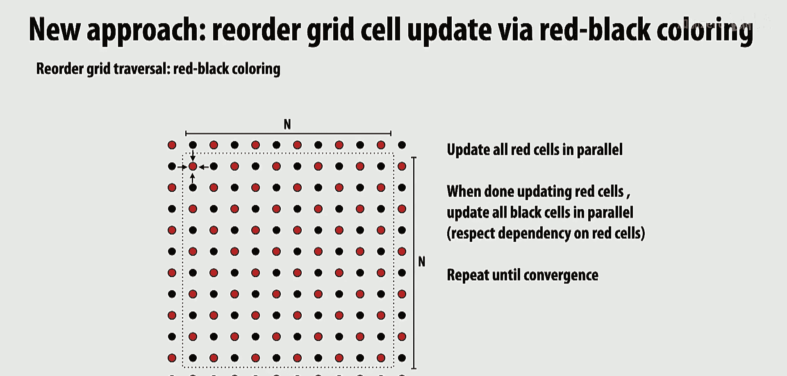

And then I can do all the black cells in parallel。Okay， now， I've changed the algorithm， which。

 by the way， I told you just a second ago， you can't do that。But now this is like， we just。

 we had nothing to do。 So it's like， okay， let's， let's go to a different algorithm。

 It's more friendly to parallelism。 It turns out that this new algorithm will actually take a little bit longer to converge。

 We're actually probably gonna need to do more iterations。 But the cost of doing some extra work。

 We're hoping can be made up by the ability to massively parallelze if we have a big parallel computer。

😊，One question about hold time。So theyre much the same value。 I'm just asserting that。

 And I want you to trust me for now， right， Like or it's theyre。

 they're gonna converge not to the same numerical value。

 But this is already an algorithm that's like good enough， right？

 So as long as it converges to some threshold， we are scientifically happy。😊，Yes， there's no。

So there does whitewood。I cannot not think the box。Hardware to solve this。

 probably something like a s system might be。Yeah， so， so you are correct。

 One possible solution would be， let's go build some custom hardware for this。 Now。

 the hardware does have some scalability issues and that there is only so much parallelism here。

 but you're also proposing a pretty expensive solution to the problem of go designing a 10 million dollar accelerator to handle this。

 this thing that， you know， you have two weeks to do the assignment。😊，Okay。

 so that was decomposition。 So we， we， we've decomposed the problem into let's do all the red stuff in parallel。

 So every red dot is something independent。 And now we need to kind of think about assignment。

 Let's say if I'm gonna chunk this grid up into into two possible assignments。😊。

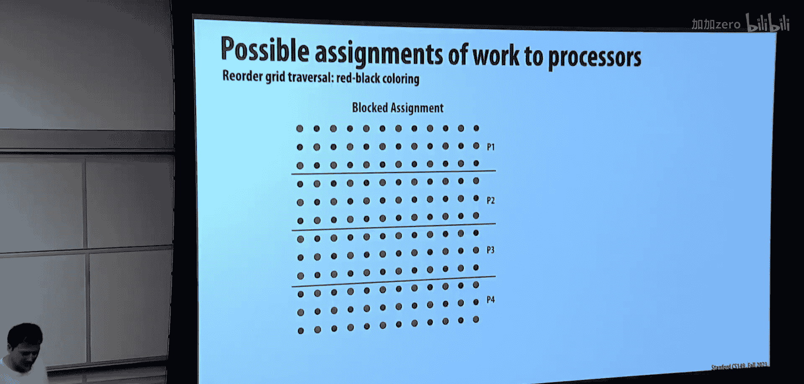

Let's say I'm going to divide them in a blocked way across the processors。

 or I could divide them in an interleaved way across the processors。

Two valid ways to paralyze this program。 Who knows what might be better。

It could be some issues that that lead us to do one or over the other。

Without that be an assignment decision。 So let's consider the， the dependencies in this program。

 right， We're gonna compute all of the red cells。Which means every red cell needs to access its to neighbors。

And then I'm going to update， I'm going to send all processors。 Everybody needs to。

 to be able to get the updated value。Of the red cells。So that we can then do the black cell update。

Right， so when I think about like this this program that I've written occurs in phases。

So in this particular case， if we decide to put continuous blocks of this array local to various processors。

There's much less data that needs to be exchanged。Because if I'm， let's say processor 4。

 I just updated these black cells or these red cells。Well。

 I already have the information I need to update my black cells。

Whereas if I would have gone with some interlea mapping。

 every single thing that I compute has to get transferred to my neighbors at some future time。

So there can be some issues related to， you know， given the no knowledge of the program。

 In this case， I'd probably do this kind of blocked assignment as opposed to interleaved。

 But when we were talking earlier about IS PCC programming on 70 hardware。

 we actually made a different conclusion。So you need to know what you're running on in order to think about the thing。

 Okay， so I wanna。Write this solver now， in two different ways。

The first way we are not going to think about threads or parallelism at all。

 we're just going to think about parallel work。It's very much like before each way of thinking about things。

 And then I'm gonna come back and rewrite it in a way that's more like， here are all my workers。

 And here's how they communicate to solve the problem。 So I'd very much rather as a programmer。

 write it in this more。 I'm gonna just think about。Parallel work。Okay so here's a version of that。

 And I'm stepping out of ISDC just to be in pseudocode。 This is just pseudocode。

 We're not thinking about Cdy。 We're just thinking abstractly right now。Oh oh。

 that might end up down here。 Okay， so I kept this simple。

 And then this is only code for just the update of the red cells。 So there's， you know。

 another thing down here。 but just the update。 So for basically。

 look what this says is there's no parallelism at all。 I just have a program that runs sequentially。

Logically。But here， instead of a regular for loop， I just wrote it as a for all red cells。

For all red cells independently， please do your red cell update。And then using some helper function。

 which we magically have available to us。😊，Please go ahead and compute the up。

 the amount of update that this iteration did。 Please accumulate it into this global variable di。

Does that make sense？And we've left everything to the system。To figure out how to paralyze。

 we've said， trust me， these in iterations are almost completely independent。

 The only thing you have to worry about is that I want all the information that I'm computing to get correctly added into this global variable。

So I am kind of thinking about perism a little bit here because otherwise I wouldn't have written this。

But more or less， I'm leaving all the。 I've done the decomposition。And I've said assignment。

Parallel system， you go figure out for me。Makes sense。O。And this is why I'd rather write it this way。

 because it's basically the sequential code。 I just did one little thing which said， hey， compiler。

 trust me all these iterations you can do in parallel provided that you take a little bit of care right here。

😊，Now， let's step down to a lower level and see how we might write it ourselves with lower level abstractions。

 or we might。 another way to think about this is if you were the， the compiler at a runtime。

 how would you implement this。Which at the end of the day， you need。

 someone needs to decide who does what。Okay。So now I want you to think about。

Kind of IS PCC programming or threaded programming。 whatever programming model you want。

 we're just gonna have a bunch of threads running in a shared address space。Okay。

 so everybody can access shared variables。We have one address space。

 but we're gonna have to synchronize with some constructs like locks and barriers。

 So here's my implementation of this code。 Now， it's a little bit long。

 So I've tried to sort of explain it to you I've tried to sort of annotate it here。 But it's。

 it's doing the same thing。 It's saying， while not converged。

This is code that's run by every thread in the system。So if this was IS PCC。

 this is like the code running by a program instance。 If this was threaded C programming。

 it's just a thread。 And in the same way that I could get my program index in any threaded system。

 you have the ability to get your current thread I D。😊，Right。

 so you have some way of knowing that of all the running things in the system， Which one am I。

Because I need to， to take that information about which index I am and turn that into some decision about what work I'm responsible for doing。

Okay， so given this thread I D， notice what happens here。

 I want you to ignore all this jumbo about locks and barriers and just look at this。 It says。

 I'm going compute the rows that I'm responsible for。 My min and my max which is blocks set of rows。

And for all elements between Ro Min Min and my Max， I'm going do the update。

And I have this local variable， my diff， which I'm accumulating my， my local stuff into。

And at some point， I take my diff and I add it into a global variable diff for all the threads。Okay。

 so this is like just a map。 You could write this in C plus+ if you wanted with C code， okay。Alright。

 so my question to you is， what is this lock doing here， What。

 Why do I have lock unlock around this line of code。对啊。Okay。

 and what could go badly if I did not lock that？否则。It's a race condition， but yeah， I mean true。

 but what could go like in the specific terms of this program， what could go badly's？Okay。

 so we need to make sure that this。

Change to this shared variable is atomic。 Okay， let me elaborate on that a little bit。 So let's。

 let's go think about a simpler example。 Imagine I have thread 1。

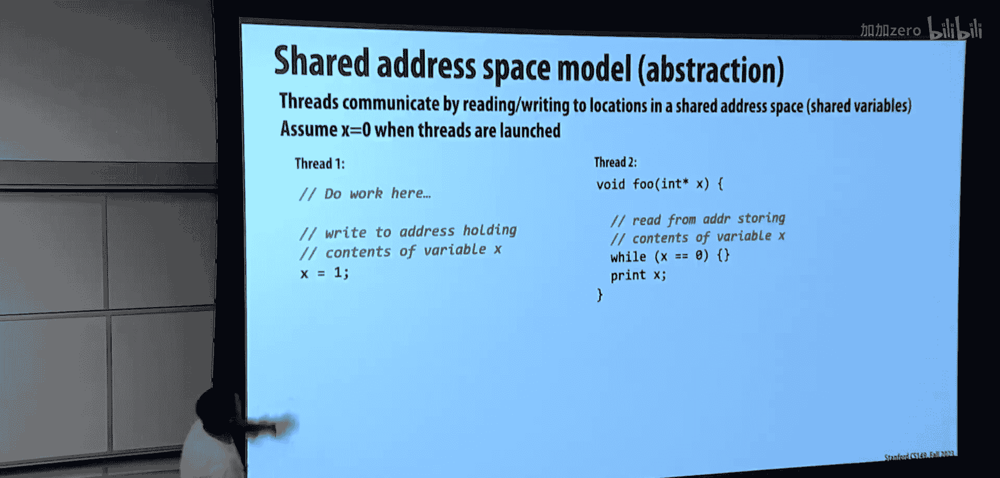

Which at some point writes one to some variable x。And I have another thread， too。

Which also has access to variable X。 And whenever it's nonze。We're going to print X。You know。

 we'd really expect。X to be printed to be one here， right。

So you can kind of think about this shared address space as。This is what you thought of any computer。

 There is some memory address space。 There's an address X， and there's a value at X。

 And all my threads have the ability to read and write to that value。That's just。

 the notion of computer that I haven't even taught you， but you naturally would have assumed。

People like to think about a shared address space It like a bulletin board。

 You go to somebody's door。 Any can read and write。

 could be some problems if we read and write to the same spot。Okay。

 so the reason why we protect updates to shared variables with locks is let's think about what can happen when we think about what does it mean to write to a value in memory。

When I have like an X plus plus on my code， what that really means is load the value in memory into register R 1。

Then perform the math on R 1 and then store that value back out to memory。

 There's actually three operation three operations here， even though it's one line of code。😊。

So imagine that the value in memory was 0。 as we started， T 1 would load 0， update it to be 1。😊。

And then， try and store one。What if at the same time， threadread 2 went in there。

 tried to do X plus plus， It also read 0 because it read the value before T U1 had written it。

It updates it by making the value 1， and then later writes one back to memory。

We wouldt miss an update。So this is a race condition because we don't have mutual exclusion。

 We don't have a policy set forth so that only one thread is writing to a shared value at once。

And what the lock does is the lock provides that mutual exclusion。

 Only one thread can have the lock at once， which means only one thread could be writing。

Later in the course， I'll tell you about other really helpful primitives that allow you to ensure mutual exclusion without locks。

But。In this example here。That's what that lock is doing。

 And that's something you would have seen probably in 1111 And with your thread pool。 a review here。

 Now， in the context of this program， what， what， what could happen if we didn't have the lock。

What be the effect on the program。The total di value would be what potentially lower than it should be。

 And some threads might falsely conclude that they should terminate。Right。

 so that would be the effect here。 you know， the incorrect assumption that things had falsely can。

Now， this code is correct。😡，But now there's a performance problem here。Something I really don't like。

Oh， sorry。 I actually already fixed it。 Shoot。 I meant to do it。 Yeah， I I。

 I've already actually fixed in this code。 So the original code had this lock in unlock update here。

 And a copy paste thing last night。 I actually copy the， the better version into here。

 So my original version was， don't even have a My di。 Just do a lock。

 just do a lock and update global diff。😊，Right， and the problem with that is I'm doing this synchronization in my innermost loop。

Right， so my solution here was to actually create a private copy of my diff。

Have everybody update their partial dis without locks。

And then come back together at the very end of the iteration and compute the overall sum before we actually did a check。

Sorry about that。 I was looking about it。 I was like。

 there is no pro performance problem with the code。Okay。

 but now the last question I want to ask you is we finish up。Is what are these barriers doing here。

You might even be asking， what is a barrier。Right， so what a barrier is。

 it's another form of synchronization。 If a lock is about mutual exclusion。

 only one thread can hold the lock。 A barrier is a。

 is a very coarse frame of synchronization where you can phase your computation。 So a barrier says。😊。

No thread。 The caller will not proceed past a barrier。

Until all threads have have gotten to this point。Okay， so say once I know everybody is here。

 then we can all continue。Okay。So my question is。Why do I have three barriers in this code。

 I kind of intuitively would think。I should probably have one。 I should do all my work。

We should wait for everybody to get done and accumulate into my death。

And then we just should do a check， and we should keep going。But this color is correct。

 And I have three barriers in it。 And if we have four minutes。

 the last thing I I'll ask you to do today is why don't you see if you can talk this over。

 What is the purpose of all three of these， I claim I need them。So， you know， wake up for one second。

我哋要嗰啲成。改。Okay， so since we have two minutes， let's see if we could talk it over。

So I think the first one to really look at is to be the one that's the most obvious。

 The second barrier here。

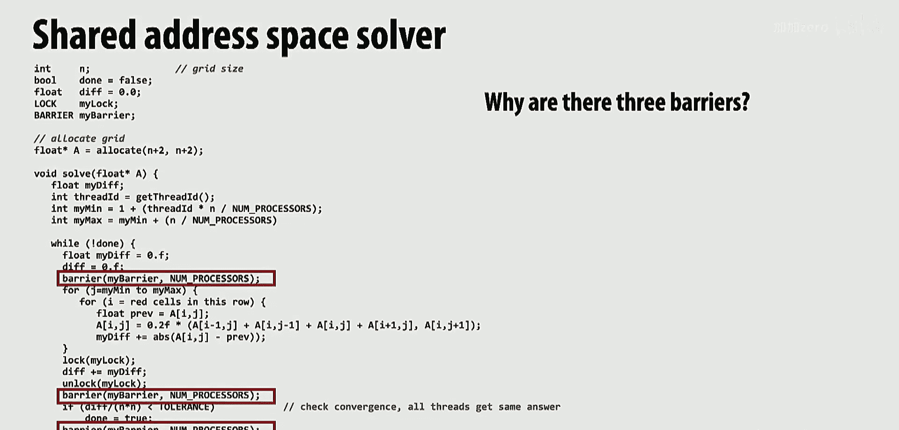

Why did I put a barrier in the code here， yes there。おくライツもに受で。也高你。

Before any thread checks to see if the system is converged。

We need to make sure that all threads have performed this update so that we're looking at a correct depth value。

That makes sense。 Okay， so let's say we decide。To。That done is， is we want to continue。

What happens if this barrier is not here and I immediately shoot up。对。Just don't set dip So I might。

 I thread 0 might be like， okay， sure， we got to keep going。 Al right。

 let me get started for the next iteration。Setting global di to 0。 And then what happens。

All other threads might be like， shoot。 By the time I got around to check it， it's 0， we should can。

 we should， we should stop。Good。Okay， so that's why I need this one。

 because I don't want people to clear that value before I take a look at it。

And then what about this one？

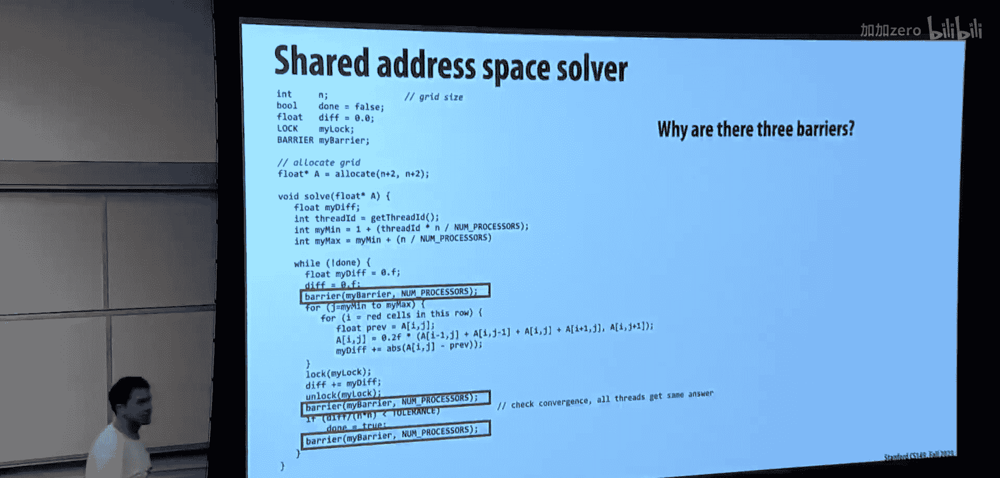

The last oneren might update。こ？Go change。So what if in the next generation I get all the way through my work？

And I update the di value。Before， in the previous iteration。

 the other threads have actually been able to check it。And if that， if that allowed to happen。

 then the di value would be incorrectly to。Well， who knows what it would be。 You know。

 I've set it to 0， and then I've updated something into it so it could be too large or too small。

 It's just wrong。So you see how I need all of these here to have this correct program。

So my challenge to you in the lecture is it is possible to do it with one。

Can you do it correctly with one。 And the hint would be。

 take some inspiration for what we did here with， with the diff variable。Is。

If we didn't have a local myif。And we had one global diff。Every single time I wanted to access di。

 I would have to walk it。But what we did is we had contention。

 So I made local copies of something in order to remove the contention by replicating some stuff。

 here。 what are we contending for with the barriers。

What's the variable that we're all making decisions off of。Death。

And the problem is that we're reusing the same diff variable across different iterations。

Is there any way you can replicate something in order to remove this dependency and you can get it down all the way to one。

 And this is the only one you actually need。 So I'll let I'll stop there。

 And that's just a fun one to talk about on the website。😊。

