# 【并行计算 CS149 2023】斯坦福大学—中英字幕 p05 p4 Lecture 5 - Performance Optimization I： Work Distribution and Scheduling -BV1du17YfE5G_p5-

All right， so let's get started。

I'd like to bring this back up from last time really quick。

 Remember we closed last Thursday on we were we were running this。

 we basically walked through a case study of optimizing a program。 And if you remember the program。

 it was this numerical program where what we did was we divided the program into various phases and I'll just page it back in for you。

 I said on phase one， we're going to update all of these black cells in a grid and we updated every black cell by looking at the neighbors。

And then we said， hold up， wait till everybody does little work。

 Everybody's got to check to see if conversions are we're supposed to stop。

 And then we're gonna repeat back。

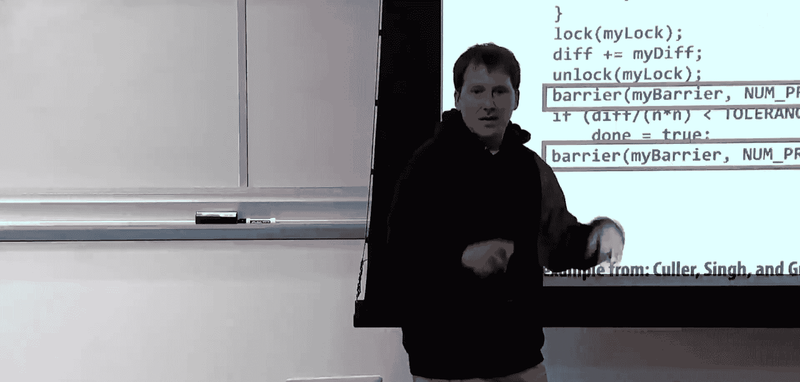

Repeat the next iteration if we haven't converged。 And the last thing that all of you did in class。

 like our last three or four minutes of class last time was you all told me。

Why there were three barriers in this code。And it's just a quick review。 Like， remember。

 all of the threads computed some elements。And computed how much of their how much did they change the final output。

 And then all of those threads accumulated their partial sums into a variable。

And then if that variable exceeded some value， if we hadn't converged。

All the threads just went back to the top of the loop again and continued。

And we had a number of barriers in there。 We said， well， well。

 this barrier is here because all the threads need to know that all other threads have accumulated into this sum。

 So it's the final value before we check if we're going continue。That was why we had this barrier。

And then we had this barrier because we were like， well， wait a minute here。

 We need to make sure that everybody has checked the actual value to determine if they should continue。

Before any thread gets to the top of the loop again and resets those values。

And then there was even a third barrier which says， well。

 we need to prevent anybody from going through this section of the code and actually updating that value。

 perhaps before it got reset or something like that， or checked by someone else。

 There were these three barriers。

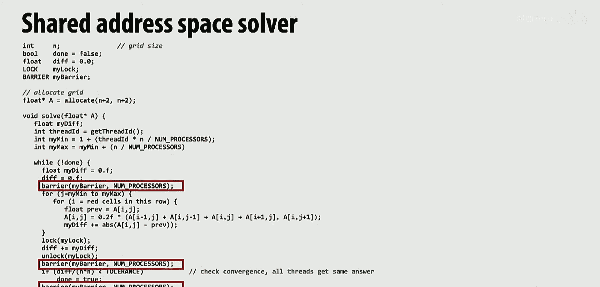

And I asked did anybody and maybe you posted us on the website。

 Did anybody come up with a way to do this with one。

Nobody puzzled over this because it would be a good thing to talk about。

 So let me just give you like。What is the reason why we have to keep waiting here。

There's a variable that we keep checking。Right， and what's that variable。That's my diff。

 And what does my di do， My diff is a single variable。

That holds the value of the amount of change per iteration。

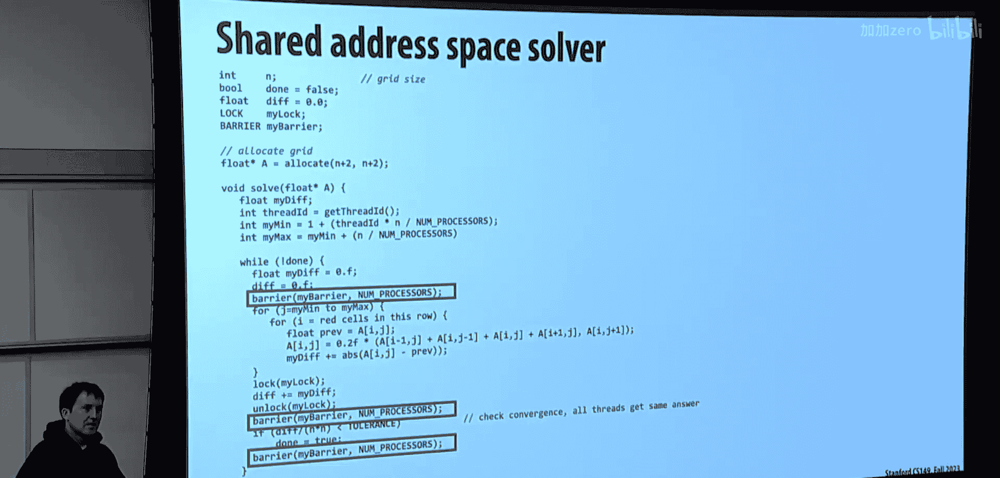

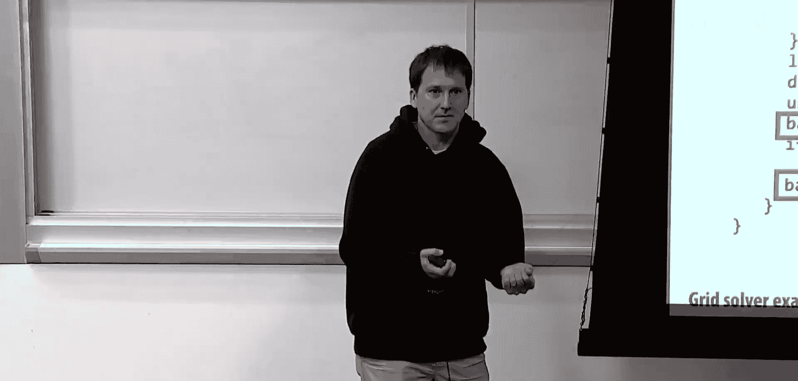

And the problem that we have is that this is code with multiple iterations。

And that my death value is being reused over and over and again。

To represent the change in each of these iterations。So the problem is that every。

 all these threads have to get out of iteration I。Before anybody can start doing any work with my death on iteration I plus 1。

Right。So。Why not just have different variables for all the different iterations。Like。

 if all we do is have a different variable。 If we had my dip for iteration I。

Everybody with in iteration， I would just accumulate into the iteration I version of myif。Check that。

And then you don't have to wait at all because when you move on to the next iteration。

 you're starting with a different variable。Or you're reading and writing a different variable。

 So this was a case where I have kind of falsely created a dependency in the program that didn't need to be there。

Becauseuse I was reusing one variable for a couple of different purposes， every iteration。

So a very simple solution would be to go to one barrier here。

And instead take this diff variable and make it an array。Now， conceptually。

 what I've done is I I could have made a different array of， you know。

 diff is an array of size number of iterations。 But really。

 all I need is I needed three different copies of diff。

I need to maintain a di from the last iteration， the current iteration and the next iteration。

 because all threads are only gonna be kind of in one of those three iterations。

 They're either finishing up from last time， working on the present or trying to move forward to the next。

😊，So what I did is I just said， oh， I'm just gonna to duplicate that variable and make sure that the accumulation goes into the right copy of the variable every time。

So this is kind of like the same idea as what we did right here where we。

 we had that one single variable My diff。 And remember。

 we made a local copy of it to accumulate our partial sum。

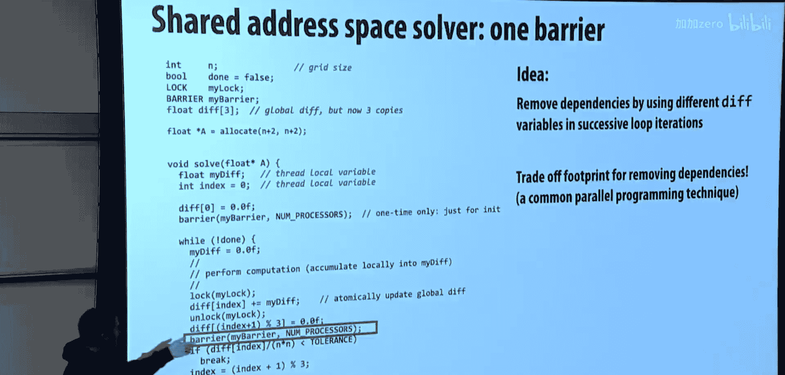

So that was， again， the same technique as like， we had one copy of a variable。

 and everybody was synchronizing on it。 So we said conceptually。

 everybody can write to a different copy of the variable。

 and we can get things all synced up at the end。😊。

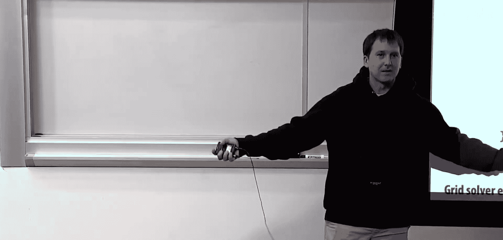

So that was it's interesting' it's actually the same trick。Just used in a different context。Okay。

So at the beginning of week three， let's finally start talking about some program optimization techniques and the way this work is going to go the way this week is going to go is today I want to talk about assignment。

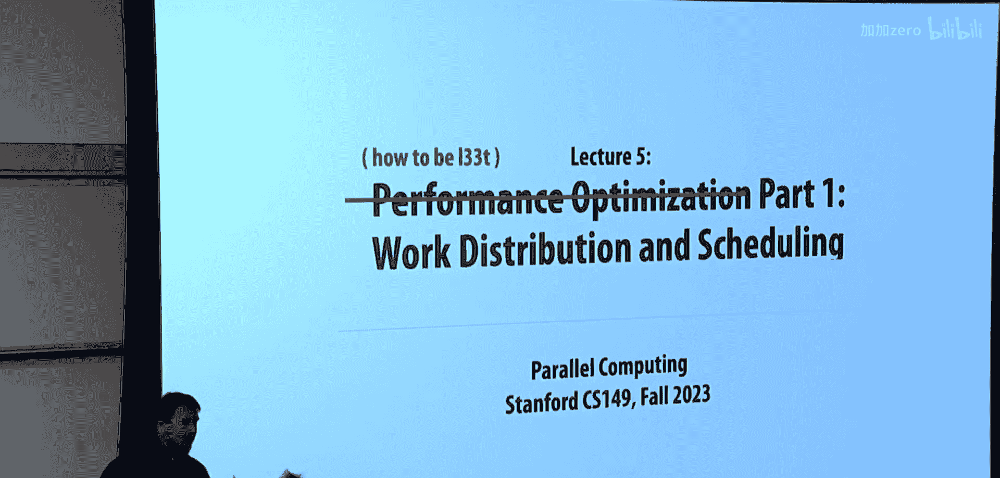

Or ideas for how to figure out what thread or what worker does each piece of work。

So today is going to be about workload assignment and scheduling。

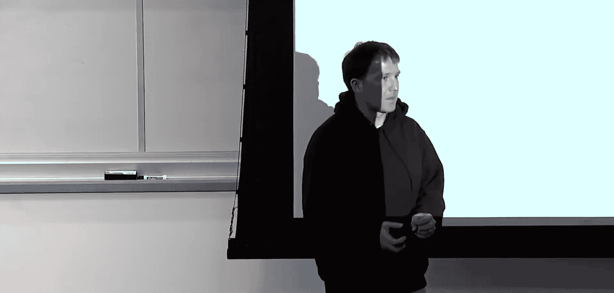

And then Thursday is gonna be about doing that scheduling in a manner that reduces communication costs remove reduces stalls do the memory and stuff like that。

 So today is gonna be about， we're not gonna think much about memory at all。

 We're just gonna think about synchronizing a bunch of workers and making sure everybody has good workload balance。

 Thursday， it's gonna be about， let's make sure we're communicating and accessing memory efficiently。

😊。

Okay， so here's where we're going with this。 Okay and。Yeah。My first disclaimer。

 before we get into any of the work this week or even next week。

 we're going now start telling you about strategies for scheduling programs efficiently。

And I cannot overemphasize， and you know， case one being your assignments。 and in particular。

 this is going be true in assignment 3 is people go， oh。

 I heard about these complex these these all these ideas in lecture。

 I'm going to think about the problem that they give me on my programming assignments。

 and I'm going figure out how to apply some of the more advanced techniques。

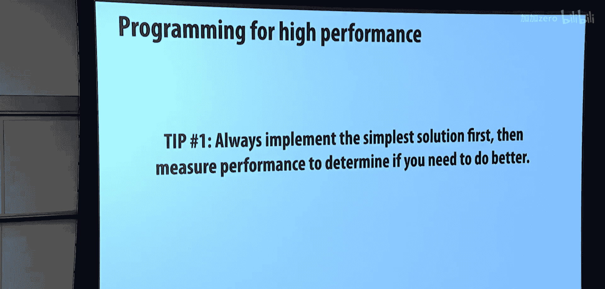

And without question， I want you to take a different approach。

I want you to take the simplest possible approach that gets the program working。

And then the simplest possible approach。To paralyze it。

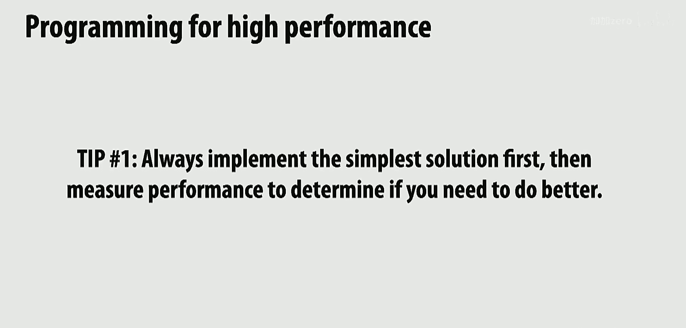

And I want you to measure your performance。 I want you to do the types of things that we forced you to do on on assignment 1。

 put in some timers， figure out which thread is doing the most work， those kinds of things。

 And then only if performance is bad。

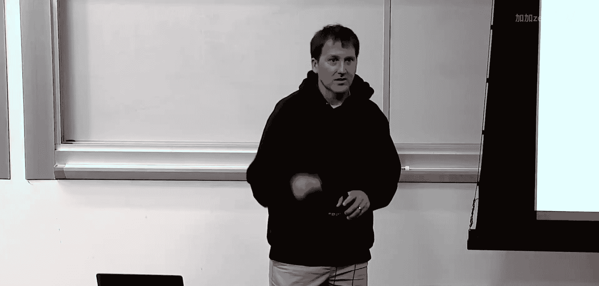

Do you start doing something more sophisticated， Okay， And this is the case。

 This happens every year So I would say about 10% of students in the class。 They read the handout。

 They read the lectures。 They get on the whiteboard and they come up with a pretty sophisticated scheme to solve the assignment。

 and they do that for multiple days。

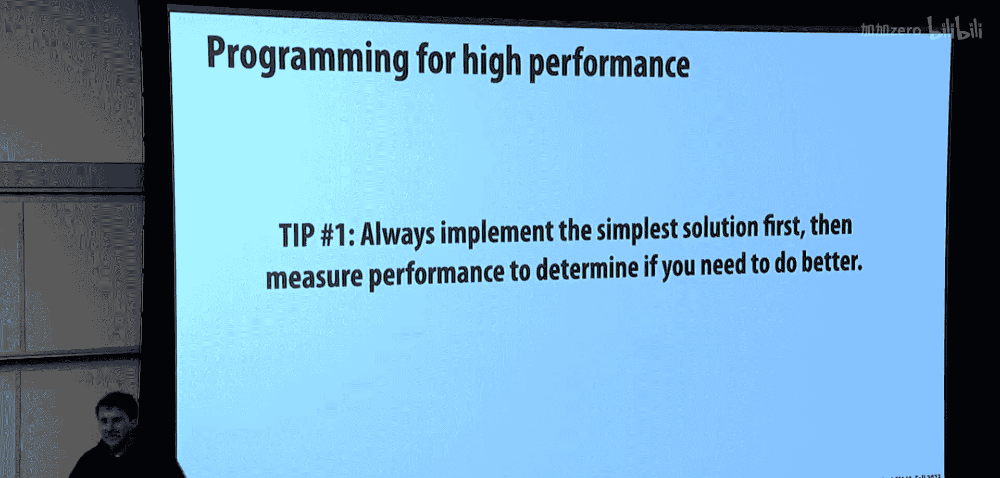

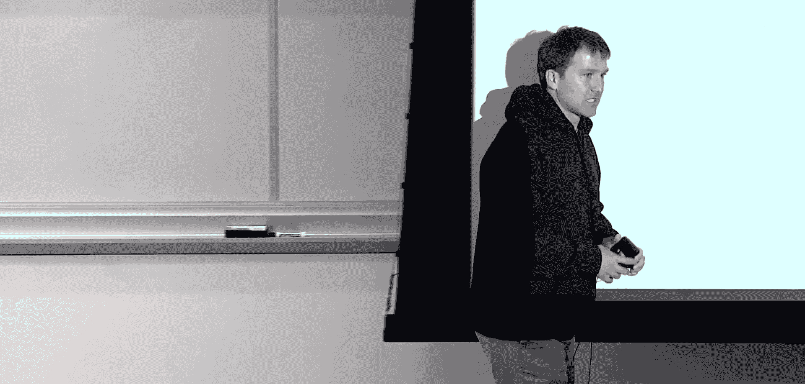

And then they say5， you know， three or four days before the assignments is due。 They're like。

 we're just going to code it up。 So as we' here to work， it'll be great。

And it turns out often that their complex scheme is slower than a simple scheme。Okay。

 so always do the simple thing first。And use measurements， use data to govern what you do next。

So I'm going to start with the simplest thing here。嗯。And。

 and the next sequence of slides is gonna all be about balancing work。And the name of the game。

 when youre， when you need to balance work， here's an example I have four processor cores。

 And for whatever reason， one of these cores， processor 4 here。

 core 4 does a lot more work than the others。And the reason why that limits speed up is we have effectively serialized parts of our program。

A large part of execution time。 Only one of these workers is doing anything。

 It is effectively running as a serial program。So if you have a bunch of work。

And you have a bunch of cores or threads。 Whatnot。 What is probably the simplest way。To divide work。

Onto those workers。Or in other words， where do we start on program1 of assignment1。

chunk ofJust give everybody an equal just I'm not going to think about what's contiguous or not。

 but we did something like this。 we said we're just going to break up the work completely evenly。

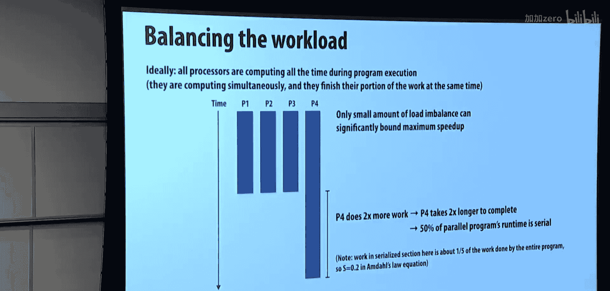

Now， we need to kind of dig in a little bit on what we mean by even。 So on program 1。Evenly met。

Same number of pixels。Right， and so here are a couple of different strategies for。

 for breaking that work up。 So this was the original version of assignment 1。嗯。

If these were actually pixel sized rows， you might have ended up with a solution that looked a little bit like this。

If I didn't make the constraint that said your solution should probably work for any viewpoint。

You might have done something like this。Or you just kind of man， you know， manually said， okay。

 I kind of know what the expense of everything， every pixel was。 And therefore， you know， I。

 I divided up the work equally。Now， in these diagrams， actually。

 how do I know how much work is associated with a pixel， One of the reasons why we。

 we use this as starting example， and it's pretty clear。Yeah。

 the brightness of the pixel is kind of how expensive it is to compute。 So， you know。

 the regions down here are not a lot of work。The regions in here are a lot of work。 And as a result。

 this scheme。Youit a significant amount of workload and balance， right。Now。

 some of you decided to come up with a solution where you interleaved。The assignment of pixels。

 rows of pixels to the output to the to the threads。And， and why is that actually an O solution。

Becauseuse each of those rows has different amounts of work， for sure， right。

Different regions of the， the image have very different amounts of work。

So why did that actually work out pretty well？Yeah， on out。

1 one thread getting silent most of the because yeah。

 we're kind of assuming that like rows right next to each other kind of have the same amount of work because there's kind of some some continuity to the figure。

 So if every like really local piece of the image gets divided up into four rows and go to different processors。

 That means all the processors on average will end up having a reasonable amount of work。 Now。

 you can imagine like。You know， addition， a different workload where that would have been a terrible strategy。

 Like， for example， imagine it was like all white at the top and then slowly went down this way or something like that。

 Like the top half was a triangle。 That would mean that processor or thread  one would always get a little bit more work than thread2。

 which would always get a little bit more work than thread tree。 But in this case。

 it actually turned out to be to be pretty good。 So what are some situations where you think you can pull off this。

 you know， the title of the slide is a static assignment。 In other words， you can go。😊。

Without ever like actually looking at the execution characteristics of the program。

 I can kind of just say， if you give me the size of the image。

 if you give me the number of workers I have， I'll give you a scheme that's always going to be pretty good。

So like what is what are the properties of this that we knew about I guess you have to know what farm in the program are going to be more intensive than other parts like this would have been very easy if all pixels were the same cost。

Okay， so you have to have some ability to predict。The cost of things。In this particular case。

 you actually can't really predict the cost of any one pixel， but you definitely can predict。

 on average。That on average stuff is going to be about the same。

So there's this notion of predictability that kind of makes this problem pretty easy。

RightLike you can just say， well， if I have eight threads or so many threads and I have this many pixels。

 here's a way I can just describe the policy up front for who does what。

 and I'm going to get a pretty good workload balance。I'm going to schedule this out onto the machine。

 right。

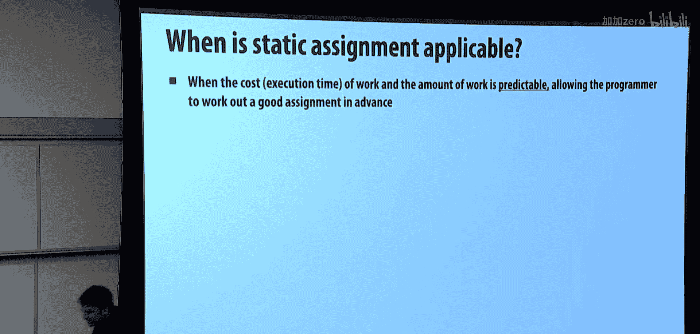

So， so this is like， you know， really applicable when。

The， you know， the， the， the cost of the chunks of work。 And here。

 the cost of the work is maybe the vertical height of these bars is equal。

 Like if I know I have 12 pieces of work and they all have equal time and I have four different workers。

4 processors。 Sure， I might just divide 12 by 3。 and I， or 12 by 4。

 and I get  three pieces of work per worker。Really simple， simple way of of doing it。

 And this is great。 because once I tell P1 and P2， like you're responsible for the first quarter。

 You're responsible the second quarter。 These threads don't have to synchronize。

 There's no communication。 Like they can compute what they have to do without knowing what anybody else is doing。

😊，And that's very helpful because it minimizes communication amongst the threats。Statatic assignment。

 as we saw in that fractal example， can also be applicable。

 when you don't know the actual cost of any one piece of work， but you know that on average。

 you're gonna end up with， on average， everything is the same。 It might have some variances。

 And if I give enough jobs to every worker。 if I add up the length of the blue。

 dark blue bars and like plot them like this and stack them， you know。

 all the different threads end up getting about the same amount of work。

 So here's an example of where， on average， everything is the same。

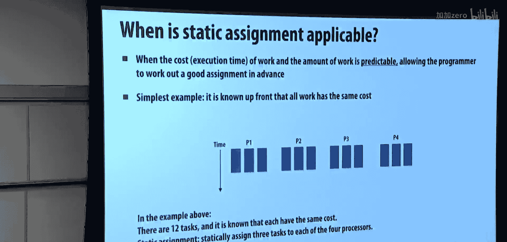

And just because there's variance that doesn't mean that I don't get a good workload balance from a simple。

 just chop it all up strategy。And you know， that fractal was a good， good example。

There are a lot of applications， especially if you're， if you anything that runs for a long time。

 Like， let's say you're a super computing simulation。 This is a figure from a， a。

A turbulent simulation。 What you see here in white is actually the profile of an of a wing。

 So you're actually looking down at the edge of the wing。 like towards the fuselage。

 And this is a mesh that's discretized， all of the， the fluid flow around the wing。 And so you could。

 you can see a super high resolution around here。 That's actually because you need high resolution around areas of high pressure。

 And the coloring suggests what cells of the mesh are processed by what thread。 So different color。

 So， so in space， they're very different amounts of space per thread。

 But probably if we look carefully encountered the number of cells per thread。

 it'd probably be about the same。😊，And you can imagine that like。

 if we're simulating this airline this， this wing for like a long period of time。

 maybe during takeoff or landing or as the wing geometry changed if you， you know， you。

The distribution might change。So it would be perfectly fine if， for example。

 we decided to go with a static assignment of of grid cells to threads at the beginning of the program。

 Maybe we let it run for a minute or two。 and then maybe the pressure changes。

 and we have to update the the number of cells。 And then we do another assignment again。😊。

So I like to， you know， like， there's this term semi static assignment。

 as you can kind of think about it is given the state of the world， I'm gonna upfront。😊。

Assign work to workers。 And then I'm not gonna change that assignment for some amount of time。

So I just want people to， to not walk away going static assignment means it's like sort of known at compile time when you write the program or something。

Another good one would be， you know， any kind of long running machine learning computation。

 you might run that training for a while， understand where you have some workload imbalance。

 adjust that workload imbalance， and then run again for another hour and so on and so on。Okay。

Now， the flip side of static assignment。Would be to do the assignment dynamically， as we go。

So let's say that we cannot predict the amount of time that a task might take。

 It might be very short。 It might very， very long。 So there's not really any way we can up front say。

 okay， you are going do all these and you are gonna to do all these。

OkaySo here's an example program I wrote it in just Caud code。 Imagine there's a void main。

 and then here's a sequential program for I equals0 to n。

 I want to compute whether or not some number in the input array is prime。😊。

Which is something that's a little bit harder to predict how expensive that would be， for example。

 And now， imagine that I have a version of this code that runs in an SMD fashion。

Not necessarily written in。IS S PCC， but it runs in the SPMD programming model， which means， however。

 many threads I'm running in my program， they're all running this code。

 and they just have a different thread I D or something like that。

So imagine that in the parallel version of this code， there are n threads running this code。

And the way my code works is all the threads continue。 They just do their thing。

Until all elements of the array have been processed。And the key thing here is， there's a counter。

And there's a lock on that counter。So the counter starts at 0 and counts up to n。

And then every thread says， well， if I have nothing to do， grab the lock， increment the counter。

 and then whatever the counter's value is， I'm responsible for that number。So first of all。

 let's check to make sure that。嗯。Does。Do all n elements of the array get processed。Yes。

It would be bad if two threads did the same work。 Is there any way for two threads to do the same work。

No， and what ensures that that's the case？This lock here， right？ So this lock says that every。

 you know， I no one else is gonna be reading that counter while I'm incrementing it。

 So I'm guaranteed that I will perform that update， increment the counter。

 I'll take the current number。 It's like basically a ticket at the Delli counter or something like that。

And then everybody come in later that looks for more work will get us a later number。

 And we're all gonna get unique numbers。 And as a result， we're gonna do all the work。

And does this code terminate。It will terminate because if a thread fails to get a number。

 it will quit。And once all threads have quit， we are， we are done。

So even though this is some basically some C code with a lock and a counter。

 what have I really done here if you were trying to sort of explain this in high level terms on what is the work assignment strategy。

Basically， which type a thread is available and just give it for。Yeah。

 so how does this program define the work to do？Basically。发译。Wever有。That's how it's gonna be。

 that defines how we're gonna， how a thread is gonna get assigned work。 But I want， I want。

 what I'm looking for here is like， when you read this program， like， first of all， how would you。

 if you look at this program and talk to like your neighbor sitting right next to you， you would say。

 like， like， what's the definition of the work here。

The work is the compute primity of all of these numbers， right。

 And a single piece of work is what computing the primality of one number， right。

 And how does this program define all the work we need to do。Basically。

 it defines it via the current， basically the number n。Right， the array， the number of N。

 So basically， I've said， look， there's a whole array of stuff to do。

And we're going to divvy up that array by indices。And the way it's gonna work is we're all just going keep grabbing the next un index that nobody else has done yet until they've all been done。

And you might even want to say， like， effectively， even though you don't see a Q data structure or anything here。

 Eively， I've thrown all of the， the things I need to do into a big queue。

And I've implemented the queue by an array and， and a counter。RightSo conceptually。

 this is kind of like， I have all this work。I threw all the work in a shared work queue。

 and I have a bunch of of， of worker threads go into the queue and say， pop me the next one。

 pop me the next one。 Now， in this case， I have a very efficient implementation of that queue because I know all my data is stored in。

 in this array already。And I can implement。Going back to the thing。

 I can implement Q pop by essentially just an atomic increment of that counter。

So I'd like to make sure everybody does that make sense， right， Like conceptually。

 that's just a work queuee and so on and so on， okay。

So this is like your canonical dynamic assignment thing is you just expose all of the potentially parallel work that can be done in parallel。

 and then you let the underlying system dynamically assign work to your workers to your threads based on if anybody goes idle。

 they should probably do more work。No。

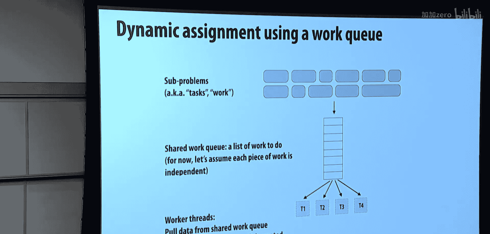

对了。In program 3， a lot of people asked me this question about。When I created these ISPC tasks。

Shouldn't I have。呃。Shouldn I just create 8 tasks？ I'm on a on a machine with8 threads， right。

And people are like， why the heck do I need to create more tasks？是。not， so what you're saying that。

And distributed into this many。Different parallel units this execution and then the code can decide to。

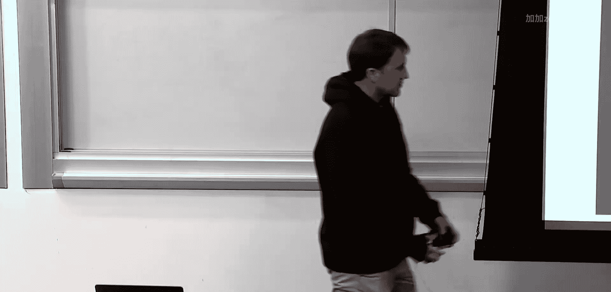

Do that parallelly to up to that extent whenever it wants and so if you just like cut this thing into tasks and you cut it into eight tasks。

Or let's just say you had a computer with four，4 cores。

 Haven't you just divided the work up into this。And what do we know that's wrong about this scheme。

It's really unwell。Now， what if instead I cut this up into a bunch of pieces。

 not not that scheme over there， but just into a bunch of smaller pieces。

And then I throw all those pieces in a work queue。Those pieces are all of different cost。

But why am I going to end up in a good place？Because the program is better able to distribute the because like something like that might happen。

 right like And as long as I have enough pieces of work， and they're relatively short。

 I'm just all those studs are just gonna keep taking the next thing until they read until everything is done。

So what's the cost of。Of this， where am I， of this dynamic scheme。Let's say under the hood。

I replace N to be number of tasks。And is prime to test Priality is run taskask I。

What is the cost of the dynamic allocation here？😡，What do you not have to do in programming assignment one or program one？

We have to use the synchronized so the question is。Is the good workload balance。

 the benefits of that compared to the cost of this。

 Does it overcome the potential workload imbalance that you might have if you use a static allocation。

And it turns out that， you know， in this case， it certainly did， right。

Okay， so that kind of gets to like， what constitutes a piece of work， right？ So in this program。

 like the， the unit of scheduling or the unit of assignment is what。 It's one number。Right。

And so if I like plot this thing out。Let's just think about this being time。

And the vertical blue bars are like actually like， imagine this is a plot of one thread。

And the blue bars are like time that it's spent testing primity or running the I SPC task or something like that。

And then the white bars are like time spent grabbing the lock。

 incrementing that counter and getting out of the lock。Right so。The question is like。

Do we have a problem。How would you know？Yeah。It would depend on how long it takes to do the synchronization compared to how long it takes to。

Yeah， like another way to think about it would be， imagine I did this。 I gave you this program。

 and I said。I want you to make it go as fast as you can。 Are you done。

What would be your next step in thinking about this？ I gave you this program。And I said。

 are you done or is there something better you could do。

 How would we go about even figuring out the answer to that question， Okay， get us start。

 I want to talk to the Steve buggging， so let's say the first thing I do is I put a timer at the beginning at the end and it says it took 5。

9 seconds。

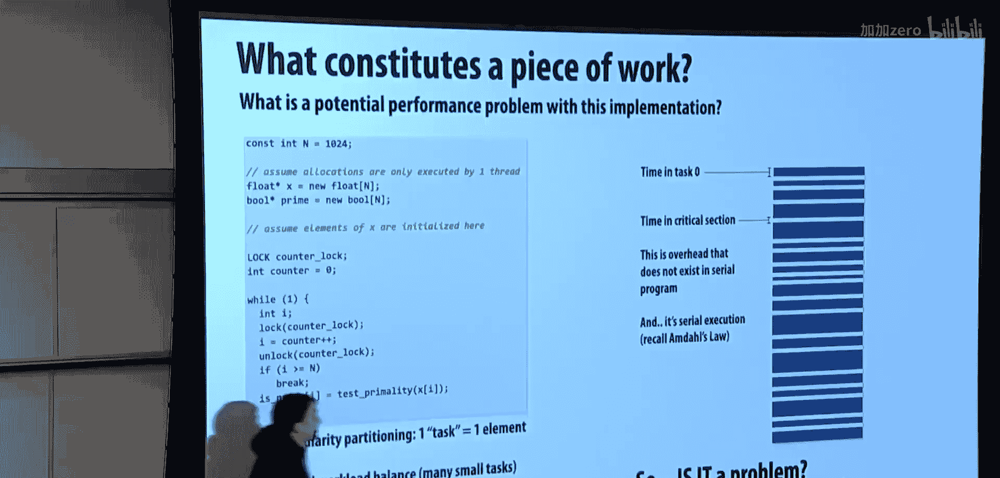

Okay， put a timer in the program。

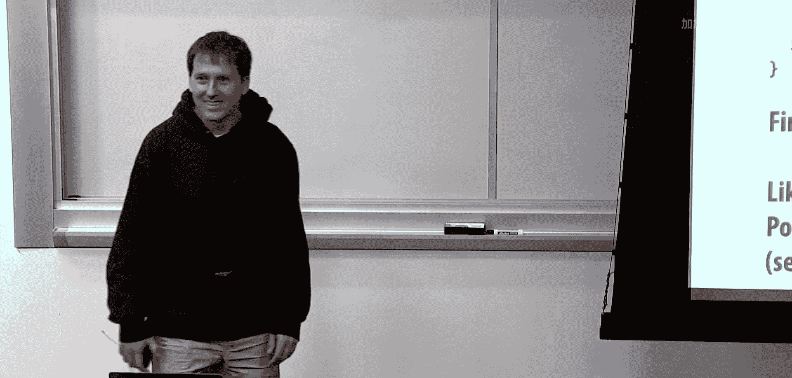

What percentage of the permanent kind that in the law are waiting for the law as opposed to Yeah。

 so the next thing I would do is I would put my timers。Right around test Priity。And， and。

 we compute this。And then the difference between the timer around the whole thing。

And the sum of all of the timings of test primality is the overhead， right。I could also put my。

 my timer around the lock and do the opposite。 But you get the point。 right。

 So if I know how much time my program takes， and I know how much time I've spent doing useful work。

What do I do next？You've got a lot of useful information though。

 you basically want to compare it with like thinking where to do it。Like how much time？

There's a couple of questions I could have， so first of all。

 I could implement the static version of the program and hopefully I might have done that first。

And I so that's， that's the speed I got。 It was like， oh， it's like 8 seconds。 So I'm like， okay。

 I'm already like 5。9 seconds。 I'm doing better。 But now my question is。

 can I do even better than the 5。9 seconds。😊，And the information I have is the total 5。9 seconds。

 And let's say that I end up saying I spend 5。75 seconds。In all of my calls， to test primity。

What do I conclude？You probably can't really do better。 Yeah， you like， well， like if 5。

9 seconds is the whole computation，5。75 seconds is like all the useful work。

 The only thing I could do is shave off like， you know， point1 or something like that。 And then I。

 I decide， you know， if I'm a high frequency of trader。 Maybe I have to win that race。

 And maybe I go for it。 But if I'm working on an assignment， I say screw。

 I'm going on to the next class。 Like there's nothing much more I can do。😊。

Right exactlyact。 now， if this timer around test primity says all calls to test primality are total。

 maybe 2。5 seconds。

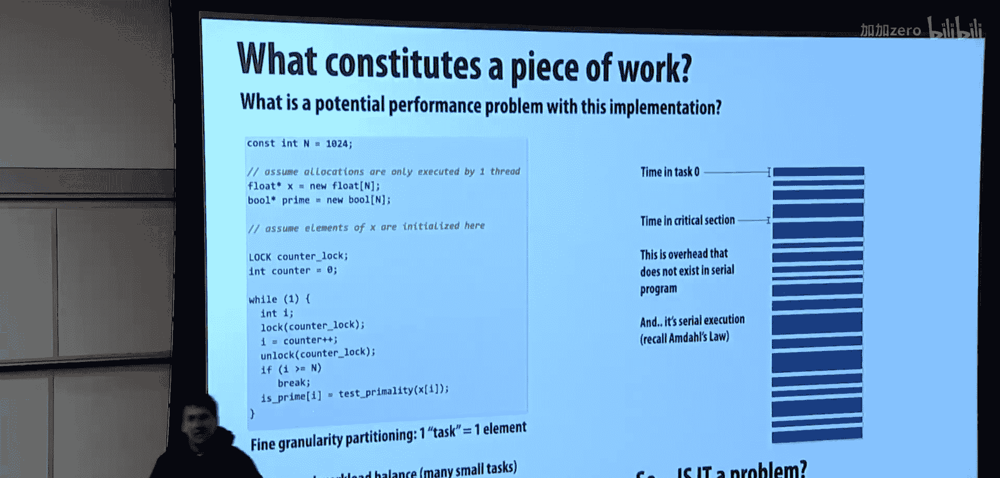

Now I'm like， well， wait a minute here。 More than half my time is probably being spent elsewhere。

And since this program is so simple， I know exactly where it's been spent。

 It's it's being spent in this lock。So what do I do next。Let's say my timers tell me。

Over 50% of the time is spent。In this law。And I'm like， yeah。

 I wouldn't mind trying to make this thing two times faster。对。

It a good dryasonic assignment scheme okay so its one conclusion like let's say this was my first program and this would probably be a really simple program to write first you could say maybe I don't need this dynamic mechanism。

Maybe I should just back off and do a static assignment and remove that。

That would be an a potentially that would be a very viable strategy。

 There's a few simpler things I might try first that don't require me to rewrite everything。

 so what we did here is we said， we're going to break this work up into the smallest pieces that are possible。

You know， maybe okay， I'm sure you could you could paralyze inside the test prim。

 but we're not going do that。 Let's say this this is a black box。

And the reason why I divided things into the smallest pieces as possible was what。

 I didn't explicitly state that。Yeah， it's like you want to have this smallest increment to that view。

Better probability of getting like you。Correct， like so the more little pieces I have。

 the easier it's gonna be for me to come up with a a partitioning where everybody has about the same amount of work。

Imagine I only had， let's， let's say there were8 threads。

 And imagine I divided the work into eight pieces。 and I used the dynamic scheduling scheme。😊。

Not that helpful， right， So I do want a lot of pieces to give me the flexibility to arrive at a good workload balance。

But the smaller I make those pieces， the larger this overhead potentially is。 right？

 So Id like this suggestion。 Let's just。I mean， maybe if we just double the size of the pieces。

 we still have enough stuff to do， because maybe let's say n is like a million。

 and I only have 8 threads。So how would you implement taking two pieces of data out of the queue at once？

increment calendar by two， and what that's done is it's going to reduce the number of white bars or white regions here by two。

 right？And I could just play with that number。 Like， and I， I didn't do it by two In my example。

 I did it by granularity。 I parameterized itca I'm good software engineer。

 and I can mess with that parameter right before the deadline to get the best performance。😊。

And so I just， I increase the granularity of my task to reduce overhead。

And it's very likely on a lot of modern systems， like taking this small little increment is not that expensive。

So most likely， you probably can make your workload granularity。

 which just picking a little bit bigger， can basically probably wash out the overheads in a lot of dynamic situations。

 So that's the trade off。 Like we want as many tasks as we can get by with or we want enough tasks that we can nicely schedule the work。

 but we don't unnecessarily many tasks such that overhead got too high。 For example。

 I don't know if any of you tried actually doing one task per row， like creating like 1000 tasks。

 And at some point， you might have started to see the the speed up curve fall off。

 You almost certainly would have seen it fall off if you maybe one task be a pixel。😊。

So here's an example。 Imagine I have these 16 tasks。 So this is task 0，1，2，3。

 all the way to 15 over there。 And I just purposely made the last task much。

 much longer than the rest。Now， imagine some dynamic scheduling approach。

 just like what we talked about。 And here's a possible final assignment as a result of the dynamic scheduling。

So notice that even though I did dynamic assignment， I got a little bit unlucky。Like。

 because they'll work at the end of the queue。Was was actually really big stuff。So like。

 the last piece of work that I assigned was like the longest running piece of work。

And so I still ended up with like a long tail here。 And there are some strategies you could try。

 Like， if you happen to know a little bit more about your tasks。

 you might do something where you assign the biggest tasks first。 So I'm gonna take this。 Now。

 look at the P4。 gotta assign the big task right at the end。

If we actually decided to like sort things by cost。

 maybe I'll assign P4 the biggest task at the very beginning and notice that P4 only does two tasks。

 but everybody kind of ends up finishing it about the same time。

So the more you know about your tasks， the better you can do some scheduling。

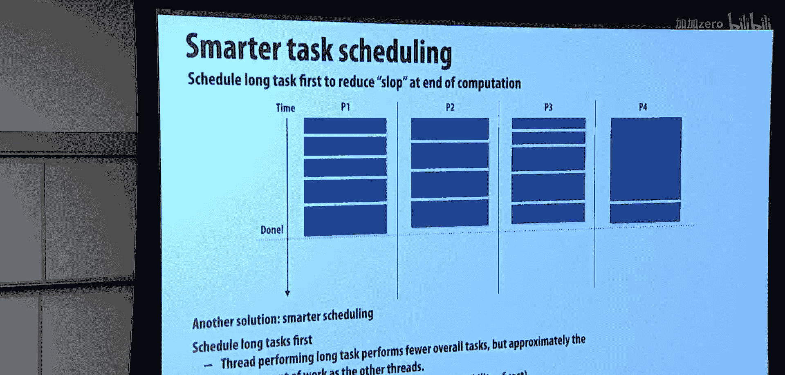

Now， the other strategy we've talked about， and that was just。

 we just talked about it with these barriers or that Myde variable was if we have a bunch of communication。

 what is being shared in the work queue example。So in the example I just showed you with the， the。

 the pool of worker threads， the shared variable is the counter， is the lock and the counter。

And maybe if we were running this on a big computer with like 1 hundred 28 threads or something like that。

That contention for that counter might actually be pretty nontri for。

 especially if the work was small。So I want to get into a little bit more advanced mode on how you might alleviate。

The costs of having a shared work queue by actually distributing。

 making copies of that work queue for every thread。And so this is gonna be the same idea as remember。

 we took the single myd variable and made local copies of it。

 So you worked on your local My di and then only aggregated those results when you had to at the very end。

 We're gonna do the same thing here for work cues。 Now you're not gonna do this for your assignment。

 By the way， This will be this is just for your own information。

 But the other thing I wanted to just point out something you will do for your assignment is that so far in this lecture。

 all the pieces of work that we threw into the queue。😊，We're independent。

You process them in any order， and it didn't matter。

Something that's very common in a lot of different systems is those pieces of the work。

 many of them might be executed in parallel， might be independent。

 but they have dependencies between these two。

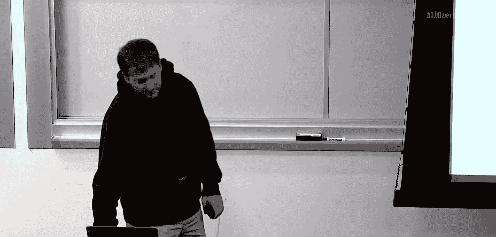

So here's an example where I wrote some code where I said， okay。

 let's say I had an API to tell the system， here's a new piece of work。

 So I want you to do task food。And then we say， I want you to then do task bar。

But please only do bar after you've done food。So I'm building up this dependency graph that constrain or limit。

What can run when？So your assignment 2， the final part of it will be I give you a bunch of tasks like this with the dependencies。

 And you have to implement a work queue。That runs those tasks， but respects all those dependencies。

And so it can be a little tricky， right， becauseuse like maybe one task finishes。

 And that means that you can now start running a whole bunch of future tasks that you had already been given。

 but could not start just yet。

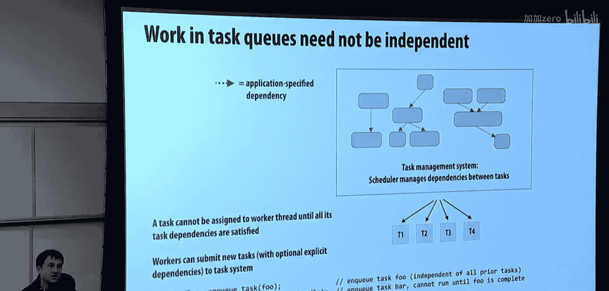

So there is a very， very common scheduling problem that exists in a bunch of different systems。

 So that that's what your assignment2 is going to be。

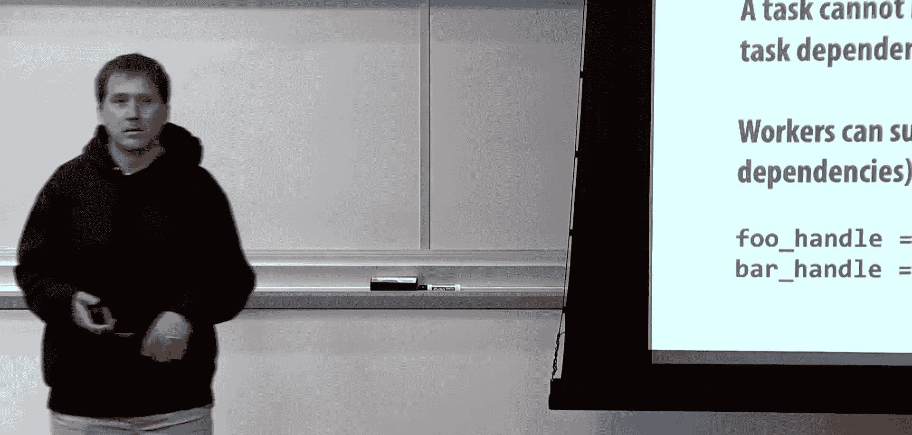

O。So just a little bit of summary that Ive probably stated a bunch of times。Any questions so far。

 yeah。It's not clear to me like why stealing the task from another thread makes it faster because then is't the work you still made。

嗯。Let's。Let's get into it。 Let's get into it。 Okay， so so far in this class。

 because it's pretty easy to think about all， almost all of the code that we have looked at。

 almost all of the programs， the parallelism comes from doing about the same thing。😊。

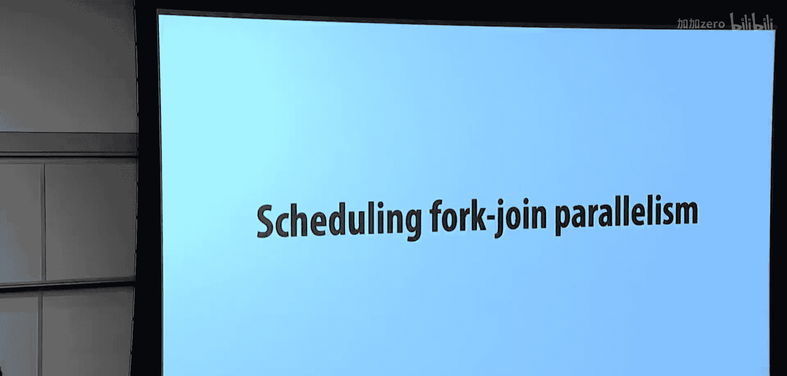

On different pieces of data from a collection。So in the mando brought fractal。

 it's compute the color of a pixel for all pixels。For many of the other examples in assignment 1。

 it was like compute the sign of this number or or so on and so on。 So all the code that we have。

 have have looked at kind of had this structure， you know， for each element of the array。

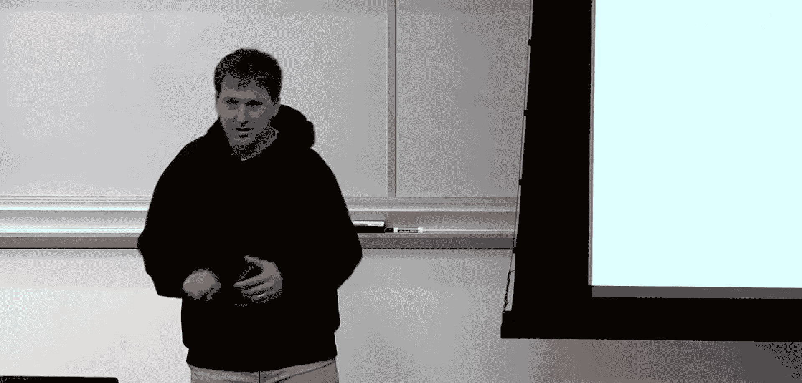

For each task， every task does something different Later in the course will'll talk about functional abstractions。

 which says run the function fo on every element of the array A and put the output in every element of the array B。

 So this is more of like a pytorch kind of of way of thinking about things。

 There are other things that you'll see when we get into couta and other types of programming。

 like there's a little C extension called openmp openmp。

 you put these little pragmas in front of your for loop。

 And basically this pragma tells the compiler。 This is a normal C4 loop。

 But I promise the loop iterations are independent under the hood launch actual threads and execute these iterations in parallel。

 It's like this easiest way to get parallel and C is just use these little open MP kind of things。

 And when we get into programming and couta， it's gonna be the same thing。 It's like。

 I want you to run this function fo。 like this many times。 and I want you to run on those array。

 So everything that we've seen so far has been like。

 let me just give you some arrays or some tensors。 and I want you to do the same。😊。

Bing on everything。And so that's one way of programming that we've talked about。

 The other way of programming that you're probably much more accustomed to is if you want parallelism。

 you don't describe independent things。 You actually create workers and have them do stuff。

So here's an example where I actually create a bunch of P threads or C plus plus threads。 Excus me。

 in this case。 So I am saying， as the programmer， I want you to create these n threads。

 And this is what they'll do。😊，So in the first case。

 I was thinking in terms of data for all of these pieces of data， you could do this independently。

When we're threaded programming， we think a little bit more like here are my threads。

 and here's what they should do。And another way of thinking about programs that's。

 that's sort of pretty elegant。 There's another class of algorithms that， like， if you took 1。

61 or something like that， you know， you would think about them in a very div conquer kind of way。

 So the canonical example of that is， is quick sort。

 So can I just quick check quick sort is something that everybody has seen。😊，Okay， alright， great。

 And so maybe just a little bit of a review of quicksort。 Just。

 I know you've seen it would be given an array。 I want to sort it。

 and I sort it in a divide and conquer way。 And the summary of quick sort。 remember。

 is I pick some element in that array， the details of which a matter for its asymptotic complexity。

 but for the sake of this class， pick some elements of the array at random or even pick the first one。

😊，And then I'm going to partition。 I'm going to move all the elements below less than that value to one side of the array。

 moveve all the elements above that value to the other side of the array。

 And then I'm going to recurse。And that's what you see here。 So the recursive calls to click sort。

 So this partition is picking the pivot and then is picking the pivot and moving everything less than the pivot to the left side of the array。

  moving everything greater than the pivot to the right side of the array。 Now。

 it means that everything on the left side of the array can be sorted and everything on the right side of the array can be sorted and recursively。

 we have a sorted array。😊，Just a little review of quick sort。So。

the skill that you're supposed to be building up in this class is if you look at this code。

Step one in any programming parallel programming exercise is identify potential parallelism。

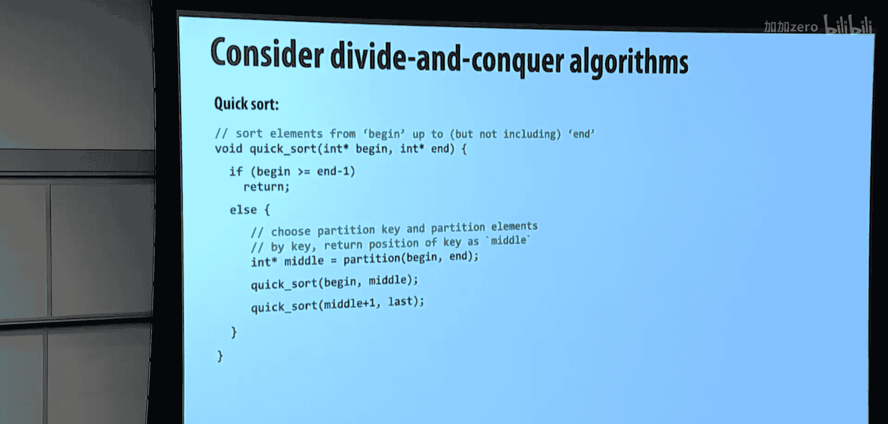

And where is that in this program， Let's assume that partition is going to be done serially for now。

 let's  treat00 black blocks。

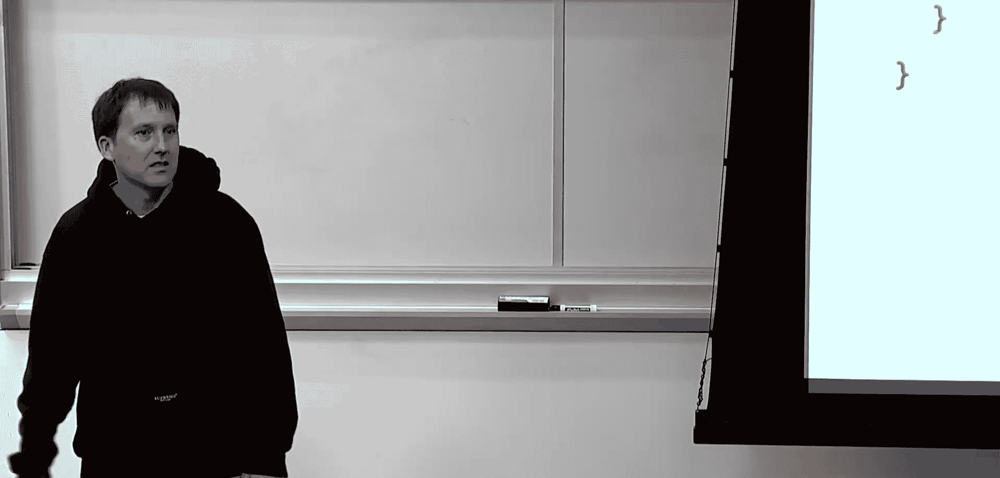

Yeah， are two recursive calls， to quick sort。 We can do the left side and the right side in parallel。

 So we're kind of used to this data parallel thinking where we， I we say， oh。

 we got an array of 10 million elements。 Everything can be done in parallel Here， we're saying， hey。

 functionally， we have two piece， two things that can be done in parallel。

 Probably not enough to saturate a big parallel computer。😊。

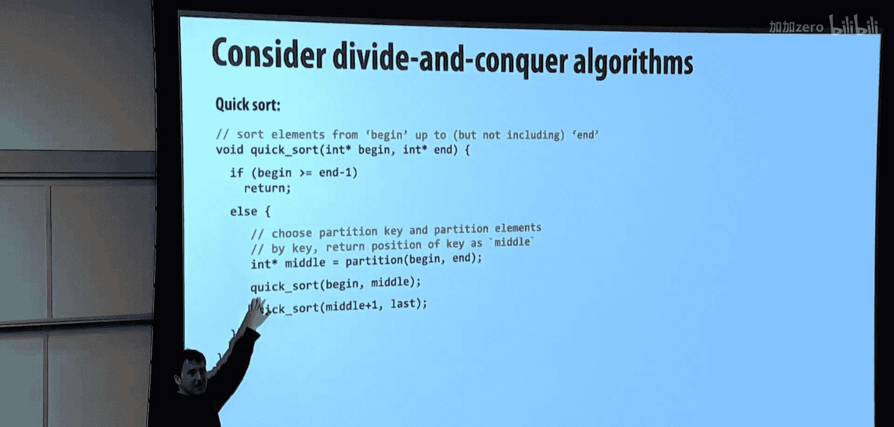

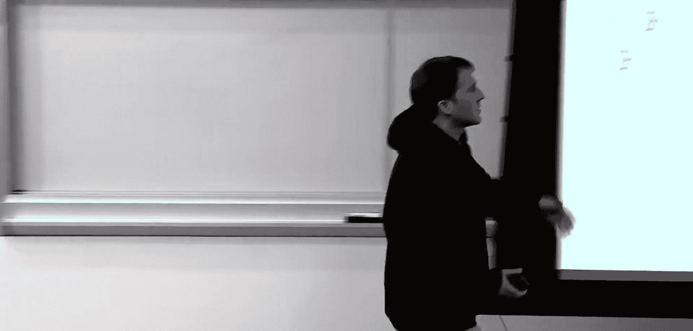

With just this one recursive call。 But where do I get my， a lot of， my lots of parallelism from。

Each of those calls is gonna make more calls。 each of those calls is gonna create two more things and so on and so on。

 So I have this tree of potential perilism。 So this is independent work。 And if I recurse。

 ultimately， at some point， I get down to a level of the tree where I have a lot of parallel things to do。

😊。

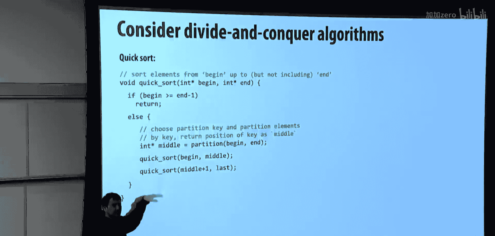

So this is a recursive algorithm that progressively reveals its parallelism。

 unlike this data parallel stuff， where I say， here's a million things to do。Okay。

 so we're good on the workload， right？は。So what I'm gonna talk about now is a programming abstraction that makes it a lot easier。

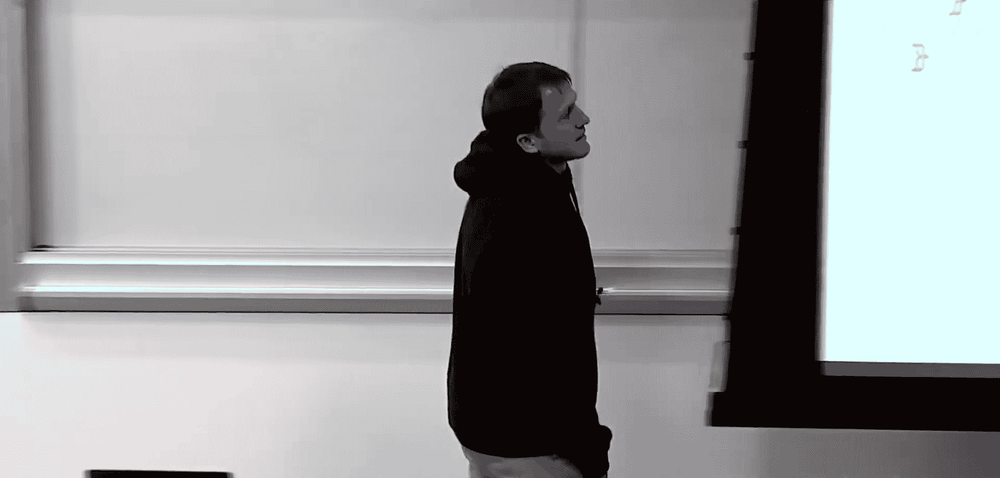

To write。These divide and conquer parallel programs。And you're gonna have at your disposal。

 And by the way， this is， this is a programming system called Silk。

 It exists in most modern C C plus plus compilers today。 So you probably can on your myth machines。

 write code like this， if you wish。And there's only two changes to see。In principle。So typically。

 we think about a normal function call。What we're gonna do is we're gonna be able to put this little keyword spawn in front of a function call。

And then we're going to add one more construct to the language called sync。

Now let's talk and be really clear about what this means。So what silks spawn a function means。

Is please invoke food just like any other function call would。But unlike a normal function call。

The collar。May continue executing asynchronously with the colleague。

This is one of those cases where I want to be very clear about in your mind。

 do does the semantics of what the programming model means I that clear to you。

 independent of how it might be implemented。

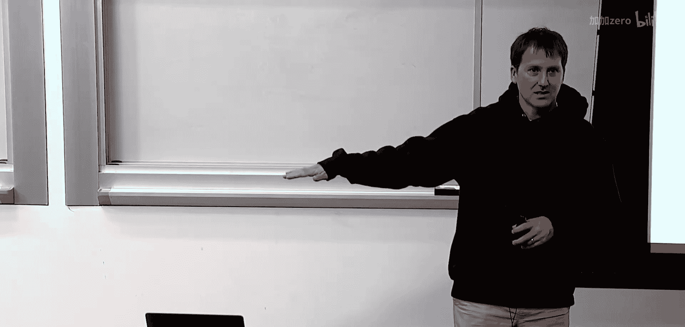

So in normal C， if we call a function。The calling thread of control goes into the function。

 The function must return， and then the caller continues。In silk， if it is a spawn fo。

 what it means is that the collar can just continue。And asynchronously， fo may run。

And then sync just says， for any calls that I have spawned。

Think means that you are guaranteed that those calls have completed。

 have returned prior to continuing from this function。

So you think about sync as a barrier for all spawn functions。Questions。

Notice that I haven't said anything about C++ threads， implementation or anything like that。Okay。

 so this all is clear to everybody。Okay。Alright， so you might be thinking， oh。

 this silk spawn foo feels a lot like forking a thread。

And the sink feelss a whole lot like joining the threat。

But there's a difference between creating threads and spawning work。

You can think about this as there's some work to do。

That is execute the function Fo on these arguments。And you can do it whenever you want。

At some future time。That's different from forking a thread， which creating a thread。

 which says here is a thread of control。 It is now running。 It needs an execution context。

 processoror is running it。Let's see if further elaboration makes sense。

 but I'm expecting questions soon。So here's an example， my function It calls foo and bar。

And I'm starting to adopt this illustration here on the right。

 which illustrates kind of the stack or the sequence of execution of this thread of control。

So in this thread of control， there's like part A， the part of my funk before the， the call to fo。

Then there will be the execution of fo， then the execution of bar， and then everything after bar。

That's just normal C function calls。In silk。Spawning food is like creating an asynchronous concurrent logical instruction stream。

That may or may not be run at the same time。 So you can think about spawning foo as more like creating a piece of work。

 some note that says you gotta run foo at some point。

And notice what I'm drawing here is I'm showing you the concurrency in the program using my arrows。

 So spawn foo and then calling bar and then sinking。 notice that spo is spawned off to the side。

 bar is actually executed as a normal C function by the collar。 That's why it's straight down。

 and then the sink means that the main collar has to wait for the food to complete before it continues。

Does that diagram make sense？And then just check your understanding。 I can also spawn fo， spawn bar。

 and then sink and notice that the main。The initial logical thread doesn't do anything， right。

 It just sits there and just waits for food and bar to get to finish。Yes。

guaranteear that's say I the second example of who and involved want to respond them that they're so responsible。

So we should be careful about。I want you to think about this。As。Logical work。

So what is true in the Semimantics is that bar and food are two pieces of work。

That can run asynchronously， that run asynchronously with this。I am care， very。

 being very careful not to telling you what， like。If there's a thread pool under the hood。

 what threads are actually going to run these things？But logically。

 I have three logical threads of control here。That are defining work that needs to be done and can be done concurrently at the same time。

for now， just think about it a shared address space， just completely shared address space。

 And then just one more check， here's Sp Fuva Fz。Buzz happens as a conventional C call。

 C function call。 Notice that it's right here on the main thread。

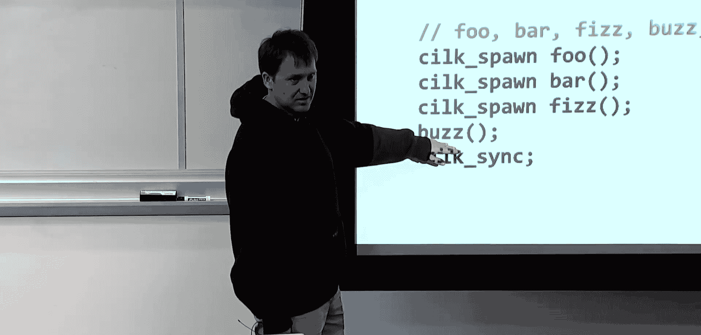

And then I sync to make sure all the asynchronous stuff is done before continuing on。Okay。So， oops。

So Silk says nothing about when this asynchronous work is done。

Other than it has to get done before sync happens before sync returns。嗯。

And so a question to you is this question here on the slide is an implementation of silk correct。

 meaning does it get a valid answer to the program。

If I just took out all of the spawns and sinks from the code。

If my implementation of the silk compiler is， take this text string。Search for silk underscore spawn。

 Remove it。 Sil search for sync， Remove it， and then compile the resulting program as a normal C program。

😊，Yes， it is a correct program。 and the language is actually intentionally designed for this to be the case。

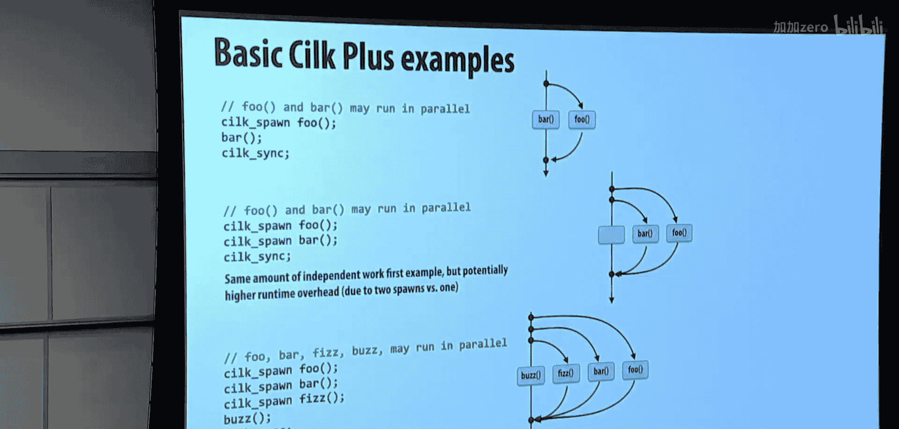

Right。Can you see that。

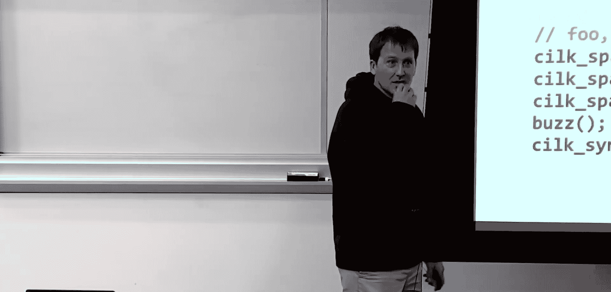

Now， of course， would it be a correct program？If the implementation here would be whenever there was a sink soak spawn。

It spawned a P thread or runfoo。Spawn another P C plus plus thread to run bar。

 Spwn another C plus plus thread to run Fizz。 And then Sil sync was just a join of all three of those P threads。

😊，That's also a valid implementation。Yeah关两。Those are two valid implementations of this programming model there's like no constraints on board。

Notice that there's no dependency here between fo， bar and Fizz。

 The only dependency is that fo can run asynchronously with the main thread。

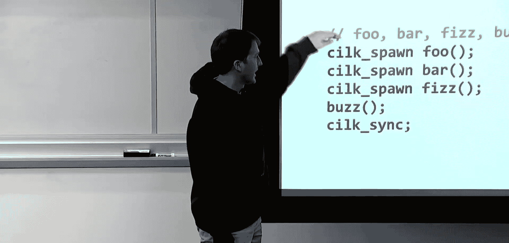

And who must be done。By the time the main thread returns from silk syncnc。

Those are the only scheduling constraints。So I could run fo bar fizz sequentially。

 I could run fo bar fiz on different threads。 I could run fo and bar on one thread and fiz on on another。

 Those are all valid potential schedules or implementations of this program。

 They will all get the same answer。😊，P bar that case。

s barfu in because it doesn't it not really matter because this fo is asynchronous with the main thing。

Bar is asynchronous with the main thing。 So it must be asynchronous with fo。

And a fiiz is asynchronous with the main thing， which is asynchronous with bar and foo。 Yes。

 they're all different。 Do not think about this as like a command buffer or something like that。

 And I'm pushing things into a command。 Yeah， I'm just saying foo bar and Fizz are all completely independent things that can be scheduled in any order。

 just， hey， you better be done with them by the time this call returns。😊。

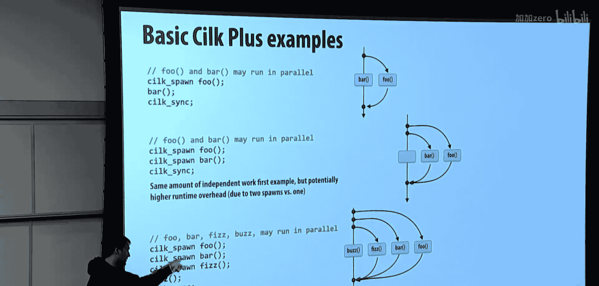

That's the only guarantee I get as a programmer。So I'm， I'm just kicking off parallel work。

 basically。

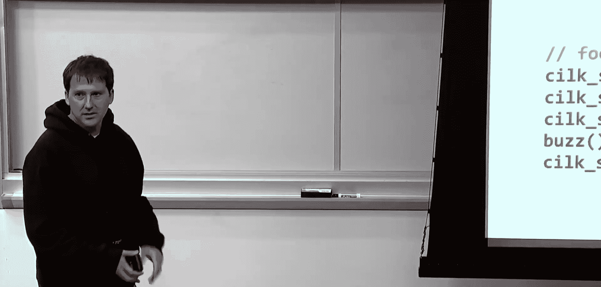

Now， the difference is that like these foods and bars。

 they can be recursive functions and they can actually kick off their own parallel work also。Okay。

 so here's quick sort implemented in this programming model。 Not that the only thing I did。

More or less was correspond spa。 Oh， By the way， there's an implicit sync at the end of the function。

 So I didn't write it here。 But when a function returns。

All things that is spawned have have to sink at the end of the function。

 So that's why you don't see a sink here。 And the only other thing is， I have this， like。

 if the size of the array is sufficiently small。 just do it sequentially because at that point。

 So I don't want any overhead of dealing with concurrency or anything like that。

 So there's a little bit of a base case there now。 But I didn't need to put that in there for。

 for correctness。And now， look to see if you can confirm that this is correct。

 So we start with the main thread。 The main thread runs partition， which is a normal C function。

Based on the partition， it spawns。 Well， first of all， it does a normal。 It spawns parallel work。

 So that's the edge off to the right。And then it calls quick sort recursively on the main。

 the current threat of control。I could have spawned both of them。

 but I just decided to do one of them。Find the main thread， they're essentially the same。

And then that's where I get these two gray boxes。 And then we recurse inside the gray boxes。

 There's a partition call， and then another spawn and so on and so on all the way down to the leaves of this tree。

 where the leaves are just calling standard S TD sort。😊。

And yeah that small little implementation detail in my cutoff。

Any questions about this program and the corresponding diagram？ okay。

So the main idea here is just the programmer's responsibility。Is just a reveal work。

And it can reveal it in a recursive way。对。It silks responsibility。To schedule these programs。

So your goal is to make sure that the recursion generates enough。Parallel tasks。

Such that a good scheduler can schedule them and get good workload balance。

 If I don't create enough parallel tasks， there's nothing anybody can do。All right。

And so as I've alluded to， like one simple， well， the simplest possible implementation of silk is ignore all of the spawn and sink keywords and run everything sequentially。

The other crazy， simple implementation is turn every spawn into an actual standard thread spawn and every sink into a join of everything that I've spotwned。

 And that is a valid implementation。😊，But it would be a little bit slow， because， like。

The cost of spawning threads is pretty heavy。 Remember that demo I showed last week。

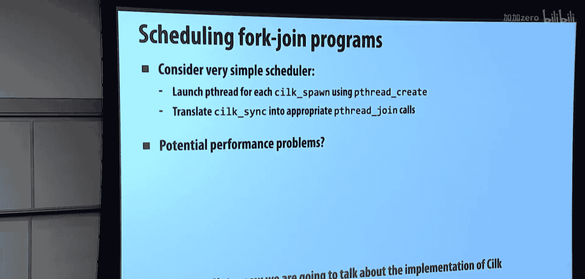

Or like 300 times faster by using a thread pool versus。

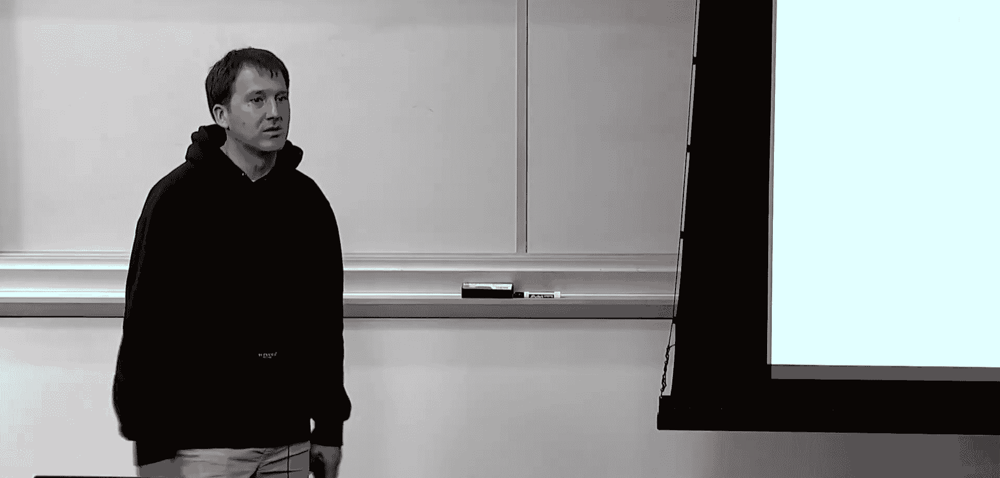

Okay。So yes， this is a little bit much。So what we're gonna to do is。

 is we're gonna to do what everybody does。Is we're gonna create a thread pool。

 Let's say I have a processor that has like 8 execution contexts At the beginning of the program。

 I'm gonna fire up 8 threads。And all of those threads are gonna be just running while there is still work to do in the system。

I'm going go grab the next piece of work。 I'm gonna grab a piece of work， and I'm gonna get it done。

That's the thing here。So all of these spawn calls are actually gonna be like adding work to a list of things to do。

And we need an algorithm that each of the threads are running that achieves good workload balance。

And minimizes synchronization cost。Okay， so let's think about an example here。

 Soak spa Fu run bar on the main thread and then sync。 That's what we have off to the side。

And just to give some things some names， I'm going to call。The asynchronous call the child。

And I'm going to call the main， the rest of the main thread， the continuation。

Just to give things some names。 So if we only have one core。We have a choice to make。

 We can either run the child first。Or we run the continuation。 A normal C program does what。

If this is a normal C code。 Does it run the child first or does it run the continuation the child first。

 because we go into the the function call， exactly。

So now let's assume that we have a pool of two threads。Alright， let's。

 let's assume that we have a pool， of two threads。 And， and I got ahead of myself。 Like。

 if this was a single threaded implementation， I just have a stack， right。

 And what would happen is when I call foo， I push my current frame onto the stack， I go run fo。

 And then when I return， I return back to the collar。 And that's just how it works。😊。

So imagine I'm running。 in this case， I'm running Fo。But while I'm running fo。

 which is asynchronous with the collar and silk， my other thread is just。I don't。Right。

So the name of the game here is that threadread one could be running a bar。

 it could be running the collar。And so what's gonna happen is。When this thread calls foo。

 it starts running foo。 and then it puts bar。You know， it reveals its stack to all other threads。

And if threadread1 over there is idle and sees that threadread 0 has bar in its work queue。

 threadread1 is just going to rip that out of the stack。And start running bar。

Or really it's just gonna put bar in its own stack。But it doesn't work you。Good。So instead of the。

 the stack just being kind of sitting there in the heap and and un interpretable to other threads。

 what's gonna happen when we spawn foo， we're actually gonna create this data record that says there's foo and there's the continuation and there's bar。

 Both of these are in my work queue。😊，One of the threads will take food。

 The other thread will take bar。So in this multiple cu situation。

 every worker thread has a queue of stuff that it's supposed to do next。

 And if my cue ever goes empty， I'm gonna go steal from somebody else。

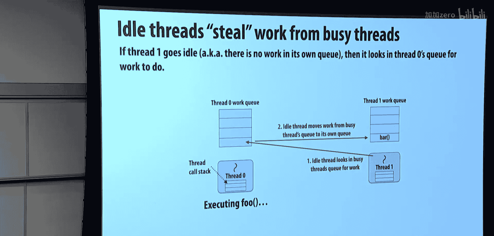

Okay。は。So， we have some options。When I look at this food and bar。哎呀。

I can either start running like the thread that actually runs this code。

It could either start running bar。And put food on the stack for stealing。

 Or it can start running fo and put bar on the stack for did I say the same thing twice。

 I can't remember。 I might have。 But I think you get the point， right。

 So running the continuation first is queuing the function call for later stealing。😊。

Running the child first is inqueuing the continuation for later stealing。

This is the same order as a serial program。This is a completely different order。

So it's kind of unclear which one is better。 So let's take a look at this program。

 I have a four loop for I equals 0 to n， Sp， spa， spa， spawn， spa。So the work looks like this。

 like I get all these edges off to the right side。Okay。And if we， if we run the continuation first。

Every one of those spawns is just gonna be adding。Foo 0， Fo 1， Fo 2， F 3 into my work queue。And the。

 the running， the， the， the existing thread is just gonna keep running that forward loop。

Becauseuse that's the continuation。It just keeps running the collar。

And this queue just kind of fills up with a bunch of work。Can you see how that works？

What's gonna happen if we run the child first。嗯。The thread gets to the first fo， you know。

 spawn of fo 0。 And what does it start doing。It's going to start。

Doing the work for that food call and it's not going me。so this threads gonna start doing F 0。

 and it's gonna put its continuation on its stack on， on its on its work queue。 So it says。

 I'm working on fo 0。 and the rest of that for loop is the task that I'm gonna put in my Q is something I have to do later。

😊，So it might look a little bit like this。 So in my indication， my。

 my notation here is thread 0 is running fo， F 0。 and thread 0s work queue has in it the rest of the loop。

 which I noted there is the continuation of the loop。😊，Starting at the iteration， I equals1。

 the next iteration。So I just start doing what the child。

 and I just shove everything else onto the queue。Okay。Now， what happens in this scheme。

 in this run child first scheme if I have two threads。So what is thread， So thread 0 is running full。

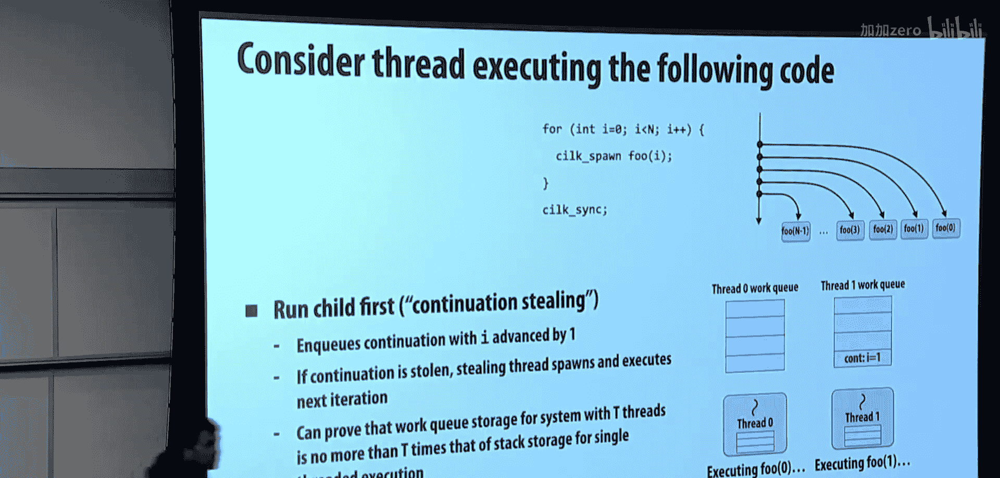

It put the rest of the continuation into its stack。

There's some other thread that steals the rest of the for loop。Starts running iteration1。

Which causes it to start running iteration 1。And then。I need。 sorry， I made one mistake。

 And then the rest of the work to steal is the form of beginning of iteration 2， right。

And then if thread 0 gets done， it steals the continuation back， starts running food， too。

And puts the continuation with iteration 3 into its cube。So， in the first example。Well。

 in this example， the continuation is just gonna be bouncing between the threats。

In the other example， the collar just created all of the iterations of the work in its own queuee。

 and the second thread， which is gonna to steal all these little pieces。

OkayThis is a good one to talk through in the future or or offline。

 Its like a good one just to make sure you work through。 So at this point， you're like， this is。

 I'm not， you probably not feeling very good about this because like works like bouncing around all over the place。

 And， but let's think about this when your algorithm is recursive。😊。

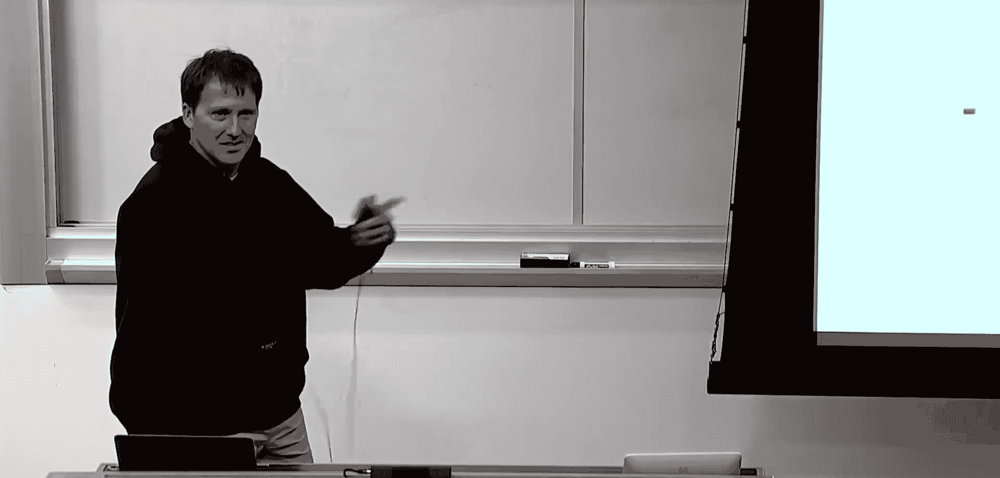

So let's go back to Quicksortt。And think about what happens if we're doing a run child first scheme。

With a recursive divide and conquer algorithm。Let's just say the size of the array was， I think。

200 elements。200， yeah。So the first thing that happened would be。I'm going to call。

Quick sort recursively on elements0 through 100。And I'm gonna put on the， my future queue。

I need to do the quick sort for the other， the back half of the array，100 to 200。

So the first thing I pushed onto my queuee was quick sort for the rest。

And I started working on Quicksortt 0 to 100。 And then what happens next。

I have to push 0 of 50 to 100 onto my stack。 and I start working on 0 to 50。Then what happens next。

 I push 26 to 50 onto my stack， and I start working on 0 to 25。

So all these recursive calls are building up here。 Notice that each piece of work that I threw in。

Is smaller than the previous one。So the tiny tasks are down here。The big tasks are up here。

So now of my tasks are different sizes because of the recursive nature of this program。Okay。

 so now let's think about what these idle threads 1 and 2 are gonna do。 So they're idle。

 So what are they gonna do。They need to still work because they're not making any progress。

So now here's a question。There are three pieces of work here。Which one should thread one steal。

What are some thoughts？Yeah， steal from the top Okay。

 so one vote is for stealing from the top of the queue。

 really these are decks so you can actually steal from the bottom or the top or anywhere so they're not actually queue。

 but What is your justification for stealing from the top I was say we saw lecture you do the word last you end up having one thread at the very end yeah that's a good reason that's actually a pretty interesting reason I actually wasn't even looking for that。

 There's even a more obvious reason why you want to steal from the top you all are correct。

It's just going to break up into a bunch of water chunk again。Ws the other。So this is a big task。

 This is quick sorting 100 elements。 This is a much smaller task， quick sorting 25 elements。

If another thread is going go through the overhead of stealing some work to give them something to do。

They should go steal the biggest thing and get working on it immediately。 actually。

 for both of your reasons， right， So to minimize overhead。

 it makes sense for me to look at the state of the world and not go， oh。

 I'm gonna take this little tiny thing away from you， but I'm gonna go take a big thing from you。

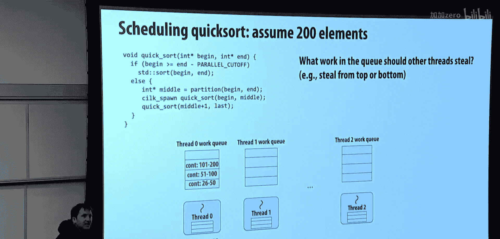

So there's the advantage of this thread0 is always going to grab the next task off the bottom of its of its local queue。

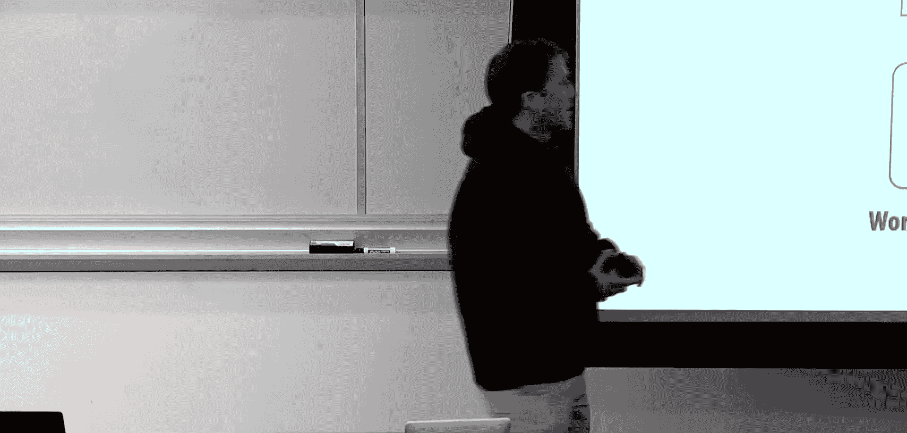

Because this is like the same order as a sequential program。 In some sense。

 It's also good because you get data locality and a lot of other nice properties。

Remote threads are gonna steal from the top of my queue for actually two cool reasons。

 One is the one that you mentioned。If youve still a lot of work。

 you won't have to synchronize again for a long time。 And two， that are actually。

 if you make sure that。Thread 0 is only touching this。 and all other threads are touching the top。

 There are very efficient data structures that you can use that don't require nearly as much synchronization。

 actually。So here， let's say thread 1 steals the biggest item。

 and thread2 steals the next small sorry get right No thread 2 stole the big thing in this case。

 And thread 1 stole the， the medium sized thing。Yep， exactly。So。

And then like things just start getting to work。 And now everybody's processing their own jobs and all of those jobs keep in mind are creating recursive calls and now shoving data into the various cues。

So now all these threads are independently working on their subtasks。Not communicating at all。

And actually revealing more parallel work as they go。

So the idea is that the local thread pushes and pops from the bottom of this queue from the tail。

 Rem threads steal from the tops。 and they stay out of each other's way。

 and they steal big amounts of work。Okay。And as time goes on。

 notice that each of these threads just by doing the recursion。

 are actually going to build up their own work cues。😊，And so they're gonna have tons of stuff to do。

 And until one of them goes idle， there is no more synchronization again。

So compare this to a single work queue implementation where every single time I run out of work。

I have to go take that shared variable to go get the next thing。Now I just go look at my local。

 know my own local MyifF， my own local cu， and I can avoid synchronization with the other threats。

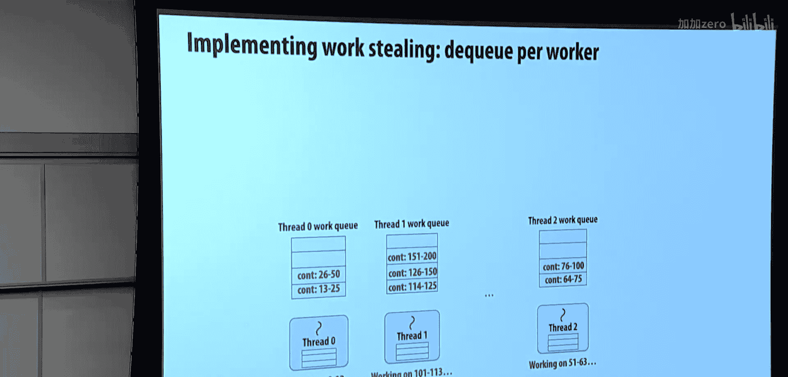

Okay， and let me just continue this thread the slide out a little bit and we've worked， Yeah。

 sorry I shouldn't have built that okay。Does this make sense？

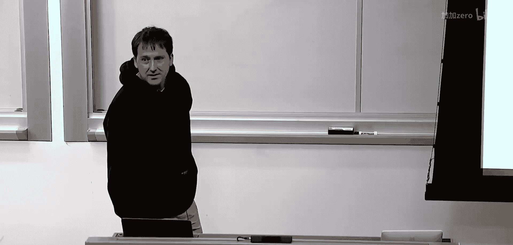

こうや。是。那吃饭。So let's say that thread zero finishes all of its work。

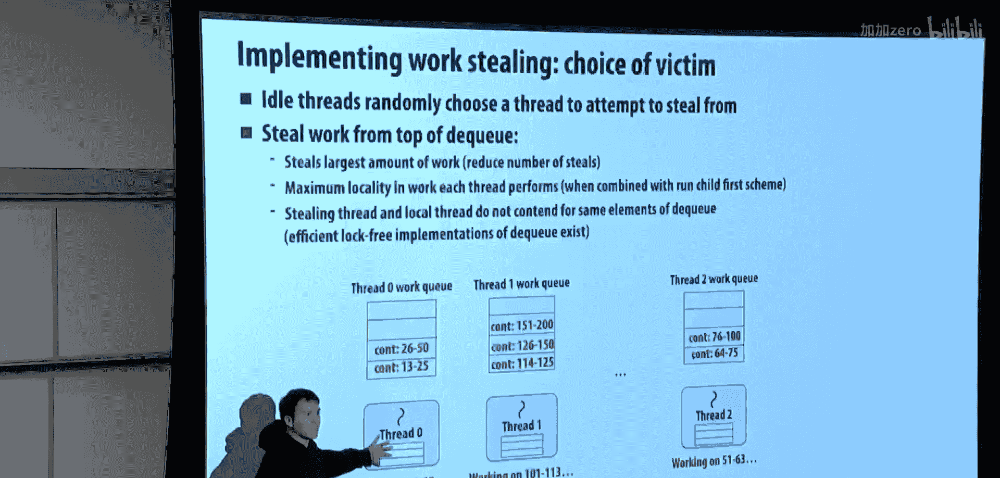

Oh， the current task， yeah。And once we get to next week， it just grab this so to grab that。

 you just to make sure that other let us down。There are ways to be careful because I know that I thread0 know that I'm only going to be accessing this side of the data structure。

And other threads are gonna be esing the other side of the data structure。

 There are very fast data structures where， where you can that can help you with that， correct， yes。

Yeah。So try to。

Let's just say thread through goes idle for any reason at all， it gets done y。

Great question so now there are multiple cues。And we have some options。

 So is it correct to steal from any one of them。whyhy not？Well。

 you get the right answer what I mean by correct。You're actually going to get the right answer。

 as long as if your idol still work and start doing it， the question is。

 what's the most efficient thing to to steal from。It would be whichever has the vote。You。

 you could say that there's a， you know， maybe you should steal from the busiest， busiest thing。

 It turns out that theoretically， asymptotically， it is optimal to randomly select a queue and steal from it。

 And that's been proven like it it， there are proofs to say that if you just randomly select a victim。

 you are within a constant of theoretically optimal。

So you could probably improve on that。 But if you improve on that。

 you're only improving your constants。 And it's actually a little bit trickier because if everybody makes that same decision to steal from the same thread。

All of a sudden， that steel might get a little bit more expensive because。It could be。

 it could be contention。 It also might mean that like， when I look at the system， I'm like， wow。

 this， this guy has a lot of work。Time， other threads make the same decision。

 some of that work might be gone and you might be stealing from someone that has a very small amount of work。

So it turns out that the simplest thing to do is randomly pick a queue that has work and steal from it。

So just a few other things to like some elegance of this policy。嗯。

Let's go back to my for loop example that I started this with for I equals 0 to n。Essential。

 this is like work that says for every element of an array， use some stuff in parallel。

I'd like you to convince yourself offline that this code that I wrote。Will sequentially generate。

Asynchronous work。Either the main thread。Serialally spawns all these things。

 or the continuation bounces back and forth is constantly getting stolen。

 So this is why I want you to think about offline。 That color there will serially create the reveal the parallel work。

😊，Which is actually not good because I have all these threads。

 and I'd like to really quickly reveal all the work。A much better way to write this for loop。

Is actually this dividing， conquer wild loop。Which says here's an array of n things。

 Let's recurse into doing the first half and the second half。

 Then let's recurse into doing the first quad。 you know。

 the first quarter and the second quarter and so on and so on。

 This allows half the array to get stolen， and then it splits up like quick sort。

 and you get parallel generation of the independent work。😊，So actually。

 if you see like Sil actually has like a silk 4 concept in it。

 So if you go like Sil 4 I equals 0 to n under the hood。

 they're gonna implement it that way because it's the scheduler will ultimately be able to create work faster and you get to running a parallel much faster。

 It's actually kind of， a core artifact of stuff。😊，Okay， so in the last three or four minutes。

 I'm just gonna kind of give you a quick sketch of the last little piece of this。

 How do we implement sync。That's the last piece of this。 Like up until now， it's been pretty simple。

But when sync means I have to go check to see if all this work that's been spawned。

 which might have been stolen by other threads。 I need to know if it's complete。

So there's some more bookkeeping than I have to do。So let's， let's think about quickword again。

 or no， let's think about the for loop again because it's easier to think about。

 Let's imagine that we're in some state。Where I am working on Foo 9， someone else is working on 6，7。

8， or basically at the end of the iteration。 And the only thing left is like。The rest of the loop。

 like， basically finish the loop and go on bar。So in this case。

 let's just say that one of the workers finishes。What do you think is going to happen。

The next time a worker finishes work。Just apply the rules that we've already talked about。

The the next thread that finishes will go idle。It will select something to steal。 In this case。

 it will steal the thread0 continuation。That continuation basically says it's done with the for loop。

 So what happens next。い。It'll join it needs to join on all the other threads， right。

 so if this was implemented sequentially， the join is trivial， you don't not have to do anything。

 but it needs to know that everybody's done。Alright， so let's take a look at this。

 So what I'm gonna do is I'm gonna say that I'm gonna call this like this。

 all this area before the sink， just a basic block。 And I'm just gonna give it a name。

 I'm gonna give the name a。And this is the seek for all calls spawned within block。

Just to give things a name。So。What's going on here is I have thread 0 is working on F 9。

And it has continuation here。 Okay， it's the rest of block A。And if theres。

If this item has never been stolen。Then what do we do？Like I at thread 0， I put this on my cue。

 If it's never been stolen， I know that nobody else is doing anything related to this。

So sync is just a noah， you just continue。So the only thing you have to do something clever on。

Is when it actually gets stolen。 So let's think about that。

 So let's go back to the very beginning here and say the very beginning， I'm working on40。

 And the continuation is the rest of the loop for block A。And at some point。The thing may get stolen。

 And if it get stolen， So's gonna have to keep a note off to the side。

So there's this node here are the things that have gotten stolen from your work queue。Okay。

Now what I'm not talking about here is how to manage the， the locking and and。

 and and unlocking of all these shared data structures。 But there's the same。 hey， look。

 one worker has stolen work that's related to block A and0 works。

 remote workers have reported that they have finished work for block A。So， in this case。This。

 this field is now just empty because it's been stolen。And thread 1 has the continuation of block a。

So threadread1 starts doing its job。 and at some point。So now thread 1 starts working on F 1。

 and my reference count of spawn things is2。And so on and so on and so on as more thread steel。 Now。

 my reference count is 3。Okay， now some thread finishes some work from block A。

Block A has been stolen。 So when we finish work， we have to update the done counter。

So that means three different threads are working on a or haven't worked on， on subwork from A。

 One of those things is done。And at this point， thread 0 will go steal some more work and so on and so on。

 and。Start working on food 3。 And now let's get to the very end of that four loop。 We're on Spwn 10。

 We're done with 9 of these things。 These threads have no work to do because they're stuck on， oh。

 they have no work to do。5。Thread 2 seems to be doing the last iteration of the for loop。

When it gets done， it says， oh。That spawn is complete， or that block is complete。

And now it can move on to working on bar。So theres just the， the sink is gonna basically。

 it basically has to keep a record。Of all of the spawns related to that block。

 whenever you complete work from some stolen block。

 you update your your reference counts and whichever thread finishes the last piece of work。

We'll just continue on with the continuation at that time。

So this is kind of called greedy join scheduling。 It means always。

 all threads are always attempting to steal。So they're being greedy。

 Treads only go idle if there's nothing in any queue。And the worker thread that initiates the spawn。

 So in that example， I just gave you， like the original spawn was started on thread 0。

But the spawn was finished up by thread too， because it was the last for to do work related to it。

 So it says， okay， I'll just keep going with this， with this with the of control。

 So so it's pretty pretty elegant。 It's actually a fun thing to play around with。

 the algorithms for scheduling are based on some pretty sound theoretical guarantees。

 So that if if you do some things randomly you're guaranteed to be within a constant factor of the optimum schedule。

 It allows you to write divide and conquer programs almost as easily as if you weren't thinking about parallelism and under the hood。

 there's a scheduling policy that maximizes locality minimizes communication amongst all these threads。

 but still achieves a pretty good workloadabouts。 So this is much more advanced than what you're expected to implement in your assignment too。

 But I just thought usually people like to know about it。 So this is。😊。

Pretty common in distributed systems as well and， and other things。

Cool， all right， we're done， and I'll see you on Thursday。

